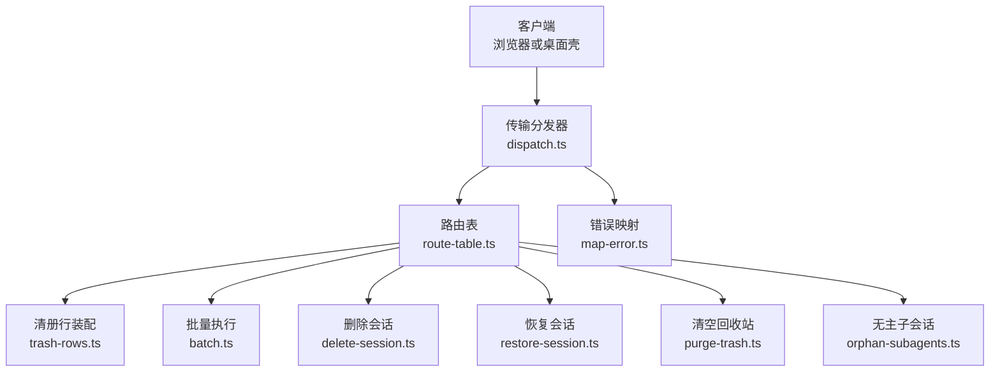
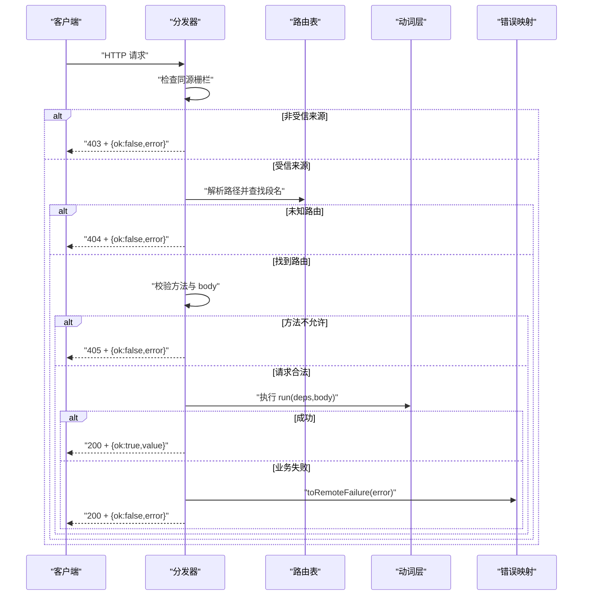
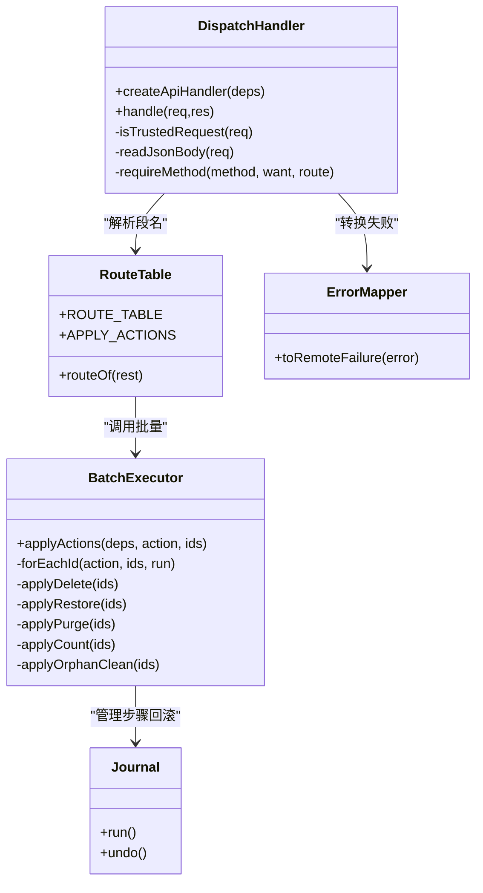

# API 参考

<cite>
**本文引用的文件**   
- [src/index.ts](file://src/index.ts)
- [src/api/dispatch.ts](file://src/api/dispatch.ts)
- [src/api/route-table.ts](file://src/api/route-table.ts)
- [src/api/trash-rows.ts](file://src/api/trash-rows.ts)
- [src/verbs/batch.ts](file://src/verbs/batch.ts)
- [src/verbs/delete-session.ts](file://src/verbs/delete-session.ts)
- [src/verbs/restore-session.ts](file://src/verbs/restore-session.ts)
- [src/verbs/purge-trash.ts](file://src/verbs/purge-trash.ts)
- [src/verbs/member-journal.ts](file://src/verbs/member-journal.ts)
- [src/verbs/orphan-subagents.ts](file://src/verbs/orphan-subagents.ts)
- [src/remote/map-error.ts](file://src/remote/map-error.ts)
- [src/shared/wire.ts](file://src/shared/wire.ts)
- [README.md](file://README.md)
- [tests/api.test.ts](file://tests/api.test.ts)
- [tests/batch.test.ts](file://tests/batch.test.ts)
- [tests/remote.test.ts](file://tests/remote.test.ts)
</cite>

## 目录
1. [引言](#引言)
2. [项目结构](#项目结构)
3. [核心组件](#核心组件)
4. [架构总览](#架构总览)
5. [详细端点规范](#详细端点规范)
6. [依赖与协议关系](#依赖与协议关系)
7. [性能考虑](#性能考虑)
8. [故障排查](#故障排查)
9. [结论](#结论)

## 引言
本插件暴露一个 HTTP 薄线：浏览器半通过宿主 web server 的固定前缀，对六个段名发起同源请求。Node 半只做三件事——同源栅栏、查路由表、写信封；业务语义由动词层实现。

统一协议要点：
- 所有成功返回 `ok:true` 且带 `value`；所有业务失败返回 `ok:false` 且带 `error:{code,message,details?}`。
- HTTP 状态码只表示“请求本身是否可被处理”，不表达业务成败：网络级错误用 4xx（400、403、404、405），操作失败一律 200 + 信封。
- 同一前缀下每个段名只能注册一次；方法白名单来自路由表；JSON body 上限为 1MiB；写动作与清单对账按串行链排队。

**章节来源**
- [src/api/dispatch.ts:1-120](file://src/api/dispatch.ts#L1-L120)
- [src/api/route-table.ts:1-40](file://src/api/route-table.ts#L1-L40)
- [src/shared/wire.ts:1-40](file://src/shared/wire.ts#L1-L40)

## 项目结构
API 相关代码集中在三个层次：
- 传输层：`src/api/dispatch.ts` 负责同源校验、路径解析、方法白名单、body 流式读取、串行链调度、信封写入。
- 路由层：`src/api/route-table.ts` 维护六个段名的方法、body 类型、纯度与处理函数；`src/api/trash-rows.ts` 把清册行装配成线上行。
- 动词层：`src/verbs/*` 分别实现删除、恢复、清空、批量、孤儿扫描等具体事务。



**图表来源**
- [src/api/dispatch.ts:1-120](file://src/api/dispatch.ts#L1-L120)
- [src/api/route-table.ts:1-143](file://src/api/route-table.ts#L1-L143)
- [src/api/trash-rows.ts:1-93](file://src/api/trash-rows.ts#L1-L93)
- [src/verbs/batch.ts:1-197](file://src/verbs/batch.ts#L1-L197)
- [src/remote/map-error.ts:1-134](file://src/remote/map-error.ts#L1-L134)

**章节来源**
- [src/index.ts:1-120](file://src/index.ts#L1-L120)
- [src/api/dispatch.ts:1-120](file://src/api/dispatch.ts#L1-L120)
- [src/api/route-table.ts:1-143](file://src/api/route-table.ts#L1-L143)

## 核心组件
- **同源栅栏**：仅允许本机回环地址；可信来源包括 Origin 与 Host 同源、桌面壳 `dsh-app://app`、Referer 为桌面壳，或两个头均缺席（本机工具）。跨源 GET 走 no-cors 时响应不可读，不构成泄露。
- **JSON body 上限**：逐块累加字节数，超过 1MiB 立即抛出 400 请求体错误。
- **方法白名单**：每个段名在路由表中声明唯一方法；不匹配直接 405。
- **路由表唯一性**：宿主 web server 对相同 `(kind, path)` 重复注册会抛错，因此前缀必须带插件专属名称。
- **串行链机制**：路由表中标记为 `chained` 的请求进入队列，前一个完成后再跑下一个；纯读请求跳过队列。
- **错误映射**：所有非网络级异常经 `toRemoteFailure` 折成 `{code,message,details?}`，其中宿主类型化错误映射为 `sessiondelete/live` 或 `sessiondelete/not-found`。

**章节来源**
- [src/api/dispatch.ts:60-120](file://src/api/dispatch.ts#L60-L120)
- [src/api/dispatch.ts:120-200](file://src/api/dispatch.ts#L120-L200)
- [src/remote/map-error.ts:1-134](file://src/remote/map-error.ts#L1-L134)

## 架构总览


**图表来源**
- [src/api/dispatch.ts:80-200](file://src/api/dispatch.ts#L80-L200)
- [src/api/route-table.ts:80-143](file://src/api/route-table.ts#L80-L143)
- [src/remote/map-error.ts:90-134](file://src/remote/map-error.ts#L90-L134)

## 详细端点规范

### 公共协议

| 项目 | 说明 |
|---|---|
| 基础路径 | `/dsh-session-delete-api` |
| 成功信封 | `{ ok: true, value }` |
| 失败信封 | `{ ok: false, error: { code, message, details? } }` |
| 错误域 | `sessiondelete/` |
| 业务码 | `live`、`not-found`、`trash-empty`、`project-missing`、`io` |
| 请求体上限 | 1MiB JSON 对象；空体视为 `null` |
| 方法约束 | 每个段名有唯一方法，其余返回 405 |
| 失败状态 | 业务失败一律 200；网络级错误使用 4xx |

**章节来源**
- [src/shared/wire.ts:1-120](file://src/shared/wire.ts#L1-L120)
- [src/api/dispatch.ts:80-160](file://src/api/dispatch.ts#L80-L160)
- [src/remote/map-error.ts:1-60](file://src/remote/map-error.ts#L1-L60)

### GET /list

| 字段 | 值 |
|---|---|
| 方法 | `GET` |
| URL | `/dsh-session-delete-api/list` |
| 请求体 | 无 |
| 纯度 | `chained`（先对账再读） |
| 成功值 | `TrashRowWire[]` |
| 失败码 | `io`、`trash-empty` 等 |

行为：
- 先对账 `session-trash/` 目录与清册，确保一致。
- 只列出父会话行；子会话折进父行，附带 `subagentCount`、`subagentBytes`。
- 附加盘上后代信息 `strandedSubagents`、`strandedBytes`。
- 若原工作区已不存在，可能带 `workspaceMissing:true`。
- `releaseBytes` 是 Node 半计算的一次事实值，客户端不应再算一遍。

典型请求：
```http
GET /dsh-session-delete-api/list HTTP/1.1
Host: 127.0.0.1:PORT
```

典型成功响应：
```json
{
  "ok": true,
  "value": [
    {
      "id": "1727720700000-session-parent",
      "sessionId": "session-parent",
      "projectDir": "--p--",
      "workspaceId": "ws-1",
      "wasArchived": false,
      "deletedAt": 1727720700000,
      "title": "",
      "sizeBytes": 1000,
      "releaseBytes": 1200,
      "subagentCount": 2,
      "subagentBytes": 200,
      "strandedSubagents": 1,
      "strandedBytes": 50
    }
  ]
}
```

典型失败响应：
```json
{
  "ok": false,
  "error": {
    "code": "sessiondelete/io",
    "message": "宿主 sessionQuery 服务缺失"
  }
}
```

**章节来源**
- [src/api/route-table.ts:90-110](file://src/api/route-table.ts#L90-L110)
- [src/api/trash-rows.ts:1-93](file://src/api/trash-rows.ts#L1-L93)
- [tests/api.test.ts:100-180](file://tests/api.test.ts#L100-L180)

### GET /ping

| 字段 | 值 |
|---|---|
| 方法 | `GET` |
| URL | `/dsh-session-delete-api/ping` |
| 请求体 | 无 |
| 纯度 | `pure` |
| 成功值 | `"pong"` |
| 用途 | 健康探测，不碰清册、磁盘与串行链 |

典型请求：
```http
GET /dsh-session-delete-api/ping HTTP/1.1
```

典型响应：
```json
{ "ok": true, "value": "pong" }
```

**章节来源**
- [src/api/route-table.ts:110-120](file://src/api/route-table.ts#L110-L120)
- [src/shared/wire.ts:30-60](file://src/shared/wire.ts#L30-L60)

### POST /detail

| 字段 | 值 |
|---|---|
| 方法 | `POST` |
| URL | `/dsh-session-delete-api/detail` |
| 请求体 | `{ entryId: string }` |
| 纯度 | `pure` |
| 成功值 | `TrashDetailWire` |
| 失败码 | `trash-empty`、`io` |

行为：
- 读取回收站条目对应会话日志，返回用户消息、助手消息、模型、轮次等元信息。
- 使用 POST 是为了复用 body 校验、同源栅栏与错误映射。

典型请求：
```json
{ "entryId": "1727720700000-session-a" }
```

典型成功响应：
```json
{
  "ok": true,
  "value": {
    "entryId": "1727720700000-session-a",
    "cwd": "C:/project",
    "createdAt": 1727720700000,
    "lastActivity": 1727720700000,
    "logTitle": "会话标题",
    "models": ["model-a"],
    "turnCount": 5,
    "userMessageCount": 3,
    "assistantMessageCount": 2,
    "toolCallCount": 0,
    "injectedCount": 0,
    "messages": [
      {
        "role": "user",
        "time": 1727720700000,
        "text": "你好",
        "truncated": false
      }
    ],
    "omittedByPayloadCap": 0
  }
}
```

典型失败响应：
```json
{
  "ok": false,
  "error": {
    "code": "sessiondelete/trash-empty",
    "message": "回收站里没有这一条"
  }
}
```

**章节来源**
- [src/api/route-table.ts:120-135](file://src/api/route-table.ts#L120-L135)
- [src/shared/wire.ts:120-200](file://src/shared/wire.ts#L120-L200)

### POST /apply

| 字段 | 值 |
|---|---|
| 方法 | `POST` |
| URL | `/dsh-session-delete-api/apply` |
| 请求体 | `{ action: ApplyAction, ids: string[] }` |
| 纯度 | `count` 为 `pure`，其余为 `chained` |
| 成功值 | `ApplyOutcome[]` |
| 失败码 | `bad-request`（路由自检）、`live`、`not-found`、`trash-empty`、`project-missing`、`io` |

动作语义：
- `delete`：把父与会话组移入回收站；同批已被父带走的子会话返回幂等 `null`。
- `restore`：从回收站恢复整组；同批已被父带回的子会话返回幂等 `null`；一批只发一次恢复通告。
- `purge`：彻底删除回收站中的组及其盘上后代；幂等结果为 `{ removed:0, freedBytes:0 }`。
- `count`：统计一组会话的子代理数量；纯读，不访问清册。
- `orphan-clean`：清理父已不在语料与清册的无主子会话组；根 id 必须是当前扫描报告里的根。

典型请求：
```json
{
  "action": "delete",
  "ids": ["session-parent", "session-kid"]
}
```

典型成功响应：
```json
{
  "ok": true,
  "value": [
    { "action": "delete", "ok": true, "value": { ...TrashEntryWire } },
    { "action": "delete", "ok": true, "value": null }
  ]
}
```

典型部分失败响应：
```json
{
  "ok": true,
  "value": [
    { "action": "purge", "ok": true, "value": { "removed": 1, "freedBytes": 1000 } },
    {
      "action": "purge",
      "ok": false,
      "error": {
        "code": "sessiondelete/trash-empty",
        "message": "回收站里没有这一条"
      }
    }
  ]
}
```

**章节来源**
- [src/api/route-table.ts:110-143](file://src/api/route-table.ts#L110-L143)
- [src/verbs/batch.ts:1-197](file://src/verbs/batch.ts#L1-L197)
- [tests/batch.test.ts:1-132](file://tests/batch.test.ts#L1-L132)

### POST /empty

| 字段 | 值 |
|---|---|
| 方法 | `POST` |
| URL | `/dsh-session-delete-api/empty` |
| 请求体 | 无 |
| 纯度 | `chained` |
| 成功值 | `PurgeStatsWire` |
| 失败码 | `io` |

行为：
- 先对账，再清空整个回收站。
- 聚合回执，不按条返回结果。
- 手工搬进 `session-trash/` 的目录也会在对账后纳入清理范围。

典型请求：
```http
POST /dsh-session-delete-api/empty HTTP/1.1
```

典型成功响应：
```json
{
  "ok": true,
  "value": {
    "removed": 3,
    "freedBytes": 1048576
  }
}
```

**章节来源**
- [src/api/route-table.ts:135-143](file://src/api/route-table.ts#L135-L143)
- [src/verbs/purge-trash.ts:1-121](file://src/verbs/purge-trash.ts#L1-L121)

### GET /orphans

| 字段 | 值 |
|---|---|
| 方法 | `GET` |
| URL | `/dsh-session-delete-api/orphans` |
| 请求体 | 无 |
| 纯度 | `pure` |
| 成功值 | `OrphanReportWire` |
| 失败码 | `io` |

行为：
- 扫描宿主的会话语料，找出父既不在 live/persisted 集合也不在回收站清册的会话组。
- 报告根会话 id、总会话数、总字节、缺失父的组数、按项目目录分组。
- 不删除任何数据；清理走 `/apply` 的 `orphan-clean`。

典型请求：
```http
GET /dsh-session-delete-api/orphans HTTP/1.1
```

典型成功响应：
```json
{
  "ok": true,
  "value": {
    "roots": ["session-orphan-child"],
    "totalSessions": 2,
    "totalBytes": 512000,
    "missingParents": 1,
    "groups": [
      { "projectDir": "--p--", "sessions": 2, "bytes": 512000 }
    ]
  }
}
```

典型失败响应：
```json
{
  "ok": false,
  "error": {
    "code": "sessiondelete/io",
    "message": "无主子会话扫描需要宿主的 sessionQuery.listSessions"
  }
}
```

**章节来源**
- [src/api/route-table.ts:110-120](file://src/api/route-table.ts#L110-L120)
- [src/verbs/orphan-subagents.ts:1-200](file://src/verbs/orphan-subagents.ts#L1-L200)

### 错误码语义

| 码 | 含义 | 常见原因 | 建议动作 |
|---|---|---|---|
| `sessiondelete/live` | 会话正在运行 | 删除、清空或孤儿清理遇到活跃会话 | 先结束会话，再重试 |
| `sessiondelete/not-found` | 目标不存在 | 会话不在持久化语料或工作区中 | 刷新列表，确认 id 仍有效 |
| `sessiondelete/trash-empty` | 回收站中没有该条目 | 恢复/彻底删除的 id 无效或已被批内前一条带走 | 重新拉取清单 |
| `sessiondelete/project-missing` | 原项目目录不存在 | 恢复时原目录被外部删除 | 手动恢复文件或放弃恢复 |
| `sessiondelete/io` | 通用 I/O 或上游错误 | 宿主服务缺失、文件系统错误、未知异常 | 查看 `details` 与 `cause`，重试或上报 |
| 路由自检码 | 请求格式错误 | 400 请求体、405 方法、404 未知路由 | 修正请求，不视为业务失败 |

**章节来源**
- [src/remote/map-error.ts:1-134](file://src/remote/map-error.ts#L1-L134)
- [src/verbs/errors.ts:1-82](file://src/verbs/errors.ts#L1-L82)
- [tests/remote.test.ts:1-129](file://tests/remote.test.ts#L1-L129)

## 依赖与协议关系



**图表来源**
- [src/api/dispatch.ts:120-200](file://src/api/dispatch.ts#L120-L200)
- [src/api/route-table.ts:80-143](file://src/api/route-table.ts#L80-L143)
- [src/verbs/batch.ts:1-197](file://src/verbs/batch.ts#L1-L197)
- [src/verbs/member-journal.ts:1-103](file://src/verbs/member-journal.ts#L1-L103)
- [src/remote/map-error.ts:1-134](file://src/remote/map-error.ts#L1-L134)

**章节来源**
- [src/api/dispatch.ts:1-200](file://src/api/dispatch.ts#L1-L200)
- [src/api/route-table.ts:1-143](file://src/api/route-table.ts#L1-L143)
- [src/verbs/member-journal.ts:1-103](file://src/verbs/member-journal.ts#L1-L103)

## 性能考虑
- `/ping` 是最便宜的探测接口，不应代替健康检查去触发 `/list` 的对账。
- `/list` 会对账回收站目录，适合页面加载或刷新时调用；高频轮询会增加磁盘与宿主查询压力。
- `/apply` 的 `count` 是批量计数入口，一次宿主调用覆盖整批 id，避免每条一次全表扫描。
- 恢复批量只拉一次宿主会话摘要并发一次 `api-session/added`，防止恢复变慢。
- 串行链代价是排队，但单进程单用户场景下通常为毫秒级；纯读接口不会进入队列。
- JSON body 限制在 1MiB，足以承载会话 id 数组，同时避免内存放大。

**章节来源**
- [src/api/route-table.ts:90-143](file://src/api/route-table.ts#L90-L143)
- [src/verbs/batch.ts:1-80](file://src/verbs/batch.ts#L1-L80)
- [src/api/dispatch.ts:60-120](file://src/api/dispatch.ts#L60-L120)

## 故障排查

### 4xx 与 200+ok:false 的区别
- 400：请求体不是合法 JSON、缺少必填字段、字段为空字符串、动作不认识、id 数组为空。
- 403：请求来源不是本机回环，或 Origin/Referer 无法证明同源。
- 404：路径不以 `/dsh-session-delete-api` 开头，或段名不在路由表。
- 405：使用了段名未声明的方法。
- 200+ok:false：请求本身合法，但业务失败；客户端应读取 `error.code` 和 `error.message`。

### 重试策略
- 对 `live`：等待会话停止后重试。
- 对 `trash-empty`：先拉取最新清单，再重试；若是批量中被前一条带走的幂等项，可直接忽略。
- 对 `not-found`：刷新宿主会话列表，确认 id 仍有效。
- 对 `io`：区分可重试 I/O 与不可恢复错误；必要时带上 `details` 上报。
- 对路由自检错误：不要重试，先修正请求。

### 调试技巧
- 先用 `/ping` 确认路由与前缀可用。
- 用 `/list` 核对回收站快照与界面显示是否一致。
- 用 `/orphans` 确认是否存在父已消失的残留组。
- 对 `/apply` 保留原始请求体与逐条结果，定位哪一条失败。
- 查看错误 `details.rollbackFailures`，判断是否发生部分回滚。
- 桌面壳路径没有 `Origin`，但 Referer 仍可用于调试同源来源。

**章节来源**
- [src/api/dispatch.ts:60-200](file://src/api/dispatch.ts#L60-L200)
- [src/verbs/member-journal.ts:60-103](file://src/verbs/member-journal.ts#L60-L103)
- [tests/api.test.ts:180-300](file://tests/api.test.ts#L180-L300)

## 结论
本 API 的核心契约是“薄线传输 + 强信封语义”：Node 半不负责业务细节，只保证同源、方法、body、顺序与错误形状；浏览器半只读 `ok`、`value`、`error.code` 与 `error.message`。六个段名覆盖了删除、恢复、清空、批量、详情与孤儿扫描；所有写操作通过串行链与事务型 journal 保护一致性。客户端应优先使用 `/ping` 探测、`/list` 刷新、`/apply` 批量执行，并在失败时按业务码映射而非 HTTP 状态码决策。

**章节来源**
- [src/shared/wire.ts:1-200](file://src/shared/wire.ts#L1-L200)
- [README.md:1-147](file://README.md#L1-L147)