# GET /attachment — 附件原始字节读取

<cite>
**Referenced Files in This Document **
- [attachment.ts](file://src/api/attachment.ts)
- [route-table.ts](file://src/api/route-table.ts)
- [dispatch.ts](file://src/api/dispatch.ts)
- [wire.ts](file://src/shared/wire.ts)
- [attachments.ts](file://src/trash/attachments.ts)
- [detail.ts](file://src/trash/detail.ts)
- [attachment-view.tsx](file://src/client/attachment-view.tsx)
- [remote.ts](file://src/client/remote.ts)
</cite>

## Table of Contents
1. [简介](#简介)
2. [端点概览](#端点概览)
3. [核心架构](#核心架构)
4. [详细组件分析](#详细组件分析)
   - [路由注册与分发](#路由注册与分发)
   - [请求处理流程](#请求处理流程)
   - [附件路径推导与安全闸](#附件路径推导与安全闸)
   - [图片类型识别](#图片类型识别)
   - [文件大小限制](#文件大小限制)
   - [客户端集成](#客户端集成)
5. [数据流图](#数据流图)
6. [错误处理](#错误处理)
7. [性能考虑](#性能考虑)
8. [故障排除指南](#故障排除指南)
9. [结论](#结论)

## 简介

`GET /attachment` 是回收站插件中唯一的二进制响应端点，专门用于在回收站详情页面中渲染图片和下载文件附件。该端点采用严格的安全设计，通过 SHA-256 ID 进行内容寻址，确保无法访问任意文件系统路径。端点支持两种附件类型：图片（`image`）和普通文件（`file`），单文件大小限制为 20 MiB。对于图片类型，系统通过魔数识别实际的文件格式（PNG、JPEG、GIF、WebP），而非依赖请求参数或文件扩展名。

本端点的设计遵循以下核心原则：
- **内容寻址**：只接受 SHA-256 哈希 ID，路径完全由服务端推导
- **类型隔离**：kind 参数严格限制为 `image` 或 `file`，对应不同的存储目录
- **安全响应**：图片以内联方式展示，文件以附件方式下载
- **容错机制**：失败时返回 JSON 信封而非二进制错误，避免浏览器误存错误响应

**Section sources**
- [attachment.ts:1-40](file://src/api/attachment.ts#L1-L40)
- [wire.ts:30-35](file://src/shared/wire.ts#L30-L35)

## 端点概览

### 路由定义

该端点在路由表中定义为 `GET` 方法，使用纯读模式（pure），不读取清册，响应类型为二进制。

| 属性 | 值 |
|------|-----|
| HTTP 方法 | GET |
| 完整路径 | `/dsh-session-delete-api/attachment` |
| 请求体 | 无（使用查询参数） |
| 纯度 | pure（不进入串行链） |
| 响应类型 | binary |
| 清册读取 | none |

### 查询参数

端点通过 URL 查询参数接收请求，主要参数包括：

| 参数名 | 必需性 | 说明 | 示例 |
|--------|--------|------|------|
| id | 必需 | SHA-256 附件 ID，格式为 `sha256:<64位小写十六进制>` | `sha256:a1b2c3...` |
| kind | 必需 | 附件类型，仅接受 `image` 或 `file` | `image` |
| name | 可选 | 下载文件名建议（仅对 file 类型有效） | `document.pdf` |

**Diagram sources **
- [route-table.ts:125-132](file://src/api/route-table.ts#L125-L132)
- [wire.ts:217-222](file://src/shared/wire.ts#L217-L222)

## 核心架构

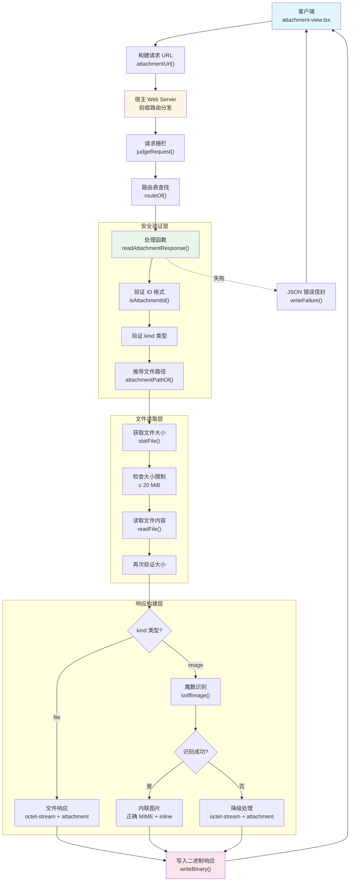

**Diagram sources **
- [attachment.ts:58-111](file://src/api/attachment.ts#L58-L111)
- [dispatch.ts:115-160](file://src/api/dispatch.ts#L115-L160)
- [route-table.ts:125-132](file://src/api/route-table.ts#L125-L132)

**Section sources**
- [attachment.ts:1-111](file://src/api/attachment.ts#L1-L111)
- [route-table.ts:125-132](file://src/api/route-table.ts#L125-L132)
- [dispatch.ts:115-160](file://src/api/dispatch.ts#L115-L160)

## 详细组件分析

### 路由注册与分发

端点通过插件的 `apply` 函数注册到宿主 Web Server，使用前缀路由机制。路由表定义了九个段名，其中 `/attachment` 是唯一使用二进制响应的端点。

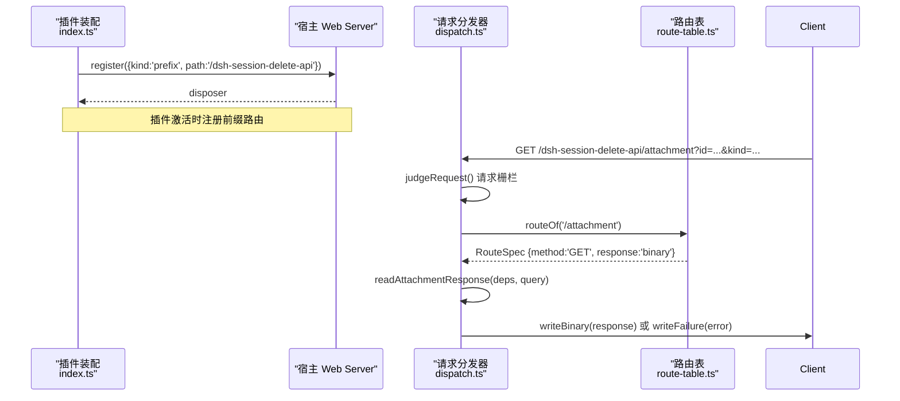

**Diagram sources **
- [index.ts:75-88](file://src/index.ts#L75-L88)
- [dispatch.ts:130-160](file://src/api/dispatch.ts#L130-L160)
- [route-table.ts:125-132](file://src/api/route-table.ts#L125-L132)

路由表配置的关键特性：
- **方法限制**：仅接受 GET 请求，其他方法返回 405
- **纯度声明**：标记为 `pure`，不进入串行执行链，可并发处理
- **响应类型**：声明为 `binary`，触发特殊的二进制响应写入逻辑
- **无清册读取**：`read: 'none'`，不访问回收站清册数据

**Section sources**
- [index.ts:75-88](file://src/index.ts#L75-L88)
- [route-table.ts:125-132](file://src/api/route-table.ts#L125-L132)
- [dispatch.ts:35-55](file://src/api/dispatch.ts#L35-L55)

### 请求处理流程

处理函数 `readAttachmentResponse` 执行严格的四步验证和处理流程：

1. **参数验证**：检查 `id` 和 `kind` 参数的合法性
2. **路径推导**：基于 ID 和 kind 自动推导文件路径
3. **大小检查**：stat 阶段和读取后双重验证文件大小
4. **类型识别**：对图片进行魔数识别，确定正确的 Content-Type

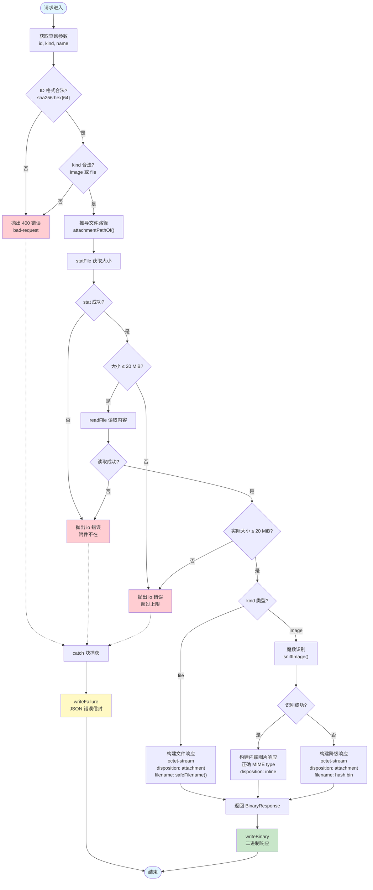

**Diagram sources **
- [attachment.ts:58-111](file://src/api/attachment.ts#L58-L111)
- [dispatch.ts:35-55](file://src/api/dispatch.ts#L35-L55)

关键设计决策：
- **双重大小检查**：在 stat 阶段和读取后都进行检查，防止文件在两次操作之间被修改导致内存溢出
- **错误统一处理**：所有错误最终都通过 `writeFailure` 返回 JSON 信封，保持错误处理的一致性
- **参数验证前置**：在进入文件系统操作前先验证参数，快速拒绝非法请求

**Section sources**
- [attachment.ts:58-111](file://src/api/attachment.ts#L58-L111)

### 附件路径推导与安全闸

路径推导函数 `attachmentPathOf` 实现了多层安全防护，确保无法通过构造恶意 ID 访问任意文件。

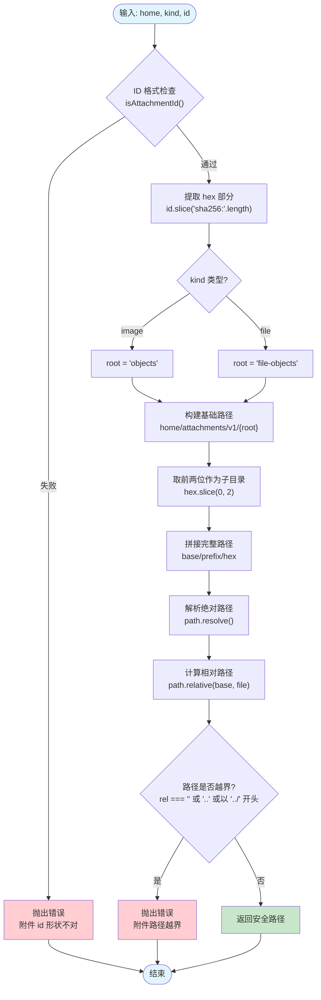

**Diagram sources **
- [attachments.ts:45-65](file://src/trash/attachments.ts#L45-L65)

安全机制详解：

1. **正则表达式验证**：ID 必须符合 `^sha256:[0-9a-f]{64}$` 格式，只允许小写十六进制字符
2. **目录结构固定**：根据 kind 选择 `objects` 或 `file-objects` 目录，不允许访问其他目录
3. **路径穿越防护**：使用 `path.relative()` 和 `path.resolve()` 进行纵深防御，检测 `..`、符号链接等穿越尝试
4. **绝对路径检查**：确保推导出的路径不是绝对路径，防止绕过基础目录限制

路径推导示例：
- 输入：`home='/data/dsh'`, `kind='image'`, `id='sha256:a1b2c3...'`
- 输出：`/data/dsh/attachments/v1/objects/a1/a1b2c3...`

**Section sources**
- [attachments.ts:30-65](file://src/trash/attachments.ts#L30-L65)

### 图片类型识别

`sniffImage` 函数通过检查文件开头的魔数（magic bytes）来识别图片格式，而非依赖文件扩展名或请求参数。

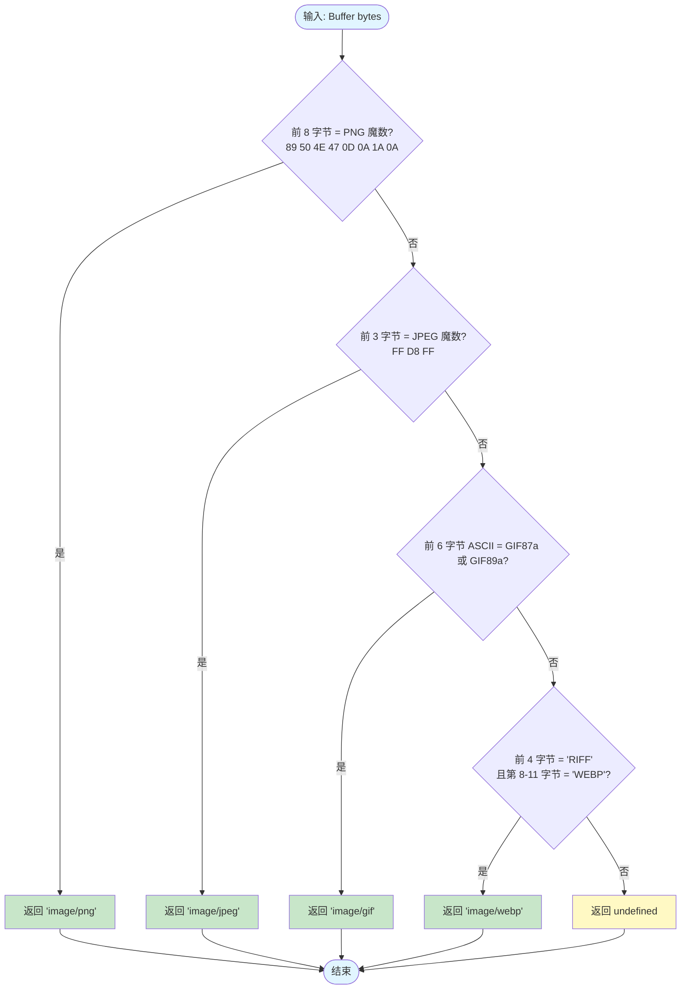

**Diagram sources **
- [attachment.ts:22-32](file://src/api/attachment.ts#L22-L32)

支持的图片格式及魔数：

| 格式 | 魔数（十六进制） | 魔数（ASCII） | MIME 类型 |
|------|------------------|---------------|-----------|
| PNG | 89 50 4E 47 0D 0A 1A 0A | - | image/png |
| JPEG | FF D8 FF | - | image/jpeg |
| GIF | 47 49 46 38 37 61 或 47 49 46 38 39 61 | GIF87a 或 GIF89a | image/gif |
| WebP | 52 49 46 46 ... 57 45 42 50 | RIFF...WEBP | image/webp |

识别失败的处理：
- 返回 `undefined`，调用方将其视为未知二进制文件
- 使用 `application/octet-stream` 作为 Content-Type
- 设置 `disposition: 'attachment'` 强制下载而非内联显示
- 生成安全的下载文件名（基于 SHA-256 哈希的前 12 位 + `.bin` 扩展名）

**Section sources**
- [attachment.ts:22-32](file://src/api/attachment.ts#L22-L32)
- [attachment.ts:90-105](file://src/api/attachment.ts#L90-L105)

### 文件大小限制

系统实施严格的大小限制以防止内存耗尽攻击，采用双重检查机制。

**限制参数**：
- 最大文件大小：20 MiB（20 × 1024 × 1024 = 20,971,520 字节）

**双重检查机制**：

1. **stat 阶段检查**：在读取文件前通过 `statFile` 获取文件大小
   - 优点：快速拒绝大文件，无需读取内容
   - 局限：文件可能在 stat 和 read 之间被修改

2. **读取后检查**：读取文件内容后再次检查实际字节数
   - 优点：确保实际加载到内存的内容不超过限制
   - 必要性：弥补 stat 阶段的时序窗口

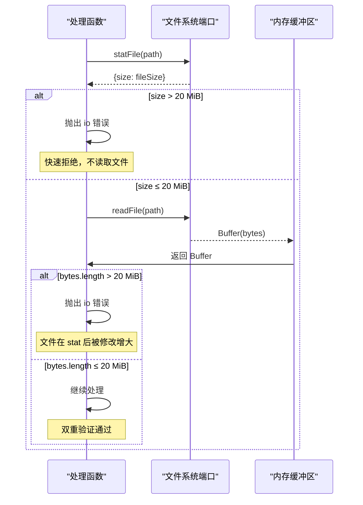

**Diagram sources **
- [attachment.ts:75-88](file://src/api/attachment.ts#L75-L88)

超限错误的处理：
- 错误码：`sessiondelete/io`
- 错误消息包含实际大小和上限值，便于调试
- 返回 200 + JSON 信封，而非 HTTP 错误状态码
- 客户端可根据错误类型决定是否显示占位符

**Section sources**
- [attachment.ts:18](file://src/api/attachment.ts#L18)
- [attachment.ts:75-88](file://src/api/attachment.ts#L75-L88)

### 客户端集成

客户端通过 `attachment-view.tsx` 组件集成附件显示功能，支持图片预览和文件下载。

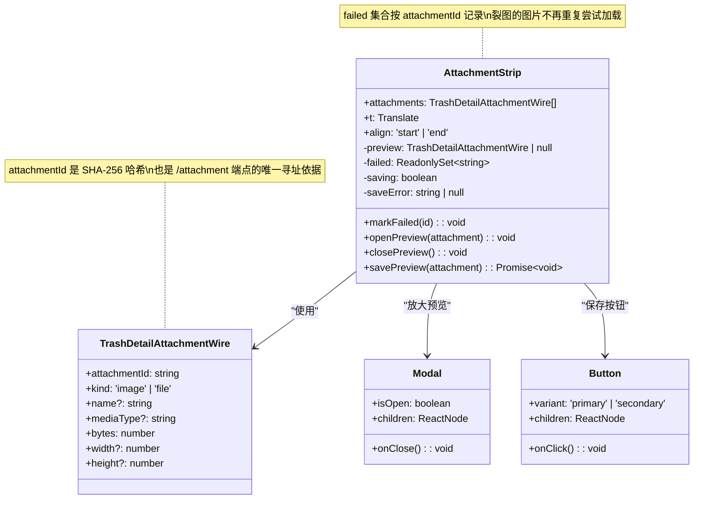

**Diagram sources **
- [attachment-view.tsx:85-293](file://src/client/attachment-view.tsx#L85-L293)
- [wire.ts:125-135](file://src/shared/wire.ts#L125-L135)

URL 构建逻辑：

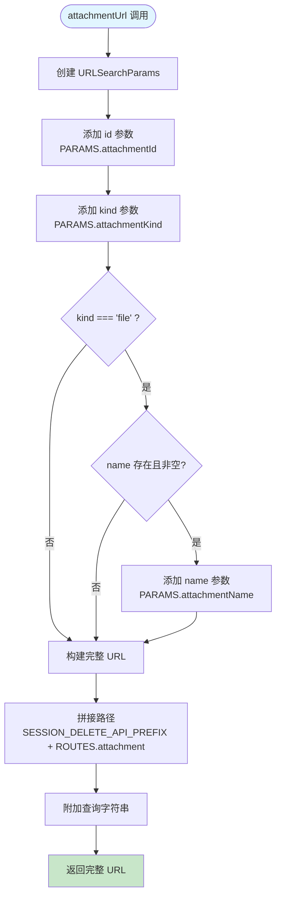

**Diagram sources **
- [attachment-view.tsx:25-38](file://src/client/attachment-view.tsx#L25-L38)

图片加载失败处理：
- 使用 `failed` Set 记录失败的 `attachmentId`
- 失败后显示占位符，包含附件名称、大小和"附件不可用"提示
- 同一个内容哈希在会话中多次引用时，一次失败即全部标记
- 放大框中也检查 `failed` 集合，避免在模态框中显示破图

文件下载处理：
- 直接使用 `<a download>` 标签，href 指向附件端点
- 对于 file 类型，如果提供了 name 参数，会添加到查询串中作为下载名建议
- 没有页面内失败面，因为服务端失败返回的是 JSON 信封，浏览器可能将其保存为文件

**Section sources**
- [attachment-view.tsx:25-38](file://src/client/attachment-view.tsx#L25-L38)
- [attachment-view.tsx:85-293](file://src/client/attachment-view.tsx#L85-L293)
- [wire.ts:125-135](file://src/shared/wire.ts#L125-L135)

## 数据流图

### 完整请求-响应流程

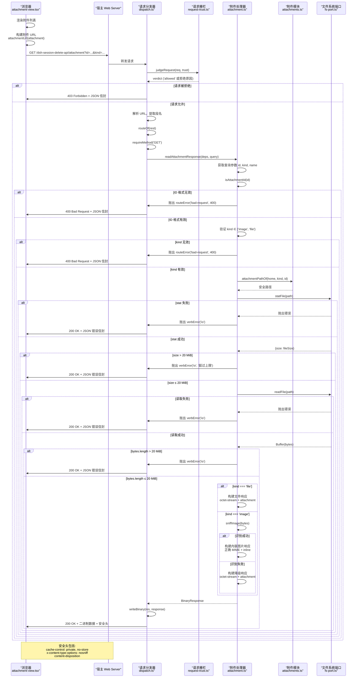

**Diagram sources **
- [dispatch.ts:115-160](file://src/api/dispatch.ts#L115-L160)
- [attachment.ts:58-111](file://src/api/attachment.ts#L58-L111)
- [attachments.ts:45-65](file://src/trash/attachments.ts#L45-L65)

### 二进制响应写入流程

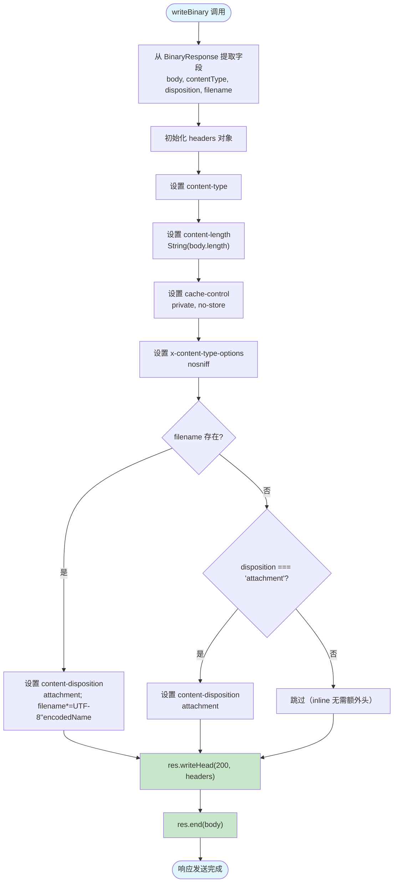

**Diagram sources **
- [dispatch.ts:35-55](file://src/api/dispatch.ts#L35-L55)

安全响应头说明：

| 响应头 | 值 | 作用 |
|--------|-----|------|
| content-type | 动态（见类型识别） | 告知浏览器内容类型 |
| content-length | 实际字节数 | 与 body.length 同源，防止篡改 |
| cache-control | private, no-store | 禁止任何中间层缓存，附件可能来自已删除会话 |
| x-content-type-options | nosniff | 禁止浏览器 MIME 类型嗅探，防止类型混淆攻击 |
| content-disposition | inline 或 attachment | 控制浏览器是内联显示还是下载 |

**Section sources**
- [dispatch.ts:35-55](file://src/api/dispatch.ts#L35-L55)
- [attachment.ts:58-111](file://src/api/attachment.ts#L58-L111)

## 错误处理

端点采用分层错误处理策略，区分请求级错误和操作级错误。

### 错误分类

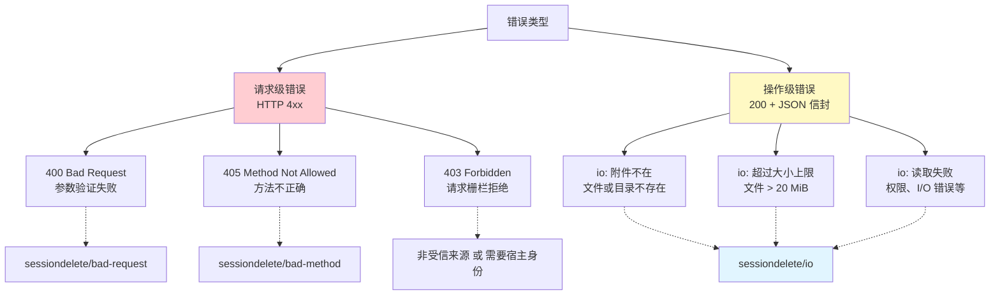

**Diagram sources **
- [dispatch.ts:57-70](file://src/api/dispatch.ts#L57-L70)
- [errors.ts:1-50](file://src/verbs/errors.ts#L1-L50)

### 错误处理策略对比

| 错误类型 | HTTP 状态码 | 响应格式 | 客户端行为 | 示例场景 |
|----------|-------------|----------|------------|----------|
| 参数验证失败 | 400 | JSON 信封 | 显示错误消息 | ID 格式错误、kind 无效 |
| 方法不允许 | 405 | JSON 信封 | 记录日志 | 使用 POST 访问 GET 端点 |
| 请求栅栏拒绝 | 403 | JSON 信封 | 引导用户重新认证 | 跨源请求、缺少宿主身份 |
| 附件不存在 | 200 | JSON 信封 | 显示占位符 | 文件已被删除 |
| 文件过大 | 200 | JSON 信封 | 显示错误提示 | 文件超过 20 MiB |
| 读取失败 | 200 | JSON 信封 | 显示占位符 | 权限不足、磁盘错误 |

### 图片加载失败的特殊处理

对于图片类型的附件，客户端实现了额外的容错机制：

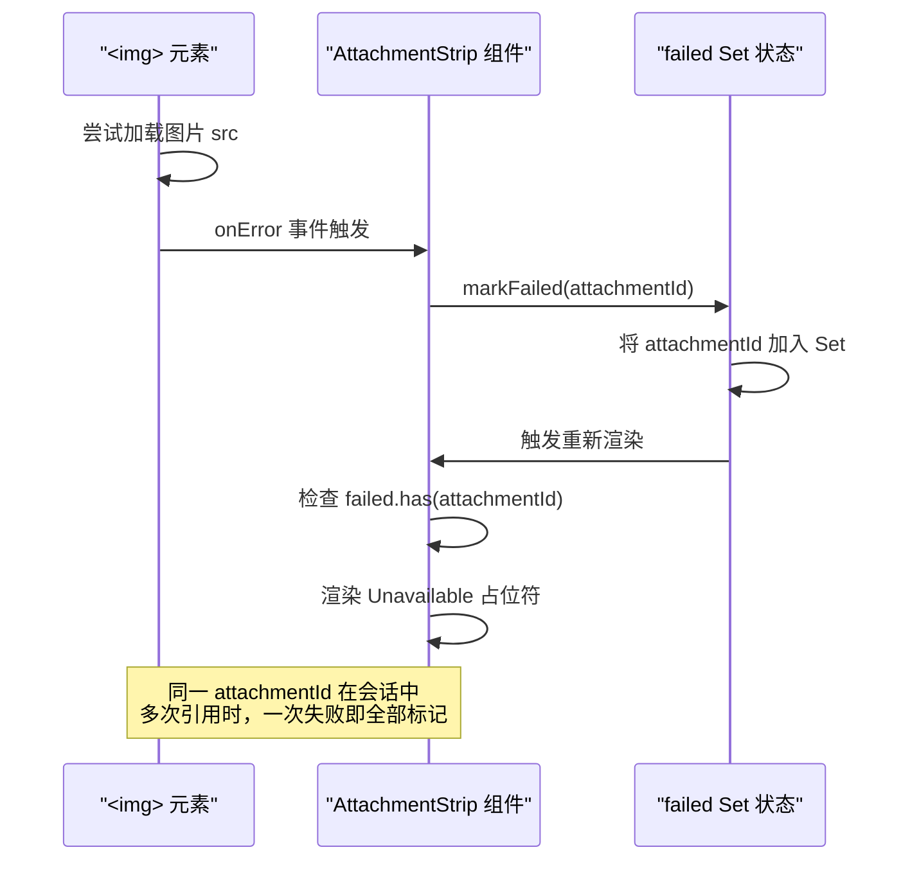

**Diagram sources **
- [attachment-view.tsx:104-110](file://src/client/attachment-view.tsx#L104-L110)
- [attachment-view.tsx:193-230](file://src/client/attachment-view.tsx#L193-L230)

占位符显示内容：
- 警告图标
- 附件名称（如果有）或默认文案（"附件图片" / "文件"）
- 文件大小（格式化显示）
- "附件不可用"提示文本

**Section sources**
- [dispatch.ts:57-70](file://src/api/dispatch.ts#L57-L70)
- [attachment-view.tsx:70-90](file://src/client/attachment-view.tsx#L70-L90)
- [attachment-view.tsx:104-110](file://src/client/attachment-view.tsx#L104-L110)

## 性能考虑

### 内存管理

端点采用全量读取策略，将文件内容一次性加载到内存中：

**优势**：
- 实现简单，无需流式处理的复杂性
- 适合小文件场景（≤ 20 MiB）
- 可以准确计算 content-length

**局限**：
- 大文件（接近 20 MiB）会占用较多内存
- 不支持断点续传
- 无法在读取过程中提前响应

**优化建议**：
- 当前限制下，单个请求最多占用 20 MiB 内存
- 并发请求数受 Node.js 进程内存限制
- 对于频繁访问的大文件，可考虑 CDN 缓存（但需注意 cache-control: no-store 的限制）

### 并发处理

由于端点标记为 `pure`，不进入串行执行链，可以并发处理多个请求：

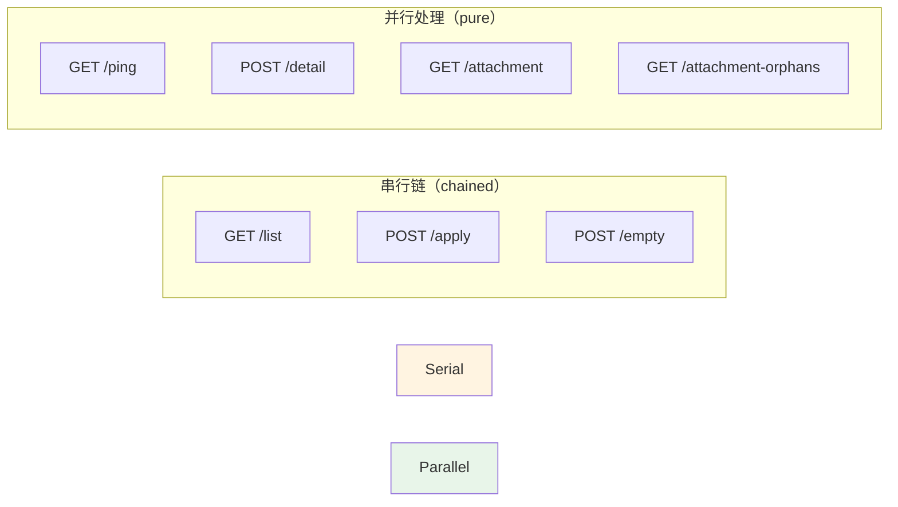

**Diagram sources **
- [route-table.ts:95-160](file://src/api/route-table.ts#L95-L160)

并发优势：
- 附件读取不会阻塞清册对账、删除等操作
- 适合详情页同时加载多张图片的场景
- 减少用户等待时间

### I/O 优化

文件系统操作优化：

1. **stat 前置检查**：先获取文件大小，快速拒绝超限文件，避免不必要的读取
2. **路径推导缓存**：虽然每次请求都重新推导路径，但推导过程是纯计算，开销极小
3. **无额外索引**：直接通过 SHA-256 哈希定位文件，无需查询数据库或索引

潜在瓶颈：
- 每个附件都需要两次文件系统调用（stat + read）
- 对于机械硬盘，随机读取大量小文件可能较慢
- 网络文件系统（NFS）的延迟可能影响响应时间

**Section sources**
- [route-table.ts:95-160](file://src/api/route-table.ts#L95-L160)
- [attachment.ts:75-88](file://src/api/attachment.ts#L75-L88)

## 故障排除指南

### 常见问题及解决方案

#### 1. 图片显示为"附件不可用"

**症状**：回收站详情中图片显示占位符，提示"附件不可用"

**可能原因**：
- 文件已被永久删除
- 文件路径推导错误（极少见，通常表示代码 bug）
- 文件系统权限问题
- 文件损坏导致魔数识别失败

**排查步骤**：
1. 检查浏览器控制台的网络请求，查看响应状态和错误消息
2. 确认附件 ID 格式是否正确（应为 `sha256:` + 64 位小写十六进制）
3. 检查服务器日志中的 `verbError('io')` 记录
4. 验证文件是否存在于预期路径：`$DSH_HOME/attachments/v1/objects/{前2位}/{完整hash}`

**Section sources**
- [attachment.ts:75-82](file://src/api/attachment.ts#L75-L82)
- [attachment-view.tsx:202-230](file://src/client/attachment-view.tsx#L202-L230)

#### 2. 文件下载得到错误响应

**症状**：点击文件附件下载，得到的文件内容是 JSON 错误信封而非实际文件

**原因**：服务端返回 200 + JSON 信封（如文件不存在），浏览器将其保存为文件

**解决方案**：
- 这是预期行为，因为操作级错误返回 200 状态码
- 客户端应在使用 `<a download>` 前检查文件是否存在
- 或者在下载后验证文件内容是否为 JSON

**改进建议**：
- 对于 file 类型，可以考虑在客户端先发起 HEAD 请求检查文件存在性
- 或在下载后检查文件扩展名和内容类型

**Section sources**
- [attachment-view.tsx:135-140](file://src/client/attachment-view.tsx#L135-L140)
- [dispatch.ts:57-70](file://src/api/dispatch.ts#L57-L70)

#### 3. 请求返回 403 Forbidden

**症状**：所有附件请求都被拒绝，返回 403 状态码

**可能原因**：
- 请求来源不被信任（跨源请求）
- 缺少宿主的 Web 身份标识
- 请求栅栏配置错误

**解决方案**：
1. 确认使用 dsh web 打印的 URL 打开页面
2. 检查浏览器控制台的网络请求头
3. 验证宿主 Web Server 的请求栅栏配置
4. 确认 LAN 或反代客户端正确继承宿主身份

**Section sources**
- [dispatch.ts:115-125](file://src/api/dispatch.ts#L115-L125)
- [request-trust.ts:1-50](file://src/api/request-trust.ts#L1-L50)

#### 4. 请求返回 400 Bad Request

**症状**：附件请求被拒绝，返回 400 状态码

**可能原因**：
- ID 参数格式错误（不是 sha256:hex64 格式）
- kind 参数不是 'image' 或 'file'
- 查询参数缺失

**解决方案**：
1. 检查 URL 中的查询参数是否完整
2. 确认 attachmentId 符合正则表达式 `^sha256:[0-9a-f]{64}$`
3. 确认 kind 参数值为小写的 'image' 或 'file'
4. 检查客户端代码中 `attachmentUrl` 函数的调用

**Section sources**
- [attachment.ts:63-68](file://src/api/attachment.ts#L63-L68)
- [attachments.ts:30-35](file://src/trash/attachments.ts#L30-L35)

#### 5. 图片类型识别失败

**症状**：图片文件被当作普通文件下载，而非内联显示

**可能原因**：
- 文件格式不受支持（仅支持 PNG、JPEG、GIF、WebP）
- 文件头部损坏，魔数不匹配
- 文件实际上是其他格式但扩展名为图片

**解决方案**：
1. 检查文件实际格式是否在支持列表中
2. 使用十六进制编辑器检查文件开头的魔数
3. 确认文件未损坏
4. 如果是其他图片格式（如 BMP、TIFF），目前不支持内联显示

**注意**：这是预期行为，系统故意不依赖文件扩展名或请求参数，而是通过魔数识别，以确保安全性。

**Section sources**
- [attachment.ts:22-32](file://src/api/attachment.ts#L22-L32)
- [attachment.ts:90-105](file://src/api/attachment.ts#L90-L105)

### 调试技巧

#### 启用详细日志

在开发环境中，可以通过以下方式获取更多信息：

1. **服务器端日志**：检查 Node.js 进程的 stdout/stderr，寻找 `verbError` 和 `routeError` 的记录
2. **浏览器开发者工具**：
   - Network 面板：查看请求 URL、响应头、响应体
   - Console 面板：查看 JavaScript 错误和警告
3. **文件系统检查**：直接访问 `$DSH_HOME/attachments/v1/objects/` 目录，验证文件存在性和权限

#### 测试用例参考

项目包含全面的测试用例，可作为调试参考：

- `tests/attachments.test.ts`：附件模块的单元测试
- `tests/api.test.ts`：API 端点的集成测试
- `tests/client/attachment-view.test.tsx`：客户端组件的测试

这些测试用例展示了各种边界情况和错误场景的处理方式。

**Section sources**
- [tests/attachments.test.ts:1-691](file://tests/attachments.test.ts#L1-L691)

## 结论

`GET /attachment` 端点是回收站插件中关键的二进制响应组件，专为安全地提供附件内容而设计。通过严格的内容寻址机制、多重安全验证和智能的类型识别，该端点在保障系统安全的同时提供了良好的用户体验。

### 核心特性总结

1. **安全寻址**：仅接受 SHA-256 ID，路径完全由服务端推导，杜绝路径遍历攻击
2. **类型隔离**：kind 参数严格限制为 image 或 file，对应不同的存储目录
3. **智能识别**：通过魔数识别图片格式，不依赖不可信的外部信息
4. **大小限制**：双重检查机制确保单文件不超过 20 MiB，防止内存耗尽
5. **容错设计**：失败时返回 JSON 信封，图片加载失败显示友好占位符
6. **并发处理**：标记为 pure 模式，不阻塞其他操作，提升响应速度

### 设计哲学

该端点体现了以下设计原则：

- **Fail-safe**：宁可拒绝可疑请求，也不冒险允许潜在危险操作
- **Defense in depth**：多层验证机制，即使某一层失效仍有其他保护
- **Explicit over implicit**：明确声明类型和意图，不依赖隐式推断
- **User-friendly errors**：错误消息清晰明了，帮助用户理解问题和采取下一步行动

### 未来改进方向

虽然当前实现已经相当完善，但仍有一些潜在的改进空间：

1. **流式响应**：对于接近上限的大文件，可考虑使用流式传输减少内存占用
2. **缓存策略**：在确保安全的前提下，为频繁访问的附件添加短期缓存
3. **批量预取**：支持一次性获取多个附件的元数据，减少往返次数
4. **更多图片格式**：扩展魔数识别支持更多图片格式（如 AVIF、HEIC）
5. **缩略图生成**：服务端生成缩略图，减少客户端带宽消耗

该端点的设计和实施为类似的文件服务场景提供了良好的参考范例，特别是在安全性和用户体验之间取得平衡方面。

[No sources needed since this section summarizes without analyzing specific files]