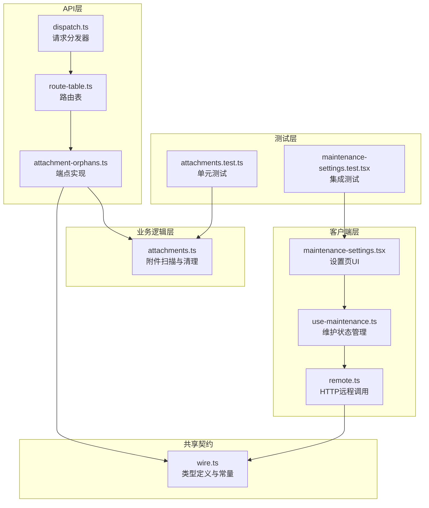
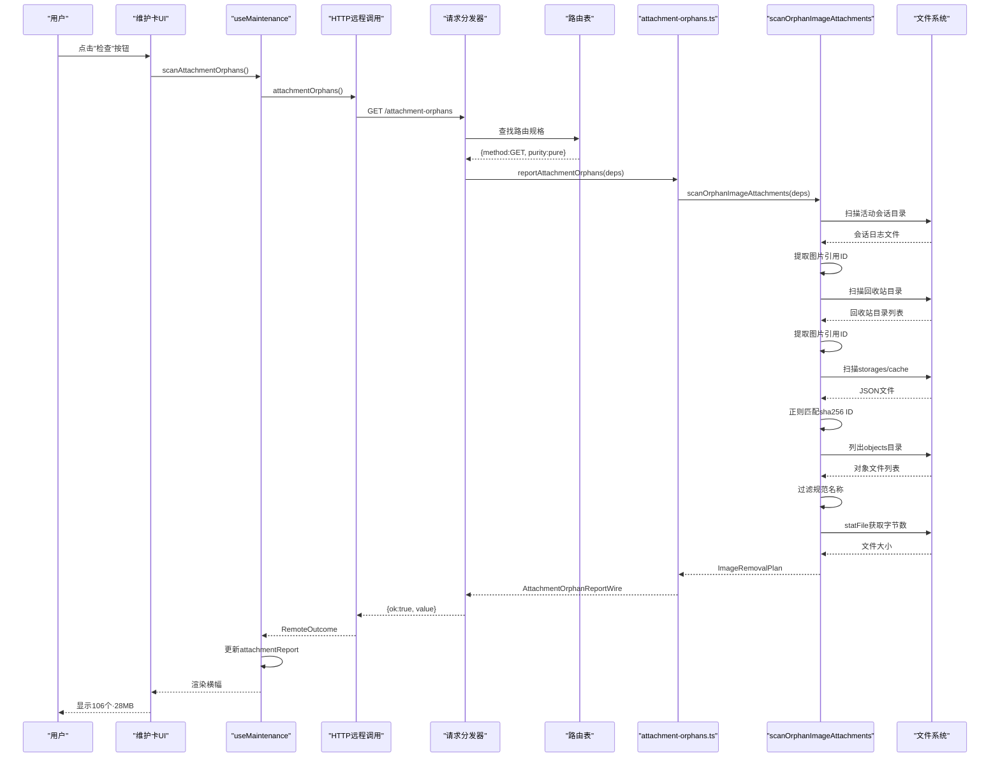
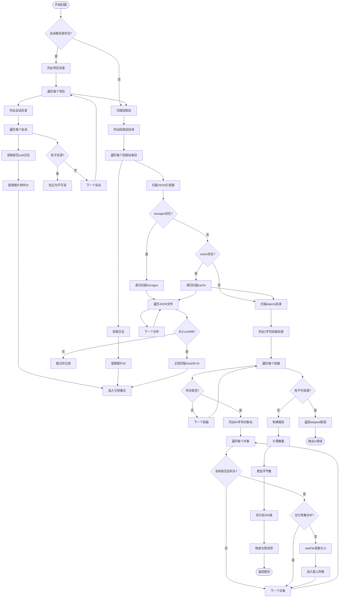
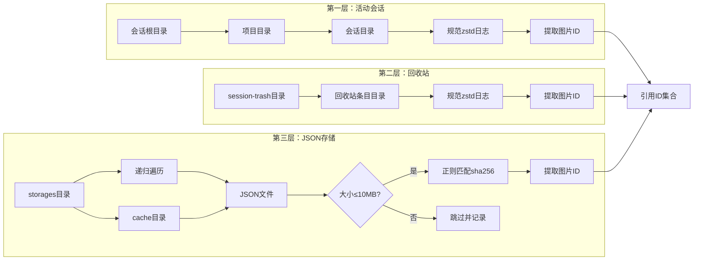
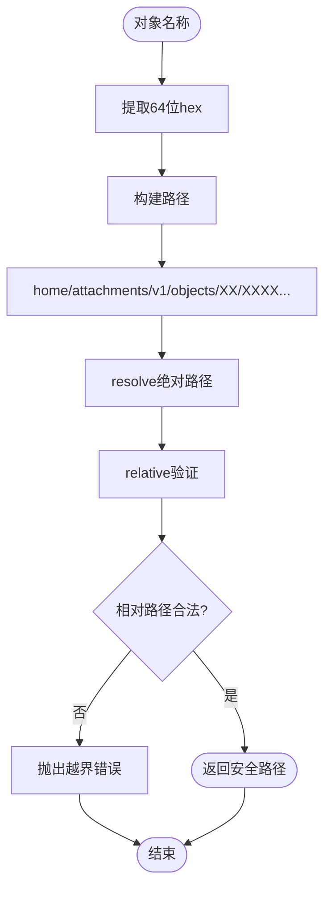
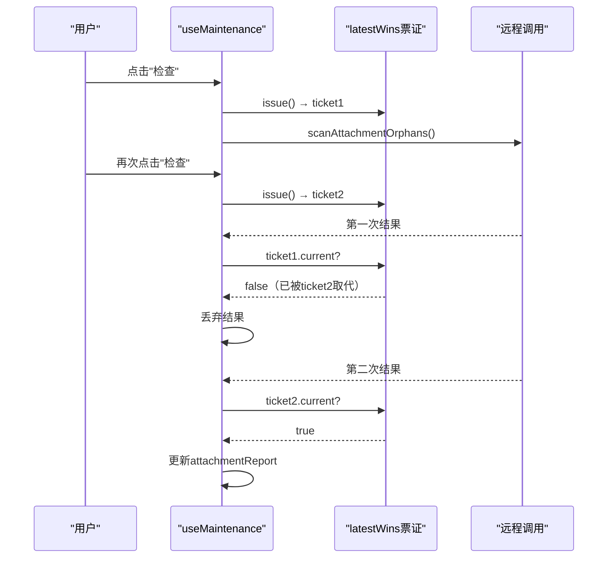
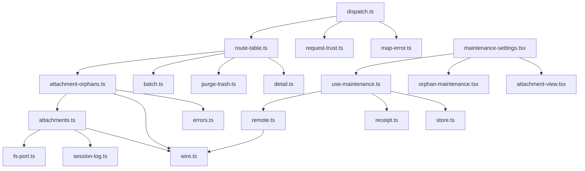

# GET /attachment-orphans — 孤儿附件报告

<cite>
**本文档引用文件 **
- [attachment-orphans.ts](file://src/api/attachment-orphans.ts)
- [wire.ts](file://src/shared/wire.ts)
- [attachments.ts](file://src/trash/attachments.ts)
- [route-table.ts](file://src/api/route-table.ts)
- [dispatch.ts](file://src/api/dispatch.ts)
- [remote.ts](file://src/client/remote.ts)
- [use-maintenance.ts](file://src/client/use-maintenance.ts)
- [maintenance-settings.tsx](file://src/client/maintenance-settings.tsx)
- [orphan-maintenance.test.tsx](file://tests/client/orphan-maintenance.test.tsx)
- [maintenance-settings.test.tsx](file://tests/client/maintenance-settings.test.tsx)
- [attachments.test.ts](file://tests/attachments.test.ts)
</cite>

## 目录

1. [引言](#引言)
2. [项目结构](#项目结构)
3. [核心组件](#核心组件)
4. [架构概览](#架构概览)
5. [详细组件分析](#详细组件分析)
6. [依赖分析](#依赖分析)
7. [性能考虑](#性能考虑)
8. [故障排除指南](#故障排除指南)
9. [结论](#结论)

## 引言

`GET /attachment-orphans` 是一个纯读端点，用于扫描活动会话、回收站目录与派生存储的图片引用，返回无引用的孤儿附件数量、体积及预览清单（最多 200 条），供设置页维护卡使用。该端点是插件设置页「维护」卡中孤儿附件段的核心数据源，帮助用户识别和清理 `.dsh` 目录内不再被任何会话引用的图片副本。

### 设计目标

- **安全性优先**：采用"失败关闭"策略，任何引用源读不出时整体跳过，绝不将"读不出"误判为"没有引用"
- **只读语义**：不修改任何数据，仅报告当前状态
- **预览限制**：对象清单最多返回 200 条，但数量和字节统计基于全量扫描
- **路径隔离**：只处理 `$DSH_HOME/attachments/v1/objects` 下的图片对象，不涉及源文件或其他存储位置

### 关键特性

- 扫描活动会话日志中的图片引用
- 扫描全部回收站目录（包括未进入清册的目录）
- 扫描 `storages` 和 `cache` 目录中的 JSON 引用源
- 对比附件库 `objects` 目录，找出无引用的图片对象
- 提供数量、总字节数和预览清单三项读数

## 项目结构



**图表来源 **
- [attachment-orphans.ts:1-26](file://src/api/attachment-orphans.ts#L1-L26)
- [route-table.ts:1-217](file://src/api/route-table.ts#L1-L217)
- [dispatch.ts:1-166](file://src/api/dispatch.ts#L1-L166)
- [wire.ts:1-331](file://src/shared/wire.ts#L1-L331)
- [attachments.ts:1-475](file://src/trash/attachments.ts#L1-L475)
- [remote.ts:1-298](file://src/client/remote.ts#L1-L298)
- [use-maintenance.ts:1-276](file://src/client/use-maintenance.ts#L1-L276)
- [maintenance-settings.tsx:1-273](file://src/client/maintenance-settings.tsx#L1-L273)

**章节来源 **
- [attachment-orphans.ts:1-26](file://src/api/attachment-orphans.ts#L1-L26)
- [wire.ts:1-331](file://src/shared/wire.ts#L1-L331)
- [route-table.ts:1-217](file://src/api/route-table.ts#L1-L217)

## 核心组件

### 1. 端点实现层

端点实现位于 `src/api/attachment-orphans.ts`，负责调用底层扫描函数并格式化响应数据。

#### 核心功能

- 调用 `scanOrphanImageAttachments` 执行完整扫描
- 处理扫描跳过情况，抛出 `io` 错误而非返回空报告
- 限制预览清单最多 200 条，但数量和字节统计保持全量
- 映射扫描结果为 `AttachmentOrphanReportWire` 格式

#### 关键常量

- `ORPHAN_PREVIEW_LIMIT = 200`：预览清单上限，与详情附件的载荷闸同一量级

**章节来源 **
- [attachment-orphans.ts:1-26](file://src/api/attachment-orphans.ts#L1-L26)

### 2. 扫描引擎层

扫描引擎位于 `src/trash/attachments.ts`，是孤儿附件检测的核心逻辑所在。

#### 主要函数

**`scanOrphanImageAttachments`**
- 收集所有剩余引用源的图片 ID
- 遍历 `attachments/v1/objects` 目录查找候选对象
- 验证对象名称符合 `<2 hex>/<64 hex>` 规范
- 对比引用集合，找出无引用对象
- 统计每个对象的字节数

**`collectRemainingImageRefs`**
- 扫描活动会话目录（排除已删除目录）
- 扫描全部回收站目录
- 递归扫描 `storages` 和 `cache` 中的 JSON 文件
- 应用 10MB JSON 文件大小上限
- 跟踪不可读的引用源

**`imageIdsOfDir`**
- 读取单个会话目录的规范 zstd 日志
- 提取日志中的图片附件 ID
- 验证目录完整性（无子目录、无非空临时文件）
- 检测损坏的日志（坏行或截断尾巴）

#### 安全机制

- **路径验证**：通过正则表达式严格验证对象 ID 格式
- **失败关闭**：任何引用源读不出时整体跳过
- **深度防御**：即使正则放宽，也通过目录包含关系验证路径不越界
- **软链防环**：按真实路径去重，防止软链绕回祖先导致无限递归

**章节来源 **
- [attachments.ts:1-475](file://src/trash/attachments.ts#L1-L475)

### 3. 路由配置层

路由表位于 `src/api/route-table.ts`，定义了端点的访问规则和纯度属性。

#### 路由规格

- **方法**：`GET`
- **纯度**：`pure`（纯读，不进串行链）
- **读面**：`none`（不读清册）
- **响应**：`json`（走信封格式）
- **Body**：`none`（无需请求体）

#### 与其他端点的区别

- `/attachment-orphans`：纯读，报告无引用对象
- `/attachment-clean`：写动作，清理无引用对象，需进串行链
- `/orphans`：扫描无主子会话，非附件相关

**章节来源 **
- [route-table.ts:1-217](file://src/api/route-table.ts#L1-L217)

### 4. 客户端集成层

客户端层由多个模块组成，负责 HTTP 调用、状态管理和 UI 呈现。

#### 远程调用封装

`src/client/remote.ts` 提供：
- `attachmentOrphans()`：调用 `GET /attachment-orphans`
- 信封解包与错误处理
- 失败原文保留

#### 状态管理

`src/client/use-maintenance.ts` 提供：
- `attachmentReport`：报告数据
- `attachmentFailure`：失败信息
- `attachmentNotice`：清理回执
- `scanAttachmentOrphans()`：手动触发扫描
- `cleanAttachmentOrphans()`：执行清理
- 最新获胜策略防止竞态条件

#### UI 呈现

`src/client/maintenance-settings.tsx` 提供：
- 维护卡布局
- 检查按钮与状态显示
- 横幅展示（数量 + 体积）
- 确认对话框与缩略图预览

**章节来源 **
- [remote.ts:1-298](file://src/client/remote.ts#L1-L298)
- [use-maintenance.ts:1-276](file://src/client/use-maintenance.ts#L1-L276)
- [maintenance-settings.tsx:1-273](file://src/client/maintenance-settings.tsx#L1-L273)

## 架构概览

### 请求处理流程



**图表来源 **
- [attachment-orphans.ts:15-25](file://src/api/attachment-orphans.ts#L15-L25)
- [attachments.ts:430-475](file://src/trash/attachments.ts#L430-L475)
- [route-table.ts:130-137](file://src/api/route-table.ts#L130-L137)
- [dispatch.ts:120-160](file://src/api/dispatch.ts#L120-L160)
- [remote.ts:240-250](file://src/client/remote.ts#L240-L250)
- [use-maintenance.ts:190-215](file://src/client/use-maintenance.ts#L190-L215)

### 数据流架构



**图表来源 **
- [attachments.ts:240-310](file://src/trash/attachments.ts#L240-L310)
- [attachments.ts:430-475](file://src/trash/attachments.ts#L430-L475)
- [attachment-orphans.ts:15-25](file://src/api/attachment-orphans.ts#L15-L25)

### 响应数据结构

| 字段 | 类型 | 说明 | 示例 |
|------|------|------|------|
| count | number | 孤儿附件总数 | 106 |
| totalBytes | number | 孤儿附件总字节数 | 29150413 |
| items | AttachmentOrphanItemWire[] | 预览清单（最多200条） | 见下表 |

**AttachmentOrphanItemWire 结构**

| 字段 | 类型 | 说明 | 示例 |
|------|------|------|------|
| attachmentId | string | SHA256哈希ID | sha256:aabbcc... |
| bytes | number | 对象文件大小（字节） | 275004 |

**章节来源 **
- [wire.ts:160-175](file://src/shared/wire.ts#L160-L175)
- [attachment-orphans.ts:15-25](file://src/api/attachment-orphans.ts#L15-L25)

## 详细组件分析

### 扫描引擎详解

#### 引用源收集策略

扫描引擎采用三层引用源收集策略，确保不遗漏任何可能的引用：



**图表来源 **
- [attachments.ts:240-310](file://src/trash/attachments.ts#L240-L310)

#### 单目录扫描规则

`imageIdsOfDir` 函数遵循严格的目录完整性验证规则：

1. **目录不存在**：返回空集合，不算错误
2. **无规范日志**：
   - 如果只有 0 字节临时日志且无子目录：返回空集合
   - 如果有非空临时日志：标记为不可读
   - 如果有子目录：标记为不可读（日志覆盖不到子目录）
3. **有规范日志**：
   - 检查旁侧文件：允许老一代规范日志和 0 字节临时日志
   - 拒绝非空临时日志、明文日志或其他文件
   - 检查子目录：有子目录则标记为不可读
   - 解析日志：提取图片 ID
   - 检测损坏：坏行或截断尾巴则标记为不可读

**章节来源 **
- [attachments.ts:165-225](file://src/trash/attachments.ts#L165-L225)

#### JSON 引用源扫描

JSON 扫描采用广度优先遍历，具有以下特点：

- **大小限制**：单个 JSON 文件超过 10MB 则跳过，但不视为"没有引用"
- **正则匹配**：使用 `/sha256:[0-9a-f]{64}/gu` 全局匹配
- **软链防环**：通过 `realpath` 获取真实路径并去重
- **错误容忍**：单个目录读失败不影响其他目录

**章节来源 **
- [attachments.ts:280-310](file://src/trash/attachments.ts#L280-L310)

### 对象候选筛选

#### 命名规范验证

对象必须满足以下规范才能成为候选：

1. **前缀目录**：必须是 2 位十六进制字符（`/^[0-9a-f]{2}$/u`）
2. **对象名称**：必须是 64 位十六进制字符（`/^[0-9a-f]{64}$/u`）
3. **同头验证**：对象名称必须以前缀开头（防止路径不一致）

#### 路径推导与验证



**图表来源 **
- [attachments.ts:50-70](file://src/trash/attachments.ts#L50-L70)
- [attachments.ts:455-465](file://src/trash/attachments.ts#L455-L465)

### 失败关闭策略

扫描引擎采用多层次的失败关闭策略，确保不会误删共享引用：

#### 层级 1：引用源整体不可读

如果任何引用源完全无法读取（如权限问题、磁盘挂载失败），整个扫描跳过，返回 `skipped` 原因。

#### 层级 2：单个引用源部分不可读

- **会话日志损坏**：坏行或截断尾巴导致该会话的引用不可信，标记为不可读
- **JSON 文件过大**：超过 10MB 的文件跳过，但记录警告
- **目录读失败**：单个目录失败不影响其他目录，但记录到 `unreadable` 数组

#### 层级 3：对象列表不可读

如果 `attachments/v1/objects` 目录无法列出，整个扫描跳过。

#### 层级 4：单个对象 stat 失败

单个对象 stat 失败（非 ENOENT）不计入失败，但该对象不会被纳入计划。

**章节来源 **
- [attachments.ts:430-475](file://src/trash/attachments.ts#L430-L475)
- [attachments.ts:240-310](file://src/trash/attachments.ts#L240-L310)

### 客户端状态管理

#### 最新获胜策略

`use-maintenance.ts` 使用 `createLatestWins` 防止竞态条件：



**图表来源 **
- [use-maintenance.ts:185-215](file://src/client/use-maintenance.ts#L185-L215)

#### 状态转换

| 状态 | 触发条件 | UI 表现 |
|------|----------|---------|
| 尚未检查 | 初始状态或重置后 | 显示"尚未检查" |
| 检查中… | 点击检查按钮后 | 禁用按钮，显示"检查中…" |
| 没有发现 | 扫描完成，count=0 | 显示"没有发现" |
| N个·XMB | 扫描完成，count>0 | 显示横幅，提供"查看并清理" |
| 检查失败 | 扫描抛出错误 | 显示错误原文 + 重试按钮 |
| 清理中… | 点击清理按钮后 | 禁用按钮，显示"清理中…" |
| 清理回执 | 清理完成后 | 显示已清理数量、跳过原因等 |

**章节来源 **
- [use-maintenance.ts:1-276](file://src/client/use-maintenance.ts#L1-L276)
- [maintenance-settings.test.tsx:50-100](file://tests/client/maintenance-settings.test.tsx#L50-L100)

### UI 呈现细节

#### 横幅展示

当报告非空且 count > 0 时，显示维护横幅：

- **主文本**："{count} 个 · {fileSizeText(totalBytes)}"
- **操作按钮**："查看并清理"（描边样式，非实心红）
- **数据来源**：`attachmentReport.count` 和 `attachmentReport.totalBytes`

#### 确认对话框

点击"查看并清理"后弹出确认对话框：

- **标题**："查看并清理 {count} 个孤儿附件？"
- **边界说明**："只清理 .dsh 内无引用的图片副本；源文件不受影响；共享引用保留。"
- **缩略图预览**：最多显示 200 个图片缩略图（来自 `items` 数组）
- **操作按钮**："取消"和"清理这些附件"（危险样式）

#### 失败块

当 `attachmentFailure` 非空时：

- **错误原文**：显示服务端返回的失败消息
- **重试按钮**：调用 `scanAttachmentOrphans()` 重新扫描
- **状态区分**：失败不是"尚未检查"，也不是"没有发现"

#### 清理回执

`attachmentNotice` 显示上一趟清理的结果：

- **成功清理**："已清理 {count} 个，释放 {size}"
- **部分失败**："未清理 {failed} 个（已清理 {removed} 个）"
- **跳过原因**："部分附件未清理：{skipped}（已清理 {removed} 个）"

**章节来源 **
- [maintenance-settings.tsx:120-180](file://src/client/maintenance-settings.tsx#L120-L180)
- [maintenance-settings.test.tsx:150-220](file://tests/client/maintenance-settings.test.tsx#L150-L220)

## 依赖分析

### 内部依赖关系



**图表来源 **
- [attachment-orphans.ts:10-14](file://src/api/attachment-orphans.ts#L10-L14)
- [attachments.ts:10-15](file://src/trash/attachments.ts#L10-L15)
- [route-table.ts:15-25](file://src/api/route-table.ts#L15-L25)
- [dispatch.ts:10-15](file://src/api/dispatch.ts#L10-L15)
- [remote.ts:15-30](file://src/client/remote.ts#L15-L30)
- [use-maintenance.ts:10-20](file://src/client/use-maintenance.ts#L10-L20)
- [maintenance-settings.tsx:15-25](file://src/client/maintenance-settings.tsx#L15-L25)

### 外部依赖

| 依赖 | 用途 | 版本约束 |
|------|------|----------|
| node:path | 路径解析与验证 | Node.js 内置 |
| node:zlib | zstd 日志压缩/解压 | Node.js 内置 |
| React | UI 组件框架 | ^18.0.0 |
| vitest | 测试框架 | ^1.0.0 |

### 端口依赖

扫描引擎依赖 `FsPort` 的部分接口：

| 方法 | 用途 | 必需性 |
|------|------|--------|
| exists | 检查目录/文件是否存在 | 必需 |
| listFiles | 列出目录中的文件 | 必需 |
| listDirs | 列出目录中的子目录 | 必需 |
| readFile | 读取文件内容（日志/JSON） | 必需 |
| statFile | 获取文件大小 | 必需 |
| realpath | 解析软链真实路径 | 必需 |
| removeFile | 删除文件（清理时使用） | 清理时必需 |

**章节来源 **
- [attachments.ts:130-145](file://src/trash/attachments.ts#L130-L145)
- [package.json:1-50](file://package.json#L1-L50)

## 性能考虑

### 扫描复杂度分析

#### 时间复杂度

- **会话扫描**：O(S × L)，其中 S 是会话数量，L 是平均日志行数
- **回收站扫描**：O(T × L)，其中 T 是回收站条目数量
- **JSON 扫描**：O(J × F)，其中 J 是目录数量，F 是每个目录的平均文件数
- **对象列表**：O(O)，其中 O 是 objects 目录下的对象数量
- **总体**：O(S×L + T×L + J×F + O)

#### 空间复杂度

- **引用 ID 集合**：O(R)，其中 R 是唯一引用 ID 数量
- **孤儿列表**：O(O')，其中 O' 是孤儿对象数量
- **峰值内存**：取决于最大 JSON 文件大小（上限 10MB）

### 优化策略

#### 1. 早期退出

- 目录不存在时立即返回空集合
- 发现子目录时立即标记为不可读，不再尝试解析日志
- 对象已在引用集合中时跳过 stat 调用

#### 2. 批量操作

- 一次性列出所有目录和文件，减少系统调用次数
- 使用 Set 数据结构进行 O(1) 查找

#### 3. 预览限制

- 预览清单最多 200 条，避免大量数据传输
- 数量和字节统计仍基于全量，保证准确性

#### 4. 缓存策略

- 客户端使用最新获胜策略，避免重复请求
- 清理后自动重查，保持数据新鲜度

### 潜在瓶颈

#### 1. 大型会话目录

如果某个项目有成千上万个会话，扫描可能耗时较长。建议：
- 定期清理旧会话
- 使用归档功能减少活动会话数量

#### 2. 深层 JSON 目录树

`storages` 和 `cache` 可能有深层嵌套目录。当前实现：
- 使用广度优先遍历
- 通过 realpath 去重防止软链环
- 但仍可能遍历大量目录

#### 3. 大量小文件

objects 目录下可能有数十万个小文件。文件系统性能：
- ext4/xfs 对大量小文件支持良好
- NFS 网络文件系统可能较慢
- 建议定期清理孤儿附件

### 内存使用

- **引用集合**：每个 ID 约 73 字节（"sha256:" + 64 字符），10 万个 ID 约 7MB
- **孤儿列表**：每个条目约 100 字节（ID + 路径 + 大小），10 万个条目约 10MB
- **日志缓冲**：单个日志文件完全读入内存，最大取决于日志大小
- **JSON 缓冲**：单个 JSON 文件上限 10MB

**章节来源 **
- [attachments.ts:430-475](file://src/trash/attachments.ts#L430-L475)
- [attachment-orphans.ts:12](file://src/api/attachment-orphans.ts#L12)

## 故障排除指南

### 常见错误场景

#### 1. 扫描返回 skipped

**症状**：`attachmentFailure` 显示"读不到引用源，无法判定孤儿附件：..."

**可能原因**：
- 活动会话目录权限不足
- 回收站目录被锁定
- storages/cache 目录不存在或不可读
- objects 目录无法列出

**解决方案**：
- 检查 `$DSH_HOME` 目录权限
- 确认宿主进程有足够权限
- 查看服务端日志获取详细错误信息

**章节来源 **
- [attachments.ts:435-445](file://src/trash/attachments.ts#L435-L445)

#### 2. 预览清单为空但 count > 0

**症状**：报告显示有孤儿附件，但 items 数组为空

**可能原因**：
- 这是正常行为：items 最多返回 200 条，但 count 是全量统计
- 如果 count ≤ 200 但 items 为空，可能是 bug

**解决方案**：
- 确认 count 是否大于 200
- 如果 count ≤ 200 但 items 为空，检查服务端日志

**章节来源 **
- [attachment-orphans.ts:20-24](file://src/api/attachment-orphans.ts#L20-L24)

#### 3. 清理后报告仍显示相同数量

**症状**：执行清理后，重新扫描仍显示相同的 count

**可能原因**：
- 清理过程中有新的引用产生（不太可能，因为是纯读端点）
- 清理失败但未正确报告
- 客户端缓存未刷新

**解决方案**：
- 检查 `attachmentNotice` 是否有失败信息
- 手动点击"检查"按钮重新扫描
- 查看服务端日志确认清理是否成功

**章节来源 **
- [use-maintenance.ts:220-245](file://src/client/use-maintenance.ts#L220-L245)

#### 4. 缩略图无法加载

**症状**：确认对话框中的图片缩略图显示为空白或错误图标

**可能原因**：
- 附件 ID 格式不正确
- 附件文件已被删除
- 权限问题导致无法读取

**解决方案**：
- 检查 `attachmentId` 是否符合 `sha256:[0-9a-f]{64}` 格式
- 确认文件存在于 `attachments/v1/objects/XX/XXXX...`
- 查看浏览器控制台是否有 404 错误

**章节来源 **
- [attachments.ts:50-70](file://src/trash/attachments.ts#L50-L70)
- [maintenance-settings.tsx:190-220](file://src/client/maintenance-settings.tsx#L190-L220)

### 调试技巧

#### 1. 启用详细日志

在服务端启用调试日志，查看扫描过程：

```typescript
// 在 attachments.ts 中添加日志
console.log(`扫描会话目录: ${dir}`)
console.log(`提取到 ${ids.size} 个图片ID`)
console.log(`发现 ${entries.length} 个孤儿附件`)
```

#### 2. 检查引用源完整性

手动验证引用源是否可读：

```bash
# 检查会话目录
ls -la $DSH_HOME/sessions/

# 检查回收站
ls -la $DSH_HOME/session-trash/

# 检查 JSON 存储
find $DSH_HOME/storages -name "*.json" | head -20

# 检查 objects 目录
ls -la $DSH_HOME/attachments/v1/objects/
```

#### 3. 验证对象路径

确认孤儿附件的路径推导是否正确：

```typescript
const id = 'sha256:aabbcc...'
const expectedPath = `${home}/attachments/v1/objects/aa/aabbcc...`
const actualPath = attachmentPathOf(home, 'image', id)
console.assert(expectedPath === actualPath)
```

**章节来源 **
- [attachments.ts:1-475](file://src/trash/attachments.ts#L1-L475)
- [attachments.test.ts:1-691](file://tests/attachments.test.ts#L1-L691)

### 测试用例参考

项目提供了全面的测试用例，可作为调试参考：

#### 单元测试

`tests/attachments.test.ts` 覆盖：
- 附件内容块解析
- 路径闸验证
- 日志提取
- 单目录引用扫描
- 孤儿附件扫描
- 清理执行

#### 集成测试

`tests/client/maintenance-settings.test.tsx` 覆盖：
- 初始状态
- 检查流程
- 清理流程
- 失败处理
- 回执显示

**章节来源 **
- [attachments.test.ts:1-691](file://tests/attachments.test.ts#L1-L691)
- [maintenance-settings.test.tsx:1-288](file://tests/client/maintenance-settings.test.tsx#L1-L288)

## 结论

`GET /attachment-orphans` 端点是一个设计精良的纯读接口，用于识别和报告 `.dsh` 目录内不再被任何会话引用的图片副本。其核心特点包括：

### 设计优势

1. **安全性优先**：采用多层失败关闭策略，确保不会误删共享引用
2. **全面扫描**：覆盖活动会话、回收站、JSON 存储三个引用源
3. **严格验证**：路径推导、名称规范、目录完整性等多重验证
4. **性能优化**：预览限制、早期退出、批量操作等优化策略
5. **用户体验**：清晰的状态反馈、详细的错误信息、直观的预览界面

### 使用建议

1. **定期扫描**：建议每周或每月执行一次扫描，及时发现孤儿附件
2. **谨慎清理**：清理前仔细查看预览清单，确认无误后再执行
3. **监控日志**：关注扫描失败的错误信息，及时解决权限或配置问题
4. **备份重要数据**：虽然清理只针对 `.dsh` 内的副本，但仍建议定期备份

### 未来改进方向

1. **增量扫描**：记录上次扫描时间，只扫描变化的部分
2. **并行处理**：对大型目录树使用并行扫描提高速度
3. **进度反馈**：对于长时间扫描，提供实时进度更新
4. **智能推荐**：根据文件大小、年龄等因素推荐优先清理的对象

本端点与 `/attachment-clean` 配合使用，构成了完整的孤儿附件管理方案，帮助用户有效管理存储空间，保持 `.dsh` 目录的整洁和高效。

**章节来源 **
- [attachment-orphans.ts:1-26](file://src/api/attachment-orphans.ts#L1-L26)
- [attachments.ts:1-475](file://src/trash/attachments.ts#L1-L475)
- [wire.ts:1-331](file://src/shared/wire.ts#L1-L331)