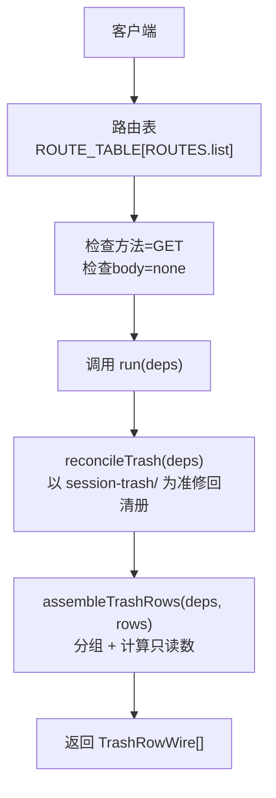
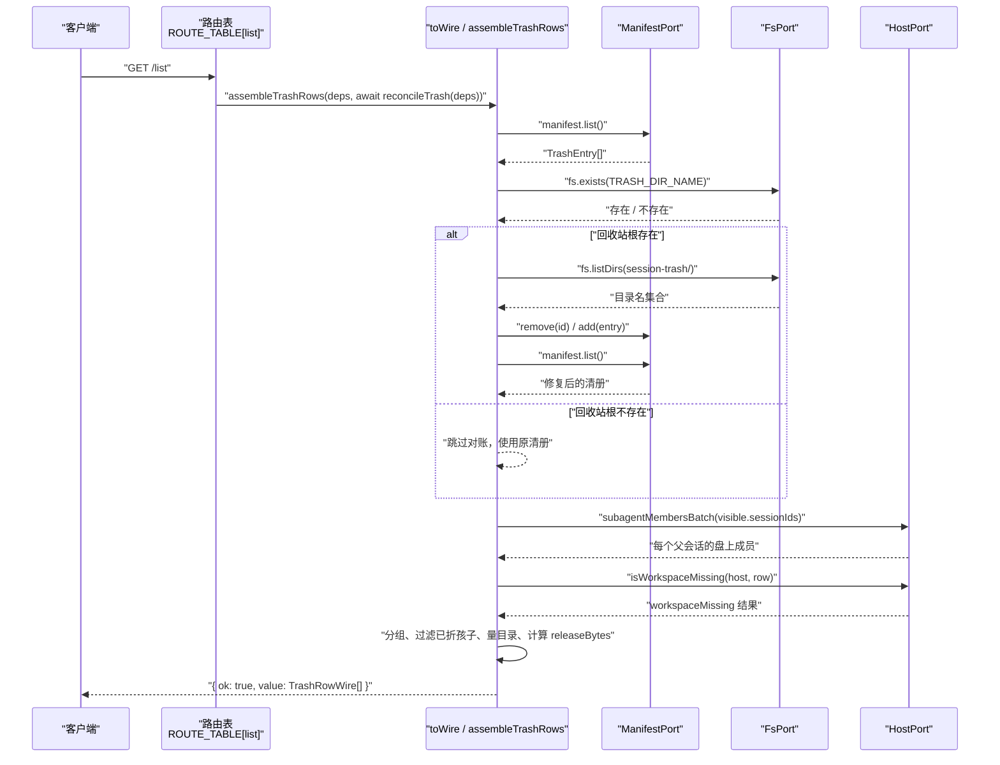
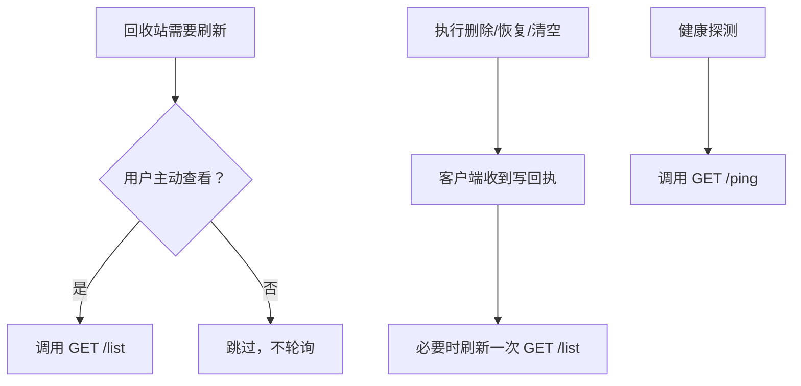

# GET /list — 回收站行列表

<cite>
**本文引用的文件**   
- [src/api/route-table.ts](file://src/api/route-table.ts)
- [src/api/trash-rows.ts](file://src/api/trash-rows.ts)
- [src/shared/wire.ts](file://src/shared/wire.ts)
- [src/trash/reconcile.ts](file://src/trash/reconcile.ts)
- [src/trash/entry.ts](file://src/trash/entry.ts)
- [src/verbs/purge-trash.ts](file://src/verbs/purge-trash.ts)
- [tests/api.test.ts](file://tests/api.test.ts)
- [tests/wire-shape.test.ts](file://tests/wire-shape.test.ts)
</cite>

## 目录
1. [接口总览](#接口总览)
2. [请求](#请求)
3. [响应：TrashRowWire[]](#响应trashrowwire)
4. [处理流程：先对账，再读清单，再装配只读数](#处理流程先对账再读清单再装配只读数)
5. [可选字段语义](#可选字段语义)
6. [典型请求与响应示例](#典型请求与响应示例)
7. [性能注意事项](#性能注意事项)
8. [故障排查](#故障排查)
9. [结论](#结论)

## 接口总览

`GET /list` 是 DSH 会话删除插件提供的六个 API 段之一，用于读取回收站中的“行”。它不是简单返回持久化清册，而是：

| 项目 | 说明 |
|---|---|
| HTTP 方法 | `GET` |
| URL 路径 | `/dsh-session-delete-api/list`（由共享 wire 的 `ROUTES.list = '/list'` 与前缀组合） |
| 请求体 | 无；路由声明为 `body: 'none'` |
| 成功状态码 | `200` |
| 成功信封 | `{ ok: true, value: TrashRowWire[] }` |
| 失败信封 | `{ ok: false, error: { code, message, details? } }` |
| 串行性 | `purity: 'chained'`，进入写路径到达序链，不与其他写操作交错 |
| 主要副作用 | 对账并写入清理后的清册；然后按组装配线上行 |

该端点面向的是“一组行”，而不是单条详情。单条详情走 `POST /detail`。

**章节来源**
- [src/shared/wire.ts:1-60](file://src/shared/wire.ts#L1-L60)
- [src/api/route-table.ts:100-120](file://src/api/route-table.ts#L100-L120)
- [tests/api.test.ts:150-170](file://tests/api.test.ts#L150-L170)

## 请求

- 不需要请求体。
- 不需要查询参数。
- 不需要认证头或业务负载；同源栅栏、错误映射等传输层检查由路由分发器统一处理。
- 如果客户端把 JSON body 带上，路由层不会去消费它，因为该方法被标记为 `body: 'none'`。



**图示来源**
- [src/api/route-table.ts:100-120](file://src/api/route-table.ts#L100-L120)
- [src/api/trash-rows.ts:45-93](file://src/api/trash-rows.ts#L45-L93)
- [src/trash/reconcile.ts:1-20](file://src/trash/reconcile.ts#L1-L20)

**章节来源**
- [src/api/route-table.ts:100-120](file://src/api/route-table.ts#L100-L120)
- [src/shared/wire.ts:1-60](file://src/shared/wire.ts#L1-L60)

## 响应：TrashRowWire[]

成功响应是一个数组，每项都是 `TrashRowWire`。它继承自清册投影 `TrashEntryWire`，并加上本次现算的只读字段。

| 字段 | 类型 | 是否必填 | 含义 |
|---|---|---:|---|
| `id` | `string` | 是 | 回收站条目 id，也是 `session-trash/` 下的目录名 |
| `sessionId` | `string` | 是 | 会话标识 |
| `projectDir` | `string` | 是 | 会话所属项目目录 |
| `workspaceId` | `string` | 是 | 删除时所属工作区；空串表示“未分组” |
| `wasArchived` | `boolean` | 是 | 删除前的归档态 |
| `deletedAt` | `number` | 是 | 删除时间戳 |
| `title` | `string` | 是 | 删除时的会话标题；取不到为空串 |
| `sizeBytes` | `number` | 是 | 删除时会话目录字节数 |
| `parentEntryId` | `string \| undefined` | 否 | 若该行是子会话，则指向父行 id；缺席表示它是父行或被单独删的行 |
| `releaseBytes` | `number` | 是 | 彻底删除本行及关联项后释放的字节总数 |
| `subagentCount` | `number \| undefined` | 否 | 跟着父会话一起进回收站的子会话数量 |
| `subagentBytes` | `number \| undefined` | 否 | 上述子会话的字节合计 |
| `strandedSubagents` | `number \| undefined` | 否 | 宿主的会话列表中仍存在的盘上后代数量 |
| `strandedBytes` | `number \| undefined` | 否 | 这些盘上后代的实际字节合计 |
| `workspaceMissing` | `boolean \| undefined` | 否 | 删除时的工作区已不在宿主账本中 |

注意：

1. `releaseBytes` 是**必填**。它代表存储侧“这一次会释放多少”的唯一口径，由服务端计算，避免浏览器端重复计算。
2. 其余扩展字段全部是可选；**缺席表示“这次没有提供这个读数”**，不能理解为 `0` 或 `false`。
3. `TrashRowWire` 在 wire 契约中定义，测试用形状断言强制两端保持一致。

**章节来源**
- [src/shared/wire.ts:60-120](file://src/shared/wire.ts#L60-L120)
- [src/trash/entry.ts:1-40](file://src/trash/entry.ts#L1-L40)
- [tests/wire-shape.test.ts:40-100](file://tests/wire-shape.test.ts#L40-L100)

## 处理流程：先对账，再读清单，再装配只读数

`GET /list` 的核心处理函数在路由表中直接组装两个步骤：



**图示来源**
- [src/api/route-table.ts:100-120](file://src/api/route-table.ts#L100-L120)
- [src/api/trash-rows.ts:45-93](file://src/api/trash-rows.ts#L45-L93)
- [src/trash/reconcile.ts:60-127](file://src/trash/reconcile.ts#L60-L127)
- [src/shared/wire.ts:1-60](file://src/shared/wire.ts#L1-L60)

### 第一步：对账 `reconcileTrash`

对账的目标是让清册与 `session-trash/` 目录一致：

- 以 `session-trash/` 里的条目目录为准。
- 清册中有但目录没有的行被移除。
- 目录中有但清册没有的行尝试重建。
- 无法重建的目录（日志缺失、header 不可读、尺寸量不出等）静默跳过。
- 如果回收站根目录不存在，不做任何修改，直接返回原清册。
- 幂等：再跑一遍不会产生额外写入。

对账是写清册的操作，但它是“修复式”的：只修正不一致部分，不改变用户真正留下的回收站数据。

**章节来源**
- [src/trash/reconcile.ts:1-20](file://src/trash/reconcile.ts#L1-L20)
- [src/trash/reconcile.ts:60-127](file://src/trash/reconcile.ts#L60-L127)

### 第二步：分组与装配 `assembleTrashRows`

清册中的子会话不应作为独立行显示；它们应折进父行。装配过程：

1. 使用 `visibleGroups(rows)` 把行分成“父行 + 跟随它的子行”。
2. 只向客户端暴露每组根行。
3. 通过 `deps.host.subagentMembersBatch` 批量获取每个父会话的盘上成员。
4. 通过 `isWorkspaceMissing` 判断工作区是否还在宿主账本中。
5. 对每个盘上成员调用 `measureMemberDir`，统计仍在磁盘上的后代数量与字节。
6. 对已折入父行的子会话，累加其 `sizeBytes` 作为 `subagentBytes`。
7. 计算 `releaseBytes = sizeBytes + subagentBytes + strandedBytes`。
8. 只把确实存在的可选字段放入响应对象，避免宽 spread 掩盖缺失值。

**章节来源**
- [src/api/trash-rows.ts:1-44](file://src/api/trash-rows.ts#L1-L44)
- [src/api/trash-rows.ts:45-93](file://src/api/trash-rows.ts#L45-L93)

### 第三步：`toWire` 投影

`toWire` 负责把 `TrashEntry` 和“只读数容器”合并成 `TrashRowWire`。它的关键设计是：

- 显式列出所有字段，不使用 `...row`，防止线上接口新增必填字段时被静默漏填。
- 显式条件加入可选字段，使“缺席”与“值为 0/false”保持语义差异。
- `releaseBytes` 是唯一必算字段，体现“本行 + 子会话 + 盘上后代”的统一口径。

**章节来源**
- [src/api/trash-rows.ts:15-44](file://src/api/trash-rows.ts#L15-L44)
- [tests/wire-shape.test.ts:40-100](file://tests/wire-shape.test.ts#L40-L100)

## 可选字段语义

| 可选字段 | 出现时机 | 缺席含义 |
|---|---|---|
| `parentEntryId` | 只有清册中存在这条父子关系时才出现 | 表示这不是子会话行，或父子信息随清册丢失而降级 |
| `subagentCount` | 父行有跟随它的子会话时出现 | 不是“没有子会话”，而是“本次没提供该计数” |
| `subagentBytes` | 同上 | 不是 0，而是“本次没提供子会话字节合计” |
| `strandedSubagents` | 父会话仍有盘上后代时出现 | 不是 0，而是“本次没测量到残留后代” |
| `strandedBytes` | 同上 | 不是 0，而是“本次没得到残留后代字节” |
| `workspaceMissing` | 工作区已从宿主账本中移除时出现且为 `true` | 不是“工作区还在”，而是“本次没发现缺失标志” |

文档要求：**不要拿 0 冒充“没有”，也不要拿字段缺席冒充“否”**。例如：

- `subagentCount` 缺席 ≠ 子会话数为 0。
- `strandedSubagents` 缺席 ≠ 盘上没有残留。
- `workspaceMissing` 缺席 ≠ 工作区仍然存在。

这是由 `toWire` 的逐格条件展开保证的：只有当值明确存在时才放进响应对象。

**章节来源**
- [src/api/trash-rows.ts:15-44](file://src/api/trash-rows.ts#L15-L44)
- [src/shared/wire.ts:80-120](file://src/shared/wire.ts#L80-L120)
- [tests/wire-shape.test.ts:50-100](file://tests/wire-shape.test.ts#L50-L100)

## 典型请求与响应示例

以下示例描述协议行为，不展示仓库源码。

### 示例一：空回收站

**请求**

```http
GET /dsh-session-delete-api/list
```

**响应**

```json
{
  "ok": true,
  "value": []
}
```

### 示例二：单个父会话，没有子会话，也没有盘上后代

**请求**

```http
GET /dsh-session-delete-api/list
```

**响应**

```json
{
  "ok": true,
  "value": [
    {
      "id": "20261019T120000Z-session-a",
      "sessionId": "session-a",
      "projectDir": "--p--",
      "workspaceId": "ws-1",
      "wasArchived": false,
      "deletedAt": 1760000000000,
      "title": "会话 A",
      "sizeBytes": 224000,
      "releaseBytes": 224000
    }
  ]
}
```

这里没有 `subagentCount`、`strandedSubagents`、`workspaceMissing`，因为它们不参与这一行。

### 示例三：父会话带两个子会话，并且还有一个盘上后代

假设清册中有：

- 父会话：`sizeBytes = 224000`
- 子会话 A：`sizeBytes = 700`
- 子会话 B：`sizeBytes = 300`
- 盘上后代 grandkidA：仍在宿主会话列表中，但不在清册里
- grandkidB：仍在宿主会话列表中，但不在清册里

响应中的父行会出现子会话计数、子会话字节，以及盘上后代计数和字节：

```json
{
  "ok": true,
  "value": [
    {
      "id": "20261019T120000Z-session-parent",
      "sessionId": "session-parent",
      "projectDir": "--p--",
      "workspaceId": "ws-1",
      "wasArchived": false,
      "deletedAt": 1760000000000,
      "title": "父会话",
      "sizeBytes": 224000,
      "releaseBytes": 225000,
      "subagentCount": 2,
      "subagentBytes": 1000,
      "strandedSubagents": 2,
      "strandedBytes": 2048
    }
  ]
}
```

其中：

- `subagentCount = 2`：两个子会话随父会话进入回收站。
- `subagentBytes = 700 + 300 = 1000`。
- `strandedSubagents = 2`：宿主会话列表中发现的两个盘上后代。
- `strandedBytes = 2048`：这两个盘上后代的实际目录字节。
- `releaseBytes = 224000 + 1000 + 2048 = 225000`。

注意：已折进父行的子会话不会被重复计入 `strandedSubagents`；实现中会排除已在清册中跟随父行进入回收站的子会话。

**章节来源**
- [src/api/trash-rows.ts:60-93](file://src/api/trash-rows.ts#L60-L93)
- [tests/api.test.ts:170-220](file://tests/api.test.ts#L170-L220)
- [tests/wire-shape.test.ts:60-80](file://tests/wire-shape.test.ts#L60-L80)

### 示例四：工作区缺失

如果恢复动词检测到某行的工作区已从宿主账本中移除，`assembleTrashRows` 会在该行上附加 `workspaceMissing: true`：

```json
{
  "ok": true,
  "value": [
    {
      "id": "20261019T120000Z-session-b",
      "sessionId": "session-b",
      "projectDir": "--p--",
      "workspaceId": "ws-2",
      "wasArchived": false,
      "deletedAt": 1760000000000,
      "title": "会话 B",
      "sizeBytes": 100000,
      "releaseBytes": 100000,
      "workspaceMissing": true
    }
  ]
}
```

这表示“删除时记录的工作区已经不在账本里”，并不表示其他可选字段不存在。

**章节来源**
- [src/api/trash-rows.ts:60-93](file://src/api/trash-rows.ts#L60-L93)

### 示例五：释放字节合计

释放字节合计不是浏览器端重新计算的数字，而是服务端唯一算式：

```text
releaseBytes = 本行.sizeBytes + 子会话.sizeBytes 合计 + 盘上后代.strandedBytes
```

这与 `purgeTrash` 最终删除目录时释放的字节口径一致，因此界面头部合计、单条确认框、清空回执之间不会出现两套口径。

**章节来源**
- [src/api/trash-rows.ts:20-44](file://src/api/trash-rows.ts#L20-L44)
- [src/verbs/purge-trash.ts:1-30](file://src/verbs/purge-trash.ts#L1-L30)

## 性能注意事项

### 1. 它是写路径中的串行操作

路由表中 `GET /list` 的纯度是 `chained`，意味着它会进入写路径到达序链。这样做的目的是避免对账与删除、恢复、彻底删除等操作交错，导致“目录在但行是降级元数据”的不一致世界。

代价是：

- 每次刷新回收站列表都会串行排队。
- 高频轮询会阻塞后续写操作。
- 不适合做成页面加载时反复触发的健康探测。

### 2. 对账有磁盘 I/O

`reconcileTrash` 会枚举 `session-trash/` 目录，并对重建的行读取日志、解析 header、测量目录大小。虽然代码注释指出本机小清单通常是毫秒级，但它仍然是磁盘相关操作。

### 3. 推荐刷新策略

- 不要在高频定时器中直接轮询 `GET /list`。
- 用户主动打开回收站面板时触发一次。
- 执行删除、恢复、彻底删除、清空等写操作成功后，让客户端刷新一次。
- 如果需要快速探测服务可用性，使用 `GET /ping`，它明确标注为纯读、不碰清册、不碰盘、不进链。



**图示来源**
- [src/api/route-table.ts:100-143](file://src/api/route-table.ts#L100-L143)
- [src/shared/wire.ts:20-40](file://src/shared/wire.ts#L20-L40)

**章节来源**
- [src/api/route-table.ts:100-143](file://src/api/route-table.ts#L100-L143)
- [src/trash/reconcile.ts:1-20](file://src/trash/reconcile.ts#L1-L20)

## 故障排查

| 现象 | 可能原因 | 建议 |
|---|---|---|
| 响应中没有 `subagentCount` 或 `subagentBytes` | 该行没有跟随它的子会话，或当前分组路径没有提供该读数 | 不要把它当作 0；检查清册中是否存在 `parentEntryId` 指向该父行的行 |
| 响应中没有 `strandedSubagents` 或 `strandedBytes` | 宿主会话列表中没有仍在运行的盘上后代，或测量结果为空 | 不要把它当作 0；检查父会话是否还有未被带走的子会话 |
| 响应中没有 `workspaceMissing` | 工作区尚未被判定为缺失，或本次未设置该标志 | 不要把它当作 `false`；恢复动词会根据工作区状态决定行为 |
| `releaseBytes` 比预期小 | 子会话或盘上后代目录不存在、日志缺失、或宿主会话列表缺少对应成员 | 检查 `session-trash/` 目录结构、会话日志、宿主会话列表 |
| 刷新很慢 | 回收站目录很多、对账重建行数多、或写路径链上有其他写操作 | 减少自动轮询；只在必要时机刷新；优先用 `/ping` 做健康探测 |
| 清册行与目录不一致 | 手工移动了 `session-trash/` 目录、磁盘异常、或上次写操作中断 | 下次调用 `GET /list` 会自动对账修复；必要时检查磁盘与清册一致性 |

对账的容错原则是：

- 不认识或读不出数据的目录：跳过，不抛掉整次读数。
- 回收站根不存在：跳过对账，不判成“回收站空了”。
- 重建行只写“文件里真有的事实”，缺失字段按降级默认值落库。

**章节来源**
- [src/trash/reconcile.ts:1-20](file://src/trash/reconcile.ts#L1-L20)
- [src/trash/reconcile.ts:60-127](file://src/trash/reconcile.ts#L60-L127)
- [src/api/trash-rows.ts:45-93](file://src/api/trash-rows.ts#L45-L93)

## 结论

`GET /list` 不是简单的“读清册”。它是一个“对账 + 分组 + 装配”的复合读端点：

- 先以 `session-trash/` 目录为准修复清册。
- 再把子会话折进父行，生成可展示的父行列表。
- 最后装配 `releaseBytes` 与五个可选只读数。
- `releaseBytes` 是服务端唯一口径，客户端不应重算。
- 可选字段缺席表示“没有该读数”，不能用 0 或 false 冒充。
- 因为它进入写路径串行链并可能做磁盘对账，应避免高频轮询；改用用户驱动刷新和写操作后刷新。