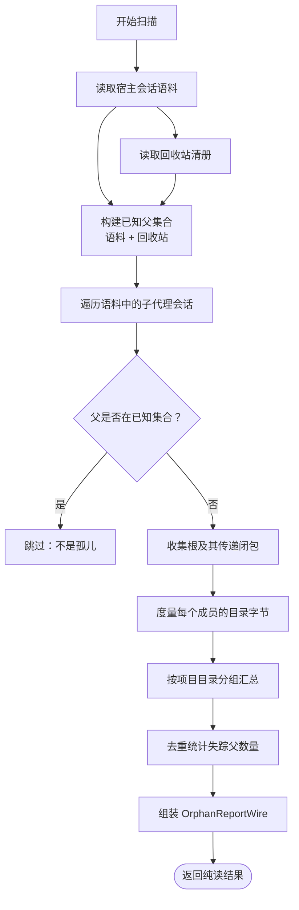
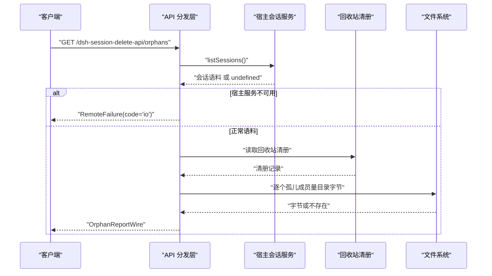

# GET /orphans — 无主子会话扫描报告

<cite>
**本文引用的文件**   
- [src/index.ts](file://src/index.ts)
- [src/shared/wire.ts](file://src/shared/wire.ts)
- [src/api/dispatch.ts](file://src/api/dispatch.ts)
- [src/verbs/orphan-subagents.ts](file://src/verbs/orphan-subagents.ts)
- [tests/orphan-subagents.test.ts](file://tests/orphan-subagents.test.ts)
- [README.md](file://README.md)
</cite>

## 目录
1. [简介](#简介)
2. [端点定义](#端点定义)
3. [扫描语义](#扫描语义)
4. [响应模型 OrphanReportWire](#响应模型-orphanreportwire)
5. [典型响应示例](#典型响应示例)
6. [与清理动作的关系](#与清理动作的关系)
7. [与 /list 的区别](#与-list-的区别)
8. [性能与错误处理](#性能与错误处理)
9. [故障排查](#故障排查)

## 简介
`GET /orphans` 是“删除会话”插件暴露的一个纯读扫描接口，用于回答：**哪些子会话的父已经彻底消失了**。它遍历宿主当前语料和回收站清册，找出那些既不在宿主会话列表、也不在回收站中的父所对应的子会话组；返回根会话、总数、字节数和按项目分组的统计。

该接口不写任何文件：不修改会话日志、不清理目录、不改动回收站清册，也不修改宿主投影缓存或附件。真正的清理通过 `/apply?action=orphan-clean&ids=[...]` 完成。

## 端点定义

| 项目 | 值 |
| --- | --- |
| HTTP 方法 | `GET` |
| URL 段名 | `/dsh-session-delete-api/orphans` |
| 入参 | 无 |
| 成功响应体 | `OrphanReportWire` |
| 失败响应信封 | `RemoteFailure`（`code`、`message`、可选 `details`） |
| 是否写盘 | 否 |
| 是否修改回收站清册 | 否 |
| 是否修改宿主会话状态 | 否 |

路由段名由共享 wire 契约声明，Node 半注册在 `/dsh-session-delete-api` 前缀下；浏览器半同源 fetch 同一路径。

**章节来源**
- [src/shared/wire.ts:38-56](file://src/shared/wire.ts#L38-L56)
- [src/index.ts:10-19](file://src/index.ts#L10-L19)

## 扫描语义

### 什么是“无主子会话”
一个会话被认定为“无主子会话”，必须同时满足：
1. 它是子代理会话（`subagent`）。
2. 它有父会话 `parentSessionId`。
3. 该父会话 **既不在宿主当前语料中，也不在回收站清册里**。

如果父会话仍在宿主列表中，或者只是被移进回收站，那不属于孤儿；后者属于“ stranded ”（滞留）关系，应由用户显式决定恢复或随父一起处理。

### 分组与传递闭包
每个孤儿组以那个“父没了”的子会话作为根，并通过宿主语料的父子关系收集它的传递闭包——包括直接子会话、孙代以及更深层后代。同一会话只归一组，避免环状数据造成重复计数。

### 去重规则
- 已知父集合会去掉会话 id 上的 `session-` 前缀后再比对，因此同一父在不同宿主代次写法下不会误判。
- `missingParents` 按去前缀后的父 id 去重计数。
- 同一父对应多个孤儿根时，`roots` 可能包含多条根，但 `missingParents` 仍计为 1。



**图表来源**
- [src/verbs/orphan-subagents.ts:75-128](file://src/verbs/orphan-subagents.ts#L75-L128)
- [src/verbs/orphan-subagents.ts:130-178](file://src/verbs/orphan-subagents.ts#L130-L178)
- [src/verbs/orphan-subagents.ts:180-200](file://src/verbs/orphan-subagents.ts#L180-L200)

**章节来源**
- [src/verbs/orphan-subagents.ts:65-128](file://src/verbs/orphan-subagents.ts#L65-L128)
- [tests/orphan-subagents.test.ts:28-52](file://tests/orphan-subagents.test.ts#L28-L52)

## 响应模型 OrphanReportWire

| 字段 | 类型 | 含义 |
| --- | --- | --- |
| `roots` | `string[]` | 每个孤儿组的根会话 id。根是那个“父已不存在”的子会话，不是整个闭包里的所有会话。 |
| `totalSessions` | `number` | 所有孤儿组成员的会话数合计，即 `roots` 所属各组的传递闭包大小之和。 |
| `totalBytes` | `number` | 所有组成员盘上目录字节合计。这是扫描时刻的快照，不代表未来清理释放的精确值。 |
| `missingParents` | `number` | 失踪父的数量，按去前缀后的父 id 去重后统计。 |
| `groups` | `OrphanProjectGroupWire[]` | 按项目目录分组的统计，每项含 `projectDir`、`sessions`、`bytes`；按字节从多到少排序。 |

其中 `OrphanProjectGroupWire` 表示一个项目目录维度的聚合：
- `projectDir`：会话所在的项目目录。
- `sessions`：该项目下孤儿组成员的数量。
- `bytes`：该项目下孤儿组成员的目录字节合计。

注意：
- `roots` 只列出每组一个根，不展开整棵闭包。
- `groups` 是“项目维度”的扁平列表，不是嵌套树。
- `groups` 按字节降序排列，便于界面优先展示残留最多的项目。
- `missingParents` 是去重后的父数量，不等于 `roots.length`。

**章节来源**
- [src/shared/wire.ts:140-170](file://src/shared/wire.ts#L140-L170)
- [src/verbs/orphan-subagents.ts:180-200](file://src/verbs/orphan-subagents.ts#L180-L200)

## 典型响应示例

### 单项目、单个孤儿根
```json
{
  "roots": ["session-root"],
  "totalSessions": 2,
  "totalBytes": 200,
  "missingParents": 1,
  "groups": [
    {
      "projectDir": "--p--",
      "sessions": 1,
      "bytes": 100
    },
    {
      "projectDir": "--q--",
      "sessions": 1,
      "bytes": 100
    }
  ]
}
```

这里根会话在一个项目目录，但其传递闭包成员落在两个项目目录，因此 `groups` 出现两项。测试用例覆盖了这种根与后代跨项目的情况。

### 多项目分组与重复失踪父
假设存在两组孤儿：
- 根 A 的父是 `gone-1`，闭包有 3 个成员，分布在项目 P 和 Q。
- 根 B 的父也是 `gone-1`，闭包有 2 个成员，全部在项目 R。

则响应可能是：
```json
{
  "roots": ["session-A", "session-B"],
  "totalSessions": 5,
  "totalBytes": 500,
  "missingParents": 1,
  "groups": [
    {
      "projectDir": "R",
      "sessions": 2,
      "bytes": 200
    },
    {
      "projectDir": "P",
      "sessions": 2,
      "bytes": 180
    },
    {
      "projectDir": "Q",
      "sessions": 1,
      "bytes": 120
    }
  ]
}
```

要点：
- `roots` 有两个元素，因为有两个不同的孤儿根。
- `missingParents` 只有 1，因为两个根的父都是同一个 `gone-1`，且去前缀后视为同一父。
- `totalSessions` 是所有组成员之和，不是 `roots.length`。
- `groups` 按字节降序排列：R 最多，其次是 P，最后是 Q。

**章节来源**
- [tests/orphan-subagents.test.ts:54-78](file://tests/orphan-subagents.test.ts#L54-L78)
- [src/verbs/orphan-subagents.ts:180-200](file://src/verbs/orphan-subagents.ts#L180-L200)

## 与清理动作的关系

`GET /orphans` 只负责发现并报告；它不会删除任何会话目录。

真正的清理通过批量动作端点执行：
```
POST /dsh-session-delete-api/apply
```
请求体中使用动作 `orphan-clean`，并以宿主会话 id 指定要清理的孤儿根。例如：
```json
{
  "action": "orphan-clean",
  "ids": ["session-A", "session-B"]
}
```

清理行为与扫描不同：
- 清理会检查组成员是否正在运行。
- 清理会从归档集中摘出这些会话。
- 清理会解绑工作区账本。
- 清理会删除盘上会话目录。
- 清理会通告宿主移除相应会话。
- 清理不会把孤儿移进回收站；孤儿没有回收站行可删。
- 如果部分目录已缺失，清理仍可继续处理其他成员，并在失败中附带已删除数量和字节。

**章节来源**
- [src/shared/wire.ts:58-74](file://src/shared/wire.ts#L58-L74)
- [src/verbs/orphan-subagents.ts:202-231](file://src/verbs/orphan-subagents.ts#L202-L231)

## 与 /list 的区别

| 维度 | `GET /list` | `GET /orphans` |
| --- | --- | --- |
| 主要用途 | 显示回收站清单，并对账回收站目录与清册 | 扫描回收站之外、父已消失的孤儿会话 |
| 数据来源 | 回收站清册为主，辅以盘上目录对账 | 宿主会话语料 + 回收站清册 |
| 是否写盘 | 会对账并写入回收站清册 | 不写盘 |
| 是否修改宿主状态 | 不修改会话状态 | 不修改会话状态 |
| 输出内容 | 回收站条目及衍生读数 | 孤儿根、闭包统计、项目分组 |
| 清理入口 | 回收站条目走 `delete` / `restore` / `purge` | 孤儿根走 `orphan-clean` |
| 安全语义 | 可能变更回收站可见性 | 纯读，不含正文，no-cors 回包 opaque |

换言之：
- `/list` 面向“已经进了回收站的东西”。
- `/orphans` 面向“父已经彻底没了、连回收站都没有的行”。

**章节来源**
- [src/shared/wire.ts:38-74](file://src/shared/wire.ts#L38-L74)
- [src/api/dispatch.ts:105-109](file://src/api/dispatch.ts#L105-L109)

## 性能与错误处理

### 性能特征
- 时间复杂度主要由宿主会话语料规模决定：需要遍历语料建立父子映射、构建已知父集合、再遍历一次识别孤儿根并收集闭包。
- 空间复杂度取决于语料大小和孤儿闭包规模。
- 磁盘访问发生在字节度量阶段：每个孤儿组成员调用一次目录存在性与大小查询。
- 报告生成是线性聚合，并按项目目录排序。
- 若宿主会话语料很大，客户端应先使用 `/list` 做基础刷新，再调用 `/orphans`，避免频繁触发完整扫描。

### 错误处理
- 如果宿主会话查询服务不可用，`loadOrphanGroups` 会抛出 `io` 类错误，而不是假装“零条孤儿”。这是有意设计：拿不到语料不能冒充空结果。
- 如果某个会话路径非法，扫描会拒绝，防止递归删除泄漏出会话根目录。
- 扫描本身不写文件，所以错误通常意味着“无法完成报告”，而不是“部分清理已完成”。
- 网络层失败会以统一信封返回，包含 `code`、`message` 和可选 `details`。



**图表来源**
- [src/verbs/orphan-subagents.ts:130-178](file://src/verbs/orphan-subagents.ts#L130-L178)
- [src/api/dispatch.ts:105-109](file://src/api/dispatch.ts#L105-L109)

**章节来源**
- [src/verbs/orphan-subagents.ts:130-178](file://src/verbs/orphan-subagents.ts#L130-L178)
- [tests/orphan-subagents.test.ts:80-103](file://tests/orphan-subagents.test.ts#L80-L103)

## 故障排查

| 现象 | 可能原因 | 建议 |
| --- | --- | --- |
| 返回 `code='io'` | 宿主会话查询服务未就绪 | 重启宿主或确认宿主版本支持该服务；不要把它解释为“没有孤儿”。 |
| `roots` 为空但盘上仍有目录 | 父仍在宿主列表或回收站中 | 这不是孤儿；应通过回收站面板恢复或彻底删除父。 |
| `missingParents` 小于 `roots.length` | 多个孤儿根共享同一个失踪父 | 这是预期去重行为。 |
| `groups` 中项目目录比预期多 | 根与会话后代位于不同项目目录 | 检查会话的 `projectDir`，这反映的是盘上归属而非 UI 分组。 |
| 清理后仍有少量目录 | 部分目录已缺失或清理中途失败 | 查看 `orphan-clean` 回执中的 `removed`、`freedBytes` 与失败详情。 |
| 客户端看不到 `/orphans` | 宿主插件未激活或服务不可用 | 重启宿主；插件不可用时不应注册入口。 |

补充说明：
- 插件文档明确“无主残留”的父会话不在回收站中，面板只在扫描到时提示，由用户决定是否清理，且“绝不自动跑”。
- 回收站与宿主会话目录同卷，搬移依赖原子 rename；孤儿清理直接删除目录，不走回收站。

**章节来源**
- [README.md:17-27](file://README.md#L17-L27)
- [README.md:68-84](file://README.md#L68-L84)
- [tests/orphan-subagents.test.ts:105-147](file://tests/orphan-subagents.test.ts#L105-L147)

## 结论
`GET /orphans` 是一个安全的纯读扫描端点，职责是回答“哪些孤儿会话存在、它们有多大、分布在哪些项目”。它不负责清理；清理通过 `/apply?action=orphan-clean&ids=[...]` 显式触发。对于运维和调试而言，区分 `/list`（回收站清单）与 `/orphans`（父已消失的孤儿）很重要：前者管理已进入回收站的会话，后者管理宿主语料与回收站都无法认领的残留会话。