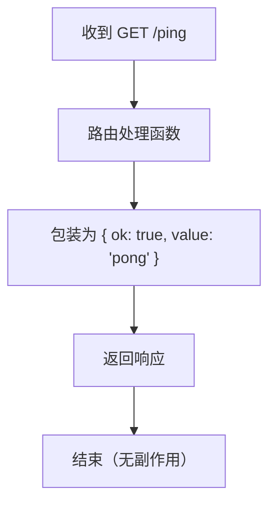
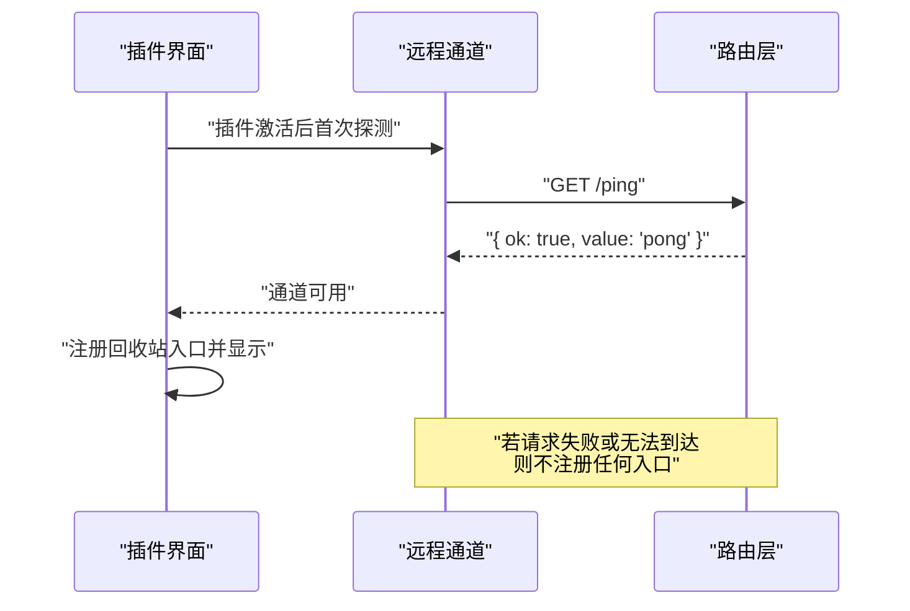
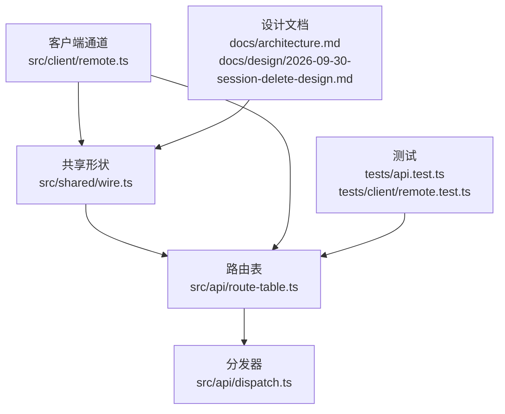

# GET /ping — 通道探测

<cite>
**本文引用的文件**   
- [README.md](file://README.md)
- [docs/architecture.md](file://docs/architecture.md)
- [docs/design/2026-09-30-session-delete-design.md](file://docs/design/2026-09-30-session-delete-design.md)
- [src/shared/wire.ts](file://src/shared/wire.ts)
- [src/api/route-table.ts](file://src/api/route-table.ts)
- [src/client/remote.ts](file://src/client/remote.ts)
- [tests/client/remote.test.ts](file://tests/client/remote.test.ts)
- [tests/api.test.ts](file://tests/api.test.ts)
</cite>

## 目录
1. [简介](#简介)
2. [端点定义](#端点定义)
3. [语义与边界](#语义与边界)
4. [客户端用法](#客户端用法)
5. [架构位置](#架构位置)
6. [故障排查](#故障排查)
7. [结论](#结论)

## 简介
`GET /ping` 是插件的**通道探测**端点，用途只有一句话：**问“通道在不在”，不回答“回收站有多少条”**。它是最便宜的在/不在探测——不读清册、不碰磁盘、不进串行链，返回字符串 `'pong'`。

它与健康检查不同：健康检查通常用于判断服务是否还活着；本端点更偏“接入点可用性”。即使它成功返回，也不代表回收站数据一定正确。**对账由 `GET /list` 承担**，`/ping` 不参与对账，结果与真实数据无关。

**章节来源**
- [README.md:1-147](file://README.md#L1-L147)
- [docs/architecture.md:24-50](file://docs/architecture.md#L24-L50)

## 端点定义

| 项目 | 值 |
| --- | --- |
| 路径 | `/ping` |
| 方法 | `GET` |
| 请求体 | 无 |
| 响应体 | `{ ok: true, value: 'pong' }` |
| 副作用 | 无 |
| 是否对账 | 否 |
| 是否进串行执行链 | 否 |
| 是否读清册 | 否 |
| 是否读盘 | 否 |
| 典型用途 | 插件激活后首次探测槽位可用性；失败时降级 UI，不注册入口 |

实现上，路由表把段名映射到处理函数，`/ping` 的处理直接返回信封形式的成功响应；共享形状 `wire.ts` 明确声明它“不碰清册、不碰盘、不进链”。

**图示来源**
- [src/api/route-table.ts:96-96](file://src/api/route-table.ts#L96-L96)
- [src/shared/wire.ts:30-39](file://src/shared/wire.ts#L30-L39)

**章节来源**
- [src/api/route-table.ts:96-96](file://src/api/route-table.ts#L96-L96)
- [src/shared/wire.ts:30-39](file://src/shared/wire.ts#L30-L39)
- [tests/api.test.ts:1066-1073](file://tests/api.test.ts#L1066-L1073)

## 语义与边界

### 什么不是 /ping
- 不是健康检查：它只证明“这一端能接到这个段名”，不代表宿主会话列表可用、清册完好或回收站目录正常。
- 不能统计回收站行数：统计应走 `GET /list` 或对应的计数动作，而不是反复调用 `/ping`。
- 不参与对账：`/list` 才负责“以 `session-trash/` 目录为准修回清单”；`/ping` 绕开所有这些逻辑。
- 不保证数据一致：即使 `/ping` 成功，后续读取仍可能遇到缺失清册、缺失日志、权限错误等。

### 什么时候用 /ping
- 插件刚激活，需要快速判断当前宿主环境是否支持本插件的 API 通道。
- 用户打开回收站面板前做一次性准入探测。
- 探测失败时，**不要注册任何入口**，用“入口不出现”表达不可用，而不是展示一个空态或禁用态界面。

### 什么时候不用 /ping
- 需要知道回收站里有多少条会话。
- 需要列出会话、查看详情、恢复、清空或清理无主残留。
- 需要确认清册与磁盘一致。
- 需要把一次业务操作的结果当作“服务存活信号”。

**章节来源**
- [docs/architecture.md:50-62](file://docs/architecture.md#L50-L62)
- [docs/design/2026-09-30-session-delete-design.md:396-415](file://docs/design/2026-09-30-session-delete-design.md#L396-L415)
- [src/shared/wire.ts:30-39](file://src/shared/wire.ts#L30-L39)

## 客户端用法

### 典型流程

**图示来源**
- [src/client/remote.ts:200-200](file://src/client/remote.ts#L200-L200)
- [tests/client/remote.test.ts:113-117](file://tests/client/remote.test.ts#L113-L117)

### 成功分支
1. 发出 `GET /ping`。
2. 拿到信封式响应。
3. 认为通道可用。
4. 注册回收站相关入口和菜单项。
5. 后续再按需调用 `GET /list` 获取真实数据。

### 失败分支
1. 网络错误、超时、路由不存在、或通道根本未暴露。
2. **不注册任何入口**。
3. 用户看不到“回收站”面板行，也看不到删除菜单项。
4. 这不是“已禁用”，而是“不可用且主动隐身”。
5. 不要弹出虚假的零条回收站界面；也不要把它解释成“回收站为空”。

### 常见误用示例与纠正

| 误用 | 为什么错 | 正确做法 |
| --- | --- | --- |
| 用 `/ping` 的返回值判断回收站是否为空 | 它只返回固定字符串，不读数据 | 调用 `GET /list` 或对应计数接口 |
| 页面加载时对每个会话行都发一次 `/ping` | 违背“最便宜探测”的定位 | 只在插件激活和面板初始化时探测一次 |
| 把 `/ping` 失败当成“回收站没数据” | 失败说明通道不可达，不等于空集 | 隐藏入口，提示用户稍后重试 |
| 用 `/ping` 参与对账或审计 | 它没有对账语义，也不记录状态 | 使用 `GET /list` 和 `POST /empty` 的对账行为 |

**章节来源**
- [src/client/remote.ts:200-200](file://src/client/remote.ts#L200-L200)
- [tests/client/remote.test.ts:113-117](file://tests/client/remote.test.ts#L113-L117)
- [docs/architecture.md:50-50](file://docs/architecture.md#L50-L50)
- [docs/design/2026-09-30-session-delete-design.md:396-415](file://docs/design/2026-09-30-session-delete-design.md#L396-L415)

## 架构位置

`GET /ping` 在本仓库中贯穿四个层次：

1. **契约层**：`src/shared/wire.ts` 把 `/ping` 定义为六个段名之一，并写明它是“最便宜的在/不在”。
2. **路由层**：`src/api/route-table.ts` 给出段名的处理方法；`/ping` 直接返回成功信封，不依赖依赖注入、不清册、不读盘。
3. **客户端层**：`src/client/remote.ts` 用一次 `GET /ping` 决定取数通道是否可用；测试确认它不再拿全表对账当健康检查。
4. **设计文档**：架构 ADR 和设计稿强调“探测不过 ⇒ 不注册入口”，并把 `/ping` 从原来昂贵的 `GET /list` 替换出来，避免每次页面加载都跑全盘对账。

**图示来源**
- [src/shared/wire.ts:30-39](file://src/shared/wire.ts#L30-L39)
- [src/api/route-table.ts:22-96](file://src/api/route-table.ts#L22-L96)
- [src/client/remote.ts:200-200](file://src/client/remote.ts#L200-L200)
- [tests/api.test.ts:1066-1073](file://tests/api.test.ts#L1066-L1073)
- [tests/client/remote.test.ts:113-117](file://tests/client/remote.test.ts#L113-L117)
- [docs/architecture.md:24-62](file://docs/architecture.md#L24-L62)
- [docs/design/2026-09-30-session-delete-design.md:396-415](file://docs/design/2026-09-30-session-delete-design.md#L396-L415)

**章节来源**
- [src/shared/wire.ts:30-39](file://src/shared/wire.ts#L30-L39)
- [src/api/route-table.ts:22-96](file://src/api/route-table.ts#L22-L96)
- [src/client/remote.ts:200-200](file://src/client/remote.ts#L200-L200)
- [docs/architecture.md:24-62](file://docs/architecture.md#L24-L62)
- [docs/design/2026-09-30-session-delete-design.md:396-415](file://docs/design/2026-09-30-session-delete-design.md#L396-L415)

## 故障排查

| 现象 | 可能原因 | 处理建议 |
| --- | --- | --- |
| 插件安装后完全不出入口 | 首次 `GET /ping` 失败 | 重启宿主；确认宿主版本兼容；不要展示空态回收站 |
| 能看到其他入口但回收站入口缺失 | 仅回收站通道探测失败 | 检查宿主是否暴露了该插件的 API 段名 |
| `/ping` 成功但列表为空 | 通道可用，但清册或磁盘异常 | 改用 `GET /list` 查看错误原文，不要归因于 `/ping` |
| 怀疑回收站行数被统计 | 有人误把 `/ping` 当计数器 | 移除该调用；改为对 `GET /list` 或计数动作取长度 |
| 对账结果与预期不符 | 对账发生在 `GET /list`，不在 `/ping` | 刷新面板或重新调用 `/list`；不要在 `/ping` 上加缓存 |

注意：设计稿明确指出，早期版本曾把 `GET /list` 当健康检查，导致每次页面加载都触发全盘对账；后来才改走 `GET /ping`。因此，**任何“页面加载就变慢”的问题都不应该通过增加 `/ping` 调用来解决**，反而要减少不必要的网络请求。

**章节来源**
- [README.md:108-147](file://README.md#L108-L147)
- [docs/design/2026-09-30-session-delete-design.md:396-415](file://docs/design/2026-09-30-session-delete-design.md#L396-L415)
- [tests/client/remote.test.ts:113-117](file://tests/client/remote.test.ts#L113-L117)
- [tests/api.test.ts:1066-1096](file://tests/api.test.ts#L1066-L1096)

## 结论
`GET /ping` 的职责很窄：它是一个**零副作用、最低成本、与数据无关的通道探针**。它适合用来决定“要不要给用户看回收站入口”，不适合用来回答“回收站有几条”。如果你需要统计数据、检查一致性或执行业务动作，请走 `/list`、`/apply` 或其他显式端点，而不是复用 `/ping`。