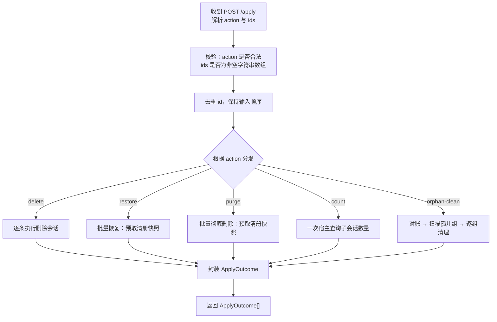
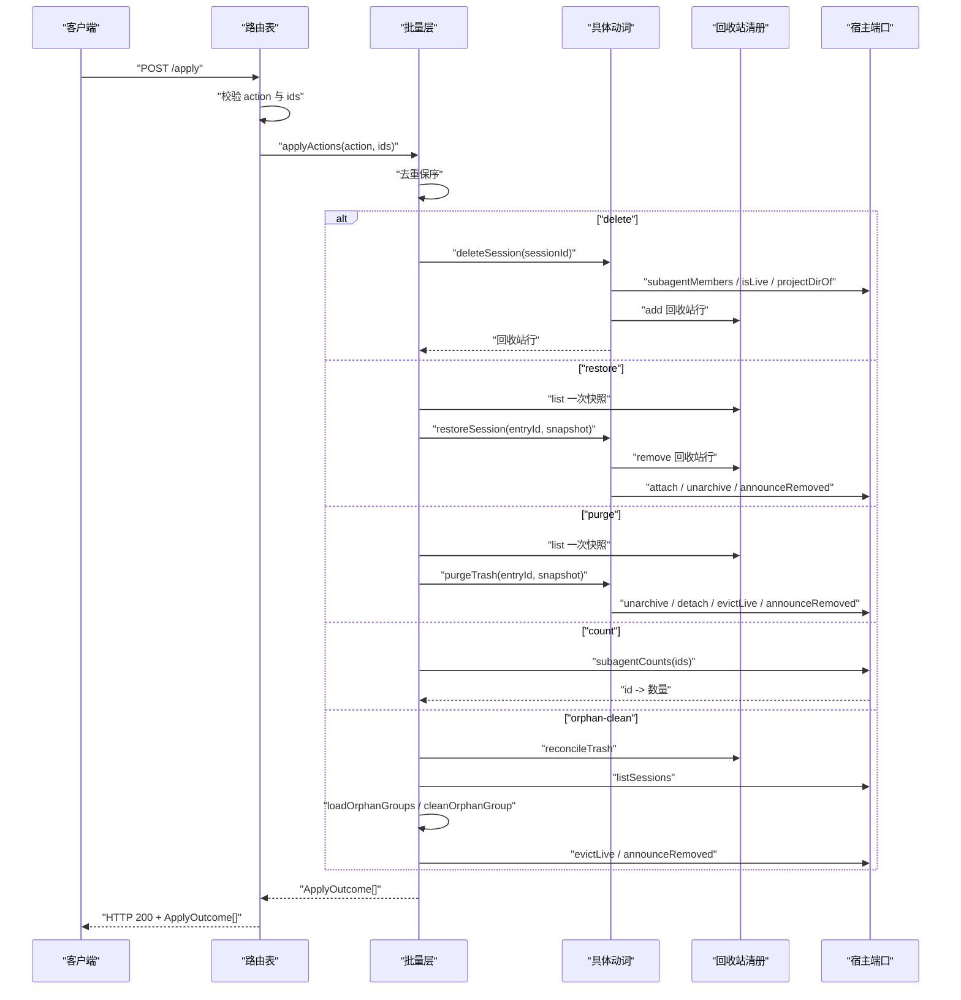
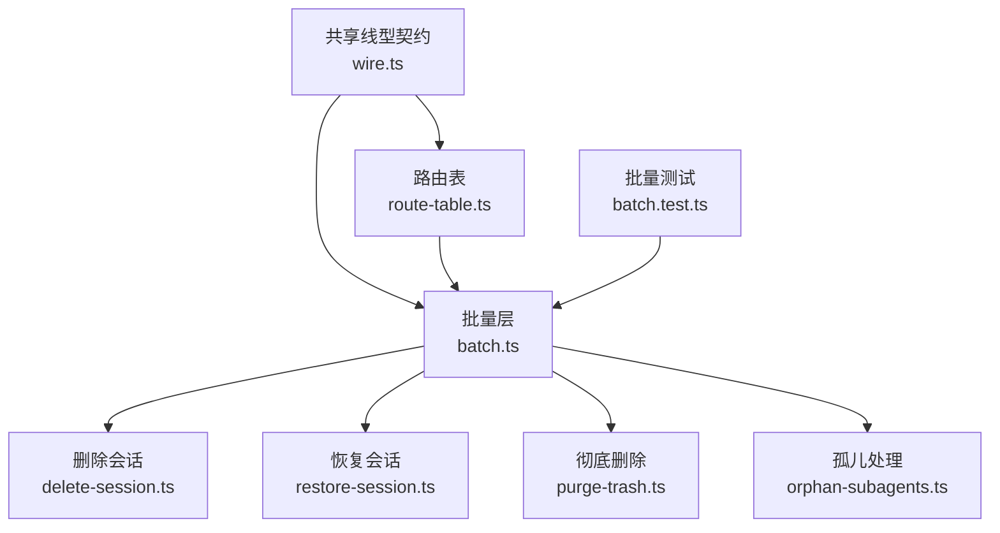

# POST /apply — 批量动作

<cite>
**本文引用的文件**   
- [wire.ts](file://src/shared/wire.ts)
- [route-table.ts](file://src/api/route-table.ts)
- [batch.ts](file://src/verbs/batch.ts)
- [delete-session.ts](file://src/verbs/delete-session.ts)
- [restore-session.ts](file://src/verbs/restore-session.ts)
- [purge-trash.ts](file://src/verbs/purge-trash.ts)
- [orphan-subagents.ts](file://src/verbs/orphan-subagents.ts)
- [batch.test.ts](file://tests/batch.test.ts)
- [api.test.ts](file://tests/api.test.ts)
</cite>

## 目录
1. [接口总览](#接口总览)
2. [请求体规范](#请求体规范)
3. [五个动作的语义差异](#五个动作的语义差异)
4. [批量处理流程](#批量处理流程)
5. [响应类型：ApplyOutcome](#响应类型applyoutcome)
6. [典型调用示例](#典型调用示例)
7. [部分失败、重试与幂等性](#部分失败重试与幂等性)
8. [错误码与故障定位](#错误码与故障定位)
9. [架构与数据流图](#架构与数据流图)
10. [常见问题排查](#常见问题排查)

## 接口总览

`POST /apply` 是回收站与会话删除功能的统一入口。它不再按“一个动作一段”，而是用同一个端点执行五种动作：

| 字段 | 类型 | 必填 | 含义 |
|---|---|---:|---|
| `action` | 字符串 | 是 | 必须为 `delete`、`restore`、`purge`、`count` 或 `orphan-clean` 之一 |
| `ids` | 字符串数组 | 是 | 至少包含一个非空字符串；单个元素即一次单条操作 |

服务端会先校验请求体，再进入批量处理层。所有业务错误都返回 HTTP `200`，但响应信封中对应条目标记为失败；只有路由层自检失败（未知动作、字段缺失、非法数组等）才返回 `400`。

**章节来源**
- [wire.ts:1-200](file://src/shared/wire.ts#L1-L200)
- [route-table.ts:1-143](file://src/api/route-table.ts#L1-L143)

## 请求体规范

### 基本形状

请求体是一个 JSON 对象，必须同时包含两个字段：

```json
{
  "action": "<动作>",
  "ids": ["<id1>", "<id2>", "..."]
}
```

- `action` 必须来自五值枚举：`delete`、`restore`、`purge`、`count`、`orphan-clean`。
- `ids` 必须是长度大于零的数组，且每个元素都是非空字符串。
- 空数组不表示“什么都不做”，而是被当作“调用方没有组好参数”。
- 重复 id 会被去重并保留输入顺序。

### id 的含义随动作变化

| 动作 | id 代表什么 | 说明 |
|---|---|---|
| `delete` | 宿主会话 id | 尚未进入回收站，通常带 `session-` 前缀 |
| `count` | 宿主会话 id | 查询该会话在盘上还有多少子会话 |
| `orphan-clean` | 孤儿组的根会话 id | 由 `GET /orphans` 返回的 `roots` 原样传回 |
| `restore` | 回收站条目 id | 由清单行 `id` 提供，由时间戳与会话名生成 |
| `purge` | 回收站条目 id | 同上 |

不要把 `delete` 的会话 id 传给 `restore`/`purge`，也不要把回收站条目 id 传给 `delete`/`count`/`orphan-clean`。

**章节来源**
- [wire.ts:1-200](file://src/shared/wire.ts#L1-L200)
- [route-table.ts:1-143](file://src/api/route-table.ts#L1-L143)

## 五个动作的语义差异

### delete：移入回收站

- 目标：宿主会话 id。
- 行为：把父会话及其仍在盘上的子会话一起移动到回收站，各自成为独立目录和清册行。
- 返回值：成功时返回回收站那一行；若同批中父已被前一条删除，当前这条返回 `null`，表示幂等 no-op。
- 关键约束：
  - 任一成员正在运行则整组拒绝。
  - 父目录必须存在；孩子目录缺失时跳过，不会让父删不掉。
  - 使用事务式日志记录每一步，失败时反向回滚。

### restore：放回原项目

- 目标：回收站条目 id。
- 行为：把删除那次按原路退回——先放目录，再挂工作区账本，再还原可见性，最后摘清册行。
- 返回值：成功时返回被恢复的回收站行；若同批中已被前一条恢复，返回 `null`。
- 关键约束：
  - 预检阶段不允许写任何字节。
  - 原项目目录不存在时抛 `project-missing`。
  - 工作区账本缺失时按“未分组”处理，不会因此静默失败。
  - 批量层聚合恢复结果，只发一次宿主通告。

### purge：彻底删除并聚合回执

- 目标：回收站条目 id。
- 行为：从回收站里真正抹掉一行，并连带那些仍留在盘上、没被带走的后代目录。
- 返回值：`{ removed, freedBytes }`。同批中被前一条带走时返回 `{ removed: 0, freedBytes: 0 }`。
- 关键约束：
  - 不回滚已删除的目录。
  - 先量字节、摘账本、再删目录与清册行。
  - 对宿主内存中的会话进行驱逐与通告。

### count：纯读数量

- 目标：宿主会话 id。
- 行为：一次性向宿主询问一批 id 的子会话数量，不是每条问一次。
- 返回值：数字；如果宿主端口没有返回该 id，计数按 `0` 算。
- 重要特性：这是纯读，不会进入写入到达序链。

### orphan-clean：清理无主子会话目录

- 目标：孤儿组的根会话 id。
- 行为：清理“父既不在宿主语料也不在回收站清册”的会话组，直接删除盘上目录，不走回收站。
- 返回值：`{ removed, freedBytes }`，统计的是被删掉的会话目录数量和释放字节。
- 关键约束：
  - 先对账，再扫描宿主语料与回收站。
  - 找不到匹配孤儿组返回 `not-found`。
  - 中途失败不回滚已删目录，但会在错误详情中携带部分回执。

**章节来源**
- [batch.ts:1-197](file://src/verbs/batch.ts#L1-L197)
- [delete-session.ts:1-206](file://src/verbs/delete-session.ts#L1-L206)
- [restore-session.ts:1-173](file://src/verbs/restore-session.ts#L1-L173)
- [purge-trash.ts:1-121](file://src/verbs/purge-trash.ts#L1-L121)
- [orphan-subagents.ts:1-200](file://src/verbs/orphan-subagents.ts#L1-L200)

## 批量处理流程

### 整体流程



**图表来源**
- [route-table.ts:60-143](file://src/api/route-table.ts#L60-L143)
- [batch.ts:140-197](file://src/verbs/batch.ts#L140-L197)

### 去重保序

批量层对 `ids` 做一次去重，保留第一次出现的顺序。测试断言了重复 id 只产生一条结果，而不是两条。

这意味着客户端可以安全地合并多个选择器输出，不需要自己先去重；但也不能依赖“重复 id 触发多次副作用”。

### 逐条信封

每个 id 都会有一条 `ApplyOutcome`。即使某条失败，其他条也不会被传染：成功的继续返回 `ok: true`，失败的返回 `ok: false`，并把原始错误映射为远程失败信封。

### 清册快照与收缩视图

`restore` 和 `purge` 在进入循环前先读一次清册快照。随后批量层维护一份可收缩的私有视图：当某个条目在同批中被处理过，后续条目能识别出“已经被前一条带走”，从而返回幂等成功值。

这个机制避免了两种错误世界：
- 先点父再点孩子：孩子那条变成幂等 no-op。
- 先点孩子再点父：父那组不再重复处理已经回来的孩子。

### 一批一次通告

恢复动作会把本批恢复的所有会话 id 攒起来，最后只调用一次宿主通告接口，并附带批量预取的摘要表。这样避免每次恢复都扫一遍宿主会话表，这也是修复“恢复很慢”的关键设计。

**章节来源**
- [batch.ts:1-197](file://src/verbs/batch.ts#L1-L197)
- [batch.test.ts:1-132](file://tests/batch.test.ts#L1-L132)

## 响应类型：ApplyOutcome

### 顶层结构

`POST /apply` 的响应是一个 `ApplyOutcome[]`。HTTP 状态码通常是 `200`，具体成败看数组中每个元素的 `ok`。

| 字段 | 类型 | 含义 |
|---|---|---|
| `id` | 字符串 | 回显原始输入的 id |
| `action` | 字面量动作 | 实际执行的五个动作之一 |
| `ok` | 布尔值 | 本条是否成功 |
| `value` | 按动作收窄 | 成功时的业务值 |
| `error` | 远程失败信封 | 失败时的结构化错误 |

### 按动作分支的 value 类型

| 动作 | 成功值类型 | 特殊语义 |
|---|---|---|
| `delete` | 回收站行 或 `null` | `null` 表示同批前一条已经把它连同组一起带走 |
| `restore` | 回收站行 或 `null` | `null` 表示同批前一条已经恢复过这一组 |
| `purge` | `{ removed, freedBytes }` | 同批被前一条带走时返回 `removed: 0, freedBytes: 0` |
| `count` | 数字 | 宿主端口缺失该 id 时按 `0` 返回 |
| `orphan-clean` | `{ removed, freedBytes }` | 清理的是盘上目录，不是回收站行 |

### 失败信封

失败项不含 `value`，而是包含：

| 字段 | 类型 | 说明 |
|---|---|---|
| `code` | 字符串 | 以 `sessiondelete/` 开头的具体错误码 |
| `message` | 字符串 | 面向用户的可读消息 |
| `details` | 可选对象 | 结构化附加信息，例如部分清理回执 |

**章节来源**
- [wire.ts:1-200](file://src/shared/wire.ts#L1-L200)
- [batch.ts:1-197](file://src/verbs/batch.ts#L1-L197)

## 典型调用示例

以下示例描述请求与响应的结构。实际实现通过测试断言契约，文档不直接粘贴仓库源码。

### 批量删除

**请求**

```json
{
  "action": "delete",
  "ids": ["session-parent", "session-kid"]
}
```

**成功响应**

```json
[
  {
    "id": "session-parent",
    "action": "delete",
    "ok": true,
    "value": {
      "id": "<回收站条目 id>",
      "sessionId": "session-parent",
      "projectDir": "<项目目录>",
      "workspaceId": "<工作区 id>",
      "wasArchived": false,
      "deletedAt": <时间戳>,
      "title": "",
      "sizeBytes": 0,
      "parentEntryId": null
    }
  },
  {
    "id": "session-kid",
    "action": "delete",
    "ok": true,
    "value": null
  }
]
```

第二项为 `null`，因为父已被前一条删除，孩子是跟着父一起搬进回收站的，所以这条是幂等 no-op。

**部分失败场景**

如果其中一个 id 不存在：

```json
[
  {
    "id": "session-parent",
    "action": "delete",
    "ok": true,
    "value": "<回收站行>"
  },
  {
    "id": "ghost",
    "action": "delete",
    "ok": false,
    "error": {
      "code": "sessiondelete/not-found",
      "message": "宿主的持久化里没有这个会话"
    }
  }
]
```

**章节来源**
- [batch.test.ts:1-132](file://tests/batch.test.ts#L1-L132)
- [delete-session.ts:1-206](file://src/verbs/delete-session.ts#L1-L206)

### 批量恢复

**请求**

```json
{
  "action": "restore",
  "ids": ["<父回收站条目 id>", "<子回收站条目 id>"]
}
```

**成功响应**

```json
[
  {
    "id": "<父回收站条目 id>",
    "action": "restore",
    "ok": true,
    "value": "<被恢复的回收站行>"
  },
  {
    "id": "<子回收站条目 id>",
    "action": "restore",
    "ok": true,
    "value": null
  }
]
```

第二条为 `null`，因为父恢复后，子会话作为同一组已经被同批前一条带回原项目。

**章节来源**
- [batch.test.ts:1-132](file://tests/batch.test.ts#L1-L132)
- [restore-session.ts:1-173](file://src/verbs/restore-session.ts#L1-L173)

### 计数查询

**请求**

```json
{
  "action": "count",
  "ids": ["session-a", "session-b", "session-c"]
}
```

**成功响应**

```json
[
  {
    "id": "session-a",
    "action": "count",
    "ok": true,
    "value": 2
  },
  {
    "id": "session-b",
    "action": "count",
    "ok": true,
    "value": 2
  },
  {
    "id": "session-c",
    "action": "count",
    "ok": true,
    "value": 2
  }
]
```

注意：这里是一次宿主调用，不是三条调用。

**章节来源**
- [batch.test.ts:1-132](file://tests/batch.test.ts#L1-L132)
- [batch.ts:120-139](file://src/verbs/batch.ts#L120-L139)

### 孤儿清理

**请求**

```json
{
  "action": "orphan-clean",
  "ids": ["session-orphan-root"]
}
```

**成功响应**

```json
[
  {
    "id": "session-orphan-root",
    "action": "orphan-clean",
    "ok": true,
    "value": {
      "removed": 3,
      "freedBytes": 1048576
    }
  }
]
```

**过期孤儿场景**

如果该组已经不再属于“无主子会话”，例如父又被人放回回收站或被另一处清理：

```json
[
  {
    "id": "session-orphan-root",
    "action": "orphan-clean",
    "ok": false,
    "error": {
      "code": "sessiondelete/not-found",
      "message": "不再是可清理的无主子会话"
    }
  }
]
```

**章节来源**
- [batch.ts:160-197](file://src/verbs/batch.ts#L160-L197)
- [orphan-subagents.ts:1-200](file://src/verbs/orphan-subagents.ts#L1-L200)

## 部分失败、重试与幂等性

### 部分失败

`POST /apply` 是逐条处理。一条失败不会影响其他条。客户端应该遍历结果，分别处理 `ok: true` 与 `ok: false` 的条目。

对于 `orphan-clean`，中途失败可能已经删除部分目录。此时错误信封的 `details` 会携带部分回执，包括已删除数量、释放字节和失败会话 id。

### 重试策略

建议客户端：

1. 检查 `body.ok` 是否为 `true`。
2. 遍历 `body.value` 中的每条结果。
3. 对 `ok: false` 的结果根据 `error.code` 决定是否重试。
4. 对 `sessiondelete/io` 这类 I/O 错误可做有限次指数退避重试。
5. 对 `sessiondelete/live`、`sessiondelete/not-found`、`sessiondelete/trash-empty`、`sessiondelete/project-missing` 等确定性错误不应盲目重试。

### 幂等性

批量层明确支持以下幂等情况：

| 场景 | 结果 |
|---|---|
| 同批中重复 id | 只执行一次，不重复副作用 |
| `delete`：父在前、孩子在后 | 孩子返回 `null`，视为幂等成功 |
| `restore`：父在前、孩子在后 | 孩子返回 `null`，视为幂等成功 |
| `restore`：孩子在后、父在前 | 两条都成功，但不会重复通告已经回来的孩子 |
| `purge`：父在前、孩子在后 | 孩子返回 `{ removed: 0, freedBytes: 0 }` |
| `purge`：孩子在后、父在前 | 父只清理自己的组，不再重复数已经清掉的孩子 |
| `delete`：幽灵 id | 不算“被前一条带走”，正常报错 |

需要特别注意：**幂等成功不等于“请求没发生”**。它只是说最终状态已经满足调用方的预期。

**章节来源**
- [batch.test.ts:1-132](file://tests/batch.test.ts#L1-L132)
- [batch.ts:1-197](file://src/verbs/batch.ts#L1-L197)

## 错误码与故障定位

### 路由层错误

| 情况 | 行为 |
|---|---|
| `action` 不在五个允许值中 | 返回 `400`，错误码指向未知动作 |
| `ids` 为空数组 | 返回 `400`，提示必须是非空字符串数组 |
| `ids` 中有空字符串或非字符串 | 返回 `400` |
| 请求体缺少 `action` 或 `ids` | 返回 `400` |

### 动词层错误

| 错误码 | 含义 | 是否适合重试 |
|---|---|---|
| `sessiondelete/live` | 会话正在运行 | 否，应等待会话结束 |
| `sessiondelete/not-found` | 会话或孤儿组不存在 | 一般否，先刷新列表 |
| `sessiondelete/trash-empty` | 回收站中没有对应条目 | 一般否，可能是已经清理 |
| `sessiondelete/project-missing` | 原项目目录不存在 | 否，需人工确认路径 |
| `sessiondelete/io` | 文件系统或宿主 I/O 错误 | 可有限次重试 |

### 如何定位问题

1. 先看外层 `ok`：如果是 `false`，说明整个 `/apply` 请求在路由或分发阶段失败。
2. 再看 `body.value` 中每条的 `ok`：确定是哪一条 id 失败。
3. 查 `error.code` 的前缀是否为 `sessiondelete/`。
4. 查 `error.message` 获取面向用户的信息。
5. 查 `error.details`，尤其是 `orphan-clean` 的部分清理回执。

**章节来源**
- [api.test.ts:1-200](file://tests/api.test.ts#L1-L200)
- [batch.ts:1-197](file://src/verbs/batch.ts#L1-L197)

## 架构与数据流图

### 请求处理序列



**图表来源**
- [route-table.ts:60-143](file://src/api/route-table.ts#L60-L143)
- [batch.ts:1-197](file://src/verbs/batch.ts#L1-L197)
- [delete-session.ts:1-206](file://src/verbs/delete-session.ts#L1-L206)
- [restore-session.ts:1-173](file://src/verbs/restore-session.ts#L1-L173)
- [purge-trash.ts:1-121](file://src/verbs/purge-trash.ts#L1-L121)
- [orphan-subagents.ts:1-200](file://src/verbs/orphan-subagents.ts#L1-L200)

### 组件关系



**图表来源**
- [wire.ts:1-200](file://src/shared/wire.ts#L1-L200)
- [route-table.ts:1-143](file://src/api/route-table.ts#L1-L143)
- [batch.ts:1-197](file://src/verbs/batch.ts#L1-L197)
- [batch.test.ts:1-132](file://tests/batch.test.ts#L1-L132)

## 常见问题排查

### 为什么同批第二个 child 不是失败？

因为批量层知道“已被同批前一条带走”。对 `delete` 和 `restore` 返回 `null`，对 `purge` 返回 `{ removed: 0, freedBytes: 0 }`。这不是错误，而是幂等成功。

### 为什么 `count` 只调一次宿主接口？

`count` 是纯读，而且宿主提供了批量计数口。批量层把所有唯一 id 一次性传给宿主，再把结果按输入顺序补齐。

### 为什么 `orphan-clean` 要先对账？

孤儿判断依赖“父是否在宿主语料和回收站清册中”。如果用户手工把目录放进回收站但清册还没更新，不对账就会误判成孤儿并直接删盘。对账保证“刚落盘的回收站行”也能参与判定。

### 为什么 `restore` 要传清册快照？

批量层只读一次清册，然后给动词一个只读快照。这样既能判断“已被同批前一条带走”，又能避免每个动词各读一次清册造成不一致。

### 什么时候该重试？

- 可重试：I/O 类错误、宿主临时不可用。
- 不建议重试：会话仍在运行、资源不存在、原项目目录丢失、回收站条目不存在。
- 幂等场景：重复 id、同批中已被前一条处理的条目。

**章节来源**
- [batch.test.ts:1-132](file://tests/batch.test.ts#L1-L132)
- [batch.ts:1-197](file://src/verbs/batch.ts#L1-L197)
- [orphan-subagents.ts:1-200](file://src/verbs/orphan-subagents.ts#L1-L200)