# POST /attachment-clean — 孤儿附件清理

<cite>
**本文档引用的文件**   
- [attachment-orphans.ts](file://src/api/attachment-orphans.ts)
- [attachments.ts](file://src/trash/attachments.ts)
- [dispatch.ts](file://src/api/dispatch.ts)
- [route-table.ts](file://src/api/route-table.ts)
- [wire.ts](file://src/shared/wire.ts)
- [batch.ts](file://src/verbs/batch.ts)
- [request-trust.ts](file://src/api/request-trust.ts)
- [deps.ts](file://src/deps.ts)
- [index.ts](file://src/index.ts)
</cite>

## 目录

1. [引言](#引言)
2. [端点概述](#端点概述)
3. [核心组件](#核心组件)
4. [架构概览](#架构概览)
5. [详细组件分析](#详细组件分析)
6. [依赖关系分析](#依赖关系分析)
7. [性能考虑](#性能考虑)
8. [故障排除指南](#故障排除指南)
9. [结论](#结论)

## 引言

`POST /attachment-clean` 端点是 DSH（DeepSeek Host）会话删除插件中的一个重要写动作，用于清理当前没有任何引用源引用的图片对象副本。该端点专门处理 `.dsh` 数据目录内的独占附件副本，不会影响源文件和普通文件。作为写动作，它必须在到达序链上串行执行，以确保与删除、清空等其他写操作不会交错执行，保证数据一致性。

本端点的核心设计理念是"失败封闭"（fail closed）：当任何引用源无法读取时，宁可保留可能的孤儿附件，也不冒险删除可能被共享的对象。这种保守策略确保了数据安全，避免了误删仍在使用的附件。

## 端点概述

### 基本信息

| 属性 | 值 |
|------|-----|
| HTTP 方法 | POST |
| 路由路径 | `/dsh-session-delete-api/attachment-clean` |
| 请求体 | 无 |
| 响应类型 | JSON 信封 |
| 纯度 | chained（必须排在到达序链上执行） |
| 清册读面 | none（不读取回收站清册） |

### 路由配置

在路由表中，该端点被配置为写动作，具有以下特征：

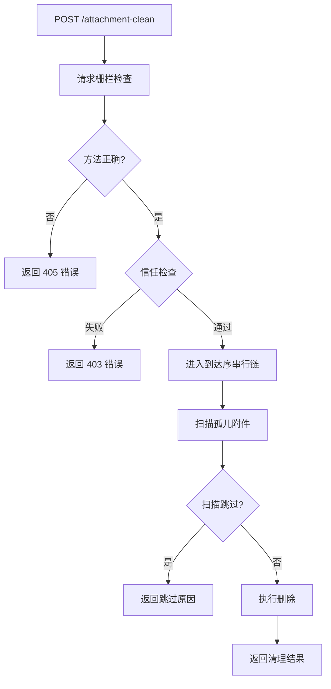

**图表来源**
- [route-table.ts:145-154](file://src/api/route-table.ts#L145-L154)
- [dispatch.ts:125-160](file://src/api/dispatch.ts#L125-L160)

**章节来源**
- [route-table.ts:145-154](file://src/api/route-table.ts#L145-L154)
- [wire.ts:38-42](file://src/shared/wire.ts#L38-L42)

## 核心组件

### 1. 路由注册与分发

#### 路由表定义

在 `route-table.ts` 中，`attachmentClean` 路由被定义为：

- **方法**: POST
- **请求体**: 无（body: 'none'）
- **纯度**: chained（必须进入到达序串行链）
- **清册读面**: none（不需要读取回收站清册）
- **响应类型**: json（返回 JSON 信封）

该路由的处理函数直接调用 `cleanOrphanImageAttachments`，这是整个清理流程的入口点。

#### 请求处理流程

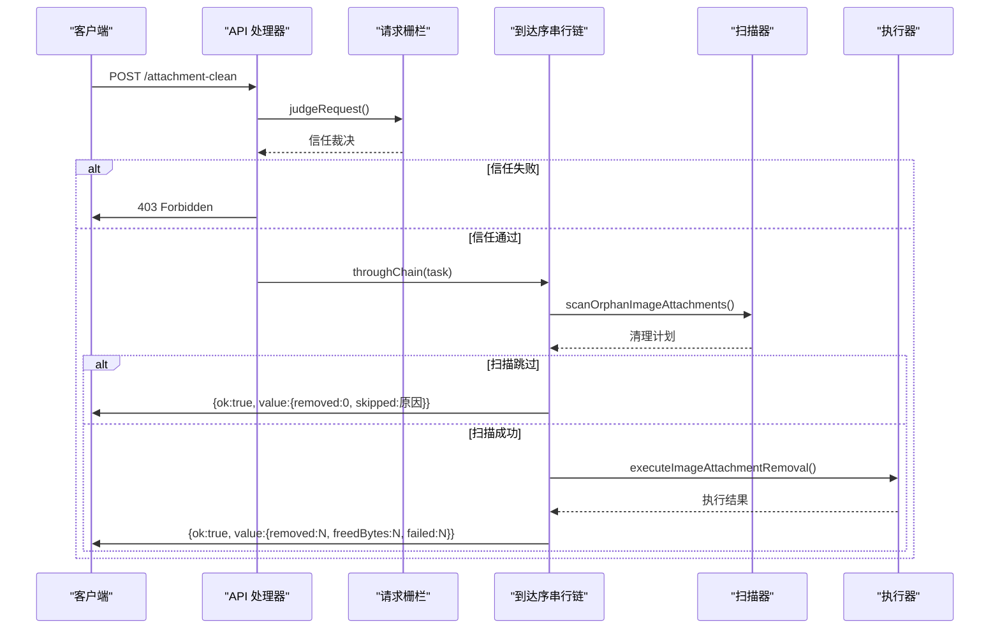

**图表来源**
- [dispatch.ts:125-160](file://src/api/dispatch.ts#L125-L160)
- [route-table.ts:145-154](file://src/api/route-table.ts#L145-L154)

**章节来源**
- [route-table.ts:145-154](file://src/api/route-table.ts#L145-L154)
- [dispatch.ts:125-160](file://src/api/dispatch.ts#L125-L160)

### 2. 孤儿附件扫描机制

#### 扫描策略

`scanOrphanImageAttachments` 函数实现了核心的扫描逻辑，其工作流程如下：

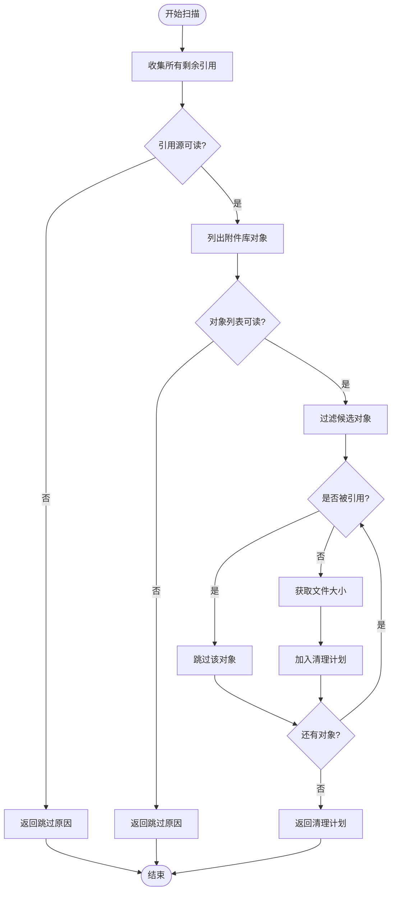

**图表来源**
- [attachments.ts:427-467](file://src/trash/attachments.ts#L427-L467)

#### 引用源收集

系统从以下位置收集图片引用：

1. **活动会话目录** (`$DSH_HOME/sessions`)
   - 遍历所有项目目录和会话目录
   - 读取规范 zstd 日志文件
   - 提取 content 数组中的图片附件 ID

2. **回收站目录** (`$DSH_HOME/session-trash`)
   - 遍历所有回收站条目目录
   - 同样读取日志文件提取引用

3. **存储配置** (`$DSH_HOME/storages`)
   - 递归扫描所有 JSON 文件
   - 使用正则表达式匹配 sha256 ID

4. **缓存目录** (`$DSH_HOME/cache`)
   - 同样递归扫描 JSON 文件

#### 安全约束

扫描过程遵循严格的安全约束：

- **失败封闭原则**: 任何引用源读取失败都会导致整体跳过，而不是将失败当作"没有引用"
- **JSON 大小限制**: 单个 JSON 文件超过 10MB 会被标记为不可读，但不会中断扫描
- **日志完整性检查**: 损坏的日志（坏行或截断尾巴）会导致整个目录被视为不可读
- **子目录检测**: 如果会话目录包含子目录，规范日志无法覆盖它们，整个目录被视为不可读

**章节来源**
- [attachments.ts:230-310](file://src/trash/attachments.ts#L230-L310)
- [attachments.ts:427-467](file://src/trash/attachments.ts#L427-L467)

### 3. 清理执行机制

#### 执行流程

`executeImageAttachmentRemoval` 函数负责实际的文件删除操作：

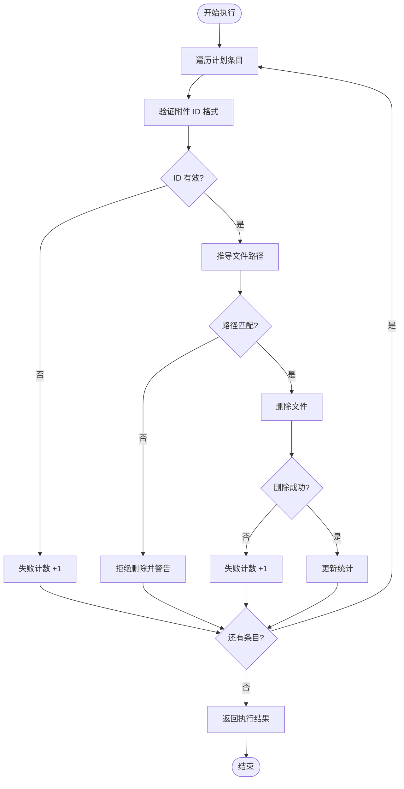

**图表来源**
- [attachments.ts:375-413](file://src/trash/attachments.ts#L375-L413)

#### 路径推导与安全验证

系统使用 `attachmentPathOf` 函数从附件 ID 推导出绝对路径：

- ID 必须符合 `sha256:[0-9a-f]{64}` 格式
- 路径结构为 `$DSH_HOME/attachments/v1/objects/<2位前缀>/<64位哈希>`
- 使用 `path.relative` 进行纵深防御，确保推导出的路径不会越界到 store 根目录之外

#### 删除验证

在执行删除前，系统会验证计划中的路径是否与从 ID 推导出的路径一致。如果不一致，说明计划条目可能被篡改，系统会拒绝删除并记录警告。这种双重验证机制确保了只能删除系统自己推导出的路径，防止误删其他文件。

**章节来源**
- [attachments.ts:375-413](file://src/trash/attachments.ts#L375-L413)
- [attachments.ts:50-68](file://src/trash/attachments.ts#L50-L68)

## 架构概览

### 系统架构

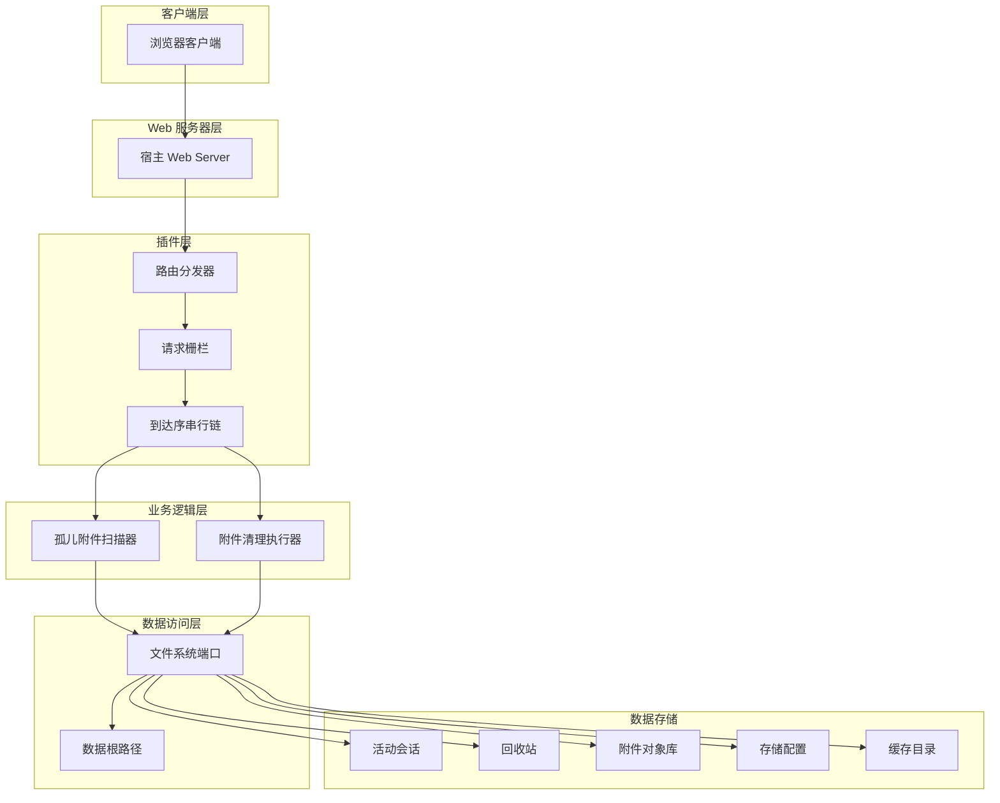

**图表来源**
- [index.ts:60-85](file://src/index.ts#L60-L85)
- [dispatch.ts:125-160](file://src/api/dispatch.ts#L125-L160)

### 数据流架构

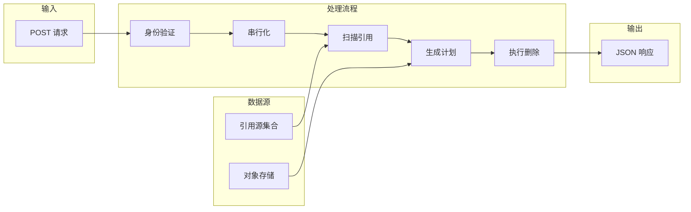

**图表来源**
- [attachments.ts:427-475](file://src/trash/attachments.ts#L427-L475)

**章节来源**
- [index.ts:60-85](file://src/index.ts#L60-L85)
- [dispatch.ts:125-160](file://src/api/dispatch.ts#L125-L160)

## 详细组件分析

### 1. 请求栅栏与信任机制

#### 信任裁决流程

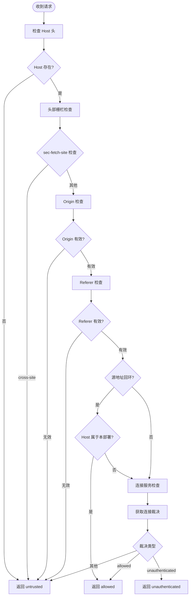

**图表来源**
- [request-trust.ts:110-128](file://src/api/request-trust.ts#L110-L128)

#### 信任裁决类型

系统定义了三种信任裁决结果：

| 裁决类型 | 含义 | HTTP 状态码 |
|---------|------|------------|
| allowed | 请求被允许 | 继续处理 |
| untrusted | 归属不对（跨源/重绑/头不成形） | 403 |
| unauthenticated | 归属对但远程客户端没带宿主身份 | 403 |

#### 本机与远程分支

- **本机分支**: 源地址为回环地址（127.0.0.1、::1、::ffff:127.0.0.1）且 Host 属于本部署
- **远程分支**: 通过宿主 connection 服务的 `requestRejection` 进行验证
- **缺席规则**: 如果 connection 服务缺席，远程请求一律拒绝（fail-closed）

**章节来源**
- [request-trust.ts:110-128](file://src/api/request-trust.ts#L110-L128)
- [dispatch.ts:127-133](file://src/api/dispatch.ts#L127-L133)

### 2. 到达序串行链

#### 串行链机制

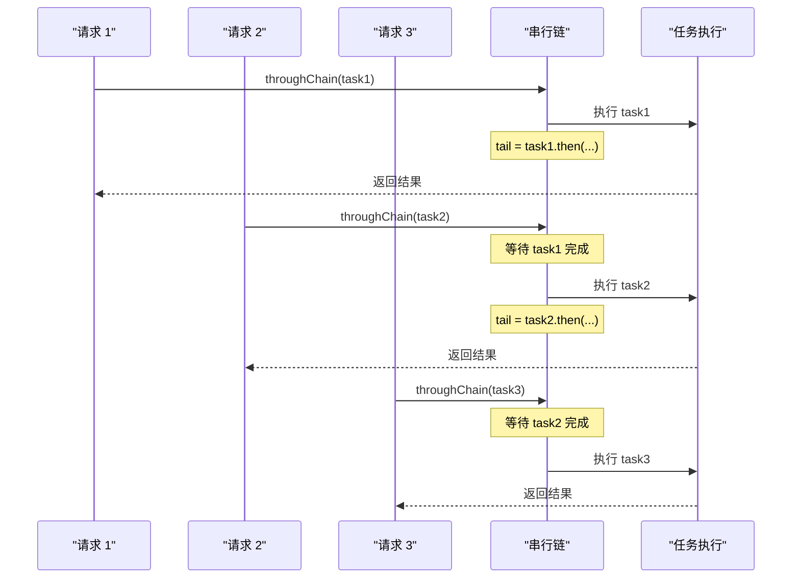

**图表来源**
- [dispatch.ts:115-123](file://src/api/dispatch.ts#L115-L123)

#### 串行链特性

- **永不阻塞**: `tail` 承诺永远不会 reject，单个任务失败不会卡死整个链
- **顺序保证**: 每个任务必须等待前一个任务完成后才能开始
- **错误隔离**: 任务的失败只影响该次请求，不会影响链上的其他任务

#### 纯度判断

路由表中的纯度决定了请求是否进入串行链：

- **pure**: 纯读操作，不进链（如 ping、attachment、attachment-orphans）
- **chained**: 写操作，必须进链（如 delete、restore、purge、attachment-clean）
- **动态纯度**: `/apply` 根据动作类型动态判断（count 是 pure，其他是 chained）

**章节来源**
- [dispatch.ts:115-123](file://src/api/dispatch.ts#L115-L123)
- [route-table.ts:25-27](file://src/api/route-table.ts#L25-L27)

### 3. 引用源收集算法

#### 数据结构

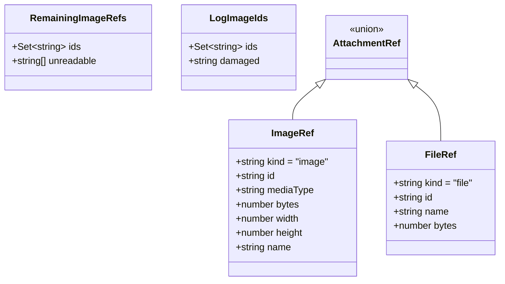

**图表来源**
- [attachments.ts:15-30](file://src/trash/attachments.ts#L15-L30)
- [attachments.ts:230-240](file://src/trash/attachments.ts#L230-L240)

#### 扫描上限与失败处理

系统设置了严格的扫描上限和失败处理机制：

- **JSON 文件大小限制**: 10MB（`MAX_JSON_REF_BYTES`）
- **超限处理**: 超过限制的文件被标记为不可读，但不中断扫描
- **错误累积**: 所有不可读的引用源都会被记录在 `unreadable` 数组中
- **整体跳过**: 如果有任何引用源不可读，整个扫描结果会被标记为跳过

#### 软链接处理

为了防止软链接导致的无限循环，系统使用真实路径去重：

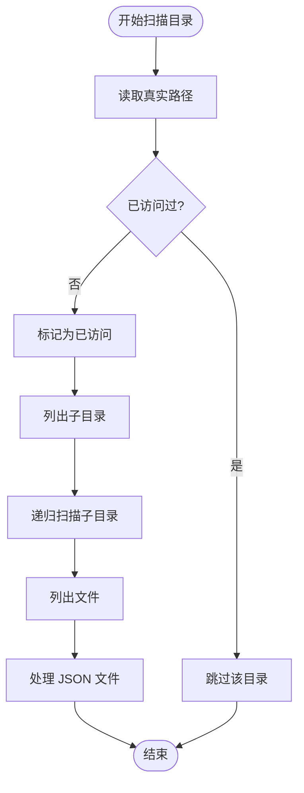

**图表来源**
- [attachments.ts:275-305](file://src/trash/attachments.ts#L275-L305)

**章节来源**
- [attachments.ts:230-310](file://src/trash/attachments.ts#L230-L310)

### 4. 附件对象扫描

#### 对象库布局

真实的宿主图片库布局为 `objects/<2位十六进制前缀>/<64位十六进制哈希>`：

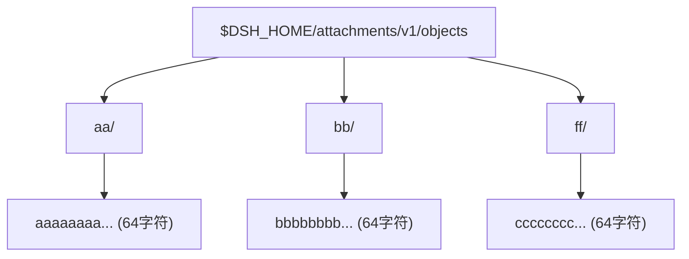

**图表来源**
- [attachments.ts:418-420](file://src/trash/attachments.ts#L418-L420)

#### 候选对象过滤

系统使用严格的正则表达式过滤候选对象：

- **前缀目录**: 必须是 2 位小写十六进制字符（`/^[0-9a-f]{2}$/`）
- **对象文件名**: 必须是 64 位小写十六进制字符（`/^[0-9a-f]{64}$/`）
- **一致性检查**: 文件名必须以前缀开头

这种严格的过滤确保只有符合规范的对象才会被考虑，排除了 `file-objects`、`tmp`、`v2`、`cache` 等非目标目录。

**章节来源**
- [attachments.ts:418-467](file://src/trash/attachments.ts#L418-L467)

### 5. 清理执行与统计

#### 执行统计

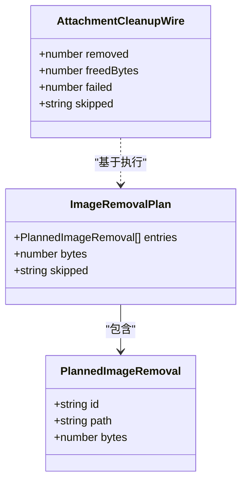

**图表来源**
- [wire.ts:145-152](file://src/shared/wire.ts#L145-L152)
- [attachments.ts:320-330](file://src/trash/attachments.ts#L320-L330)

#### 执行结果字段

| 字段 | 类型 | 含义 |
|------|------|------|
| removed | number | 成功删除的对象数量 |
| freedBytes | number | 释放的字节总数 |
| failed | number | 删除失败的对象数量 |
| skipped | string (可选) | 跳过原因（如果有） |

#### 失败处理策略

- **ENOENT 错误**: 文件已不存在，不算失败，只是没有可删除的字节
- **其他错误**: 计数为失败，但继续处理其他对象
- **路径不匹配**: 拒绝删除并计数为失败，防止误删

**章节来源**
- [attachments.ts:375-413](file://src/trash/attachments.ts#L375-L413)
- [attachments.ts:470-475](file://src/trash/attachments.ts#L470-L475)

## 依赖关系分析

### 模块依赖图

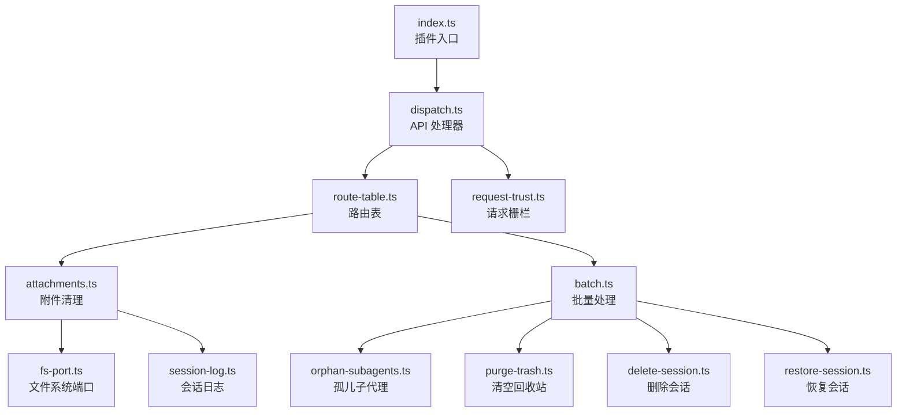

**图表来源**
- [index.ts:1-15](file://src/index.ts#L1-L15)
- [dispatch.ts:1-15](file://src/api/dispatch.ts#L1-L15)
- [route-table.ts:1-20](file://src/api/route-table.ts#L1-L20)

### 依赖注入结构

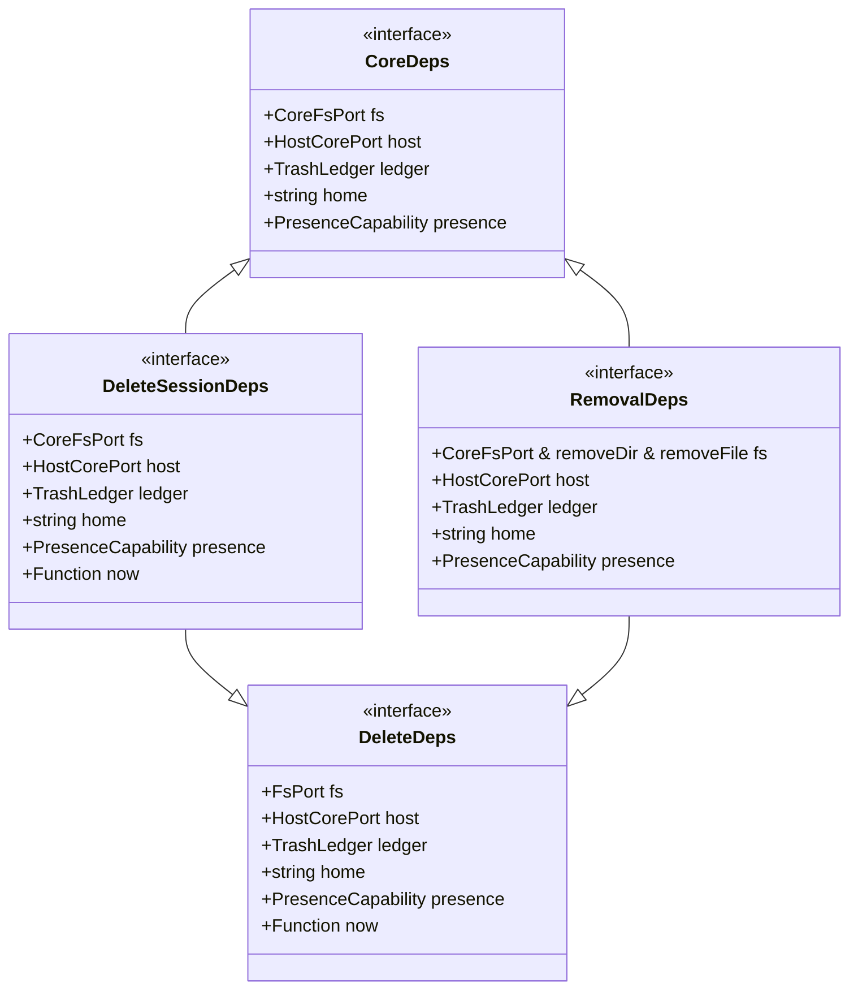

**图表来源**
- [deps.ts:1-25](file://src/deps.ts#L1-L25)

### 外部依赖

| 依赖项 | 用途 | 来源 |
|--------|------|------|
| node:path | 路径处理 | Node.js 标准库 |
| node:http | HTTP 服务器 | Node.js 标准库 |
| @deepseek-ai/cordis | 插件框架 | 宿主提供 |

**章节来源**
- [deps.ts:1-25](file://src/deps.ts#L1-L25)
- [index.ts:1-15](file://src/index.ts#L1-L15)

## 性能考虑

### 扫描性能

#### 时间复杂度

- **引用源收集**: O(S + T + J)，其中 S 是会话目录数，T 是回收站目录数，J 是 JSON 文件数
- **对象库扫描**: O(P × F)，其中 P 是前缀目录数（最多 256），F 是每个前缀下的文件数
- **总体复杂度**: 线性于数据规模，但受限于文件系统 I/O

#### 空间复杂度

- **引用 ID 集合**: O(R)，其中 R 是唯一引用 ID 的数量
- **清理计划**: O(C)，其中 C 是候选孤儿对象的数量
- **内存使用**: 主要取决于引用 ID 集合的大小

### 优化策略

#### 1. 早期退出

如果扫描过程中发现任何引用源不可读，立即返回跳过结果，避免不必要的后续扫描。

#### 2. 集合查找优化

使用 `Set` 数据结构存储引用 ID，确保 O(1) 的查找时间复杂度。

#### 3. 流式处理

对于大型 JSON 文件，虽然设置了 10MB 的上限，但系统仍然采用逐文件处理的方式，避免一次性加载所有文件到内存。

#### 4. 路径推导缓存

`attachmentPathOf` 函数的结果是确定性的，相同的 ID 总是推导出相同的路径，无需缓存。

### I/O 优化建议

1. **批量 stat 操作**: 如果文件系统支持，可以考虑批量获取文件统计信息
2. **并行扫描**: 不同的引用源目录可以并行扫描，但需要注意错误处理的复杂性
3. **增量扫描**: 对于频繁调用的场景，可以考虑缓存扫描结果，只在数据变化时重新扫描

### 串行链性能影响

由于写动作必须在串行链上执行，多个并发请求会被序列化：

- **优点**: 保证数据一致性，避免竞态条件
- **缺点**: 高并发场景下可能成为瓶颈
- **缓解**: 纯读操作（如 `GET /attachment-orphans`）不进链，可以并行处理

**章节来源**
- [attachments.ts:230-310](file://src/trash/attachments.ts#L230-L310)
- [dispatch.ts:115-123](file://src/api/dispatch.ts#L115-L123)

## 故障排除指南

### 常见问题

#### 1. 清理结果为空但有孤儿附件

**症状**: `removed: 0, freedBytes: 0`，但预期有孤儿附件

**可能原因**:
- 引用源读取失败，导致整体跳过
- 检查响应中的 `skipped` 字段

**解决方案**:
```javascript
// 检查响应
if (result.value.skipped) {
  console.error('扫描跳过:', result.value.skipped)
  // 根据具体原因修复引用源的可读性
}
```

**相关代码**: [attachments.ts:470-475](file://src/trash/attachments.ts#L470-L475)

#### 2. 部分对象删除失败

**症状**: `failed > 0`

**可能原因**:
- 文件权限问题
- 文件已被其他进程占用
- 磁盘 I/O 错误

**解决方案**:
- 检查文件系统权限
- 确认没有其他进程正在使用该文件
- 查看控制台警告日志获取详细错误信息

**相关代码**: [attachments.ts:405-410](file://src/trash/attachments.ts#L405-L410)

#### 3. 403 Forbidden 错误

**症状**: 请求被拒绝，返回 403 状态码

**可能原因**:
- 请求来源不被信任（跨源请求）
- 远程客户端没有宿主身份
- Host 头不属于本部署

**解决方案**:
- 确保从正确的 URL 访问（使用 `dsh web` 打印的 URL）
- 检查浏览器的 Origin 和 Referer 头
- 确认 Host 头与监听地址匹配

**相关代码**: [request-trust.ts:110-128](file://src/api/request-trust.ts#L110-L128)

#### 4. 扫描耗时过长

**症状**: 清理请求响应时间很长

**可能原因**:
- 大量会话目录需要扫描
- 大量 JSON 文件需要解析
- 文件系统 I/O 缓慢

**解决方案**:
- 考虑定期清理，避免积累过多孤儿附件
- 检查文件系统性能
- 监控引用源目录的大小

### 调试技巧

#### 启用详细日志

系统会在以下情况输出警告日志：

- 计划路径与 ID 推导不一致
- 文件删除失败
- 附件清理拒绝

查看控制台输出可以获取详细的错误信息。

#### 使用预览端点

在执行清理之前，可以先调用 `GET /attachment-orphans` 查看孤儿附件报告：

```javascript
// 先预览
const report = await fetch('/dsh-session-delete-api/attachment-orphans')
console.log('孤儿附件数量:', report.value.count)
console.log('总字节数:', report.value.totalBytes)

// 再清理
const result = await fetch('/dsh-session-delete-api/attachment-clean', { method: 'POST' })
console.log('清理结果:', result.value)
```

**相关代码**: [attachment-orphans.ts:15-26](file://src/api/attachment-orphans.ts#L15-L26)

### 错误码说明

| 错误码 | 含义 | 处理方式 |
|--------|------|----------|
| sessiondelete/io | I/O 错误 | 检查文件系统状态和权限 |
| sessiondelete/bad-request | 请求格式错误 | 检查请求参数 |
| sessiondelete/bad-method | 方法不允许 | 使用 POST 方法 |
| sessiondelete/not-found-route | 路由不存在 | 检查 URL 路径 |

**章节来源**
- [attachments.ts:470-475](file://src/trash/attachments.ts#L470-L475)
- [request-trust.ts:110-128](file://src/api/request-trust.ts#L110-L128)
- [wire.ts:250-270](file://src/shared/wire.ts#L250-L270)

## 结论

`POST /attachment-clean` 端点是 DSH 会话删除插件中一个关键的维护功能，用于安全地清理不再被任何引用源引用的图片附件副本。该端点的设计体现了以下几个核心原则：

### 设计原则

1. **安全性优先**: 通过失败封闭策略，确保在任何不确定情况下都不会误删可能被共享的附件
2. **数据一致性**: 通过到达序串行链保证写操作的原子性和顺序性
3. **纵深防御**: 多层验证机制（ID 格式、路径推导、路径匹配）确保只能删除系统授权的文件
4. **透明性**: 详细的统计信息和跳过原因让管理员了解清理过程的每一个细节

### 关键特性

- **精确的作用域**: 只处理 `$DSH_HOME/attachments/v1/objects` 下的图片对象，不影响其他文件或目录
- **全面的引用扫描**: 从活动会话、回收站、存储配置和缓存目录四个维度收集引用信息
- **严格的完整性检查**: 日志损坏、子目录存在、JSON 超限等情况都会导致整体跳过
- **幂等性**: 重复执行不会产生副作用，已删除的文件不会导致错误

### 最佳实践

1. **定期清理**: 建议定期执行清理操作，避免孤儿附件积累过多
2. **先预览后清理**: 使用 `GET /attachment-orphans` 端点预览结果，确认无误后再执行清理
3. **监控跳过原因**: 如果清理经常被跳过，需要检查引用源的可读性
4. **备份重要数据**: 虽然系统设计很安全，但在执行大规模清理前仍建议备份重要数据

### 未来改进方向

1. **增量扫描**: 实现基于变更的检测，避免每次都全量扫描
2. **并行处理**: 在保证一致性的前提下，探索并行扫描的可能性
3. **缓存机制**: 为频繁查询的场景提供缓存支持
4. **进度反馈**: 对于大规模清理，提供实时进度反馈

该端点的实现展示了如何在保证数据安全的前提下，实现高效的资源清理功能，为 DSH 系统的长期稳定运行提供了重要保障。