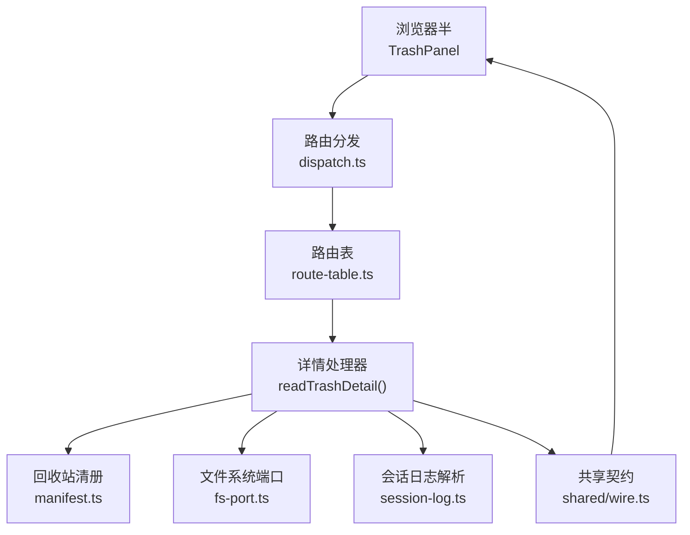
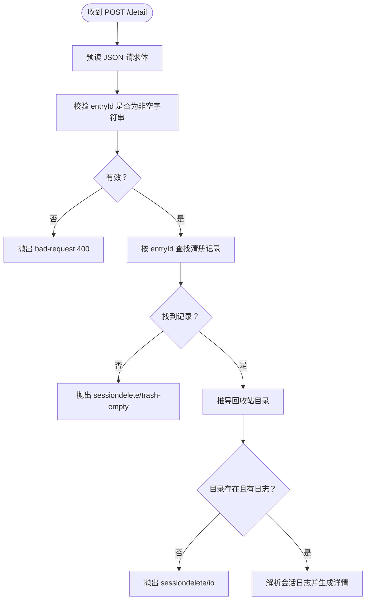
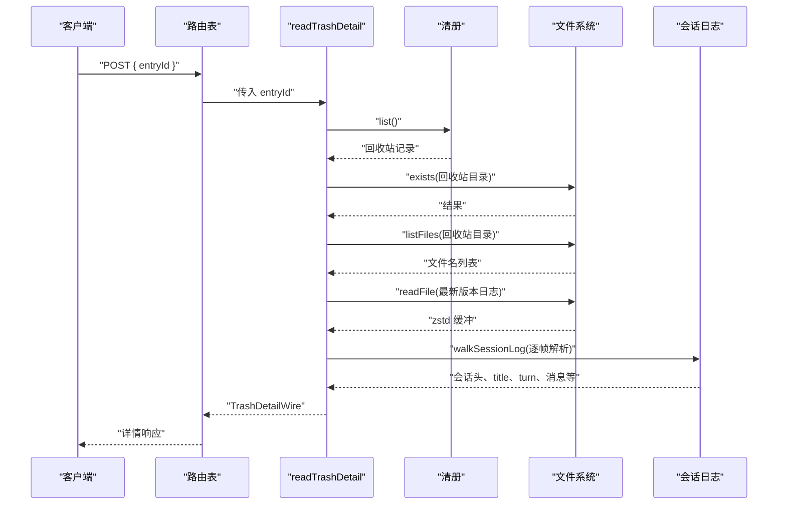
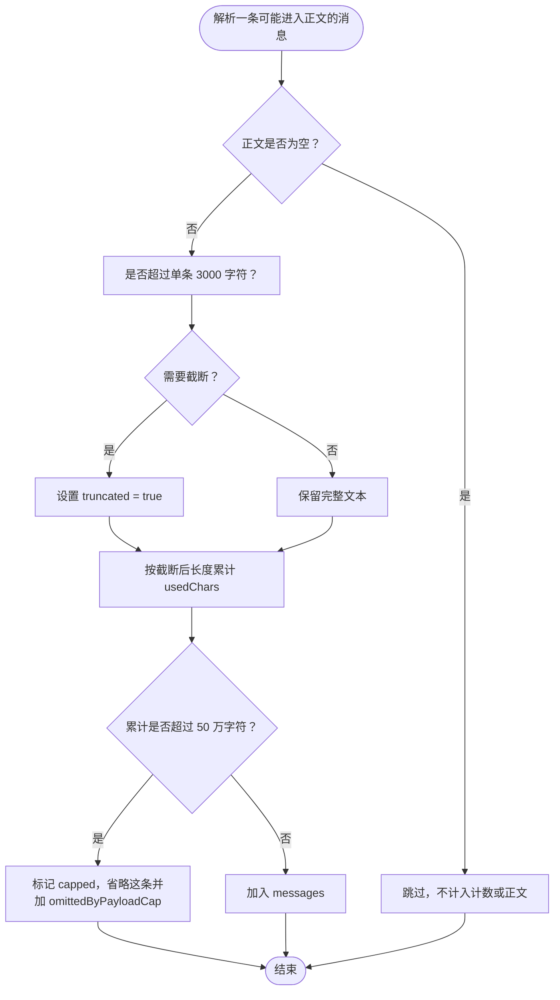
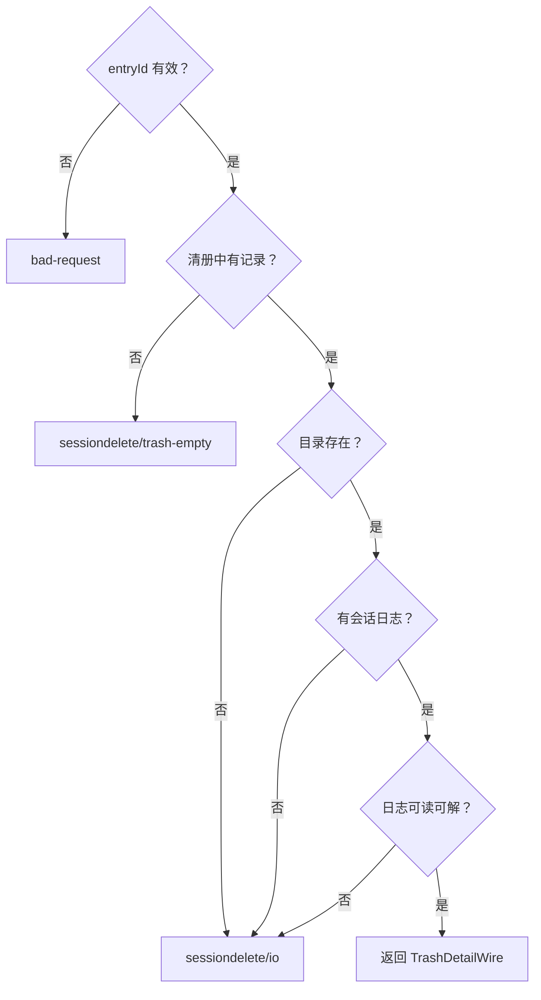

# POST /detail — 回收站详情

<cite>
**本文引用的文件**   
- [README.md](file://README.md)
- [docs/design/2026-10-15-trash-detail-design.md](file://docs/design/2026-10-15-trash-detail-design.md)
- [src/index.ts](file://src/index.ts)
- [src/api/route-table.ts](file://src/api/route-table.ts)
- [src/shared/wire.ts](file://src/shared/wire.ts)
- [src/trash/detail.ts](file://src/trash/detail.ts)
- [tests/trash-detail.test.ts](file://tests/trash-detail.test.ts)
</cite>

## 目录
1. [简介](#简介)
2. [端点总览](#端点总览)
3. [请求体](#请求体)
4. [响应体 TrashDetailWire](#响应体-trashdetailwire)
5. [数据来源与排序规则](#数据来源与排序规则)
6. [正文过滤与 Markdown 渲染](#正文过滤与-markdown-渲染)
7. [截断与载荷体积控制](#截断与载荷体积控制)
8. [标题为空时的兜底行为](#标题为空时的兜底行为)
9. [典型请求与响应示例](#典型请求与响应示例)
10. [错误处理](#错误处理)
11. [大日志场景下的体积控制建议](#大日志场景下的体积控制建议)
12. [附录：字段速查表](#附录字段速查表)

## 简介
`POST /detail` 是回收站插件的第五个 API 段，用于读取某条已删除会话的详情。它不直接接受任意路径，而是以回收站清单中的 `entryId` 为入口，定位到 `~/.dsh/session-trash/<id>/` 下对应会话的 zstd 压缩日志，从中提取元信息、计数与消息正文。该端点在浏览器半通过 `/dsh-session-delete-api` 前缀调用，Node 半由路由表统一注册并校验请求体。

本端点是只读操作（纯度标记为纯），但使用 POST 是为了复用路由表的非空字符串校验、同源栅栏与错误映射；设计稿明确说明“改成 GET query 只是把同一道栅栏再写一遍”。

**章节来源**
- [src/api/route-table.ts:108-128](file://src/api/route-table.ts#L108-L128)
- [src/shared/wire.ts:28-56](file://src/shared/wire.ts#L28-L56)
- [docs/design/2026-10-15-trash-detail-design.md:1-23](file://docs/design/2026-10-15-trash-detail-design.md#L1-L23)

## 端点总览
| 项目 | 值 |
| --- | --- |
| URL | `/dsh-session-delete-api/detail` |
| 方法 | `POST` |
| 内容类型 | `application/json` |
| 认证 | 由宿主 webServer 同源通道承担；客户端通过插件前缀发起 fetch |
| 输入 | JSON 请求体，必须包含非空字符串字段 `entryId` |
| 成功输出 | `TrashDetailWire` |
| 失败输出 | `RemoteFailure`，常见代码包括 `sessiondelete/trash-empty` 与 `sessiondelete/io` |



**图表来源**
- [src/api/route-table.ts:108-128](file://src/api/route-table.ts#L108-L128)
- [src/trash/detail.ts:46-172](file://src/trash/detail.ts#L46-L172)
- [src/shared/wire.ts:140-173](file://src/shared/wire.ts#L140-L173)

**章节来源**
- [src/index.ts:24-38](file://src/index.ts#L24-L38)
- [src/api/route-table.ts:108-128](file://src/api/route-table.ts#L108-L128)

## 请求体
请求体是一个 JSON 对象，必须包含：

| 字段 | 类型 | 是否必填 | 说明 |
| --- | --- | --- | --- |
| `entryId` | 字符串 | 是 | 回收站清单中该会话行的唯一标识；服务端用它查找清册记录，再通过 `trashDirOf(record.id, home)` 推导磁盘路径 |

校验规则来自路由表的 `requireString`：
- 字段不存在 → 报 `bad-request`
- 字段不是字符串 → 报 `bad-request`
- 字段是空字符串 `""` → 报 `bad-request`



**图表来源**
- [src/api/route-table.ts:28-38](file://src/api/route-table.ts#L28-L38)
- [src/api/route-table.ts:118-128](file://src/api/route-table.ts#L118-L128)
- [src/trash/detail.ts:61-93](file://src/trash/detail.ts#L61-L93)

**章节来源**
- [src/api/route-table.ts:28-38](file://src/api/route-table.ts#L28-L38)
- [src/api/route-table.ts:118-128](file://src/api/route-table.ts#L118-L128)
- [tests/trash-detail.test.ts:86-96](file://tests/trash-detail.test.ts#L86-L96)

## 响应体 TrashDetailWire
成功时返回 `TrashDetailWire`，它是 Node 半产出、浏览器半消费的共享形状，定义在 `shared/wire.ts`。

| 字段 | 类型 | 含义 |
| --- | --- | --- |
| `entryId` | 字符串 | 本次查询对应的回收站条目 id，与请求一致 |
| `cwd` | 字符串 | 日志 header 里原生的工作区路径；无损、未做平台规范化 |
| `createdAt` | 数字 | 会话创建时间戳（毫秒）；读不到时为 0 |
| `lastActivity` | 数字 | 所有记录中最大的 `time`；读不到时为 0 |
| `logTitle` | 字符串 | 日志内 `session/title` 记录的标题；清册标题为空串时，客户端用此字段兜底 |
| `models` | 字符串数组 | 助手消息中出现过的模型名集合，去重后按插入顺序转为数组 |
| `turnCount` | 数字 | 遇到 `turn/start` 的次数，表示轮数 |
| `userMessageCount` | 数字 | 进入正文的用户提问数量；仅统计 `source.kind === "user"` 且正文非空的消息 |
| `assistantMessageCount` | 数字 | 进入正文的助手回复数量；仅统计有 `text` 段的消息 |
| `toolCallCount` | 数字 | 日志中 `tool/call` 的数量，不计入正文 |
| `injectedCount` | 数字 | `user/message` 中非 `kind === "user"` 的注入条数，例如 AGENTS 指令、运行时快照、技能清单等 |
| `messages` | 消息数组 | 过滤后的正文序列，每条最多 3000 字符，累计最多 50 万字符 |
| `omittedByPayloadCap` | 数字 | 因累计字符上限被丢弃的消息条数 |

### 各字段的读取规则摘要
- `cwd`、`createdAt` 从 `type === "session"` 的记录根字段读取。
- `logTitle` 从 `type === "session/title"` 的 `data.title` 读取。
- `turnCount` 每次遇到 `turn/start` 加一。
- `toolCallCount` 每次遇到 `tool/call` 加一。
- `models` 从助手消息的 `message.source.model` 收集。
- 用户消息和助手消息的时间戳来自记录顶层 `time`；若缺失则用 0。
- `messages` 与计数共用同一条判据：只有能写出非空正文的消息才计入对应计数，也才进入正文列表。

**章节来源**
- [src/shared/wire.ts:140-173](file://src/shared/wire.ts#L140-L173)
- [src/trash/detail.ts:95-172](file://src/trash/detail.ts#L95-L172)

## 数据来源与排序规则
详情数据来源于回收站目录下的会话日志，而不是从宿主会话列表重建。具体流程如下：

1. 根据 `entryId` 在回收站清册中查找记录。
2. 用记录 id 和宿主数据根计算回收站目录。
3. 列出目录文件，选择版本号最高的会话日志。
4. 读取并逐帧解压 zstd 日志。
5. 按记录类型遍历，聚合元信息、计数、模型与消息。



**图表来源**
- [src/api/route-table.ts:118-128](file://src/api/route-table.ts#L118-L128)
- [src/trash/detail.ts:61-172](file://src/trash/detail.ts#L61-L172)

### 角色与时间排序
正文消息按以下顺序排列：
- 先按日志记录的 `time` 升序。
- 同一轮次中，用户提问排在助手回复之前。
- 助手侧只保留 `content[].type === "text"` 的内容片段；推理、工具调用、工具结果不会成为独立消息行。

这意味着消息序列反映的是“真实可见对话”的时间线，而不是原始日志中全部 `user/message` 或 `assistant/message` 的原始出现顺序。

**章节来源**
- [src/trash/detail.ts:112-172](file://src/trash/detail.ts#L112-L172)
- [docs/design/2026-10-15-trash-detail-design.md:105-130](file://docs/design/2026-10-15-trash-detail-design.md#L105-L130)

## 正文过滤与 Markdown 渲染
### 服务器端过滤
服务器端只向 `messages` 写入可显示的正文：
- 用户消息必须满足 `data.source.kind === "user"`。
- 其他 `kind`，如 `agent-instructions`、`runtime-context`、`skill-catalog`，会进入 `injectedCount`，但不进入正文。
- 助手消息必须至少有一个 `content` 片段的 `type` 为 `"text"` 且文本非空。
- 助手消息中的 `reasoning`、`tool/call`、`tool/result` 不计入正文，也不计入 `assistantMessageCount`。

因此，`userMessageCount` 不等于日志中所有 `user/message` 的数量，而是“真正进入正文的用户提问数量”；同理，`assistantMessageCount` 是“有文字正文的助手回复数量”。

### 浏览器端渲染
浏览器端的详情组件对两类消息采用不同渲染策略：
- 用户消息：保持原话，使用 `white-space: pre-wrap` 显示，避免把用户输入当成富文本。
- 助手消息：作为 Markdown 源交给 `react-markdown` + GFM 渲染，匹配宿主聊天界面的排版。

这个差异很重要：API 返回的 `text` 字段对助手来说是 Markdown 源码，前端负责渲染；对用户来说，它是原始输入文本，不应再次渲染。

**章节来源**
- [src/trash/detail.ts:123-172](file://src/trash/detail.ts#L123-L172)
- [docs/design/2026-10-15-trash-detail-design.md:105-130](file://docs/design/2026-10-15-trash-detail-design.md#L105-L130)
- [src/client/trash-detail.tsx:1-28](file://src/client/trash-detail.tsx#L1-L28)

## 截断与载荷体积控制
详情实现有两个载荷闸，称为“载荷闸”，而不是“读盘阈值”：

| 闸门 | 默认值 | 行为 |
| --- | ---: | --- |
| `perMessageChars` | 3000 | 单条消息超过 3000 字符时截取前 3000 字符，并将 `truncated` 设为 `true` |
| `totalChars` | 500000 | 当已放入 `messages` 的字符总量达到 50 万时停止追加后续消息；后续被跳过的消息条数累加到 `omittedByPayloadCap` |

关键点：
- 截断发生在单条消息级别。
- 累计上限发生在整份详情的 `messages` 级别。
- 一旦达到累计上限，新消息不再进入 `messages`，而是增加 `omittedByPayloadCap`。
- 这些闸门保护的是网络载荷大小，不是磁盘 I/O；即使日志很大，服务端仍会完整解析，只是不在响应中发送超出限额的正文。
- 测试断言生产的两个默认值为 3000 和 500000。



**图表来源**
- [src/trash/detail.ts:101-111](file://src/trash/detail.ts#L101-L111)
- [src/trash/detail.ts:112-172](file://src/trash/detail.ts#L112-L172)
- [tests/trash-detail.test.ts:176-191](file://tests/trash-detail.test.ts#L176-L191)

**章节来源**
- [src/trash/detail.ts:33-44](file://src/trash/detail.ts#L33-L44)
- [src/trash/detail.ts:101-111](file://src/trash/detail.ts#L101-L111)
- [tests/trash-detail.test.ts:176-191](file://tests/trash-detail.test.ts#L176-L191)

## 标题为空时的兜底行为
详情标题的优先级如下：
1. 回收站清册中的 `entry.title`。
2. 如果清册标题为空字符串，则回落到日志内的 `logTitle`。
3. 如果两者都为空，客户端显示“未命名”之类的兜底文案。

注意：`logTitle` 是响应体中的一个字段，供前端判断；实际兜底文案由浏览器端翻译键决定。

**章节来源**
- [src/shared/wire.ts:155-165](file://src/shared/wire.ts#L155-L165)
- [src/client/trash-detail.tsx:112-118](file://src/client/trash-detail.tsx#L112-L118)
- [docs/design/2026-10-15-trash-detail-design.md:105-130](file://docs/design/2026-10-15-trash-detail-design.md#L105-L130)

## 典型请求与响应示例
以下示例描述请求与响应的结构，不复制仓库中的具体 JSON 内容。

### 典型请求
```json
{
  "entryId": "<回收站条目 id>"
}
```
- `entryId` 必须是存在的回收站记录 id。
- 不能是空字符串。
- 不能是任意磁盘路径或项目路径。

### 典型成功响应
```json
{
  "entryId": "<回收站条目 id>",
  "cwd": "C:/develop/my-project",
  "createdAt": 1728864000000,
  "lastActivity": 1728870000000,
  "logTitle": "日志内标题",
  "models": ["deepseek-chat"],
  "turnCount": 3,
  "userMessageCount": 3,
  "assistantMessageCount": 3,
  "toolCallCount": 1,
  "injectedCount": 0,
  "messages": [
    {
      "role": "user",
      "time": 1728865000000,
      "text": "请检查当前目录结构",
      "truncated": false
    },
    {
      "role": "assistant",
      "time": 1728866000000,
      "text": "当前目录包含三个子模块……",
      "truncated": false
    }
  ],
  "omittedByPayloadCap": 0
}
```

### 截断消息示例
当某条助手回复很长时：
- `text` 只包含前 3000 字符。
- `truncated` 为 `true`。
- `assistantMessageCount` 仍然表示这是一条完整的助手回复，不代表正文一定完整。

### `omittedByPayloadCap` 示例
当多条消息累计超过 50 万字符时：
- `messages` 中只显示已达到上限前的消息。
- `omittedByPayloadCap` 表示“因为载荷上限被丢弃的消息条数”。
- 界面应提示还有若干条未显示，而不只是隐藏这些消息。

### 标题为空时的示例
如果清册标题为空：
- 响应中的 `logTitle` 提供日志内标题。
- 前端用 `logTitle` 作为详情标题。
- 如果 `logTitle` 也为空，前端显示内置兜底文案。

**章节来源**
- [src/shared/wire.ts:140-173](file://src/shared/wire.ts#L140-L173)
- [src/trash/detail.ts:95-172](file://src/trash/detail.ts#L95-L172)
- [tests/trash-detail.test.ts:53-84](file://tests/trash-detail.test.ts#L53-L84)
- [tests/trash-detail.test.ts:176-191](file://tests/trash-detail.test.ts#L176-L191)

## 错误处理
`POST /detail` 的错误分为三类：

| 条件 | 错误代码 | 语义 |
| --- | --- | --- |
| `entryId` 缺失、不是字符串或为空 | `bad-request` | 请求体参数无效 |
| 清册中没有该 `entryId` | `sessiondelete/trash-empty` | 回收站里没有这一条 |
| 回收站目录不存在、没有会话日志、读取或解压失败 | `sessiondelete/io` | 文件或 I/O 问题 |

错误信封遵循共享的 `RemoteFailure` 形状：
- `code`：判别错误类型的字符串。
- `message`：面向用户的原文。
- `details`：可选的结构化附加信息。

测试覆盖了以下关键分支：
- 条目不在清册时，不会执行文件列表或文件读取。
- 目录不存在时返回 `sessiondelete/io`。
- 目录存在但没有会话日志时返回 `sessiondelete/io`。
- 文件读取抛错时返回 `sessiondelete/io`，并把原始错误信息放进 message。
- 日志解析失败时返回 `sessiondelete/io`，并且不返回半截正文。



**图表来源**
- [src/api/route-table.ts:28-38](file://src/api/route-table.ts#L28-L38)
- [src/trash/detail.ts:61-93](file://src/trash/detail.ts#L61-L93)
- [src/trash/detail.ts:143-172](file://src/trash/detail.ts#L143-L172)
- [tests/trash-detail.test.ts:86-133](file://tests/trash-detail.test.ts#L86-L133)

**章节来源**
- [src/api/route-table.ts:28-38](file://src/api/route-table.ts#L28-L38)
- [src/trash/detail.ts:61-93](file://src/trash/detail.ts#L61-L93)
- [src/trash/detail.ts:143-172](file://src/trash/detail.ts#L143-L172)
- [tests/trash-detail.test.ts:86-133](file://tests/trash-detail.test.ts#L86-L133)

## 大日志场景下的体积控制建议
实测表明，本机回收站最大单条正文约 806 KB UTF-8，对应约 27 万字符和数百条消息；在当前默认闸门下，单条都很难触发 50 万字符上限。因此：

1. **不要把 3000 字符或 50 万字符当成“读盘阈值”**。它们限制的是响应正文，不阻止服务端解析大日志。
2. **不要为了省带宽而拒绝读取大日志**。设计稿明确指出，不设“文件太大就拒绝”，否则会挡掉能读出来的真实正文。
3. **客户端应尊重 `truncated` 和 `omittedByPayloadCap`**：
   - 单条 `truncated` 表示消息被截断。
   - `omittedByPayloadCap > 0` 表示还有消息未显示。
4. **未来若正文继续膨胀，优先考虑分页或懒加载**，而不是盲目增大载荷上限。
5. **Markdown 渲染在大消息下更耗客户端性能**，尤其是助手消息；应避免一次性渲染超长 Markdown 树。

**章节来源**
- [docs/design/2026-10-15-trash-detail-design.md:90-104](file://docs/design/2026-10-15-trash-detail-design.md#L90-L104)
- [src/trash/detail.ts:33-44](file://src/trash/detail.ts#L33-L44)
- [tests/trash-detail.test.ts:176-191](file://tests/trash-detail.test.ts#L176-L191)

## 附录：字段速查表
| 字段 | 类别 | 是否随盘变化 | 说明 |
| --- | --- | ---: | --- |
| `entryId` | 标识 | 否 | 请求与响应保持一致 |
| `cwd` | 元信息 | 否 | 日志原生工作区路径 |
| `createdAt` | 元信息 | 否 | 会话创建时间 |
| `lastActivity` | 元信息 | 否 | 最后活动时间 |
| `logTitle` | 元信息 | 否 | 日志标题 |
| `models` | 模型 | 否 | 去重后的模型名列表 |
| `turnCount` | 计数 | 否 | 轮数 |
| `userMessageCount` | 计数 | 否 | 进入正文的用户消息数 |
| `assistantMessageCount` | 计数 | 否 | 进入正文的助手消息数 |
| `toolCallCount` | 计数 | 否 | 工具调用次数 |
| `injectedCount` | 计数 | 否 | 宿主注入的非用户消息数 |
| `messages` | 正文 | 否 | 过滤、截断后的消息列表 |
| `omittedByPayloadCap` | 正文控制 | 否 | 因载荷上限被丢弃的消息条数 |

**章节来源**
- [src/shared/wire.ts:140-173](file://src/shared/wire.ts#L140-L173)
- [src/trash/detail.ts:95-172](file://src/trash/detail.ts#L95-L172)