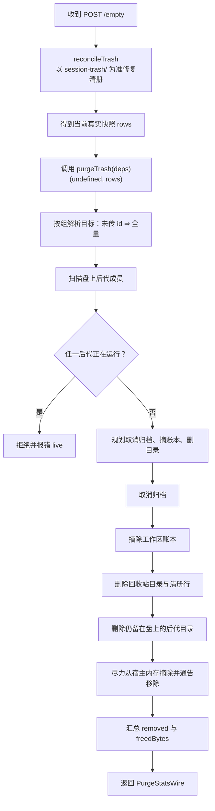
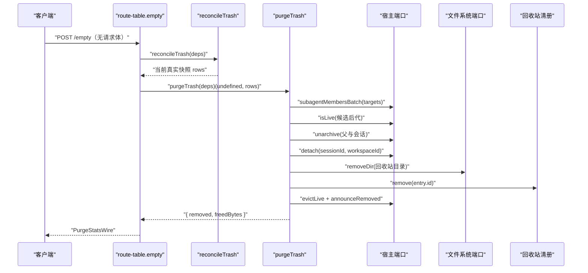

# POST /empty — 清空回收站

<cite>
**本文引用的文件**
- [src/shared/wire.ts](file://src/shared/wire.ts)
- [src/api/route-table.ts](file://src/api/route-table.ts)
- [src/verbs/purge-trash.ts](file://src/verbs/purge-trash.ts)
- [tests/purge-trash.test.ts](file://tests/purge-trash.test.ts)
- [README.md](file://README.md)
</cite>

## 目录
1. [简介](#简介)
2. [端点总览](#端点总览)
3. [请求与响应](#请求与响应)
4. [顺序语义与对账前置](#顺序语义与对账前置)
5. [聚合回执而非逐条返回](#聚合回执而非逐条返回)
6. [典型响应示例](#典型响应示例)
7. [与 `/apply?action=purge` 的区别](#与-applyactionpurge-的区别)
8. [危险操作警告、二次确认与回滚限制](#危险操作警告二次确认与回滚限制)
9. [错误处理](#错误处理)
10. [架构与调用流程](#架构与调用流程)
11. [附录：相关数据模型](#附录相关数据模型)

## 简介
`POST /empty` 是会话删除插件提供的“清空回收站”入口。它不接受请求体，作用是把当前回收站中所有可彻底删除的条目全部清理，并返回一个聚合统计对象 `PurgeStatsWire`（包含 `removed` 与 `freedBytes`）。该接口不是批量动作的简化版，而是专门针对整站回收站的危险操作：它会先对账获得真实快照，再执行彻底删除。

## 端点总览
| 项目 | 说明 |
| --- | --- |
| 路径 | `/dsh-session-delete-api/empty` |
| 方法 | `POST` |
| 请求体 | 无（`body: 'none'`） |
| 纯度 | 写操作，进入到达序链（`purity: 'chained'`） |
| 成功返回值 | `PurgeStatsWire`：`{ removed, freedBytes }` |
| 失败返回 | 标准远程失败信封，含 `code`、`message` 及可选 `details` |

路由表把 `empty` 段名注册为只接受 `POST`、不读请求体的写端点；浏览器半通过共享 wire 契约中的 `ROUTES.empty = '/empty'` 访问同一前缀下的同名路径。

**章节来源**
- [src/api/route-table.ts:88-143](file://src/api/route-table.ts#L88-L143)
- [src/shared/wire.ts:39-70](file://src/shared/wire.ts#L39-L70)

## 请求与响应
### 请求
- 不需要请求体。
- 不应携带 `entryId`、`action`、`ids` 等字段；这些属于其他端点的参数。
- 因为 `body: 'none'`，Node 端不会尝试解析请求体。

### 响应
成功时返回一个扁平对象：

| 字段 | 类型 | 含义 |
| --- | --- | --- |
| `removed` | `number` | 本次成功清理的会话条目数 |
| `freedBytes` | `number` | 本次成功释放的字节总数 |

失败时返回远程失败信封：

| 字段 | 类型 | 含义 |
| --- | --- | --- |
| `ok` | `false` | 表示失败 |
| `error.code` | `string` | 错误码，例如 `sessiondelete/io`、`sessiondelete/live` |
| `error.message` | `string` | 面向用户的原始消息 |
| `error.details` | `Record<string, unknown>` 或无 | 可选的结构化附带信息 |

**章节来源**
- [src/shared/wire.ts:145-154](file://src/shared/wire.ts#L145-L154)
- [src/shared/wire.ts:205-216](file://src/shared/wire.ts#L205-L216)
- [src/api/route-table.ts:116-130](file://src/api/route-table.ts#L116-L130)

## 顺序语义与对账前置
`POST /empty` 的关键安全语义是：**先对账，再清空**。

具体顺序如下：

**图表来源**
- [src/api/route-table.ts:116-130](file://src/api/route-table.ts#L116-L130)
- [src/verbs/purge-trash.ts:17-41](file://src/verbs/purge-trash.ts#L17-L41)
- [src/verbs/purge-trash.ts:43-121](file://src/verbs/purge-trash.ts#L43-L121)

### 为什么必须先对账
回收站由两部分组成：
- `~/.dsh/session-trash/` 下的真实会话目录；
- 插件自己的持久化清册。

如果用户手工搬入一个能被识别的回收站目录，但该目录没有对应清册行，只按清册清空会留下“目录在、行已没”的孤儿目录。对账会把当前磁盘事实修正进清册，这样 `POST /empty` 能捕获到这些手工放入的内容，并在清空时一并处理。

对账后的 `rows` 直接作为只读快照传给 `purgeTrash`，避免再次读取清册造成状态漂移。

**章节来源**
- [src/api/route-table.ts:116-130](file://src/api/route-table.ts#L116-L130)
- [README.md:78-108](file://README.md#L78-L108)

## 聚合回执而非逐条返回
`POST /empty` 返回的是整个清空操作的聚合结果，而不是每个被删除条目的一条回执。也就是说，客户端不能依赖响应数组来知道哪一条成功、哪一条失败；要么整体成功拿到 `removed` 与 `freedBytes`，要么整体失败拿到远程错误信封。

这与 `/apply?action=purge` 的行为不同：后者接收一组 `id`，对每组 id 逐条执行，并返回每条动作的回执列表。

**章节来源**
- [src/shared/wire.ts:61-70](file://src/shared/wire.ts#L61-L70)
- [src/shared/wire.ts:94-106](file://src/shared/wire.ts#L94-L106)
- [src/api/route-table.ts:116-130](file://src/api/route-table.ts#L116-L130)

## 典型响应示例
成功清空回收站后，可能返回以下结构：

| 场景 | 响应 |
| --- | --- |
| 清空空回收站 | `{ "removed": 0, "freedBytes": 0 }` |
| 清空三条会话，合计释放约 1.5 MB | `{ "removed": 3, "freedBytes": 1572864 }` |
| 清空包含父会话及其子会话的组 | `removed` 会算上父和跟随进来的孩子 |
| 盘上还有未被带走的后代 | 若可清理，也会被计入 `removed` 与 `freedBytes` |

注意：
- `freedBytes` 是本次成功执行的累计值，不是单条大小。
- 目录已被手工删除时，仍会计入 `removed`，但不会重复释放不存在目录的字节。
- 若某个后代仍在运行，整次清空会被拒绝，不会部分成功。

**章节来源**
- [tests/purge-trash.test.ts:25-44](file://tests/purge-trash.test.ts#L25-L44)
- [tests/purge-trash.test.ts:77-95](file://tests/purge-trash.test.ts#L77-L95)
- [tests/purge-trash.test.ts:97-118](file://tests/purge-trash.test.ts#L97-L118)

## 与 `/apply?action=purge` 的区别
| 对比项 | `POST /empty` | `POST /apply?action=purge` |
| --- | --- | --- |
| 目标范围 | 清空整个回收站 | 针对传入的 `ids` 组 |
| 请求体 | 无 | 必须带 `action: 'purge'` 和 `ids` |
| 返回形状 | 单个 `PurgeStatsWire` | 多条 `ApplyOutcome`，其中 `purge` 值为 `PurgeStatsWire` |
| 是否按条返回 | 否 | 是 |
| 适用场景 | 显式“清空回收站”危险操作 | 批量操作中针对若干组的彻底删除 |
| 幂等行为 | 无“同批内跳过”语义 | 已被同批前一条带走的条目可返回 `removed: 0, freedBytes: 0` |

两者最终都调用 `purgeTrash`，但 `/apply` 的批量层负责：
- 读取并收缩快照；
- 判断某条是否已被同批前一条清理；
- 组装逐条回执；
- 对 `purge` 动作使用 `PurgeStatsWire` 作为单条成功值。

`POST /empty` 则绕过批量回执包装，直接对整站做一次聚合。

**章节来源**
- [src/shared/wire.ts:61-106](file://src/shared/wire.ts#L61-L106)
- [src/api/route-table.ts:92-115](file://src/api/route-table.ts#L92-L115)
- [src/verbs/purge-trash.ts:17-41](file://src/verbs/purge-trash.ts#L17-L41)

## 危险操作警告、二次确认与回滚限制
### 危险操作警告
清空回收站是破坏性操作：
- 它会真正删除回收站目录；
- 它会从清册中移除条目；
- 它会清理仍留在盘上的后代目录；
- 它会尽力从宿主内存中移除条目并向客户端通告移除；
- 它不可恢复。

界面应明确提示：这是“清空回收站”，不是普通删除；一旦执行，无法撤销。

### 二次确认
根据项目设计：
- 单条“彻底删除…”与页脚“清空回收站…”共用同一个二次确认机制；
- 单条确认卡片会显示这一次会释放多少字节；
- “清空回收站…”会在确认前完成回收站目录与清单的对账；
- 对账后看到的规模就是即将清空的目标规模。

因此，前端在展示“清空回收站”的确认框时，应至少说明：
1. 将永久删除回收站中所有可清理的条目；
2. 包括父会话、跟随进入的子会话，以及仍留在盘上的后代；
3. 释放空间总量；
4. 不可撤销。

**章节来源**
- [README.md:62-76](file://README.md#L62-L76)
- [README.md:92-108](file://README.md#L92-L108)
- [src/verbs/purge-trash.ts:17-23](file://src/verbs/purge-trash.ts#L17-L23)

### 回滚限制
`purgeTrash` 明确不做回滚：
- 目录一旦删除就不可退回；
- 中途失败时，已删除的目录不会自动恢复；
- 部分成功的计数只在成功回执中返回；
- 调用方应按“宁可重试一遍”的方式处理失败，而不是尝试撤销已完成步骤。

这意味着 `POST /empty` 的调用方不能依赖“失败即完整回滚”的语义。若服务端中途失败，客户端应结合日志和用户提示决定重试或人工排查。

**章节来源**
- [src/verbs/purge-trash.ts:17-23](file://src/verbs/purge-trash.ts#L17-L23)
- [src/verbs/purge-trash.ts:97-121](file://src/verbs/purge-trash.ts#L97-L121)

## 错误处理
`POST /empty` 的错误主要来源于底层动词与宿主端口：

| 错误情况 | 错误码或行为 | 说明 |
| --- | --- | --- |
| 任意盘上后代仍在运行 | `sessiondelete/live` | 整次清空拒绝，零副作用 |
| 宿主 I/O 失败 | `sessiondelete/io` | 如取消归档、删除目录、摘账本失败 |
| 会话不在回收站 | `sessiondelete/trash-empty` | 通常发生在指定 id 的 purge 分支；清空时由对账 + 全量目标规避 |
| 路径非法 | 抛出包含“不是单段路径”的消息 | 后代会话 id 不符合预期时拒绝 |
| 远端服务不可用 | 映射为远程失败 | 客户端应原样上报并允许重试 |

由于 `POST /empty` 返回聚合结果，客户端不应把响应拆成多条状态；只有整体成功或整体失败两种结果。

**章节来源**
- [tests/purge-trash.test.ts:46-75](file://tests/purge-trash.test.ts#L46-L75)
- [tests/purge-trash.test.ts:97-118](file://tests/purge-trash.test.ts#L97-L118)
- [src/shared/wire.ts:205-216](file://src/shared/wire.ts#L205-L216)

## 架构与调用流程

**图表来源**
- [src/api/route-table.ts:116-130](file://src/api/route-table.ts#L116-L130)
- [src/verbs/purge-trash.ts:43-121](file://src/verbs/purge-trash.ts#L43-L121)

## 附录：相关数据模型
### PurgeStatsWire
| 字段 | 类型 | 必填 | 说明 |
| --- | --- | --- | --- |
| `removed` | `number` | 是 | 本次成功清理的条目数量 |
| `freedBytes` | `number` | 是 | 本次成功释放的字节总数 |

### RemoteFailure
| 字段 | 类型 | 说明 |
| --- | --- | --- |
| `code` | `string` | 错误分类码 |
| `message` | `string` | 面向用户的原始消息 |
| `details` | `Record<string, unknown>` 或无 | 可选结构化附带信息 |

**章节来源**
- [src/shared/wire.ts:145-154](file://src/shared/wire.ts#L145-L154)
- [src/shared/wire.ts:205-216](file://src/shared/wire.ts#L205-L216)