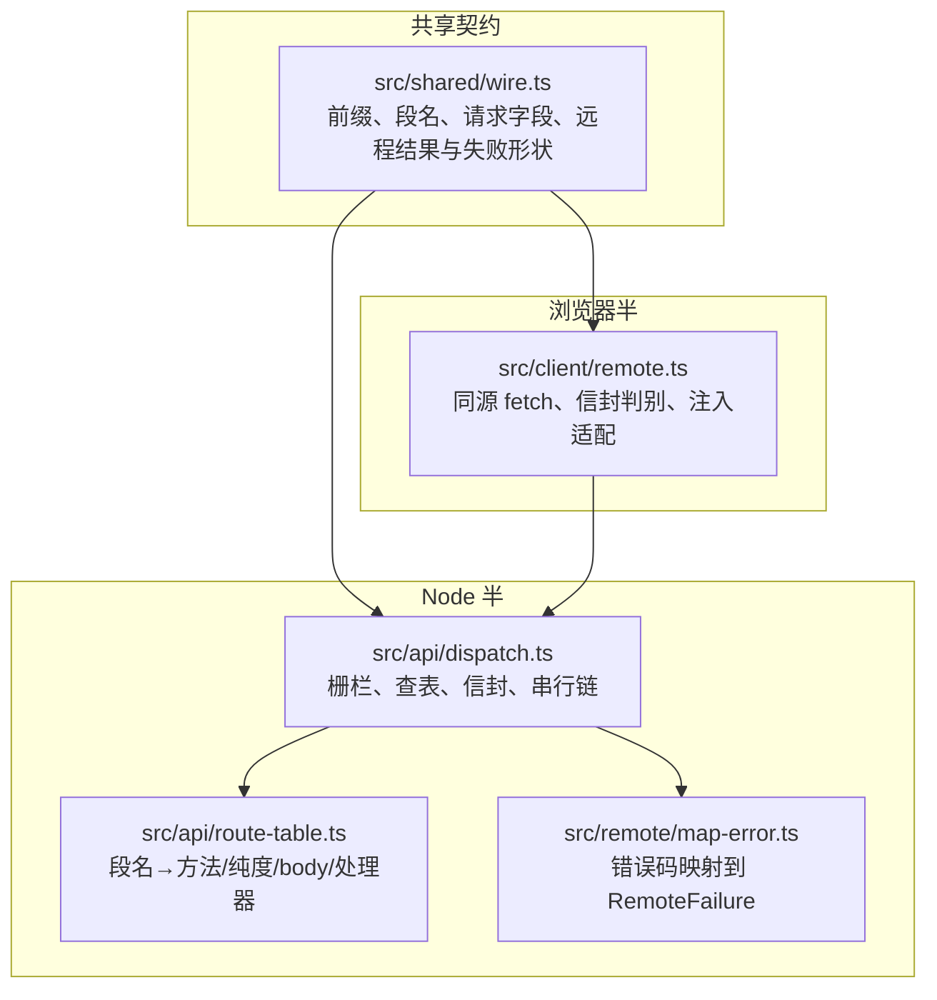
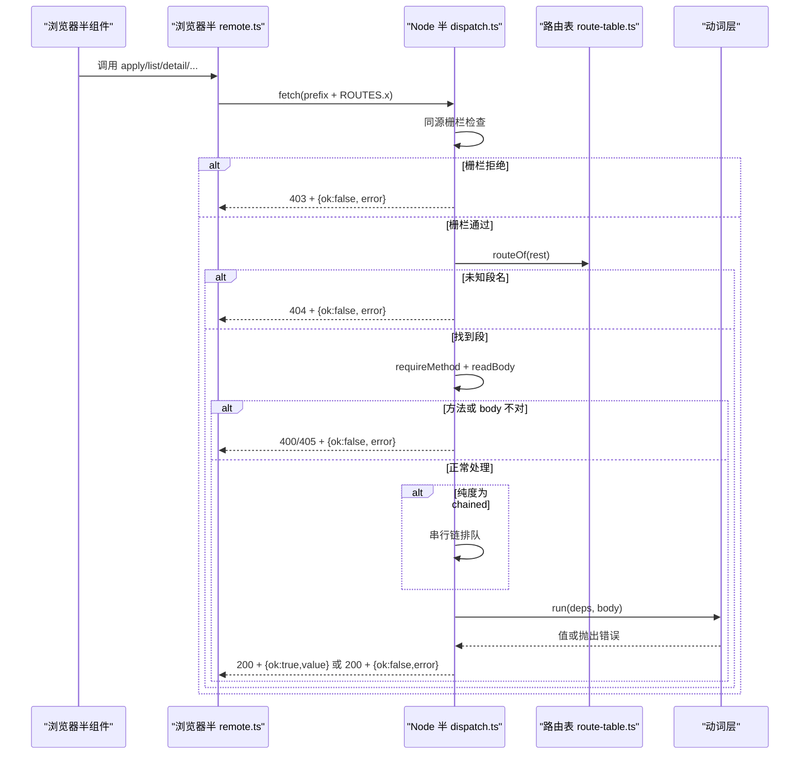
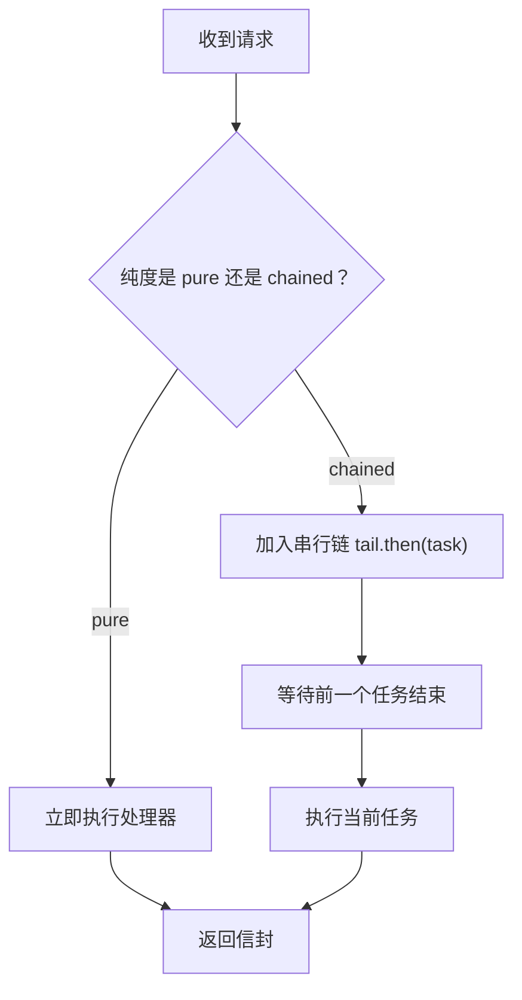
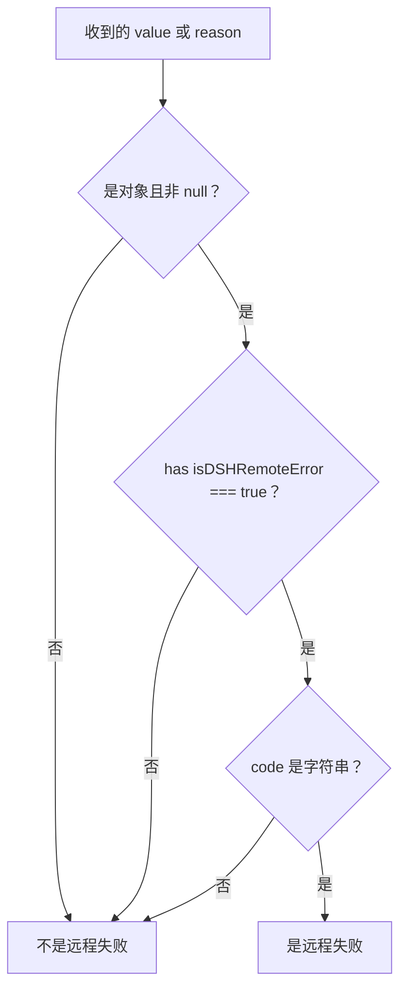
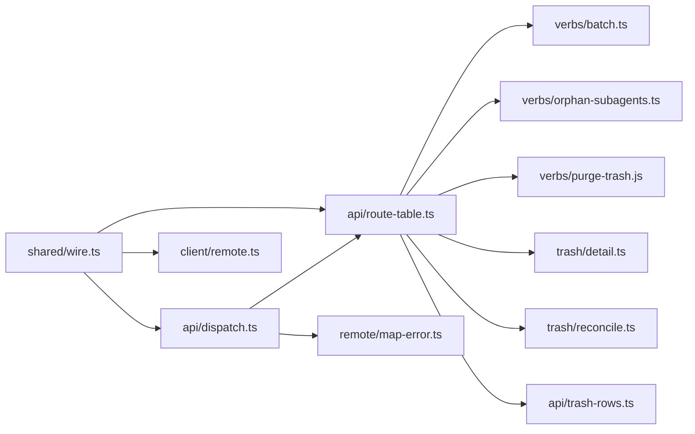

# 薄线协议与通用约定

<cite>
**本文引用的文件**   
- [README.md](file://README.md)
- [架构文档](file://docs/architecture.md)
- [共享导线与信封定义](file://src/shared/wire.ts)
- [Node 半分发器](file://src/api/dispatch.ts)
- [路由表](file://src/api/route-table.ts)
- [错误映射器](file://src/remote/map-error.ts)
- [浏览器半取数通道](file://src/client/remote.ts)
- [API 层集成测试](file://tests/api.test.ts)
- [路由表测试](file://tests/route-table.test.ts)
</cite>

## 目录

1. [引言](#引言)
2. [项目结构](#项目结构)
3. [核心组件](#核心组件)
4. [架构总览](#架构总览)
5. [详细组件分析](#详细组件分析)
6. [依赖关系分析](#依赖关系分析)
7. [性能与一致性特征](#性能与一致性特征)
8. [客户端调用建议](#客户端调用建议)
9. [故障排查](#故障排查)
10. [结论](#结论)

## 引言

本插件为 DeepSeek Harness（DSH）增加“删除会话”能力：删除不是直接销毁，而是移入本机回收站；恢复可回到原项目目录并还原归档态；另有显式的彻底删除和清空回收站。数据本体留在 `~/.dsh/session-trash/`，不联网、不上传。

本文聚焦其“薄线协议”——浏览器半与 Node 半之间唯一的 HTTP/JSON 契约：统一前缀 `/dsh-session-delete-api`、同源栅栏、JSON body 上限、方法白名单、串行链与失败信封。同时解释为什么 `wire.ts` 由两半共享、`RemoteResult<T>` 与 `RemoteFailure` 如何判别，以及新增端点时必须同步维护的约束。

## 项目结构

从协议视角看，仓库按“共享契约 → 浏览器半实现 → Node 半传输 → 业务动词”分层组织：

**图表来源**
- [架构文档:14-34](file://docs/architecture.md#L14-L34)
- [共享导线与信封定义:1-38](file://src/shared/wire.ts#L1-L38)
- [浏览器半取数通道:1-32](file://src/client/remote.ts#L1-L32)
- [Node 半分发器:1-39](file://src/api/dispatch.ts#L1-L39)
- [路由表:1-20](file://src/api/route-table.ts#L1-L20)
- [错误映射器:1-12](file://src/remote/map-error.ts#L1-L12)

### 关键目录职责

| 路径 | 职责 | 与薄线的关系 |
| --- | --- | --- |
| `src/shared/wire.ts` | 前缀、六个段名、请求字段、线上类型、`RemoteResult<T>`、`RemoteFailure`、`isDSHRemoteError` | 唯一真相源，两半共同 import |
| `src/client/remote.ts` | 浏览器半的 `list/ping/orphans/detail/apply/empty` 方法与 `callRemote` | 用共享常量拼 URL，解析响应信封 |
| `src/api/dispatch.ts` | 注册在宿主 web server 上的统一入口 | 只负责栅栏、查表、信封、串行链 |
| `src/api/route-table.ts` | 段名到方法、body、纯度、处理函数的映射 | 把“是什么”和“怎么处理”分开 |
| `src/remote/map-error.ts` | 把任意抛出物折成 `{code,message,details?}` | 保证上屏原文与结构化附带物 |

**章节来源**
- [架构文档:14-34](file://docs/architecture.md#L14-L34)
- [README.md:1-44](file://README.md#L1-L44)

## 核心组件

薄线协议由五个硬约束组成：

1. **统一前缀**：所有端点都位于 `/dsh-session-delete-api`。
2. **同源栅栏**：仅接受回环地址与受信任来源的请求；跨源 POST 不会被简单请求绕过 CSRF。
3. **JSON body 上限**：每个请求体最多 1MiB，超限直接拒绝。
4. **方法白名单**：每个段名固定为 `GET` 或 `POST`，不对的方法返回 405。
5. **串行链与失败信封**：写动作和对账动作进入串行链；操作成功/失败都用 `{ok,value}` / `{ok,error}` 表达，HTTP 状态只在“请求本身不对”时才体现差异。

| 维度 | 规则 | 违反时的表现 |
| --- | --- | --- |
| 前缀 | 必须匹配 `SESSION_DELETE_API_PREFIX` | 未知路由 404 |
| 来源 | 回环 + 同源 Origin、桌面壳 Origin 或桌面壳 Referer | 非受信来源 403 |
| Body | 需要 JSON 的段只读一次；不需要 JSON 的段一律不读 | 非法/超限 JSON 400 |
| 方法 | `routeOf` 后强制校验 | 405 |
| 执行顺序 | `chained` 段串行；`pure` 段并行 | 无额外重试语义 |
| 返回值 | 信封对象 | 非信封响应被浏览器半当作通道失败 |

**章节来源**
- [共享导线与信封定义:39-75](file://src/shared/wire.ts#L39-L75)
- [Node 半分发器:40-121](file://src/api/dispatch.ts#L40-L121)
- [路由表:21-143](file://src/api/route-table.ts#L21-L143)

## 架构总览

浏览器半通过同源 `fetch` 访问 Node 半暴露的前缀路由；Node 半只做轻量分发，真实逻辑在动词层。

**图表来源**
- [浏览器半取数通道:220-288](file://src/client/remote.ts#L220-L288)
- [Node 半分发器:122-200](file://src/api/dispatch.ts#L122-L200)
- [路由表:86-143](file://src/api/route-table.ts#L86-L143)

## 详细组件分析

### 统一前缀与六段端点

共享前缀是 `/dsh-session-delete-api`，由 `shared/wire.ts` 导出，Node 半与浏览器半都使用同一个字面量拼接路径。这样做有两个原因：

- 宿主 web server 对重复 `(kind, path)` 会抛错，所以插件前缀是与生态的硬边界。
- 如果两侧各写一份字符串，很容易漂移出两个不同路径，调试成本很高。

六个段名如下：

| 端点 | 方法 | 是否读 body | 是否进串行链 | 语义 |
| --- | --- | --- | --- | --- |
| `/list` | GET | 否 | 是 | 对账回收站目录后读取清单 |
| `/ping` | GET | 否 | 否 | 最便宜探测，不碰清册与盘 |
| `/orphans` | GET | 否 | 否 | 扫描父已不在语料或清册的项目组 |
| `/detail` | POST | 是 | 否 | 读取单条回收站详情 |
| `/apply` | POST | 是 | count 为纯读，其余写动作进链 | 批量执行 delete/restore/purge/count/orphan-clean |
| `/empty` | POST | 否 | 是 | 清空回收站，返回聚合回执 |

**章节来源**
- [共享导线与信封定义:39-75](file://src/shared/wire.ts#L39-L75)
- [路由表:86-143](file://src/api/route-table.ts#L86-L143)

### 同源栅栏

栅栏的目标不是“认证用户”，而是防止恶意网页用简单跨源 POST 触发删除等写操作。它允许以下三种情况：

1. `Origin` 与 `Host` 同源。
2. `Origin` 是桌面壳的 `dsh-app://app`。
3. `Referer` 是桌面壳的 `dsh-app://app`。

若两者都缺席，则视为本机工具调用；但任何跨源 POST 都会携带 `Origin`，因此恶意网页无法利用这个“缺席分支”。GET 在无跨域 CORS 时可能既无 `Origin` 也无 `Referer`，不过这类响应是 opaque，页面读不出内容。

| 场景 | 是否放行 | 说明 |
| --- | --- | --- |
| 本地回环 + 同源 Origin | 是 | 常规浏览器直连 |
| 本地回环 + 桌面壳 Origin | 是 | 桌面壳转发 |
| 本地回环 + 桌面壳 Referer | 是 | 桌面壳删掉 Origin 后的真机路径 |
| 非回环地址 | 否 | 外部主机 |
| Origin 跨源 | 否 | 跨源 POST 必带 Origin，不会被忽略 |
| Origin 与 Referer 都缺失 | 是 | 仅限本机工具；跨源形态不会走到这里 |

**章节来源**
- [Node 半分发器:40-118](file://src/api/dispatch.ts#L40-L118)

### JSON body 上限

Node 半逐块累加请求体字节，超过 1MiB 即抛出“bad-request”，返回 400。随后尝试 `JSON.parse`，要求结果是普通对象（不允许数组、原始值、null）。空体返回 `null`，由下游根据是否需要参数决定。

| 输入 | 行为 |
| --- | --- |
| 空体 | 返回 `null` |
| 合法 JSON 对象 | 传给处理器 |
| 合法 JSON 数组 | 400，提示需对象 |
| 非法 JSON | 400，带上解析错误消息 |
| 超过 1MiB | 400，不再继续解析 |

**章节来源**
- [Node 半分发器:122-176](file://src/api/dispatch.ts#L122-L176)

### 方法白名单

每个段名在路由表中声明了唯一合法方法：

| 段 | 合法方法 | 其他方法 |
| --- | --- | --- |
| list | GET | 405 |
| ping | GET | 405 |
| orphans | GET | 405 |
| detail | POST | 405 |
| apply | POST | 405 |
| empty | POST | 405 |

方法检查发生在查表之后、读取 body 之前。这样能避免用错误方法触发不必要的 body 解析。

**章节来源**
- [Node 半分发器:178-183](file://src/api/dispatch.ts#L178-L183)
- [路由表:86-143](file://src/api/route-table.ts#L86-L143)

### 串行链与纯度判断

`/list`、`/empty` 和 `/apply` 中除 `count` 外的写动作属于“先对账、再动盘、再写清单”的多步操作。它们进入一个进程内 Promise 串行链，避免删除、恢复、清空与对账交错产生“目录在、行是降级元数据”的不一致世界。

- `pure`：立即执行，不占串行链。
- `chained`：等待前一个任务完成后再执行。
- `/apply` 的纯度是函数形式：`action === 'count'` 为纯读，其余四个动作进链。
- 串行链的尾任务永不 reject，单次失败不会卡死整条链。

**图表来源**
- [Node 半分发器:185-198](file://src/api/dispatch.ts#L185-L198)
- [路由表:106-133](file://src/api/route-table.ts#L106-L133)

**章节来源**
- [Node 半分发器:185-198](file://src/api/dispatch.ts#L185-L198)
- [路由表:86-143](file://src/api/route-table.ts#L86-L143)

### 为什么 Node 半与浏览器半共享 `wire.ts`

`shared/wire.ts` 不是普通的工具库，而是两半之间的 wire 契约。代码注释明确列出两条构建期约束：

1. 浏览器半不能引入 Node 内建或平台模块，否则会撞上 tsdown 的纯度门。
2. 跨插件一律 `import type`，因为值 import 会把宿主包拖进客户端 bundle。

`wire.ts` 恰好满足这两点：它只导出常量、类型和纯判别函数，零运行时依赖。浏览器半把它整个 inline 进 bundle，Node 半也用它构造响应。如果把前缀、段名、请求字段或信封形状放在任一端的私有文件中，就会出现两套字面量，导致前端发 `/x` 而后端只认 `/y`。

此外，`RemoteResult<T>`、`RemoteFailure` 和 `isDSHRemoteError` 本身就是“两端都要理解的对象”，因此也必须共享。

**章节来源**
- [共享导线与信封定义:1-38](file://src/shared/wire.ts#L1-L38)
- [架构文档:14-34](file://docs/architecture.md#L14-L34)

### `RemoteResult<T>` 与 `RemoteFailure` 的判别规则

#### 在线形状

| 字段 | 含义 |
| --- | --- |
| `ok` | 判别位：`true` 表示成功，`false` 表示失败 |
| `value` | 成功时的业务值 |
| `error` | 失败时的 `RemoteFailure` |
| `error.code` | 失败码，如 `sessiondelete/live`、`sessiondelete/not-found` 等 |
| `error.message` | 上屏原文 |
| `error.details` | 可选的结构化附带物 |

#### 判别函数

`isDSHRemoteError` 不按 `instanceof Error` 判别，因为它要跨 realm、跨 bundle、跨 JSON 往返。它按标记位判断：

- 值是对象且不为 null。
- `isDSHRemoteError` 为 `true`。
- `code` 是字符串。

Node 半的错误映射器在把宿主错误、动词错误、官方错误折成线上形状时，也会给已是远程失败的错误保留 `details`。浏览器半在把网络层异常包装成失败时，会为新的 Error 补上 `isDSHRemoteError: true`，使后续判别保持一致。

**图表来源**
- [共享导线与信封定义:180-200](file://src/shared/wire.ts#L180-L200)
- [浏览器半取数通道:103-154](file://src/client/remote.ts#L103-L154)
- [错误映射器:79-134](file://src/remote/map-error.ts#L79-L134)

**章节来源**
- [共享导线与信封定义:157-200](file://src/shared/wire.ts#L157-L200)
- [浏览器半取数通道:103-154](file://src/client/remote.ts#L103-L154)
- [错误映射器:79-134](file://src/remote/map-error.ts#L79-L134)

### 4xx 网络级错误与 200+`ok:false` 业务失败的区别

这是薄线协议最重要的语义分界：

| 类别 | HTTP 状态 | 信封 | 谁的责任 | 客户端行为 |
| --- | --- | --- | --- | --- |
| 请求本身不对 | 400 / 405 / 404 | 通常仍带 `{ok:false,error}` | 调用方没组好请求或走错路由 | 不调用者重试；记录调试信息 |
| 同源栅栏拒绝 | 403 | 带失败信封 | 来源不受信 | 不重试；报告通道不可信 |
| 操作失败 | 200 | `{ok:false,error:{code,...}}` | 业务层面失败 | 可按策略重试、降级或展示 |
| 通道完全失败 | 非信封响应或 fetch 抛错 | 浏览器半内部 reject | 网络/网关问题 | 作为客户端未知错误处理 |

具体示例：

- 400：JSON 非法、缺少必填字段、body 超限。
- 405：对 `/detail` 用了 GET。
- 404：段名不在路由表。
- 403：来自非回环地址，或 Origin/Referer 不被信任。
- 200+`ok:false`：例如会话正在运行、会话不存在、磁盘 I/O 失败。

浏览器半的 `requestEnvelope` 先把响应解析为 JSON；解析失败时直接抛错，描述为“取数通道回的不是信封”。只有真正拿到信封时，才按 `ok` 分支。

**章节来源**
- [Node 半分发器:89-121](file://src/api/dispatch.ts#L89-L121)
- [Node 半分发器:122-183](file://src/api/dispatch.ts#L122-L183)
- [浏览器半取数通道:238-268](file://src/client/remote.ts#L238-L268)

### 端点路由表

| 段名 | 方法 | body | 纯度 | 处理器 | 备注 |
| --- | --- | --- | --- | --- | --- |
| `/list` | GET | none | chained | reconcileTrash + assembleTrashRows | 对账后读清单 |
| `/ping` | GET | none | pure | 返回探针值 | 通道健康探测 |
| `/orphans` | GET | none | pure | reportOrphans | 纯读扫描 |
| `/detail` | POST | json | pure | readTrashDetail | 用 POST 复用同一栅栏与 body 校验 |
| `/apply` | POST | json | 函数 | applyActions | count 为纯读，其余进链 |
| `/empty` | POST | none | chained | reconcileTrash + purgeTrash | 清空回收站 |

**章节来源**
- [路由表:86-143](file://src/api/route-table.ts#L86-L143)

## 依赖关系分析

**图表来源**
- [共享导线与信封定义:1-75](file://src/shared/wire.ts#L1-L75)
- [Node 半分发器:1-39](file://src/api/dispatch.ts#L1-L39)
- [路由表:1-20](file://src/api/route-table.ts#L1-L20)
- [浏览器半取数通道:1-32](file://src/client/remote.ts#L1-L32)

### 耦合与内聚

- `wire.ts` 与 `dispatch.ts`、`client/remote.ts` 高内聚：三者共同维护前缀、段名、请求字段和信封形状。
- `dispatch.ts` 低耦合：只负责栅栏、查表、信封和串行链，不关心回收站如何移动。
- `route-table.ts` 是“怎么做”的唯一集中点，避免过去分散在多个 if 分支中的方法判断和纯度判断漂移。
- `map-error.ts` 单向依赖 wire 的失败码与域名，不反向引用宿主类型。

### 循环依赖风险

当前依赖方向清晰：浏览器半和 Node 半都依赖共享契约；Node 半的分发器依赖路由表；路由表依赖动词与 trash 部件；没有反向引用。新增端点时最容易破坏的是“只改 wire 不改路由表”，这正是 `tests/route-table.test.ts` 要钉住的。

**章节来源**
- [架构文档:21-46](file://docs/architecture.md#L21-L46)
- [路由表:1-20](file://src/api/route-table.ts#L1-L20)

## 性能与一致性特征

### 吞吐量

- 浏览器半与 Node 半之间是薄通道，没有序列化 RPC 描述符、没有动态发现。
- 写操作进入进程内 Promise 串行链，代价只是毫秒级排队。
- 纯读段（ping、orphans、detail、apply 的 count）不进链，避免探测和大正文读阻塞删除按钮。

### 内存

- JSON body 上限为 1MiB，防止无限流放大内存。
- 清单、详情和孤儿报告都是按需计算，不落清册。
- 回收站目录与清册对账时，随盘状态随时变的派生读数（子代理数量、释放字节等）现算现给。

### 一致性

- 删除顺序固定：归档 → 摘账本 → 搬目录 → 摘活体 → 通告。
- 清单登记是最后一件写；若失败，整体回退已做的归档和账本变更。
- `/list` 先对账再读，确保“目录有而行丢了”的世界也能重建。
- `/empty` 先对账再清空，手工放进 `session-trash/` 的目录能被识别并清理。

**章节来源**
- [Node 半分发器:122-198](file://src/api/dispatch.ts#L122-L198)
- [路由表:86-143](file://src/api/route-table.ts#L86-L143)

## 客户端调用建议

### 重试策略

| 条件 | 是否重试 | 理由 |
| --- | --- | --- |
| 400 / 405 / 404 | 不应自动重试 | 请求格式、方法或路由错误，重试不会改变结果 |
| 403 | 不应自动重试 | 来源不受信，重试通常仍是 403 |
| 200+`ok:false`，业务码为 live | 可有限重试 | 会话仍在运行，短暂等待后可能可用 |
| 200+`ok:false`，not-found | 通常不重试 | 会话确实不存在 |
| 200+`ok:false`，io | 可有限重试 | 可能是临时 I/O 问题 |
| 通道完全失败 | 可有限重试 | 宿主未启动、网关暂时不可用 |
| 批量部分失败 | 只重试失败项 | 成功项不应重放 |

注意区分两层失败：

- 顶层 `RemoteResult.ok === false`：表示这次 HTTP 调用没有拿到期望信封，或网关层失败。
- `/apply` 返回的 `ApplyOutcome[]` 中单项 `ok === false`：表示该 id 的业务操作失败，但整批调用本身成功了。

### 幂等性建议

- `/apply` 的 restore 和 purge 对同一条回收站条目多次执行，语义上是幂等的：已被同批前一条带走的条目返回幂等 no-op。
- delete 对还在盘上的会话应视为非幂等：重复删除可能再次归档并生成新回收站行。
- 重试时应优先去重 id，避免把同一批 id 反复发送。
- 对于“确认框 + 批量执行”的界面，不要把用户二次确认当成幂等键；真正的幂等键是服务端对已处理 id 的状态判断。

### 调试技巧

1. 先用 `GET /ping` 检测通道是否在；它不碰清册和盘，适合页面加载前的快速探测。
2. 打印 `error.code`：区分 `sessiondelete/*` 业务码、宿主官方码、`client/unknown` 客户端未知错误。
3. 打印 `error.message`：这是设计稿要求的上屏原文，不要只显示 code。
4. 检查 `error.details`：可能包含 `sessionId`、`workspaceId`、`path`、`activity` 等结构化信息。
5. 区分 HTTP 状态与信封：日志里 4xx 不代表“业务失败”，200 也不代表“一定成功”。
6. 对 `/apply`，检查返回数组中哪一项 `ok:false`，而不是只看外层信封。
7. 遇到 403 时检查来源：是否是本机回环、Origin 是否与 Host 同源、或是否为桌面壳路径。

**章节来源**
- [浏览器半取数通道:156-200](file://src/client/remote.ts#L156-L200)
- [浏览器半取数通道:238-288](file://src/client/remote.ts#L238-L288)
- [错误映射器:79-134](file://src/remote/map-error.ts#L79-L134)

## 故障排查

### 新增端点后列表不一致

症状：`ROUTES` 加了段名，但路由表测试报错。

原因：ADR-0004 要求“一段一行”，新增端点必须同步更新：

1. `src/shared/wire.ts` 的 `ROUTES`。
2. `src/api/route-table.ts` 的 `ROUTE_TABLE`。
3. 如需新方法、body 或纯度，也在路由表里声明。
4. 浏览器半的 `RawSessionDeleteRemote` 接口与 `createHttpRemote` 中新增对应方法。

测试已经断言：

- `ROUTE_TABLE` 的键集合与 `Object.values(ROUTES)` 排序后相等。
- 六个段名的方法正确。
- 只有 `apply` 与 `detail` 需要 JSON body。
- `list` 与 `empty` 必须进链，ping/orphans/detail 必须是纯读。
- `/apply` 的动作表由 `ApplyAction` 类型派生。

**章节来源**
- [路由表测试:1-69](file://tests/route-table.test.ts#L1-L69)
- [路由表:86-143](file://src/api/route-table.ts#L86-L143)
- [共享导线与信封定义:39-75](file://src/shared/wire.ts#L39-L75)

### 浏览器半报“取数通道回的不是信封”

可能原因：

- 请求落到 SPA 兜底处理器，返回了 HTML 而非 JSON。
- 网关返回了非信封格式。
- 网络层异常被捕获后包装成错误。

处理建议：

- 确认前缀和段名一致。
- 检查是否走了同源栅栏。
- 在 `failureOf` 中保留原始错误 message。
- 把这类错误归类为 `client/unknown`，不要冒充业务码。

**章节来源**
- [浏览器半取数通道:238-288](file://src/client/remote.ts#L238-L288)

### 删除按钮被堵在身后

症状：点击探测、详情或扫描后，删除按钮很久才响应。

原因：不该进链的操作被误判为 `chained`。

排查：

- 检查 `routeOf` 对应的 `purity`。
- 确认 `/apply` 的纯度函数只对 `count` 返回 `pure`。
- 确认 `/detail` 是纯读。
- 确认 `/orphans` 是纯读。

**章节来源**
- [路由表:106-133](file://src/api/route-table.ts#L106-L133)
- [Node 半分发器:185-198](file://src/api/dispatch.ts#L185-L198)

### 4xx 与业务失败混淆

症状：日志里大量 4xx，但客户端以为“业务失败”。

纠正：

- 400/405/404/403 是“请求本身不对”。
- 200+`ok:false` 才是“操作失败”。
- 客户端应先解信封，再看 `ok`；不要只看 HTTP 状态。

**章节来源**
- [Node 半分发器:89-121](file://src/api/dispatch.ts#L89-L121)
- [API 层集成测试:1-112](file://tests/api.test.ts#L1-L112)

## 结论

薄线协议的核心不是“又一个 REST API”，而是把浏览器半与 Node 半之间容易漂移的字面量、类型和错误形状收归到一份共享契约中。统一前缀、同源栅栏、JSON body 上限、方法白名单、串行链和失败信封共同保证了：

- 调用方知道怎么发请求。
- 服务器知道怎么处理请求。
- 两端知道什么时候是网络级失败、什么时候是业务失败。
- 新增端点不会悄悄脱离契约。

实践上，新增端点必须同步维护 `ROUTES` 与 `ROUTE_TABLE`，并明确它的 HTTP 方法、body 需求和纯度。客户端调用应以信封为主、HTTP 状态为辅，结合幂等性与有限重试策略处理可恢复失败，并把 `message` 和 `details` 用于可观测性与调试。