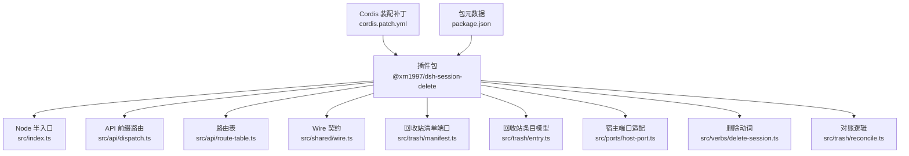
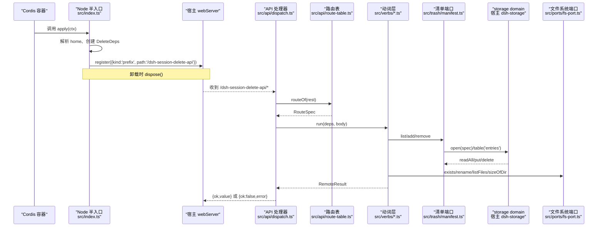
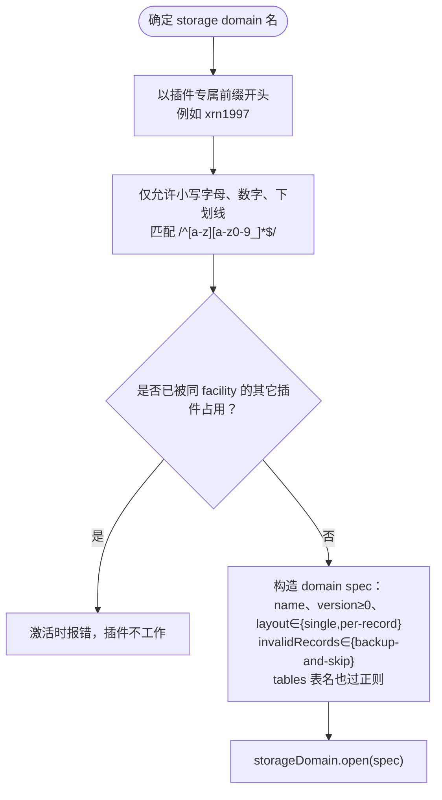
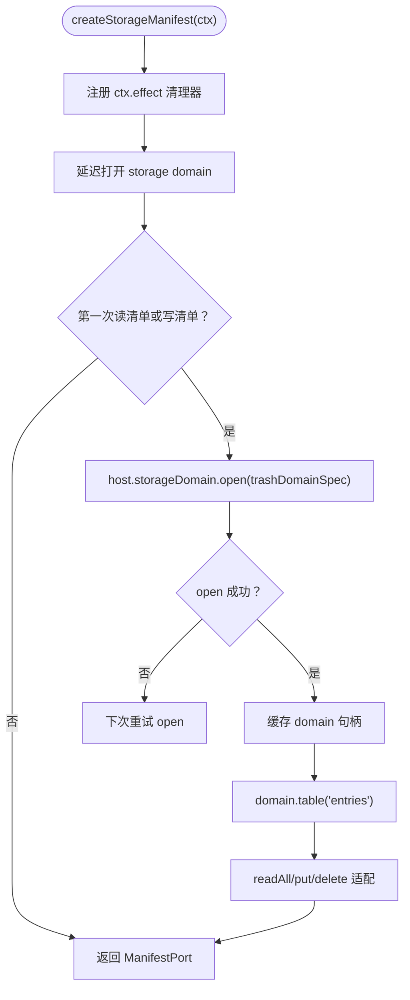
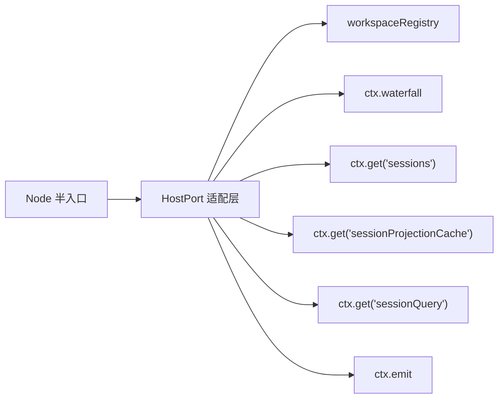
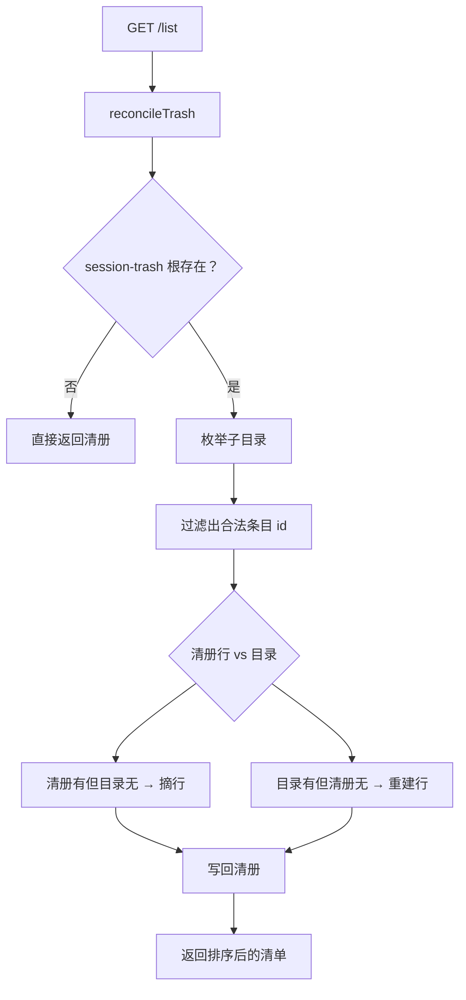
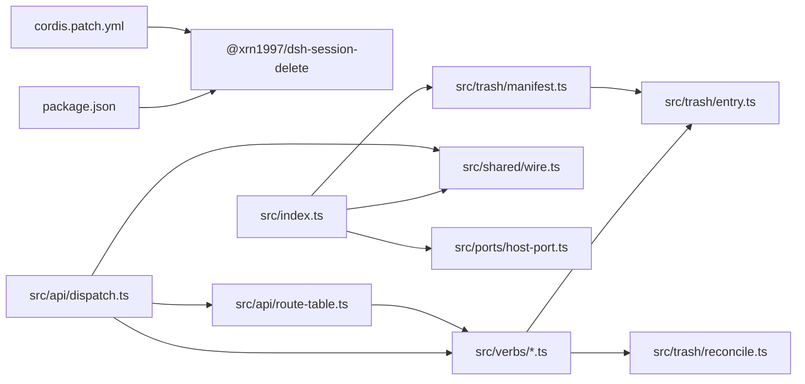

# Node 半入口与装配

<cite>
**本文引用的文件**   
- [src/index.ts](file://src/index.ts)
- [package.json](file://package.json)
- [cordis.patch.yml](file://cordis.patch.yml)
- [README.md](file://README.md)
- [AGENTS.md](file://AGENTS.md)
- [src/trash/manifest.ts](file://src/trash/manifest.ts)
- [src/trash/entry.ts](file://src/trash/entry.ts)
- [src/shared/wire.ts](file://src/shared/wire.ts)
- [src/api/dispatch.ts](file://src/api/dispatch.ts)
- [src/api/route-table.ts](file://src/api/route-table.ts)
- [src/ports/host-port.ts](file://src/ports/host-port.ts)
- [src/verbs/delete-session.ts](file://src/verbs/delete-session.ts)
- [src/trash/reconcile.ts](file://src/trash/reconcile.ts)
- [tests/assembly.test.ts](file://tests/assembly.test.ts)
- [docs/design/2026-09-30-session-delete-design.md](file://docs/design/2026-09-30-session-delete-design.md)
</cite>

## 目录
1. [引言](#引言)
2. [项目结构](#项目结构)
3. [核心组件](#核心组件)
4. [架构总览](#架构总览)
5. [详细组件分析](#详细组件分析)
6. [依赖关系分析](#依赖关系分析)
7. [性能考虑](#性能考虑)
8. [故障排查指南](#故障排查指南)
9. [结论](#结论)
10. [附录：扩展示例与约束](#附录扩展示例与约束)

## 引言
本文聚焦本插件的 **Node 半入口与装配**，解释以下问题：
- 插件名、cordis 注入项与 storage domain 命名规范。
- `createStorageManifest` 生命周期如何建立回收站清单。
- 数据根解析、宿主服务连接、日志目录与 `session-trash` 目录的关系。
- 添加新的 storage domain 或注册新的 Node 能力时应遵循的约束。
- 配置选项、环境变量、部署位置与权限要求。

## 项目结构
本仓库是 DeepSeek Harness（DSH）的一个会话删除插件。Node 半由 `src/index.ts` 暴露 `name`、`inject`、`apply`；浏览器半与共享契约分布在 `src/client`、`src/shared`、`src/api`、`src/verbs`、`src/trash` 等目录中。

**图示来源**
- [src/index.ts:1-250](file://src/index.ts#L1-L250)
- [cordis.patch.yml:1-3](file://cordis.patch.yml#L1-L3)
- [package.json:1-105](file://package.json#L1-L105)

**章节来源**
- [src/index.ts:1-250](file://src/index.ts#L1-L250)
- [package.json:1-105](file://package.json#L1-L105)
- [cordis.patch.yml:1-3](file://cordis.patch.yml#L1-L3)

## 核心组件
本节从“装配面”角度说明 Node 半的三个关键输出：

| 名称 | 定义位置 | 作用 |
|---|---|---|
| 插件名 | `src/index.ts` | 导出 `name = '@xrn1997/dsh-session-delete'`，作为 cordis 插件标识。 |
| Cordis 注入项 | `src/index.ts` | 导出 `inject = ['workspaceRegistry', 'storageDomain', 'webServer']`，声明 Node 半需要的宿主服务。 |
| 装配函数 | `src/index.ts` | 导出 `apply(ctx)`，创建依赖、注册 `/dsh-session-delete-api` 前缀路由。 |

### 插件名与安装位置
- npm 包名是 `@xrn1997/dsh-session-delete`，由 `package.json` 声明。
- 通过 `dsh plugin --profile <profile> add @xrn1997/dsh-session-delete` 安装到宿主 profile。
- 包产物中的 `lib/index.js` 是 Node 半主入口，`lib/client.js` 是浏览器半入口。
- `cordis.patch.yml` 在宿主打包阶段把插件 id 插入 cordis 装配列表，id 为 `session-delete`，name 指向该包。

**章节来源**
- [package.json:1-105](file://package.json#L1-L105)
- [cordis.patch.yml:1-3](file://cordis.patch.yml#L1-L3)
- [README.md:1-147](file://README.md#L1-L147)

### Cordis 注入项约束
Node 半只注入三个字符串：
1. `workspaceRegistry`：工作区与会话可见性、归档态、头信息读取。
2. `storageDomain`：用于打开本插件自己的回收站清单域。
3. `webServer`：注册插件专属 API 前缀路由。

注释明确排除了三项：
- `remote`：那是浏览器半的服务，写进 Node 半会导致插件永远 pending。
- `sessions` / `sessionProjectionCache`：按 `ctx.get(...)` 可选读，注入可能不存在的服务也会让插件 pending。

这意味着：**扩展 Node 半时不能随意加 inject 字符串**；必须确认宿主一定提供，否则应改用 `ctx.get` 降级。

**章节来源**
- [src/index.ts:1-60](file://src/index.ts#L1-L60)
- [src/ports/host-port.ts:1-120](file://src/ports/host-port.ts#L1-L120)

## 架构总览
Node 半启动后，会做三件事：
1. 解析宿主数据根 `home`。
2. 构造 `DeleteDeps`，包含文件系统端口、宿主端口、回收站清单、当前时间。
3. 用 `webServer.register` 注册 `/dsh-session-delete-api` 前缀路由，卸载时自动摘除。

**图示来源**
- [src/index.ts:201-250](file://src/index.ts#L201-L250)
- [src/api/dispatch.ts:1-200](file://src/api/dispatch.ts#L1-L200)
- [src/api/route-table.ts:1-143](file://src/api/route-table.ts#L1-L143)
- [src/trash/manifest.ts:1-35](file://src/trash/manifest.ts#L1-L35)
- [src/ports/fs-port.ts:1-200](file://src/ports/fs-port.ts#L1-L200)

## 详细组件分析

### 插件名、注入项与 storage domain 命名规范

#### 插件名
- 包名：`@xrn1997/dsh-session-delete`。
- Node 半导出的插件名：`@xrn1997/dsh-session-delete`。
- cordis patch 中的装配 id：`session-delete`，name 指向包名。

#### Cordis 注入项
Node 半显式注入：
- `workspaceRegistry`
- `storageDomain`
- `webServer`

可选宿主服务通过 `ctx.get` 读取，包括：
- `sessions`
- `sessionProjectionCache`
- `sessionQuery`

#### storage domain 命名
回收站清单使用自定义 storage domain，域名为：
`xrn1997_session_delete_trash`

命名规则如下：
- 必须以插件专属前缀开头，这里采用 npm scope `xrn1997`。
- 只能匹配 `[a-z][a-z0-9_]*$`，因此不允许 `@`、`/`、`-` 等字符。
- 一个 facility 中域名全局唯一，且只能 `open()` 一次；若被其他插件占用，本插件激活时会抛错。
- domain spec 还校验 version、layout、invalidRecords 与表名，表名也必须匹配相同正则。

**图示来源**
- [src/index.ts:60-160](file://src/index.ts#L60-L160)

**章节来源**
- [src/index.ts:60-160](file://src/index.ts#L60-L160)
- [package.json:1-105](file://package.json#L1-L105)
- [cordis.patch.yml:1-3](file://cordis.patch.yml#L1-L3)

### `createStorageManifest` 生命周期与回收站清单

`createStorageManifest` 是 Node 半中把宿主 storage domain 适配为清单端口的工厂。它返回 `ManifestPort`，供动词层调用 `list`、`add`、`remove`。

关键点：
- 清单域 spec 使用 `layout: 'per-record'` 和 `invalidRecords: 'backup-and-skip'`，一条坏记录不会让整域开不起来。
- 域句柄懒加载：第一次访问 `readAll`/`put`/`delete` 时才 `storageDomain.open(trashDomainSpec)`。
- 并发安全：`opening` promise 缓存首次打开请求，避免重复 open。
- 资源清理：通过 `ctx.effect` 注册卸载清理器，关闭已打开的域句柄；失败过的 opening promise 不会当作待关闭句柄。
- 适配器：把宿主 `DomainLike` 的 `table('entries')` 映射为 `StorageDomainLike` 的 `readAll`/`put`/`delete`。
- 最终再传给 `trash/manifest.ts` 的 `createStorageManifest(domain)`，封装成统一排序后的 `ManifestPort`。

**图示来源**
- [src/index.ts:100-200](file://src/index.ts#L100-L200)
- [src/trash/manifest.ts:1-35](file://src/trash/manifest.ts#L1-L35)

**章节来源**
- [src/index.ts:100-200](file://src/index.ts#L100-L200)
- [src/trash/manifest.ts:1-35](file://src/trash/manifest.ts#L1-L35)

### 数据根解析与宿主服务连接

#### 数据根解析
Node 半自己实现宿主数据根解析，优先级为：
1. 环境变量 `DSH_HOME`（空值视为未设置）。
2. 用户主目录下的 `.dsh`。
3. 展开 `~` 并规范化绝对路径。

重要边界：
- 如果 profile 显式配置了不同 data root，插件无法拿到该显式配置，只会镜像后两级。
- 此时 sessions 与 session-trash 同源同卷，但探测不到预期目录时，删除/恢复会以 `not-found` 响亮拒绝，不会误动其他树。

#### 宿主服务连接
Node 半通过 `createHostPort(ctx)` 包装宿主能力，对外暴露 `HostPort` 接口，包括：
- 工作区查询：`workspaceOf`、`projectDirOf`、`workspaceExists`。
- 会话状态：`titleOf`、`isLive`、`isArchived`。
- 会话管理：`evictLive`、`announceRemoved`、`announceRestored`、`archive`、`unarchive`、`attach`、`detach`。
- 语料扫描：`listSessions`、`subagentMembers`、`subagentCounts`、`subagentMembersBatch`。

这些方法都是 Promise，测试用例要求每个方法都返回 Promise，并且没有“尚未接线”的占位错误。

**图示来源**
- [src/index.ts:201-250](file://src/index.ts#L201-L250)
- [src/ports/host-port.ts:1-120](file://src/ports/host-port.ts#L1-L120)
- [tests/assembly.test.ts:1-200](file://tests/assembly.test.ts#L1-L200)

**章节来源**
- [src/index.ts:201-250](file://src/index.ts#L201-L250)
- [src/ports/host-port.ts:1-120](file://src/ports/host-port.ts#L1-L120)
- [tests/assembly.test.ts:1-200](file://tests/assembly.test.ts#L1-L200)

### 日志目录与 `session-trash` 目录的关系

#### 会话日志目录
会话本体与日志落在宿主的数据根下，典型路径形如：
`~/.dsh/sessions/<项目目录>/<会话目录>/session.vN.jsonl.zstd`

插件不直接维护这个目录，而是通过宿主提供的服务与文件系统端口交互。

#### 回收站目录
回收站本体位于：
`~/.dsh/session-trash/<删除时间戳>-<原会话目录名>/`

- 目录名即回收站条目 id。
- 恢复时按原目录名放回去，而不是重新生成 id。
- 每个会话一格目录，父子会话各自独立目录。

#### 清单存储
回收站清单不在 `session-trash` 里，也不放在 `~/.dsh/storages` 的路径语义中作为普通键集合。它是本插件通过 storage domain 创建的领域对象，介质落在宿主 storage 基础设施之下，而本插件只关心 `ManifestPort` 的抽象。

#### 对账机制
每次 `GET /list` 都会先对账：
- 枚举 `session-trash` 下的目录。
- 识别合法条目 id。
- 重建缺失行。
- 删除清册中存在但目录不存在的行。
- 对不可识别或读不出日志的目录静默跳过。

**图示来源**
- [src/trash/reconcile.ts:1-127](file://src/trash/reconcile.ts#L1-L127)
- [src/shared/wire.ts:1-120](file://src/shared/wire.ts#L1-L120)
- [src/trash/entry.ts:1-90](file://src/trash/entry.ts#L1-L90)

**章节来源**
- [src/trash/reconcile.ts:1-127](file://src/trash/reconcile.ts#L1-L127)
- [src/shared/wire.ts:1-120](file://src/shared/wire.ts#L1-L120)
- [src/trash/entry.ts:1-90](file://src/trash/entry.ts#L1-L90)
- [docs/design/2026-09-30-session-delete-design.md:1-81](file://docs/design/2026-09-30-session-delete-design.md#L1-L81)

### 装配流程与 API 通道

Node 半装配顺序是：
1. 构建 `DeleteDeps`。
2. 获取 `webServer`。
3. 用 `ctx.effect` 注册前缀路由。
4. 卸载时调用 `dispose()`。

API 通道走宿主 web server，不是 cordis `remote` 命名空间。原因：
- 浏览器半 `remote.<namespace>` 需要生成的 Typert 描述符并挂载，第三方仓难以动态发现。
- 插件选择宿主自带的 web server，注册 `/dsh-session-delete-api` 前缀路由。
- 浏览器半通过同源 fetch 调用，信封形状与官方 unary 面一致。

路由表集中定义六个段名：
- `GET /list`
- `GET /ping`
- `POST /detail`
- `POST /apply`
- `POST /empty`
- `GET /orphans`

**章节来源**
- [src/index.ts:201-250](file://src/index.ts#L201-L250)
- [src/api/dispatch.ts:1-200](file://src/api/dispatch.ts#L1-L200)
- [src/api/route-table.ts:1-143](file://src/api/route-table.ts#L1-L143)
- [AGENTS.md:1-62](file://AGENTS.md#L1-L62)

## 依赖关系分析

**图示来源**
- [package.json:1-105](file://package.json#L1-L105)
- [cordis.patch.yml:1-3](file://cordis.patch.yml#L1-L3)
- [src/index.ts:1-250](file://src/index.ts#L1-L250)
- [src/api/dispatch.ts:1-200](file://src/api/dispatch.ts#L1-L200)
- [src/api/route-table.ts:1-143](file://src/api/route-table.ts#L1-L143)
- [src/trash/manifest.ts:1-35](file://src/trash/manifest.ts#L1-L35)
- [src/trash/entry.ts:1-90](file://src/trash/entry.ts#L1-L90)
- [src/trash/reconcile.ts:1-127](file://src/trash/reconcile.ts#L1-L127)

### 耦合与内聚
- `index.ts` 负责装配与依赖组装，内聚度高，但耦合宿主 `Context`。
- `api/dispatch.ts` 只处理传输、栅栏、路由分发，业务逻辑下沉到 verbs。
- `trash/manifest.ts` 是清单抽象，解耦具体 storage domain 实现。
- `ports/host-port.ts` 把宿主服务窄化为可测试端口。
- `trash/entry.ts` 集中条目模型、id 生成、路径安全校验。

### 外部依赖
- Cordis：插件运行时容器。
- 宿主 dsh-storage：storage domain 的实际提供者。
- 宿主 web server：承载插件 API 前缀路由。
- 宿主 workspace/session 服务：会话归属、活跃性、归档态、投影缓存、会话列表。

**章节来源**
- [src/index.ts:1-250](file://src/index.ts#L1-L250)
- [src/api/dispatch.ts:1-200](file://src/api/dispatch.ts#L1-L200)
- [src/api/route-table.ts:1-143](file://src/api/route-table.ts#L1-L143)
- [src/trash/manifest.ts:1-35](file://src/trash/manifest.ts#L1-L35)
- [src/ports/host-port.ts:1-120](file://src/ports/host-port.ts#L1-L120)
- [src/trash/entry.ts:1-90](file://src/trash/entry.ts#L1-L90)

## 性能考虑
- storage domain 懒加载：只有真正读写清单时才 open 域句柄。
- 对账只在 `GET /list` 触发，纯读探测 `/ping` 不碰清册与磁盘。
- 到达序串行链：对账与写动作串行执行，避免“目录已搬、行未写”时的竞态。
- 批量操作逐条执行，失败不连坐，客户端可重试失败项。
- 标题与字节数尽量复用已有宿主能力，不自行重复造轮子。

[本节为通用性能讨论，不直接分析具体代码片段]

## 故障排查指南

### 插件始终 pending
常见原因：
- 在 Node 半的 `inject` 中写入了浏览器半才有的 `remote`。
- 注入了可能不存在的服务，例如 `sessions` 或 `sessionProjectionCache`。
- storage domain 名冲突，导致 `open` 报 already-open。

排查建议：
- 检查 `src/index.ts` 的 `inject` 数组。
- 确认 `xrn1997_session_delete_trash` 没有被其他插件抢占。
- 确认 cordis patch 只插入一次。

**章节来源**
- [src/index.ts:1-60](file://src/index.ts#L1-L60)
- [src/index.ts:60-160](file://src/index.ts#L60-L160)
- [cordis.patch.yml:1-3](file://cordis.patch.yml#L1-L3)

### 侧栏没有回收站入口
可能原因：
- 插件未重启宿主。
- 同源栅栏拒绝桌面壳请求，导致所有入口不注册。
- 宿主版本不满足 `engines.dsh` 范围。
- cordis patch 没有生效，插件未被装配。

排查建议：
- 安装后重启宿主。
- 检查桌面壳转发路径与同源判断。
- 核对 `package.json` 的 `engines.dsh` 与 `dsh.compatibility.dshReleases`。
- 检查 `cordis.patch.yml` 是否被打包进产物。

**章节来源**
- [README.md:1-147](file://README.md#L1-L147)
- [package.json:1-105](file://package.json#L1-L105)
- [src/api/dispatch.ts:1-200](file://src/api/dispatch.ts#L1-L200)

### 恢复后会话掉入“未分组”
原因：
- 工作区已被宿主删除，恢复时跳过 `attach`。
- 这是设计允许的降级行为：会话仍回盘，但不再属于任何工作区。

排查建议：
- 确认工作区是否存在。
- 不要手动把目录搬回 `sessions` 代替面板恢复。
- 查看清单行中 `workspaceId` 是否为空。

**章节来源**
- [src/ports/host-port.ts:1-120](file://src/ports/host-port.ts#L1-L120)
- [src/verbs/delete-session.ts:1-206](file://src/verbs/delete-session.ts#L1-L206)
- [README.md:1-147](file://README.md#L1-L147)

### 清单与目录不一致
现象：
- 手工移动过 `session-trash`。
- 清册丢失或部分损坏。

处理方式：
- 不需要手动修复 storages 里的清单。
- 下一次 `GET /list` 会自动对账，重建可识别条目，丢弃无法识别条目。

**章节来源**
- [src/trash/reconcile.ts:1-127](file://src/trash/reconcile.ts#L1-L127)

## 结论
本插件的 Node 半入口通过 cordis 装配，声明三个宿主注入项，并用 storage domain 维护回收站清单。数据根解析遵循 `DSH_HOME` 优先、默认 `~/.dsh` 的规则；会话日志归宿主，回收站本体在 `session-trash`，清单介质由 storage domain 管理。扩展时应严格遵守注入项、域名命名、路径安全与路由契约，不能随意新增 cordis 注入或假设宿主服务一定存在。

[本节为总结，不直接分析具体代码片段]

## 附录：扩展示例与约束

### 扩展示例一：添加新的 storage domain

步骤与约束：
1. 给新域取一个符合 `[a-z][a-z0-9_]*$` 的名字，并以插件专属前缀开头。
2. 定义 domain spec，指定 name、version、layout、invalidRecords 与 tables。
3. 在 Node 半创建一个类似 `createStorageManifest` 的工厂，懒 open、缓存句柄、注册 effect 清理。
4. 将返回的 `ManifestPort` 放入 `DeleteDeps`，让动词层消费。
5. 不要在 `inject` 中新增可能不存在的 service key；如需宿主支持，优先用 `ctx.get` 降级。
6. 在测试中覆盖：
   - 域名冲突。
   - 域 open 失败重试。
   - 卸载关闭句柄。
   - 单条坏记录不影响整域。
   - 表名也过命名正则。

推荐新增位置：
- 与现有 `createStorageManifest` 并列的工厂函数。
- 在 `apply` 中组装依赖。
- 在 `tests/assembly.test.ts` 中加入接线断言。

**章节来源**
- [src/index.ts:60-200](file://src/index.ts#L60-L200)
- [src/trash/manifest.ts:1-35](file://src/trash/manifest.ts#L1-L35)
- [tests/assembly.test.ts:1-200](file://tests/assembly.test.ts#L1-L200)

### 扩展示例二：注册新的 Node 能力

如果要在 Node 半注册新的宿主能力：
1. 先在 `src/ports/host-port.ts` 定义端口方法与类型。
2. 在 `createHostPort` 中实现宿主服务桥接。
3. 在 `DeleteDeps` 中增加字段。
4. 在相关动词中消费该端口。
5. 在 `tests/assembly.test.ts` 中验证所有方法返回 Promise，且不出现“尚未接线”。

如果是要注册新的 HTTP 能力：
1. 在 `src/shared/wire.ts` 定义公共段名或协议常量。
2. 在 `src/api/route-table.ts` 新增路由表记录，明确 method、body、purity、run。
3. 在 `src/api/dispatch.ts` 中确保栅栏、JSON 体读取、信封输出覆盖新段。
4. 在浏览器半同步更新同源 fetch 调用。
5. 保持“请求本身不对”与“操作失败”的错误语义分离。

**章节来源**
- [src/ports/host-port.ts:1-120](file://src/ports/host-port.ts#L1-L120)
- [src/api/route-table.ts:1-143](file://src/api/route-table.ts#L1-L143)
- [src/api/dispatch.ts:1-200](file://src/api/dispatch.ts#L1-L200)
- [tests/assembly.test.ts:1-200](file://tests/assembly.test.ts#L1-L200)

### 配置选项与环境变量

| 项目 | 值 | 说明 |
|---|---|---|
| 插件名 | `@xrn1997/dsh-session-delete` | npm 包名与 Node 半导出的插件名。 |
| Cordis 装配 id | `session-delete` | cordis patch 中的装配条目 id。 |
| 注入项 | `['workspaceRegistry', 'storageDomain', 'webServer']` | Node 半需要的宿主服务。 |
| 可选宿主服务 | `sessions`、`sessionProjectionCache`、`sessionQuery` | 通过 `ctx.get` 读取，不写入 `inject`。 |
| 环境变量 | `DSH_HOME` | 覆盖宿主数据根；空值视为未设置。 |
| 数据根默认位置 | `~/.dsh` | 当 `DSH_HOME` 未设置时使用。 |
| 回收站目录 | `~/.dsh/session-trash/` | 会话删除后的物理落点。 |
| 清单存储 | storage domain `xrn1997_session_delete_trash` | 介质由宿主 storage 管理，插件只消费清单端口。 |
| API 前缀 | `/dsh-session-delete-api` | Node 半注册的宿主 web server 路由前缀。 |

**章节来源**
- [src/index.ts:1-250](file://src/index.ts#L1-L250)
- [src/shared/wire.ts:1-120](file://src/shared/wire.ts#L1-L120)
- [README.md:1-147](file://README.md#L1-L147)

### 部署位置与权限要求

- 安装位置：宿主 profile 的插件目录，由 `dsh plugin --profile <profile> add` 管理。
- 数据位置：本机 `~/.dsh` 下，包括 `sessions`、`session-trash`、storage 介质。
- 网络：回收站本体不联网、不上传。
- 进程权限：需要有读写宿主 data root 的权限，尤其是 `~/.dsh` 下的会话目录与回收站目录。
- 构建产物：`lib/index.js` 与 `lib/client.js` 由 `pnpm build` 生成，发布包需包含预构建产物。
- 兼容性：`engines.dsh` 限制宿主版本区间；`dsh.compatibility.dshReleases` 列出真机实测宿主。

**章节来源**
- [README.md:1-147](file://README.md#L1-L147)
- [package.json:1-105](file://package.json#L1-L105)
- [docs/design/2026-09-30-session-delete-design.md:1-81](file://docs/design/2026-09-30-session-delete-design.md#L1-L81)