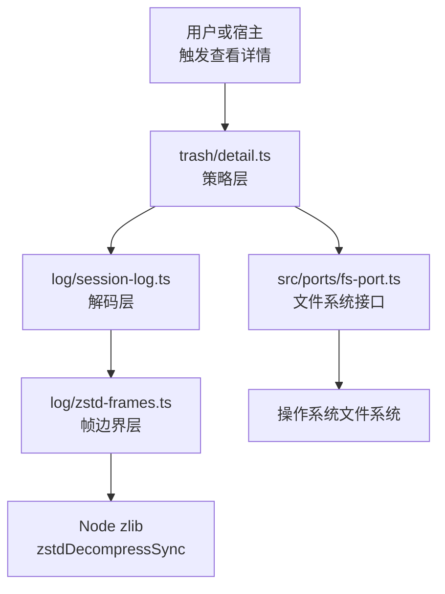
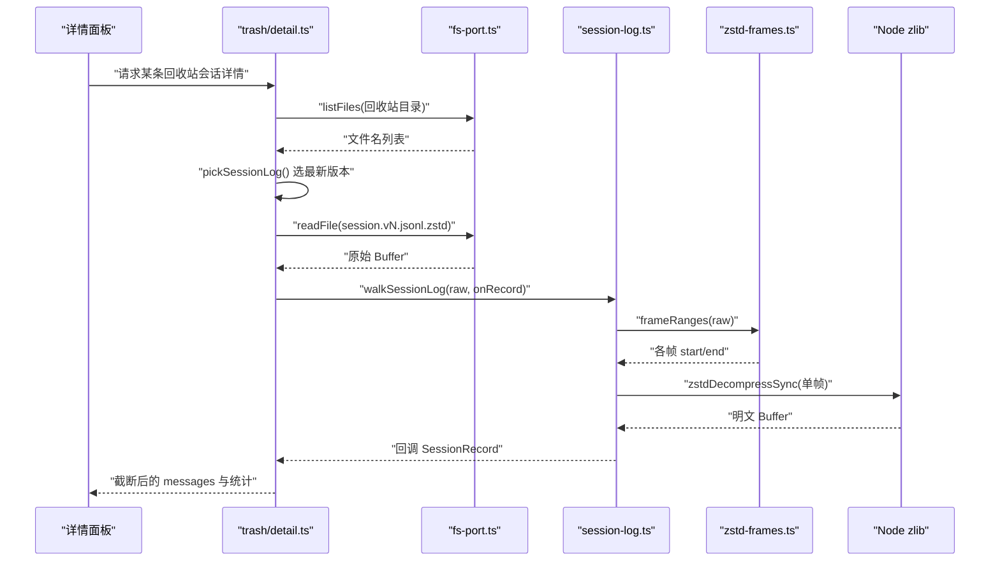
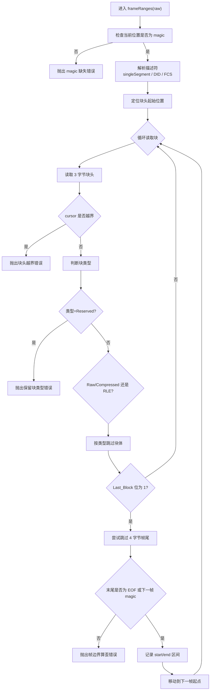
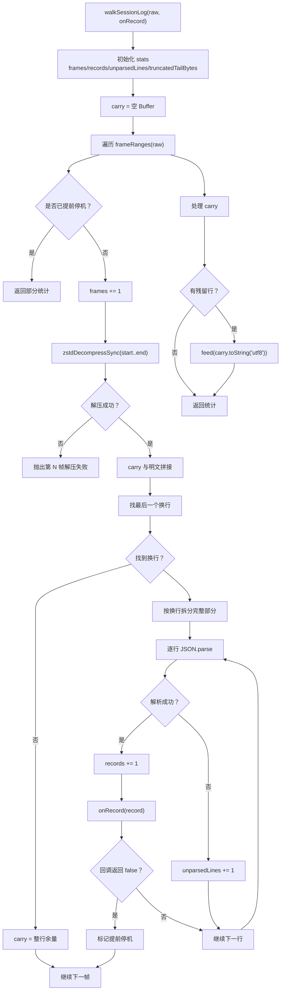
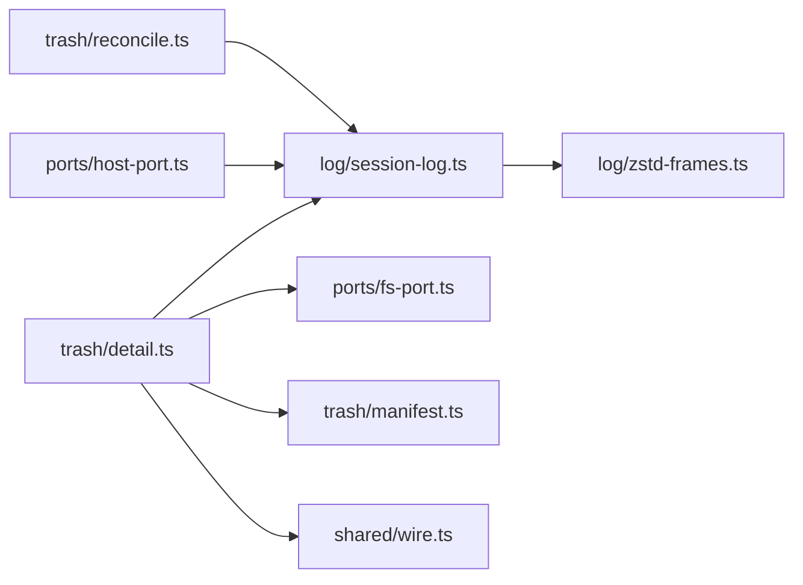
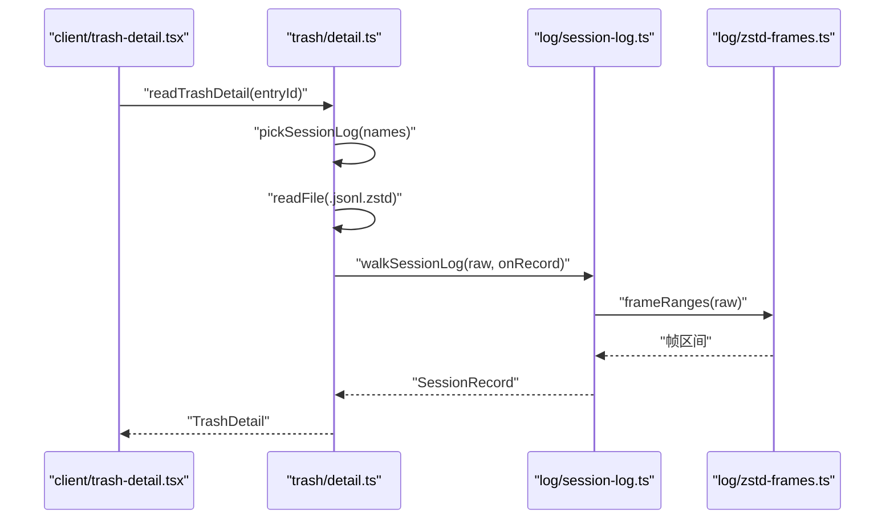
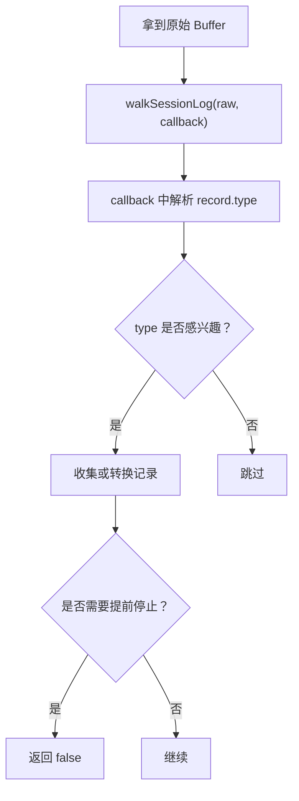

# 会话日志读取

<cite>
**本文引用的文件**   
- [session-log.ts](file://src/log/session-log.ts)
- [zstd-frames.ts](file://src/log/zstd-frames.ts)
- [detail.ts](file://src/trash/detail.ts)
- [reconcile.ts](file://src/trash/reconcile.ts)
- [host-port.ts](file://src/ports/host-port.ts)
- [fs-port.ts](file://src/ports/fs-port.ts)
- [trash-detail.test.tsx](file://tests/client/trash-detail.test.tsx)
- [session-log.test.ts](file://tests/session-log.test.ts)
- [zstd-frames.test.ts](file://tests/zstd-frames.test.ts)
</cite>

## 目录

1. [引言](#引言)
2. [项目结构与职责边界](#项目结构与职责边界)
3. [核心组件](#核心组件)
4. [架构总览](#架构总览)
5. [详细组件分析](#详细组件分析)
6. [依赖关系分析](#依赖关系分析)
7. [性能与内存特性](#性能与内存特性)
8. [错误处理与故障诊断](#错误处理与故障诊断)
9. [与 trash/detail 的集成方式](#与-trashdetail-的集成方式)
10. [示例调用](#示例调用)
11. [结论](#结论)

## 引言

本模块负责读取回收站中的会话日志，把 `session.vN.jsonl.zstd` 这种“多次追加、每帧压缩”的文件还原成可消费的会话记录。它由三层组成：

| 层级 | 文件 | 职责 |
| --- | --- | --- |
| 帧边界层 | `src/log/zstd-frames.ts` | 在原始字节流中找出每个 zstd 帧的起止偏移 |
| 解码层 | `src/log/session-log.ts` | 逐帧解压、按行拆分 JSONL、回调返回每条记录 |
| 策略层 | `src/trash/detail.ts` | 决定哪些记录算正文、截断多少字符、如何渲染详情面板 |

设计上的关键约束是：**只读本地文件，不联网；只解已落盘的 zstd 帧；正文必须安全裁剪；多代日志按版本号选最新一代。**

## 项目结构与职责边界

**图示来源**
- [detail.ts:23-115](file://src/trash/detail.ts#L23-L115)
- [session-log.ts:20-140](file://src/log/session-log.ts#L20-L140)
- [zstd-frames.ts:1-116](file://src/log/zstd-frames.ts#L1-L116)
- [fs-port.ts](file://src/ports/fs-port.ts)

### 职责划分

- `zstd-frames.ts` 不关心业务，只回答：“从第几个字节到第几个字节是一个完整 zstd 帧？”
- `session-log.ts` 不关心正文怎么显示，只回答：“这串字节对应哪些 JSONL 记录？第一条 `type='session'` 是什么？”
- `detail.ts` 不实现压缩算法，只回答：“哪条消息属于用户、能显示多少字、是否被截断、计数是否对得上账。”

**章节来源**
- [session-log.ts:1-25](file://src/log/session-log.ts#L1-L25)
- [zstd-frames.ts:1-20](file://src/log/zstd-frames.ts#L1-L20)
- [detail.ts:1-25](file://src/trash/detail.ts#L1-L25)

## 核心组件

### 数据模型

| 类型 | 含义 | 关键字段 |
| --- | --- | --- |
| `SessionRecord` | 一行 JSONL 解析后的最小面 | `type`、`time`、`id`、`createdAt`、`cwd`、`data` |
| `SessionLogStats` | 一次 `walkSessionLog` 的统计 | `frames`、`records`、`unparsedLines`、`truncatedTailBytes` |
| `FrameRange` | 一个 zstd 帧在原始 Buffer 中的区间 | `start`、`end` |
| `TrashDetailMessage` | 详情面板中的一条消息 | `role`、`time`、`text`、`truncated` |
| `TrashDetail` | 单条回收站会话的详情 | `cwd`、`createdAt`、`lastActivity`、`messages`、各类计数 |

**章节来源**
- [session-log.ts:23-56](file://src/log/session-log.ts#L23-L56)
- [detail.ts:45-58](file://src/trash/detail.ts#L45-L58)

### 对外 API

| 函数 | 输入 | 输出 | 用途 |
| --- | --- | --- | --- |
| `pickSessionLog(names)` | 目录中的文件名数组 | 规范 zstd 日志名或 `undefined` | 同一目录多代并存时选择最新版本 |
| `walkSessionLog(raw, onRecord)` | 原始 Buffer + 记录回调 | `SessionLogStats` | 逐帧解压并迭代每条记录 |
| `readSessionHeader(raw)` | 原始 Buffer | `SessionRecord` 或 `undefined` | 快速读取会话身份行，不要求整条可读 |
| `frameRanges(raw)` | 原始 Buffer | `FrameRange[]` | 返回所有 zstd 帧的起止偏移 |
| `readTrashDetail(deps)(entryId)` | 依赖对象 + 条目 ID | `Promise<TrashDetail>` | 策略层入口：查清单、定位日志、构建详情 |

**章节来源**
- [session-log.ts:58-140](file://src/log/session-log.ts#L58-L140)
- [zstd-frames.ts:67-116](file://src/log/zstd-frames.ts#L67-L116)
- [detail.ts:58-172](file://src/trash/detail.ts#L58-L172)

## 架构总览

**图示来源**
- [detail.ts:75-115](file://src/trash/detail.ts#L75-L115)
- [session-log.ts:79-120](file://src/log/session-log.ts#L79-L120)
- [zstd-frames.ts:67-116](file://src/log/zstd-frames.ts#L67-L116)

## 详细组件分析

### zstd 帧边界解析

zstd 帧由魔数、描述符、可选窗口标识、字典 ID、校验和、若干块以及尾部的 4 字节组成。由于 Node 的 zstd 解压接口只返回第一帧，而会话日志是多次 append 产生的帧序列，因此必须先切帧再解压。

**图示来源**
- [zstd-frames.ts:21-116](file://src/log/zstd-frames.ts#L21-L116)

#### 关键规则

1. **魔数校验**：不是 `0x28 0xb5 0x2f 0xfd` 立即报错，避免把随机字节当帧。
2. **描述符驱动**：根据 `singleSegment`、DID、FCS 计算帧头长度。
3. **块类型区分**：
   - `Raw`(0) 和 `Compressed`(2) 后跟 `blockSize` 字节。
   - `RLE`(1) 后跟 1 字节。
   - `Reserved`(3) 直接抛错，不吞块体。
4. **帧尾处理**：实测每帧尾部都有 4 字节；只有“跳过之后正好是下一帧魔数或 EOF”才认为该 4 字节属于当前帧。
5. **越界护栏**：如果块头越界会抛出错误，而不是让 `cursor` 永远递增导致进程卡死。

**章节来源**
- [zstd-frames.ts:21-116](file://src/log/zstd-frames.ts#L21-L116)

### 会话日志解码层

解码层的核心流程是：取帧区间 → 解压 → 拼接上一帧未闭合的行 → 按换行拆行 → JSON 解析 → 回调。

**图示来源**
- [session-log.ts:79-120](file://src/log/session-log.ts#L79-L120)

#### 跨行余量机制

写作侧是逐条 `append`，理论上可能把一个 JSON 行切成两半放在相邻两个 zstd 帧里。解码层用 `carry: Buffer` 保存上一帧末尾未闭合的行，并在下一帧解压后再拼回完整行。这样做有两个好处：

- 跨帧的一行不会变成两条无法解析的记录。
- 拼接发生在字节层，`toString('utf8')` 看到的是完整 UTF-8 文本，避免多字节字符被截断。

如果最后一帧本身就被写了一半（例如写入中断），那半行会被计入 `unparsedLines`，但不会让整个读数失败。

**章节来源**
- [session-log.ts:79-120](file://src/log/session-log.ts#L79-L120)

### 多代版本号选择策略

同一个会话目录可以并存多个版本：旧代留在原地作为历史语料，新代作为迁移后的超集。选择规则如下：

| 文件名形式 | 解释 | 是否候选 |
| --- | --- | --- |
| `session.jsonl.zstd` | 裸名，视为第 0 代 | ✅ |
| `session.v4.jsonl.zstd` | 第 4 代 | ✅ |
| `session.v10.jsonl.zstd` | 第 10 代，数值大于 v9 | ✅ |
| `session.v0.jsonl.zstd` | 非规范 | ❌ |
| `session.v03.jsonl.zstd` | 前导零 | ❌ |
| `SESSION.V4.JSONL.ZSTD` | 大写 | ❌ |
| `session.v4.jsonl.zstd.tmp` | 临时文件 | ❌ |
| `notes.jsonl.zstd` | 非会话命名 | ❌ |
| `session.jsonl` | 明文日志 | ❌ |

选择逻辑是扫描所有文件名，匹配正则 `^session(?:\\.v([1-9][0-9]*))?\\.jsonl\\.zstd$`，把裸名当作版本 0，其他按数值比较，最终取版本号最大者。

**章节来源**
- [session-log.ts:58-76](file://src/log/session-log.ts#L58-L76)
- [session-log.test.ts:89-148](file://tests/session-log.test.ts#L89-L148)

### 消息迭代与正文裁剪

策略层 `readTrashDetail` 通过 `walkSessionLog` 迭代记录，并按 `type` 分类：

| type | 行为 |
| --- | --- |
| `session` | 读取根级 `cwd`、`createdAt` |
| `session/title` | 读取日志标题 |
| `turn/start` | 增加回合计数 |
| `tool/call` | 增加工具调用计数 |
| `user/message` | 仅当 `source.kind === 'user'` 且正文非空时计入用户消息 |
| `assistant/message` | 仅当正文非空时计入助手回复 |
| 其他类型 | 忽略，不报错 |

正文提取规则：

1. 从 `data.content` 或 `message.content` 中提取 `type === 'text'` 的部分。
2. 将多个 text 片段用换行拼接并去空白。
3. 单条消息超过 3000 字符时截断，并标记 `truncated`。
4. 累计正文超过 50 万字符后，后续消息不再加入正文，只增加 `omittedByPayloadCap`。
5. `userMessageCount`、`assistantMessageCount` 与正文中的消息数量同源同判据，避免页面上出现“计数与正文不一致”。

**章节来源**
- [detail.ts:75-172](file://src/trash/detail.ts#L75-L172)

## 依赖关系分析

**图示来源**
- [detail.ts:23-30](file://src/trash/detail.ts#L23-L30)
- [session-log.ts:20-20](file://src/log/session-log.ts#L20-L20)
- [reconcile.ts:30-30](file://src/trash/reconcile.ts#L30-L30)
- [host-port.ts:93-93](file://src/ports/host-port.ts#L93-L93)

### 耦合与内聚

- `zstd-frames.ts` 是最低耦合层，只依赖 Node Buffer 和 zstd 格式约定。
- `session-log.ts` 依赖帧边界层，但不依赖任何 UI 或回收站语义。
- `detail.ts` 是策略入口，组合 `pickSessionLog`、`walkSessionLog`、文件系统端口和共享 wire 类型。
- `reconcile.ts` 复用 `pickSessionLog` 和 `readSessionHeader`，说明这两个 API 是跨模块复用的基础能力。
- `host-port.ts` 暴露 `readSessionHeader` 的宿主接口，表明这个能力不仅用于回收站详情，也可能被宿主或其他子系统使用。

**章节来源**
- [session-log.ts:20-20](file://src/log/session-log.ts#L20-L20)
- [detail.ts:23-30](file://src/trash/detail.ts#L23-L30)
- [reconcile.ts:30-30](file://src/trash/reconcile.ts#L30-L30)
- [host-port.ts:93-93](file://src/ports/host-port.ts#L93-L93)

## 性能与内存特性

### 为什么必须逐帧

Node 的 `zstdDecompressSync` 和流式解压都只返回第一帧。如果先整体解压，会把整条日志明文全部放进内存。仓库注释指出本机 125 条日志合计约 280.7 MB，因此必须按帧解压，内存峰值接近“最大一帧的明文”，实测约 8.99 MB。

### 时间复杂度

- `frameRanges`：线性扫描 Buffer，每次块头读取是常数操作，总体近似 O(n)。
- `walkSessionLog`：对每个 zstd 帧解压一次，再按换行拆分 JSONL，总体近似 O(n + m)，其中 n 是字节数，m 是可解析行数。
- `pickSessionLog`：O(k)，k 是文件名数量。
- `readTrashDetail`：主要成本在文件 I/O 和解压，正文裁剪是 O(m)，m 为命中正文的消息数。

### 空间复杂度

- 帧边界数组最多包含文件中帧的数量。
- 解码层只保留上一帧的未闭合行 `carry`。
- 详情层只保留被接受的消息文本，受 `perMessageChars` 和 `totalChars` 限制。

### 性能注意事项

1. 不要一次性 `zstdDecompressSync` 整个文件。
2. 不要在回调中做昂贵工作，否则会影响流式迭代体验。
3. 正文截断使用字符串长度判断，CJK 最坏情况约 1.5 MB 文本；这是载荷上限，不是文件大小上限。
4. 如果只需要会话身份信息，优先使用 `readSessionHeader`，它会在找到第一条 `type='session'` 后提前停止。

**章节来源**
- [session-log.ts:7-19](file://src/log/session-log.ts#L7-L19)
- [detail.ts:27-44](file://src/trash/detail.ts#L27-L44)

## 错误处理与故障诊断

### 帧级错误

| 场景 | 行为 | 诊断建议 |
| --- | --- | --- |
| 起始位置不是 zstd magic | 抛出 magic 缺失错误 | 检查文件是否损坏或被替换为非 zstd 内容 |
| 帧头不完整 | 抛出帧头不完整错误 | 文件可能被截断 |
| 块头越界 | 抛出块头越界错误 | 帧元数据损坏，不应继续“尽力解析” |
| 遇到 Reserved 块类型 | 抛出保留块类型错误 | 与 Node 解压端一致拒绝 |
| 帧尾后既不是 EOF 也不是下一帧 magic | 抛出帧边界算歪错误 | 帧切割逻辑异常或外部修改了字节流 |
| 单帧解压失败 | 抛出“第 N 帧解压失败” | 结合 `stats.frames` 定位具体帧 |

### 记录级错误

- JSON 解析失败：不计入记录，`unparsedLines` 加 1，继续处理下一行。
- 最后残留行：如果没有换行结尾，该行会被丢弃并计入 `truncatedTailBytes`。
- 回调返回 `false`：立即停止后续帧，但之前已处理的帧和记录仍有效。

### 详情层错误

- 回收站清单中没有该条目：抛出 `trash-empty`。
- 回收站目录不存在：抛出 `io`。
- 目录中没有规范的 `.jsonl.zstd` 日志：抛出 `io`。
- 读取日志失败：包装为 `io` 错误并保留原始 error。
- 解码过程抛出异常：统一包装为 `io` 错误，避免半截正文误导用户。

**章节来源**
- [zstd-frames.ts:67-116](file://src/log/zstd-frames.ts#L67-L116)
- [session-log.ts:79-140](file://src/log/session-log.ts#L79-L140)
- [detail.ts:96-172](file://src/trash/detail.ts#L96-L172)
- [session-log.test.ts:52-88](file://tests/session-log.test.ts#L52-L88)
- [zstd-frames.test.ts:84-123](file://tests/zstd-frames.test.ts#L84-L123)

## 与 trash/detail 的集成方式

`trash/detail.ts` 是详情面板的直接上游。它的集成路径如下：

**图示来源**
- [detail.ts:75-115](file://src/trash/detail.ts#L75-L115)
- [session-log.ts:79-120](file://src/log/session-log.ts#L79-L120)
- [zstd-frames.ts:67-116](file://src/log/zstd-frames.ts#L67-L116)

### 安全渲染原则

详情面板接收的是已经过策略层过滤和截断的 `messages`，而不是原始日志。这样做的安全原因是：

1. 只接受 `source.kind === 'user'` 的用户提问，避免宿主注入的大量上下文淹没真实对话。
2. 只提取 `content[].type === 'text'` 的字段，忽略其他结构化负载。
3. 单条消息最多 3000 字符，累计最多 50 万字符。
4. 未知 `type` 一律忽略，不因宿主新增日志词汇表而崩溃。
5. 所有正文都是普通字符串，不包含可执行脚本；前端渲染时应继续使用安全的 HTML/Markdown 渲染路径，不要把 raw JSON 当成 HTML。

需要特别注意：虽然日志读取层已经做了严格过滤，但“详情面板如何渲染用户生成文本”仍取决于上层 UI。文档建议：

- 不要直接 `innerHTML` 原始日志。
- 使用项目已有的 Markdown 或安全渲染组件。
- 若需要高亮代码或链接，应在渲染层做白名单过滤。
- 对超长正文展示“已截断”提示，保持与 `truncated` 标志一致。

**章节来源**
- [detail.ts:1-44](file://src/trash/detail.ts#L1-L44)
- [detail.ts:115-172](file://src/trash/detail.ts#L115-L172)

## 示例调用

以下示例以调用流程为主，不直接粘贴源码。

### 示例一：选择并读取回收站会话详情

1. 调用 `deps.manifest.list()` 获取回收站条目。
2. 用 `entryId` 找到对应 `TrashEntry`。
3. 用 `trashDirOf(record.id, home)` 确定目录。
4. 调用 `deps.fs.listFiles(dir)` 获取文件名。
5. 调用 `pickSessionLog(names)` 选择最新版本。
6. 调用 `deps.fs.readFile(`${dir}/${logName}`)` 读取原始 Buffer。
7. 调用 `walkSessionLog(raw, onRecord)` 迭代记录。
8. 在 `onRecord` 中按 `type` 更新 `cwd`、`createdAt`、`turnCount`、`userMessageCount`、`assistantMessageCount`、`toolCallCount`、`injectedCount` 和 `messages`。
9. 返回 `TrashDetail`。

**章节来源**
- [detail.ts:75-172](file://src/trash/detail.ts#L75-L172)

### 示例二：只读取会话头

如果需要知道某个日志对应的 `id`、`cwd`、`createdAt`，可以直接调用 `readSessionHeader(raw)`。它会内部调用 `walkSessionLog`，并在遇到第一条 `type='session'` 时提前停机，不需要整条日志都可解析。

**章节来源**
- [session-log.ts:132-140](file://src/log/session-log.ts#L132-L140)

### 示例三：只扫描帧边界

调试 zstd 文件时，可以调用 `frameRanges(raw)` 得到所有帧区间，然后单独对每个区间调用 `zlib.zstdDecompressSync` 验证是否能正确解压。

**章节来源**
- [zstd-frames.ts:67-116](file://src/log/zstd-frames.ts#L67-L116)

### 示例四：自定义记录消费

**图示来源**
- [session-log.ts:79-95](file://src/log/session-log.ts#L79-L95)

## 结论

会话日志读取模块把 zstd 帧解析、JSONL 解码和详情策略拆成清晰层次：

- `zstd-frames.ts` 保证帧边界准确，避免静默切错压缩流。
- `session-log.ts` 保证逐帧解压、跨行余量和 JSONL 行迭代正确。
- `trash/detail.ts` 保证正文只来自用户、长度可控、计数与正文同源。
- `pickSessionLog` 保证多代日志按版本号选最新一代，不拼接、不重复。
- 所有 I/O 和压缩都在本地完成，详情面板只消费已经过滤和截断的结构化数据。

实际使用中应优先复用现有 API，而不是自己实现 zstd 帧解析；渲染用户生成文本时应走安全渲染路径，并把截断状态如实反馈给终端用户。