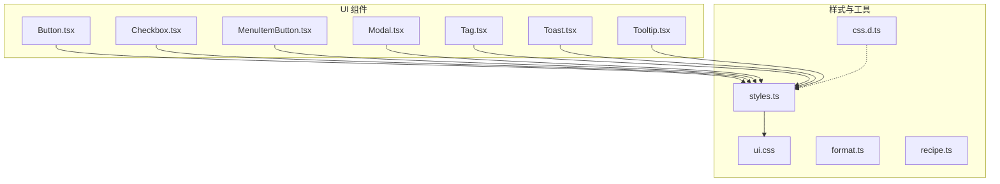
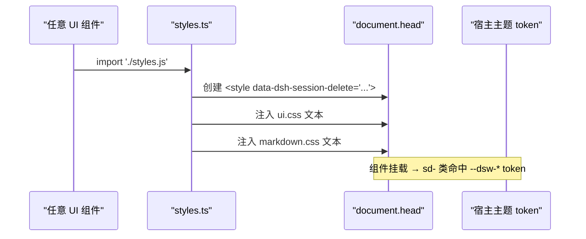
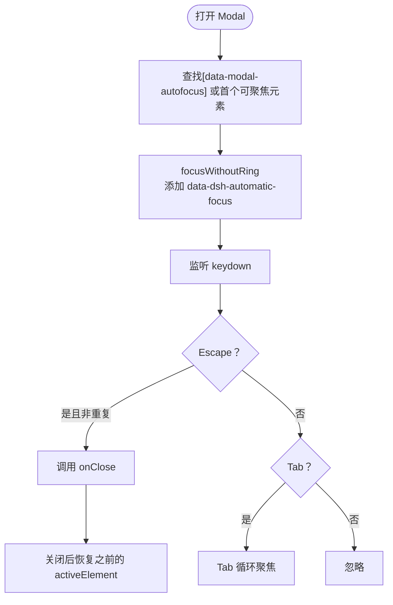
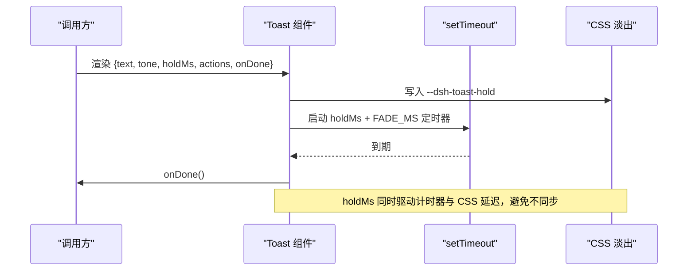
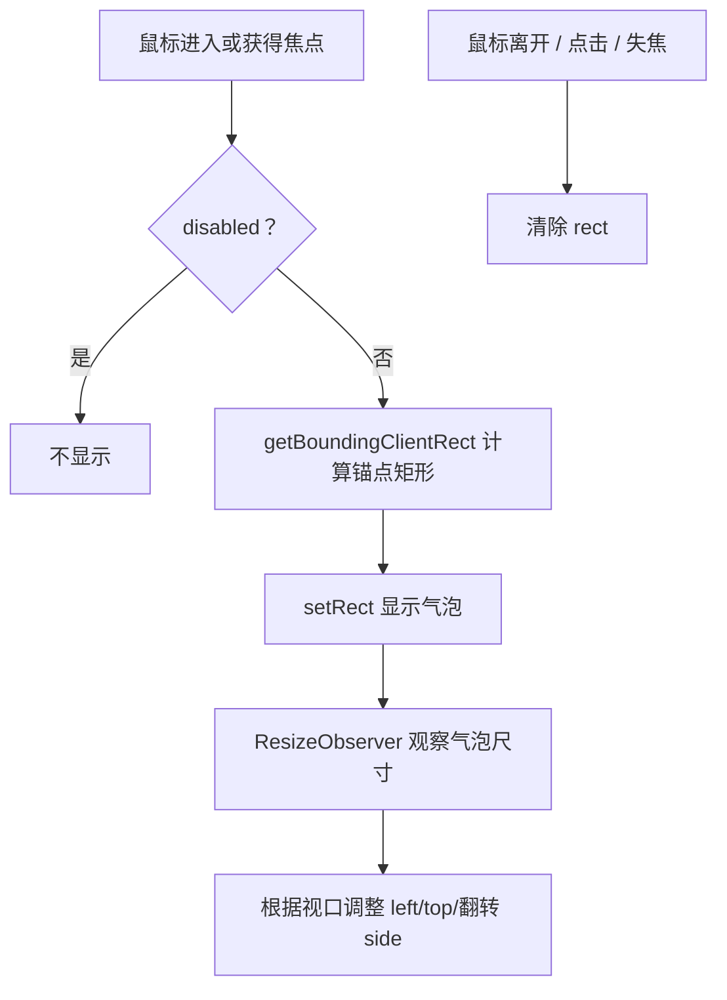
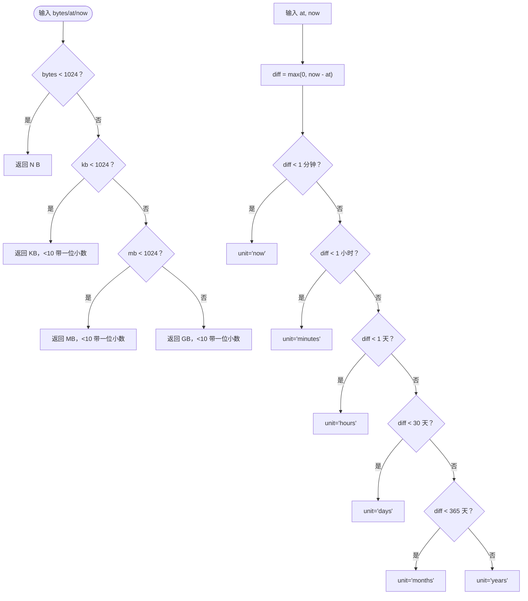
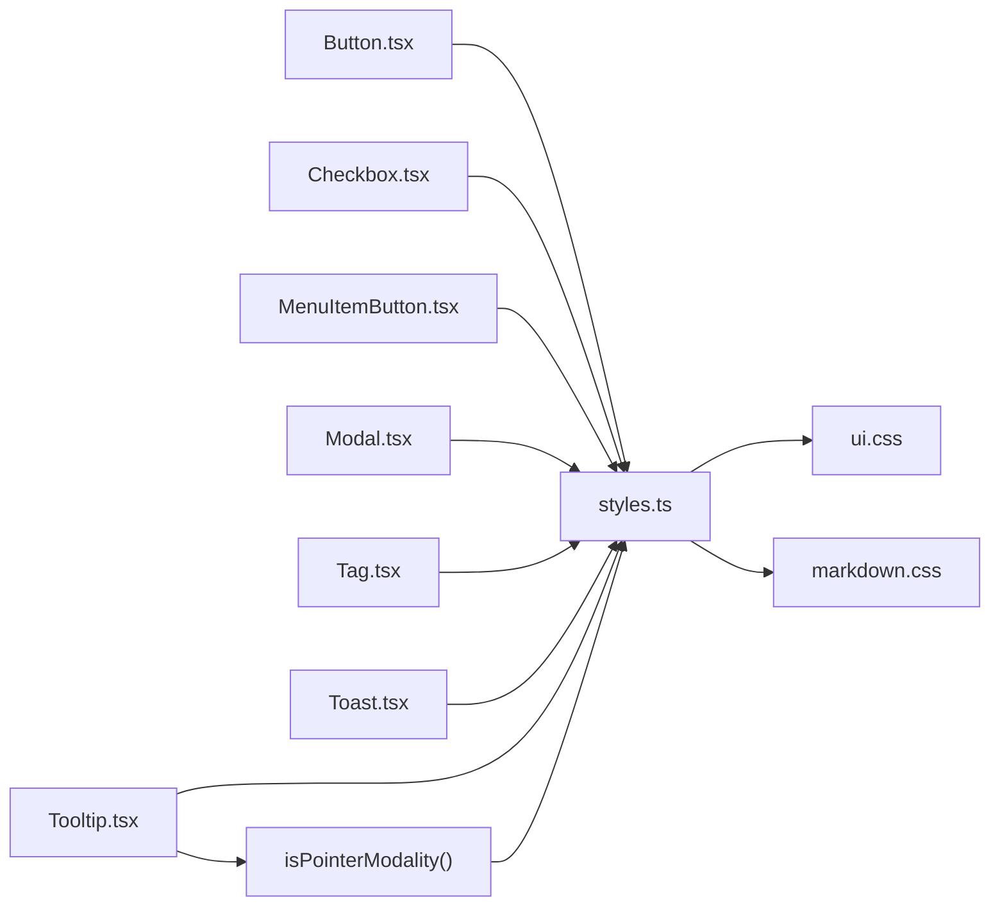

# 共享 UI 组件

<cite>
**本文引用的文件**
- [Button.tsx](file://src/client/ui/Button.tsx)
- [Checkbox.tsx](file://src/client/ui/Checkbox.tsx)
- [MenuItemButton.tsx](file://src/client/ui/MenuItemButton.tsx)
- [Modal.tsx](file://src/client/ui/Modal.tsx)
- [Tag.tsx](file://src/client/ui/Tag.tsx)
- [Toast.tsx](file://src/client/ui/Toast.tsx)
- [Tooltip.tsx](file://src/client/ui/Tooltip.tsx)
- [format.ts](file://src/client/ui/format.ts)
- [recipe.ts](file://src/client/ui/recipe.ts)
- [styles.ts](file://src/client/ui/styles.ts)
- [ui.css](file://src/client/ui/ui.css)
- [css.d.ts](file://src/client/ui/css.d.ts)
</cite>

## 目录
1. [引言](#引言)
2. [项目结构](#项目结构)
3. [核心组件总览](#核心组件总览)
4. [架构概览](#架构概览)
5. [组件详解](#组件详解)
6. [样式与主题规范](#样式与主题规范)
7. [工具模块：数值与时间格式化](#工具模块数值与时间格式化)
8. [依赖关系分析](#依赖关系分析)
9. [性能与兼容性](#性能与兼容性)
10. [复用模式与定制指南](#复用模式与定制指南)
11. [调试与排错](#调试与排错)
12. [结论](#结论)

## 引言
本仓库的 `src/client/ui` 是一个面向 DeepSeek Harness（DSH）插件环境的共享 UI 子集。它从官方 `@deepseek-ai/dsh-client-ui-primitives@0.2.0-rc.2` 中按“只抄我们真正需要的部分”的原则，裁剪出 Button、Checkbox、MenuItemButton、Modal、Tag、Toast、Tooltip 等组件，并配套提供样式装载、CSS 类前缀、token 使用约定以及数值/时间格式化能力。文档的目标是帮助开发者理解每个组件的外观、行为、属性、事件、可访问性约定、样式组织方式，以及如何安全地复用和定制。

## 项目结构
UI 子仓采用“一个组件一个文件 + 共享样式与工具”的组织方式：

**图表来源**
- [Button.tsx:1-36](file://src/client/ui/Button.tsx#L1-L36)
- [Checkbox.tsx:1-55](file://src/client/ui/Checkbox.tsx#L1-L55)
- [MenuItemButton.tsx:1-57](file://src/client/ui/MenuItemButton.tsx#L1-L57)
- [Modal.tsx:1-152](file://src/client/ui/Modal.tsx#L1-L152)
- [Tag.tsx:1-22](file://src/client/ui/Tag.tsx#L1-L22)
- [Toast.tsx:1-97](file://src/client/ui/Toast.tsx#L1-L97)
- [Tooltip.tsx:1-175](file://src/client/ui/Tooltip.tsx#L1-L175)
- [styles.ts:1-75](file://src/client/ui/styles.ts#L1-L75)
- [ui.css:1-200](file://src/client/ui/ui.css#L1-L200)
- [css.d.ts:1-12](file://src/client/ui/css.d.ts#L1-L12)

**章节来源**
- [Button.tsx:1-36](file://src/client/ui/Button.tsx#L1-L36)
- [styles.ts:1-75](file://src/client/ui/styles.ts#L1-L75)

## 核心组件总览
| 组件 | 主要用途 | 外观要点 | 关键 props | 关键事件 | 可访问性要点 |
| --- | --- | --- | --- | --- | --- |
| Button | 通用按钮 | 三种变体 primary / ghost / outline；两种尺寸 md / sm；可选 16px 前导图标 | variant、size、icon、children、其余原生 button 属性 | onClick 等原生事件；支持 ref | 渲染为 `<button type="button">`，禁用态走原生 disabled |
| Checkbox | 行内勾选框 | 原生 checkbox + accent-color，不自绘圆框 | checked、indeterminate、onChange、label、disabled | onChange(checked)；点击由外层 span 阻止冒泡 | aria-label 给读屏；indeterminate 映射为 mixed |
| MenuItemButton | 宿主菜单中的单行 | 可选分隔线、可选危险色、图标位 + 标签位 | children、icon、disabled、danger、separatorBefore、onSelect | onSelect | role="menuitem"，禁用用原生 disabled |
| Modal | 全屏蒙层 + 居中对话框 | 遮罩、标题栏、内容区、可选底部动作区 | open、onClose、title、closeLabel、footer、children | onClose；内部自动处理 Escape 与焦点环 | role="dialog"、aria-modal、aria-label、Tab 循环、初始聚焦、返回旧焦点 |
| Tag | 只读状态胶囊 | 当前仅 danger 档，error 字色 + 透明底 | tone、children | 无交互 | 语义上是信息标签，无额外 ARIA |
| Toast | 顶部一次性横幅 | 滑入、停留、淡出；success 自带对勾 | text、icon、tone、holdMs、actions、onDone | actions.onClick；onDone 在淡出完成后调用 | role="alert"；success 图标 aria-hidden |
| Tooltip | 锚点悬浮提示 | right / bottom / top 三方位；视口边界自适应；ResizeObserver 先量尺寸再显示 | label、side、gap、disabled、portal、children | 继承锚点的鼠标/键盘事件；disabled 时不出气泡 | role="tooltip"；pointer 交互后 focus 不弹 |

**章节来源**
- [Button.tsx:1-36](file://src/client/ui/Button.tsx#L1-L36)
- [Checkbox.tsx:1-55](file://src/client/ui/Checkbox.tsx#L1-L55)
- [MenuItemButton.tsx:1-57](file://src/client/ui/MenuItemButton.tsx#L1-L57)
- [Modal.tsx:1-152](file://src/client/ui/Modal.tsx#L1-L152)
- [Tag.tsx:1-22](file://src/client/ui/Tag.tsx#L1-L22)
- [Toast.tsx:1-97](file://src/client/ui/Toast.tsx#L1-L97)
- [Tooltip.tsx:1-175](file://src/client/ui/Tooltip.tsx#L1-L175)

## 架构概览
UI 组件通过副作用导入触发样式注入；所有 CSS 类以 `sd-` 前缀命名，颜色与主题由宿主 token 提供。

**图表来源**
- [styles.ts:1-75](file://src/client/ui/styles.ts#L1-L75)
- [ui.css:1-200](file://src/client/ui/ui.css#L1-L200)

**章节来源**
- [styles.ts:1-75](file://src/client/ui/styles.ts#L1-L75)

## 组件详解

### Button
- **外观**：默认 ghost；primary 为主色填充；outline 为描边；md 高 36px，sm 高 28px；图标宽 16px。
- **行为**：渲染原生 `<button type="button">`；icon 为空时不渲染图标容器；className 与其他原生属性透传。
- **Props**
  - variant：'primary' | 'ghost' | 'outline'，缺省 'ghost'
  - size：'md' | 'sm'，缺省 'md'
  - icon：ReactNode，可选 16px 前导图标
  - 其他：透传所有 HTMLButtonElement 属性，包括 className、onClick、disabled 等
- **事件**
  - 原生 button 事件全部透传
  - ref 指向原生 button，供 Modal 等做初始聚焦或对齐测量
- **可访问性**
  - 使用原生 button，天然支持键盘与屏幕阅读器
  - 禁用态使用原生 disabled，对应 CSS 降低透明度
- **样式实现**
  - 类名组合：`sd-button` + `sd-button-{variant}` + `sd-button-{size}`
  - 尺寸与悬停态由 ui.css 控制，颜色来自 `--dsw-alias-*` token

**章节来源**
- [Button.tsx:1-36](file://src/client/ui/Button.tsx#L1-L36)
- [ui.css:1-200](file://src/client/ui/ui.css#L1-L200)

### Checkbox
- **外观**：不是自绘圆框，而是原生 input[type=checkbox] 配合 accent-color，保证深浅主题下与宿主一致。
- **行为**
  - indeterminate 通过 DOM IDL 字段设置，不在 JSX 中写
  - 外层 span 的 onClick 调用 stopPropagation，避免与整行点击冲突
- **Props**
  - checked：boolean
  - indeterminate：boolean，表示半选横杠
  - onChange：接收 checked 值
  - label：字符串，作为 aria-label
  - disabled：boolean，缺省 false
- **事件**
  - onChange(checked)
- **可访问性**
  - aria-label 提供可读名称
  - indeterminate 时 aria-checked 设为 'mixed'
  - 原生 checkbox 自带键盘与读屏支持

**章节来源**
- [Checkbox.tsx:1-55](file://src/client/ui/Checkbox.tsx#L1-L55)
- [ui.css:1-200](file://src/client/ui/ui.css#L1-L200)

### MenuItemButton
- **外观**：菜单中的一行；可选 separatorBefore 在上侧画一条分隔线；danger 时使用错误文字色与危险悬停背景。
- **行为**
  - 内部结构必须与宿主菜单契约一致：wrap → 可选 separator → button(role="menuitem") → icon + label
  - disabled 直接落到原生 button，而不是 aria-disabled
- **Props**
  - children：行标签
  - icon：可选图标
  - disabled：是否不可激活
  - danger：是否使用破坏性配色
  - separatorBefore：是否上方有分隔线
  - onSelect：行被激活时调用
- **事件**
  - onSelect
- **可访问性**
  - role="menuitem"
  - 原生 button 支持键盘导航
  - disabled 由原生 disabled 表达

**章节来源**
- [MenuItemButton.tsx:1-57](file://src/client/ui/MenuItemButton.tsx#L1-L57)
- [ui.css:1-200](file://src/client/ui/ui.css#L1-L200)

### Modal
- **外观**：固定定位到视口的根层；遮罩带模糊与进入动画；卡片居中，含标题、关闭按钮、内容区和可选 footer。
- **行为**
  - 通过 createPortal 挂载到 document.body
  - 打开时记录 activeElement，首次聚焦优先选择 `[data-modal-autofocus]`，其次首个可聚焦元素，最后 dialog 本身
  - 关闭后恢复之前 activeElement
  - Escape 只在 Modal 处于“最上层”时生效
  - Tab 在对话框内循环
  - 自动聚焦会加 `data-dsh-automatic-focus`，宿主主题据此抑制 outline，键盘移动或失焦后移除
- **Props**
  - open：boolean
  - onClose：关闭回调
  - title：标题，同时作为 aria-label
  - closeLabel：关闭按钮的可访问名称
  - footer：底部动作区
  - children：正文内容
- **事件**
  - onClose：蒙层点击、Escape、关闭按钮均走此回调
- **可访问性**
  - role="dialog"、aria-modal="true"、aria-label=title
  - Tab 环绕，Focus Trap
  - 关闭时归还焦点
  - 顶层判定兼容宿主菜单也抢 Escape 的场景

**图表来源**
- [Modal.tsx:1-152](file://src/client/ui/Modal.tsx#L1-L152)

**章节来源**
- [Modal.tsx:1-152](file://src/client/ui/Modal.tsx#L1-L152)

### Tag
- **外观**：胶囊形状，当前只有 danger 档；底色是 error 主色的 10% 混合，文字为 error 主色。
- **行为**：纯展示，无交互。
- **Props**
  - tone：'danger'
  - children：标签内容
- **可访问性**
  - 没有额外 ARIA；作为信息标签使用
- **扩展建议**
  - 新增 tone 时需同步增加 CSS 类与联合类型

**章节来源**
- [Tag.tsx:1-22](file://src/client/ui/Tag.tsx#L1-L22)
- [ui.css:1-200](file://src/client/ui/ui.css#L1-L200)

### Toast
- **外观**：顶部居中的横幅；成功态自带对勾图标；自定义 icon 在非 success 态显示；包含文本与可选行内动作按钮。
- **行为**
  - portal 到 document.body
  - holdMs + FADE_MS 后调用 onDone；FADE_MS 与 CSS 淡出时长一致
  - 重渲染不会延长寿命；latestOnDone 通过 ref 持有最新回调
  - success 态忽略传入 icon，改用内置对勾
- **Props**
  - text：已本地化的文案
  - icon：可选前导图标
  - tone：'success'
  - holdMs：全不透明停留时长，缺省 3000
  - actions：数组，每项含 label 与 onClick
  - onDone：淡出完成后卸载回调
- **事件**
  - actions[i].onClick
  - onDone
- **可访问性**
  - role="alert"
  - 图标使用 aria-hidden

**图表来源**
- [Toast.tsx:1-97](file://src/client/ui/Toast.tsx#L1-L97)

**章节来源**
- [Toast.tsx:1-97](file://src/client/ui/Toast.tsx#L1-L97)

### Tooltip
- **外观**：气泡跟随锚点；right 方向向右偏移 10px；bottom/top 居中并按 gap 留距；超出视口自动翻面；ResizeObserver 先拿到气泡尺寸再显示。
- **行为**
  - hover、focus 显示；click、blur、mouseleave 隐藏
  - pointer 交互之后的 focus 不显示气泡，避免菜单收起后焦点回归又弹出
  - portal=true 时气泡挂到 document.body，避免被父容器裁剪
  - disabled 时不显示气泡且不重新挂载锚点
  - side 支持 'right' | 'bottom' | 'top'；gap 缺省 8
- **Props**
  - label：气泡文案
  - side：方位，缺省 'right'
  - gap：bottom/top 时距离，缺省 8
  - disabled：是否禁用气泡
  - portal：是否 portal 到 body
  - children：单一锚点元素
- **事件**
  - 克隆锚点元素并追加 onMouseEnter/onMouseLeave/onClick/onFocus/onBlur，同时转发原有处理器
- **可访问性**
  - 气泡 role="tooltip"
  - 空 label 时不渲染文字节点
  - pointer 模态下 focus 不弹，避免误触

**图表来源**
- [Tooltip.tsx:1-175](file://src/client/ui/Tooltip.tsx#L1-L175)

**章节来源**
- [Tooltip.tsx:1-175](file://src/client/ui/Tooltip.tsx#L1-L175)

## 样式与主题规范

### CSS 类名前缀
- 所有组件类名统一使用 `sd-` 前缀，例如 `sd-button`、`sd-tag-danger`、`sd-modal-dialog`、`sd-tooltip-bubble`、`sd-toast`。
- 这取代了原包的 CSS module 哈希类名，由前缀承担全局唯一性。

### Token 来源
- 颜色、边框、阴影、层级、圆角等视觉变量一律通过宿主提供的 `--dsw-*` token 读取，例如：
  - `--dsw-alias-label-primary`
  - `--dsw-alias-button-primary-fill`
  - `--dsw-alias-state-error-primary`
  - `--dsw-radius-md`、`--dsw-radius-sm`
  - `--dsw-mask-blur`、`--dsw-elevation-prominent`
- 这样当宿主切换主题或重命名 token 时，组件最多“难看”，不会因硬编码颜色而崩溃。

### 字面量限制
- 字号、行高、控件高度等几何尺寸使用 px 字面量，与官方原始 CSS 保持一致，例如 Button md 高 36px、sm 高 28px。
- 这是已知差异点之一：视觉主题影响颜色，但尺寸仍按官方原文。

### 响应式约定
- Modal 宽度使用 `min(380px, 100%)`，在小屏幕上退化为满宽。
- Modal 上边距考虑宿主框架 chrome：`max(24px, var(--dsh-frame-overlay-top, 24px))`。
- Tooltip 使用 `window.innerWidth`、`window.innerHeight` 和 12px 边距做视口边界检查，并在 resize 时重算。
- 组件自身没有断点系统；布局适配主要由容器决定。

### 可访问性约定
- 按钮、菜单项、对话框、提示、警告横幅都遵循原生语义或 ARIA 约定。
- Modal 实现焦点环、初始聚焦、焦点归还、Escape 关闭。
- Checkbox 使用原生 checkbox 与 accent-color，键盘与读屏开箱即用。
- Toast 使用 role="alert"，图标使用 aria-hidden。
- Tooltip 使用 role="tooltip"，并根据指针/键盘输入模态决定是否显示。

**章节来源**
- [ui.css:1-200](file://src/client/ui/ui.css#L1-L200)
- [Modal.tsx:1-152](file://src/client/ui/Modal.tsx#L1-L152)
- [Checkbox.tsx:1-55](file://src/client/ui/Checkbox.tsx#L1-L55)
- [Toast.tsx:1-97](file://src/client/ui/Toast.tsx#L1-L97)
- [Tooltip.tsx:1-175](file://src/client/ui/Tooltip.tsx#L1-L175)

## 工具模块：数值与时间格式化

### fileSizeText
- 输入：字节数 number
- 输出：紧凑字符串，如 `312B`、`4.2KB`、`1.5MB`、`2.4GB`
- 规则：
  - 小于 1024 字节直接显示 B
  - KB/MB/GB 单位下，数值小于 10 时保留一位小数，否则取整
- 复杂度：O(1)，只做常数次除法与比较

### relativeTime
- 输入：目标时间 at、当前时间 now，均为毫秒时间戳
- 输出：{ unit: RelativeTimeUnit; n: number }
- 单位：'now' | 'minutes' | 'hours' | 'days' | 'months' | 'years'
- 分桶规则：
  - 小于 1 分钟：now
  - 小于 1 小时：分钟
  - 小于 1 天：小时
  - 小于 30 天：天
  - 小于 365 天：月
  - 其他：年
- 复杂度：O(1)，只比较差值

**图表来源**
- [format.ts:1-37](file://src/client/ui/format.ts#L1-L37)

**章节来源**
- [format.ts:1-37](file://src/client/ui/format.ts#L1-L37)

## 依赖关系分析

**图表来源**
- [Button.tsx:1-36](file://src/client/ui/Button.tsx#L1-L36)
- [Checkbox.tsx:1-55](file://src/client/ui/Checkbox.tsx#L1-L55)
- [MenuItemButton.tsx:1-57](file://src/client/ui/MenuItemButton.tsx#L1-L57)
- [Modal.tsx:1-152](file://src/client/ui/Modal.tsx#L1-L152)
- [Tag.tsx:1-22](file://src/client/ui/Tag.tsx#L1-L22)
- [Toast.tsx:1-97](file://src/client/ui/Toast.tsx#L1-L97)
- [Tooltip.tsx:1-175](file://src/client/ui/Tooltip.tsx#L1-L175)
- [styles.ts:1-75](file://src/client/ui/styles.ts#L1-L75)

**章节来源**
- [styles.ts:1-75](file://src/client/ui/styles.ts#L1-L75)

## 性能与兼容性

### 性能特征
- 组件都是轻量 React 函数组件，没有复杂状态树。
- Modal、Toast、Tooltip 使用 createPortal 挂载到 document.body，避免被 transform/filter 祖先或宿主菜单裁剪。
- styles.ts 通过副作用导入在模块作用域安装 `<style>`，由宿主工厂物化阶段认领，卸载时可由宿主统一回收。
- Tooltip 使用 ResizeObserver 先获取气泡尺寸再显示，减少错位闪烁；窗口 resize 时重算。
- Toast 使用 setTimeout 一次性计时，FADE_MS 与 CSS 过渡时长一致，避免状态不一致。

### 跨浏览器兼容性
- 依赖现代 Web API：createPortal、ResizeObserver、querySelectorAll、addEventListener、CSS custom properties、color-mix、inset、backdrop-filter、prefers-reduced-motion。
- 颜色混色使用 `color-mix(in srgb, ...)`，用于 Tag danger 的底图。
- 动画尊重 `prefers-reduced-motion: reduce`，Modal 在减少动效模式下取消动画。
- Node 半不导入任何 `.css`，样式只在浏览器半加载；css.d.ts 声明 `.css` 导入为字符串，由 tsdown 构建插件处理。

**章节来源**
- [ui.css:1-200](file://src/client/ui/ui.css#L1-L200)
- [styles.ts:1-75](file://src/client/ui/styles.ts#L1-L75)
- [css.d.ts:1-12](file://src/client/ui/css.d.ts#L1-L12)

## 复用模式与定制指南

### 复用模式
- 所有组件都是无副作用的 React 组件，除了 styles.ts 的副作用样式注入。
- 需要按钮时优先用 Button，并通过 variant/size 选择外观；需要菜单行时用 MenuItemButton，保持与宿主菜单契约同构。
- 需要用户确认时使用 Modal，并把标题放在 aria-label 中，把可聚焦元素放在 `[data-modal-autofocus]`。
- 需要临时反馈时用 Toast，success 态直接使用 tone="success"，其他态传入 icon。
- 需要解释短文本时使用 Tooltip，portal 开启以解决宿主菜单裁剪问题。
- 需要状态标签时使用 Tag，danger 档适合失败信息。
- 需要行内勾选时使用 Checkbox，并把 label 作为 aria-label。

### 主题定制方法
- 不要直接修改 ui.css 中的 `--dsw-*` 引用；应通过宿主主题配置这些 token。
- 如果必须在本插件内覆盖样式，建议：
  - 新增 `sd-` 前缀的自定义类，而不是改现有基类
  - 颜色继续走 `var(--dsw-alias-*)`，避免引入新 token 字面量
  - 如需局部覆盖，可在调用方通过 className 叠加，但要注意与宿主菜单契约的优先级
- recipe.ts 提供了两个常用内联样式配方：
  - QUIET_DANGER：只设置错误文字色，不铺背景，避免覆盖作者态内联 background
  - ELLIPSIS：单行截断，适用于可能被挤压的文字

**章节来源**
- [recipe.ts:1-15](file://src/client/ui/recipe.ts#L1-L15)
- [ui.css:1-200](file://src/client/ui/ui.css#L1-L200)

## 调试与排错

### 样式未加载
- 现象：组件类存在但没有预期样式。
- 排查：
  - 确认组件所在模块已被导入，因为样式注入发生在 styles.ts 的模块作用域
  - 检查浏览器 head 中是否存在 `data-dsh-session-delete` 标记的 `<style>`
  - 确认运行环境是浏览器半，Node 半不应导入 `.css`

### Tooltip 不显示
- 现象：hover 或 focus 后没有气泡。
- 排查：
  - disabled 为真时会隐藏
  - pointer 交互之后紧接着 focus 不会弹出，这是预期行为
  - portal 未开启且锚点在宿主菜单中被裁剪时，气泡会被裁掉
  - 查看 ResizeObserver 是否拿到气泡尺寸，以及 window.resize 是否触发

### Modal 焦点异常
- 现象：Tab 跳出对话框，或关闭后焦点丢失。
- 排查：
  - 确认对话框内确实有可聚焦元素，或使用 `[data-modal-autofocus]`
  - 确认没有嵌套另一个 role="menu" 接管 Tab
  - 检查是否在多层对话场景中，Escape 只应由最上层 dialog/menu 处理

### Toast 提前消失或卡住
- 现象：横幅淡出中途被卸载，或 hold 时间不准确。
- 排查：
  - 确认 holdMs 与 FADE_MS 之和是期望总时长
  - 确认 onDone 是在淡出完成后调用，不要在 onDone 之外手动清理
  - 检查父组件是否频繁重渲染导致 holdMs 变化

### Checkbox 点击无效
- 现象：点击勾选框后勾选立即取消。
- 排查：
  - 确认外层行没有再次处理点击事件，或者确保 Checkbox 外层 span 调用了 stopPropagation
  - 确认 indeterminate 是通过 DOM 字段赋值，而不是 JSX 属性

**章节来源**
- [styles.ts:1-75](file://src/client/ui/styles.ts#L1-L75)
- [Tooltip.tsx:1-175](file://src/client/ui/Tooltip.tsx#L1-L175)
- [Modal.tsx:1-152](file://src/client/ui/Modal.tsx#L1-L152)
- [Toast.tsx:1-97](file://src/client/ui/Toast.tsx#L1-L97)
- [Checkbox.tsx:1-55](file://src/client/ui/Checkbox.tsx#L1-L55)

## 结论
这套共享 UI 组件的核心设计原则是：**最小复制、严格前缀、token 驱动、行为贴近官方 primitives**。Button、MenuItemButton、Tag 侧重外观一致性；Modal、Toast、Tooltip 负责常见交互；Checkbox 强调原生可访问性；format.ts 与 recipe.ts 提供稳定、零耦合的工具与样式配方。使用时应优先复用已有组件，按需通过宿主 token 定制主题，并在遇到宿主菜单、裁剪、焦点、指针模态等边界场景时参考本文的排错建议。