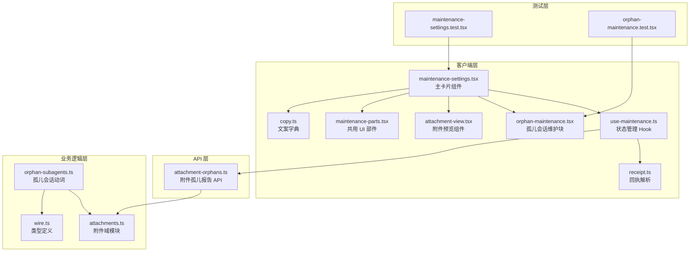
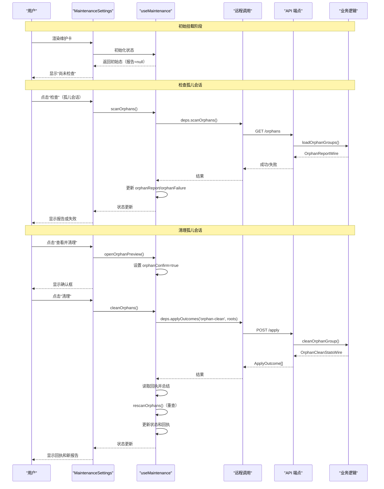
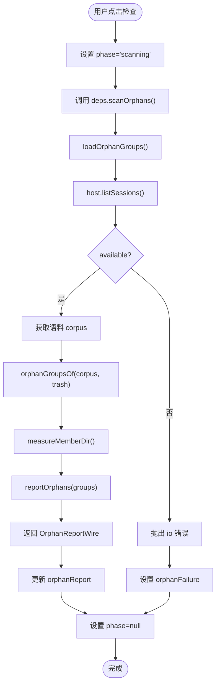
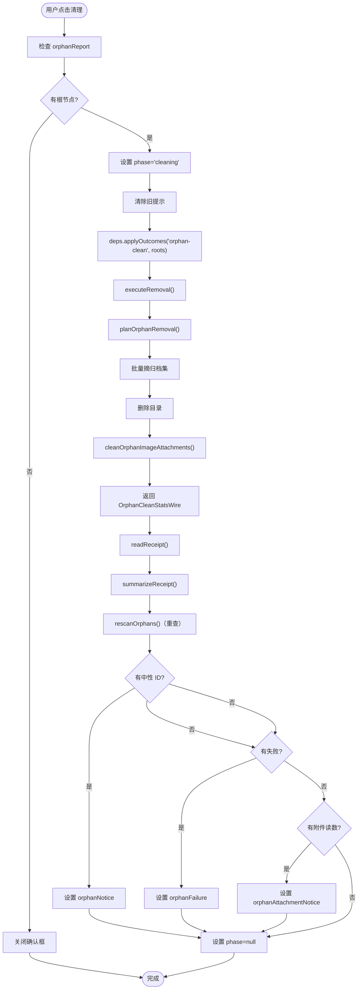
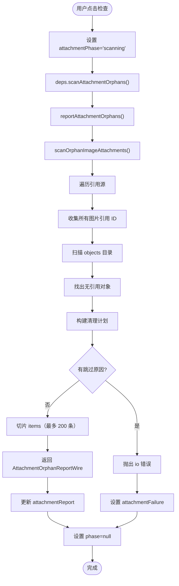
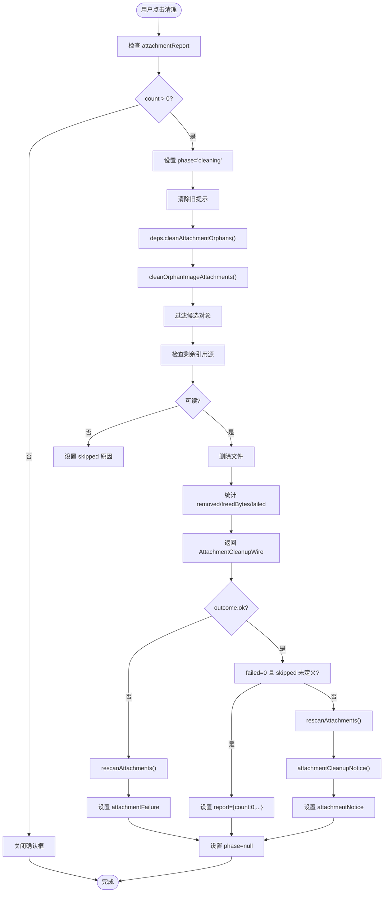
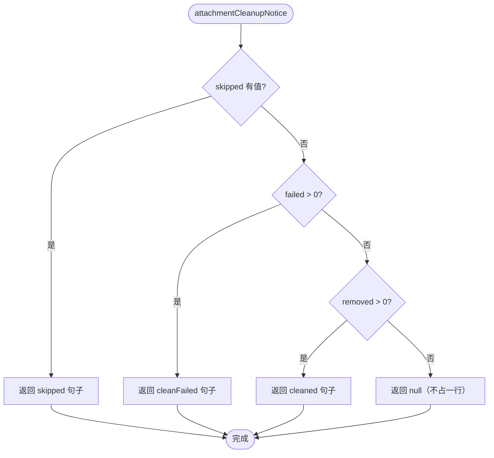
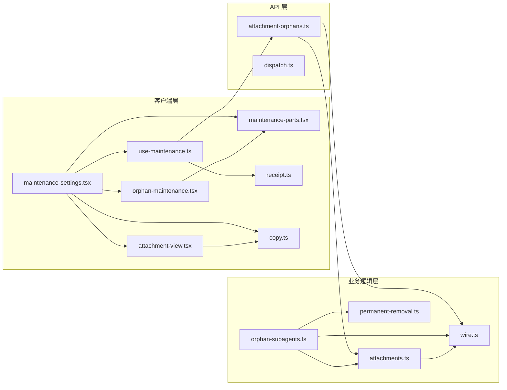

# 插件设置页维护卡

<cite>
**本文档引用的文件**
- [maintenance-settings.tsx](file://src/client/maintenance-settings.tsx)
- [maintenance-parts.tsx](file://src/client/maintenance-parts.tsx)
- [use-maintenance.ts](file://src/client/use-maintenance.ts)
- [orphan-maintenance.tsx](file://src/client/orphan-maintenance.tsx)
- [attachment-view.tsx](file://src/client/attachment-view.tsx)
- [receipt.ts](file://src/client/receipt.ts)
- [copy.ts](file://src/client/copy.ts)
- [attachment-orphans.ts](file://src/api/attachment-orphans.ts)
- [attachments.ts](file://src/trash/attachments.ts)
- [orphan-subagents.ts](file://src/verbs/orphan-subagents.ts)
- [wire.ts](file://src/shared/wire.ts)
- [maintenance-settings.test.tsx](file://tests/client/maintenance-settings.test.tsx)
- [orphan-maintenance.test.tsx](file://tests/client/orphan-maintenance.test.tsx)
</cite>

## 目录

1. [简介](#简介)
2. [项目结构](#项目结构)
3. [核心组件](#核心组件)
4. [架构概览](#架构概览)
5. [详细组件分析](#详细组件分析)
6. [依赖关系分析](#依赖关系分析)
7. [性能考虑](#性能考虑)
8. [故障排除指南](#故障排除指南)
9. [结论](#结论)

## 简介

本插件的「维护」卡是 `plugins.bundle.config` 槽位的占用者，提供两个独立的手动检查与清理段：**孤儿会话**和**孤儿附件**。该卡片遵循严格的设计原则：挂载时不发起任何请求，仅在用户点击「检查」按钮时才执行全盘扫描。这种设计确保了界面的响应性和用户的控制权，避免了后台自动扫描可能带来的性能问题和意外行为。

维护卡的两个段各自独立运作，互不干扰。孤儿会话段负责识别和清理那些父会话已被彻底删除或从回收站移除的子会话；孤儿附件段则专注于清理 `.dsh` 日志文件中没有任何引用的图片副本。两者都采用相同的交互模式：检查 → 预览 → 清理，每一步都需要用户明确确认。

## 项目结构

维护卡相关的代码分布在客户端层、API 层和业务逻辑层，形成了清晰的职责分离：



**图表来源**
- [maintenance-settings.tsx:1-50](file://src/client/maintenance-settings.tsx#L1-L50)
- [use-maintenance.ts:1-30](file://src/client/use-maintenance.ts#L1-L30)
- [attachment-orphans.ts:1-15](file://src/api/attachment-orphans.ts#L1-L15)

**章节来源**
- [maintenance-settings.tsx:1-100](file://src/client/maintenance-settings.tsx#L1-L100)
- [use-maintenance.ts:1-50](file://src/client/use-maintenance.ts#L1-L50)

## 核心组件

维护卡由以下几个核心组件构成，每个组件都有明确的职责边界：

### 1. MaintenanceSettings（主卡片组件）

这是维护卡的入口组件，负责渲染整个卡片的外壳和两个维护段的布局。它不包含任何业务逻辑，只负责呈现和协调子组件。

**关键特性：**
- 使用 `CARD_SHELL` 样式确保卡片在不同宽度下都能正常显示
- 为每个段提供稳定的 `data-dsh-session-delete` 属性，便于测试和界面规格验证
- 状态行按优先级显示：在飞动作 > 失败 > 报告状态

**状态显示优先级：**
1. 清理中（`maintenance.cleaning`）
2. 检查中（`maintenance.scanning`）
3. 检查失败（`maintenance.checkFailed`）
4. 尚未检查（`maintenance.notScanned`）
5. 没有发现（`maintenance.none`）
6. N 个（`maintenance.orphans.count` / `maintenance.attachments.count`）

### 2. useMaintenance（状态管理 Hook）

这是维护卡的核心逻辑层，管理两个段的独立状态和动作。它遵循三条承重规矩：

**三条承重规矩：**
1. **没有自动扫描**：不使用 `useEffect` 或定时器，只有用户点击才发请求
2. **读不到就说读不到**：报告失败时返回 `null` + 原文，不折成"没有发现"
3. **清理后必重查**：清完立刻重读，回执先读出再上屏

**状态隔离：**
- 孤儿会话和孤儿附件各有独立的报告、失败、提示、确认和忙碌状态
- 两个段的写动作互不影响，可以并发执行

### 3. OrphanMaintenance（孤儿会话维护块）

这是一个可复用的维护块，最初用于回收站面板，后来被迁移到设置页维护卡。它只消费一个窄接口 `OrphanMaintenanceQuery`，包含报告、三条提示和四个动作。

**三条界面规则：**
1. **报告非空才出警告条**：空报告和 `null` 都不出现
2. **读不到就说读不到**：失败时原位摆原文 + 重试
3. **"已经不在"不是失败**：中性提示单独一块，不计入失败

### 4. AttachmentMaintenance（孤儿附件维护段）

这是维护卡内联实现的附件维护段，结构与孤儿会话段相似，但有自己的横幅、失败处理和确认框。

**关键特性：**
- 报告大于 0 时显示横幅（数量 + 体积 + 查看并清理按钮）
- 失败时显示原文 + 重试按钮
- 回执单独一行，只在上一趟真的清过或跳过时出现
- 确认框包含缩略图预览和三条边界说明

## 架构概览

维护卡的架构遵循手动触发、状态隔离和错误透明的设计原则：



**图表来源**
- [maintenance-settings.tsx:180-273](file://src/client/maintenance-settings.tsx#L180-L273)
- [use-maintenance.ts:80-150](file://src/client/use-maintenance.ts#L80-L150)
- [orphan-subagents.ts:80-161](file://src/verbs/orphan-subagents.ts#L80-L161)

**章节来源**
- [maintenance-settings.tsx:1-273](file://src/client/maintenance-settings.tsx#L1-L273)
- [use-maintenance.ts:1-276](file://src/client/use-maintenance.ts#L1-L276)

## 详细组件分析

### 孤儿会话段分析

孤儿会话段负责识别和清理那些父会话已不在会话列表或回收站中的子会话。

#### 数据流



**图表来源**
- [use-maintenance.ts:100-130](file://src/client/use-maintenance.ts#L100-L130)
- [orphan-subagents.ts:60-120](file://src/verbs/orphan-subagents.ts#L60-L120)

#### 清理流程



**图表来源**
- [use-maintenance.ts:135-180](file://src/client/use-maintenance.ts#L135-L180)
- [orphan-subagents.ts:130-161](file://src/verbs/orphan-subagents.ts#L130-L161)
- [receipt.ts:150-220](file://src/client/receipt.ts#L150-L220)

#### 关键数据结构

**OrphanReportWire（报告形状）**
- `roots`: 每组"父没了"的 subagent 自己的 id 列表
- `totalSessions`: 闭包总数
- `totalBytes`: 总字节数
- `missingParents`: 失踪父的去重计数
- `groups`: 按项目目录分摊的汇总

**OrphanCleanStatsWire（清理回执）**
- `removed`: 删除的会话目录数
- `freedBytes`: 释放的字节数
- `attachments`: 附件读数（可选）

**章节来源**
- [orphan-subagents.ts:1-161](file://src/verbs/orphan-subagents.ts#L1-L161)
- [wire.ts:180-220](file://src/shared/wire.ts#L180-L220)

### 孤儿附件段分析

孤儿附件段负责识别和清理 `.dsh` 日志文件中没有任何引用的图片副本。

#### 数据流



**图表来源**
- [use-maintenance.ts:195-215](file://src/client/use-maintenance.ts#L195-L215)
- [attachment-orphans.ts:15-26](file://src/api/attachment-orphans.ts#L15-L26)
- [attachments.ts:200-350](file://src/trash/attachments.ts#L200-L350)

#### 清理流程



**图表来源**
- [use-maintenance.ts:220-250](file://src/client/use-maintenance.ts#L220-L250)
- [attachments.ts:350-475](file://src/trash/attachments.ts#L350-L475)

#### 关键数据结构

**AttachmentOrphanReportWire（报告形状）**
- `count`: 无引用图片对象总数
- `totalBytes`: 总字节数
- `items`: 预览清单（最多 200 条，每条含 `attachmentId` 和 `bytes`）

**AttachmentCleanupWire（清理回执）**
- `removed`: 删除的对象数
- `freedBytes`: 释放的字节数
- `failed`: 逐文件失败的件数
- `skipped`: 跳过原因（可选，表示部分或整体没敢清）

**章节来源**
- [attachment-orphans.ts:1-26](file://src/api/attachment-orphans.ts#L1-L26)
- [attachments.ts:1-475](file://src/trash/attachments.ts#L1-L475)
- [wire.ts:140-180](file://src/shared/wire.ts#L140-L180)

### 共用 UI 部件分析

维护卡的两个段共用一些 UI 部件，这些部件定义在 `maintenance-parts.tsx` 中。

#### MaintenanceBanner（警告条外壳）

用于显示需要用户注意的信息，如孤儿会话报告或孤儿附件报告。

**结构特点：**
- 使用警告色图标（`IconWarningOutlineRegular`）
- 左侧显示内容，右侧显示操作按钮
- 支持 `gapBelow` 参数控制下边距

#### MaintenanceFailure（失败块）

用于显示检查或清理失败的信息。

**结构特点：**
- 使用错误色图标
- 显示服务端原文
- 提供重试按钮
- 支持 `gapBelow` 参数控制下边距

**章节来源**
- [maintenance-parts.tsx:1-97](file://src/client/maintenance-parts.tsx#L1-L97)

### 回执解析机制

维护卡的回执解析逻辑集中在 `receipt.ts` 中，确保不同动作的回执处理方式一致。

#### 回执类型

```mermaid
classDiagram
    class ReceiptVerdict {
        +kind: 'ok' | 'already-gone' | 'failed' | 'neutral' | 'missing'
        +id: string
        +value?: T
        +error?: RemoteFailure
        +message?: string
    }
    
    class Receipt {
        +action: ApplyAction
        +verdicts: ReceiptVerdict[]
        +byId: Map~string, ReceiptVerdict~
    }
    
    class ReceiptSummary {
        +successIds: string[]
        +neutralIds: string[]
        +failed: {id, error}[]
        +partial: {removed, freedBytes}
        +landedIds: string[]
        +anySuccess: boolean
        +attachmentCleanup?: AttachmentCleanupWire
    }
    
    class AttachmentCleanupWire {
        +removed: number
        +freedBytes: number
        +failed: number
        +skipped?: string
    }
    
    Receipt --> ReceiptVerdict : "包含"
    ReceiptSummary --> AttachmentCleanupWire : "可选包含"
```

**图表来源**
- [receipt.ts:1-100](file://src/client/receipt.ts#L1-L100)
- [wire.ts:120-160](file://src/shared/wire.ts#L120-L160)

#### 附件清理回执句子生成



**图表来源**
- [use-maintenance.ts:60-75](file://src/client/use-maintenance.ts#L60-L75)
- [receipt.ts:200-250](file://src/client/receipt.ts#L200-L250)

**章节来源**
- [receipt.ts:1-307](file://src/client/receipt.ts#L1-L307)
- [use-maintenance.ts:60-75](file://src/client/use-maintenance.ts#L60-L75)

### 文案系统

维护卡的文案通过 `copy.ts` 中的字典管理，支持中英文切换。

#### 关键文案键

**维护卡通用：**
- `maintenance.title`: "维护"
- `maintenance.scan`: "检查"
- `maintenance.scanning`: "检查中…"
- `maintenance.cleaning`: "清理中…"
- `maintenance.checkFailed`: "检查失败"
- `maintenance.notScanned`: "尚未检查"
- `maintenance.none`: "没有发现"

**孤儿会话段：**
- `maintenance.orphans.title`: "孤儿会话"
- `maintenance.orphans.hint`: "父会话已不在会话列表或回收站里的子会话。检查只读，不会自动运行。"
- `maintenance.orphans.count`: "{count} 个"

**孤儿附件段：**
- `maintenance.attachments.title`: "孤儿附件"
- `maintenance.attachments.hint`: "在 .dsh 里没有任何引用的图片副本。检查只读，清理只动这些副本。"
- `maintenance.attachments.count`: "{count} 个"
- `maintenance.attachments.confirm`: "查看并清理 {count} 个孤儿附件？"
- `maintenance.attachments.body`: "只清理 .dsh 内无引用的图片副本；源文件不受影响；共享引用保留。"
- `maintenance.attachments.previewTruncated`: "仅预览前 {shown} 个；清理会处理全部 {total} 个。"
- `maintenance.attachments.previewHint`: "点图片可放大；关闭这个框不会删除任何东西。"
- `maintenance.attachments.clean`: "清理这些附件"

**章节来源**
- [copy.ts:100-150](file://src/client/copy.ts#L100-L150)

## 依赖关系分析

维护卡的依赖关系可以分为三层：客户端层、API 层和业务逻辑层。



**图表来源**
- [maintenance-settings.tsx:1-30](file://src/client/maintenance-settings.tsx#L1-L30)
- [use-maintenance.ts:1-30](file://src/client/use-maintenance.ts#L1-L30)
- [attachment-orphans.ts:1-15](file://src/api/attachment-orphans.ts#L1-L15)

### 外部依赖

维护卡依赖以下外部模块：

1. **React**: 用于组件渲染和状态管理
2. **宿主连接端口**: 通过 `callRemote` 调用 API 端点
3. **宿主文件系统**: 通过 `FsPort` 访问文件和目录
4. **宿主会话查询**: 通过 `host.listSessions()` 获取语料

### 内部依赖

1. **附件域模块** (`attachments.ts`): 提供引用扫描和独占清理功能
2. **孤儿会话动词** (`orphan-subagents.ts`): 提供孤儿会话扫描和清理功能
3. **回执解析** (`receipt.ts`): 提供统一的回执读法
4. **类型定义** (`wire.ts`): 提供跨半 wire 契约

**章节来源**
- [use-maintenance.ts:1-30](file://src/client/use-maintenance.ts#L1-L30)
- [attachment-orphans.ts:1-15](file://src/api/attachment-orphans.ts#L1-L15)
- [orphan-subagents.ts:1-30](file://src/verbs/orphan-subagents.ts#L1-L30)

## 性能考虑

维护卡的设计充分考虑了性能问题，主要体现在以下几个方面：

### 1. 手动触发避免后台扫描

维护卡挂载时不发起任何请求，只有在用户点击"检查"按钮时才执行扫描。这避免了以下问题：
- 启动时的延迟
- 不必要的磁盘 I/O
- 后台扫描可能导致的界面卡顿

### 2. 预览清单限制

孤儿附件报告的预览清单最多只返回 200 条（`ORPHAN_PREVIEW_LIMIT`），但数量和字节仍按全量计算。这样做的好处是：
- 确认框不会因为渲染大量缩略图而变慢
- 用户仍能知道实际的总数
- 清理操作不受预览条数限制

### 3. 最新胜利者模式

`useMaintenance` 使用 `createLatestWins` 来管理并发请求，确保只有最新的请求结果会被应用。这避免了：
- 旧请求覆盖新请求的结果
- 状态不一致
- 用户看到过时的数据

### 4. 重查优化

清理操作完成后立即重查，但重查使用的是同一份逻辑（`rescanOrphans` / `rescanAttachments`），并且通过 `latestWins` 确保只有最新的重查结果会被应用。这保证了：
- 报告始终反映当前盘上状态
- 不会因为并发请求导致状态混乱

### 5. 内存管理

- 预览清单中的缩略图使用懒加载策略
- 失败集合使用 `Set` 存储，避免重复标记
- 状态更新使用不可变数据结构，避免浅拷贝问题

**章节来源**
- [use-maintenance.ts:90-110](file://src/client/use-maintenance.ts#L90-L110)
- [attachment-orphans.ts:15-20](file://src/api/attachment-orphans.ts#L15-L20)
- [attachment-view.tsx:80-120](file://src/client/attachment-view.tsx#L80-L120)

## 故障排除指南

### 常见问题

#### 1. 检查失败：sessionQuery 不在

**症状：** 状态行显示"检查失败"，错误消息包含"sessionQuery 不在"

**原因：** 宿主的会话语料服务没有挂载，`listSessions()` 返回 `{ available: false }`

**解决方案：** 
- 检查宿主是否正确配置了 `sessionQuery` 服务
- 确认宿主版本是否支持该插件
- 查看控制台日志获取更多信息

**章节来源**
- [orphan-subagents.ts:75-85](file://src/verbs/orphan-subagents.ts#L75-L85)
- [maintenance-settings.test.tsx:100-120](file://tests/client/maintenance-settings.test.tsx#L100-L120)

#### 2. 附件检查失败：引用源读不出

**症状：** 状态行显示"检查失败"，错误消息包含"引用源读不出"

**原因：** 扫描过程中遇到以下情况之一：
- 目录/文件读失败（权限、盘挂、I/O 错误）
- 目录非空但没有规范 zstd 日志
- JSON 超出扫描上限
- 日志有坏行或尾巴被截断

**解决方案：**
- 检查文件权限
- 确认磁盘是否正常挂载
- 查看日志文件是否完整
- 点击"重试"按钮重新扫描

**章节来源**
- [attachments.ts:150-200](file://src/trash/attachments.ts#L150-L200)
- [maintenance-settings.test.tsx:230-250](file://tests/client/maintenance-settings.test.tsx#L230-L250)

#### 3. 清理失败：盘上忙

**症状：** 清理操作失败，错误消息包含"盘上忙"

**原因：** 文件系统繁忙或文件被其他进程占用

**解决方案：**
- 等待一段时间后重试
- 检查是否有其他程序正在访问相关文件
- 重启宿主应用

**章节来源**
- [maintenance-settings.test.tsx:260-280](file://tests/client/maintenance-settings.test.tsx#L260-L280)

#### 4. 部分附件未清理

**症状：** 清理成功后显示"部分附件未清理：剩余引用源读不出（已清理 N 个）"

**原因：** 某些引用源无法读取，但其余对象正常清理

**解决方案：**
- 这是预期行为，不是错误
- 无法读取的引用源对应的对象会被保留
- 可以尝试修复引用源后再次清理

**章节来源**
- [receipt.ts:220-250](file://src/client/receipt.ts#L220-L250)
- [maintenance-settings.test.tsx:140-160](file://tests/client/maintenance-settings.test.tsx#L140-L160)

#### 5. 预览清单超过上限

**症状：** 确认框中只显示部分缩略图，并有提示"仅预览前 200 个；清理会处理全部 N 个。"

**原因：** 孤儿附件数量超过 200 条，预览清单被截断

**解决方案：**
- 这是预期行为，不是错误
- 清理操作会处理所有孤儿附件，不受预览条数限制
- 如果确实需要查看所有附件，可以分批清理

**章节来源**
- [attachment-orphans.ts:15-20](file://src/api/attachment-orphans.ts#L15-L20)
- [maintenance-settings.test.tsx:200-220](file://tests/client/maintenance-settings.test.tsx#L200-L220)

### 调试技巧

#### 1. 使用 data 属性定位元素

维护卡的各个部分都有稳定的 `data-dsh-session-delete` 属性，可以用于测试和调试：

- `maintenance-card`: 整个卡片
- `maintenance-orphans`: 孤儿会话段
- `maintenance-attachments`: 孤儿附件段
- `maintenance-status`: 状态行
- `orphan-banner`: 孤儿会话警告条
- `attachment-banner`: 孤儿附件警告条
- `attachment-failure`: 孤儿附件失败块
- `orphan-notice`: 孤儿会话中性提示

#### 2. 检查网络请求

使用浏览器的开发者工具检查以下 API 请求：

- `GET /dsh-session-delete-api/orphans`: 孤儿会话扫描
- `POST /dsh-session-delete-api/apply`: 孤儿会话清理（action=orphan-clean）
- `GET /dsh-session-delete-api/attachment-orphans`: 孤儿附件扫描
- `POST /dsh-session-delete-api/attachment-clean`: 孤儿附件清理

#### 3. 查看控制台日志

维护卡在关键操作时会输出日志，包括：
- 扫描开始和结束
- 清理开始和结束
- 错误和失败信息

**章节来源**
- [maintenance-settings.tsx:40-60](file://src/client/maintenance-settings.tsx#L40-L60)
- [maintenance-settings.test.tsx:30-60](file://tests/client/maintenance-settings.test.tsx#L30-L60)

## 结论

插件设置页的维护卡是一个设计精良的手动检查与清理工具，它为孤儿会话和孤儿附件提供了清晰、可控的管理界面。通过遵循"挂载不发请求、只在用户点击时执行全盘扫描"的设计原则，维护卡确保了界面的响应性和用户的控制权。

### 关键设计亮点

1. **手动触发机制**：避免了后台自动扫描带来的性能问题和意外行为
2. **状态隔离**：两个段各自独立运作，互不干扰
3. **错误透明**：读不到就说读不到，不折成"没有发现"
4. **清理后必重查**：确保报告始终反映当前盘上状态
5. **预览清单限制**：平衡了用户体验和性能
6. **共用 UI 部件**：减少了代码重复，提高了可维护性

### 未来改进方向

1. **批量操作优化**：可以考虑支持同时检查两个段
2. **进度指示**：对于大规模扫描，可以添加进度条
3. **历史记录**：记录每次检查和清理的结果，方便追溯
4. **定时提醒**：虽然不支持自动扫描，但可以添加定期提醒用户检查的功能

维护卡的实现充分体现了现代前端应用的最佳实践，包括状态管理、错误处理、性能优化和用户体验设计。它不仅是一个功能完整的工具，也是一个值得学习的代码范例。

**章节来源**
- [maintenance-settings.tsx:1-30](file://src/client/maintenance-settings.tsx#L1-L30)
- [use-maintenance.ts:1-50](file://src/client/use-maintenance.ts#L1-L50)