# 删除会话动词

<cite>
**本文引用的文件**   
- [delete-session.ts](file://src/verbs/delete-session.ts)
- [member-journal.ts](file://src/verbs/member-journal.ts)
- [errors.ts](file://src/verbs/errors.ts)
- [dispatch.ts](file://src/api/dispatch.ts)
- [route-table.ts](file://src/api/route-table.ts)
- [trash-rows.ts](file://src/api/trash-rows.ts)
- [wire.ts](file://src/shared/wire.ts)
- [delete-session.test.ts](file://tests/delete-session.test.ts)
- [session-delete-design.md](file://docs/design/2026-09-30-session-delete-design.md)
</cite>

## 目录

1. [简介](#简介)
2. [项目结构](#项目结构)
3. [核心组件](#核心组件)
4. [架构总览](#架构总览)
5. [详细组件分析](#详细组件分析)
6. [依赖关系分析](#依赖关系分析)
7. [性能与一致性特征](#性能与一致性特征)
8. [故障排查指南](#故障排查指南)
9. [结论](#结论)
10. [附录：错误码、测试用例与调用链](#附录错误码测试用例与调用链)

## 简介

`delete-session` 是 DSH 会话删除插件的核心动词，负责把一个“父会话及其盘上的子会话”整体移入回收站。它不是只改宿主注册表，而是真正移动磁盘目录、更新工作区账本、管理归档可见性、写入回收站清单，并向宿主与会话列表发送实时通告。

设计目标可以概括为三句话：

- **运行中会话一律拒绝**：不替用户终止正在运行的活体会话。
- **按组执行、整组回滚**：父会话与其子会话算一组；任一成员失败，已搬的成员全部退回原处。
- **不做删一半的状态**：五个触点中的任一步失败，都要把之前写过的状态退回去，并把原始错误带上。

该动词由 HTTP API `/dsh-session-delete-api/apply` 的 `action: 'delete'` 驱动，但最终业务逻辑集中在 `src/verbs/delete-session.ts`。

**章节来源**
- [session-delete-design.md:1-81](file://docs/design/2026-09-30-session-delete-design.md#L1-L81)
- [delete-session.test.ts:1-60](file://tests/delete-session.test.ts#L1-L60)

## 项目结构

删除会话相关代码分布在四个层次：

| 层次 | 主要文件 | 职责 |
|---|---|---|
| HTTP 入口 | `src/api/dispatch.ts` | 同源栅栏、方法校验、请求体解析、信封封装 |
| 路由表 | `src/api/route-table.ts` | 段名到处理函数的映射，决定 GET/POST、是否读 body、是否串行 |
| 动作分发 | `src/verbs/batch.ts` | 把 `/apply` 的批量 id 交给具体动词（`delete` / `restore` / `purge`） |
| 业务动词 | `src/verbs/delete-session.ts` | 准入检查、父子组扫描、五触点、反向动作、组级回滚 |
| 事务日志 | `src/verbs/member-journal.ts` | 顺序执行、相反顺序回滚、失败收集 |
| 错误模型 | `src/verbs/errors.ts` | 动词码、路由自检码、回滚失败合并 |
| 跨半契约 | `src/shared/wire.ts` | API 前缀、路由段、错误域、错误码表 |
| 行为验证 | `tests/delete-session.test.ts` | 正常流程、异常分支、级联回滚、未知孩子、回滚自身失败 |

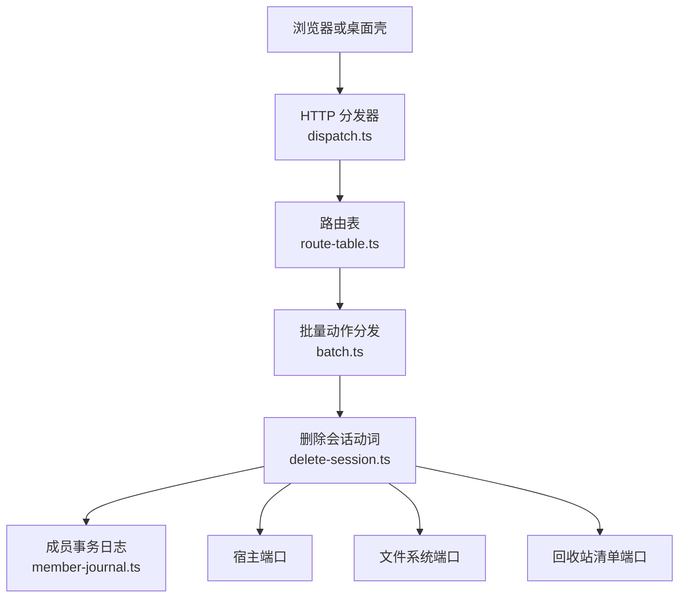

**图示来源**
- [dispatch.ts:1-200](file://src/api/dispatch.ts#L1-L200)
- [route-table.ts:1-143](file://src/api/route-table.ts#L1-L143)
- [delete-session.ts:1-200](file://src/verbs/delete-session.ts#L1-L200)
- [member-journal.ts:1-103](file://src/verbs/member-journal.ts#L1-L103)

**章节来源**
- [dispatch.ts:1-200](file://src/api/dispatch.ts#L1-L200)
- [route-table.ts:1-143](file://src/api/route-table.ts#L1-L143)
- [delete-session.ts:1-200](file://src/verbs/delete-session.ts#L1-L200)

## 核心组件

### 函数签名

```typescript
export function deleteSession(deps: DeleteDeps): (sessionId: string) => Promise<TrashEntry>
```

外层函数接收依赖对象，返回一个接受会话 id 的异步函数。这样设计让同一实例可复用，也方便批量和测试注入。

#### 依赖类型

| 字段 | 类型 | 作用 |
|---|---|---|
| `fs` | `FsPort` | 读取目录大小、创建回收站目录、原子重命名 |
| `host` | `HostPort` | 查项目目录、工作区、标题、字节、归档态、子代理成员、摘除活体、发送通告 |
| `manifest` | `ManifestPort` | 增删回收站清册行 |
| `home` | `string` | DSH 数据根路径 |
| `now` | `() => number` | 提供生成 entry id 的时间戳，便于测试固定 |

#### 返回值

成功时返回**父会话**对应的 `TrashEntry`。如果删除的是没有父的子会话，则返回该行本身。

**章节来源**
- [delete-session.ts:1-44](file://src/verbs/delete-session.ts#L1-L44)

### 准入检查

删除入口先做纯读准入，**任何写操作都不发生**：

1. 查询宿主的子代理成员列表，得到父会话在盘上的所有孩子。
2. 用 `projectDirOf(sessionId)` 确认父会话属于哪个项目。若返回 `undefined`，直接抛出 `sessiondelete/not-found`。
3. 构建候选成员集合：父会话 + 每个子会话。
4. 对每个成员调用 `isLive`：只要有一个成员在运行，就立即拒绝并抛出 `sessiondelete/live`。

这意味着“父在跑”和“某个孩子在跑”都会阻止整个删除。

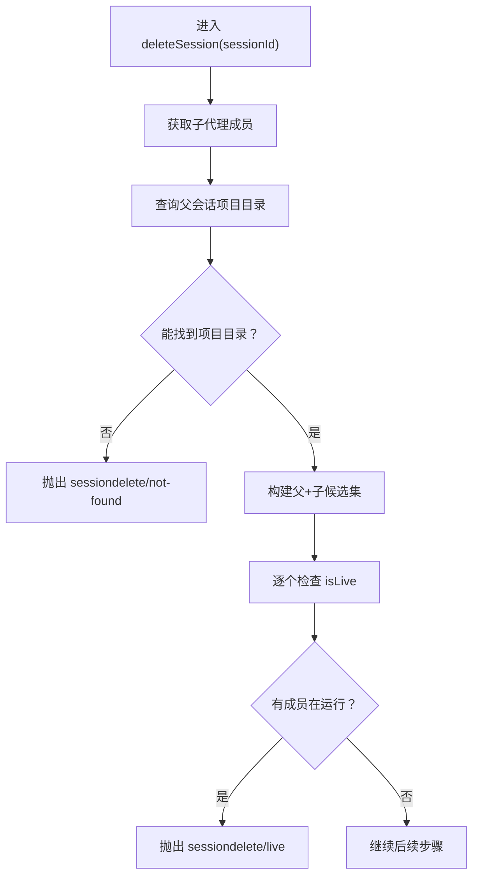

**图示来源**
- [delete-session.ts:45-85](file://src/verbs/delete-session.ts#L45-L85)
- [delete-session.test.ts:30-45](file://tests/delete-session.test.ts#L30-L45)

**章节来源**
- [delete-session.ts:45-85](file://src/verbs/delete-session.ts#L45-L85)
- [delete-session.test.ts:30-45](file://tests/delete-session.test.ts#L30-L45)

### 父子组扫描策略

删除不是单条会话操作，而是“父会话 + 盘上孩子”的组操作：

- 父会话的孩子通过 `host.subagentMembers(sessionId)` 取得。
- 只有**目录确实存在**的孩子才会加入最终执行成员集合；宿主记录存在但目录缺失的孩子会被跳过，不会让整个删除失败。
- 父会话目录不存在才抛 `not-found`；子目录缺失只是跳过。
- 每个成员各自拥有自己的回收站目录和清册行；子行的 `parentEntryId` 指向父那一行。
- 父行自己不带 `parentEntryId`。

这种设计解决了一个真实问题：宿主客户端会把 `origin:"subagent"` 的子会话整排隐藏，导致用户点掉父会话后，大量子目录既看不见又占空间。

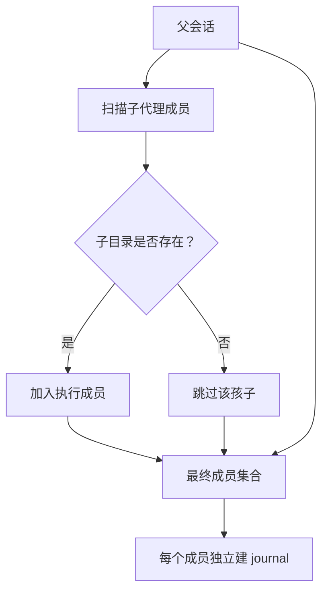

**图示来源**
- [delete-session.ts:55-105](file://src/verbs/delete-session.ts#L55-L105)
- [delete-session.test.ts:201-274](file://tests/delete-session.test.ts#L201-L274)

**章节来源**
- [delete-session.ts:55-105](file://src/verbs/delete-session.ts#L55-L105)
- [delete-session.test.ts:201-274](file://tests/delete-session.test.ts#L201-L274)

### 五个触点与执行顺序

删除的五个触点对应会话在宿主系统中的五个可见面：

| 触点 | 位置 | 删除时做什么 | 反向动作 |
|---|---|---|---|
| ① 会话目录 | `~/.dsh/sessions/<项目>/<会话目录>/` | `rename` 进 `~/.dsh/session-trash/<时间戳>-<原目录名>/` | 搬回原项目目录 |
| ② 工作区账本 | `tables.workspaces[<ws>].sessionIds` | 若存在工作区则 `detachSession` | 若曾 detach 则 `attachSession` |
| ③ 已归档表 | `global.archivedSessionIds` | 确保在归档集中；原本未归档才调用官方归档 | 若是我们加的归档则取消归档 |
| ④ 投影缓存行 | `storages/session_projcache/sessions/<id>.json` | 不碰 | 不碰 |
| ⑤ 宿主内存活体与会话列表 | `ctx.sessions` 及客户端事件 | 尽力摘除并如实通告 `api-session/removed` | 若整组回滚成功则补发 `api-session/restored` |

**关键顺序约束：**

1. 先归档，再摘账本：避免“无主且可见”窗口导致会话落入“未分组”。
2. 摘账本在动文件之前：避免账本留下指向不存在目录的行。
3. 目录搬进回收站后才写清册行：避免“行在、目录还在 sessions/”的幽灵行。
4. 清册行是最后一件写：它的失败必须回滚目录、账本、可见性。
5. 摘活体和通告放在 journal 成功后：这两件事不抛，只在完全搬成之后有意义。

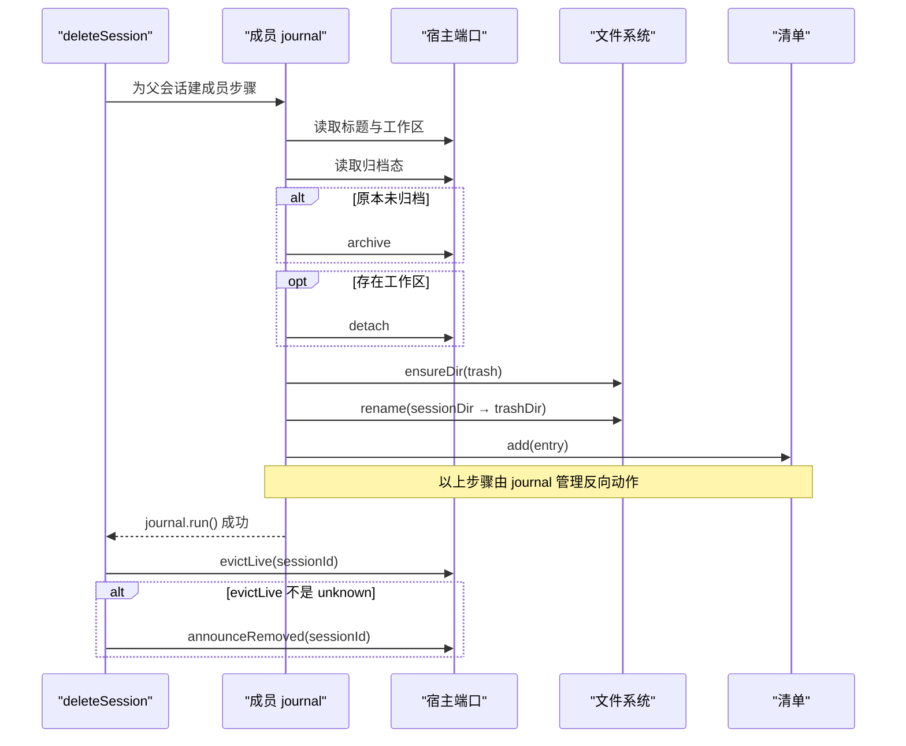

**图示来源**
- [delete-session.ts:106-200](file://src/verbs/delete-session.ts#L106-L200)
- [delete-session.test.ts:60-120](file://tests/delete-session.test.ts#L60-L120)
- [session-delete-design.md:33-81](file://docs/design/2026-09-30-session-delete-design.md#L33-L81)

**章节来源**
- [delete-session.ts:106-200](file://src/verbs/delete-session.ts#L106-L200)
- [delete-session.test.ts:60-120](file://tests/delete-session.test.ts#L60-L120)
- [session-delete-design.md:33-81](file://docs/design/2026-09-30-session-delete-design.md#L33-L81)

### 失败回滚机制

回滚分两层：

1. **成员级回滚**：由 `member-journal.ts` 的 `createJournal` 管理。已完成的步骤按相反顺序执行 `undo`；非原子步骤支持 `undoOnFailure`，即使 run 失败也要尝试撤销半完成状态。
2. **组级回滚**：当某个成员搬不动时，`rollbackJournals` 会按相反顺序调用所有已完成成员的 `journal.undo()`。如果回滚过程中又有失败，这些失败会被收集到 `details.rollbackFailures`，而不是替换原错误。

特别重要的语义：

- 目录搬回失败时，清册行不会被摘掉，因为“留着行至少元数据还在”。
- 只有当目录、账本、可见性三件都真正退回原样时，才补发 `announceRestored`。
- 回滚自身失败不会静默：它会连同原错误一起以 `sessiondelete/io` 形式抛出，并在 details 中列出回滚失败原因。

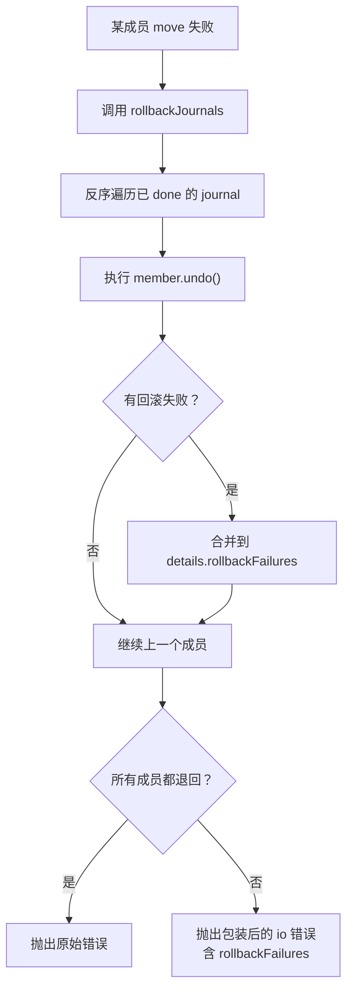

**图示来源**
- [member-journal.ts:60-103](file://src/verbs/member-journal.ts#L60-L103)
- [delete-session.ts:90-105](file://src/verbs/delete-session.ts#L90-L105)
- [delete-session.test.ts:240-274](file://tests/delete-session.test.ts#L240-L274)

**章节来源**
- [member-journal.ts:60-103](file://src/verbs/member-journal.ts#L60-L103)
- [delete-session.ts:90-105](file://src/verbs/delete-session.ts#L90-L105)
- [delete-session.test.ts:240-274](file://tests/delete-session.test.ts#L240-L274)

## 架构总览

从浏览器或桌面壳发起删除，到会话真正进入回收站，调用链如下：

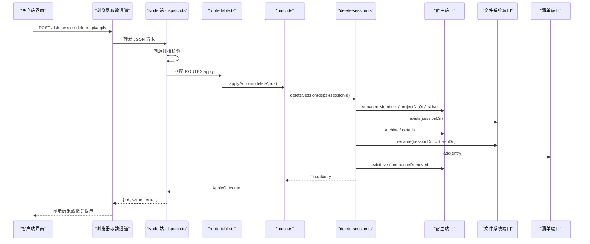

**图示来源**
- [dispatch.ts:150-200](file://src/api/dispatch.ts#L150-L200)
- [route-table.ts:70-143](file://src/api/route-table.ts#L70-L143)
- [delete-session.ts:39-200](file://src/verbs/delete-session.ts#L39-L200)

**章节来源**
- [dispatch.ts:1-200](file://src/api/dispatch.ts#L1-L200)
- [route-table.ts:1-143](file://src/api/route-table.ts#L1-L143)
- [delete-session.ts:39-200](file://src/verbs/delete-session.ts#L39-L200)

## 详细组件分析

### 删除会话动词类图

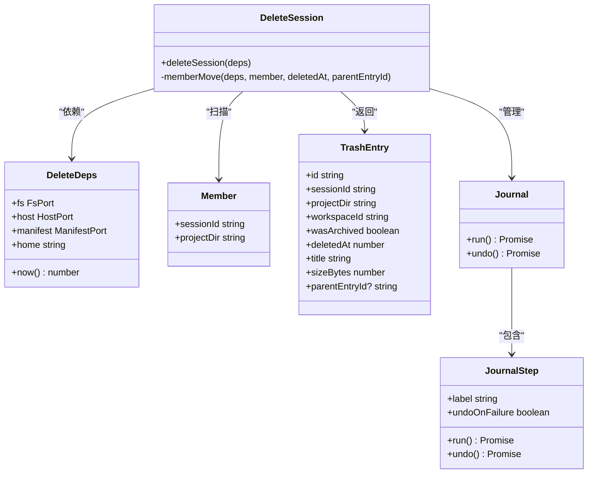

**图示来源**
- [delete-session.ts:1-44](file://src/verbs/delete-session.ts#L1-L44)
- [delete-session.ts:106-200](file://src/verbs/delete-session.ts#L106-L200)
- [member-journal.ts:1-60](file://src/verbs/member-journal.ts#L1-L60)

**章节来源**
- [delete-session.ts:1-44](file://src/verbs/delete-session.ts#L1-L44)
- [member-journal.ts:1-60](file://src/verbs/member-journal.ts#L1-L60)

### 正常删除时序

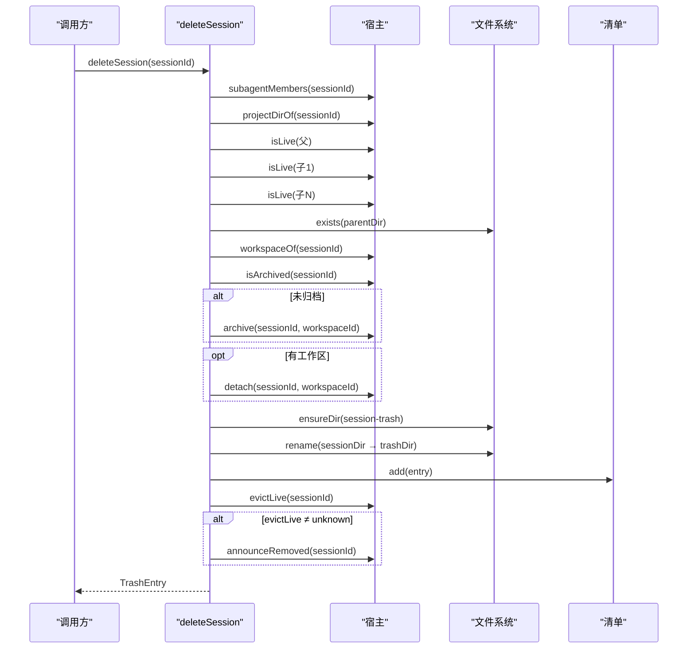

**图示来源**
- [delete-session.ts:39-200](file://src/verbs/delete-session.ts#L39-L200)
- [delete-session.test.ts:60-120](file://tests/delete-session.test.ts#L60-L120)

### 异常分支时序

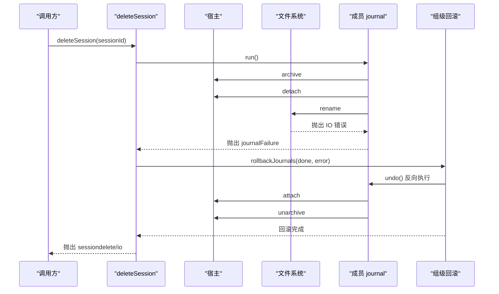

**图示来源**
- [delete-session.ts:85-105](file://src/verbs/delete-session.ts#L85-L105)
- [delete-session.ts:106-200](file://src/verbs/delete-session.ts#L106-L200)
- [member-journal.ts:60-103](file://src/verbs/member-journal.ts#L60-L103)
- [delete-session.test.ts:90-115](file://tests/delete-session.test.ts#L90-L115)

### 反向动作规则

| 正向动作 | 触发条件 | 反向动作 | 反向触发条件 |
|---|---|---|---|
| 读取标题与目录大小 | 总是执行 | 无 | 无 |
| 归档 | 原本未归档 | 取消归档 | 成员回滚 |
| 摘账本 | 工作区存在 | 挂回账本 | 成员回滚 |
| 移动目录 | 总是执行 | 搬回原目录 | 成员回滚 |
| 登记清册行 | 目录已搬进回收站 | 摘除清册行 | 目录成功搬回后 |
| 摘活体 | journal.run() 成功后 | 无 | 无 |
| 移除通告 | evictLive ≠ unknown | 无 | 无 |
| 恢复通告 | 组级回滚且三件写都退回 | 无 | 组级回滚成功 |

特别注意：`evictLive` 和 `announceRemoved` 不在成员 journal 的 `steps` 里，而是在 `journal.run()` 成功后追加。因此它们不参与成员级 undo，而是由组级回滚单独决定是否补发 `announceRestored`。

**章节来源**
- [delete-session.ts:106-200](file://src/verbs/delete-session.ts#L106-L200)

## 依赖关系分析

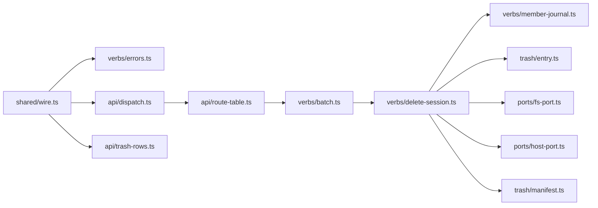

**图示来源**
- [wire.ts:1-261](file://src/shared/wire.ts#L1-L261)
- [errors.ts:1-82](file://src/verbs/errors.ts#L1-L82)
- [dispatch.ts:1-200](file://src/api/dispatch.ts#L1-L200)
- [route-table.ts:1-143](file://src/api/route-table.ts#L1-L143)
- [delete-session.ts:1-200](file://src/verbs/delete-session.ts#L1-L200)

### 耦合与内聚

- `delete-session.ts` 是业务内聚中心，依赖端口抽象，不直接耦合宿主实现。
- `member-journal.ts` 被删除与恢复两个动词共用，降低重复回滚逻辑。
- `errors.ts` 只负责错误构造，错误码常量来自 `shared/wire.ts`，保证两端一致。
- `dispatch.ts` 与 `route-table.ts` 是薄传输层，只关心 HTTP 契约与执行顺序。
- `trash-rows.ts` 专注线上行装配，不混入删除事务逻辑。

### 外部依赖

| 外部系统 | 使用方式 | 风险 |
|---|---|---|
| 宿主会话活动接口 | `workspace/session-activity` waterfall | 第三方插件可能不可用，需判空 |
| 宿主归档服务 | `archiveSession` / `unarchiveSession` | 磁盘卷不一致会 EXDEV |
| 宿主工作区注册表 | `attachSession` / `detachSession` | 工作区可能已被删除 |
| 宿主会话内存表 | `liveEntryFor().detach()` | 已知限制：不拆 agent，后续 flush 可能报错 |
| 宿主会话列表转发 | `api-session/removed` / `api-session/added` | 客户端重连可自愈 |
| Node 文件系统 | `rename` / `exists` / `sizeOfDir` | 权限不足、跨卷失败、路径不存在 |
| 插件存储域 | `manifest.add` / `manifest.remove` | 存储介质故障 |

**章节来源**
- [delete-session.ts:1-200](file://src/verbs/delete-session.ts#L1-L200)
- [member-journal.ts:1-103](file://src/verbs/member-journal.ts#L1-L103)
- [errors.ts:1-82](file://src/verbs/errors.ts#L1-L82)

## 性能与一致性特征

### 性能特征

- 单个删除是 O(n) 扫描，n 为父会话及其子会话数量。
- 子目录存在性检查是磁盘 I/O，但只在确定要删除后才执行。
- 目录移动使用原子 `rename`，在同一卷上是瞬时操作。
- 批处理通过 `batch.ts` 串行化，避免多个删除交错造成回收站不一致。
- 列表和对账走串行链，纯读如 `ping`、`orphans`、`count` 不走链。

### 一致性特征

- **读早于写**：标题、工作区、归档态、目录存在性都在归档和摘账本之前。
- **可见性优先**：先归档再摘账本，避免“无主可见”窗口。
- **目录优先于清单**：清册行在目录搬进回收站后才写入。
- **最后写可回滚**：清册行失败能退回目录、账本和可见性。
- **组级幂等观察**：同批中被前一条带走的 id 返回 null，不视为失败。
- **失败可自愈**：彻底删除（purge）先删目录再摘行，摘行失败重试即可。

**章节来源**
- [delete-session.ts:45-105](file://src/verbs/delete-session.ts#L45-L105)
- [delete-session.ts:106-200](file://src/verbs/delete-session.ts#L106-L200)
- [route-table.ts:1-40](file://src/api/route-table.ts#L1-L40)

## 故障排查指南

### 常见问题定位

| 现象 | 可能原因 | 检查点 |
|---|---|---|
| 删除后立即报 `sessiondelete/live` | 父或某个子仍在运行 | 检查 `isLive` 返回值 |
| 删除后会话出现在“未分组” | 先摘账本再归档，或遗漏归档 | 检查 archive/detach 顺序 |
| 删除后客户端行不消失 | 冷会话未收到 `announceRemoved` | 检查 evictLive 结果与通告调用 |
| 回收站里看不到刚删的会话 | 清册登记失败 | 检查 manifest.add 错误 |
| 回滚后仍有部分目录留在回收站 | 回滚自身失败 | 检查 `details.rollbackFailures` |
| 报 `sessiondelete/not-found` | 项目目录推不出或会话目录不存在 | 区分 projectDirOf 与 fs.exists |
| 批量删除部分成功 | 同批后续 id 被前一条带走返回 null | 这不是失败，是幂等 no-op |

### 调试建议

1. 查看 `calls` 日志顺序，确认是否为 `archive → detach → rename → evictLive → announceRemoved`。
2. 若回滚失败，检查 `error.details.rollbackFailures` 是否包含多步失败。
3. 若 evictLive 返回 `unknown`，不要期望 `announceRemoved` 被调用；删除仍应成功。
4. 若子目录缺失，确认宿主记录与磁盘不一致，不应影响父会话删除。
5. 若 `projectDirOf` 返回 undefined，这是真正的 not-found，不是 IO 错误。

**章节来源**
- [delete-session.test.ts:30-190](file://tests/delete-session.test.ts#L30-L190)
- [delete-session.test.ts:240-274](file://tests/delete-session.test.ts#L240-L274)
- [errors.ts:40-82](file://src/verbs/errors.ts#L40-L82)

## 结论

`delete-session` 是一个以“组”为单位、以“回滚”为核心保障的删除动词。它的设计重点不是简单的“移动文件夹”，而是协调五个触点，确保会话在宿主列表、工作区账本、归档可见性、磁盘目录和回收站清单之间保持一致。

其核心价值在于：

- 明确拒绝运行中会话。
- 自动发现并搬迁盘上子会话。
- 用 journal 管理每一步的反向动作。
- 用组级回滚防止“半组在回收站”的不一致。
- 通过宿主通告让客户端侧栏及时刷新。
- 通过清晰的错误码和测试覆盖，使异常行为可观测、可回归。

**章节来源**
- [session-delete-design.md:1-81](file://docs/design/2026-09-30-session-delete-design.md#L1-L81)
- [delete-session.ts:1-200](file://src/verbs/delete-session.ts#L1-L200)
- [delete-session.test.ts:1-274](file://tests/delete-session.test.ts#L1-L274)

## 附录：错误码、测试用例与调用链

### 错误码总表

| 完整错误码 | 含义 | 典型触发条件 |
|---|---|---|
| `sessiondelete/live` | 会话正在运行 | `isLive` 返回真 |
| `sessiondelete/not-found` | 找不到会话 | `projectDirOf` 返回 undefined，或会话目录不存在 |
| `sessiondelete/trash-empty` | 回收站为空 | 清空回收站时没有可清条目 |
| `sessiondelete/project-missing` | 项目目录缺失 | 工作区或项目根不存在 |
| `sessiondelete/io` | 其他 I/O 或未知失败 | 归档失败、detach 失败、rename 失败、清单失败、回滚失败 |
| `sessiondelete/bad-method` | HTTP 方法不对 | POST 写成 GET，或反之 |
| `sessiondelete/not-found-route` | 路由不存在 | 路径不匹配 `/dsh-session-delete-api/*` |
| `sessiondelete/bad-request` | 请求体无效 | 缺少必填字段、类型错误、JSON 非法、超出 1MiB |

其中前五个是动词码，后三个是路由自检码；后者代表“这条请求不归我办”，前者代表“这次操作失败了”。

**章节来源**
- [wire.ts:200-261](file://src/shared/wire.ts#L200-L261)
- [errors.ts:1-40](file://src/verbs/errors.ts#L1-L40)
- [dispatch.ts:110-170](file://src/api/dispatch.ts#L110-L170)

### 典型测试输入输出示例

以下示例基于 `tests/delete-session.test.ts` 的行为断言整理，不直接粘贴源码。

| 场景 | 输入 | 预期输出 |
|---|---|---|
| 运行中会话 | `sessionId = "session-abc"`，`host.isLive()` 返回真 | 抛出 `{ code: "sessiondelete/live" }`，无任何 host/fs 写调用 |
| 正常删除 | 会话可找到、不在运行、目录存在 | 返回 `TrashEntry`，调用顺序为 `archive → detach → rename → evictLive → announceRemoved` |
| 已归档会话 | `host.isArchived()` 返回真 | 不调用 archive，返回的 entry 中 `wasArchived = true` |
| rename 失败 | `fs.rename` 抛错 | 抛出 `{ code: "sessiondelete/io", cause: 原始错误 }`，反向调用 `attach` 然后 `unarchive` |
| 清单登记失败 | `manifest.add` 抛错 | 抛出 `{ code: "sessiondelete/io" }`，目录搬回、账本挂回、归档态还原 |
| detach 失败 | `host.detach` 抛错 | 抛出 `{ code: "sessiondelete/io" }`，反向调用 `unarchive`，目录不动 |
| archive 失败 | `host.archive` 抛错 | 抛出 `{ code: "sessiondelete/io" }`，无后续调用 |
| 纯读失败 | `host.titleOf` 抛错 | 抛出 `{ code: "sessiondelete/io" }`，零副作用 |
| 未分组会话 | `host.workspaceOf()` 返回 undefined | 不调用 detach，entry 中 `workspaceId = ""` |
| 推不出项目目录 | `host.projectDirOf()` 返回 undefined | 抛出 `{ code: "sessiondelete/not-found" }`，零副作用 |
| 会话目录不存在 | `fs.exists(sessionDir)` 返回 false | 抛出 `{ code: "sessiondelete/not-found" }` |
| 父带两个孩子 | 父会话有两个子目录 | 三个目录分别搬进回收站，子行带 `parentEntryId` |
| 孩子目录缺失 | 宿主说有孩子但目录不存在 | 跳过该孩子，不影响父和其他孩子 |
| 孩子在运行 | 某个子 `isLive` 为真 | 整组拒绝，报 `sessiondelete/live` |
| 第二个孩子搬不动 | 第一个孩子已搬入回收站 | 父和第一个孩子一起回滚，并补发 `announceRestored` |
| 回滚自身失败 | 回滚 rename 抛权限错误 | 保留原错误码，新增 `details.rollbackFailures`，不发 `announceRestored` |

**章节来源**
- [delete-session.test.ts:30-190](file://tests/delete-session.test.ts#L30-L190)
- [delete-session.test.ts:201-274](file://tests/delete-session.test.ts#L201-L274)

### API 到 trash/* 与 ports/* 的调用链

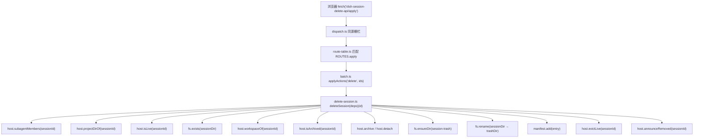

**图示来源**
- [dispatch.ts:150-200](file://src/api/dispatch.ts#L150-L200)
- [route-table.ts:90-143](file://src/api/route-table.ts#L90-L143)
- [delete-session.ts:39-200](file://src/verbs/delete-session.ts#L39-L200)

**章节来源**
- [dispatch.ts:1-200](file://src/api/dispatch.ts#L1-L200)
- [route-table.ts:1-143](file://src/api/route-table.ts#L1-L143)
- [delete-session.ts:39-200](file://src/verbs/delete-session.ts#L39-L200)