# 动词层（业务逻辑）

<cite>
**本文引用的文件**   
- [delete-session.ts](file://src/verbs/delete-session.ts)
- [restore-session.ts](file://src/verbs/restore-session.ts)
- [purge-trash.ts](file://src/verbs/purge-trash.ts)
- [batch.ts](file://src/verbs/batch.ts)
- [member-journal.ts](file://src/verbs/member-journal.ts)
- [orphan-subagents.ts](file://src/verbs/orphan-subagents.ts)
- [errors.ts](file://src/verbs/errors.ts)
- [entry.ts](file://src/trash/entry.ts)
- [groups.js](file://src/trash/groups.js)
- [reconcile.ts](file://src/trash/reconcile.ts)
- [fs-port.ts](file://src/ports/fs-port.ts)
- [host-port.ts](file://src/ports/host-port.ts)
- [map-error.ts](file://src/remote/map-error.ts)
- [delete-session.test.ts](file://tests/delete-session.test.ts)
- [restore-session.test.ts](file://tests/restore-session.test.ts)
- [purge-trash.test.ts](file://tests/purge-trash.test.ts)
- [batch.test.ts](file://tests/batch.test.ts)
- [orphan-subagents.test.ts](file://tests/orphan-subagents.test.ts)
</cite>

## 目录

1. [引言](#引言)
2. [项目结构](#项目结构)
3. [核心组件](#核心组件)
4. [架构总览](#架构总览)
5. [详细组件分析](#详细组件分析)
6. [依赖关系分析](#依赖关系分析)
7. [性能与并发特性](#性能与并发特性)
8. [故障排查指南](#故障排查指南)
9. [结论](#结论)

## 引言

本文件聚焦动词层的五个核心业务动作：**删除会话、恢复会话、彻底清理回收站、批量编排、无主子会话扫描与清理**。这些动词不是简单封装文件系统调用，而是围绕“会话在 `sessions/` 与 `session-trash/` 之间移动”这一状态机，组织宿主端口、清册、工作区账本与客户端通告。

它们共同遵循几条原则：

- **按组语义处理父子关系**：父会话被删除或恢复时，盘上属于该父的子会话要一起走；恢复与彻底删除都读 `trash/groups.js` 的分组规则，而不是各自写一遍父子判断。
- **先预检、再写盘**：活体检查在任何写之前执行；任一成员在跑就整组拒绝，零副作用。
- **用 journal 表达五触点步骤**：每个成员的移动由“读现场 → 归档/摘可见性 → 摘账本 → 搬目录/摘行 → 摘活体与通告”组成，失败时按相反顺序退回。
- **批量拥有请求语义**：去重保序、快照只读一次、逐条信封、一批一次通告。
- **错误码集中在共享契约**：`not-found`、`live`、`io`、`trash-empty`、`project-missing` 等码由 `shared/wire.ts` 定义，动词只负责包装和传递。

## 项目结构

动词层位于 `src/verbs`，它不直接实现持久化，而是通过三类端口与上层共享模块协作：

| 层级 | 文件 | 职责 |
|---|---|---|
| 动词入口 | `delete-session.ts`、`restore-session.ts`、`purge-trash.ts` | 一个 id 进、一条结果出；对外接口不含批量参数 |
| 批量编排 | `batch.ts` | 接收 `applyActions(action, ids)`，负责去重、幂等、通告聚合 |
| 回滚骨架 | `member-journal.ts` | 相反顺序回退、失败收集、非原子步骤反向 |
| 孤儿与级联 | `orphan-subagents.ts` | 扫描无主子会话、计算清理计划、清理一组盘上后代 |
| 错误模型 | `errors.ts` | `verbError`、`withRollbackFailures`、回滚原因拼接 |
| 回收站数据 | `../trash/entry.ts`、`../trash/groups.js` | 条目构造、组归属、批量取走判据 |
| 外部端口 | `../ports/fs-port.ts`、`../ports/host-port.ts` | 文件系统、宿主会话、工作区、归档集、事件通道 |
| 远程映射 | `../remote/map-error.ts` | 把 Node 端错误折成远端失败形状 |
| 测试 | `tests/*-test.ts` | 断言顺序、错误码、回滚路径、批量幂等与通告次数 |

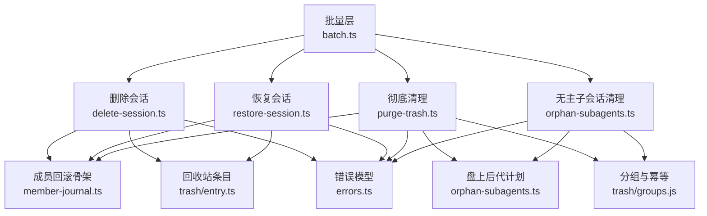

**图表来源**

- [batch.ts:1-197](file://src/verbs/batch.ts#L1-L197)
- [delete-session.ts:1-200](file://src/verbs/delete-session.ts#L1-L200)
- [restore-session.ts:1-173](file://src/verbs/restore-session.ts#L1-L173)
- [purge-trash.ts:1-121](file://src/verbs/purge-trash.ts#L1-L121)
- [member-journal.ts:1-103](file://src/verbs/member-journal.ts#L1-L103)
- [orphan-subagents.ts:1-231](file://src/verbs/orphan-subagents.ts#L1-L231)

**章节来源**

- [batch.ts:1-197](file://src/verbs/batch.ts#L1-L197)
- [delete-session.ts:1-200](file://src/verbs/delete-session.ts#L1-L200)
- [restore-session.ts:1-173](file://src/verbs/restore-session.ts#L1-L173)
- [purge-trash.ts:1-121](file://src/verbs/purge-trash.ts#L1-L121)
- [member-journal.ts:1-103](file://src/verbs/member-journal.ts#L1-L103)
- [orphan-subagents.ts:1-231](file://src/verbs/orphan-subagents.ts#L1-L231)

## 核心组件

### 成员回滚骨架（journal）

`member-journal.ts` 是三个主要动词共享的状态推进器。它不关心“删还是恢复”，只负责：

1. 按声明顺序执行步骤。
2. 某步失败时，对已执行步骤执行反向动作。
3. 支持 `undoOnFailure`：即使这一步自己失败，也要先执行它的反向动作。
4. 收集所有反向失败，并通过 `withRollbackFailures` 合并到最终错误中。

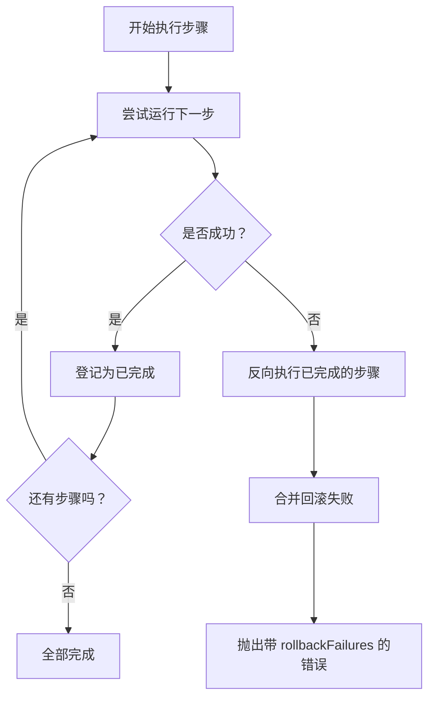

**图表来源**

- [member-journal.ts:1-103](file://src/verbs/member-journal.ts#L1-L103)

关键行为：

| 能力 | 说明 |
|---|---|
| 相反顺序回退 | 最后成功的步骤最先撤销 |
| 非原子步骤保护 | `undoOnFailure` 让“取消归档”这类可能半做的步骤也能安全回退 |
| 回滚失败收集 | 多个步骤退不干净时，汇总为 `details.rollbackFailures` |
| 组级回滚 | `rollbackJournals` 把已经执行的成员 journal 逆序统一回退 |
| 错误域保持 | 如果原错误已经是 `sessiondelete/...` 动词码，保留其码；否则落为 `io` |

**章节来源**

- [member-journal.ts:1-103](file://src/verbs/member-journal.ts#L1-L103)
- [errors.ts:1-82](file://src/verbs/errors.ts#L1-L82)

### 错误模型

`errors.ts` 暴露两个重要工具：

- `verbError(code, message, cause?, details?)`：构造带有领域前缀的错误。
- `withRollbackFailures(error, failures)`：把回滚失败并进现有错误，既不吞掉原始错误，也不重复已有消息。

| 错误码 | 含义 | 典型触发点 |
|---|---|---|
| `not-found` | 会话不存在或无法解析项目目录 | 删除时宿主没有持久化记录 |
| `live` | 会话正在运行 | 删除、彻底清理、孤儿清理准入检查 |
| `trash-empty` | 回收站里没有这条 | 恢复或彻底清理找不到条目 |
| `project-missing` | 原项目目录不存在 | 恢复预检发现 `sessions/` 下目标根缺失 |
| `io` | I/O、宿主服务、存储等底层失败 | 文件移动、宿主事件、工作区操作失败 |

**章节来源**

- [errors.ts:1-82](file://src/verbs/errors.ts#L1-L82)

## 架构总览

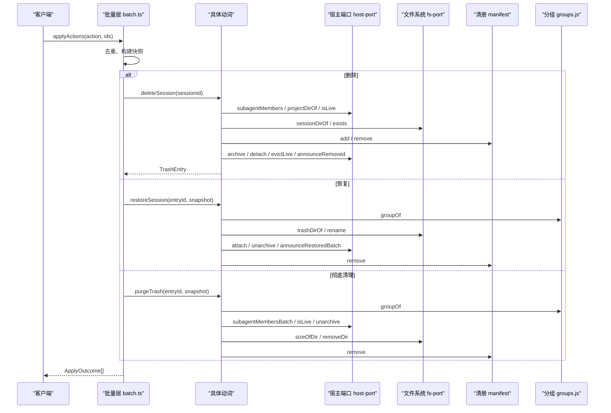

**图表来源**

- [batch.ts:1-197](file://src/verbs/batch.ts#L1-L197)
- [delete-session.ts:1-200](file://src/verbs/delete-session.ts#L1-L200)
- [restore-session.ts:1-173](file://src/verbs/restore-session.ts#L1-L173)
- [purge-trash.ts:1-121](file://src/verbs/purge-trash.ts#L1-L121)

## 详细组件分析

### 删除会话 `deleteSession`

#### 职责

把指定会话从当前会话目录移入回收站，并把它在宿主内存和客户端列表中移除。重点在于：

- 用户点击父会话时，要把宿主的子会话也一起搬进回收站，避免子目录继续占用空间且不可见。
- 删除以“组”为单位，但函数签名只接受单个 `sessionId`；批量层负责同批其他父/子 id 的去重与幂等。
- 删除后返回的是父会话对应的回收站条目。

#### 输入输出

| 项 | 类型 | 说明 |
|---|---|---|
| 输入 | `sessionId: string` | 要删除的会话 id |
| 输出 | `Promise<TrashEntry>` | 回收站中的父条目 |
| 依赖 | `DeleteDeps` | 包含 `fs`、`host`、`manifest`、`home`、`now` |

#### 预处理流程

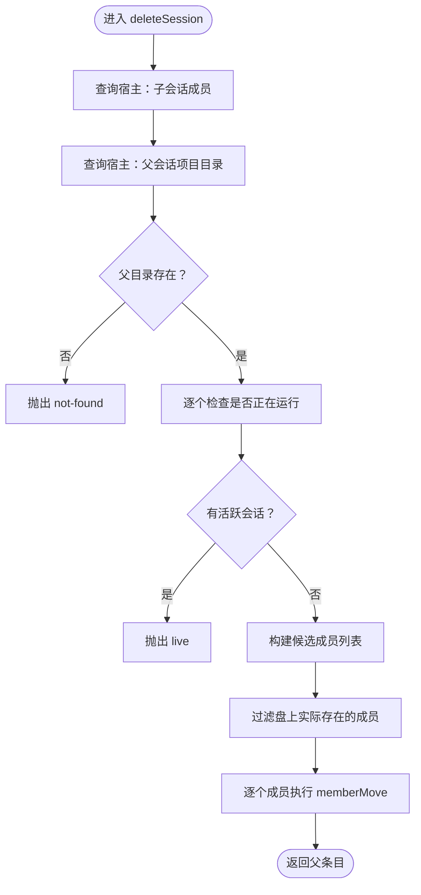

**图表来源**

- [delete-session.ts:1-200](file://src/verbs/delete-session.ts#L1-L200)

#### 五触点步骤

每个成员的删除按以下顺序执行：

1. **读取会话现场**：标题与目录字节数。
2. **归档**：若原本未归档，则先归档，确保中间不会掉进“未分组”。
3. **摘账本**：若原来挂在某个工作区，则解除挂接。
4. **移动目录与登记清册**：目录移到 `session-trash/`，清册写入条目；两者合成一步，保证“行只在目录真正搬走后出现”。
5. **摘活体与通告**：成功后才执行，因为回滚不需要“撤销通告”。

#### 错误码与回滚策略

| 阶段 | 错误码 | 回滚行为 |
|---|---|---|
| 宿主查不到会话 | `not-found` | 无写，无需回滚 |
| 任意成员在运行 | `live` | 任何写尚未发生 |
| 会话目录不存在 | `not-found` | 无写 |
| 归档失败 | `io` | 无已做步骤，直接失败 |
| 摘账本失败 | `io` | 还原可见性（unarchive） |
| 移动目录失败 | `io` | 挂回账本、还原可见性 |
| 清册登记失败 | `io` | 目录搬回、账本挂回、可见性还原 |
| 组成员级失败 | `io` + `rollbackFailures` | 已搬成员按相反顺序退回 |

#### 调用时序图

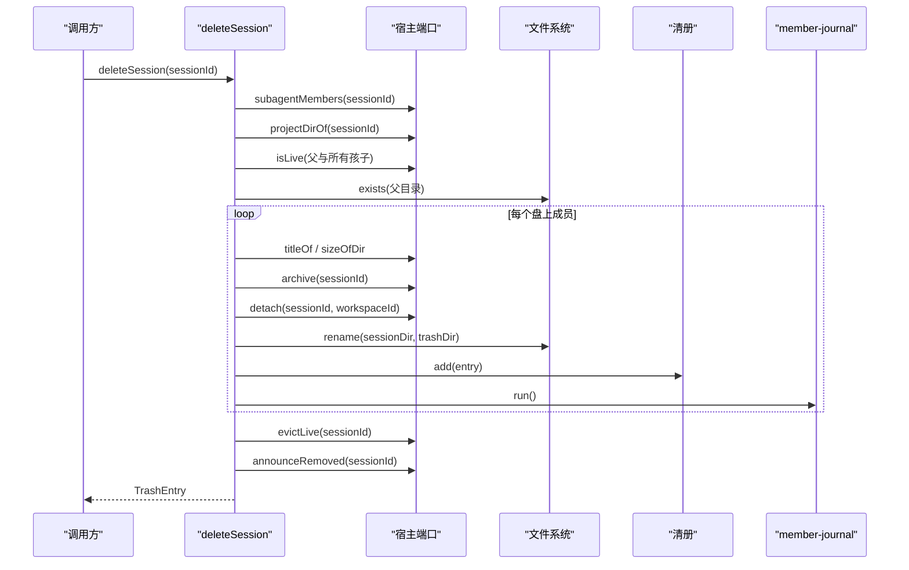

**图表来源**

- [delete-session.ts:1-200](file://src/verbs/delete-session.ts#L1-L200)
- [member-journal.ts:1-103](file://src/verbs/member-journal.ts#L1-L103)

#### 与 `trash/*` 的关系

- 使用 `makeEntryId`、`sessionDirOf`、`trashDirOf` 生成回收站条目 id 与路径。
- 使用 `parentEntryId` 标记子会话属于哪个父条目。
- 与 `trash/groups.js` 的分组规则一致：恢复与彻底删除都按同一组语义处理。

#### 相关测试要点

- 运行中的会话一律拒绝，且不产生写。
- 固定顺序：归档 → 摘账本 → 移动 → 摘活体 → 通告。
- 已归档会话不动归档集。
- `rename` 失败会回滚已摘账本与可见性。
- 清册登记失败会整体回退。
- 未分组会话允许删除，workspaceId 记为空串。
- 子会话随父一起进入回收站。

**章节来源**

- [delete-session.ts:1-200](file://src/verbs/delete-session.ts#L1-L200)
- [delete-session.test.ts:1-274](file://tests/delete-session.test.ts#L1-L274)
- [entry.ts](file://src/trash/entry.ts)
- [groups.js](file://src/trash/groups.js)

---

### 恢复会话 `restoreSession`

#### 职责

把删除时放进回收站的会话放回原项目目录，并按原来的工作区与归档态恢复。恢复也以“组”为单位：如果传入的是父条目，则整组恢复；如果传入的是孩子条目，则只恢复它自己。

#### 输入输出

| 项 | 类型 | 说明 |
|---|---|---|
| 输入 | `entryId: string` | 回收站条目 id |
| 可选输入 | `snapshot?: readonly TrashEntry[]` | 批量层提供的只读清册快照 |
| 输出 | `Promise<TrashEntry>` | 被恢复的那一行条目 |

#### 工作区缺失判断

恢复侧有两个关键辅助函数：

| 函数 | 返回值 | 含义 |
|---|---|---|
| `attachableWorkspaceId(host, entry)` | `string | undefined` | 能挂的工作区 id，或无账目可挂 |
| `isWorkspaceMissing(host, entry)` | `boolean` | 删除时有账目但现在不存在 |

规则是：

- `workspaceId` 为空串：删除时就没有账目，恢复后归入“未分组”。
- `workspaceId` 非空但 `workspaceExists` 为假：工作区已被宿主删除，恢复后也归入“未分组”。
- 只有工作区仍存在时才挂账本。

#### 预处理流程

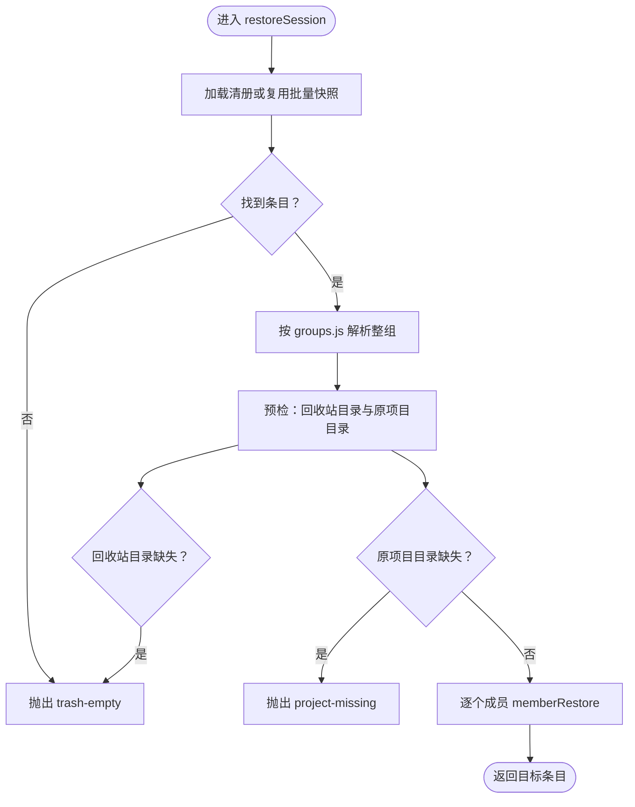

**图表来源**

- [restore-session.ts:1-173](file://src/verbs/restore-session.ts#L1-L173)

#### 恢复步骤

与删除相反：

1. **放回目录**：从 `session-trash/` 搬回 `sessions/`。
2. **挂账本**：仅在可附加的工作区存在时执行。
3. **还原可见性**：若删除前未归档，则取消归档；若删除前已归档，则不动。
4. **摘清册行**：最后一件写，失败时必须把前面步骤全部退回。

#### 错误码与回滚策略

| 阶段 | 错误码 | 回滚行为 |
|---|---|---|
| 回收站中没有条目 | `trash-empty` | 无写 |
| 回收站目录缺失 | `trash-empty` | 无写 |
| 原项目目录缺失 | `project-missing` | 无写 |
| 目录放回失败 | `io` | 目录重新退回回收站 |
| 挂账本失败 | `io` | 若工作区确实不存在则按未分组收；否则回滚 |
| 取消归档失败 | `io` | 重新归档、摘账本、目录退回回收站 |
| 摘清册行失败 | `io` | 重新归档、摘账本、目录退回回收站 |
| 组成员级失败 | `io` + `rollbackFailures` | 已恢复成员逆序退回 |

#### 调用时序图

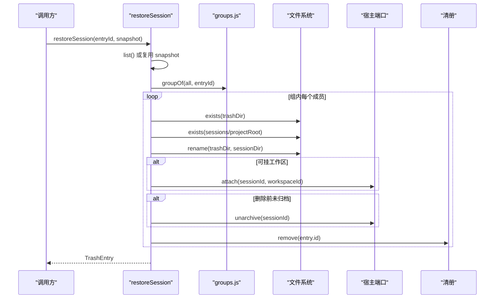

**图表来源**

- [restore-session.ts:1-173](file://src/verbs/restore-session.ts#L1-L173)
- [groups.js](file://src/trash/groups.js)

#### 与批量层的通告关系

恢复动词本身**不直接发批次通告**。批量层 `batch.ts` 在 `applyRestore` 中收集一批恢复出的会话 id，并在批尾调用 `announceRestoredBatch(restored, restoredSummariesOf())`，从而避免每条恢复都触发一次宿主全表扫描。

**章节来源**

- [restore-session.ts:1-173](file://src/verbs/restore-session.ts#L1-L173)
- [restore-session.test.ts:1-274](file://tests/restore-session.test.ts#L1-L274)
- [batch.ts:1-197](file://src/verbs/batch.ts#L1-L197)

---

### 彻底清理回收站 `purgeTrash`

#### 职责

从回收站里**真的删除**条目及其目录，并统计删除条数与释放字节。它可以：

- 清空整个回收站。
- 彻底删除一个父条目（连带组内子条目）。
- 彻底删除一个子条目。
- 清理“父已在回收站中被删、但子目录还留在盘上”的后代。

#### 输入输出

| 项 | 类型 | 说明 |
|---|---|---|
| 输入 | `entryId?: string` | 省略表示清空；否则是一个回收站条目 id |
| 可选输入 | `snapshot?: readonly TrashEntry[]` | 批量层提供的只读清册快照 |
| 输出 | `Promise<{ removed: number; freedBytes: number }>` | 成功回执中的计数 |

#### 关键设计约束

文档明确说明：**这条动词不做回滚**。目录一旦删除就无法“退回回收站”，因此它只报告部分成功时的 `removed` 与 `freedBytes`，不伪装成整组成功，也不把部分删除静默吞掉。

#### 预处理流程

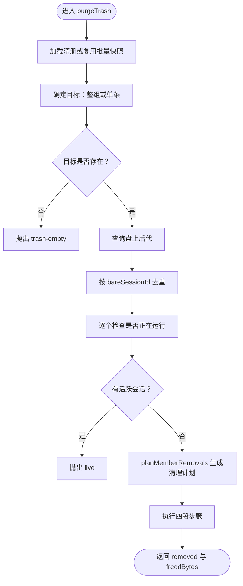

**图表来源**

- [purge-trash.ts:1-121](file://src/verbs/purge-trash.ts#L1-L121)
- [orphan-subagents.ts:1-231](file://src/verbs/orphan-subagents.ts#L1-L231)

#### 四段步骤

1. **取消归档**：父条目与盘上后代都要取消归档。
2. **摘账本**：仅对计划中有 `workspaceId` 的成员摘账本。
3. **删除回收站目录与清册行**：目录可能已被手工删除，此时仍要摘行。
4. **删除盘上后代目录**：每删一个目录就累计字节，并摘活体、发移除通告。

#### 错误码与回滚策略

| 阶段 | 错误码 | 回滚行为 |
|---|---|---|
| 回收站中没有条目 | `trash-empty` | 无写 |
| 任意成员在运行 | `live` | 零副作用 |
| 取消归档失败 | `io` | 不回滚；重试仍可清理 |
| 摘账本失败 | `io` | 不回滚；目录仍可能在 |
| 删除目录失败 | `io` | 不回滚，`details` 带部分计数 |
| 摘清册行失败 | `io` | 目录可能仍在，需要重试 |

#### 与孤儿清理的关系

`purgeTrash` 使用 `planMemberRemovals` 计算盘上后代，而 `orphan-subagents.ts` 的 `cleanOrphanGroup` 用于“父已经被彻底删除、子还在 `sessions/`”的情况。二者共用目录度量与账本归属逻辑，但清理时机不同。

**章节来源**

- [purge-trash.ts:1-121](file://src/verbs/purge-trash.ts#L1-L121)
- [orphan-subagents.ts:1-231](file://src/verbs/orphan-subagents.ts#L1-L231)
- [purge-trash.test.ts:1-169](file://tests/purge-trash.test.ts#L1-L169)

---

### 批量编排 `applyActions`

#### 职责

批量层是“这一批”的唯一拥有者。它接收动作名与 id 数组，输出每个 id 的 `ApplyOutcome`。它不负责业务细节，只负责：

- 去重保序。
- 清册快照只读一次。
- 逐条信封：一条失败不影响下一条。
- 恢复与彻底清理的幂等：已被同批前一条带走的 id 返回成功 no-op。
- 恢复的批次通告只发一次。

#### 动作分发

| 动作 | 对应实现 | 特殊语义 |
|---|---|---|
| `delete` | `applyDelete` | 子 id 被父删除后幂等返回 null |
| `restore` | `applyRestore` | 收集会话 id，批尾一次 `announceRestoredBatch` |
| `purge` | `applyPurge` | 已被带走的 id 返回 `{removed:0,freedBytes:0}` |
| `count` | `applyCount` | 一次问完整批的子会话数量 |
| `orphan-clean` | `applyOrphanClean` | 先对账，再扫描，再清理 |

#### 去重与幂等

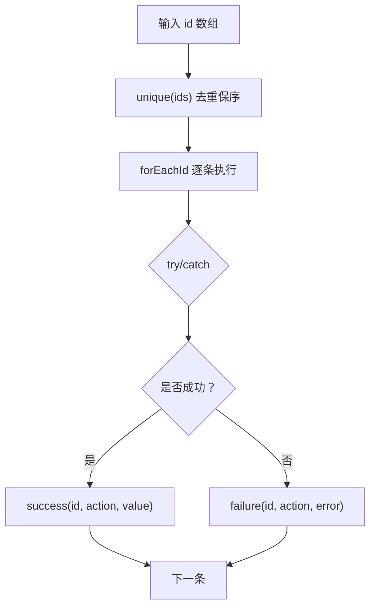

**图表来源**

- [batch.ts:1-197](file://src/verbs/batch.ts#L1-L197)

#### 批量恢复时序

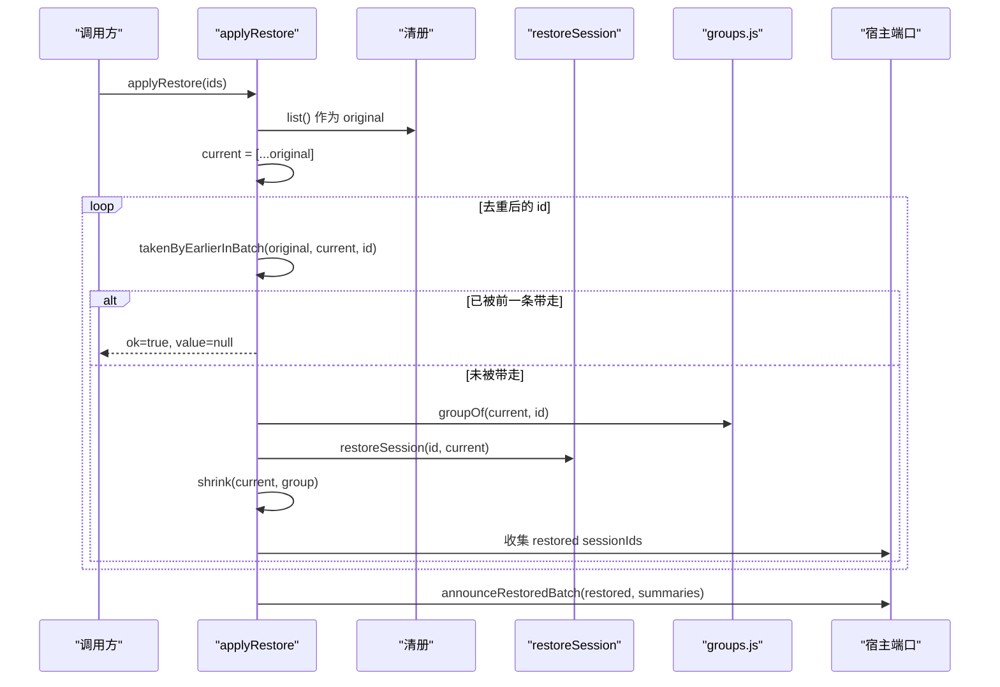

**图表来源**

- [batch.ts:1-197](file://src/verbs/batch.ts#L1-L197)
- [restore-session.ts:1-173](file://src/verbs/restore-session.ts#L1-L173)
- [groups.js](file://src/trash/groups.js)

#### 错误传播

批量层使用 `toRemoteFailure` 把 Node 端错误转换为远端失败形状 `{code, message, details?}`。动词自身抛出的 `VerbError` 会被保留语义，而普通异常会落入 `io`。

**章节来源**

- [batch.ts:1-197](file://src/verbs/batch.ts#L1-L197)
- [map-error.ts](file://src/remote/map-error.ts)
- [batch.test.ts:1-132](file://tests/batch.test.ts#L1-L132)

---

### 无主子会话扫描与清理

#### 概念

“无主子会话”是指 `origin:"subagent"` 且父会话既不在宿主语料中，也不在回收站清册中的会话。它与“ stranded ”不同：stranded 是父还在回收站里，应该跟着父一起恢复或彻底删除；孤儿则是父已经没了，盘上的目录成了无人认领的残留。

#### 扫描流程

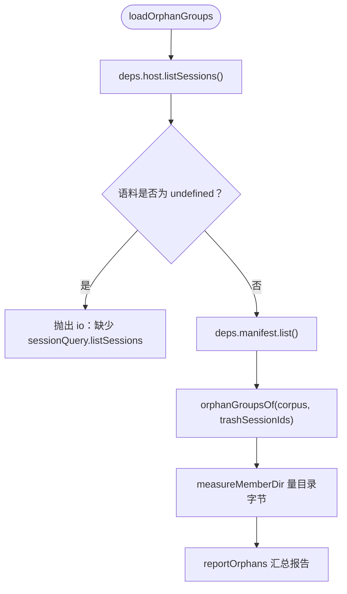

**图表来源**

- [orphan-subagents.ts:1-231](file://src/verbs/orphan-subagents.ts#L1-L231)

#### 分组统计字段

`reportOrphans` 输出：

| 字段 | 含义 |
|---|---|
| `roots` | 每组根会话 id |
| `totalSessions` | 闭包内会话总数 |
| `totalBytes` | 闭包内目录字节总和 |
| `missingParents` | 丢失父会话的去重数量 |
| `groups` | 按项目目录分组的会话数与字节，按字节降序 |

#### 清理流程

`cleanOrphanGroup` 的顺序与删除对称，但不是镜像复制：

1. **整组活体检查**：任一成员在运行则整组拒绝。
2. **整批取消归档**：失败时目录仍在，下次重试仍有效。
3. **摘账本**：只对确实挂着工作区的成员摘。
4. **逐条删除目录**：失败不回滚已删目录，但 `details` 带 `removed`、`freedBytes`、`failedSessionId`。
5. **摘活体与通告**：按 purge 的约定，只在知道宿主列表干净时发移除通告。

#### 错误码与回滚策略

| 阶段 | 错误码 | 回滚行为 |
|---|---|---|
| 宿主语料缺失 | `io` | 扫描阶段，无写 |
| 任一成员在运行 | `live` | 零副作用 |
| 目录删除失败 | `io` | 不回滚已删目录，附带部分回执 |
| 批量编排中的孤儿清理失败 | `orphan-clean` 失败结果 | 由 `batch.ts` 捕获并包装 |

#### 调用时序图

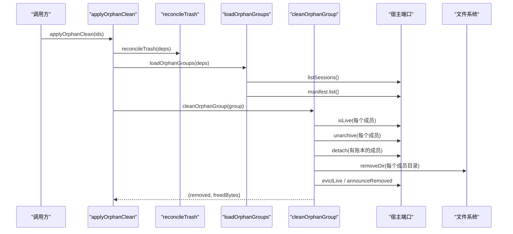

**图表来源**

- [batch.ts:1-197](file://src/verbs/batch.ts#L1-L197)
- [orphan-subagents.ts:1-231](file://src/verbs/orphan-subagents.ts#L1-L231)
- [reconcile.ts](file://src/trash/reconcile.ts)

**章节来源**

- [orphan-subagents.ts:1-231](file://src/verbs/orphan-subagents.ts#L1-L231)
- [orphan-subagents.test.ts:1-147](file://tests/orphan-subagents.test.ts#L1-L147)
- [batch.ts:1-197](file://src/verbs/batch.ts#L1-L197)

## 依赖关系分析

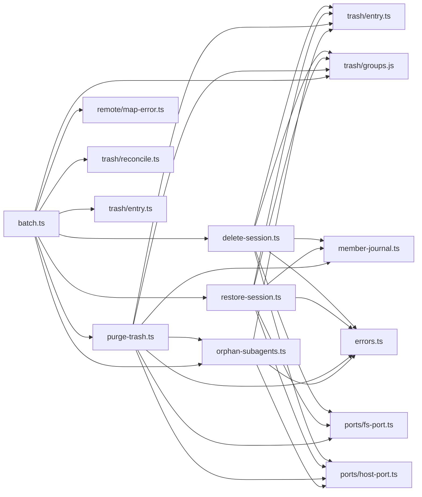

**图表来源**

- [delete-session.ts:1-200](file://src/verbs/delete-session.ts#L1-L200)
- [restore-session.ts:1-173](file://src/verbs/restore-session.ts#L1-L173)
- [purge-trash.ts:1-121](file://src/verbs/purge-trash.ts#L1-L121)
- [batch.ts:1-197](file://src/verbs/batch.ts#L1-L197)
- [orphan-subagents.ts:1-231](file://src/verbs/orphan-subagents.ts#L1-L231)
- [member-journal.ts:1-103](file://src/verbs/member-journal.ts#L1-L103)

耦合特征：

- 动词层对 `trash/*` 高度依赖，尤其是条目构造与分组规则。
- 动词层对 `ports/*` 松耦合：所有外部副作用通过端口注入，便于测试。
- `member-journal.ts` 是横切关注点，被删除、恢复、彻底清理共用。
- `batch.ts` 是唯一知道“批量语义”的地方，避免五个动词互相耦合。

**章节来源**

- [delete-session.ts:1-200](file://src/verbs/delete-session.ts#L1-L200)
- [restore-session.ts:1-173](file://src/verbs/restore-session.ts#L1-L173)
- [purge-trash.ts:1-121](file://src/verbs/purge-trash.ts#L1-L121)
- [batch.ts:1-197](file://src/verbs/batch.ts#L1-L197)
- [orphan-subagents.ts:1-231](file://src/verbs/orphan-subagents.ts#L1-L231)

## 性能与并发特性

| 方面 | 实现特点 | 影响 |
|---|---|---|
| 宿主会话扫描 | 批量恢复只在批尾调一次 `restoredSummariesOf()` | 避免每条恢复都触发宿主全表扫描 |
| 清册读取 | 批量层只读一次 `manifest.list()`，动词复用只读快照 | 减少清册 I/O 与序列化开销 |
| 子会话计数 | `count` 动作一次传完整 id 数组 | 宿主只需一次批量查询 |
| 组级回滚 | 失败后逆序调用 journal.undo | 防止“半组在回收站、半组在原处” |
| 孤儿扫描 | `listSessions` 必须存在，否则响亮失败 | 避免把服务缺失误报为“没有孤儿” |
| 目录删除 | purge 与孤儿清理不回滚已删目录 | 删除语义不可逆，但部分计数可用于重试 |

优化建议：

- 对于大批量恢复，应优先提交父会话 id，使批量层尽早收缩当前视图，减少重复恢复。
- 对超大回收站，应分批调用 `purgeTrash`，避免一次性取消归档、摘账本与删除目录造成长时间锁。
- 宿主 `evictLive` 返回 `unknown` 时不应假定成功或失败，只应根据通告策略决定是否发送事件。
- 如果 `listSessions` 经常超时或缺席，应在路由层加超时与降级提示，而不是让动词层假装“零孤儿”。

[本节为通用指导，不直接分析具体代码片段]

## 故障排查指南

### 常见错误码与定位

| 错误码 | 可能原因 | 排查方向 |
|---|---|---|
| `sessiondelete/not-found` | 宿主持久化里没有会话；或删除前项目目录不存在 | 检查 `host.projectDirOf` 与 `fs.exists(sessionDir)` |
| `sessiondelete/live` | 删除、彻底清理或孤儿清理遇到运行中会话 | 检查 `host.isLive` 调用链 |
| `sessiondelete/trash-empty` | 恢复或彻底清理找不到回收站条目 | 检查清册与 `groupOf` |
| `sessiondelete/project-missing` | 恢复时发现 `sessions/` 下原项目根缺失 | 检查 `fs.exists(home/sessions/projectRoot)` |
| `sessiondelete/io` | 文件移动、宿主事件、工作区或存储失败 | 查看 `cause` 与 `details.rollbackFailures` |

### 回滚失败诊断

当回滚不完整时，错误会带上 `details.rollbackFailures`。排查时应注意：

1. 先看外层错误码：通常仍是原动作的语义码。
2. 再看 `cause`：它是导致最初失败的底层错误。
3. 再看 `details.rollbackFailures`：列出每一步反向动作没能完全恢复的原因。
4. 不要只看 `ok=false` 就认为“什么都没做”；purge 与孤儿清理的部分成功会带 `removed`、`freedBytes`。

### 典型异常场景

| 场景 | 预期行为 | 验证方式 |
|---|---|---|
| 删除时 `rename` 失败 | 挂回账本、还原可见性、目录搬回原处 | 检查 `fs.rename` 调用次数与顺序 |
| 恢复时工作区刚好被删 | 按未分组恢复，不回滚 | 检查是否跳过 `attach` |
| 彻底清理父条目 | 整组回收站目录与盘上后代一起清 | 检查 `removed` 与 `fs.removeDir` 次数 |
| 批量恢复重复 id | 第二个 id 返回幂等成功 | 检查结果数组长度与值 |
| 孤儿清理目录删除中途失败 | 错误带 `failedSessionId` 与已删计数 | 检查 `details` |

**章节来源**

- [errors.ts:1-82](file://src/verbs/errors.ts#L1-L82)
- [delete-session.test.ts:1-274](file://tests/delete-session.test.ts#L1-L274)
- [restore-session.test.ts:1-274](file://tests/restore-session.test.ts#L1-L274)
- [purge-trash.test.ts:1-169](file://tests/purge-trash.test.ts#L1-L169)
- [orphan-subagents.test.ts:1-147](file://tests/orphan-subagents.test.ts#L1-L147)

## 结论

动词层的核心价值不在于“移动文件”，而在于把“会话生命周期”的易错状态变化收敛到一组可测试、可回滚、可批量的步骤中。

- **删除**负责把父与会话子一起安全搬入回收站，并以五触点顺序保证不会留下无主、可见、未归档的中间世界。
- **恢复**负责按原路退回，正确处理工作区缺失与可见性还原，并把失败限制在成员范围内。
- **彻底清理**承担不可逆删除，明确不提供回滚，但用部分计数帮助调用方决定重试。
- **批量层**独占请求语义，保证去重、幂等、逐条信封与一批一次通告。
- **无主子会话扫描**区分“父在回收站”的 stranded 与“父真没了”的 orphan，并提供分组统计与安全的清理回执。

这套设计的关键经验是：不要把批量、回滚、分组、通告、错误码分散到每个动词里；而是让 `batch.ts` 管请求，`member-journal.ts` 管回滚，`trash/groups.js` 管组语义，`errors.ts` 管错误契约，动词只专注“一个成员在 sessions 与 trash 之间移动”的那几件事。