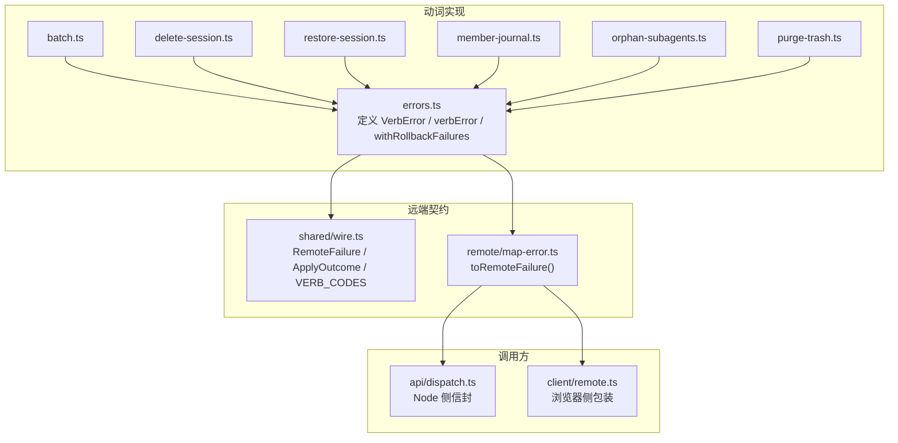
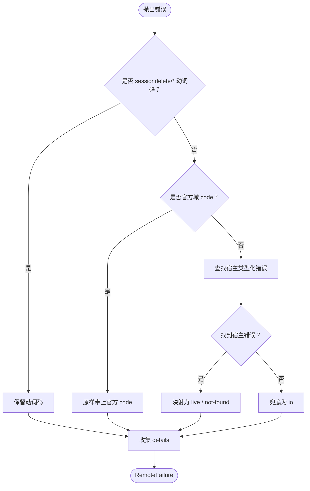
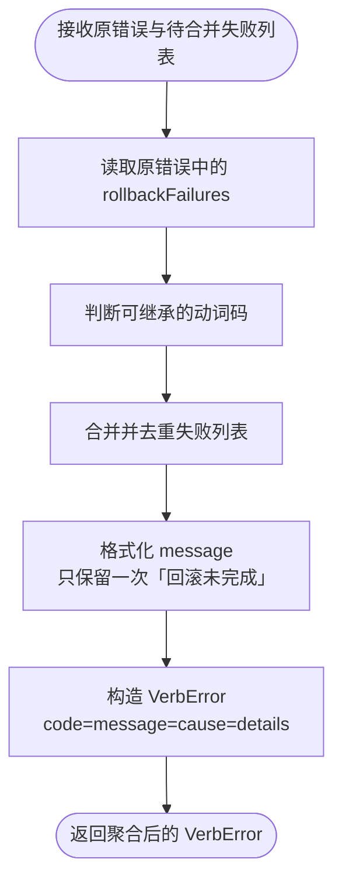

# 动词错误模型

<cite>
**本文引用的文件**
- [src/verbs/errors.ts](file://src/verbs/errors.ts)
- [tests/verbs-errors.test.ts](file://tests/verbs-errors.test.ts)
- [src/shared/wire.ts](file://src/shared/wire.ts)
- [src/remote/map-error.ts](file://src/remote/map-error.ts)
- [src/api/dispatch.ts](file://src/api/dispatch.ts)
- [src/client/remote.ts](file://src/client/remote.ts)
</cite>

## 目录
1. [引言](#引言)
2. [项目结构定位](#项目结构定位)
3. [核心错误类型与构造器](#核心错误类型与构造器)
4. [错误码与领域契约](#错误码与领域契约)
5. [从领域错误到 RemoteFailure 的转换路径](#从领域错误到-remotefailure-的转换路径)
6. [HTTP 4xx 与 200+ok:false 的区分原则](#http-4xx-与-200okfalse-的区分原则)
7. [回滚失败的结构化上报](#回滚失败的结构化上报)
8. [常见错误构造示例](#常见错误构造示例)
9. [捕获、分类与重试建议](#捕获分类与重试建议)
10. [与 shared/wire.RemoteFailure 的关系](#与-sharedwireremotefailure-的关系)
11. [扩展新错误的注意事项](#扩展新错误的注意事项)
12. [故障排查清单](#故障排查清单)
13. [结论](#结论)

## 引言
本文件是 `src/verbs/errors.ts` 的错误模型参考文档。它说明：
- 动词层定义的错误类型、错误码来源和 message 格式；
- 如何将领域错误转换为进程内 `VerbError`，以及最终如何进入跨半 `RemoteFailure`；
- HTTP 级 4xx 路由自检错误与 `/apply` 返回的 `200 + ok:false` 在职责上的区别；
- 回滚失败如何在 `details.rollbackFailures` 中结构化合并；
- 捕获、分类、重试的实践建议；
- 扩展新错误时不应破坏的契约边界。

## 项目结构定位
动词错误模型处于“业务动词”与“远端契约”之间：

**图表来源**
- [src/verbs/errors.ts:1-82](file://src/verbs/errors.ts#L1-L82)
- [src/shared/wire.ts:1-200](file://src/shared/wire.ts#L1-L200)
- [src/remote/map-error.ts:1-134](file://src/remote/map-error.ts#L1-L134)
- [src/api/dispatch.ts](file://src/api/dispatch.ts)
- [src/client/remote.ts](file://src/client/remote.ts)

**章节来源**
- [src/verbs/errors.ts:1-82](file://src/verbs/errors.ts#L1-L82)
- [src/shared/wire.ts:1-200](file://src/shared/wire.ts#L1-L200)

## 核心错误类型与构造器
### VerbError
`VerbError` 是动词层内部抛出的错误对象，继承普通 `Error`，并额外携带：
- `code`：动词错误码，形如 `sessiondelete/<后缀>`；
- `message`：面向用户的上屏原文；
- `cause`：可选的原因，供 `map-error` 沿链查找宿主类型化错误；
- `details`：可选的结构化附带物，对齐远端 `RemoteFailure.details`。

它不是线上信封，而是 Node 进程内的结构化错误载体。

| 字段 | 类型 | 含义 |
|---|---|---|
| `code` | `string` | 以 `SESSION_DELETE_ERROR_DOMAIN` 为前缀的错误码 |
| `message` | `string` | 面向用户或日志的上屏文本 |
| `cause` | `unknown` | 被包装的原错误，通常用于保留原始堆栈或宿主错误 |
| `details` | `Record<string, unknown>` | 结构化数据，例如回滚失败列表、会话标识等 |

### verbError
构造通用动词错误：
- 参数一：动词码后缀（来自 `VERB_CODE_SUFFIXES`）；
- 参数二：message；
- 参数三：可选 cause；
- 参数四：可选 details。

行为要点：
- 将后缀拼接成完整码，前缀来自 `SESSION_DELETE_ERROR_DOMAIN`；
- 仅当传入 cause 时才挂 `cause`；
- 仅当传入 details 时才挂 `details`；
- 不硬造空表，避免把“没有可带信息”误判为“带了空 details”。

### routeError
构造路由自检失败的专用函数，特点是：
- 使用 `io` 作为基础消息；
- 把路由自检码（`RouteCode`）写入 `code`；
- 额外挂载 `httpStatus`，表示该错误对应某个 HTTP 状态语义；
- 明确“不冒充五个动词码”，用于区分“路由/网络层自检失败”和“业务动词失败”。

### rollbackReason
构造回滚步骤失败时的标签句：
- 输入一个描述“正在回滚哪一步”的 label；
- 取原错误的 message（非 Error 则字符串化）；
- 输出固定格式：`label：message`。

调用方不得自行拼接同类字符串，否则界面会出现同一失败的多版本说法。

### withRollbackFailures
聚合多个回滚步骤失败：
- 从原错误继承 code：若原错误是可识别的动词码，则保留；否则落 `io`；
- 收集已有 `details.rollbackFailures` 与本次 failures，去重后合并；
- message 中只出现一次“回滚未完成”，并把新增失败追加进去；
- 结果仍是一个 `VerbError`，便于上层继续包装或转换。

**章节来源**
- [src/verbs/errors.ts:1-82](file://src/verbs/errors.ts#L1-L82)
- [tests/verbs-errors.test.ts:1-28](file://tests/verbs-errors.test.ts#L1-L28)

## 错误码与领域契约
动词错误码由 `shared/wire.ts` 统一维护，这里只做导出和复用：

| 类别 | 来源 | 说明 |
|---|---|---|
| `VERB_CODES` | `shared/wire.ts` 的 `VERB_CODE_SUFFIXES` | 五个动词码的后缀，例如 `not-found`、`live` 等 |
| `ROUTE_CODES` | `shared/wire.ts` 的 `ROUTE_CODE_SUFFIXES` | 三个路由自检码的后缀 |
| `RouteCode` | `shared/wire.ts` 的类型 | 路由自检码类型 |
| `VerbCode` | `shared/wire.ts` 的类型 | 动词码类型 |
| `SESSION_DELETE_ERROR_DOMAIN` | `shared/wire.ts` | 插件专属错误域，所有动词码都以此开头 |

关键约束：
- 这些码属于 Node 半与浏览器半的共同契约，不能只在 Node 侧写死字面量；
- 浏览器半也需要认识这些码，例如 `not-found` 应显示中性提示而不是失败；
- `io` 是兜底码，其他未知动词错误最终会落到这个码；
- 动词码形状为 `<domain>/<suffix>`，而官方宿主错误码属于不同域。

**章节来源**
- [src/verbs/errors.ts:1-24](file://src/verbs/errors.ts#L1-L24)
- [src/shared/wire.ts:1-200](file://src/shared/wire.ts#L1-L200)

## 从领域错误到 RemoteFailure 的转换路径
动词层的错误进入远端信封有两种主要路径：

**图表来源**
- [src/remote/map-error.ts:1-134](file://src/remote/map-error.ts#L1-L134)
- [src/shared/wire.ts:1-200](file://src/shared/wire.ts#L1-L200)

具体规则如下：

1. **已经是远程错误**：如果抛出物带有宿主网关客户端约定的标记位，则直接按 `code`、`message`、`details` 输出，不再包一层。
2. **官方域 code**：若 code 符合官方命名规则且不以本插件域开头，则原样过桥，同时带上结构化字段。
3. **动词码**：若 code 以 `SESSION_DELETE_ERROR_DOMAIN` 开头且后缀属于 `VERB_CODES`，则提取后缀并按本域重新拼装。
4. **宿主类型化错误**：沿 `cause` 链查找 `WorkspaceUnknownSessionError` 和 `WorkspaceActiveSessionError`，分别映射为 `not-found` 和 `live`。
5. **其余情况**：兜底为 `io`。
6. **details 优先级**：优先使用错误对象自身携带的 `details`；如果没有，再尝试从宿主错误身上提取 `sessionId`、`workspaceId`、`path`、`activity` 等字段。

**章节来源**
- [src/remote/map-error.ts:1-134](file://src/remote/map-error.ts#L1-L134)
- [src/shared/wire.ts:1-200](file://src/shared/wire.ts#L1-L200)

## HTTP 4xx 与 200+ok:false 的区分原则
这是理解动词错误模型的关键分界点：

| 场景 | 典型表现 | 处理位置 | 错误归属 |
|---|---|---|---|
| 请求未到达动词逻辑 | HTTP 4xx、5xx、DNS/连接错误 | Node 侧 API 分发层 | 通常不是 `ApplyOutcome.error`，而是外层传输失败 |
| 动词逻辑已执行但失败 | HTTP 200，响应体含 `ok:false` | `/apply` 的逐条结果 | 进入 `ApplyOutcome` 的 `error: RemoteFailure` |
| 路由自检失败 | 用 `routeError` 构造的错误 | 路由校验阶段 | 带 `httpStatus` 的 `VerbError`，但不冒充动词码 |
| 业务动词失败 | 用 `verbError` 构造的错误 | 动词实现中 | 走动词码映射，最终成为 `RemoteFailure.code` |

判断原则：
- **4xx/5xx**：表示请求本身没有成功到达动词处理器，不属于单个动作的落地结果；
- **200 + ok:false**：表示动词已经执行，只是对某条 id 返回失败，属于 `ApplyOutcome` 的失败分支；
- **routeError**：用于“路由自检”这类基础设施错误，带有 HTTP 状态语义，但不应混入五个动词码；
- **verbError**：用于业务动词失败，应映射为 `sessiondelete/<verb-code>`。

因此，不要把所有失败都包装成动词码。路由层、网络层和业务层的失败要分层表达。

**章节来源**
- [src/verbs/errors.ts:33-45](file://src/verbs/errors.ts#L33-L45)
- [src/shared/wire.ts:1-200](file://src/shared/wire.ts#L1-L200)
- [src/remote/map-error.ts:1-134](file://src/remote/map-error.ts#L1-L134)

## 回滚失败的结构化上报
动词批量操作中，单条成员可能就地回滚失败，组级 catch 也可能再次包装失败。`withRollbackFailures` 负责把这些失败合并为一份结构化报告。

**图表来源**
- [src/verbs/errors.ts:46-82](file://src/verbs/errors.ts#L46-L82)

行为细节：
- 若原错误是可识别的动词码，则继承该码；否则落 `io`；
- 原错误中已有的 `rollbackFailures` 与新失败一起合并；
- 失败列表去重，避免同一条失败重复出现；
- message 中若已有“回滚未完成”片段，则不再重复该短语，只追加新的失败项；
- 最终 `details.rollbackFailures` 是字符串数组，适合 UI 展示。

测试覆盖了三种关键路径：
- 内层已有回滚失败时，外层追加不会重复“回滚未完成”；
- 失败列表去重，同时保留原错误的动词码；
- 不可继承的错误码退化为 `io`。

**章节来源**
- [src/verbs/errors.ts:46-82](file://src/verbs/errors.ts#L46-L82)
- [tests/verbs-errors.test.ts:1-28](file://tests/verbs-errors.test.ts#L1-L28)

## 常见错误构造示例
以下示例给出构造思路，不包含具体代码内容：

| 场景 | 推荐构造方式 | code 预期 | message 建议 |
|---|---|---|---|
| 会话不存在 | `verbError('not-found', '会话不存在')` | `sessiondelete/not-found` | 简洁、可直接上屏 |
| 会话仍在运行 | `verbError('live', '会话正在运行')` | `sessiondelete/live` | 表明当前状态，不宜伪装成网络错误 |
| I/O 失败 | `verbError('io', '磁盘读取失败')` | `sessiondelete/io` | 说明底层操作失败 |
| 路由自检失败 | `routeError(路由码, httpStatus, '路由不可达')` | 路由自检码，并带 `httpStatus` | 说明是路由或网关层面的问题 |
| 批量回滚失败 | `withRollbackFailures(innerError, ['回滚 A 失败', '回滚 B 失败'])` | 继承原动词码或 `io` | 包含“回滚未完成”及失败列表 |
| 需要保留宿主字段 | 先 `verbError(..., cause=宿主错误)`，再由 `toRemoteFailure` 提取 | 根据宿主错误或动词码决定 | 宿主结构化字段进入 `details` |

注意：
- 不要手动拼出 `sessiondelete/...` 字符串，应通过 `verbError` 使用受控后缀；
- 不要把路由自检失败写成动词码；
- 不要把业务失败包装成 HTTP 状态码语义；
- 如果需要保留宿主错误字段，务必放在 `cause` 中，让 `map-error` 能沿链发现。

**章节来源**
- [src/verbs/errors.ts:1-82](file://src/verbs/errors.ts#L1-L82)
- [tests/verbs-errors.test.ts:1-28](file://tests/verbs-errors.test.ts#L1-L28)
- [src/remote/map-error.ts:1-134](file://src/remote/map-error.ts#L1-L134)

## 捕获、分类与重试建议
### 捕获策略
建议在动词实现中使用最小粒度 try-catch：
- 捕获具体可恢复的错误；
- 对不可恢复错误使用 `verbError` 表达领域语义；
- 对批量回滚失败使用 `withRollbackFailures` 聚合；
- 不要把所有异常都转成 `io`，否则会丢失可重试性判断依据。

### 分类建议
调用方应按 `RemoteFailure.code` 分类：
- `sessiondelete/not-found`：通常不需要重试；
- `sessiondelete/live`：可能需要等待会话空闲或拒绝操作；
- `sessiondelete/io`：可能是临时 I/O 失败，可考虑有限次重试；
- 官方域 code：交给上层宿主错误处理逻辑；
- 其他未知码：记录日志并降级为通用失败。

### 重试建议
- **幂等读操作**：可短间隔重试少量次数；
- **删除/清空等操作**：谨慎重试，必须确认后端幂等；
- **live 状态**：优先改为轮询状态或提示用户稍后再试；
- **not-found 状态**：一般不重试，除非上游存在延迟一致性；
- **io 状态**：结合超时、指数退避和最大重试次数控制。

### 日志建议
- 保留原始 `cause` 堆栈；
- 记录 `code`、`message` 和 `details`；
- 对回滚失败单独记录 `details.rollbackFailures`；
- 不要仅依赖 message 做机器可读判断，应以 code 为主。

**章节来源**
- [src/verbs/errors.ts:1-82](file://src/verbs/errors.ts#L1-L82)
- [src/remote/map-error.ts:1-134](file://src/remote/map-error.ts#L1-L134)
- [src/shared/wire.ts:1-200](file://src/shared/wire.ts#L1-L200)

## 与 shared/wire.RemoteFailure 的关系
`RemoteFailure` 是跨半契约中的失败信封，而 `VerbError` 是 Node 侧进程内错误。两者关系如下：

| 维度 | VerbError | RemoteFailure |
|---|---|---|
| 作用域 | Node 进程内 | 跨半 JSON 信封 |
| 类型 | 继承 `Error` | 纯对象 `{code, message, details?}` |
| 用途 | 动词实现中抛错、包装、回滚聚合 | 浏览器端判定 `ApplyOutcome.error` |
| 构造入口 | `verbError`、`routeError`、`withRollbackFailures` | `toRemoteFailure` 产出 |
| 可序列化 | 不是设计目标 | 是，作为 RPC 失败体 |

重要约束：
- `RemoteFailure` 不是 `Error` 实例，不能依赖 `instanceof`；
- 浏览器端通过标记位识别远程错误，而跨线传递的是 JSON，标记位不会随 JSON 过去；
- 两端共享的是形状和语义，而不是类；
- `details` 是可选字段，没有结构化附带物时应缺失整件，而不是空对象。

**章节来源**
- [src/shared/wire.ts:1-200](file://src/shared/wire.ts#L1-L200)
- [src/remote/map-error.ts:1-134](file://src/remote/map-error.ts#L1-L134)
- [src/verbs/errors.ts:1-82](file://src/verbs/errors.ts#L1-L82)

## 扩展新错误的注意事项
### 新增动词码
1. 在 `shared/wire.ts` 的动词码集合中添加后缀；
2. 在 `src/verbs/errors.ts` 中通过 `VERB_CODES` 使用，不要复制字面量；
3. 在 `src/remote/map-error.ts` 中确认 `toRemoteFailure` 能识别新码；
4. 在浏览器端确认新码有对应的 UI 语义；
5. 补充测试，覆盖正常映射、回滚聚合和不可继承码退化。

### 新增错误场景
- 如果是业务失败，优先使用 `verbError`；
- 如果是基础设施失败，使用 `io` 或 `routeError`；
- 如果涉及宿主会话状态，尽量保留宿主错误作为 `cause`；
- 如果需要向 UI 传递结构化信息，使用 `details`；
- 如果是一次批量回滚的一部分，使用 `withRollbackFailures` 聚合。

### 不能做的事
- 不要在 Node 侧和浏览器侧各自维护一套错误码；
- 不要为了兼容旧调用点而在动词实现里手写完整 domain/code；
- 不要把路由自检失败写成业务动词码；
- 不要假设 `details` 一定存在；
- 不要忽略 `cause` 链，以免丢失宿主错误信息；
- 不要在 message 中拼接可变标签，应使用 `rollbackReason`。

**章节来源**
- [src/verbs/errors.ts:1-82](file://src/verbs/errors.ts#L1-L82)
- [src/shared/wire.ts:1-200](file://src/shared/wire.ts#L1-L200)
- [src/remote/map-error.ts:1-134](file://src/remote/map-error.ts#L1-L134)

## 故障排查清单
- **message 中出现多次“回滚未完成”**：检查是否多处调用 `withRollbackFailures`，应依赖其自动合并逻辑；
- **回滚失败未在 UI 显示**：检查 `details.rollbackFailures` 是否存在且为非空数组；
- **动词码丢失**：确认原始错误使用了 `verbError`，而不是直接 `throw new Error`；
- **宿主错误字段丢失**：确认宿主错误被放入 `cause`，并被 `toRemoteFailure` 的 cause 链遍历；
- **浏览器端拿不到 code**：确认错误已通过 `toRemoteFailure` 转为 `RemoteFailure`；
- **4xx 被当成业务失败**：确认 4xx 发生在路由层或传输层，不应包装成 `ApplyOutcome.error`；
- **自定义 code 被误转成 io**：确认 code 是否以正确域开头，并属于受控后缀；
- **details 为空对象**：确认是否显式传入了空对象，应让“无 details”保持缺失。

**章节来源**
- [src/verbs/errors.ts:1-82](file://src/verbs/errors.ts#L1-L82)
- [tests/verbs-errors.test.ts:1-28](file://tests/verbs-errors.test.ts#L1-L28)
- [src/remote/map-error.ts:1-134](file://src/remote/map-error.ts#L1-L134)

## 结论
动词错误模型的核心是三层分离：
- `VerbError` 负责 Node 侧结构化错误；
- `RemoteFailure` 负责跨半失败信封；
- `toRemoteFailure` 负责把进程内错误映射为远端可消费的 code、message 和 details。

正确实践是：
- 用动词码表达业务语义；
- 用路由自检码表达基础设施失败；
- 用 HTTP 状态区分请求是否到达动词；
- 用 `200 + ok:false` 表达单条动作落地失败；
- 用 `details.rollbackFailures` 表达批量回滚聚合结果；
- 用 `cause` 保留宿主错误上下文；
- 用 `shared/wire.ts` 作为唯一错误码真相源。