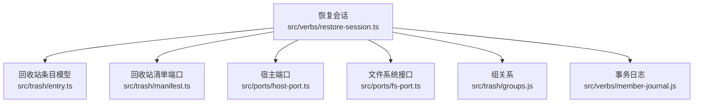
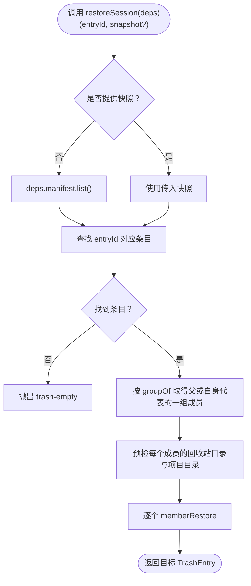
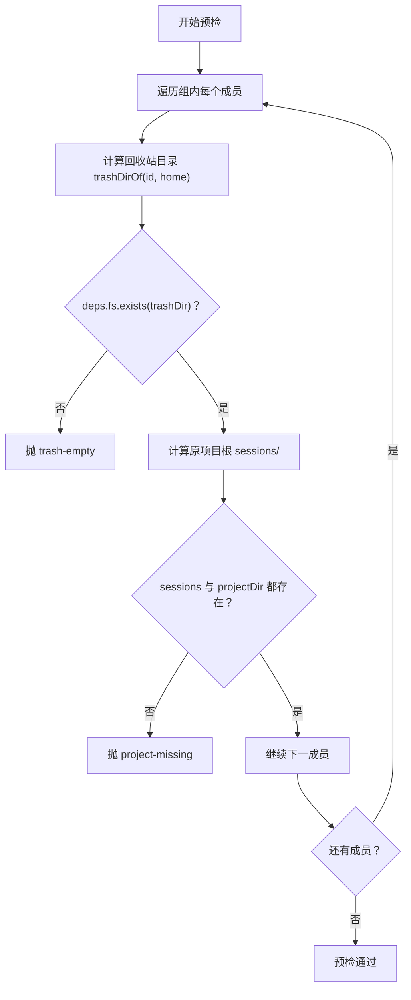
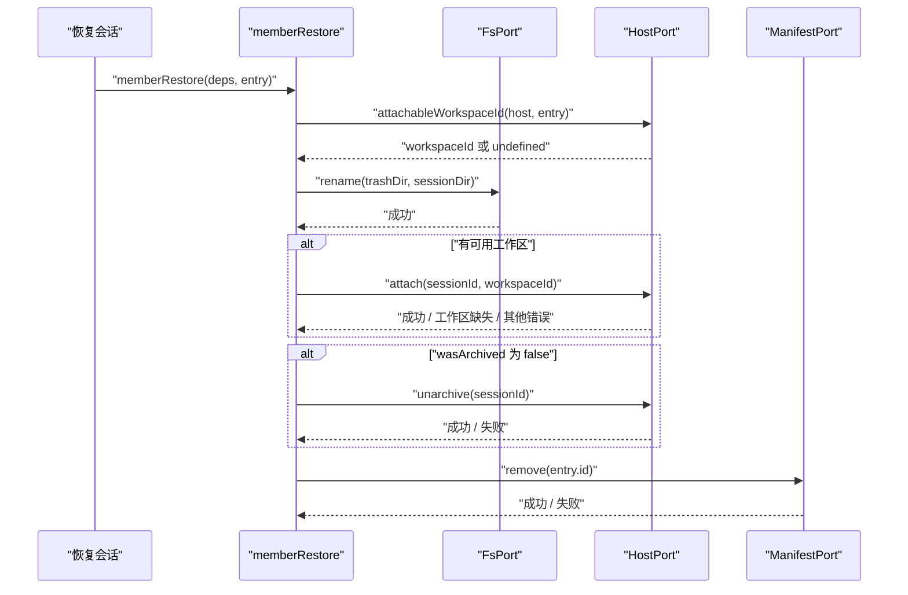
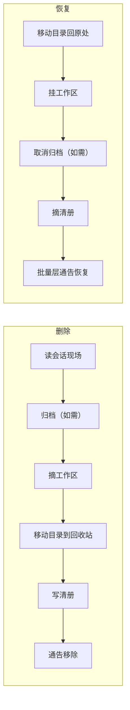
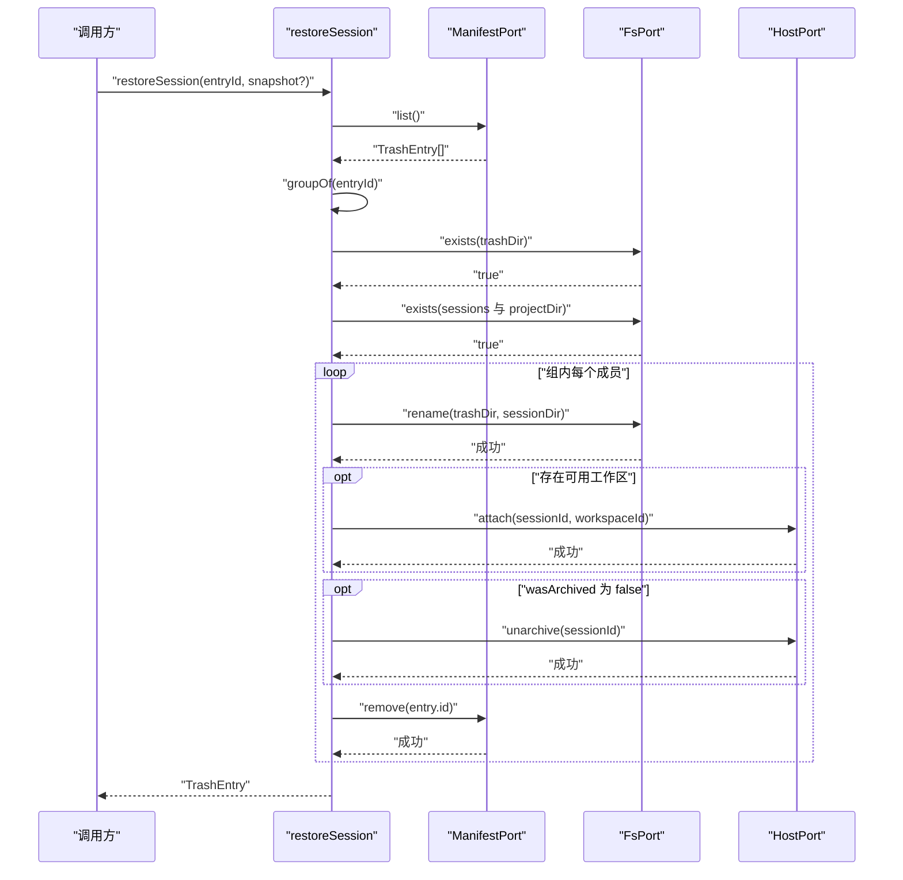
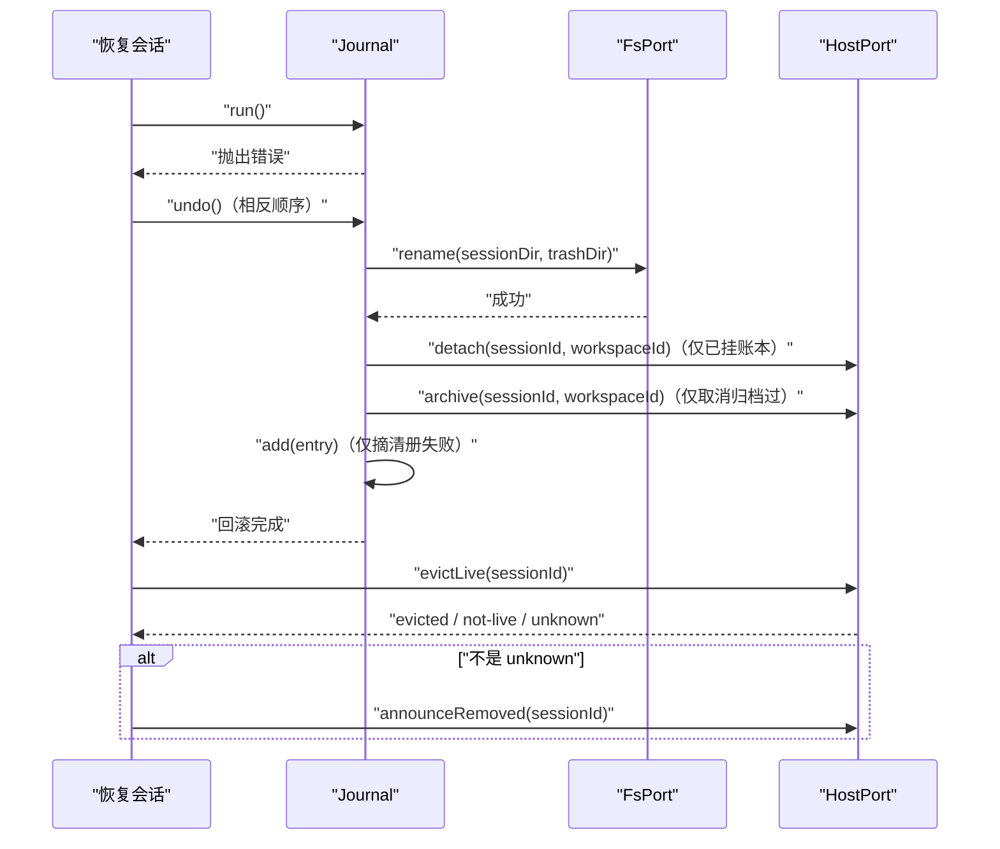

# 恢复会话动词

<cite>
**本文引用的文件**   
- [restore-session.ts](file://src/verbs/restore-session.ts)
- [delete-session.ts](file://src/verbs/delete-session.ts)
- [entry.ts](file://src/trash/entry.ts)
- [manifest.ts](file://src/trash/manifest.ts)
- [host-port.ts](file://src/ports/host-port.ts)
- [fake-deps.ts](file://tests/support/fake-deps.ts)
- [restore-session.test.ts](file://tests/restore-session.test.ts)
</cite>

## 目录
1. [引言](#引言)
2. [项目结构定位](#项目结构定位)
3. [函数签名与职责边界](#函数签名与职责边界)
4. [回收站条目解析与分组](#回收站条目解析与分组)
5. [预检：目标项目目录与工作区是否存在](#预检目标项目目录与工作区是否存在)
6. [成员恢复流程](#成员恢复流程)
7. [归档可见性还原](#归档可见性还原)
8. [工作区账本挂接与宿主通告](#工作区账本挂接与宿主通告)
9. [删除动词的反向流程对比](#删除动词的反向流程对比)
10. [成功路径与错误分支](#成功路径与错误分支)
11. [错误码规范](#错误码规范)
12. [调用时序图](#调用时序图)
13. [与 trash/manifest 和 ports/host-port 的集成示例](#与-trashmanifest-和-portshost-port-的集成示例)
14. [故障排查](#故障排查)
15. [结论](#结论)

## 引言
`restore-session` 是“会话删除”的逆向动词：它把从 `sessions/<projectDir>/<sessionId>` 移动到回收站的一个或多个会话，按原路放回原项目目录，并按删除前的工作区归属与归档状态重建宿主的运行时视图。

它与 `delete-session` 对称：删除时先归档、摘账本、搬目录、写清册；恢复时则先搬回目录、挂账本、还原可见性、摘清册行。批量层负责拉一次宿主会话摘要并发出 `api-session/added`，单条恢复动词本身不直接对外发批量通告。

## 项目结构定位
恢复逻辑集中在 verbs 层，依赖三条外部接缝：
- 文件系统端口：移动回收站目录与原项目目录。
- 宿主端口：工作区存在性、会话归档态、账本挂接、会话摘除与通告。
- 回收站清单端口：列出、新增、删除回收站条目。

**图表来源**
- [restore-session.ts:1-173](file://src/verbs/restore-session.ts#L1-L173)
- [entry.ts:1-90](file://src/trash/entry.ts#L1-L90)
- [manifest.ts:1-35](file://src/trash/manifest.ts#L1-L35)
- [host-port.ts:1-200](file://src/ports/host-port.ts#L1-L200)

**章节来源**
- [restore-session.ts:1-173](file://src/verbs/restore-session.ts#L1-L173)
- [entry.ts:1-90](file://src/trash/entry.ts#L1-L90)
- [manifest.ts:1-35](file://src/trash/manifest.ts#L1-L35)
- [host-port.ts:1-200](file://src/ports/host-port.ts#L1-L200)

## 函数签名与职责边界
`restoreSession` 返回一个异步函数，接受两个参数：

| 参数 | 类型 | 含义 |
| --- | --- | --- |
| `entryId` | `string` | 要恢复的回收站条目 id，形如 `<时间戳>-<原会话目录名>`。 |
| `snapshot` | `readonly TrashEntry[] \| undefined` | 可选的只读清册快照。批量层传入后，整批只读一次清册，避免重复扫描。 |

返回值是 `Promise<TrashEntry>`，即被恢复的目标条目对象。如果恢复失败，会抛出带有结构化 `code` 的错误对象。

**图表来源**
- [restore-session.ts:16-59](file://src/verbs/restore-session.ts#L16-L59)

**章节来源**
- [restore-session.ts:16-59](file://src/verbs/restore-session.ts#L16-L59)

## 回收站条目解析与分组
恢复以 `entryId` 为入口，而不是直接以 `sessionId` 恢复。这是因为回收站的 id 里保存了删除时的原会话目录名，恢复时需要用它还原真实位置。

关键数据结构 `TrashEntry` 包含以下字段：

| 字段 | 类型 | 恢复语义 |
| --- | --- | --- |
| `id` | `string` | 回收站目录名，也是恢复目标目录名的来源。 |
| `sessionId` | `string` | 宿主会话身份，用于挂账本、归档控制与通告。 |
| `projectDir` | `string` | 原项目目录名，决定 `sessions/<projectDir>/...`。 |
| `workspaceId` | `string` | 删除时的工作区 id；空串表示删除时就没有账目，属于“未分组”。 |
| `wasArchived` | `boolean` | 删除前的归档态：`true` 表示仍应处于归档集合，`false` 表示需要取消归档。 |
| `deletedAt` | `number` | 删除时间戳，参与 `id` 生成。 |
| `title` | `string` | 删除时尽力读取的标题，恢复时主要用于用户界面元数据。 |
| `sizeBytes` | `number` | 删除时量到的目录字节数。 |
| `parentEntryId` | `string \| undefined` | 若存在，表示该条目是跟随父会话一起进入回收站的孩子。 |

恢复入口会先查清单，找不到就抛 `trash-empty`；找到后用 `groupOf` 取出一组成员。父会话在回收站中代表整组，因此恢复一组时按孩子 id 遍历，但由父行触发。

**章节来源**
- [entry.ts:1-90](file://src/trash/entry.ts#L1-L90)
- [restore-session.ts:16-59](file://src/verbs/restore-session.ts#L16-L59)

## 预检：目标项目目录与工作区是否存在
预检阶段**不写入任何持久化状态**，只做安全检查。

### 回收站目录预检
对组内每个成员：
1. 用 `trashDirOf(entry.id, deps.home)` 计算回收站目录。
2. 通过 `deps.fs.exists(trashDir)` 判断是否存在。
3. 不存在时抛 `trash-empty`，说明回收站条目已经不在磁盘上。

### 原项目目录预检
恢复目标目录由 `sessionDirOf(entry.projectDir, parseEntryId(entry.id).sessionDirName, deps.home)` 计算，核心规则是：
- 会话目录名来自 `entryId`，不是从 `sessionId` 重新推导。
- 这样能兼容宿主旧版本命名约定变化，例如 v3 无前缀、v4 带 `session-` 前缀。

预检要求：
- `deps.home/sessions` 必须存在。
- `deps.home/sessions/<projectDir>` 也必须存在。
- 任一缺失都抛 `project-missing`，且**不会静默创建目录**。

### 工作区是否存在不参与硬预检
工作区账目是“可选归属”，不是恢复的必要前提。即使宿主的“删除工作区”已经把工作区注册删掉，只要原目录还在，恢复就照常执行，会话归入“未分组”。

**图表来源**
- [restore-session.ts:29-48](file://src/verbs/restore-session.ts#L29-L48)
- [entry.ts:60-90](file://src/trash/entry.ts#L60-L90)

**章节来源**
- [restore-session.ts:29-48](file://src/verbs/restore-session.ts#L29-L48)
- [entry.ts:60-90](file://src/trash/entry.ts#L60-L90)

## 成员恢复流程
成功预检后，动词对组内每个成员调用 `memberRestore`。每个成员生成一个独立的事务日志，成功后才加入 `done` 列表；任一步骤失败时，已完成的兄弟按相反顺序回滚。

单个成员的步骤顺序与删除相反：

| 步骤 | 操作 | 可逆动作 |
| --- | --- | --- |
| ① | 将回收站目录移回原会话目录。 | 将原会话目录移回回收站。 |
| ② | 如有可用工作区，则 `attach(sessionId, workspaceId)`。 | 如已挂上，则 `detach(sessionId, workspaceId)`。 |
| ③ | 如删除前未归档，则 `unarchive(sessionId)`。 | 调用失败时重新 `archive(sessionId, workspaceId)` 藏回去。 |
| ④ | 从回收站清单删除该行。 | 重新 `manifest.add(entry)`。 |

其中第②步有特殊的“工作区刚好被删”容错：如果 `isWorkspaceMissingError(error)` 为真，并且再次检查 `workspaceExists(workspaceId)` 确实为假，则视为“未分组”，不回滚。其他错误仍按普通 io 错误处理。

**图表来源**
- [restore-session.ts:85-173](file://src/verbs/restore-session.ts#L85-L173)

**章节来源**
- [restore-session.ts:60-173](file://src/verbs/restore-session.ts#L60-L173)

## 归档可见性还原
`wasArchived` 决定恢复后的可见性：

| `wasArchived` | 删除前状态 | 恢复行为 |
| --- | --- | --- |
| `true` | 原本就在归档集合 | 不再动归档集合，会话保持隐藏。 |
| `false` | 原本未归档，删除时被我们归档藏起来 | 调用 `unarchive(sessionId)` 让会话回到宿主会话树。 |

当取消归档失败时，回滚会尝试重新归档，把会话再次藏回去，防止出现“目录已回盘、但宿主仍认为它归档”的不一致。

**章节来源**
- [entry.ts:5-29](file://src/trash/entry.ts#L5-L29)
- [restore-session.ts:124-142](file://src/verbs/restore-session.ts#L124-L142)

## 工作区账本挂接与宿主通告
### 是否挂账本
`attachableWorkspaceId` 是唯一判据：

| 输入情况 | 结果 |
| --- | --- |
| `workspaceId` 为空串 | 返回 `undefined`，跳过挂账本。 |
| `workspaceId` 非空且 `host.workspaceExists(id)` 为真 | 返回该 `workspaceId`，执行挂账本。 |
| `workspaceId` 非空但 `host.workspaceExists(id)` 为假 | 返回 `undefined`，按“未分组”恢复。 |

`isWorkspaceMissing` 基于同一判据派生，用于界面提示“原工作区已不存在，恢复后归入未分组”。

### 挂账本失败的特殊处理
- 如果是“工作区缺失”错误，并且再次确认工作区确实不存在，则视作正常降级：按未分组恢复，不回滚。
- 如果不是这个特定错误，或者工作区仍然存在，则抛出原始错误，触发回滚。

### 宿主通告
- 单条恢复的成功路径不直接发送 `api-session/added`。批量层负责拉一次宿主会话摘要并调用 `announceRestoredBatch`。
- 删除侧的回滚会在“真正退回原处”的情况下调用 `announceRestored`，补一条“已恢复”通告。
- 恢复侧的组级回滚也会在目录真正退回回收站后尝试 `evictLive` 与 `announceRemoved`，如实通知客户端移除。

**章节来源**
- [restore-session.ts:76-102](file://src/verbs/restore-session.ts#L76-L102)
- [restore-session.ts:103-173](file://src/verbs/restore-session.ts#L103-L173)
- [host-port.ts:1-200](file://src/ports/host-port.ts#L1-L200)

## 删除动词的反向流程对比
删除与恢复是镜像关系，但方向相反：

| 阶段 | 删除 `delete-session` | 恢复 `restore-session` |
| --- | --- | --- |
| 预检 | 检查会话是否运行、父目录是否存在、子目录是否存在。 | 检查回收站目录是否存在、原项目目录是否存在。 |
| 第一步 | 可能先归档。 | 先移动目录。 |
| 第二步 | 摘工作区账本。 | 挂工作区账本。 |
| 第三步 | 移动目录到回收站。 | 移动目录回原项目。 |
| 第四步 | 写回收站清册。 | 摘回收站清册。 |
| 第五步 | 从宿主活体摘除并通告移除。 | 由批量层通告恢复；删除回滚时才补发“已恢复”。 |
| 回滚 | 先把目录搬回，再摘清册；三件事都成功才发“已恢复”。 | 反向退每一步，并在目录真正退回回收站后发“已移除”。 |

[此图为概念对照，不绑定具体源码行]

**章节来源**
- [delete-session.ts:1-206](file://src/verbs/delete-session.ts#L1-L206)
- [restore-session.ts:1-173](file://src/verbs/restore-session.ts#L1-L173)

## 成功路径与错误分支

### 成功路径
1. 在快照或清册中找到条目。
2. 计算出父会话代表的一组成员。
3. 预检所有成员的回收站目录与原项目目录。
4. 对每个成员：
   - 移动目录。
   - 挂工作区（如存在）。
   - 取消归档（如 `wasArchived` 为假）。
   - 删除回收站清册行。
5. 返回目标 `TrashEntry`。

批量层随后使用宿主会话摘要发出 `announceRestoredBatch`。

### 工作区缺失分支
- 如果 `workspaceId` 为空串，恢复时不挂账本。
- 如果 `workspaceId` 非空但 `workspaceExists` 为假，也跳过挂账本。
- 这两种情况都算“未分组”，不影响目录恢复与可见性还原。

### 项目目录冲突分支
这里的“冲突”不是同名覆盖语义，而是“原项目目录不存在”：
- 如果 `sessions` 根不存在，或 `sessions/<projectDir>` 不存在，抛 `project-missing`。
- 实现不静默创建目录，因为恢复是按原位置回退，不能替宿主决定项目结构。

### 回滚语义
回滚分两层：
- 成员级：journal 按相反顺序撤销本成员已完成的操作。
- 组级：捕获整个组的恢复异常，把已成功恢复的成员全部反向退回。

回滚过程中：
- 目录退回回收站后才标记 `movedBack`。
- 只有 `movedBack` 为真时，才会尝试 `evictLive` 与 `announceRemoved`。
- 摘账本只在曾经成功挂账本的成员上执行。
- 取消归档失败时会尝试重新归档。
- 摘清册失败时会尝试重新写回清册。

**章节来源**
- [restore-session.ts:16-173](file://src/verbs/restore-session.ts#L16-L173)
- [restore-session.test.ts:1-274](file://tests/restore-session.test.ts#L1-L274)

## 错误码规范

| 错误码 | 触发条件 | 回滚行为 |
| --- | --- | --- |
| `trash-empty` | 清单中没有对应条目，或回收站目录不在磁盘上。 | 尚未写出持久化状态，通常无回滚。 |
| `project-missing` | 原项目目录不存在，包括 `sessions` 根缺失或 `sessions/<projectDir>` 缺失。 | 预检阶段失败，无回滚。 |
| `io` | 任意受 journal 管理的步骤失败：目录移动失败、挂账本失败、取消归档失败、摘清册失败等。 | 按相反顺序回滚已执行步骤。 |
| 工作区缺失特殊分支 | `attach` 抛出“工作区缺失”错误，且 `workspaceExists` 确认为假。 | 不抛错，按未分组继续恢复。 |

错误对象通常包含 `code` 与 `cause`，以便上层区分业务语义与底层原因。

**章节来源**
- [restore-session.ts:29-48](file://src/verbs/restore-session.ts#L29-L48)
- [restore-session.ts:103-173](file://src/verbs/restore-session.ts#L103-L173)
- [restore-session.test.ts:100-274](file://tests/restore-session.test.ts#L100-L274)

## 调用时序图

### 正常恢复路径

**图表来源**
- [restore-session.ts:16-173](file://src/verbs/restore-session.ts#L16-L173)
- [manifest.ts:1-35](file://src/trash/manifest.ts#L1-L35)
- [host-port.ts:1-200](file://src/ports/host-port.ts#L1-L200)

### 回滚路径

**图表来源**
- [restore-session.ts:103-173](file://src/verbs/restore-session.ts#L103-L173)

## 与 trash/manifest 和 ports/host-port 的集成示例

### 回收站清单集成
恢复动词只依赖 `ManifestPort` 的三个方法：

| 方法 | 用途 |
| --- | --- |
| `list()` | 查找条目、构建组、批量层复用快照。 |
| `add(e)` | 回滚时重新写回清册行。 |
| `remove(id)` | 恢复成功后摘除回收站条目。 |

内存实现按 `deletedAt` 倒序排序，存储适配层则委托到底层 storage domain。

### 宿主端口集成
恢复主要使用以下宿主端口：

| 方法 | 用途 |
| --- | --- |
| `workspaceExists` | 判断工作区是否仍存在。 |
| `attach` | 挂回会话到原工作区。 |
| `detach` | 回滚时摘回工作区。 |
| `unarchive` | 取消归档，让会话回到宿主会话树。 |
| `archive` | 回滚时重新归档，把会话藏回去。 |
| `evictLive` | 回滚时从宿主内存中摘除活体。 |
| `announceRemoved` | 回滚后告知客户端“已移除”。 |
| `announceRestoredBatch` | 批量层正常恢复后调用，单条动词不直接调用。 |

### 测试装配示例
测试通过 `createFakeDeps` 组装 `DeleteDeps`，并用 `logMethods` 记录关心的端口调用，例如：
- `rename`：目录移动。
- `attach` / `detach`：工作区挂接。
- `archive` / `unarchive`：归档可见性。
- `announceRestoredBatch`：批量恢复通告。

这使测试既能断言业务结果，又能钉住跨端口的操作顺序。

**章节来源**
- [manifest.ts:1-35](file://src/trash/manifest.ts#L1-L35)
- [host-port.ts:1-200](file://src/ports/host-port.ts#L1-L200)
- [fake-deps.ts:1-213](file://tests/support/fake-deps.ts#L1-L213)

## 故障排查

| 现象 | 可能原因 | 建议处理方式 |
| --- | --- | --- |
| 报 `trash-empty` | 清单没有该条目，或回收站目录已从磁盘消失。 | 检查回收站清单与磁盘目录是否一致。 |
| 报 `project-missing` | `sessions` 根或 `sessions/<projectDir>` 不存在。 | 不要静默创建目录；检查宿主项目结构是否被破坏。 |
| 恢复后未挂工作区 | `workspaceId` 为空串，或 `workspaceExists` 为假。 | 确认工作区是否已被删除；这是预期的“未分组”行为。 |
| 恢复中途失败，目录仍在 `sessions/` | journal 回滚失败，或回滚前宿主已摘除活体。 | 检查 fs rename 与 host detach/archive 的副作用；必要时人工清理半状态。 |
| 恢复成功但客户端没看到会话 | 批量层未调用 `announceRestoredBatch`，或宿主摘要为空。 | 检查批量层通告逻辑与 `restoredSummariesOf`。 |
| 删除回滚后客户端仍看不到会话 | 删除回滚没有满足“目录、账本、可见性都退回”的条件。 | 检查 `movedBack`、`workspaceBack`、`visibleBack` 三个标记。 |

**章节来源**
- [restore-session.ts:16-173](file://src/verbs/restore-session.ts#L16-L173)
- [delete-session.ts:1-206](file://src/verbs/delete-session.ts#L1-L206)
- [restore-session.test.ts:1-274](file://tests/restore-session.test.ts#L1-L274)

## 结论
`restore-session` 的核心设计原则是：**按删除的逆序回退，按组恢复，把可选的工作区归属当作降级而非失败条件，并把回滚的可观测性与安全性放在第一位**。

它通过：
- 固定顺序的文件、账本、可见性、清册操作；
- 基于 `wasArchived` 的可见性还原；
- 基于 `attachableWorkspaceId` 的工作区缺失容错；
- 基于 journal 的逐成员与组级回滚；
- 与批量层解耦的宿主通告机制；

实现了恢复会话的安全、可审计、可回滚能力。对于使用者来说，最重要的理解点是：恢复不是简单地把文件搬回来，而是同时恢复宿主内存中的会话归属、归档状态与客户端视图。