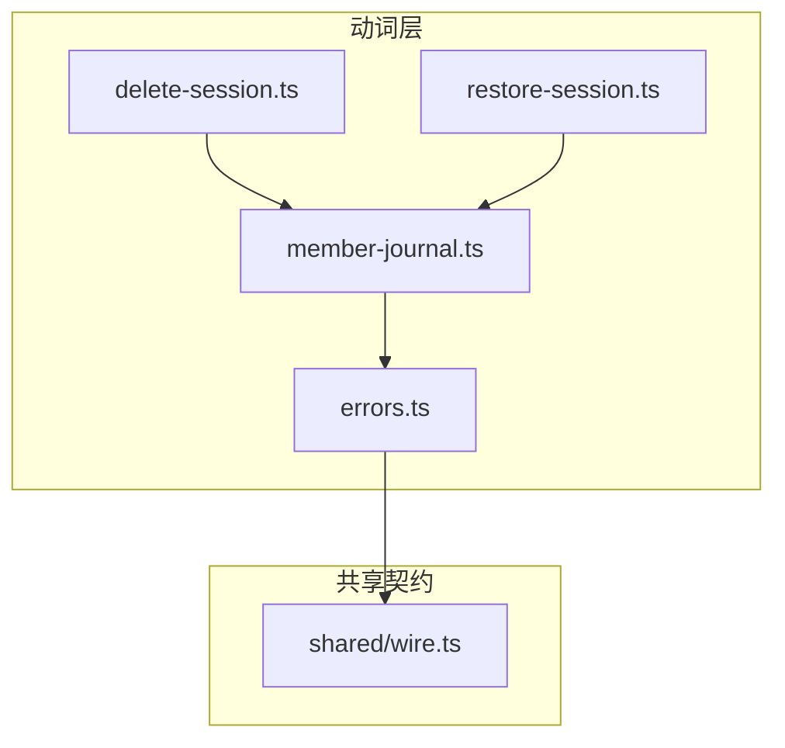
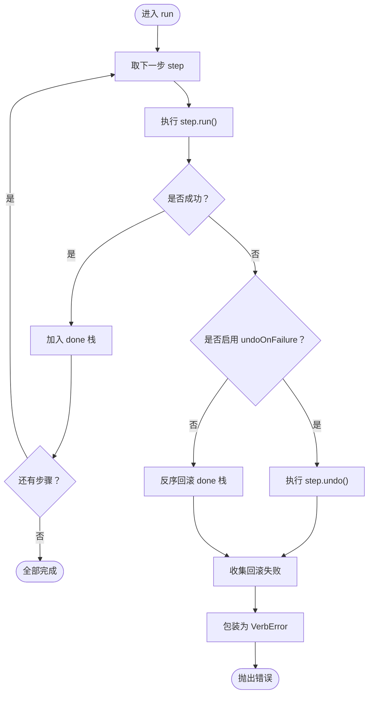
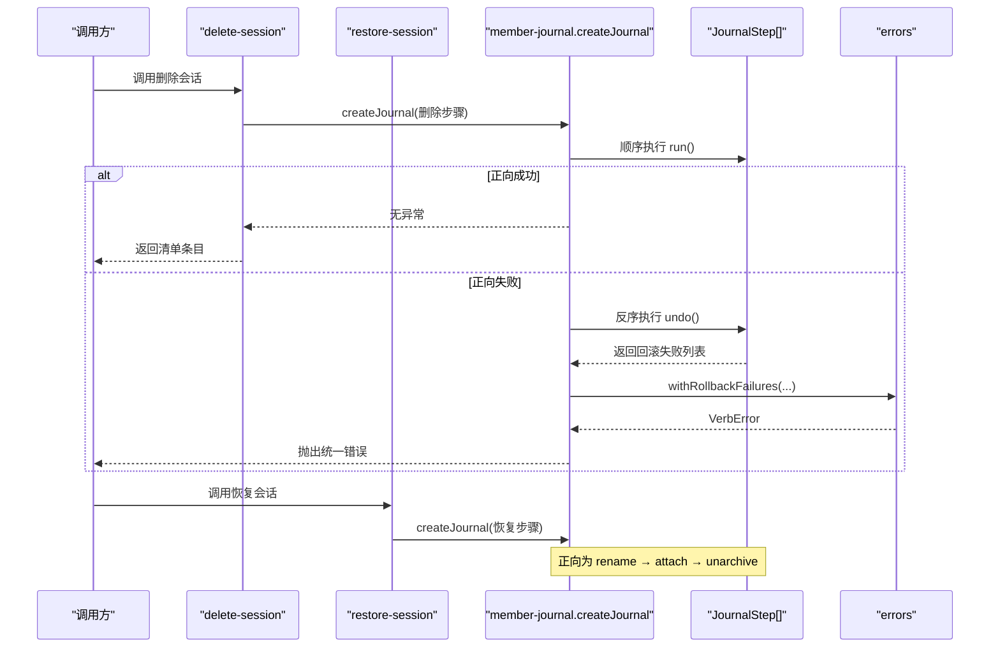
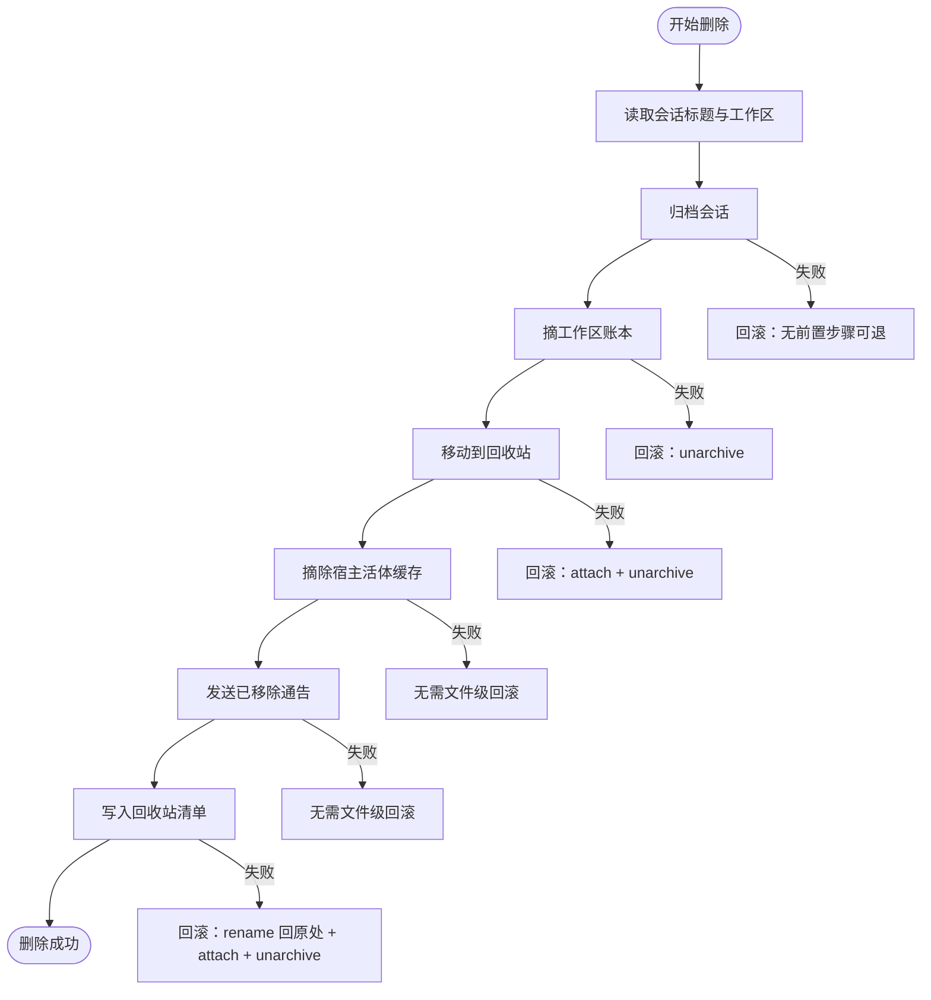
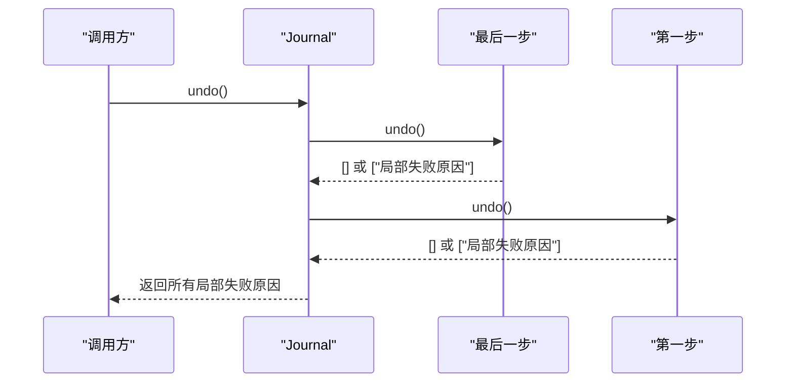
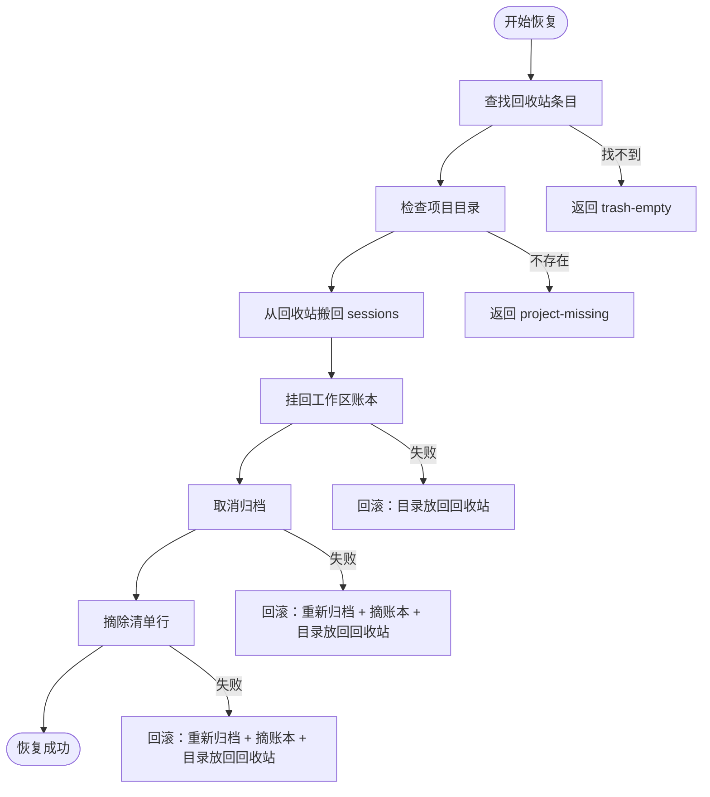
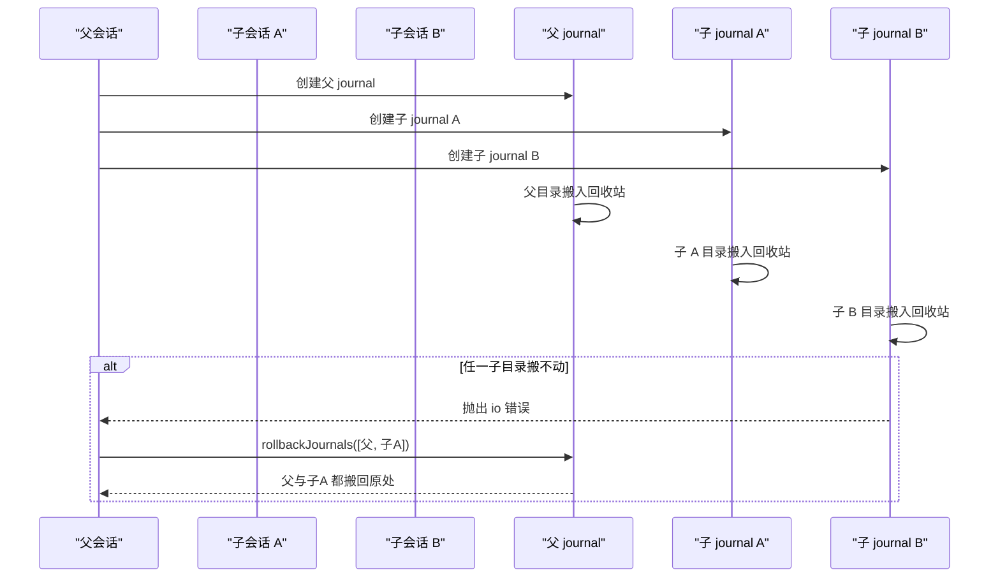
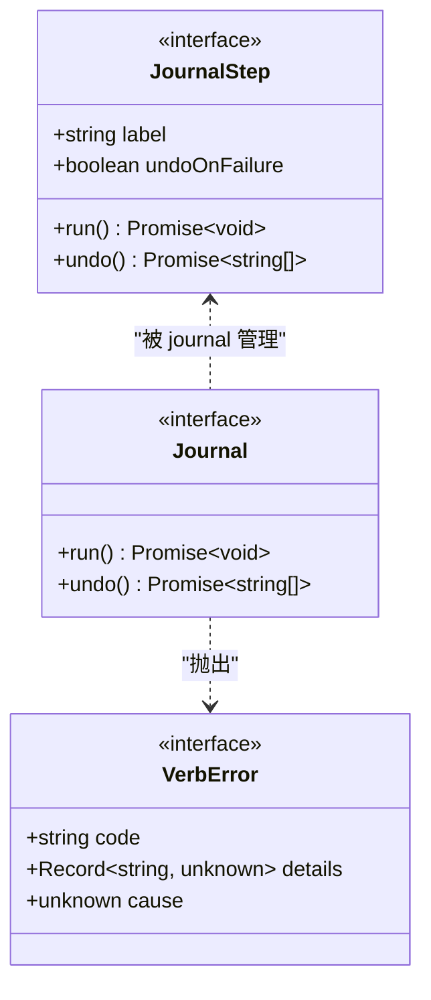

# 成员 Journal 与反向动作

<cite>
**本文引用的文件**   
- [member-journal.ts](file://src/verbs/member-journal.ts)
- [errors.ts](file://src/verbs/errors.ts)
- [delete-session.test.ts](file://tests/delete-session.test.ts)
- [restore-session.test.ts](file://tests/restore-session.test.ts)
</cite>

## 目录

1. [引言](#引言)
2. [项目结构定位](#项目结构定位)
3. [核心组件](#核心组件)
4. [架构总览](#架构总览)
5. [详细组件分析](#详细组件分析)
6. [依赖关系分析](#依赖关系分析)
7. [性能与复杂度](#性能与复杂度)
8. [故障排查指南](#故障排查指南)
9. [结论](#结论)

## 引言

`member-journal` 是删除会话与恢复会话两个动词共用的 **通用 journal 辅助器**。它不关心“删除还是恢复”，只负责把一次成员移动拆成若干步骤，维护一个“已做成步骤栈”，按顺序执行正向动作；一旦某步失败，就按相反顺序执行反向动作，并把回滚过程中的局部失败合并进统一的错误结构。

它承担四项职责：

| 职责 | 说明 |
|---|---|
| 维护五触点步骤栈 | 记录已经成功执行的 `JournalStep`，供撤销时按相反顺序回退。 |
| 执行正向动作 | 逐个调用每步的 `run()`，直到全部完成或抛出异常。 |
| 构造反向动作 | 对已完成的步骤调用 `undo()`，必要时也支持在正向失败时运行 `undoOnFailure`。 |
| 统一错误与撤销 | 把非动词码错误包装为 `sessiondelete/io`，并把回滚失败收集到 `details.rollbackFailures`。 |

该组件明确声明边界：它只服务“成员在 `sessions/` 与 `session-trash/` 之间搬动”这一件事，不封装宿主通告策略、不决定哪些失败算成功。

**章节来源**
- [member-journal.ts:1-28](file://src/verbs/member-journal.ts#L1-L28)

## 项目结构定位

`member-journal.ts` 位于 `src/verbs/`，与以下关键文件协作：

- `delete-session.ts` 和 `restore-session.ts` 各自声明本次操作的步骤序列，并复用 `createJournal`。
- `errors.ts` 提供 `VerbError`、`verbError`、`withRollbackFailures`、`rollbackReason` 等统一错误工具。
- `shared/wire.ts` 提供会话删除错误域前缀与动词码集合，避免动词层重复拼写错误前缀。

**图示来源**
- [member-journal.ts:29-38](file://src/verbs/member-journal.ts#L29-L38)
- [errors.ts:1-17](file://src/verbs/errors.ts#L1-L17)

**章节来源**
- [member-journal.ts:1-38](file://src/verbs/member-journal.ts#L1-L38)
- [errors.ts:1-17](file://src/verbs/errors.ts#L1-L17)

## 核心组件

### 步骤接口 `JournalStep`

每个步骤是一个最小原子单元，包含：

| 字段 | 类型 | 语义 |
|---|---|---|
| `label` | `string` | 步骤标签；失败消息中用于标识“哪一步失败了”。 |
| `run()` | `Promise<void>` | 正向动作；任何未带动词码的异常都会被 journal 折成 `sessiondelete/io`。 |
| `undo()` | `Promise<readonly string[]>` | 反向动作；返回这一步未能退干净的失败原因列表。 |
| `undoOnFailure` | `boolean` | 可选；当正向动作本身可能半做成功时，即使 `run()` 抛错也要执行 `undo()`。 |

典型步骤包括：

| 步骤 | 正向语义 | 反向语义 |
|---|---|---|
| 归档会话 | 将会话移入归档集，使其从分组面隐藏。 | 取消归档，让会话重新可见。 |
| 摘工作区账本 | 从宿主工作区账本中移除会话归属。 | 把会话挂回原工作区。 |
| 移动会话目录 | 把会话目录从 `sessions/` 搬到 `session-trash/`，或反过来。 | 把目录搬回原来的位置。 |
| 写入回收站清单 | 把删除条目登记到回收站 manifest。 | 从 manifest 中摘除该行。 |
| 发送宿主通告 | 向客户端广播会话已移除或已恢复。 | 通常由更高层决定是否补发反向通告；journal 自身不假定必须通知。 |

**章节来源**
- [member-journal.ts:29-56](file://src/verbs/member-journal.ts#L29-L56)

### 期刊接口 `Journal`

`Journal` 暴露两个方法：

| 方法 | 行为 |
|---|---|
| `run()` | 按声明顺序执行所有步骤；中途失败则回滚已做步骤。 |
| `undo()` | 显式撤销已经做成的步骤，按相反顺序调用 `undo()`。 |

内部使用 `done: JournalStep[]` 维护已成功步骤栈；每一步成功后才入栈，因此回滚只作用于“真正生效的前缀”。

**章节来源**
- [member-journal.ts:58-63](file://src/verbs/member-journal.ts#L58-L63)

### 工厂函数 `createJournal`

`createJournal(steps)` 创建拥有独立已完成栈的 journal：

**图示来源**
- [member-journal.ts:65-90](file://src/verbs/member-journal.ts#L65-L90)

关键点：

1. 正向执行遇到异常时，先决定是否执行“失败步骤自身的反向动作”。
2. 然后反序执行 `done` 中已有步骤的反向动作。
3. 把所有回滚失败聚合成 `details.rollbackFailures`。
4. 最终抛出错误：若已有动词码则保留，否则落为 `sessiondelete/io`。

**章节来源**
- [member-journal.ts:65-90](file://src/verbs/member-journal.ts#L65-L90)

### 辅助函数 `attempt`

`attempt(label, run)` 捕获一次副作用操作的回滚失败，不抛出，而是返回失败原因字符串数组。它被组级回滚中使用，保证某个成员的 undo 失败不会中断其他成员的 undo。

**章节来源**
- [member-journal.ts:92-100](file://src/verbs/member-journal.ts#L92-L100)

### 组级回滚 `rollbackJournals`

当多个 journal 共同组成一次更大操作（例如父会话连同子会话一起删除）时，`rollbackJournals(journals, error)` 会：

1. 按 journal 的相反顺序调用 `undo()`。
2. 如果存在回滚失败，用 `withRollbackFailures(error, failures)` 包裹原错误。
3. 如果没有回滚失败，直接抛出原错误。

这确保“整个组”失败时，已搬入回收站的成员也能被退回原处。

**章节来源**
- [member-journal.ts:102-103](file://src/verbs/member-journal.ts#L102-L103)
- [errors.ts:47-82](file://src/verbs/errors.ts#L47-L82)

## 架构总览

下图展示删除会话与恢复会话如何共用 member-journal：

**图示来源**
- [member-journal.ts:65-100](file://src/verbs/member-journal.ts#L65-L100)
- [errors.ts:19-46](file://src/verbs/errors.ts#L19-L46)

## 详细组件分析

### 错误转换规则

`journalFailure(step, error)` 决定一个步骤失败应该以什么错误形式抛出：

| 条件 | 结果 |
|---|---|
| 错误已经是动词码（code 以 `SESSION_DELETE_ERROR_DOMAIN/` 开头） | 原样返回，保留原始动词码。 |
| 其他情况 | 用 `verbError('io', '<label>：<原错误>', error)` 包装。 |

这里的关键是“原错误作为 cause 保留”，上层调试可以沿着 cause 链看到底层文件系统或宿主端口错误。

**章节来源**
- [member-journal.ts:102-103](file://src/verbs/member-journal.ts#L102-L103)
- [errors.ts:19-46](file://src/verbs/errors.ts#L19-L46)

### 回滚失败合并

`withRollbackFailures(error, failures)` 的行为：

1. 判断原错误是否属于动词码。
2. 提取内层已有的 `details.rollbackFailures`。
3. 去重合并所有回滚失败。
4. 在原错误消息后追加“回滚未完成”提示。
5. 输出新的 `VerbError`，其 code 继承自原错误或落为 `io`。

这解决了“某一步退不干净”的场景：主错误反映主要失败，`details.rollbackFailures` 记录所有局部回滚失败。

**章节来源**
- [errors.ts:47-82](file://src/verbs/errors.ts#L47-L82)

### 删除路径流程

删除会话的典型步骤顺序是：

1. 读取标题与工作区信息（纯读）。
2. 归档会话。
3. 摘工作区账本。
4. 移动会话目录到回收站。
5. 摘除宿主内存中的活体。
6. 发送“已移除”通告。
7. 写入回收站清单。

**图示来源**
- [delete-session.test.ts:38-66](file://tests/delete-session.test.ts#L38-L66)
- [delete-session.test.ts:68-103](file://tests/delete-session.test.ts#L68-L103)

#### 正向执行成功

断言示例要点：

- 调用顺序固定为“归档 → 摘账本 → 重命名 → 摘活体 → 通告移除”。
- 成功后清单里只有当前会话一行。
- 条目包含会话 id、项目目录、工作区 id、是否原本归档、标题、大小等元数据。

**章节来源**
- [delete-session.test.ts:38-66](file://tests/delete-session.test.ts#L38-L66)
- [delete-session.test.ts:105-118](file://tests/delete-session.test.ts#L105-L118)

#### 中途失败

常见中途失败路径：

| 失败点 | 回滚行为 | 测试断言要点 |
|---|---|---|
| `archive` 失败 | 无前置步骤，无需回滚 | 仅记录 `archive`，后续步骤未调用。 |
| `detach` 失败 | 取消归档 | 调用顺序为 `archive → detach → unarchive`。 |
| `rename` 失败 | 挂回账本 + 取消归档 | 错误码为 `sessiondelete/io`，cause 为原始 IO 错误。 |
| `manifest.add` 失败 | 目录搬回原处 + 挂回账本 + 取消归档 | 两次 `rename` 互为正反向。 |
| 纯读失败 | 零副作用 | 不产生任何写操作。 |

**章节来源**
- [delete-session.test.ts:68-103](file://tests/delete-session.test.ts#L68-L103)

#### 显式撤销

通过 `journal.undo()` 可显式撤销已完成的步骤。member-journal 的实现保证：

- 只对 `done` 中已成功的步骤执行 `undo()`。
- 执行顺序与正向相反。
- 如果某步 `undo()` 返回失败原因，这些原因会被收集进 `details.rollbackFailures`。
- 外层仍抛出错误，但错误结构中包含所有局部回滚失败。

**图示来源**
- [member-journal.ts:65-90](file://src/verbs/member-journal.ts#L65-L90)

**章节来源**
- [member-journal.ts:65-90](file://src/verbs/member-journal.ts#L65-L90)

### 恢复路径流程

恢复会话的典型步骤顺序是：

1. 从回收站清单查找条目。
2. 检查目标项目目录是否存在。
3. 移动会话目录回到 `sessions/`。
4. 挂回工作区账本（如果清单中有工作区且工作区仍存在）。
5. 取消归档（如果删除前原本未归档）。
6. 摘除清单行。
7. 由批量层负责发送恢复通告。

**图示来源**
- [restore-session.test.ts:39-76](file://tests/restore-session.test.ts#L39-L76)
- [restore-session.test.ts:114-145](file://tests/restore-session.test.ts#L114-L145)

#### 正向执行成功

断言示例要点：

- 原本未归档：顺序为 `rename → attach → unarchive`。
- 原本已归档：不调用 `archive` / `unarchive`。
- 未分组会话：不挂账本。
- 恢复完成后清单不再包含该行。

**章节来源**
- [restore-session.test.ts:39-76](file://tests/restore-session.test.ts#L39-L76)

#### 中途失败

常见中途失败路径：

| 失败点 | 回滚行为 | 测试断言要点 |
|---|---|---|
| `attach` 失败 | 目录放回回收站 | 错误码为 `sessiondelete/io`，cause 包含原始错误。 |
| `unarchive` 失败 | 重新归档 + 摘账本 + 目录放回回收站 | 不调用 `detach`，因为删除时并未摘账本。 |
| 摘清单行失败 | 重新归档 + 摘账本 + 目录放回回收站 | 清单行仍保留，目录回到回收站。 |
| 清单中无条目 | 不触发 journal 回滚 | 直接报 `trash-empty`。 |
| 项目目录不存在 | 不触发 journal 回滚 | 直接报 `project-missing`。 |

**章节来源**
- [restore-session.test.ts:78-145](file://tests/restore-session.test.ts#L78-L145)

#### 显式撤销

恢复流程同样基于 journal：一旦目录已经搬出回收站，显式撤销会把目录搬回去，并根据是否需要恢复可见性执行对应反向动作。测试断言强调：

- 回滚中没有多余的 `detach`。
- 目录的两次 `rename` 互为正反向。
- 清单状态与目录状态保持一致。

**章节来源**
- [restore-session.test.ts:147-174](file://tests/restore-session.test.ts#L147-L174)

### 级联删除与恢复

删除会话时，如果宿主报告该会话有子代理成员，这些子会话要一起进入回收站。恢复时也必须按整组搬回，否则会留下“看不见也清不掉”的孩子行。

**图示来源**
- [delete-session.test.ts:201-274](file://tests/delete-session.test.ts#L201-L274)
- [restore-session.test.ts:201-274](file://tests/restore-session.test.ts#L201-L274)

**章节来源**
- [delete-session.test.ts:201-274](file://tests/delete-session.test.ts#L201-L274)
- [restore-session.test.ts:201-274](file://tests/restore-session.test.ts#L201-L274)

## 依赖关系分析

**图示来源**
- [member-journal.ts:29-63](file://src/verbs/member-journal.ts#L29-L63)
- [errors.ts:19-28](file://src/verbs/errors.ts#L19-L28)

外部依赖：

| 依赖 | 用途 |
|---|---|
| `../shared/wire.js` | 提供 `SESSION_DELETE_ERROR_DOMAIN` 与动词码前缀。 |
| `./errors.js` | 提供 `VerbError`、`verbError`、`withRollbackFailures`、`rollbackReason`。 |
| 文件系统端口 | 用于移动会话目录、检查目录存在、读取大小等。 |
| 宿主端口 | 用于归档、取消归档、摘/挂工作区账本、摘活体、发送通告。 |

**章节来源**
- [member-journal.ts:29-38](file://src/verbs/member-journal.ts#L29-L38)
- [errors.ts:1-17](file://src/verbs/errors.ts#L1-L17)

## 性能与复杂度

| 指标 | 复杂度 | 说明 |
|---|---|---|
| 正向执行 | O(n) | n 为步骤数；每个步骤最多执行一次 `run()`。 |
| 正常回滚 | O(k) | k 为已成功步骤数；按相反顺序执行 `undo()`。 |
| 失败时回滚 | O(k) | 先执行必要逆向步骤，再反序回滚已做步骤。 |
| 空间占用 | O(k) | `done` 栈保存已成功步骤引用。 |
| 回滚失败合并 | O(m) | m 为回滚失败原因数量；使用集合去重。 |

优化机会：

1. 如果某步骤的 `undo()` 是幂等的，可在多次回滚中减少副作用。
2. 对于大批量级联操作，可考虑批量日志写入，而不是逐条清单写入。
3. 当前实现已经避免嵌套 try/catch 重复书写回滚逻辑，耦合度较低。

[本节为一般性性能讨论，不直接分析具体代码行]

## 故障排查指南

### 常见错误码

| 错误码 | 含义 | 排查方向 |
|---|---|---|
| `sessiondelete/not-found` | 会话不存在或无法推导出项目目录。 | 检查会话 id、项目目录映射、目录是否存在。 |
| `sessiondelete/live` | 会话正在运行，不允许删除。 | 确认会话状态，不应替用户终止正在运行的会话。 |
| `sessiondelete/trash-empty` | 恢复时回收站中没有该条目。 | 检查清单是否已被清理或条目 id 是否正确。 |
| `sessiondelete/project-missing` | 恢复时目标项目目录不存在。 | 检查工作区或项目根是否已被删除。 |
| `sessiondelete/io` | 文件系统、宿主端口或其他 I/O 失败。 | 查看 `cause` 与 `message` 中的原始错误。 |

**章节来源**
- [delete-session.test.ts:22-36](file://tests/delete-session.test.ts#L22-L36)
- [delete-session.test.ts:120-141](file://tests/delete-session.test.ts#L120-L141)
- [restore-session.test.ts:176-186](file://tests/restore-session.test.ts#L176-L186)

### 回滚失败诊断

当出现回滚失败时，应同时检查：

1. 外层错误的 `code`：通常是原始动词码，或落为 `io`。
2. 外层错误的 `cause`：底层文件系统或宿主端口错误。
3. `details.rollbackFailures`：所有局部回滚失败原因列表。
4. 实际副作用状态：目录是否仍在回收站、清单行是否残留、工作区归属是否正确。

测试中常用断言模式：

- `toMatchObject({ code: 'sessiondelete/io' })`：确认错误落在 I/O 类别。
- `expect(err.cause).toBe(boom)`：确认原始错误未被吞掉。
- `expect(calls).toEqual([...])`：确认正向与反向调用顺序。
- `expect(rename.mock.calls).toEqual([...])`：确认目录正反向移动对称。
- `expect(await d.manifest.list()).toHaveLength(...)`：确认清单状态正确。

**章节来源**
- [errors.ts:47-82](file://src/verbs/errors.ts#L47-L82)
- [delete-session.test.ts:68-103](file://tests/delete-session.test.ts#L68-L103)
- [restore-session.test.ts:114-174](file://tests/restore-session.test.ts#L114-L174)

## 结论

`member-journal` 把删除与恢复动词中共有的“步骤化执行 + 相反顺序回滚 + 回滚失败合并”抽象为一个稳定组件。它的价值不在于实现具体业务动作，而在于消除 `delete-session` 与 `restore-session` 中重复的嵌套 try/catch，并确保：

- 正向动作按声明顺序执行。
- 反向动作按相反顺序执行。
- 非原子步骤可通过 `undoOnFailure` 在正向失败时也得到回滚。
- 所有回滚失败都被收集到 `details.rollbackFailures`，不掩盖原始错误。
- 错误类型统一为 `VerbError`，便于浏览器端和宿主端一致处理。

单元测试覆盖了三种关键路径：正向成功、中途失败、显式撤销，并通过调用顺序、目录迁移、清单状态和错误结构四个维度验证实现符合设计预期。

[本节为总结性内容，不直接分析具体代码行]