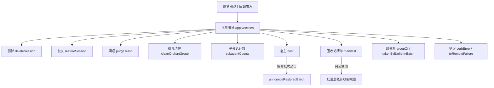
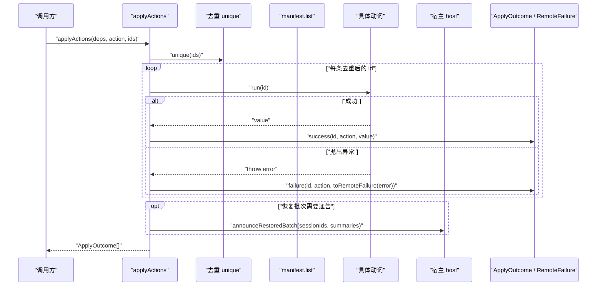
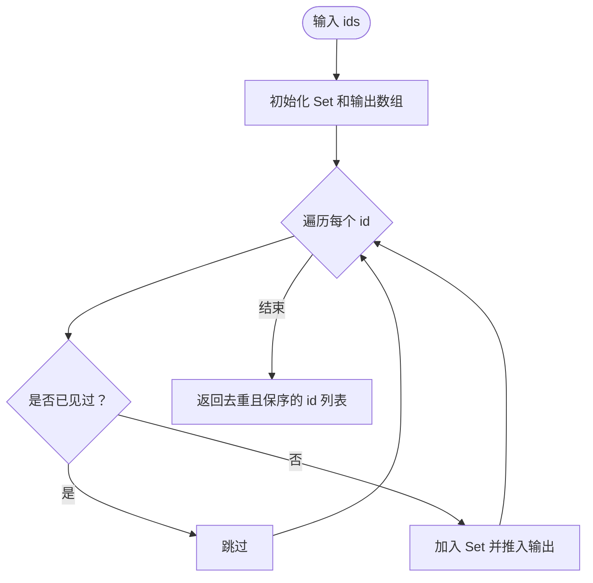
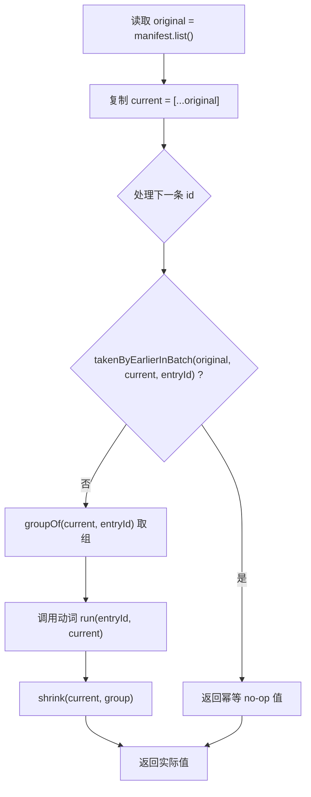
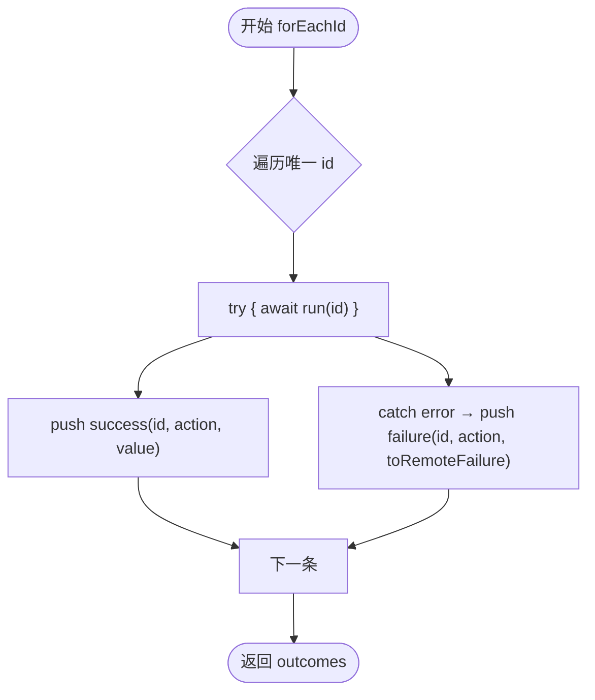
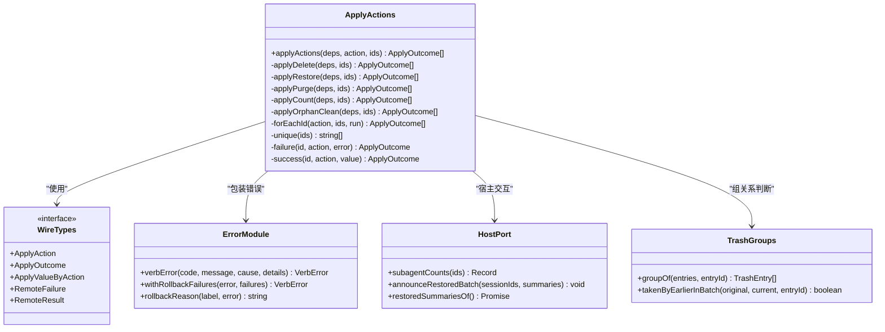
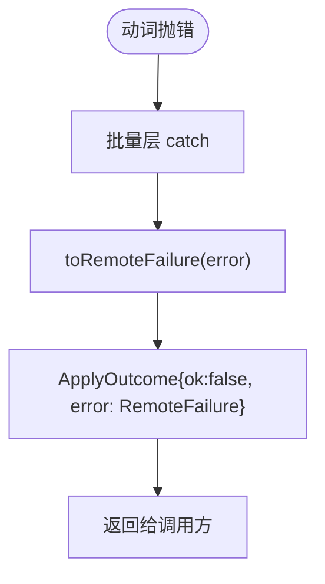
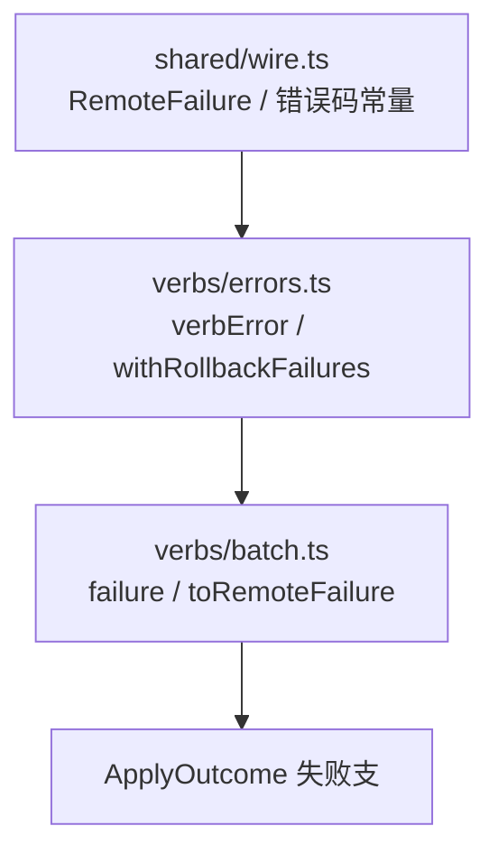

# 批量编排动词

<cite>
**本文引用的文件**   
- [src/verbs/batch.ts](file://src/verbs/batch.ts)
- [src/verbs/errors.ts](file://src/verbs/errors.ts)
- [src/shared/wire.ts](file://src/shared/wire.ts)
- [tests/batch.test.ts](file://tests/batch.test.ts)
- [tests/verbs-errors.test.ts](file://tests/verbs-errors.test.ts)
- [docs/adr/0002-batch-and-journal-own-the-request.md](file://docs/adr/0002-batch-and-journal-own-the-request.md)
</cite>

## 目录
1. [引言](#引言)
2. [项目结构中的位置](#项目结构中的位置)
3. [核心职责与输入输出](#核心职责与输入输出)
4. [架构总览](#架构总览)
5. [详细组件分析](#详细组件分析)
6. [依赖关系分析](#依赖关系分析)
7. [性能与一致性特征](#性能与一致性特征)
8. [典型测试场景与返回结果](#典型测试场景与返回结果)
9. [错误处理与 RemoteFailure 映射](#错误处理与-remotefailure-映射)
10. [故障排查指南](#故障排查指南)
11. [结论](#结论)

## 引言
本文件面向“批量编排动词”，即 `applyActions` 所在的 `src/verbs/batch.ts`。它不是某个具体业务动词的实现，而是对“同一批、同一个动作”的跨动词统一编排：接收一组 `ApplyAction[]` 对应的条目 id，完成去重保序、快照、逐条调用具体动词、收集结果，并最终生成一批 `ApplyOutcome`。

其设计目标是让“这一批”的性质不再散落在多个动词的接口里，而是集中在一个拥有者中，从而避免每个动词重复实现去重、幂等判断、失败隔离和通告聚合等逻辑。

## 项目结构中的位置
批量编排位于 Node 端动词层：
- 入口：`applyActions(deps, action, ids)`
- 具体动词：`delete-session`、`restore-session`、`purge-trash`、`orphan-subagents`
- 共享契约：`shared/wire.ts` 定义 `ApplyAction`、`ApplyOutcome`、`RemoteFailure`
- 错误包装：`verbs/errors.ts` 提供 `verbError`、`withRollbackFailures` 等
- 宿主交互：通过 `DeleteDeps.host` 进行恢复批次通告、子会话计数等
- 清册与组关系：通过 `trash/groups.js`、`trash/reconcile.js` 读取回收站状态

**图表来源**
- [src/verbs/batch.ts:1-197](file://src/verbs/batch.ts#L1-L197)
- [src/shared/wire.ts:1-200](file://src/shared/wire.ts#L1-L200)

**章节来源**
- [src/verbs/batch.ts:1-197](file://src/verbs/batch.ts#L1-L197)
- [docs/adr/0002-batch-and-journal-own-the-request.md:1-77](file://docs/adr/0002-batch-and-journal-own-the-request.md#L1-L77)

## 核心职责与输入输出
### 输入
`applyActions` 接收三件事：
- `deps`：包含宿主端口、回收站清单、文件系统依赖等
- `action`：当前批次的单一动作，类型为 `ApplyAction`
- `ids`：待处理的条目 id 列表

支持的五个动作：
| 动作 | id 含义 | 成功值类型 | 说明 |
| --- | --- | --- | --- |
| `delete` | 宿主会话 id | 回收站行或 null | 删除会话；同批前一条已带走则幂等返回 null |
| `restore` | 回收站条目 id | 回收站行或 null | 恢复会话；同批前一条已带走则幂等返回 null |
| `purge` | 回收站条目 id | `{removed, freedBytes}` | 彻底删除；同批前一条已带走则返回零统计 |
| `count` | 宿主会话 id | number | 查询子会话数量，一次问完整批 |
| `orphan-clean` | 根会话 id | `{removed, freedBytes}` | 清理无主子会话，失败可能带部分回执细节 |

### 输出
每个 id 对应一条 `ApplyOutcome`，形如：
- 成功：`{id, action, ok: true, value}`
- 失败：`{id, action, ok: false, error: RemoteFailure}`

`ApplyOutcome` 是判别联合类型：根据 `action` 和 `ok` 可以收窄出具体的成功值类型。

**章节来源**
- [src/shared/wire.ts:1-200](file://src/shared/wire.ts#L1-L200)
- [src/verbs/batch.ts:1-197](file://src/verbs/batch.ts#L1-L197)

## 架构总览
批量编排把“请求语义”从“动词语义”中剥离出来。之前，三个动词各自承担：
- 去重保序
- 清册快照
- “已被同批前一条带走”的判断
- 逐条信封包装

现在这些逻辑集中在 `batch.ts`，具体动词只需关心“单个 id 的处理”。

**图表来源**
- [src/verbs/batch.ts:40-120](file://src/verbs/batch.ts#L40-L120)
- [src/shared/wire.ts:1-200](file://src/shared/wire.ts#L1-L200)

**章节来源**
- [src/verbs/batch.ts:1-197](file://src/verbs/batch.ts#L1-L197)

## 详细组件分析

### 去重保序
`unique` 使用 `Set` 记录已出现的 id，并按输入顺序输出。这意味着：
- 重复 id 在结果中只出现一次
- 原始顺序保持不变
- 重复 id 不会触发额外的动词执行

这是“用户界面从上到下的阅读感”的基础。

**图表来源**
- [src/verbs/batch.ts:40-60](file://src/verbs/batch.ts#L40-L60)

**章节来源**
- [src/verbs/batch.ts:40-60](file://src/verbs/batch.ts#L40-L60)

### 快照与“已被同批前一条带走”
批量层维护两份清册视图：
- `original`：整批第一次读取的只读快照
- `current`：本层私有的可收缩副本

判断某条是否已被同批前一条带走的依据是：
1. 在 `original` 中能识别该 id
2. 在 `current` 中已经被移除

这实现了幂等语义：如果父先被处理，孩子再进来就是幂等 no-op；如果先处理孩子，父回来时不会再重复处理已经恢复或清理的成员。

**图表来源**
- [src/verbs/batch.ts:60-120](file://src/verbs/batch.ts#L60-L120)

**章节来源**
- [src/verbs/batch.ts:60-120](file://src/verbs/batch.ts#L60-L120)

### 逐条信封调用
`forEachId` 是批量层的核心循环：
- 对每个去重后的 id 调用动词函数
- 成功时封装为 `success`
- 失败时捕获异常并封装为 `failure`
- 单条失败不影响后续 id

这保证了“一批中有失败项，其他项仍可继续执行”。

**图表来源**
- [src/verbs/batch.ts:60-80](file://src/verbs/batch.ts#L60-L80)

**章节来源**
- [src/verbs/batch.ts:60-80](file://src/verbs/batch.ts#L60-L80)

### 各动作的具体行为

#### 删除
- 对每个会话 id 调用 `deleteSession`
- 用 `bareSessionId` 归一化根 id
- 用 `groupOf` 找出被删除行所属组的成员
- 将同批中被父带走的孩子 id 加入 `carried`，后续遇到直接返回 null

#### 恢复
- 整批只读一次清册
- 对每个条目 id：
  - 若已被同批前一条带走，返回 null
  - 否则取组、调用 `restoreSession`
  - 收集组内所有 `sessionId`，用于批尾一次通告
  - 收缩 `current`，避免重复通告

#### 清理
- 同样维护 `original` 与 `current`
- 若已被同批前一条带走，返回 `{removed: 0, freedBytes: 0}`
- 否则取组、调用 `purgeTrash`
- 收缩 `current`，保证父清理时不重复计算已清掉的孩子

#### 计数
- 一次调用 `host.subagentCounts(wanted)`
- 按原 id 顺序映射回 `ApplyOutcome`
- 缺失的 id 默认计为 0

#### 孤儿清理
- 先对账 `reconcileTrash`
- 加载孤儿组并按根 id 建索引
- 找不到对应组时返回 `not-found`
- 清理失败时捕获异常并包装为失败结果

**章节来源**
- [src/verbs/batch.ts:80-197](file://src/verbs/batch.ts#L80-L197)

## 依赖关系分析

**图表来源**
- [src/verbs/batch.ts:1-197](file://src/verbs/batch.ts#L1-L197)
- [src/shared/wire.ts:1-200](file://src/shared/wire.ts#L1-L200)
- [src/verbs/errors.ts:1-82](file://src/verbs/errors.ts#L1-L82)

**章节来源**
- [src/verbs/batch.ts:1-197](file://src/verbs/batch.ts#L1-L197)
- [src/shared/wire.ts:1-200](file://src/shared/wire.ts#L1-L200)
- [src/verbs/errors.ts:1-82](file://src/verbs/errors.ts#L1-L82)

## 性能与一致性特征
### 清册只读一次
批量层显式缓存 `manifest.list()` 的结果，并把这份只读快照传给动词。这样：
- 整批只读一次清册
- 动词不再各自重复读取
- 避免“100 条 = 100 次读”的性能问题

### 恢复通告合并
恢复动作会把所有恢复出的会话 id 攒起来，只在批尾调用一次 `announceRestoredBatch`。这避免了逐条通告导致的“每次全表扫描”问题。

### 子会话计数批量
`count` 动作一次性传入所有 id，由宿主返回映射对象，再按原顺序映射回结果。这样计数接口本身也是批量的。

### 幂等减少重复工作
“已被同批前一条带走”的判定让同批中的重复处理直接返回幂等值，而不是真正执行动词逻辑。

**章节来源**
- [src/verbs/batch.ts:60-120](file://src/verbs/batch.ts#L60-L120)
- [docs/adr/0002-batch-and-journal-own-the-request.md:1-77](file://docs/adr/0002-batch-and-journal-own-the-request.md#L1-L77)

## 典型测试场景与返回结果

### 重复 id 去重保序
输入两个相同 id，输出只保留一个，且保持原顺序。

| 输入 | 期望输出 |
| --- | --- |
| `[parent.id, parent.id]` | `[parent.id]`，长度为 1 |

**章节来源**
- [tests/batch.test.ts:1-132](file://tests/batch.test.ts#L1-L132)

### 部分成功
一条成功、一条失败：
- 成功项：`{id, ok: true}`
- 失败项：`{id, ok: false, error: {code: 'sessiondelete/trash-empty'}}`

失败项不会中断后续项。

**章节来源**
- [tests/batch.test.ts:1-132](file://tests/batch.test.ts#L1-L132)

### 全失败
当所有 id 都无法处理时，每项都返回失败信封。例如幽灵 id 不在原始快照中，会走正常失败路径。

| 输入 | 期望结果 |
| --- | --- |
| `['ghost']` | `[{ok: false, error: {code: 'sessiondelete/trash-empty'}}]` |

**章节来源**
- [tests/batch.test.ts:1-132](file://tests/batch.test.ts#L1-L132)

### 幂等 no-op 与真实失败的区别
- 同批中“已被前一条带走”的项返回幂等成功（值为 null 或零统计）
- 原始快照中就找不到的“幽灵 id”走失败路径

| 情况 | 返回值语义 |
| --- | --- |
| 父先删，孩子后到 | 孩子返回幂等成功 |
| 幽灵 id | 返回失败 |

**章节来源**
- [tests/batch.test.ts:1-132](file://tests/batch.test.ts#L1-L132)

### 恢复批次通告
- 一批恢复只发一次 `announceRestoredBatch`
- 通告内容是整组的会话 id
- 先父后子、或先子后父，都不会重复通告已经恢复过的成员

**章节来源**
- [tests/batch.test.ts:1-132](file://tests/batch.test.ts#L1-L132)

### 计数一次宿主调用
即使传入多个 id，`subagentCounts` 也只被调用一次，而不是每条一次。

**章节来源**
- [tests/batch.test.ts:1-132](file://tests/batch.test.ts#L1-L132)

## 错误处理与 RemoteFailure 映射

### 批量层的失败包装
批量层内部有两个关键包装点：
1. `failure`：把任意异常转换为 `ApplyOutcome` 的失败支
2. `toRemoteFailure`：把内部错误映射为线上的 `RemoteFailure`

**图表来源**
- [src/verbs/batch.ts:60-80](file://src/verbs/batch.ts#L60-L80)

### RemoteFailure 的结构
`RemoteFailure` 是跨半契约中的失败形状：
- `code`：错误码
- `message`：上屏消息
- `details`：可选的结构化附带物

它不是 Node 端内部错误类型，而是线上信封的一部分。

**章节来源**
- [src/shared/wire.ts:1-200](file://src/shared/wire.ts#L1-L200)

### verbs-errors 的职责
`src/verbs/errors.ts` 不负责把普通异常转成 `RemoteFailure`，而是负责：
- 构造带动词错误码的内部错误 `verbError`
- 合并回滚失败 `withRollbackFailures`
- 提供回滚原因字符串 `rollbackReason`
- 暴露路由自检用的 `routeError`

它与 `shared/wire.ts` 的关系是：
- 错误码常量来自 `shared/wire.ts`
- 这里只是导出别名，避免各处硬编码错误域和前缀
- 真正的“内部错误 → RemoteFailure”映射发生在 `remote/map-error.ts`（被 `toRemoteFailure` 使用）

**图表来源**
- [src/shared/wire.ts:1-200](file://src/shared/wire.ts#L1-L200)
- [src/verbs/errors.ts:1-82](file://src/verbs/errors.ts#L1-L82)
- [src/verbs/batch.ts:1-197](file://src/verbs/batch.ts#L1-L197)

### 回滚失败的结构化上报
当某个步骤回滚失败时，`withRollbackFailures` 会：
- 尝试继承原错误的动词码
- 若无可继承码则落 `io`
- 合并内层和外层回滚失败列表
- 确保消息中不重复出现“回滚未完成”

测试验证了：
- 内层 `rollbackFailures` 会被合并
- 消息中只有一个“回滚未完成”
- 失败列表去重
- 未知错误码退化为 `io`

**章节来源**
- [tests/verbs-errors.test.ts:1-28](file://tests/verbs-errors.test.ts#L1-L28)
- [src/verbs/errors.ts:1-82](file://src/verbs/errors.ts#L1-L82)

## 故障排查指南

### 现象：一批中有一条失败，其他条也被标记失败
检查是否在批量层之外又加了一层“整批失败”的逻辑。批量层的设计是单条失败不传染下一条，每条结果独立。

**排查要点**
- 确认失败发生在 `forEachId` 的 try/catch 内
- 确认没有在外层对 `outcomes` 做整体 reject

**章节来源**
- [src/verbs/batch.ts:60-80](file://src/verbs/batch.ts#L60-L80)
- [tests/batch.test.ts:1-132](file://tests/batch.test.ts#L1-L132)

### 现象：重复 id 产生了多条结果
检查输入是否已经被上层去重，或者是否绕过了 `applyActions` 直接调用了具体动词。批量层只对进入它的 id 列表去重。

**排查要点**
- 确认调用的是 `applyActions`
- 确认没有手动拼接多个 `ApplyOutcome`

**章节来源**
- [src/verbs/batch.ts:40-60](file://src/verbs/batch.ts#L40-L60)
- [tests/batch.test.ts:1-132](file://tests/batch.test.ts#L1-L132)

### 现象：恢复或清理重复通告
检查是否在每个 id 上分别调用宿主通告接口，而不是在批量层汇总后调用一次。

**排查要点**
- 恢复动作应仅在批尾调用 `announceRestoredBatch`
- 不应在动词内部逐条通告

**章节来源**
- [src/verbs/batch.ts:100-140](file://src/verbs/batch.ts#L100-L140)
- [tests/batch.test.ts:1-132](file://tests/batch.test.ts#L1-L132)

### 现象：幽灵 id 被误判为幂等 no-op
“已被同批前一条带走”要求 id 在原始快照中存在。如果 id 本来就不在清册中，应该走失败路径。

**排查要点**
- 区分“原始快照中不存在”和“当前快照中被移除”
- 检查 `takenByEarlierInBatch` 的参数顺序

**章节来源**
- [src/verbs/batch.ts:100-140](file://src/verbs/batch.ts#L100-L140)
- [tests/batch.test.ts:1-132](file://tests/batch.test.ts#L1-L132)

### 现象：错误信息缺少结构化 details
确认错误是在动词侧用 `verbError` 构造的，还是直接抛了一个普通 `Error`。普通错误仍会被 `toRemoteFailure` 包装，但可能没有业务层面的 `details`。

**排查要点**
- 业务错误优先使用 `verbError`
- 回滚失败使用 `withRollbackFailures`
- 注意 `RemoteFailure.details` 是可选字段

**章节来源**
- [src/verbs/errors.ts:1-82](file://src/verbs/errors.ts#L1-L82)
- [src/shared/wire.ts:1-200](file://src/shared/wire.ts#L1-L200)

## 结论
批量编排动词是“这一批”的统一拥有者。它把原本分散在多个动词中的去重、快照、幂等判断、失败隔离和通告聚合集中到一个模块中，使具体动词回归“单 id 进、单结果出”的职责。

关键要点包括：
- 输入去重保序，保证用户界面的顺序预期
- 整批只读一次清册，动词使用批量层提供的只读快照
- 单条失败不中断其他项，结果以 `ApplyOutcome` 逐项报告
- “已被同批前一条带走”是幂等成功，不是失败
- 恢复批次通告合并到批尾，避免逐条全表扫描
- 错误通过 `toRemoteFailure` 映射为 `RemoteFailure`，并由 `verbs/errors.ts` 提供动词错误码和回滚失败合并能力
- 测试覆盖了部分成功、全失败、重复 id、幂等 no-op、清册只读一次等关键契约