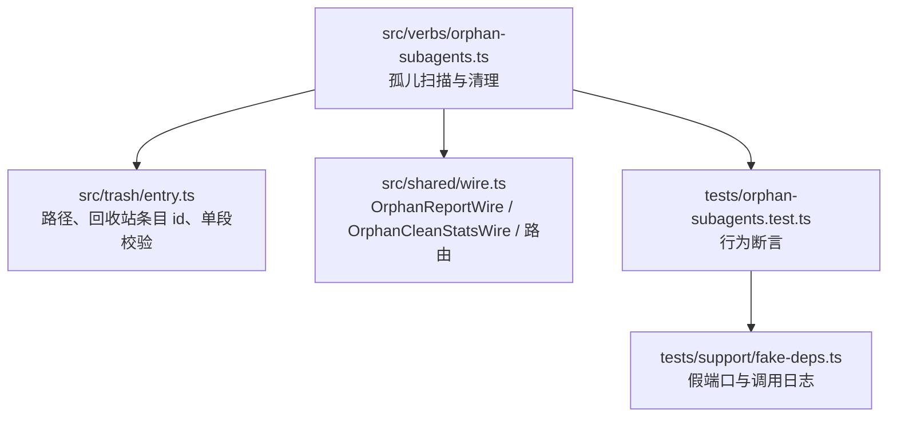
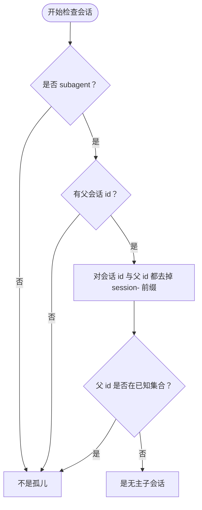
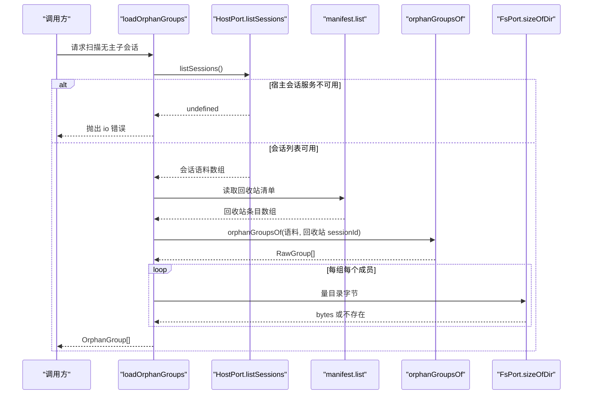
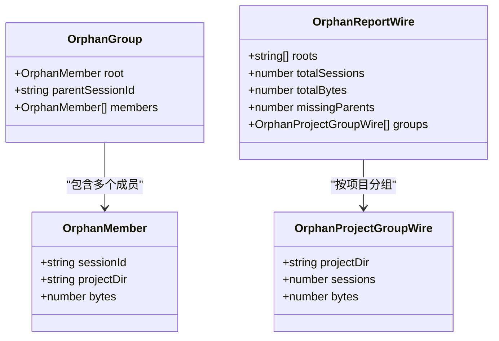
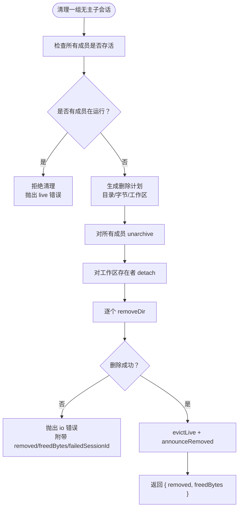
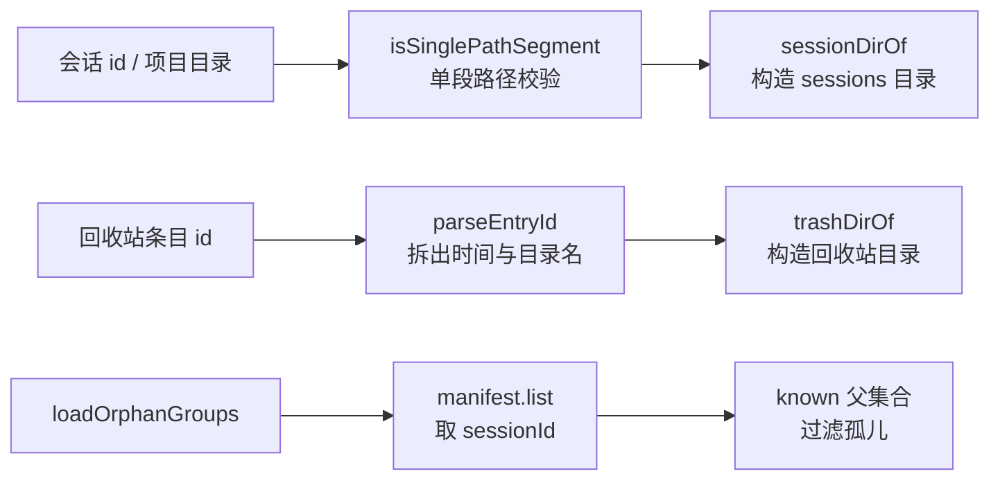
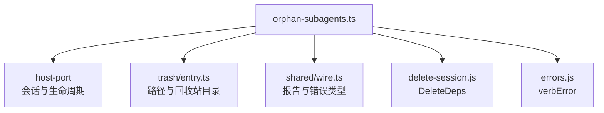

# 无主子会话扫描与清理

<cite>
**本文引用的文件**   
- [orphan-subagents.ts](file://src/verbs/orphan-subagents.ts)
- [entry.ts](file://src/trash/entry.ts)
- [wire.ts](file://src/shared/wire.ts)
- [orphan-subagents.test.ts](file://tests/orphan-subagents.test.ts)
- [fake-deps.ts](file://tests/support/fake-deps.ts)
- [README.md](file://README.md)
</cite>

## 目录
1. [引言](#引言)
2. [项目结构定位](#项目结构定位)
3. [核心概念：什么是无主子会话](#核心概念什么是无主子会话)
4. [扫描入口与数据流](#扫描入口与数据流)
5. [分组、过滤与报告结构](#分组过滤与报告结构)
6. [清理模式与误删防护](#清理模式与误删防护)
7. [与回收站条目 id 的关系](#与回收站条目id的关系)
8. [典型项目树与扫描结果示例](#典型项目树与扫描结果示例)
9. [依赖关系分析](#依赖关系分析)
10. [错误类型与排查建议](#错误类型与排查建议)
11. [结论](#结论)

## 引言
`orphan-subagents` 是 `@xrn1997/dsh-session-delete` 插件中的“无主子会话”能力。它解决的是这样一个问题：某个子会话的父会话已经被彻底删除（或从盘上手工清掉），因此该子会话既不在宿主当前会话列表中，也不在回收站清单里；但它的目录还留在本机磁盘上。

这个动词提供两种能力：
- **扫描**：只读地找出这些“父没了”的子会话组，并给出按项目分组的体积统计。
- **清理**：按用户确认，永久删除这些目录；它不经过回收站，也不会自动执行。

它不是普通的删除会话流程：普通删除把会话移进回收站并可恢复；无主子会话清理则是直接清盘上的残留目录。

**章节来源**
- [README.md:1-147](file://README.md#L1-L147)

## 项目结构定位
无主子会话逻辑集中在一个动词实现文件中，并与三个外部契约协作：



**图示来源**
- [orphan-subagents.ts:1-231](file://src/verbs/orphan-subagents.ts#L1-L231)
- [entry.ts:1-90](file://src/trash/entry.ts#L1-L90)
- [wire.ts:1-200](file://src/shared/wire.ts#L1-L200)
- [orphan-subagents.test.ts:1-147](file://tests/orphan-subagents.test.ts#L1-L147)
- [fake-deps.ts:1-213](file://tests/support/fake-deps.ts#L1-L213)

**章节来源**
- [orphan-subagents.ts:1-231](file://src/verbs/orphan-subagents.ts#L1-L231)
- [entry.ts:1-90](file://src/trash/entry.ts#L1-L90)
- [wire.ts:1-200](file://src/shared/wire.ts#L1-L200)
- [orphan-subagents.test.ts:1-147](file://tests/orphan-subagents.test.ts#L1-L147)
- [fake-deps.ts:1-213](file://tests/support/fake-deps.ts#L1-L213)

## 核心概念：什么是无主子会话
无主子会话必须同时满足以下三点：
1. 它是一个 **subagent**（会话身份中标记为子会话）。
2. 它有明确的父会话 id。
3. 该父会话**既不在当前语料中，也不在回收站清册中**。

这里的关键判断是“父会话 id 去前缀后不存在于已知集合”。实现会同时处理带 `session-` 前缀和不带前缀的情况，因为不同代宿主可能以不同形式记录父 id。

需要注意：**回收站里的父不算孤儿**。如果父还在回收站里，孩子属于“滞留”状态，应该等父一起恢复或一起彻底删除，而不是被当成孤儿单独删掉。



**图示来源**
- [orphan-subagents.ts:100-160](file://src/verbs/orphan-subagents.ts#L100-L160)
- [wire.ts:1-200](file://src/shared/wire.ts#L1-L200)

**章节来源**
- [orphan-subagents.ts:90-160](file://src/verbs/orphan-subagents.ts#L90-L160)
- [README.md:1-147](file://README.md#L1-L147)

## 扫描入口与数据流
扫描入口是 `loadOrphanGroups`。它的工作顺序如下：

1. 调用宿主的 `listSessions()` 获取完整会话语料。
2. 若返回 `undefined`，表示宿主会话查询服务不可用，立即抛出输入输出错误；绝不能把“服务没挂”解释成“没有孤儿”。
3. 读取回收站清单，提取所有回收站条目的 `sessionId`。
4. 把会话语料和回收站 id 合并为“已知父集合”，再交给纯函数 `orphanGroupsOf` 分组。
5. 对每组成员测量盘上目录大小，生成最终可报告的 `OrphanGroup`。



**图示来源**
- [orphan-subagents.ts:160-200](file://src/verbs/orphan-subagents.ts#L160-L200)
- [orphan-subagents.test.ts:40-70](file://tests/orphan-subagents.test.ts#L40-L70)

**章节来源**
- [orphan-subagents.ts:160-200](file://src/verbs/orphan-subagents.ts#L160-L200)
- [orphan-subagents.test.ts:40-70](file://tests/orphan-subagents.test.ts#L40-L70)

## 分组、过滤与报告结构
### 分组算法
`orphanGroupsOf` 是纯函数，不碰文件系统：
- 先构建父到子会话的映射。
- 遍历所有会话，只关注标记为 subagent 且有父 id 的记录。
- 如果父在已知集合中，跳过。
- 如果该会话已被某组认领，跳过，防止环导致重复删除。
- 从根开始做传递闭包，把所有后代加入同一组。

这意味着：根是一个“父没了”的子会话，`members` 包含根及其所有后代。

### 回收站过滤
回收站中的父会话通过 `trashSessionIds` 进入“已知集合”，因此不会被当成孤儿。这是重要的安全边界：回收站里的父尚未被彻底删除，其子会话应跟随父的生命周期。

### 报告结构 `OrphanReportWire`
`reportOrphans` 把一组 `OrphanGroup` 折成前端可用的报告：

| 字段 | 含义 |
| --- | --- |
| `roots` | 每组的根会话 id，也就是那个“父没了”的原始 subagent |
| `totalSessions` | 所有组成员总数 |
| `totalBytes` | 所有成员目录字节合计 |
| `missingParents` | 失踪父会话的**去重数量**，按去前缀后的 id 计算 |
| `groups` | 按项目目录分组的结果，每项含 `projectDir`、`sessions`、`bytes`，并按字节降序排列 |

注意：`totalSessions` 和 `totalBytes` 是对所有成员的累加，而 `missingParents` 是按父去重计数。`groups` 排序是为了让界面优先显示占用最多的项目。



**图示来源**
- [orphan-subagents.ts:1-90](file://src/verbs/orphan-subagents.ts#L1-L90)
- [wire.ts:150-200](file://src/shared/wire.ts#L150-L200)

**章节来源**
- [orphan-subagents.ts:1-90](file://src/verbs/orphan-subagents.ts#L1-L90)
- [orphan-subagents.ts:200-231](file://src/verbs/orphan-subagents.ts#L200-L231)
- [wire.ts:150-200](file://src/shared/wire.ts#L150-L200)
- [orphan-subagents.test.ts:40-70](file://tests/orphan-subagents.test.ts#L40-L70)

## 清理模式与误删防护
清理由 `cleanOrphanGroup` 执行，针对一个已加载的 `OrphanGroup`。它与普通删除的主要差异是：
- 普通删除：移入回收站，可恢复。
- 无主子会话清理：直接删除盘上目录，**不进入回收站，不可恢复**。

### 清理步骤
1. **整组 live 准入**：对每个成员调用 `host.isLive`。只要任一成员正在运行，就拒绝整组，且不进行任何写操作。
2. **收集删除计划**：对每个成员调用 `planMemberRemovals`，得到目录、字节和工作区归属。目录不存在时跳过该成员，但不影响其他成员。
3. **批量摘归档集**：对所有成员调用 `host.unarchive`。这样做的目的是避免留下“会话目录已删、却仍在归档集”的幽灵 id。
4. **批量解绑工作区**：只对确实在账本中的会话调用 `detach(sessionId, workspaceId)`。未分组会话不抛错。
5. **逐个删除目录**：调用 `fs.removeDir`。
6. **逐条摘活体并通告**：调用 `evictLive`，并根据返回值决定是否发送 `announceRemoved`。
7. **返回部分回执**：成功时返回 `{ removed, freedBytes }`。

### 误删防护
代码有多层防护：
- **父在回收站不过滤**：这类会话不会出现在孤儿报告中，因此不会触发清理。
- **live 预检**：任一成员在跑 ⇒ 整组拒绝，零副作用。
- **单段路径校验**：会话 id 和项目目录必须通过 `isSinglePathSegment`，否则构造出的目录可能被当作递归路径，从而破坏 `sessions/` 或 `session-trash/`。
- **目录缺失容错**：某个成员目录不存在时，跳过删除和计数，但归档集摘除仍发生，保证一致性。
- **部分失败回执**：删目录中途失败时，错误附带 `details`，包括 `removed`、`freedBytes` 和 `failedSessionId`，让上层知道“已经删了多少”，而不是假装什么都没动。
- **不回滚已删目录**：磁盘目录没有回收站这一层，已删的不回滚；但失败信息足以定位问题。



**图示来源**
- [orphan-subagents.ts:200-231](file://src/verbs/orphan-subagents.ts#L200-L231)
- [entry.ts:60-90](file://src/trash/entry.ts#L60-L90)
- [orphan-subagents.test.ts:72-147](file://tests/orphan-subagents.test.ts#L72-L147)

**章节来源**
- [orphan-subagents.ts:200-231](file://src/verbs/orphan-subagents.ts#L200-L231)
- [entry.ts:60-90](file://src/trash/entry.ts#L60-L90)
- [orphan-subagents.test.ts:72-147](file://tests/orphan-subagents.test.ts#L72-L147)

## 与回收站条目 id 的关系
回收站条目 id 和无主子会话扫描是两个相关但不同的概念：

- 回收站条目 id 由 `makeEntryId` 生成，格式是 `<UTC 时间戳>-<原会话目录名>`。
- 解析函数 `parseEntryId` 负责把它拆回时间戳和会话目录名。
- 路径构造函数 `sessionDirOf` 使用项目目录与会话目录名拼接出 `home/sessions/<projectDir>/<sessionDirName>`。
- 对会话 id 本身也要求是**单段路径**，防止 `/`、`\`、`.`、`..`、NUL 等字符造成危险路径。

无主子会话扫描虽然不直接读写回收站目录，但它需要回收站清册中的 `sessionId` 来判断“父是否仍在回收站”。如果父在回收站里，它就不算孤儿；只有父既不在会话列表、也不在回收站时，才可能是孤儿。



**图示来源**
- [entry.ts:1-90](file://src/trash/entry.ts#L1-L90)
- [orphan-subagents.ts:160-200](file://src/verbs/orphan-subagents.ts#L160-L200)

**章节来源**
- [entry.ts:1-90](file://src/trash/entry.ts#L1-L90)
- [orphan-subagents.ts:160-200](file://src/verbs/orphan-subagents.ts#L160-L200)

## 典型项目树与扫描结果示例
下面用一个简化项目树说明扫描结果如何产生。假设宿主 home 目录为 `/h`，有两个项目目录 `--p--` 和 `--q--`。

```text
/h
├── sessions
│   ├── --p--
│   │   ├── session-root
│   │   └── session-kid
│   └── --q--
│       └── session-g1
└── .dsh/session-trash/
    └── ...（不含 session-gone）
```

会话关系：
- `session-root`：subagent，父是 `session-gone`。
- `session-kid`：子会话，父是 `session-root`，位于 `--p--`。
- `session-g1`：子会话，父是 `session-kid`，位于 `--q--`。
- `session-gone`：不在宿主会话列表，也不在回收站。

扫描过程：
1. `listSessions` 返回这三个会话。
2. 回收站中没有 `session-gone`。
3. `orphanGroupsOf` 发现 `session-root` 是 subagent 且父不在已知集合。
4. 传递闭包把 `session-root`、`session-kid`、`session-g1` 归为一组。
5. 按项目分组：`--p--` 有 1 个会话，`--q--` 有 1 个会话。

报告形状大致为：
- `roots`：`["session-root"]`
- `totalSessions`：3
- `totalBytes`：三个会话目录字节之和
- `missingParents`：1
- `groups`：两个项目分组，分别对应 `--p--` 和 `--q--`

测试用例中还覆盖了更简单的情况：根会话在一个项目下，子会话在另一个项目下，此时报告会出现两个项目分组。

**章节来源**
- [orphan-subagents.test.ts:12-70](file://tests/orphan-subagents.test.ts#L12-L70)
- [orphan-subagents.ts:100-200](file://src/verbs/orphan-subagents.ts#L100-L200)

## 依赖关系分析
`orphan-subagents.ts` 的依赖可以分成三类：

| 依赖 | 作用 | 耦合特点 |
| --- | --- | --- |
| `../ports/host-port.js` | 读取会话、检查活跃、管理归档与工作区、通告移除 | 高耦合宿主运行时能力 |
| `../trash/entry.ts` | 构造会话目录、校验单段路径、处理回收站目录 | 低耦合纯路径工具 |
| `../shared/wire.ts` | 定义线上报告结构与错误信封 | 固定 wire 契约 |
| `./delete-session.js` | 复用 `DeleteDeps` 依赖形状 | 共享依赖接口 |
| `./errors.js` | 包装结构化错误 | 统一错误形态 |



**图示来源**
- [orphan-subagents.ts:1-10](file://src/verbs/orphan-subagents.ts#L1-L10)

**章节来源**
- [orphan-subagents.ts:1-10](file://src/verbs/orphan-subagents.ts#L1-L10)

## 错误类型与排查建议
### 常见错误
| 错误场景 | 错误特征 | 原因 | 排查建议 |
| --- | --- | --- | --- |
| 宿主会话服务不可用 | `code` 为 `io` | `listSessions` 返回 `undefined` | 重启宿主；确认会话查询通道可用；不要把它解释成“没有孤儿” |
| 非单段会话 id | 抛出包含“不是单段路径”的消息 | 会话 id 包含 `/`、`\`、`.`、`..` 或 NUL | 检查宿主写入的会话 id；确认会话目录命名合法；该错误应在扫描阶段阻止清理 |
| 会话正在运行 | `code` 为 `live` | 任一成员 `isLive` 返回真 | 先停止该会话；注意正在运行的可能是隐藏子会话 |
| 删除目录失败 | `code` 为 `io`，`details` 含 `removed`、`freedBytes`、`failedSessionId` | `fs.removeDir` 抛出异常 | 检查权限、磁盘空间、进程占用；已成功删除的部分不回滚 |
| 成员目录缺失 | 不计入 `removed` 与 `freedBytes` | `fs.exists` 返回假 | 目录可能已被手工删除；但仍会尝试 unarchive 以保持归档集一致 |

### 排查步骤
1. 先看扫描报告：`OrphanReportWire` 中的 `roots`、`totalSessions`、`totalBytes`、`missingParents` 和 `groups` 能判断是否存在孤儿以及规模。
2. 确认父会话状态：检查宿主会话列表和回收站清单中是否真的没有该父会话。
3. 检查会话是否运行：如果清理报 `live`，先定位具体会话 id 并停止它。
4. 检查路径合法性：如果报“不是单段路径”，说明会话 id 或项目目录有问题，不应继续执行清理。
5. 查看部分失败回执：如果清理报 `io`，通过 `details.failedSessionId` 定位失败会话，并通过 `removed`、`freedBytes` 判断已清理程度。
6. 不要手工移动回收站目录来“恢复”无主子会话：无主子会话清理直接清盘，不走回收站恢复流程。

**章节来源**
- [orphan-subagents.test.ts:40-147](file://tests/orphan-subagents.test.ts#L40-L147)
- [entry.ts:60-90](file://src/trash/entry.ts#L60-L90)
- [wire.ts:150-200](file://src/shared/wire.ts#L150-L200)

## 结论
无主子会话扫描与清理是会话删除能力的补充：它不负责常规删除，而是处理“父已彻底消失、但子会话目录仍留在本机”的边缘情况。

它的设计重点在于：
- **扫描是纯读**：通过宿主会话列表和回收站清单识别孤儿，再通过文件系统度量体积。
- **分组严格**：只认 subagent，且父必须在会话语料和回收站中都缺失。
- **报告清晰**：`OrphanReportWire` 暴露根、总数、总字节、失踪父数量和项目分组。
- **清理保守**：先 live 预检，再摘归档、解绑工作区、删目录，最后摘活体并通告。
- **失败透明**：部分失败不伪装成整组成功，错误中携带已删数量和失败会话 id。
- **安全优先**：路径必须单段；目录缺失不连坐；回收站中的父不被误删；任意成员在运行则整组拒绝。

对于使用者而言，最安全的做法是：先刷新扫描，阅读 `OrphanReportWire` 中的项目和体积分布，确认孤儿确实不再需要后，再手动执行一次清理。