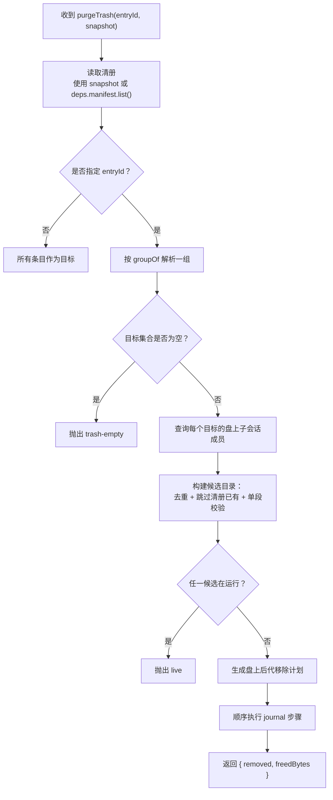
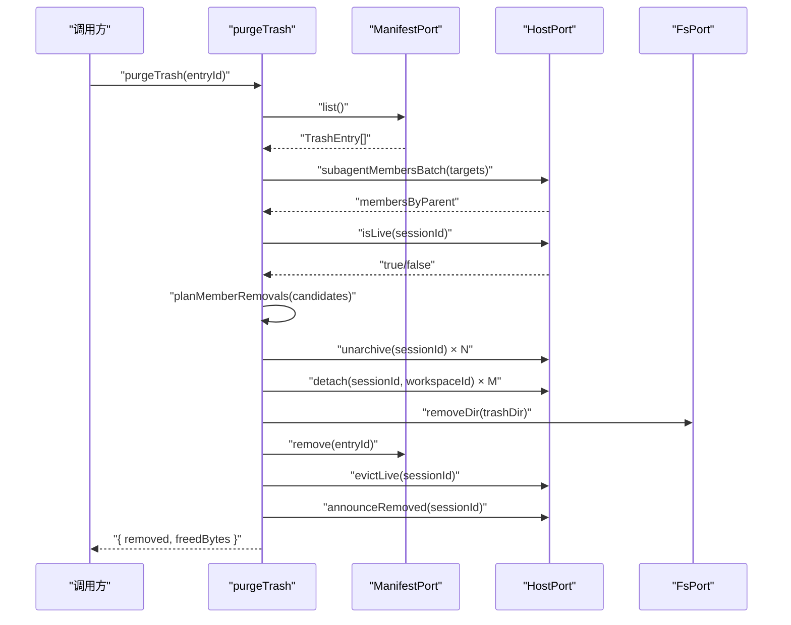
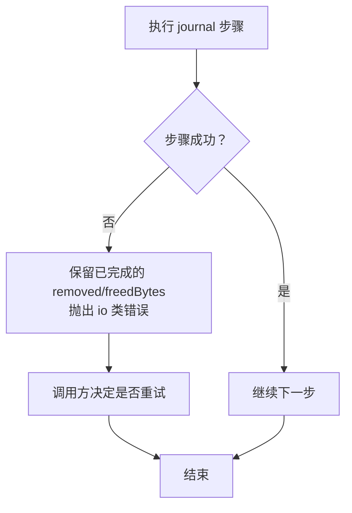
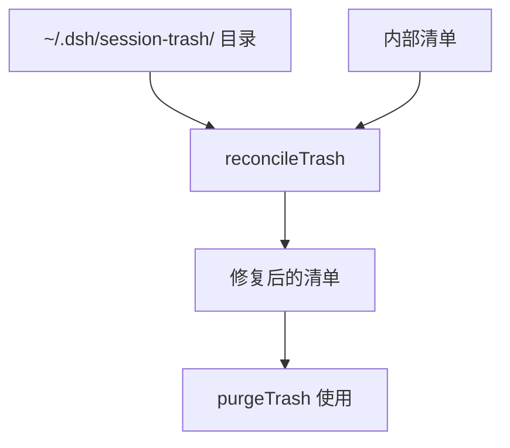
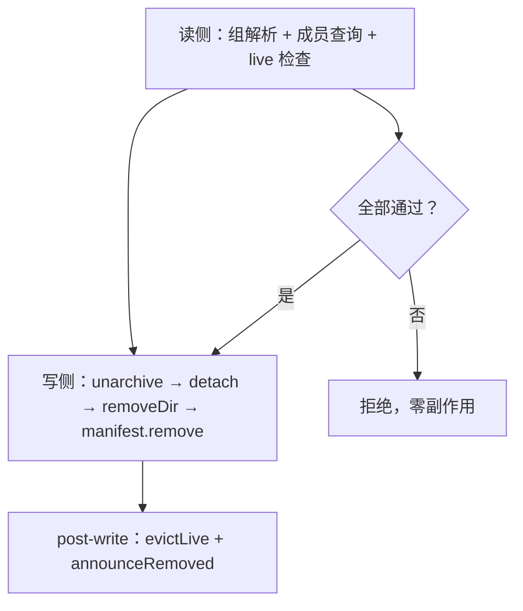

# 清空回收站动词

<cite>
**本文引用的文件**   
- [src/verbs/purge-trash.ts](file://src/verbs/purge-trash.ts)
- [tests/purge-trash.test.ts](file://tests/purge-trash.test.ts)
- [src/trash/reconcile.ts](file://src/trash/reconcile.ts)
- [src/trash/entry.ts](file://src/trash/entry.ts)
- [src/trash/groups.ts](file://src/trash/groups.ts)
- [src/ports/fs-port.ts](file://src/ports/fs-port.ts)
- [src/ports/host-port.ts](file://src/ports/host-port.ts)
- [src/verbs/member-journal.ts](file://src/verbs/member-journal.ts)
- [src/verbs/orphan-subagents.ts](file://src/verbs/orphan-subagents.ts)
- [src/verbs/delete-session.ts](file://src/verbs/delete-session.ts)
- [docs/design/2026-10-15-trash-detail-design.md](file://docs/design/2026-10-15-trash-detail-design.md)
</cite>

## 目录
1. [引言](#引言)
2. [函数签名与调用约定](#函数签名与调用约定)
3. [对账驱动的清空流程总览](#对账驱动的清空流程总览)
4. [逐条删除与盘上后代处理](#逐条删除与盘上后代处理)
5. [回执、统计与部分失败语义](#回执统计与部分失败语义)
6. [与 reconcile 的关系：为什么清空前要对账](#与-reconcile-的关系为什么清空前要对账)
7. [与 manifest 层和 ports 的交互](#与-manifest-层和-ports-的交互)
8. [调用示例](#调用示例)
9. [错误处理建议](#错误处理建议)
10. [性能与可恢复性考量](#性能与可恢复性考量)
11. [故障排查清单](#故障排查清单)
12. [结论](#结论)

## 引言
`purgeTrash` 是 `@xrn1997/dsh-session-delete` 插件中的“彻底删除”动词。它不负责把会话从工作区移入回收站，而是负责把**已经位于回收站中的条目**真正抹掉，并清理与之对应的 `session-trash` 目录以及仍在盘上的子会话目录。

该动词的设计重点有三点：
- **按组操作**：点父行会清整组；点子行只清自身及其盘上后代。
- **对账优先**：在删目录之前先确认目标、去重、检查运行中状态，避免误删或半删。
- **尽力而为但不可回滚**：成功回执里的 `removed` 与 `freedBytes` 只在整体成功后返回；中间失败不会自动回滚已删目录，调用方应通过重试解决。

本文件面向需要理解该动词行为、返回值、错误形态以及与 `reconcile`、`manifest`、`fs-port` 关系的开发者与维护者。

## 函数签名与调用约定
`purgeTrash` 是一个工厂函数，接收依赖对象后返回一个异步函数。其核心签名可概括为：

| 参数 | 类型 | 含义 |
| --- | --- | --- |
| `deps` | `DeleteDeps` | 依赖注入容器，包含清单、文件系统端口、宿主端口等。 |
| `entryId` | `string \| undefined` | 要彻底删除的回收站条目 id；不传表示清空全部。 |
| `snapshot` | `readonly TrashEntry[] \| undefined` | 可选的只读清册快照；批量层已读过的数据可透传，避免重复读取。 |

返回值：

| 字段 | 类型 | 含义 |
| --- | --- | --- |
| `removed` | `number` | 本次成功处理的条目数量，包括回收站条目本身及被一并清理的盘上后代。 |
| `freedBytes` | `number` | 本次成功释放的字节数，主要来自回收站目录大小；盘上后代按计划中的字节计。 |

重要约定：
- 该动词**不做事务回滚**。一旦开始执行步骤，已删除的目录不会被撤销。
- 如果传入 `entryId` 但不在当前清册中，直接抛出 `trash-empty` 错误。
- 如果目标或其盘上后代中有正在运行的会话，整个操作拒绝并抛出 `live` 错误。
- 批量层的“哪些条目已经被同批前一条带走”属于 `verbs/batch.ts` 的职责，不在本动词内判断。

**章节来源**
- [src/verbs/purge-trash.ts:12-27](file://src/verbs/purge-trash.ts#L12-L27)
- [src/verbs/delete-session.ts](file://src/verbs/delete-session.ts)

## 对账驱动的清空流程总览
清空不是简单遍历目录然后 `rm -rf`。它先确定“要删什么”，再验证“能不能删”，最后才执行“删目录 + 摘清单 + 摘活体 + 通告”。



**图表来源**
- [src/verbs/purge-trash.ts:28-121](file://src/verbs/purge-trash.ts#L28-L121)
- [src/trash/groups.ts](file://src/trash/groups.ts)

### 关键阶段说明
1. **读取清册**：优先使用传入的 `snapshot`；否则调用 `deps.manifest.list()`。
2. **解析目标**：
   - 未传 `entryId`：清空全部。
   - 传入 `entryId`：通过 `groupOf(all, entryId)` 解析“这一组有谁”。
3. **准入检查**：
   - 如果指定了条目但组为空，抛出 `trash-empty`。
   - 扫描盘上后代时，若任一成员处于运行态，立即抛出 `live`。
4. **生成计划**：通过 `planMemberRemovals` 计算仍留在磁盘上的后代目录、工作区与字节数。
5. **顺序执行**：使用 `createJournal` 保证步骤顺序与失败路径一致。

**章节来源**
- [src/verbs/purge-trash.ts:28-75](file://src/verbs/purge-trash.ts#L28-L75)
- [tests/purge-trash.test.ts:12-28](file://tests/purge-trash.test.ts#L12-L28)

## 逐条删除与盘上后代处理
### 回收站条目
对每个目标条目：
1. 构造回收站目录路径：`trashDirOf(entry.id, deps.home)`。
2. 如果目录仍存在：
   - 调用 `deps.fs.sizeOfDir(dir)` 累加 `freedBytes`。
   - 调用 `deps.fs.removeDir(dir)` 删除目录。
3. 调用 `deps.manifest.remove(entry.id)` 摘除清单行。
4. `removed += 1`。
5. 调用 `deps.host.evictLive(entry.sessionId)` 尝试从宿主内存摘除。
6. 如果 `eviction !== 'unknown'`，则调用 `deps.host.announceRemoved(entry.sessionId)` 通知客户端。

注意：即使目录已被手工删除，只要条目在清单中，也会摘清单行并计入 `removed`，只是不再产生 `freedBytes`。

### 盘上后代
盘上后代是指“父会话被彻底删除，但其子会话目录仍留在原项目目录下”的情况。处理逻辑是：
1. 通过 `deps.host.subagentMembersBatch` 获取每个目标会话的子会话成员。
2. 过滤掉已经在清册中的孩子（避免重复）。
3. 对每个候选成员调用 `host.isLive` 检查是否在运行。
4. 通过 `planMemberRemovals` 生成移除计划。
5. 执行计划时：
   - 调用 `deps.fs.removeDir(plan.dir)`。
   - `removed += 1`。
   - `freedBytes += plan.bytes`。
   - 同样走 `evictLive` + `announceRemoved` 的生命周期收尾。



**图表来源**
- [src/verbs/purge-trash.ts:40-121](file://src/verbs/purge-trash.ts#L40-L121)
- [src/ports/host-port.ts](file://src/ports/host-port.ts)
- [src/ports/fs-port.ts](file://src/ports/fs-port.ts)

**章节来源**
- [src/verbs/purge-trash.ts:40-121](file://src/verbs/purge-trash.ts#L40-L121)
- [tests/purge-trash.test.ts:60-169](file://tests/purge-trash.test.ts#L60-L169)

## 回执、统计与部分失败语义
### 成功回执
成功时返回：

| 字段 | 类型 | 含义 |
| --- | --- | --- |
| `removed` | `number` | 成功处理的条目总数。包括回收站条目本身，也包括盘上后代的数量。 |
| `freedBytes` | `number` | 成功释放的字节总数。主要来自回收站目录大小，盘上后代来自移除计划。 |

### 部分失败语义
该动词明确声明：**不做回滚**。因此：
- 如果某个步骤失败，已经执行的步骤不会撤销。
- 已成功删除的目录不会自动恢复。
- 调用方应把“部分成功”理解为“需要重试或人工介入”。
- 文档注释指出，带部分计数的 `details` 回执属于 `orphan-clean`；`purgeTrash` 的成功回执只有 `removed` 与 `freedBytes`，不包含每条明细。

这意味着上层批量框架必须：
- 捕获具体步骤错误。
- 记录失败原因。
- 允许用户重试失败条目。
- 不要把“已删除目录”当成“仍可恢复的数据”。



**图表来源**
- [src/verbs/purge-trash.ts:80-121](file://src/verbs/purge-trash.ts#L80-L121)

**章节来源**
- [src/verbs/purge-trash.ts:12-27](file://src/verbs/purge-trash.ts#L12-L27)
- [src/verbs/purge-trash.ts:80-121](file://src/verbs/purge-trash.ts#L80-L121)
- [tests/purge-trash.test.ts:140-169](file://tests/purge-trash.test.ts#L140-L169)

## 与 reconcile 的关系：为什么清空前要对账
`reconcileTrash` 的职责是把 `~/.dsh/session-trash/` 目录与插件内部清单对齐：
- 目录存在但清单没有的行：重建。
- 清单有但目录没有的行：删除。
- 名称不规范、日志读不出、尺寸量不出：视为外人，静默跳过。

清空前需要对账的原因：
1. **防止“幽灵行”**：如果清单里有条目但目录已被手工删除，清空仍能摘行，但不会产生字节；不对账可能导致用户看到“还有条目”却找不到文件。
2. **兼容外部修改**：用户可能手动移动、复制或删除 `session-trash` 中的目录。下一次读清单会通过 `reconcileTrash` 修复。
3. **保证清空范围准确**：清空只认“能识别的条目目录”；非规范目录被视为外人，不清理。
4. **幂等安全**：对账是可重入的；多次运行不会破坏既有数据。

设计文档也明确指出，“清空回收站…”会把回收站目录与清单对账一遍再清，这样手工放进 `session-trash/` 且能被识别的目录也能被管起来。



**图表来源**
- [src/trash/reconcile.ts:1-127](file://src/trash/reconcile.ts#L1-L127)
- [docs/design/2026-10-15-trash-detail-design.md](file://docs/design/2026-10-15-trash-detail-design.md)

**章节来源**
- [src/trash/reconcile.ts:1-127](file://src/trash/reconcile.ts#L1-L127)
- [README.md:88-100](file://README.md#L88-L100)

## 与 manifest 层和 ports 的交互
### manifest 层
`manifest` 提供回收站清单的持久化索引。清空过程中会：
- 读取清单：`deps.manifest.list()`。
- 删除条目：`deps.manifest.remove(entry.id)`。
- 对账时新增条目：`deps.manifest.add(entry)`。

清单是内部索引，不是唯一真相源；真实文件位置以 `~/.dsh/session-trash/` 为准，而 `reconcileTrash` 负责让两者保持一致。

### fs-port
`FsPort` 是文件系统操作的抽象。清空涉及的方法：
- `exists`：检查回收站根是否存在。
- `sizeOfDir`：统计目录大小并计入 `freedBytes`。
- `removeDir`：递归删除回收站目录或盘上后代目录。
- `listFiles` / `listDirs`：由对账和其他模块使用。

生产实现位于 `createFsPort()`，基于 Node.js `node:fs/promises`。

### host-port
`HostPort` 封装宿主能力。清空过程会调用：
- `unarchive`：取消归档，使会话回到可见状态以便清理。
- `detach`：从工作区账本摘除会话。
- `isLive`：检查会话是否正在运行。
- `evictLive`：从宿主内存中摘除会话。
- `announceRemoved`：通知客户端该会话已从列表中移除。
- `subagentMembersBatch`：批量查询子会话成员。

```mermaid
classDiagram
    class PurgeTrash {
        +purgeTrash(entryId, snapshot) Promise~{removed,freedBytes}~
        -resolveTargets()
        -checkLive()
        -executeSteps()
    }

    class ManifestPort {
        <<interface>>
        +list()
        +add(entry)
        +remove(id)
    }

    class FsPort {
        <<interface>>
        +exists(path)
        +sizeOfDir(path)
        +removeDir(path)
        +listFiles(path)
        +listDirs(path)
    }

    class HostPort {
        <<interface>>
        +unarchive(sessionId)
        +detach(sessionId, workspaceId)
        +isLive(sessionId)
        +evictLive(sessionId)
        +announceRemoved(sessionId)
        +subagentMembersBatch(parentIds)
    }

    PurgeTrash --> ManifestPort : "读取/删除清单"
    PurgeTrash --> FsPort : "统计/删除目录"
    PurgeTrash --> HostPort : "取消归档/摘活体/查成员"
```

**图表来源**
- [src/verbs/purge-trash.ts:12-121](file://src/verbs/purge-trash.ts#L12-L121)
- [src/ports/fs-port.ts:1-46](file://src/ports/fs-port.ts#L1-L46)
- [src/ports/host-port.ts](file://src/ports/host-port.ts)

**章节来源**
- [src/ports/fs-port.ts:1-46](file://src/ports/fs-port.ts#L1-L46)
- [src/ports/host-port.ts](file://src/ports/host-port.ts)

## 调用示例
以下示例仅展示调用形态与预期结果，不粘贴实现代码。

### 清空单个条目
```typescript
const purge = purgeTrash(deps)
const result = await purge('a')
// 成功时：
// result.removed === 1
// result.freedBytes === 该目录字节数
```

### 清空全部回收站
```typescript
const purge = purgeTrash(deps)
const result = await purge()
// 成功时：
// result.removed === 回收站条目总数
// result.freedBytes === 所有目录字节之和
```

### 批量清空中的单条调用
批量层会在执行前构建快照，并把快照传给 `purgeTrash`。调用方不需要在动词内再次聚合收缩。

### 失败场景
```typescript
try {
  await purgeTrash(deps)('nope')
} catch (err) {
  // code 应为 'trash-empty'
}
```

**章节来源**
- [tests/purge-trash.test.ts:12-58](file://tests/purge-trash.test.ts#L12-L58)

## 错误处理建议
### 常见错误码
| 错误 | 触发条件 | 建议处理方式 |
| --- | --- | --- |
| `trash-empty` | 传入 `entryId`，但该条目不在当前清册中。 | 提示用户该条目不存在；不要继续删除。 |
| `live` | 目标或其盘上后代中仍有会话正在运行。 | 提示用户先停止会话；不要强制终止。 |
| `io` | 文件系统或宿主操作失败，例如 `unarchive` 失败。 | 记录原文；允许重试；不要把“部分成功”包装成假成功。 |

### 错误分类原则
- 业务准入错误：`trash-empty`、`live`。这类错误应在执行写操作前抛出，零副作用。
- I/O 错误：目录删除失败、清单写入失败、宿主端口失败。这类错误通常包装为 `io`，由调用方决定重试策略。
- 路径校验错误：例如盘上后代 session id 不是单段路径。这类错误会直接抛出，因为它是输入合法性问题。

### 批量层建议
- 保留失败列表，不关闭确认框。
- 对失败条目显示原始错误信息。
- 提供“重试失败项”按钮。
- 对已成功条目做撤销或补偿提示。

**章节来源**
- [tests/purge-trash.test.ts:40-58](file://tests/purge-trash.test.ts#L40-L58)
- [tests/purge-trash.test.ts:140-169](file://tests/purge-trash.test.ts#L140-L169)
- [src/verbs/errors.ts](file://src/verbs/errors.ts)

## 性能与可恢复性考量
### 性能特点
- 对账在读清单时发生，代价是额外一次目录枚举，但在本机规模下是毫秒级。
- 清空前只做读操作：成员查询、运行状态检查、计划生成；直到确认全部准入后才开始写。
- 目录大小统计发生在实际删除前，因此 `freedBytes` 反映的是即将释放的大小。
- 批量查询使用 `subagentMembersBatch`，避免对每个父会话单独拉取。

### 可恢复性特点
- 步骤顺序是“取消归档 → 摘账本 → 删回收站目录 → 删盘上后代目录”。
- 失败不回滚，但设计允许“宁可重试一遍”：如果目录还在，重试可以完成清理；如果目录已删，重试会跳过并继续计数。
- `evictLive` 结果为 `unknown` 时不发 `announceRemoved`，但彻底删除仍然成功，避免虚假 UI 状态。



**图表来源**
- [src/verbs/purge-trash.ts:40-121](file://src/verbs/purge-trash.ts#L40-L121)

**章节来源**
- [src/verbs/purge-trash.ts:40-121](file://src/verbs/purge-trash.ts#L40-L121)
- [tests/purge-trash.test.ts:59-139](file://tests/purge-trash.test.ts#L59-L139)

## 故障排查清单
| 现象 | 检查点 | 可能原因 | 处理建议 |
| --- | --- | --- | --- |
| 清空后侧栏仍显示一行 | `evictLive` 返回 `unknown` | 宿主内存状态不确定 | 刷新页面；不要断言已通知客户端。 |
| 清空时报 `trash-empty` | 传入的 `entryId` 不在清单中 | 条目已被清理或清单不一致 | 先对账，再重试。 |
| 清空时报 `live` | 子会话仍在运行 | 用户未停止相关会话 | 提示停止会话后再试。 |
| 目录已不存在但仍报 io | `removeDir` 或后续步骤失败 | 文件系统权限、锁、路径异常 | 查看底层错误原文，必要时人工清理。 |
| 盘上后代没被清 | `subagentMembersBatch` 未返回或路径非法 | 宿主接口缺失、session id 非单段 | 检查宿主端口实现与路径校验。 |
| 清空后字节数偏少 | 目录已被手工删除 | `sizeOfDir` 无法统计 | 正常；`removed` 仍会计数。 |

**章节来源**
- [tests/purge-trash.test.ts:29-58](file://tests/purge-trash.test.ts#L29-L58)
- [tests/purge-trash.test.ts:90-169](file://tests/purge-trash.test.ts#L90-L169)

## 结论
`purgeTrash` 是回收站功能的最终写入口之一。它不是简单的“删目录”，而是一个按组解析、对账、准入、计划、顺序执行的删除流程。它的核心价值在于：
- 确保父级与子级的一致性。
- 保护正在运行的会话。
- 区分业务错误与 I/O 错误。
- 通过 `removed` 与 `freedBytes` 给出清晰的统计回执。
- 与 `reconcileTrash` 配合，保证“目录世界”和“清单世界”最终一致。

在使用该动词时，应把它视为**无回滚的幂等可重试操作**：调用方可根据错误码决定重试、提示或人工干预，但不能假设“成功回执之外的状态一定干净”。