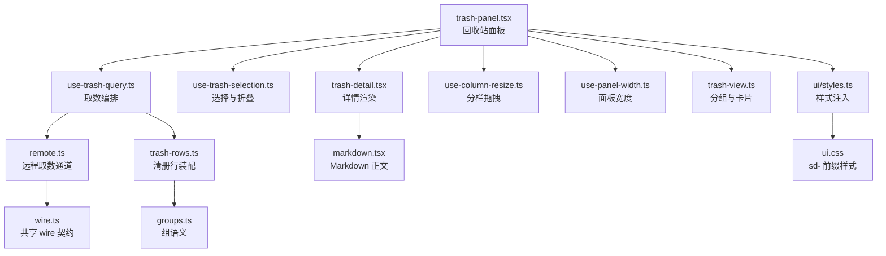
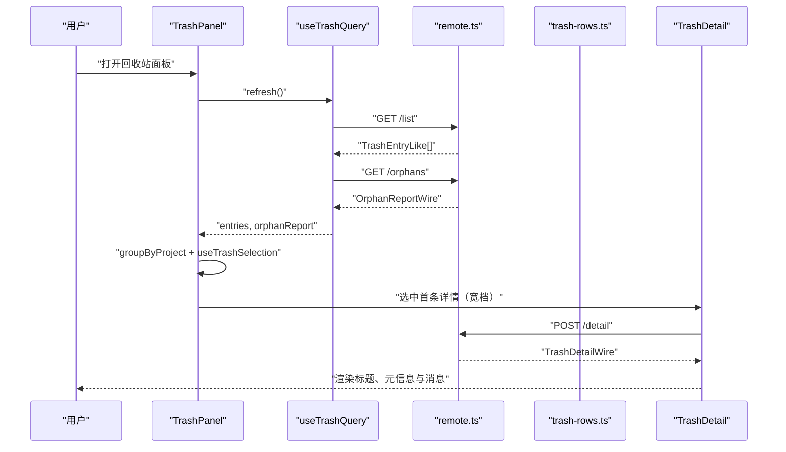
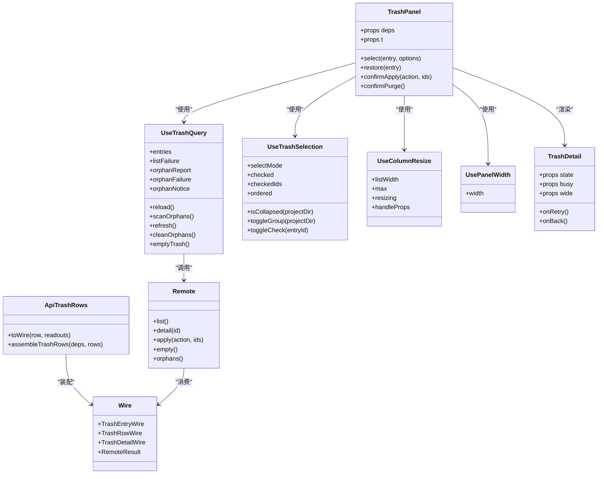
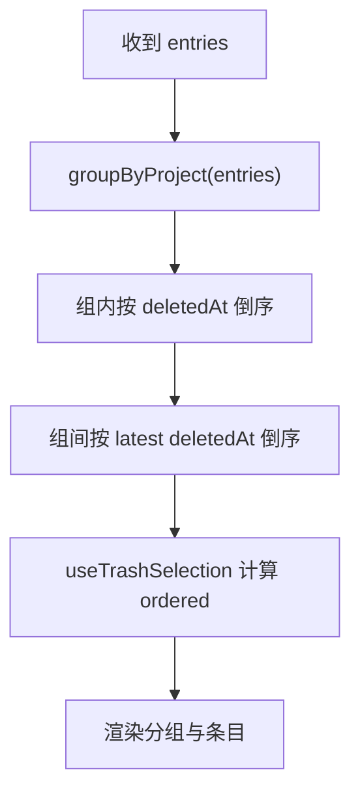
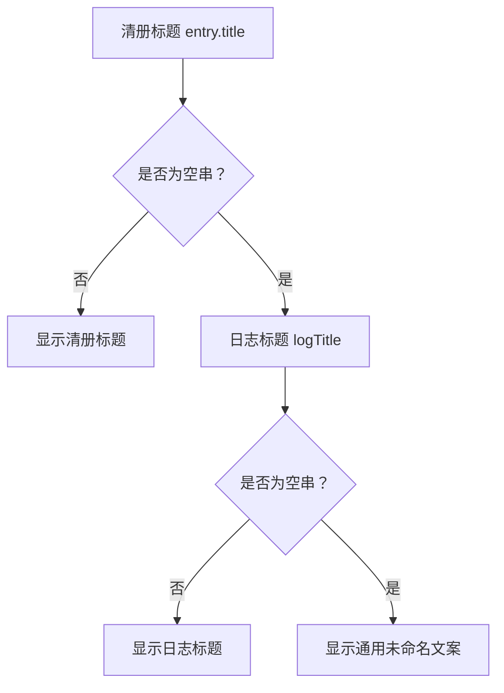
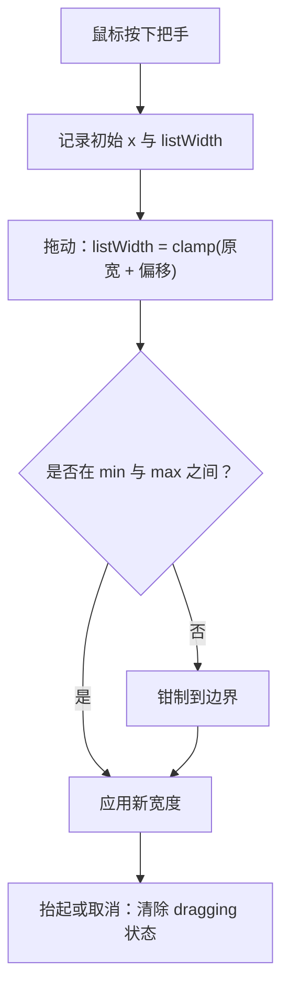
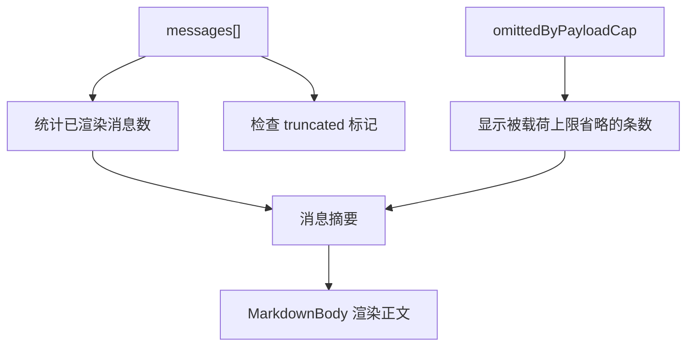
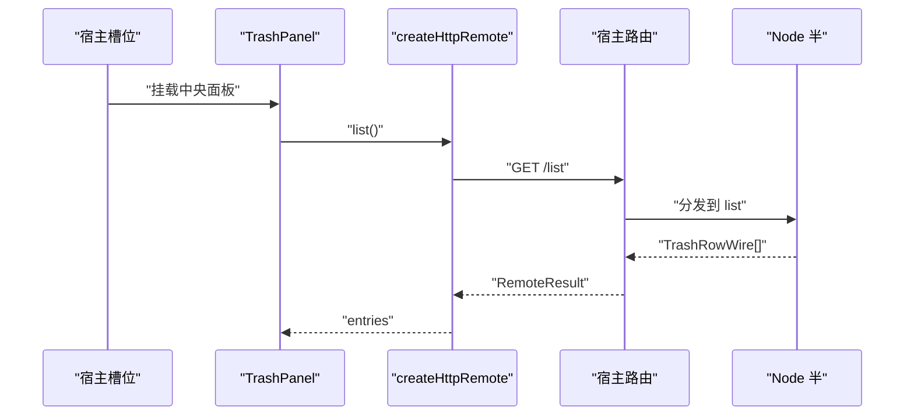
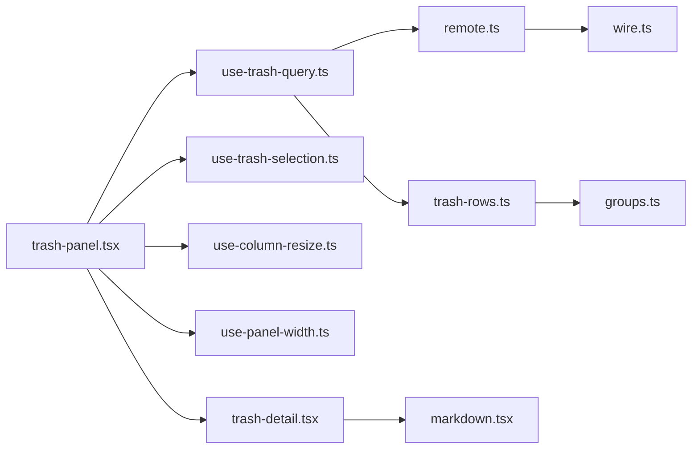

# 回收站列表面板

<cite>
**本文引用的文件**   
- [trash-panel.tsx](file://src/client/trash-panel.tsx)
- [trash-view.ts](file://src/client/trash-view.ts)
- [use-trash-query.ts](file://src/client/use-trash-query.ts)
- [use-trash-selection.ts](file://src/client/use-trash-selection.ts)
- [use-column-resize.ts](file://src/client/use-column-resize.ts)
- [use-panel-width.ts](file://src/client/use-panel-width.ts)
- [trash-detail.tsx](file://src/client/trash-detail.tsx)
- [markdown.tsx](file://src/client/markdown.tsx)
- [remote.ts](file://src/client/remote.ts)
- [wire.ts](file://src/shared/wire.ts)
- [trash-rows.ts](file://src/api/trash-rows.ts)
- [groups.ts](file://src/trash/groups.ts)
- [ui.css](file://src/client/ui/ui.css)
- [styles.ts](file://src/client/ui/styles.ts)
- [trash-entry.tsx](file://src/client/trash-entry.tsx)
- [trash-panel.test.tsx](file://tests/client/trash-panel.test.tsx)
- [use-trash-query.test.tsx](file://tests/client/use-trash-query.test.tsx)
</cite>

## 目录
1. [简介](#简介)
2. [项目结构](#项目结构)
3. [核心组件与数据流](#核心组件与数据流)
4. [架构总览](#架构总览)
5. [详细组件分析](#详细组件分析)
6. [依赖关系分析](#依赖关系分析)
7. [性能考量](#性能考量)
8. [故障排查指南](#故障排查指南)
9. [结论](#结论)

## 简介
回收站列表面板是宿主中央面板中的一个功能区域，负责展示被删除会话的分组清单、选中态、批量操作以及单条详情预览。它不是独立页面，而是通过宿主的槽位机制挂载到中央列；其布局在宽档时采用“左清单 + 右详情”的两栏模式，窄档时走下钻流程：先显示清单，点击某一行再进入该会话的详情视图。

面板需要处理三类输入：
- **数据输入**：从宿主提供的远程接口读取清册行、单条详情和孤儿扫描报告。
- **用户交互**：点击行、多选、折叠展开分组、拖拽分栏分隔条、键盘导航、右键菜单等。
- **状态输出**：更新选中项、勾选集合、详情加载态、失败消息、批量操作结果。

文档重点覆盖以下方面：
- 左侧分组清单渲染流程。
- `TrashEntry`（清册行）与 `TrashRowWire`（线上行）映射。
- 标题降级策略。
- 折叠/展开、排序规则。
- 拖拽分栏对列宽的影响。
- 选中态、悬停态、禁用态等 UI 状态。
- Markdown 预览中的截断计数逻辑。
- 组件 props、事件回调、样式扩展点与无障碍建议。
- 与宿主槽位及 wire 数据的集成方式。
- 常见问题排查方法。

## 项目结构
回收站列表面板相关代码分布在客户端层、共享 wire 契约、API 装配层、测试用例与样式模块中。核心文件职责如下：

| 文件 | 职责 |
| --- | --- |
| `src/client/trash-panel.tsx` | 回收站面板入口，负责布局、两栏切换、选择与批量动作编排。 |
| `src/client/trash-view.ts` | 卡片配方、项目名标签、按项目分组逻辑。 |
| `src/client/use-trash-query.ts` | 清册读取、孤儿扫描、清空与清理无主子会话的编排。 |
| `src/client/use-trash-selection.ts` | 多选模式、分组折叠、勾选集合与有序可见条目。 |
| `src/client/use-column-resize.ts` | 清单列与详情列之间的可拖宽度把手。 |
| `src/client/use-panel-width.ts` | 观测面板自身宽度，驱动宽窄档断点。 |
| `src/client/trash-detail.tsx` | 单条详情渲染，包括标题、元信息、消息列表与失败提示。 |
| `src/client/markdown.tsx` | Markdown 正文渲染，链接与图片安全化处理。 |
| `src/client/remote.ts` | 浏览器半取数通道，封装 fetch、信封判别与失败包装。 |
| `src/shared/wire.ts` | Node 半与浏览器半共用的 wire 类型、路由前缀、请求字段与错误形状。 |
| `src/api/trash-rows.ts` | 清册行装配为线上行，计算释放字节、子会话与残留后代。 |
| `src/trash/groups.ts` | 回收站组语义：根与会话子代归属、可见组推导。 |
| `src/client/ui/ui.css` | 插件控件 CSS，类名加 `sd-` 前缀，配色走 token。 |
| `src/client/ui/styles.ts` | 把 CSS 注入为 `<style>`，并维护指针模态。 |
| `src/client/trash-entry.tsx` | 侧栏面板图标占位，不绘制整行文本或角标。 |
| `tests/client/trash-panel.test.tsx` | 面板交互、两栏形态、下钻、动作调用等测试。 |
| `tests/client/use-trash-query.test.tsx` | 取数编排、到达序号、先清单后扫描、孤儿清理等测试。 |

**图表来源**
- [trash-panel.tsx:201-450](file://src/client/trash-panel.tsx#L201-L450)
- [use-trash-query.ts:1-178](file://src/client/use-trash-query.ts#L1-L178)
- [use-trash-selection.ts:1-133](file://src/client/use-trash-selection.ts#L1-L133)
- [trash-detail.tsx:1-200](file://src/client/trash-detail.tsx#L1-L200)
- [use-column-resize.ts:1-144](file://src/client/use-column-resize.ts#L1-L144)
- [use-panel-width.ts:1-30](file://src/client/use-panel-width.ts#L1-L30)
- [trash-view.ts:1-80](file://src/client/trash-view.ts#L1-L80)
- [remote.ts:1-200](file://src/client/remote.ts#L1-L200)
- [wire.ts:1-200](file://src/shared/wire.ts#L1-L200)
- [trash-rows.ts:1-93](file://src/api/trash-rows.ts#L1-L93)
- [groups.ts:1-83](file://src/trash/groups.ts#L1-L83)
- [markdown.tsx:1-57](file://src/client/markdown.tsx#L1-L57)
- [ui/styles.ts:1-75](file://src/client/ui/styles.ts#L1-L75)
- [ui.css:1-200](file://src/client/ui/ui.css#L1-L200)

**章节来源**
- [trash-panel.tsx:1-200](file://src/client/trash-panel.tsx#L1-L200)
- [trash-view.ts:1-80](file://src/client/trash-view.ts#L1-L80)
- [use-trash-query.ts:1-178](file://src/client/use-trash-query.ts#L1-L178)
- [use-trash-selection.ts:1-133](file://src/client/use-trash-selection.ts#L1-L133)
- [use-column-resize.ts:1-144](file://src/client/use-column-resize.ts#L1-L144)
- [use-panel-width.ts:1-30](file://src/client/use-panel-width.ts#L1-L30)
- [trash-detail.tsx:1-200](file://src/client/trash-detail.tsx#L1-L200)
- [markdown.tsx:1-57](file://src/client/markdown.tsx#L1-L57)
- [remote.ts:1-200](file://src/client/remote.ts#L1-L200)
- [wire.ts:1-200](file://src/shared/wire.ts#L1-L200)
- [trash-rows.ts:1-93](file://src/api/trash-rows.ts#L1-L93)
- [groups.ts:1-83](file://src/trash/groups.ts#L1-L83)
- [ui.css:1-200](file://src/client/ui/ui.css#L1-L200)
- [styles.ts:1-75](file://src/client/ui/styles.ts#L1-L75)

## 核心组件与数据流
回收站列表面板的核心数据流可以概括为：
1. 面板初始化时触发一次刷新。
2. 取数钩子先调用 `/list` 获取清册行。
3. 清册成功后再调用纯读接口扫描无主子会话。
4. 面板根据清册行生成分组、选择集与可视顺序。
5. 宽档且存在条目时自动选中第一条，并在右侧显示详情。
6. 用户点击某行时，优先命中详情缓存；未命中则调用 `/detail` 读取日志消息。
7. 恢复、彻底删除、清空回收站等操作通过 `/apply` 或 `/empty` 执行，成功后统一刷新。

**图表来源**
- [trash-panel.tsx:201-450](file://src/client/trash-panel.tsx#L201-L450)
- [use-trash-query.ts:1-178](file://src/client/use-trash-query.ts#L1-L178)
- [remote.ts:1-200](file://src/client/remote.ts#L1-L200)
- [trash-detail.tsx:1-200](file://src/client/trash-detail.tsx#L1-L200)

**章节来源**
- [trash-panel.tsx:201-450](file://src/client/trash-panel.tsx#L201-L450)
- [use-trash-query.ts:1-178](file://src/client/use-trash-query.ts#L1-L178)
- [remote.ts:1-200](file://src/client/remote.ts#L1-L200)
- [trash-detail.tsx:1-200](file://src/client/trash-detail.tsx#L1-L200)

## 架构总览
回收站列表面板采用分层架构：
- **表现层**：`TrashPanel`、`TrashDetail`、`TrashPanelIcon`。
- **状态层**：`useTrashQuery`、`useTrashSelection`、`useColumnResize`、`usePanelWidth`。
- **数据装配层**：`assembleTrashRows`、`toWire`、`visibleGroups`。
- **传输层**：`createHttpRemote`、`callRemote`、`unwrapRemoteResult`。
- **契约层**：`TrashEntryWire`、`TrashRowWire`、`TrashDetailWire`、`RemoteResult`。

**图表来源**
- [trash-panel.tsx:201-450](file://src/client/trash-panel.tsx#L201-L450)
- [use-trash-query.ts:1-178](file://src/client/use-trash-query.ts#L1-L178)
- [use-trash-selection.ts:1-133](file://src/client/use-trash-selection.ts#L1-L133)
- [use-column-resize.ts:1-144](file://src/client/use-column-resize.ts#L1-L144)
- [use-panel-width.ts:1-30](file://src/client/use-panel-width.ts#L1-L30)
- [trash-detail.tsx:1-200](file://src/client/trash-detail.tsx#L1-L200)
- [remote.ts:1-200](file://src/client/remote.ts#L1-L200)
- [wire.ts:1-200](file://src/shared/wire.ts#L1-L200)
- [trash-rows.ts:1-93](file://src/api/trash-rows.ts#L1-L93)

## 详细组件分析

### 左侧分组清单渲染流程
左侧分组清单由以下步骤组成：
1. 面板拿到清册数组 `entries`。
2. 调用 `groupByProject` 将条目按 `projectDir` 分组。
3. 每组内按 `deletedAt` 倒序排列，最新删除的会话排在组内顶部。
4. 组间按各组最新一条的删除时间倒序排列，刚删的项目排在最上面。
5. 选择钩子根据分组与折叠状态计算 `ordered`，即当前屏幕上从上到下的可见条目顺序。
6. 面板用 `ordered` 渲染列表，每个条目对应一个可聚焦选项。

分组标签使用 `projectLabel` 从 `projectDir` 还原项目名。如果还原结果为空或特殊值 `_no-cwd`，则显示“未知项目”文案。

**图表来源**
- [trash-view.ts:40-80](file://src/client/trash-view.ts#L40-L80)
- [use-trash-selection.ts:60-133](file://src/client/use-trash-selection.ts#L60-L133)
- [trash-panel.tsx:201-450](file://src/client/trash-panel.tsx#L201-L450)

**章节来源**
- [trash-view.ts:1-80](file://src/client/trash-view.ts#L1-L80)
- [use-trash-selection.ts:1-133](file://src/client/use-trash-selection.ts#L1-L133)
- [trash-panel.tsx:201-450](file://src/client/trash-panel.tsx#L201-L450)

### 会话条目 TrashEntry 与行数据 TrashRowWire 的映射
`TrashEntry` 是持久化清册中的一行，`TrashRowWire` 是 `/list` 返回的线上行。两者并非完全相同：
- `TrashEntryWire` 包含基础会话字段，例如 `id`、`sessionId`、`projectDir`、`workspaceId`、`wasArchived`、`deletedAt`、`title`、`sizeBytes`、可选的 `parentEntryId`。
- `TrashRowWire` 在此基础上增加现算只读字段：`releaseBytes`、`subagentCount`、`subagentBytes`、`strandedSubagents`、`strandedBytes`、`workspaceMissing`。
- `api/trash-rows.ts` 的 `toWire` 明确列出这些字段，避免用展开语法遗漏新增字段。
- `assembleTrashRows` 会把父子会话分组，并补充盘上残留后代数量与字节。

浏览器半通过 `remote.ts` 把 `TrashRowWire` 别名暴露为 `TrashEntryLike`，因此面板看到的“条目”实际上是线上行，而不是原始清册对象。

| 字段 | 含义 | 是否可缺省 |
| --- | --- | --- |
| `id` | 回收站条目 id | 否 |
| `sessionId` | 会话 id | 否 |
| `projectDir` | 项目目录标识 | 否 |
| `workspaceId` | 工作区标识 | 否 |
| `wasArchived` | 是否来自归档 | 否 |
| `deletedAt` | 删除时间戳 | 否 |
| `title` | 清册标题 | 否 |
| `sizeBytes` | 本行大小 | 否 |
| `releaseBytes` | 彻底删除会释放的总字节 | 否 |
| `subagentCount` | 随父一起进回收站的孩子数 | 是 |
| `subagentBytes` | 这些孩子的字节合计 | 是 |
| `strandedSubagents` | 盘上还存在的后代数 | 是 |
| `strandedBytes` | 盘上后代字节合计 | 是 |
| `workspaceMissing` | 工作区已不在账本 | 是 |

**章节来源**
- [wire.ts:100-200](file://src/shared/wire.ts#L100-L200)
- [trash-rows.ts:1-93](file://src/api/trash-rows.ts#L1-L93)
- [remote.ts:60-120](file://src/client/remote.ts#L60-L120)

### 标题降级策略
标题降级分为两个层次：
1. **行标题与详情标题一致**：详情组件优先使用清册中的 `entry.title`。
2. **清册标题为空时回退到日志标题**：如果 `entry.title` 为空字符串，则使用详情中的 `logTitle`。
3. **日志标题也为空时显示通用“未命名”**：最终兜底文案来自翻译键。

注意，这里的降级不是回到会话 id 或项目名。会话 id 用于选择、缓存 key、批量操作等内部逻辑；项目名用于分组标签。标题降级发生在详情头部，目的是保证“行里叫什么、点开也叫什么”。

**图表来源**
- [trash-detail.tsx:120-180](file://src/client/trash-detail.tsx#L120-L180)

**章节来源**
- [trash-detail.tsx:1-200](file://src/client/trash-detail.tsx#L1-L200)
- [wire.ts:150-200](file://src/shared/wire.ts#L150-L200)

### 折叠与展开行为
分组折叠由 `useTrashSelection` 管理：
- 每个项目组有一个折叠状态，键为 `projectDir`。
- 工具栏提供“全部折叠”和“全部展开”入口。
- 折叠的组不会出现在 `ordered` 中，但仍在 `checkedIds` 的计算范围内。
- 多选模式下，折叠组的条目仍然参与勾选统计。
- 面板本身不持久化折叠偏好，因为宿主 webview origin 不可靠，本地存储可能抛错。

**章节来源**
- [use-trash-selection.ts:1-133](file://src/client/use-trash-selection.ts#L1-L133)
- [trash-panel.tsx:201-450](file://src/client/trash-panel.tsx#L201-L450)

### 排序规则
排序规则有两层：
1. **分组排序**：`groupByProject` 先整体按 `deletedAt` 倒序，再按项目分组，最后按组内第一条的删除时间倒序。
2. **组内排序**：同一项目内的会话按删除时间倒序。
3. **可见顺序**：`useTrashSelection` 的 `ordered` 排除折叠组，保留其余组的全部条目，保持从上到下的屏幕顺序。

这意味着最近删除的项目会出现在列表顶部；同项目内，最新删除的会话排在前面。

**章节来源**
- [trash-view.ts:40-80](file://src/client/trash-view.ts#L40-L80)
- [use-trash-selection.ts:60-133](file://src/client/use-trash-selection.ts#L60-L133)

### 拖拽分栏对列宽的影响
分栏拖拽由 `useColumnResize` 实现：
- 默认清单列宽为 `LIST_COLUMN_DEFAULT`，即 420px。
- 最小清单列为 `LIST_COLUMN_MIN`，即 330px。
- 最大清单列由 `panelWidth - reserve` 决定，其中 `DETAIL_RESERVE` 是详情侧地板。
- 拖拽过程中面板根添加 `.sd-resizing`，关闭文字选中。
- 把手支持键盘：左右箭头调整一像素步长，Home 回到默认值，End 到最大值。
- 如果拖拽中途把手被卸载，window 上的 `pointerup` 与 `pointercancel` 会兜住结束状态，避免 `resizing` 永远为真。

当面板宽度小于断点 `SPLIT_MIN_WIDTH` 时，不显示详情栏，改为下钻模式。

**图表来源**
- [use-column-resize.ts:1-144](file://src/client/use-column-resize.ts#L1-L144)
- [trash-panel.tsx:201-450](file://src/client/trash-panel.tsx#L201-L450)

**章节来源**
- [use-column-resize.ts:1-144](file://src/client/use-column-resize.ts#L1-L144)
- [trash-panel.tsx:201-450](file://src/client/trash-panel.tsx#L201-L450)
- [use-panel-width.ts:1-30](file://src/client/use-panel-width.ts#L1-L30)

### UI 状态：选中、悬停、禁用
| 状态 | 行为与样式来源 |
| --- | --- |
| 选中态 | 行通过 `aria-selected="true"` 表达；卡片背景换为宿主选中 token。 |
| 悬停态 | 按钮与交互元素走宿主交互 token；危险按钮区分实心红与安静红。 |
| 禁用态 | 全局按钮在 disabled 时降低透明度并禁止光标；行尾勾选开关还有 `[aria-pressed='true']` 与禁用变体。 |
| 焦点态 | 行作为 `role="option"` 可聚焦，焦点环由 `ui.css` 中针对回收站的规则控制。 |
| 拖拽中 | 面板根挂 `.sd-resizing`，把手挂 `data-dragging`。 |

**章节来源**
- [trash-panel.tsx:1-200](file://src/client/trash-panel.tsx#L1-L200)
- [ui.css:1-200](file://src/client/ui/ui.css#L1-L200)

### Markdown 预览中的截断计数逻辑
详情正文的消息列表由 `TrashDetail` 渲染，每条消息包含：
- 角色：用户或助手。
- 时间。
- 文本内容。
- `truncated` 标记。
- 详情级 `omittedByPayloadCap`：因载荷上限而被省略的消息条数。

Markdown 正文渲染使用 `MarkdownBody`，它：
- 使用 `react-markdown` 与 `remark-gfm` 渲染表格、任务列表等。
- 把链接渲染成带 title 的纯文本，不跳转。
- 把图片渲染成说明文本，因为回收站里无法访问原图路径。
- 给外层容器加 `.sd-md`，由注入的样式表提供排版。

截断计数逻辑的关键点是：界面上必须同时显示“实际渲染了多少条消息”和“因为载荷限制省略了多少条”，不能让用户误以为这条会话本来就只有这么短内容。

**图表来源**
- [trash-detail.tsx:1-200](file://src/client/trash-detail.tsx#L1-L200)
- [markdown.tsx:1-57](file://src/client/markdown.tsx#L1-L57)
- [wire.ts:150-200](file://src/shared/wire.ts#L150-L200)

**章节来源**
- [trash-detail.tsx:1-200](file://src/client/trash-detail.tsx#L1-L200)
- [markdown.tsx:1-57](file://src/client/markdown.tsx#L1-L57)
- [wire.ts:150-200](file://src/shared/wire.ts#L150-L200)

### 组件 Props、事件回调与样式扩展点

#### 面板 Props
`TrashPanel` 主要暴露以下输入：
- `deps`：远程接口依赖，包括 `list`、`detail`、`applyOutcomes`、`emptyTrash`、`scanOrphans`。
- `t`：翻译函数，默认为中文内置翻译。

面板内部自行管理：
- 选中条目。
- 详情缓存。
- 详情加载与失败状态。
- 多选与折叠状态。
- 批量操作确认框状态。
- 面板宽度与两栏模式。

#### 详情组件 Props
`TrashDetail` 接收：
- `state`：空闲、加载中、失败、就绪四种状态。
- `busy`：是否有写操作进行中。
- `wide`：宽档是否隐藏返回按钮。
- `onRetry`：重试详情读取。
- `onBack`：窄档返回清单。

#### 事件回调
| 场景 | 回调或行为 |
| --- | --- |
| 点击行 | 宽档选中并显示详情；窄档选中并下钻。 |
| Enter 或空格 | 多选模式下勾选/取消；正常模式下选中并下钻。 |
| 方向键 | 在列表中上下移动选中项。 |
| Escape | 窄档下钻时返回清单。 |
| 拖拽分隔条 | 改变清单列宽。 |
| 右键菜单 | 由宿主槽位或上层菜单系统驱动，面板本身不直接实现右键菜单。 |
| 选择变更 | 通过 `useTrashSelection` 暴露 `checkedIds`、`groupFullyChecked`、`groupPartiallyChecked`。 |

#### 样式扩展点
- 所有控件样式类以 `sd-` 前缀命名，避免与宿主冲突。
- 颜色、圆角、阴影走宿主 token，如 `--dsw-alias-bg-layer-2`、`--dsw-radius-lg`。
- 字号与行高多为字面量 px，与宿主同类面保持一致。
- 自定义滚动条 thumb 使用 `--dsh-scrollbar-thumb` 系列属性。
- Markdown 正文使用 `.sd-md` 容器，由 `ui/styles.ts` 注入样式。
- 拖拽中面板根挂 `.sd-resizing`，把手挂 `data-dragging`。

**章节来源**
- [trash-panel.tsx:1-200](file://src/client/trash-panel.tsx#L1-L200)
- [trash-detail.tsx:1-200](file://src/client/trash-detail.tsx#L1-L200)
- [use-trash-selection.ts:1-133](file://src/client/use-trash-selection.ts#L1-L133)
- [ui.css:1-200](file://src/client/ui/ui.css#L1-L200)
- [styles.ts:1-75](file://src/client/ui/styles.ts#L1-L75)

### 无障碍建议
| 需求 | 现状与建议 |
| --- | --- |
| 键盘导航 | 列表行作为 `role="option"` 可聚焦；方向键移动选中；Enter/Space 触发动作；Esc 返回。 |
| 读屏标签 | 分隔条使用 `role="separator"` 与 `aria-label`；拖拽中提供 `aria-valuenow`、`aria-valuemin`、`aria-valuemax`。 |
| 状态播报 | 失败块使用 `role="status"`，但注释指出常驻 live region 才是稳定方案，当前属于已知边界。 |
| 焦点管理 | 下钻返回后尝试把焦点还给选中行，但焦点节点尚未进入 DOM，需借助 ref 延迟聚焦。 |
| 视觉对比 | 选中态使用宿主选中 token，浅色与深色主题都经过实测。 |
| 鼠标与键盘混合 | 使用指针模态防止 tooltip 在焦点回归时误触发。 |

**章节来源**
- [use-column-resize.ts:1-144](file://src/client/use-column-resize.ts#L1-L144)
- [trash-panel.tsx:201-450](file://src/client/trash-panel.tsx#L201-L450)
- [ui/styles.ts:40-75](file://src/client/ui/styles.ts#L40-L75)

### 与宿主槽位及 wire 数据的集成方式
回收站列表面板通过宿主中央面板槽位挂载。侧栏中的回收站图标由 `TrashPanelIcon` 提供，但它只渲染图标，不渲染行文本或角标；整行由宿主 `PanelRow` 渲染，因此回收站插件不应重复绘制行主体。

wire 集成要点：
- 浏览器半通过 `createHttpRemote` 调用宿主前缀路由。
- 路由段名集中在 `shared/wire.ts` 的 `ROUTES` 中。
- 清册行线上形状为 `TrashRowWire`，浏览器半将其别名为 `TrashEntryLike`。
- 详情线上形状为 `TrashDetailWire`，包含消息列表、模型、对话轮次与截断信息。
- 批量动作通过 `/apply` 发送，单条动作也是长度为 1 的批量。
- 清空回收站走 `/empty`，返回聚合回执。
- 孤儿扫描走 `/orphans`，仅报告；清理走 `/apply` 的第五个动作。

**图表来源**
- [remote.ts:120-200](file://src/client/remote.ts#L120-L200)
- [wire.ts:1-120](file://src/shared/wire.ts#L1-L120)
- [trash-panel.tsx:1-200](file://src/client/trash-panel.tsx#L1-L200)
- [trash-entry.tsx:1-30](file://src/client/trash-entry.tsx#L1-L30)

**章节来源**
- [remote.ts:1-200](file://src/client/remote.ts#L1-L200)
- [wire.ts:1-200](file://src/shared/wire.ts#L1-L200)
- [trash-entry.tsx:1-30](file://src/client/trash-entry.tsx#L1-L30)
- [trash-panel.tsx:1-200](file://src/client/trash-panel.tsx#L1-L200)

## 依赖关系分析
回收站列表面板的依赖具有清晰的分层：
- 面板依赖取数钩子、选择钩子、宽度钩子、分栏钩子、详情组件与分组逻辑。
- 取数钩子依赖远程接口与翻译。
- 详情组件依赖 Markdown 渲染与翻译。
- 远程接口依赖共享 wire 契约。
- API 装配依赖组语义、端口与动词。

**图表来源**
- [trash-panel.tsx:201-450](file://src/client/trash-panel.tsx#L201-L450)
- [use-trash-query.ts:1-178](file://src/client/use-trash-query.ts#L1-L178)
- [remote.ts:1-200](file://src/client/remote.ts#L1-L200)
- [wire.ts:1-200](file://src/shared/wire.ts#L1-L200)
- [trash-rows.ts:1-93](file://src/api/trash-rows.ts#L1-L93)
- [groups.ts:1-83](file://src/trash/groups.ts#L1-L83)
- [trash-detail.tsx:1-200](file://src/client/trash-detail.tsx#L1-L200)
- [markdown.tsx:1-57](file://src/client/markdown.tsx#L1-L57)

**章节来源**
- [trash-panel.tsx:201-450](file://src/client/trash-panel.tsx#L201-L450)
- [use-trash-query.ts:1-178](file://src/client/use-trash-query.ts#L1-L178)
- [remote.ts:1-200](file://src/client/remote.ts#L1-L200)
- [wire.ts:1-200](file://src/shared/wire.ts#L1-L200)
- [trash-rows.ts:1-93](file://src/api/trash-rows.ts#L1-L93)
- [groups.ts:1-83](file://src/trash/groups.ts#L1-L83)
- [trash-detail.tsx:1-200](file://src/client/trash-detail.tsx#L1-L200)
- [markdown.tsx:1-57](file://src/client/markdown.tsx#L1-L57)

## 性能考量
回收站列表面板在设计注释中多次强调性能问题：
- 详情缓存：面板存活期内每条会话详情只读一次，本机经验是单条约 135ms，125 条全读约 2.0s。
- Markdown 渲染：`MarkdownBody` 使用 `memo`，因为底层解析没有 memoization，每次重渲染都会重新解析。
- 取数顺序：后发的读数先落地、先发后落地的旧响应会被丢弃，避免旧数据盖掉新数据。
- 先清单后扫描：孤儿扫描依赖对账后的清册，不能并行抢占。
- 两栏断点：面板宽度由 ResizeObserver 观测，避免侧栏折叠导致断点判断错误。
- 长清单滚动：面板自带滚动容器，不把高度撑满宿主中央列。

优化建议：
- 不要在清单行内做重型计算，尽量复用 `releaseBytes` 等已由后端计算的字段。
- 避免在悬停或焦点变化时触发详情读取。
- 长 Markdown 正文应避免频繁重建处理器。
- 分批大动作应走 `/apply` 批量接口，不要循环单次请求。

**章节来源**
- [trash-panel.tsx:201-450](file://src/client/trash-panel.tsx#L201-L450)
- [markdown.tsx:30-57](file://src/client/markdown.tsx#L30-L57)
- [use-trash-query.test.tsx:1-151](file://tests/client/use-trash-query.test.tsx#L1-L151)
- [use-panel-width.ts:1-30](file://src/client/use-panel-width.ts#L1-L30)

## 故障排查指南

### 长会话预览卡顿
**现象**：选中某条会话后详情加载慢，或切换会话时 Markdown 渲染明显抖动。  
**可能原因**：
- 详情未命中缓存，正在发起 `/detail`。
- Markdown 正文过长，`MarkdownBody` 每次渲染都重新解析。
- 大量会话一次性预读。

**排查步骤**：
1. 检查是否已命中 `detailCache`。
2. 查看详情加载态是否仍显示。
3. 确认 Markdown 正文长度与消息条数。
4. 避免在悬停或焦点事件中触发详情读取。

**章节来源**
- [trash-panel.tsx:201-450](file://src/client/trash-panel.tsx#L201-L450)
- [markdown.tsx:30-57](file://src/client/markdown.tsx#L30-L57)

### 分组标签不显示或显示异常
**现象**：项目名显示为“未知项目”，或分组未按预期出现。  
**可能原因**：
- `projectDir` 还原后为空或 `_no-cwd`。
- 清册中缺少 `projectDir` 字段。
- 分组逻辑中父行不存在或父行自己也是孩子，导致该会话不进入可见组。

**排查步骤**：
1. 检查清册行中的 `projectDir`。
2. 确认 `projectLabel` 的回退逻辑。
3. 检查 `visibleGroups` 是否把该行归入根组。
4. 确认 `/list` 返回的 `TrashRowWire` 是否携带必要字段。

**章节来源**
- [trash-view.ts:1-80](file://src/client/trash-view.ts#L1-L80)
- [groups.ts:1-83](file://src/trash/groups.ts#L1-L83)
- [trash-rows.ts:1-93](file://src/api/trash-rows.ts#L1-L93)

### 拖分栏后布局错乱
**现象**：拖拽后面板始终处于 `.sd-resizing` 状态，或列宽超出预期。  
**可能原因**：
- 拖拽中途把手被卸载，window 上的结束监听未兜住。
- 面板宽度断点判断使用了 `window.innerWidth` 而非面板自身宽度。
- `reserve` 与 `min` 配置不匹配实际详情可读宽度。

**排查步骤**：
1. 检查面板根是否仍有 `.sd-resizing`。
2. 确认 `usePanelWidth` 观测的是面板元素而非 window。
3. 核对 `LIST_COLUMN_MIN`、`DETAIL_RESERVE` 与断点 `SPLIT_MIN_WIDTH`。
4. 验证键盘 Home/End 是否能回到默认或最大宽度。

**章节来源**
- [use-column-resize.ts:1-144](file://src/client/use-column-resize.ts#L1-L144)
- [use-panel-width.ts:1-30](file://src/client/use-panel-width.ts#L1-L30)
- [trash-panel.tsx:201-450](file://src/client/trash-panel.tsx#L201-L450)

### 选中态与多选不一致
**现象**：折叠组内勾选状态与屏幕可见行数不一致，或退出多选后仍有勾选残留。  
**可能原因**：
- 勾选集合未随清册刷新清理已删除条目。
- 多选模式退出时未清空勾选集合。
- 折叠状态与 `ordered` 计算不同步。

**排查步骤**：
1. 检查 `entries` 变化时是否过滤掉不存在的 `checked` id。
2. 检查 `exitSelect` 是否同时关闭多选模式并清空集合。
3. 确认 `checkedIds` 基于完整分组计算，而不是仅基于可见行。

**章节来源**
- [use-trash-selection.ts:1-133](file://src/client/use-trash-selection.ts#L1-L133)

### 标题显示不符合预期
**现象**：详情标题显示为“未命名”，或行标题与详情标题不一致。  
**可能原因**：
- 清册标题为空，且日志标题也为空。
- 详情尚未加载完成，`logTitle` 暂不可用。
- 把会话 id 当成标题降级目标，但实际降级目标是日志标题。

**排查步骤**：
1. 检查清册行 `title` 是否为空串。
2. 检查详情 `logTitle` 是否为空串。
3. 确认标题降级顺序：清册标题 → 日志标题 → 通用未命名。

**章节来源**
- [trash-detail.tsx:120-180](file://src/client/trash-detail.tsx#L120-L180)
- [wire.ts:150-200](file://src/shared/wire.ts#L150-L200)

### 远程取数失败
**现象**：清单显示“读不到”，或孤儿扫描报失败。  
**可能原因**：
- 宿主路由未挂载。
- 返回的不是信封格式。
- 网络请求失败。
- 服务端返回带标记位的远程错误。

**排查步骤**：
1. 检查 `/ping` 是否可达。
2. 检查浏览器控制台是否出现“取数通道打不通”或“取数通道回的不是信封”。
3. 检查失败消息是否来自 `failureOf`。
4. 确认 `listFailure` 与 `orphanFailure` 分别对应清册与孤儿扫描。

**章节来源**
- [remote.ts:1-200](file://src/client/remote.ts#L1-L200)
- [use-trash-query.ts:1-178](file://src/client/use-trash-query.ts#L1-L178)

## 结论
回收站列表面板是一个以面板为中心、钩子拆分状态、wire 约定跨半通信的前端组件。它的核心能力包括：
- 按项目分组并倒序展示回收站会话。
- 在宽窄档之间切换布局。
- 管理选中、多选、折叠与详情下钻。
- 把清册行映射为线上行，并显示释放字节、子会话与残留后代。
- 对标题进行清册优先、日志兜底的降级。
- 安全渲染 Markdown 正文并显式提示截断条数。
- 通过 token 与 `sd-` 前缀类名与宿主主题和解耦。
- 提供键盘导航、焦点管理与拖拽分栏的可访问性基础。

在实际使用中，应优先关注三个层面：
1. **数据正确性**：确保清册、详情与孤儿报告的数据链路一致。
2. **交互一致性**：保持行选中、多选、折叠与批量操作的语义一致。
3. **样式与可访问性**：遵循 token 与 `sd-` 前缀规范，并提供完整的键盘与读屏支持。