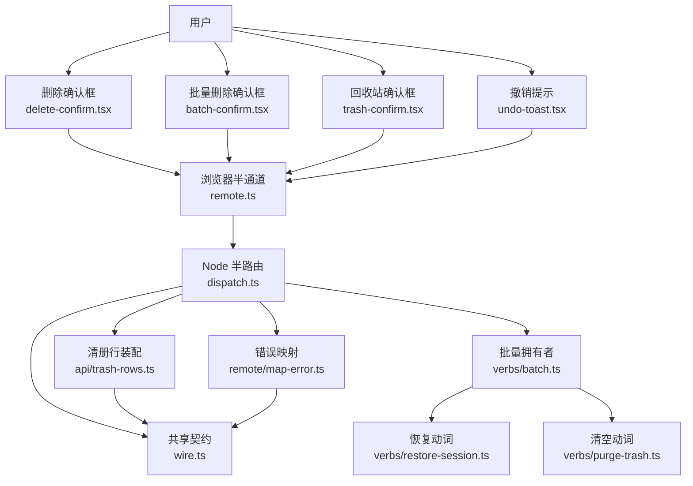
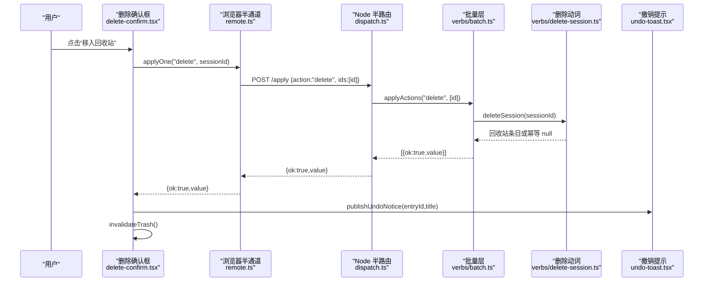
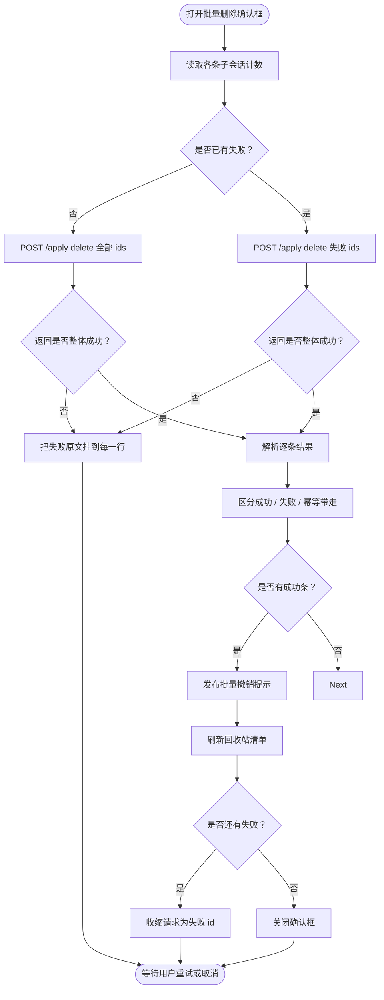
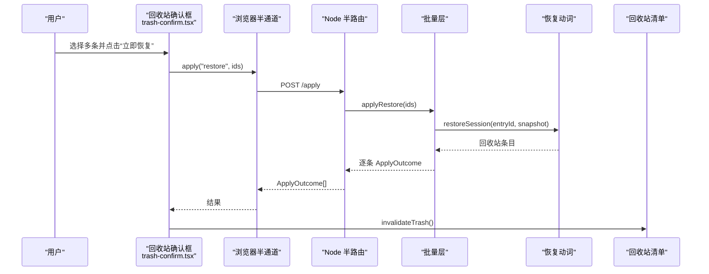
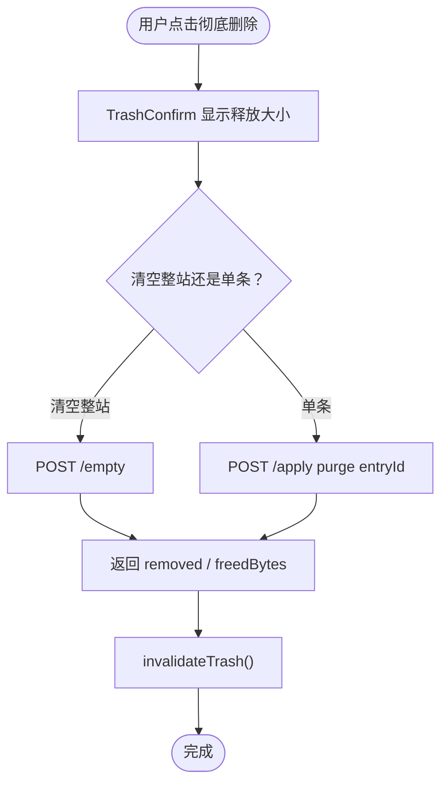
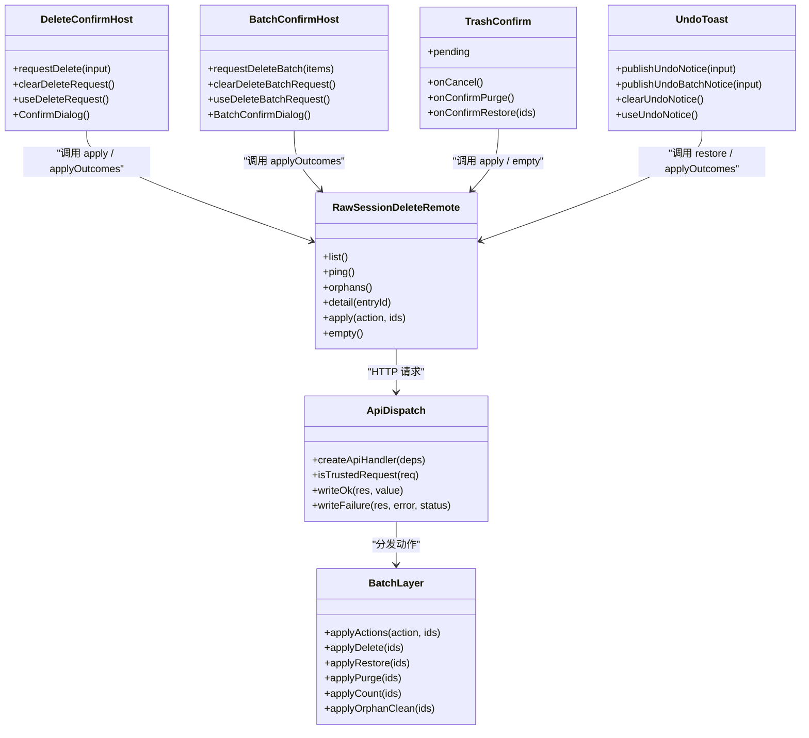
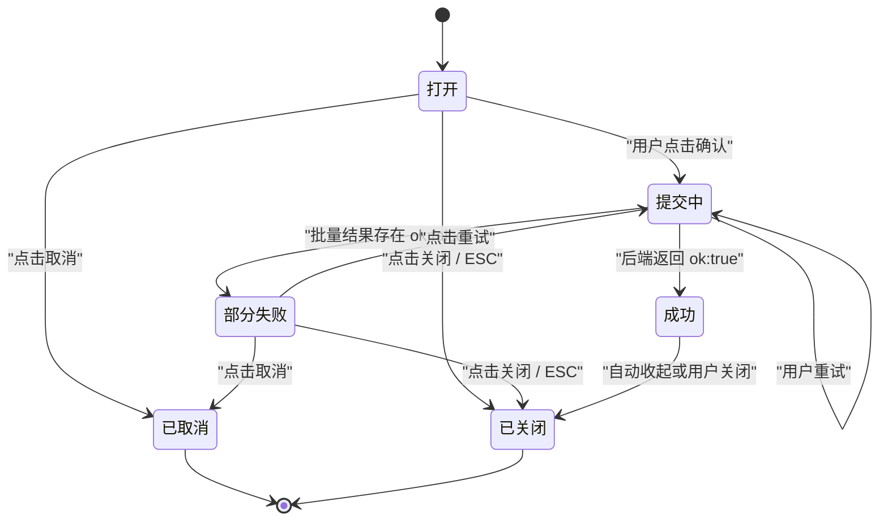

# 回收站确认与操作交互

<cite>
**本文引用的文件**   
- [README.md](file://README.md)
- [docs/design/2026-09-30-session-delete-design.md](file://docs/design/2026-09-30-session-delete-design.md)
- [locale/zh.json](file://locale/zh.json)
- [locale/en.json](file://locale/en.json)
- [src/client/delete-confirm.tsx](file://src/client/delete-confirm.tsx)
- [src/client/batch-confirm.tsx](file://src/client/batch-confirm.tsx)
- [src/client/trash-confirm.tsx](file://src/client/trash-confirm.tsx)
- [src/client/trash-detail.tsx](file://src/client/trash-detail.tsx)
- [src/client/trash-entry.tsx](file://src/client/trash-entry.tsx)
- [src/client/trash-view.ts](file://src/client/trash-view.ts)
- [src/client/undo-toast.tsx](file://src/client/undo-toast.tsx)
- [src/client/remote.ts](file://src/client/remote.ts)
- [src/api/dispatch.ts](file://src/api/dispatch.ts)
- [src/api/trash-rows.ts](file://src/api/trash-rows.ts)
- [src/shared/wire.ts](file://src/shared/wire.ts)
- [src/verbs/batch.ts](file://src/verbs/batch.ts)
- [src/verbs/restore-session.ts](file://src/verbs/restore-session.ts)
- [src/verbs/purge-trash.ts](file://src/verbs/purge-trash.ts)
- [src/verbs/errors.ts](file://src/verbs/errors.ts)
- [src/remote/map-error.ts](file://src/remote/map-error.ts)
</cite>

## 目录
1. [引言](#引言)
2. [项目结构与入口](#项目结构与入口)
3. [核心交互流程](#核心交互流程)
4. [架构总览](#架构总览)
5. [详细组件分析](#详细组件分析)
6. [后端动词层与通信路径](#后端动词层与通信路径)
7. [状态机：二次确认对话框](#状态机二次确认对话框)
8. [本地化、可访问性与移动端适配](#本地化可访问性与移动端适配)
9. [配置选项](#配置选项)
10. [性能与批量语义](#性能与批量语义)
11. [故障排查指南](#故障排查指南)
12. [结论](#结论)

## 引言
本文件聚焦“回收站的删除、恢复与清空”的确认与操作交互，覆盖从用户选中一行或多行到二次确认框、提交、结果反馈、撤销入口的完整链路。重点说明以下边界：

- **单个会话删除**：进入宿主菜单上的二次确认框；成功后弹出 6 秒撤销提示。
- **批量删除**：通过宿主会话列表多选浮条发起；一次 `apply('delete', ids)`，部分失败不关框，按钮变为“重试这 N 条”。
- **单条恢复**：回收站清单行直接执行，不再弹确认框。
- **批量恢复**：回收站工具栏多选后先弹确认框，逐条执行，失败不连坐。
- **彻底删除 / 清空回收站**：共用同一张回收站确认框，区分“一条释放多少”和“整站对账后再清”。
- **无主残留清理**：独立扫描报告 + 独立确认框，属于“盘上直接删”，不走回收站。

## 项目结构与入口
回收站相关代码按“浏览器半 UI → 通道 → Node 半路由 → 动词层 → 文件系统/宿主端口”分层组织：

| 层次 | 主要文件 | 职责 |
|---|---|---|
| 浏览器半 UI | `delete-confirm.tsx`、`batch-confirm.tsx`、`trash-confirm.tsx`、`trash-detail.tsx`、`undo-toast.tsx` | 渲染删除确认、批量确认、回收站确认、详情、撤销横幅 |
| 浏览器半通道 | `remote.ts` | 同源 fetch `/dsh-session-delete-api`，统一信封与失败转换 |
| Node 半路由 | `dispatch.ts`、`trash-rows.ts` | 栅栏、路由分发、请求体校验、清册行装配 |
| 动词层 | `batch.ts`、`restore-session.ts`、`purge-trash.ts`、`errors.ts` | 批量去重、幂等、回滚、日志、错误码 |
| 共享契约 | `wire.ts` | API 前缀、段名、动作、信封、失败形状 |
| 错误映射 | `map-error.ts` | 宿主类型化错误 → `live` / `not-found`，动词码原样过桥 |

**图示来源**
- [src/client/delete-confirm.tsx:1-194](file://src/client/delete-confirm.tsx#L1-L194)
- [src/client/batch-confirm.tsx:1-237](file://src/client/batch-confirm.tsx#L1-L237)
- [src/client/trash-confirm.tsx:1-224](file://src/client/trash-confirm.tsx#L1-L224)
- [src/client/undo-toast.tsx:1-151](file://src/client/undo-toast.tsx#L1-L151)
- [src/client/remote.ts:1-200](file://src/client/remote.ts#L1-L200)
- [src/api/dispatch.ts:1-200](file://src/api/dispatch.ts#L1-L200)
- [src/api/trash-rows.ts:1-93](file://src/api/trash-rows.ts#L1-L93)
- [src/shared/wire.ts:1-200](file://src/shared/wire.ts#L1-L200)
- [src/verbs/batch.ts:1-197](file://src/verbs/batch.ts#L1-L197)
- [src/verbs/restore-session.ts:1-173](file://src/verbs/restore-session.ts#L1-L173)
- [src/verbs/purge-trash.ts:1-121](file://src/verbs/purge-trash.ts#L1-L121)
- [src/remote/map-error.ts:1-134](file://src/remote/map-error.ts#L1-L134)

**章节来源**
- [README.md:1-147](file://README.md#L1-L147)
- [docs/design/2026-09-30-session-delete-design.md:1-81](file://docs/design/2026-09-30-session-delete-design.md#L1-L81)

## 核心交互流程
### 1. 单个会话删除
1. 用户在宿主会话行的“⋯”菜单点击“删除”。
2. 菜单项只写模块级删除请求，然后关闭菜单；真正确认框由挂在 `shell.overlay` 上的 `DeleteConfirmHost` 渲染。
3. 确认框显示目标会话标题、子会话数（若可读）、警告文案与失败原文。
4. 用户点确认后，调用 `applyOne(deps, 'delete', sessionId)`。
5. 成功时：
   - 清空当前删除请求；
   - 使回收站清单失效并重读；
   - 发布撤销提示（含条目 id 与删除时的标题）。
6. 失败时：
   - 保持 busy 结束；
   - 在确认框内以危险标签显示失败消息；
   - 用户可以再次点击确认重试。

**图示来源**
- [src/client/delete-confirm.tsx:100-194](file://src/client/delete-confirm.tsx#L100-L194)
- [src/client/remote.ts:120-200](file://src/client/remote.ts#L120-L200)
- [src/api/dispatch.ts:120-200](file://src/api/dispatch.ts#L120-L200)
- [src/verbs/batch.ts:100-160](file://src/verbs/batch.ts#L100-L160)
- [src/client/undo-toast.tsx:60-151](file://src/client/undo-toast.tsx#L60-L151)

### 2. 批量删除
1. 用户在宿主会话列表开启多选，勾选若干行。
2. 浮条点击“移入回收站 N 条”触发批量确认框。
3. 批量确认框列出每条目标，并汇总子会话数。
4. 首次运行发送全部 id；若首轮部分失败，按钮文本变为“重试这 N 条”，仅对失败 id 再发一次。
5. 成功后：
   - 发布批量撤销提示；
   - 刷新回收站清单；
   - 若仍有失败则保留失败名单，允许继续重试。

**图示来源**
- [src/client/batch-confirm.tsx:1-237](file://src/client/batch-confirm.tsx#L1-L237)
- [src/verbs/batch.ts:60-140](file://src/verbs/batch.ts#L60-L140)
- [src/client/undo-toast.tsx:60-151](file://src/client/undo-toast.tsx#L60-L151)

### 3. 回收站恢复
- **单条恢复**：点击清单行的恢复按钮，直接执行 `apply('restore', [entryId])`，不弹确认框。
- **批量恢复**：回收站工具栏多选后弹出 `TrashConfirm`，展示待恢复条目及其原项目目录；确认后逐条恢复。
- 恢复成功后，对应行从回收站消失；失败行保留失败原文，不影响其他行。

**图示来源**
- [src/client/trash-confirm.tsx:1-200](file://src/client/trash-confirm.tsx#L1-L200)
- [src/verbs/batch.ts:120-170](file://src/verbs/batch.ts#L120-L170)
- [src/verbs/restore-session.ts:1-173](file://src/verbs/restore-session.ts#L1-L173)

### 4. 彻底删除与清空回收站
- 单条“彻底删除…”与页脚“清空回收站…”共用 `TrashConfirm`。
- 单条卡片会显示“这一次会释放多少”，包括父会话、跟随进来的孩子、以及仍留在盘上的后代。
- “清空回收站…”会在执行前先对账，手工放进 `session-trash/` 且能被识别的目录也归它管。
- 清空完成后刷新回收站清单。

**图示来源**
- [src/client/trash-confirm.tsx:1-200](file://src/client/trash-confirm.tsx#L1-L200)
- [src/api/dispatch.ts:160-200](file://src/api/dispatch.ts#L160-L200)
- [src/verbs/purge-trash.ts:1-121](file://src/verbs/purge-trash.ts#L1-L121)

## 架构总览
系统采用薄插件架构：浏览器半只负责交互与取数，Node 半只做传输与动词编排，实际数据落盘由宿主端口与文件系统完成。

**图示来源**
- [src/client/delete-confirm.tsx:1-194](file://src/client/delete-confirm.tsx#L1-L194)
- [src/client/batch-confirm.tsx:1-237](file://src/client/batch-confirm.tsx#L1-L237)
- [src/client/trash-confirm.tsx:1-224](file://src/client/trash-confirm.tsx#L1-L224)
- [src/client/undo-toast.tsx:1-151](file://src/client/undo-toast.tsx#L1-L151)
- [src/client/remote.ts:1-200](file://src/client/remote.ts#L1-L200)
- [src/api/dispatch.ts:1-200](file://src/api/dispatch.ts#L1-L200)
- [src/verbs/batch.ts:1-197](file://src/verbs/batch.ts#L1-L197)

## 详细组件分析

### 删除确认框：单条删除
- 作为宿主挂载在 `shell.overlay` 上的常驻组件，避免被菜单行卸载影响。
- 使用模块级 store 保存当前 `DeleteRequest`，并通过 `useSyncExternalStore` 订阅。
- 打开时异步查询子会话数；读不到不假报 0，也不阻断删除。
- 提交时设置 `busy=true`，成功后发布撤销通知并刷新回收站清单。
- 失败时不关框，失败消息以危险标签显示，用户可重试。

关键行为约束：
- 失败原文必须能上屏。
- 删除按组走，但界面不替用户终止正在运行的会话。
- 单条撤销提示需要回收站条目 id，若幂等值为 null，则不发布无落点的撤销。

**章节来源**
- [src/client/delete-confirm.tsx:1-194](file://src/client/delete-confirm.tsx#L1-L194)

### 批量删除确认框
- 同样挂在 `shell.overlay`，与单删确认框复用目标卡样式和子会话提示。
- 维护模块级 `BatchDeleteRequest`，每次选批递增 `seq`，换批重挂载。
- 开框时一次性读取所有目标子会话计数；重试轮不重新问。
- 执行分两阶段：
  - 首轮全部；
  - 后续只对失败 id。
- 成功后发布批量撤销提示，并让回收站面板重读。
- 失败不关框，按钮文案根据剩余失败数动态变化。

**章节来源**
- [src/client/batch-confirm.tsx:1-237](file://src/client/batch-confirm.tsx#L1-L237)

### 回收站确认框
- 同时承担两类用途：
  - 彻底删除：单条、整站、多选批量。
  - 批量恢复：先列条目与原项目去向，再执行。
- 当 `pending.kind === 'restore'` 时，标题带条数，正文说明恢复去向；否则显示“不可恢复”警告。
- 单条卡片显示标题、项目目录、释放大小；释放大小来自 Node 半计算的 `releaseBytes`，界面不自己算。
- `busy` 期间拦截关闭与取消，防止批量在执行中被关闭造成误判。

**章节来源**
- [src/client/trash-confirm.tsx:1-224](file://src/client/trash-confirm.tsx#L1-L224)
- [src/client/trash-view.ts:1-80](file://src/client/trash-view.ts#L1-L80)

### 撤销提示
- 使用模块级通知台，挂在 `shell.overlay`。
- 支持两种形态：
  - 单条：`kind='one'`，用条目 id 调用 `restore`。
  - 批量：`kind='batch'`，用条目 id 列表调用 `applyOutcomes('restore', ids)`。
- 默认停留 6 秒；失败时不换另一个 Toast，而是把原因替换到同一条横幅上。
- 若没有可撤销的条目 id，则只显示正文，不出“撤销”按钮。

**章节来源**
- [src/client/undo-toast.tsx:1-151](file://src/client/undo-toast.tsx#L1-L151)

### 回收站详情与清单
- 详情块本身不取数，由上层面板管理加载、失败与重试。
- 详情只展示真实提问与助手文字，宿主注入上下文与工具调用不进正文。
- 助手正文按 Markdown 排版，用户提问保持原话。
- 列表行图标由 `trash-entry.tsx` 提供，实际行本体由宿主 PanelRow 绘制，插件侧不重复渲染按钮或角标。

**章节来源**
- [src/client/trash-detail.tsx:1-323](file://src/client/trash-detail.tsx#L1-L323)
- [src/client/trash-entry.tsx:1-30](file://src/client/trash-entry.tsx#L1-L30)

## 后端动词层与通信路径

### 通信信封
浏览器半与 Node 半之间的通信信封是：

- 成功：`{ ok: true, value }`
- 失败：`{ ok: false, error: { code, message, details? } }`

只有往返本身失败（打不通、响应不是信封）才抛异常；业务失败一律 resolve 成 `ok:false`。

**章节来源**
- [src/shared/wire.ts:120-200](file://src/shared/wire.ts#L120-L200)
- [src/client/remote.ts:1-120](file://src/client/remote.ts#L1-L120)
- [src/api/dispatch.ts:100-160](file://src/api/dispatch.ts#L100-L160)

### API 端点
| 端点 | 方法 | 用途 | 返回值语义 |
|---|---:|---|---|
| `/list` | GET | 对账并列出回收站行 | `TrashRowWire[]` |
| `/ping` | GET | 通道探测 | 字符串探针值 |
| `/detail` | POST | 读取单条回收站日志与元信息 | `TrashDetailWire` |
| `/apply` | POST | 批量执行一个动作 | `ApplyOutcome[]` |
| `/empty` | POST | 清空回收站 | `PurgeStatsWire` |
| `/orphans` | GET | 扫描无主子会话 | `OrphanReportWire` |

**章节来源**
- [src/shared/wire.ts:20-120](file://src/shared/wire.ts#L20-L120)
- [src/client/remote.ts:160-200](file://src/client/remote.ts#L160-L200)
- [src/api/dispatch.ts:160-200](file://src/api/dispatch.ts#L160-L200)

### 动词层职责
- `batch.ts`：唯一拥有“这一批”的语义，负责去重、快照、逐条信封、一批一次通告。
- `restore-session.ts`：按组恢复，顺序与删除相反，失败回滚。
- `purge-trash.ts`：彻底删除整组及盘上后代，部分成功不回滚，只给聚合回执。
- `errors.ts`：构造动词错误、路由自检错误、回滚失败合并。
- `map-error.ts`：将宿主类型化错误映射为 `live` / `not-found`，并把结构化字段放入 `details`。

**章节来源**
- [src/verbs/batch.ts:1-197](file://src/verbs/batch.ts#L1-L197)
- [src/verbs/restore-session.ts:1-173](file://src/verbs/restore-session.ts#L1-L173)
- [src/verbs/purge-trash.ts:1-121](file://src/verbs/purge-trash.ts#L1-L121)
- [src/verbs/errors.ts:1-82](file://src/verbs/errors.ts#L1-L82)
- [src/remote/map-error.ts:1-134](file://src/remote/map-error.ts#L1-L134)

## 状态机：二次确认对话框
本节描述三类二次确认框的共同状态：

规则：
- **打开**：显示目标、规模、风险说明与确认按钮。
- **提交中**：禁用取消与确认按钮；关闭事件被拦截，避免用户以为没动。
- **成功**：单删发布撤销提示，批量刷新回收站并可能收缩失败名单。
- **部分失败**：保留失败原文，按钮文案变为“重试这 N 条”。
- **已取消**：用户主动放弃。
- **已关闭**：非 busy 状态下关闭，或成功后收起。

**图示来源**
- [src/client/delete-confirm.tsx:100-194](file://src/client/delete-confirm.tsx#L100-L194)
- [src/client/batch-confirm.tsx:120-237](file://src/client/batch-confirm.tsx#L120-L237)
- [src/client/trash-confirm.tsx:1-200](file://src/client/trash-confirm.tsx#L1-L200)
- [src/client/undo-toast.tsx:60-151](file://src/client/undo-toast.tsx#L60-L151)

## 本地化、可访问性与移动端适配

### 本地化文案来源
- 插件元信息的中文与英文标题、描述分别位于 `locale/zh.json` 与 `locale/en.json`。
- 界面文案通过宿主的 locale 服务获取，键名集中在 UI 组件中调用的翻译函数里。
- 当宿主 locale 服务不可用时，浏览器半使用内置中文翻译。

需要注意：
- `locale/zh.json` 与 `locale/en.json` 目前只包含插件元信息；具体对话框文案键（如 `trash.confirm.purge`、`common.cancel`、`dialog.title`）应视为宿主提供的翻译键，而不是这两个文件的内容。
- README 明确说明：界面语言跟随宿主设置；服务不可用时退回内置中文。

**章节来源**
- [locale/zh.json:1-6](file://locale/zh.json#L1-L6)
- [locale/en.json:1-6](file://locale/en.json#L1-L6)
- [README.md:1-147](file://README.md#L1-L147)
- [src/client/delete-confirm.tsx:1-194](file://src/client/delete-confirm.tsx#L1-L194)
- [src/client/batch-confirm.tsx:1-237](file://src/client/batch-confirm.tsx#L1-L237)
- [src/client/trash-confirm.tsx:1-224](file://src/client/trash-confirm.tsx#L1-L224)

### 可访问性要求
- **焦点管理**：确认框使用宿主 `Modal` 组件；取消按钮与确认按钮都是 `<Button>`，符合宿主 UI 组件约定。
- **ESC 关闭**：`Modal` 的 `onClose` 在非 busy 状态下回调 `onCancel`，因此取消与关闭语义一致。
- **确认按钮默认聚焦**：当前实现未显式设置确认按钮为默认焦点；若需满足无障碍规范，应在确认框打开后将焦点聚焦到确认按钮。
- **屏幕阅读器**：详情失败区域使用 `role="status"`，帮助读屏器把失败消息当作状态播报。
- **危险操作视觉**：批量删除与清空回收站使用统一的实心红色主按钮样式，与宿主 danger 按钮风格对齐。

**章节来源**
- [src/client/trash-detail.tsx:120-200](file://src/client/trash-detail.tsx#L120-L200)
- [src/client/trash-confirm.tsx:1-200](file://src/client/trash-confirm.tsx#L1-L200)
- [src/client/trash-view.ts:1-80](file://src/client/trash-view.ts#L1-L80)

### 移动端适配注意事项
- 批量确认框的目标卡片列表内部滚动，最大高度固定，保证头与底部按钮始终可见。
- 回收站详情在小屏下切换为下钻模式，出现“返回清单”按钮。
- 项目名、会话标题使用省略号处理，避免长串溢出。
- 文档未定义明确的断点与触摸目标尺寸；若新增按钮或交互，应补充最小触摸面积、横向滚动保护与键盘导航测试。

**章节来源**
- [src/client/batch-confirm.tsx:140-237](file://src/client/batch-confirm.tsx#L140-L237)
- [src/client/trash-detail.tsx:1-200](file://src/client/trash-detail.tsx#L1-L200)
- [src/client/trash-view.ts:40-80](file://src/client/trash-view.ts#L40-L80)

## 配置选项
当前仓库中没有暴露面向用户的运行时配置文件来开关这些行为。下列选项应以“未来扩展建议”的形式记录，不应理解为现有默认行为：

| 配置项 | 当前行为 | 建议的未来配置语义 |
|---|---|---|
| 是否允许跳过二次确认 | 不允许；删除、批量删除、彻底删除、清空回收站均有确认或批量确认 | `allowSkipConfirmation: boolean` |
| 失败时是否自动重试 | 不允许自动重试；用户必须点击“重试这 N 条” | `autoRetryOnFailure: boolean` |
| 成功后是否保留撤销窗口 | 固定 6 秒后自动收起 | `keepUndoAfterSuccess: boolean` |
| 批量失败时是否保留确认框 | 是；失败不关框 | 不建议改为自动关闭 |
| 清空回收站前是否强制对账 | 是；`/empty` 所在路径由 Node 半路由与动词层控制 | `forceReconcileBeforeEmpty: boolean` |
| 无主残留是否自动清理 | 绝不自动跑；必须先扫描、预览、再确认 | `autoCleanOrphans: boolean`（强烈不建议默认开启） |

当前实现中，撤销提示停留时长固定为 6 秒；批量确认框的状态收缩、失败原文保留、确认框不关闭等行为均硬编码在组件逻辑中。

**章节来源**
- [src/client/undo-toast.tsx:120-151](file://src/client/undo-toast.tsx#L120-L151)
- [src/client/batch-confirm.tsx:160-237](file://src/client/batch-confirm.tsx#L160-L237)
- [src/verbs/purge-trash.ts:1-121](file://src/verbs/purge-trash.ts#L1-L121)

## 性能与批量语义

### 批量语义
- 批量层是唯一拥有“这一批”的地方，避免每个动词各自维护“已被前面带走”的状态。
- 输入去重保序，保证界面从上到下的读感。
- 恢复与清空都维护一份当前视图，前一条成功后收缩，避免重复处理。
- 恢复的宿主会话通告攒到批尾，配一次预取的摘要表发送，避免逐条全表扫描。

### 时间复杂度
- `forEachId` 遍历 id 列表，每条调用一次动词；总体 O(n)。
- `unique` 使用 Set 去重，O(n)。
- `groupOf` 与 `visibleGroups` 依赖清册分组逻辑，属于 O(n) 级别的集合操作。
- 批量恢复/清空中的 `Promise.all` 用于并行读取宿主与会话信息，但写操作经到达序串行链排队。

### 空间复杂度
- 批量结果数组与失败 Map 随选中条数增长。
- 批量确认框最多承载几十条目标卡片，内部滚动而非全屏铺开。

**章节来源**
- [src/verbs/batch.ts:1-197](file://src/verbs/batch.ts#L1-L197)
- [src/api/dispatch.ts:140-200](file://src/api/dispatch.ts#L140-L200)
- [src/client/batch-confirm.tsx:120-237](file://src/client/batch-confirm.tsx#L120-L237)

## 故障排查指南

### 确认框不出现
**可能原因：**
1. 宿主尚未重启；浏览器半 HMR 不会热重载 Node 半。
2. 取数通道探测失败，插件入口不注册。
3. 同源栅栏拒绝请求，Node 半返回 403。

**排查步骤：**
- 确认宿主已重启。
- 检查 `/ping` 是否可达。
- 查看浏览器控制台是否出现“取数通道打不通”或“回的不是信封”。
- 检查 Node 半日志中是否有非受信来源、未知路由或方法不允许。

**章节来源**
- [README.md:1-147](file://README.md#L1-L147)
- [src/client/remote.ts:160-200](file://src/client/remote.ts#L160-L200)
- [src/api/dispatch.ts:100-200](file://src/api/dispatch.ts#L100-L200)

### 操作无响应
**可能原因：**
1. 用户点了关闭，但处于 `busy` 状态，关闭被拦截。
2. HTTP 请求卡在队列中。
3. 路由体超过上限或 JSON 非法。

**排查步骤：**
- 确认确认框是否仍处于“提交中”状态。
- 检查网络面板中 `/apply` 或 `/empty` 是否发出。
- 检查请求体是否为 `{ action, ids }` 形式的 JSON 对象。
- 确认请求体不超过 1MiB。

**章节来源**
- [src/client/trash-confirm.tsx:1-200](file://src/client/trash-confirm.tsx#L1-L200)
- [src/api/dispatch.ts:60-120](file://src/api/dispatch.ts#L60-L120)

### 批量结果与本地状态不一致
**可能原因：**
1. 首轮部分失败，但用户关闭了确认框。
2. 回收站面板没有收到 `invalidateTrash()` 刷新信号。
3. 恢复或清空过程中宿主事件延迟，客户端仍显示旧行。
4. 手工移动 `session-trash/` 目录导致清册与磁盘不一致。

**排查步骤：**
- 不要在执行中关闭确认框。
- 若批量失败，点击“重试这 N 条”，只重试失败项。
- 刷新回收站面板或重新打开详情。
- 不要在回收站面板外手工搬移目录；恢复请走面板按钮。
- 若目录已手工搬回 `sessions/`，下一次清单对账会把对应行修正掉。

**章节来源**
- [src/client/batch-confirm.tsx:160-237](file://src/client/batch-confirm.tsx#L160-L237)
- [src/client/undo-toast.tsx:60-151](file://src/client/undo-toast.tsx#L60-L151)
- [README.md:1-147](file://README.md#L1-L147)
- [src/api/trash-rows.ts:1-93](file://src/api/trash-rows.ts#L1-L93)

### 恢复后仍在“未分组”
这是预期边界之一：
- 宿主的“删除工作区”只删注册，保留日志；恢复时若账本不存在，会话照常回盘但归入“未分组”。
- 清单行和批量恢复确认框会在点之前说明这一点。

**章节来源**
- [src/verbs/restore-session.ts:120-173](file://src/verbs/restore-session.ts#L120-L173)
- [src/api/trash-rows.ts:60-93](file://src/api/trash-rows.ts#L60-L93)
- [README.md:1-147](file://README.md#L1-L147)

### 彻底删除后盘上仍有目录
可能原因：
- 该目录是“还留在盘上、没被带走”的后代。
- 彻底删除部分成功时，已删目录不回滚，但失败会暴露部分统计信息。
- 无主残留需要单独扫描与清理。

**排查步骤：**
- 查看错误信封中的 `code` 与 `message`。
- 使用 `/orphans` 扫描无主子会话。
- 在扫描报告中确认项目目录、会话数与字节数后再手动确认清理。

**章节来源**
- [src/verbs/purge-trash.ts:1-121](file://src/verbs/purge-trash.ts#L1-L121)
- [src/verbs/batch.ts:160-197](file://src/verbs/batch.ts#L160-L197)
- [src/shared/wire.ts:180-261](file://src/shared/wire.ts#L180-L261)

## 结论
回收站的删除、恢复与清空交互以“二次确认 + 批量拥有者 + 统一信封”为核心设计：

- 单条删除、批量删除、批量恢复、彻底删除、清空回收站都有明确的用户确认入口。
- 批量层集中处理幂等、去重、逐条信封与批次通告，避免动词层重复维护批语义。
- 错误路径遵循“失败不吞、原文上屏、失败不连坐”的原则。
- 撤销提示在删除成功后提供短期撤销入口，单条与批量分别走不同恢复路径。
- 可访问性方面，当前实现依赖宿主 Modal 与 Button；如需严格满足焦点与默认聚焦要求，应在确认框打开处显式聚焦确认按钮。
- 当前版本没有暴露“跳过确认”“自动重试”“保留撤销窗口”等配置开关；这些应作为未来扩展点，并配合严格的默认安全策略。