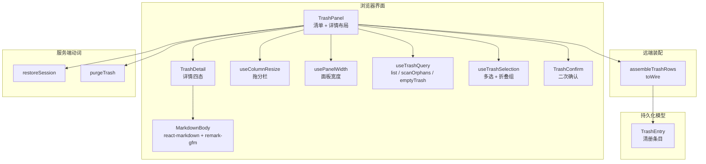
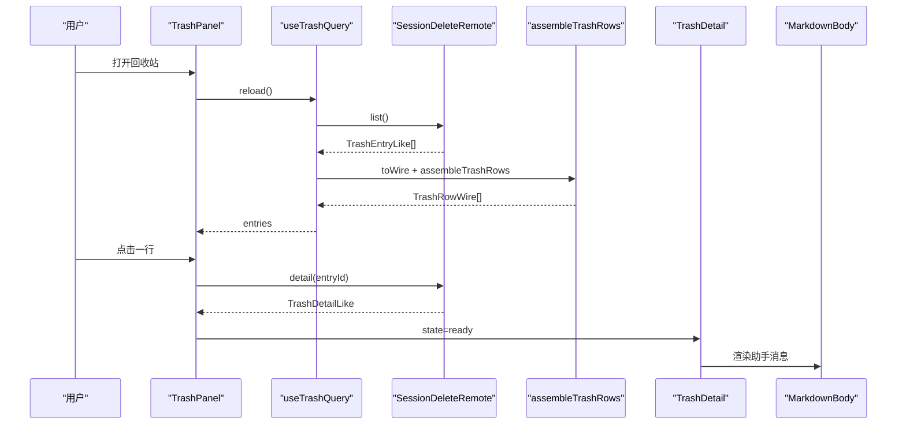
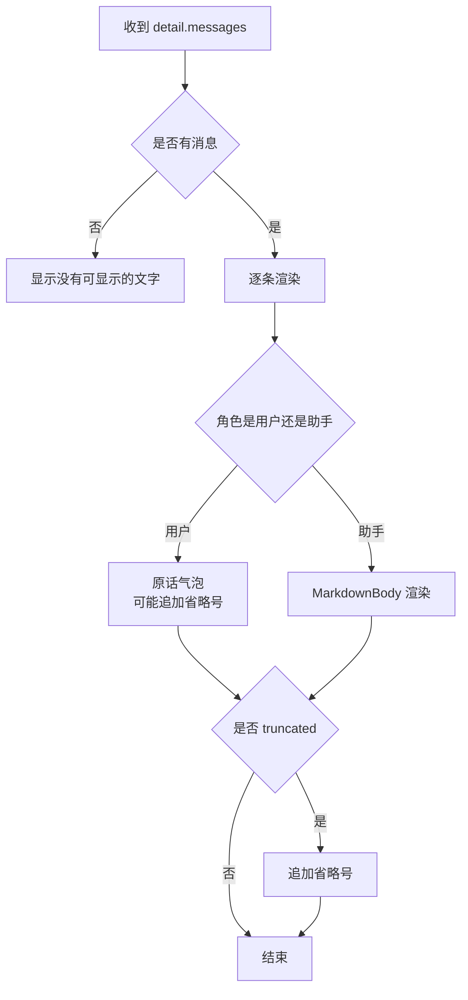
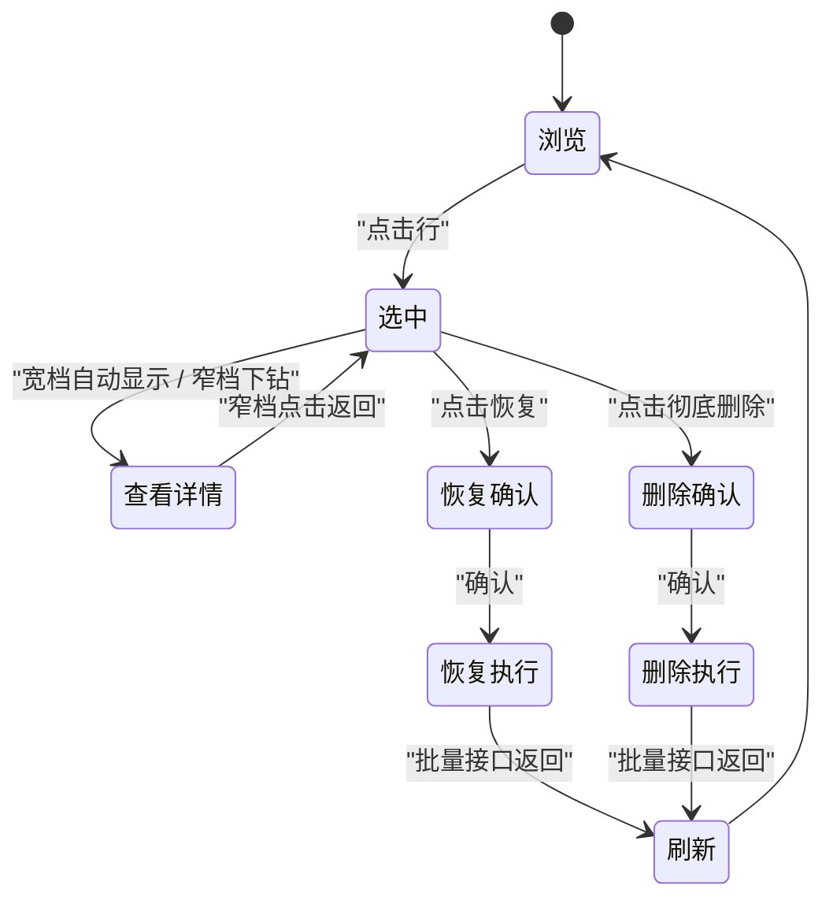

# 回收站面板与详情

<cite>
**本文引用的文件**   
- [trash-view.ts](file://src/client/trash-view.ts)
- [trash-entry.tsx](file://src/client/trash-entry.tsx)
- [trash-detail.tsx](file://src/client/trash-detail.tsx)
- [markdown.tsx](file://src/client/markdown.tsx)
- [use-column-resize.ts](file://src/client/use-column-resize.ts)
- [use-panel-width.ts](file://src/client/use-panel-width.ts)
- [trash-panel.tsx](file://src/client/trash-panel.tsx)
- [use-trash-query.ts](file://src/client/use-trash-query.ts)
- [use-trash-selection.ts](file://src/client/use-trash-selection.ts)
- [trash-confirm.tsx](file://src/client/trash-confirm.tsx)
- [trash-rows.ts](file://src/api/trash-rows.ts)
- [restore-session.ts](file://src/verbs/restore-session.ts)
- [purge-trash.ts](file://src/verbs/purge-trash.ts)
- [entry.ts](file://src/trash/entry.ts)
- [trash-detail.test.tsx](file://tests/client/trash-detail.test.tsx)
- [trash-panel.test.tsx](file://tests/client/trash-panel.test.tsx)
</cite>

## 目录

1. [引言](#引言)
2. [项目结构](#项目结构)
3. [核心组件](#核心组件)
4. [架构总览](#架构总览)
5. [详细组件分析](#详细组件分析)
6. [依赖关系分析](#依赖关系分析)
7. [性能考量](#性能考量)
8. [故障排查指南](#故障排查指南)
9. [结论](#结论)

## 引言

回收站面板负责展示已删除会话的分组清单，并在右侧渲染选中会话的 Markdown 正文与元信息。它同时承担多选、批量恢复、批量彻底删除与清空回收站等能力；详情页只负责“读”和“重试”，动作入口统一回到左侧行内，避免把操作按钮挤进窄侧栏。

文档面向三类读者：

- 前端使用者：理解分组、折叠、拖分栏、标题降级、正文过滤与交互路径。
- 维护者：掌握 `TrashRowWire` 投影字段、消息迭代逻辑、Markdown 渲染策略与失败回写。
- 测试与产品人员：对照断言用例理解四态详情、宽窄档行为与批量确认语义。

## 项目结构

回收站相关代码按“界面 → 取数编排 → 远端装配 → 服务端动词 → 持久化模型”分层组织：

**图表来源**

- [trash-panel.tsx](file://src/client/trash-panel.tsx)
- [trash-detail.tsx:1-60](file://src/client/trash-detail.tsx#L1-L60)
- [markdown.tsx:1-57](file://src/client/markdown.tsx#L1-L57)
- [use-column-resize.ts:1-144](file://src/client/use-column-resize.ts#L1-L144)
- [use-panel-width.ts:1-30](file://src/client/use-panel-width.ts#L1-L30)
- [use-trash-query.ts:1-178](file://src/client/use-trash-query.ts#L1-L178)
- [use-trash-selection.ts:1-133](file://src/client/use-trash-selection.ts#L1-L133)
- [trash-confirm.tsx:1-120](file://src/client/trash-confirm.tsx#L1-L120)
- [trash-rows.ts:1-93](file://src/api/trash-rows.ts#L1-L93)
- [restore-session.ts:1-173](file://src/verbs/restore-session.ts#L1-L173)
- [purge-trash.ts:1-121](file://src/verbs/purge-trash.ts#L1-L121)
- [entry.ts:1-90](file://src/trash/entry.ts#L1-L90)

**章节来源**

- [trash-panel.tsx:1-200](file://src/client/trash-panel.tsx#L1-L200)
- [trash-detail.tsx:1-60](file://src/client/trash-detail.tsx#L1-L60)

## 核心组件

### 共享视图词汇与分组

`trash-view.ts` 提供卡片样式、选中态、危险色与项目名还原函数，并实现按项目分组：

- 卡片使用宿主设置面的底层 token，圆角走 `radius-lg`。
- 选中态用宿主“幽灵按钮激活”那一组 token，而非自创颜色。
- `projectLabel` 把宿主的 `projectKey` 拆掉 `--…--` 包裹后还原，空串或 `_no-cwd` 显示为“未知项目”。
- `groupByProject` 先按删除时间倒序排序，再按 `projectDir` 合并，最后按每组最新一条的删除时间倒序排列。

这意味着：

- 最近删除的项目排在最上面。
- 同一项目的多个会话放在一个分组里。
- 分组内部保持删除时间从新到旧。

**章节来源**

- [trash-view.ts:1-80](file://src/client/trash-view.ts#L1-L80)

### 回收站行图标

`trash-entry.tsx` 只渲染侧栏面板列表中的回收站图标，不绘制整行文字、计数角标或按钮：

- 行由宿主 `PanelRow` 渲染。
- 计数角标不做，因为 glyph 盒空间不够，且宿主槽位标签只在特定事件时重算，容易 stale。
- 条数和占用改在面板头部展示。

**章节来源**

- [trash-entry.tsx:1-30](file://src/client/trash-entry.tsx#L1-L30)

### 详情块

`trash-detail.tsx` 是纯展示组件，不直接取数据：

- 状态分为四种：未选中、读数中、失败、就绪。
- 标题优先使用清册中的 `entry.title`；为空才回落到日志中的 `detail.logTitle`；仍为空则显示通用“未命名”。
- 用户提问以原话渲染；助手回复以 Markdown 渲染。
- 注入上下文数量与因负载上限截断的消息数量分别说明，不能混入主计数列。
- 宽档不显示返回按钮；窄档下钻时显示返回按钮。

**章节来源**

- [trash-detail.tsx:1-60](file://src/client/trash-detail.tsx#L1-L60)
- [trash-detail.tsx:201-323](file://src/client/trash-detail.tsx#L201-L323)

### Markdown 正文渲染

`markdown.tsx` 通过 `react-markdown` 与 `remark-gfm` 渲染助手回复：

- 原始 HTML 不会执行；默认路径会转义成字面文本，可见但不执行。
- 链接只显示锚文本和 URL 提示，不跳转。
- 图片显示为 `[图片 · alt]`，因为正文里的图片路径属于会话当时的工作目录，回收站里无法访问。
- 打开 GFM，支持表格、任务列表等常见语法。
- `MarkdownBody` 使用 `memo`，避免每次重渲染都重新解析 Markdown。

**章节来源**

- [markdown.tsx:1-57](file://src/client/markdown.tsx#L1-L57)

### 拖分栏

`use-column-resize.ts` 实现左右两栏之间的可拖分隔条：

- 左栏宽度被限制在最小值与 `panelWidth - reserve` 之间。
- 拖动时关闭面板的文字选择。
- 键盘方向键调节一格；Home 回到默认宽度；End 拉到最大。
- 拖动过程中若把手元素被卸载，window 级监听兜底结束拖动状态。
- 无障碍属性包括 `role="separator"`、垂直方向、当前值、最小值、最大值与焦点表项。

**章节来源**

- [use-column-resize.ts:1-144](file://src/client/use-column-resize.ts#L1-L144)

### 面板宽度观测

`use-panel-width.ts` 观察中央列面板自身的宽度：

- 使用 `ResizeObserver`，而不是 `window.resize`。
- 量的是 `getBoundingClientRect().width`，即 border-box 宽度。
- 首帧读取一次，之后跟随变化；无法观测时退化为窄档。

**章节来源**

- [use-panel-width.ts:1-30](file://src/client/use-panel-width.ts#L1-L30)

### 多选与折叠

`use-trash-selection.ts` 管理多选模式、勾选集合与分组折叠：

- 勾选顺序等于清单从上往下的顺序，不是点击顺序。
- 折叠不影响勾选集合；但键盘导航只遍历展开的分组。
- 当外部变更清册后，自动剔除已不存在的选择项。
- 组头勾选表示“整组全选或全取消”。

**章节来源**

- [use-trash-selection.ts:1-133](file://src/client/use-trash-selection.ts#L1-L133)

### 数据取数编排

`use-trash-query.ts` 编排回收站清单、无主子会话扫描与清空：

- 到达序号保证后到的旧响应不会覆盖新动作后的状态。
- 先对账并读清单，再扫描残留。
- 失败原文上屏，不伪装成“干净”。
- 清空失败写回“清单读不到”那块区域。
- 孤儿清理区分“已经不在了”的中性提示与真失败，并把部分成功结果拼入提示。

**章节来源**

- [use-trash-query.ts:1-178](file://src/client/use-trash-query.ts#L1-L178)

### 二次确认框

`trash-confirm.tsx` 提供两类确认框：

- 批量恢复：列出选中会话及其去向，若原工作区缺失则提示恢复后归入未分组。
- 批量彻底删除：强调不可恢复，释放大小来自 Node 半计算好的 `releaseBytes`。
- 忙碌期间不允许关闭或提交。

**章节来源**

- [trash-confirm.tsx:1-120](file://src/client/trash-confirm.tsx#L1-L120)

## 架构总览

回收站的典型数据流如下：

**图表来源**

- [trash-panel.tsx:1-200](file://src/client/trash-panel.tsx#L1-L200)
- [use-trash-query.ts:1-178](file://src/client/use-trash-query.ts#L1-L178)
- [trash-rows.ts:1-93](file://src/api/trash-rows.ts#L1-L93)
- [trash-detail.tsx:201-323](file://src/client/trash-detail.tsx#L201-L323)
- [markdown.tsx:1-57](file://src/client/markdown.tsx#L1-L57)

## 详细组件分析

### 左侧分组清单

#### 分组规则

分组由 `trash-view.ts` 的 `groupByProject` 完成：

1. 复制输入数组并按 `deletedAt` 倒序排序。
2. 按 `projectDir` 聚合。
3. 每组记录最新一条的删除时间。
4. 最终按各组最新一条倒序排列。

时间复杂度为 `O(n log n)`，主要成本在首次排序；后续分组是线性扫描。

#### 折叠

折叠状态保存在 `useTrashSelection` 的 `collapsedGroups` 中，键为 `projectDir`：

- 每个分组可单独折叠。
- 支持全部折叠与全部展开。
- 折叠只是收起 DOM，不改变勾选集合。
- 键盘导航跳过折叠分组。

#### 拖分栏

面板默认左栏宽 `420px`，最小 `330px`，右栏预留 `489px`，整体断点为 `900px`：

- 宽于等于 `900px` 时左右并列。
- 窄于 `900px` 时详情下钻。
- 拖动把手调整左栏宽度，右栏按剩余空间渲染。
- 细节正文最大宽度为 `860px`，防止长内容撑满整列。

#### 标题降级

标题优先级如下：

1. 清册行的 `title`。
2. 详情中的 `logTitle`。
3. 通用“未命名”。

这保证“行里叫 A、点开也叫 A”，只有清册标题为空时才回落到日志标题。

#### 正文过滤

详情页显示的正文只包含 `detail.messages`：

- `userMessageCount` 与 `assistantMessageCount` 对应这些可见消息。
- `injectedCount` 表示宿主注入的上下文条数。
- `omittedByPayloadCap` 表示因负载上限被裁剪的消息条数。
- 两者分别用不同文案说明，避免让用户误以为正文本来就很少。

**章节来源**

- [trash-view.ts:1-80](file://src/client/trash-view.ts#L1-L80)
- [use-trash-selection.ts:1-133](file://src/client/use-trash-selection.ts#L1-L133)
- [trash-panel.tsx:1-200](file://src/client/trash-panel.tsx#L1-L200)
- [trash-detail.tsx:201-323](file://src/client/trash-detail.tsx#L201-L323)

### 右侧 Markdown 详情

#### 四态

| 状态 | 表现 | 用户可做什么 |
|---|---|---|
| 未选中 | 显示引导语，无动作按钮 | 选择一行 |
| 读数中 | 显示“正在读这条会话…”与骨架 | 等待或切换行 |
| 失败 | 显示错误原因与重试 | 重试 |
| 就绪 | 显示元信息与消息线程 | 阅读 |

#### 标题与元信息

详情页头部显示：

- 创建时间
- 最后活跃时间
- 活跃跨度（小时或天）
- 删除时间（相对时间与绝对时间）
- 大小
- 轮次
- 用户消息数
- 助手消息数
- 工具调用数
- 模型列表
- 项目
- 会话标识
- 回收站目录
- 是否原本归档

#### 消息迭代逻辑

消息渲染流程如下：

**图表来源**

- [trash-detail.tsx:201-323](file://src/client/trash-detail.tsx#L201-L323)
- [markdown.tsx:1-57](file://src/client/markdown.tsx#L1-L57)

#### 正文裁剪策略

- 用户消息：原样输出文本；如果后端标记 `truncated`，尾部追加省略号。
- 助手消息：交给 `MarkdownBody` 渲染；如果后端标记 `truncated`，在 Markdown 区块下方追加省略号。
- 截断标志由远端装配进入详情，界面不自行判断正文长度。

**章节来源**

- [trash-detail.tsx:201-323](file://src/client/trash-detail.tsx#L201-L323)
- [markdown.tsx:1-57](file://src/client/markdown.tsx#L1-L57)

### 用户交互路径

#### 从选中恢复到彻底删除

**图表来源**

- [trash-panel.tsx:1-200](file://src/client/trash-panel.tsx#L1-L200)
- [trash-confirm.tsx:1-120](file://src/client/trash-confirm.tsx#L1-L120)
- [use-trash-query.ts:1-178](file://src/client/use-trash-query.ts#L1-L178)

#### 批量恢复

1. 进入多选模式。
2. 勾选若干分组或条目。
3. 点击批量恢复。
4. 弹出确认框，列出每条会话及其原项目目录。
5. 若原工作区不存在，提示恢复后归入未分组。
6. 确认后调用批量恢复接口。
7. 成功后刷新清单。
8. 失败时把原文写在对应行上。

#### 批量彻底删除

1. 进入多选模式。
2. 勾选若干分组或条目。
3. 点击批量彻底删除。
4. 弹出危险确认框，显示不可恢复警告与释放大小。
5. 确认后调用批量删除接口。
6. 成功后刷新清单。
7. 失败时把原文写在对应行上。

#### 清空回收站

1. 有内容时底部显示“清空回收站…”。
2. 空回收站不显示该按钮。
3. 点击后弹出二次确认。
4. 确认后调用 `emptyTrash`。
5. 成功则刷新；失败则写回“清单读不到”区域。

**章节来源**

- [trash-panel.tsx:1-200](file://src/client/trash-panel.tsx#L1-L200)
- [trash-confirm.tsx:1-120](file://src/client/trash-confirm.tsx#L1-L120)
- [use-trash-query.ts:1-178](file://src/client/use-trash-query.ts#L1-L178)

### 组件 Props 与回调

#### TrashDetailProps

| 字段 | 类型 | 含义 |
|---|---|---|
| `state` | `TrashDetailState` | 未选中、加载中、失败、就绪 |
| `busy` | `boolean` | 是否有写操作在进行 |
| `wide` | `boolean` | 宽档时不画返回按钮 |
| `onRetry` | `() => void` | 正文读取失败时重试 |
| `onBack` | `() => void` | 窄档返回清单 |
| `t` | `Translate` | 翻译函数 |

**章节来源**

- [trash-detail.tsx:1-60](file://src/client/trash-detail.tsx#L1-L60)

#### TrashPanelDeps

| 字段 | 含义 |
|---|---|
| `list` | 获取回收站清册 |
| `detail` | 获取某条会话详情 |
| `applyOutcomes` | 批量动作入口 |
| `emptyTrash` | 清空回收站 |
| `scanOrphans` | 扫描无主子会话残留 |

**章节来源**

- [trash-panel.tsx:1-200](file://src/client/trash-panel.tsx#L1-L200)

### 样式扩展点

推荐通过宿主主题 token 扩展，而不是在组件内新增硬编码颜色：

- 卡片背景与描边使用 `dsw-alias-bg-layer-2` 与 `dsw-alias-border-l4`。
- 选中态使用宿主幽灵按钮激活填充与边框 token。
- 危险色集中在页面脚部批量操作中。
- Markdown 正文容器类名为 `.sd-md`，由 `ui/styles.ts` 随模块物化注入样式。
- 详情正文最大宽度常量 `DETAIL_TEXT_MAX_WIDTH` 控制正文限宽，适合根据主题字号调整。
- 拖分栏焦点可见性依赖宿主提供的 `ui.css` 规则。

不建议直接覆盖组件内联样式；更安全的做法是在宿主层调整 token 或替换面板包装。

**章节来源**

- [trash-view.ts:1-80](file://src/client/trash-view.ts#L1-L80)
- [markdown.tsx:1-57](file://src/client/markdown.tsx#L1-L57)
- [trash-panel.tsx:1-200](file://src/client/trash-panel.tsx#L1-L200)

### 无障碍建议

- 清单行使用 `option` 语义，宽档自动选中行带 `aria-selected`。
- 拖分栏具备 `role="separator"`、垂直方向、可聚焦、数值范围与键盘控制。
- 详情失败块使用 `role="status"`，让读屏软件播报错误。
- 标题过长时使用 `title` 提供完整字符串。
- 用户气泡与助手消息通过 `data-sd-msg` 区分角色，便于测试与辅助技术定位。
- 需要长期读屏播报的区域应常驻一个只给读屏用的状态容器；当前注释指出这是已知边界，并非已经完备。

**章节来源**

- [use-column-resize.ts:1-144](file://src/client/use-column-resize.ts#L1-L144)
- [trash-detail.tsx:1-60](file://src/client/trash-detail.tsx#L1-L60)
- [trash-panel.tsx:1-200](file://src/client/trash-panel.tsx#L1-L200)

## 依赖关系分析

### 数据结构投影

`TrashRowWire` 由 `trash-rows.ts` 的 `toWire` 生成，关键字段如下：

| 字段 | 来源或计算方式 | 用途 |
|---|---|---|
| `id` | 清册条目 id | 唯一标识 |
| `sessionId` | 会话标识 | 关联宿主会话 |
| `projectDir` | 项目目录 | 分组与项目名还原 |
| `workspaceId` | 删除时的工作区 | 恢复时挂账本 |
| `wasArchived` | 删除前归档态 | 恢复时决定是否取消归档 |
| `deletedAt` | 删除时间 | 分组排序与展示 |
| `title` | 清册标题 | 详情标题优先 |
| `sizeBytes` | 会话目录字节数 | 详情大小与释放计算 |
| `releaseBytes` | 本行 + 子会话 + 盘上后代 | 确认框释放大小 |
| `subagentCount` | 子会话数量 | 行统计 |
| `subagentBytes` | 子会话字节合计 | 行统计 |
| `strandedSubagents` | 盘上仍存在但未进回收站的后代 | 行统计 |
| `strandedBytes` | 盘上后代字节合计 | 行统计 |
| `workspaceMissing` | 原工作区是否存在 | 提示恢复后归入未分组 |
| `parentEntryId` | 父条目 id | 分组语义 |

**章节来源**

- [trash-rows.ts:1-93](file://src/api/trash-rows.ts#L1-L93)

### 消息迭代与正文裁剪

详情渲染对 `detail.messages` 做线性遍历：

- 时间复杂度为 `O(m)`，其中 `m` 为可见消息条数。
- 用户消息为 `O(1)` 文本插入。
- 助手消息会触发 Markdown 解析，单次解析成本取决于消息体长度。
- `MarkdownBody` 使用 `memo`，仅当 `text` 变化时重建 Markdown 处理器。
- 截断由后端 `message.truncated` 决定，前端不裁剪字符串。

**章节来源**

- [trash-detail.tsx:201-323](file://src/client/trash-detail.tsx#L201-L323)
- [markdown.tsx:1-57](file://src/client/markdown.tsx#L1-L57)

### 恢复与彻底删除的副作用

恢复与会话目录、工作区账本、可见性与清册行有关：

- 预检阶段检查回收站目录与原项目目录。
- 恢复顺序：放回目录 → 挂账本 → 取消归档（如原本未归档）→ 摘清册行。
- 失败时按相反顺序回滚。
- 通告不在单个恢复动词内，而是由批量层统一处理。

彻底删除会：

- 将父行视为整组目标。
- 计划删除盘上仍在的后代。
- 取消归档、摘账本、删回收站目录、摘清册行。
- 不回滚已删目录，但会如实统计已删除数量与释放字节。

**章节来源**

- [restore-session.ts:1-173](file://src/verbs/restore-session.ts#L1-L173)
- [purge-trash.ts:1-121](file://src/verbs/purge-trash.ts#L1-L121)

## 性能考量

### 长会话预览卡顿

可能原因：

- 单条助手回复非常大，导致 Markdown 解析耗时。
- 大量消息同时渲染。
- 频繁重渲染导致 `react-markdown` 重复构建处理器。

缓解建议：

- 保持 `MarkdownBody` 的 `memo` 依赖不变，只传入稳定变化的 `text`。
- 对超长会话考虑分页或懒加载详情。
- 避免在消息渲染层做额外同步计算。
- 不要把宿主主题变量放进 React props 作为 Markdown 输入。

### Markdown 内容缺失

可能原因：

- 后端返回的消息体为空。
- 消息被 `injectedCount` 或 `omittedByPayloadCap` 裁剪。
- 原始 HTML 被转义成文本而非执行。
- 图片路径属于会话当时的工作目录，回收站中不可访问。
- 用户消息不应被当作 Markdown 渲染。

验证方式：

- 检查 `detail.messages.length`。
- 检查 `detail.injectedCount` 与 `detail.omittedByPayloadCap`。
- 检查具体消息的 `role` 与 `text`。
- 确认助手消息确实走了 `MarkdownBody`，用户消息走普通文本气泡。

**章节来源**

- [markdown.tsx:1-57](file://src/client/markdown.tsx#L1-L57)
- [trash-detail.tsx:201-323](file://src/client/trash-detail.tsx#L201-L323)
- [trash-detail.test.tsx:1-200](file://tests/client/trash-detail.test.tsx#L1-L200)

## 故障排查指南

### 问题：长会话预览卡顿

诊断步骤：

1. 确认是否只有一条超长助手回复。
2. 检查消息数组长度。
3. 检查是否在悬停、滚动或时间更新时触发重渲染。
4. 确认 Markdown 内容没有通过 props 频繁变化。

修复建议：

- 保留 `MarkdownBody` 的 memo 策略。
- 对超大正文考虑截断预览、展开按钮或虚拟列表。
- 避免在渲染循环中创建新对象传给 Markdown。

**章节来源**

- [markdown.tsx:1-57](file://src/client/markdown.tsx#L1-L57)
- [trash-detail.tsx:201-323](file://src/client/trash-detail.tsx#L201-L323)

### 问题：Markdown 内容缺失或显示异常

诊断步骤：

1. 检查消息角色是否为用户消息。
2. 检查后端是否返回了 `text`。
3. 检查 `injectedCount` 与 `omittedByPayloadCap`。
4. 检查原始 HTML 是否被预期地转义。
5. 检查图片链接是否为本地会话路径。

修复建议：

- 用户消息保持原话。
- 助手消息使用 MarkdownBody。
- 对缺失正文明确显示“没有可显示的文字”。
- 对注入上下文和被截断消息分别说明。

**章节来源**

- [trash-detail.test.tsx:1-200](file://tests/client/trash-detail.test.tsx#L1-L200)
- [markdown.tsx:1-57](file://src/client/markdown.tsx#L1-L57)

### 问题：拖分栏卡住或始终处于拖动状态

诊断步骤：

1. 检查是否在拖动过程中快速切换宽窄档。
2. 检查清单是否被清空导致把手卸载。
3. 检查是否缺少 window 级指针事件监听。

修复要点：

- 拖动开始时保存起点与初始宽度。
- 拖动结束后清空起点。
- 在 window 上监听 `pointerup` 与 `pointercancel` 兜底。
- 仅在把手元素上移动左栏宽度。

**章节来源**

- [use-column-resize.ts:1-144](file://src/client/use-column-resize.ts#L1-L144)

### 问题：恢复失败但看不到提示

诊断步骤：

1. 确认失败是由 `applyOutcomes('restore', ids)` 返回。
2. 检查失败是否写回该行对应的错误状态。
3. 确认失败原文没有被吞掉。

修复要点：

- 行内动作失败必须留在该行。
- 失败块使用 `role="status"`。
- 不要把所有失败集中到一个全局弹窗。

**章节来源**

- [trash-panel.test.tsx:1-200](file://tests/client/trash-panel.test.tsx#L1-L200)
- [trash-panel.tsx:1-200](file://src/client/trash-panel.tsx#L1-L200)

### 问题：清空回收站没有效果

诊断步骤：

1. 确认回收站非空。
2. 确认二次确认已提交。
3. 检查 `emptyTrash` 返回值。
4. 检查失败是否写回清单错误区域。

修复要点：

- 空回收站不显示清空按钮。
- 清空失败不假装成功。
- 成功后必须刷新清单。

**章节来源**

- [use-trash-query.ts:1-178](file://src/client/use-trash-query.ts#L1-L178)
- [trash-panel.test.tsx:1-200](file://tests/client/trash-panel.test.tsx#L1-L200)

## 结论

回收站面板与详情实现了“左侧分组清单 + 右侧 Markdown 详情”的双栏形态，并通过面板宽度观测与拖分栏满足可读性要求。其设计重点在于：

- 标题与正文来源清晰：清册优先，日志降级。
- 用户消息原话、助手消息 Markdown。
- 注入上下文与被截断消息分别披露。
- 动作留在清单行，详情只负责展示。
- 批量恢复与彻底删除均经过二次确认。
- 失败反馈精确到行或面板区域。
- 样式以 token 为主，Markdown 渲染通过受控组件收敛风险。

对于维护者而言，最需要关注的是 `TrashRowWire` 投影一致性、消息迭代逻辑、Markdown 缓存策略以及恢复与彻底删除的副作用边界。