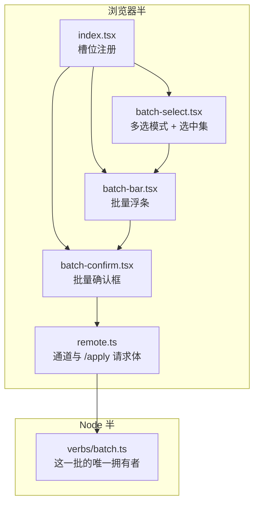
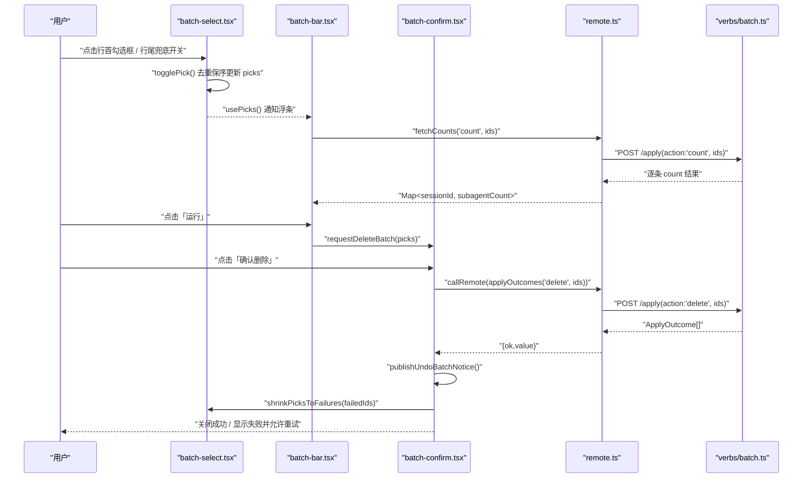
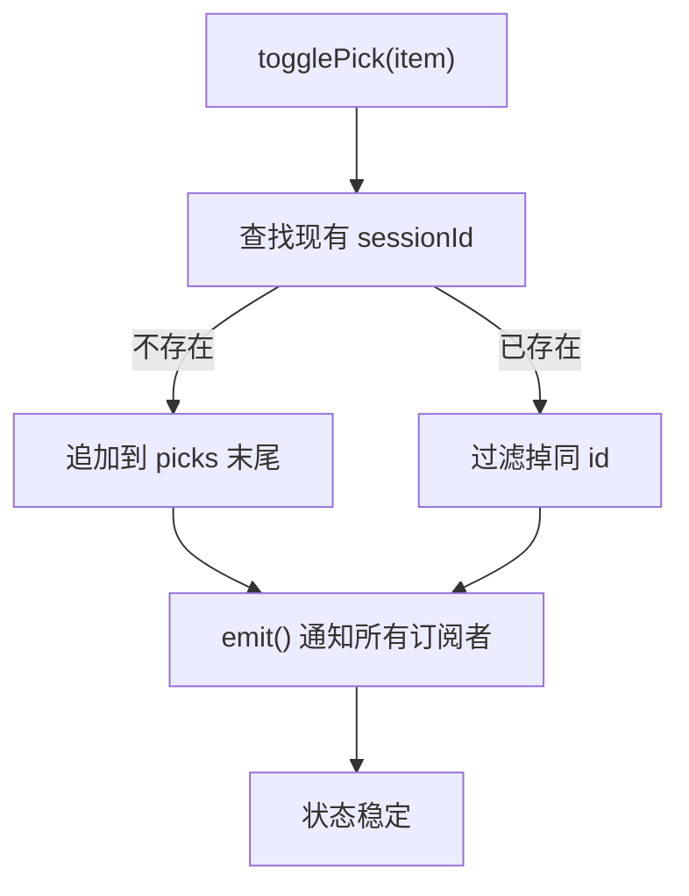
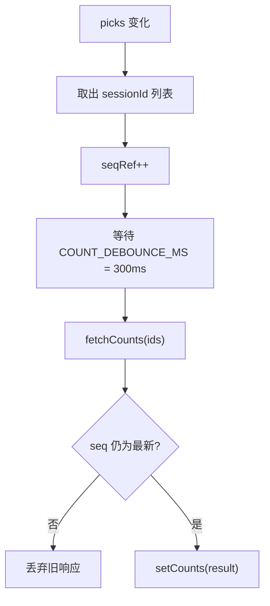
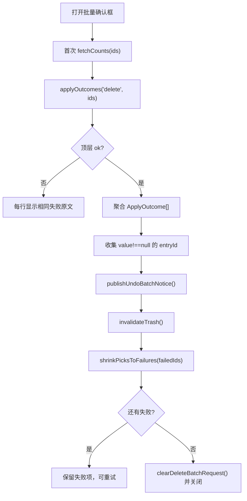
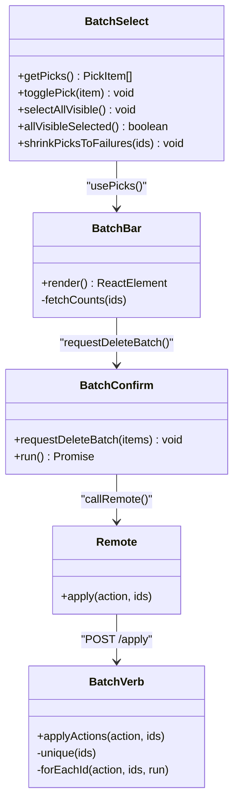
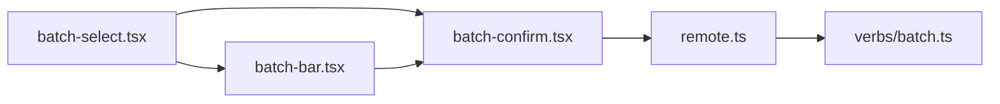

# 多选与批量操作

<cite>
**本文引用的文件**   
- [src/client/batch-select.tsx](file://src/client/batch-select.tsx)
- [src/client/batch-bar.tsx](file://src/client/batch-bar.tsx)
- [src/client/batch-confirm.tsx](file://src/client/batch-confirm.tsx)
- [src/client/remote.ts](file://src/client/remote.ts)
- [src/verbs/batch.ts](file://src/verbs/batch.ts)
- [src/client/index.tsx](file://src/client/index.tsx)
- [tests/client/batch-select.test.tsx](file://tests/client/batch-select.test.tsx)
- [tests/client/use-trash-selection.test.tsx](file://tests/client/use-trash-selection.test.tsx)
- [tests/batch.test.ts](file://tests/batch.test.ts)
- [docs/adr/0002-batch-and-journal-own-the-request.md](file://docs/adr/0002-batch-and-journal-own-the-request.md)
</cite>

## 目录
1. [引言](#引言)
2. [项目结构](#项目结构)
3. [核心组件](#核心组件)
4. [架构总览](#架构总览)
5. [详细组件分析](#详细组件分析)
6. [依赖关系分析](#依赖关系分析)
7. [性能考量](#性能考量)
8. [无障碍与键盘操作建议](#无障碍与键盘操作建议)
9. [常见问题排查](#常见问题排查)
10. [结论](#结论)

## 引言
本文面向回收站的多选与批量删除机制，解释用户如何通过行首勾选框、行尾兜底开关或全选按钮维护选中集合，以及选中项数量变化如何驱动批量浮条与批量确认框。文档同时覆盖去重保序、跨页选择、撤销态、部分失败重试、wire 数据集成、宿主槽位接入，以及键盘与无障碍建议。目标是让前端使用者、插件集成者和后端调用方都能理解“选中 → 计数 → 确认 → 执行 → 撤销”的完整链路。

## 项目结构
多选与批量删除由浏览器半的多个小模块协作完成，并由 Node 半的 `apply` 动词统一收敛：

**图示来源**
- [src/client/index.tsx:1-120](file://src/client/index.tsx#L1-L120)
- [src/client/batch-select.tsx:1-120](file://src/client/batch-select.tsx#L1-L120)
- [src/client/batch-bar.tsx:1-60](file://src/client/batch-bar.tsx#L1-L60)
- [src/client/batch-confirm.tsx:1-80](file://src/client/batch-confirm.tsx#L1-L80)
- [src/client/remote.ts:1-120](file://src/client/remote.ts#L1-L120)
- [src/verbs/batch.ts:1-60](file://src/verbs/batch.ts#L1-L60)

**章节来源**
- [src/client/index.tsx:1-120](file://src/client/index.tsx#L1-L120)

## 核心组件
- **多选状态与选中集**：`batch-select.tsx` 暴露模块级 store，提供进入/退出多选模式、逐条翻转、清空、全选可见行、收缩失败名单等能力；渲染行首 Checkbox 与行尾 Button。
- **批量浮条**：`batch-bar.tsx` 常驻在多选模式下，汇总已选数量与子会话数，提供展开查看清单、全选/取消全选、运行批量删除、退出多选。
- **批量确认框**：`batch-confirm.tsx` 展示待删目标、执行 `POST /apply('delete', ids)`、聚合结果、发布撤销通知、收缩失败名单并允许重试。
- **远程通道**：`remote.ts` 构造 `{action, ids}` 请求体，并把 `/apply` 的逐条结果交给上层。
- **批量动词**：`verbs/batch.ts` 是 `POST /apply` 的落点，负责去重保序、幂等判断、逐条信封、一批一次通告。

**章节来源**
- [src/client/batch-select.tsx:1-80](file://src/client/batch-select.tsx#L1-L80)
- [src/client/batch-bar.tsx:1-60](file://src/client/batch-bar.tsx#L1-L60)
- [src/client/batch-confirm.tsx:1-80](file://src/client/batch-confirm.tsx#L1-L80)
- [src/client/remote.ts:120-200](file://src/client/remote.ts#L120-L200)
- [src/verbs/batch.ts:1-60](file://src/verbs/batch.ts#L1-L60)

## 架构总览
下图描述从用户点击到服务端执行的端到端流程。重点在于：选中集合只由 `batch-select.tsx` 维护；浮条负责 UI 汇总与触发；确认框负责发起批量动作；服务端保证“一组 id 进、逐条结果出”。

**图示来源**
- [src/client/batch-select.tsx:60-120](file://src/client/batch-select.tsx#L60-L120)
- [src/client/batch-bar.tsx:60-136](file://src/client/batch-bar.tsx#L60-L136)
- [src/client/batch-confirm.tsx:80-200](file://src/client/batch-confirm.tsx#L80-L200)
- [src/client/remote.ts:180-200](file://src/client/remote.ts#L180-L200)
- [src/verbs/batch.ts:140-197](file://src/verbs/batch.ts#L140-L197)

## 详细组件分析

### 多选状态与选中集（batch-select.tsx）
- **状态模型**
  - `picks`：模块级数组，元素为 `{sessionId, title}`，顺序等于用户勾选顺序。
  - `selecting`：是否处于多选模式。
  - 通过 `useSyncExternalStore` 订阅，避免引入第三方状态库。
- **关键行为**
  - `enterSelection()` / `exitSelection()`：进入时不重复进入；退出时同时清空 `selecting` 与 `picks`。
  - `togglePick(item)`：若不存在则追加到队尾；若已存在则移除，保证无重复 sessionId。
  - `clearPicks()`：清空选中集。
  - `selectAllVisible()`：先保留已有选中，再把当前 DOM 中可见可选行的未选项按 DOM 序追加。
  - `allVisibleSelected()`：有选中且当前可见可选行全部命中时返回“取消全选”语义；没有可见可选行时也视为“全选”，避免显示歧义。
  - `shrinkPicksToFailures(ids)`：执行后只保留失败的 sessionId；空数组表示全清。
- **跨页选择实现**
  - 通过扫描 DOM 中 `data-row-key^="session:"` 的行获取可见可选行，因此翻页后新页的行仍可被全选加入。
  - 使用 `seen` Set 对同一行 key 去重，防止宿主列表重复渲染造成重复选择。
- **整行点击守卫**
  - `useSelectionRowClickGuard()` 在 document 捕获阶段拦截宿主的行点击与会话切换，把模式内整行点击转为勾选/取消。
  - 跳过行内已有交互元素（按钮、链接、输入、菜单项、其他 batch-pick 标记）。
  - 忽略双击与 `detail > 1` 的连续点击，避免误翻。
  - 对“在跑会话”跳过勾选，与行尾禁用开关保持一致。
- **UI 状态同步**
  - `BatchPickCheckbox` 与 `BatchPickButton` 都基于 `usePicks()` 计算自身是否选中，并通过 `data-checked` 与 `aria-pressed` 暴露给辅助技术。
  - 行尾按钮还登记 `rowInfo`，供整行点击守卫读取标题与运行态。

**图示来源**
- [src/client/batch-select.tsx:60-100](file://src/client/batch-select.tsx#L60-L100)

**章节来源**
- [src/client/batch-select.tsx:1-120](file://src/client/batch-select.tsx#L1-L120)
- [src/client/batch-select.tsx:201-317](file://src/client/batch-select.tsx#L201-L317)
- [tests/client/batch-select.test.tsx:1-123](file://tests/client/batch-select.test.tsx#L1-L123)

### 批量浮条（batch-bar.tsx）
- **职责边界**
  - 不负责发送删除请求，只负责：
    - 显示已选数量与合计子会话数；
    - 展开列出每条标题与子会话数，支持单条移除；
    - 全选/取消全选；
    - 触发 `requestDeleteBatch(getPicks())`；
    - 退出多选模式。
- **选中项数量变化处理**
  - 监听 `usePicks()`；每当 picks 变化，防抖 300ms 后调用 `fetchCounts(deps, ids)`。
  - 使用 `seqRef` 序号守卫：旧响应不能覆盖新请求的结果，避免并发计数覆盖最新名单。
  - 如果任一 id 读不到计数，整个 counts 置为 null；界面不显示 K 值，遵循“不许拿 0 冒充没有”的规则。
- **工具栏显示逻辑**
  - 只有 `selecting` 为真时才渲染；即使 picks 为空也渲染，用于提示“请勾选条目”并提供退出入口。
  - 展开清单仅在多选模式且 picks 非空时显示；退出模式或清空 picks 时自动收起。
- **全选按钮文案**
  - 调用 `allVisibleSelected()`：当当前可见可选行已全部选中时显示“取消全选”，否则显示“全选”。

**图示来源**
- [src/client/batch-bar.tsx:60-100](file://src/client/batch-bar.tsx#L60-L100)

**章节来源**
- [src/client/batch-bar.tsx:1-136](file://src/client/batch-bar.tsx#L1-L136)

### 批量确认框（batch-confirm.tsx）
- **请求现场**
  - 模块级 `request` 保存 `{seq, items}`；每次打开新批次递增 `nextSeq`，作为 React key，避免 busy/失败记忆串到下一批。
  - `useDeleteBatchRequest()` 通过 `useSyncExternalStore` 暴露给浮条和确认框宿主。
- **执行流程**
  - 首轮：对所有 pending ids 发 `deps.applyOutcomes('delete', ids)`。
  - 结果聚合：
    - 顶层 `ok=false`：整次调用失败，每行显示相同失败原文。
    - 顶层 `ok=true`：按 sessionId 建立结果 Map，逐条判断：
      - 未返回：通道错误，记为失败。
      - `item.ok=false`：业务失败，记录错误信息。
      - `item.action='delete'` 且 `value !== null`：成功移动，加入撤销通知。
      - `value === null`：已被同批前一条带走的幂等成功，不计入撤销名单。
  - 成功后：
    - 发布批量撤销通知；
    - 使回收站面板失效并重读；
    - 清空成功请求；
    - 若有失败，收缩 picks 到失败名单，并允许重试。
- **重试语义**
  - 重试轮只发送失败 id；
  - 重新挂载会重置 `busy` 与 `failures`，但保持原 `seq`，因此不再重复问子会话计数；
  - 若重试后仍有失败，继续缩窄 `items` 与 `failures`；
  - 若全部成功，清除请求并关闭确认框。

**图示来源**
- [src/client/batch-confirm.tsx:80-200](file://src/client/batch-confirm.tsx#L80-L200)

**章节来源**
- [src/client/batch-confirm.tsx:1-200](file://src/client/batch-confirm.tsx#L1-L200)

### 与 wire 数据及后端 batch 动词的集成
- **请求体构造**
  - `remote.ts` 将浏览器端的 `apply(action, ids)` 映射为 JSON body `{[PARAMS.action]: action, [PARAMS.ids]: [...ids]}`。
  - 对于批量子会话计数，使用 `action:'count'`；对于批量删除，使用 `action:'delete'`。
- **结果契约**
  - 顶层信封 `{ok, value}` 或 `{ok, error}`；
  - 批量动作返回值是 `ApplyOutcome[]`，每条包含 `id, action, ok, value?` 或 `error`。
- **服务端去重保序**
  - `verbs/batch.ts` 的 `unique(ids)` 去重并保持输入顺序；
  - 删除、恢复、彻底删除均走 `forEachId`，一条 try/catch，失败不传染下一条；
  - “已被同批前一条带走”的幂等成功不是失败：
    - 删除：父先删，孩子返回 `null`；
    - 恢复：父先恢复，孩子返回 `null`；
    - 彻底删除：孩子返回 `{removed:0, freedBytes:0}`。
- **清册快照与通告**
  - 恢复与彻底删除整批只读一次清册，并在批量层维护一个可收缩的当前视图，避免重复处理。
  - 恢复成功组按会话 id 聚合，只在批尾发一次 `announceRestoredBatch`，避免逐条广播导致宿主全表扫描。

**图示来源**
- [src/client/batch-select.tsx:1-120](file://src/client/batch-select.tsx#L1-L120)
- [src/client/batch-bar.tsx:60-136](file://src/client/batch-bar.tsx#L60-L136)
- [src/client/batch-confirm.tsx:80-200](file://src/client/batch-confirm.tsx#L80-L200)
- [src/client/remote.ts:180-200](file://src/client/remote.ts#L180-L200)
- [src/verbs/batch.ts:60-140](file://src/verbs/batch.ts#L60-L140)

**章节来源**
- [src/client/remote.ts:120-200](file://src/client/remote.ts#L120-L200)
- [src/verbs/batch.ts:60-197](file://src/verbs/batch.ts#L60-L197)
- [docs/adr/0002-batch-and-journal-own-the-request.md:1-77](file://docs/adr/0002-batch-and-journal-own-the-request.md#L1-L77)

### 选择状态与 UI 状态的同步
- **全选态**
  - 当 `picks.length > 0` 且所有当前可见可选行都已命中时，全选按钮显示“取消全选”。
  - 若当前没有可见可选行（例如全部折叠），全选按钮仍显示“取消全选”，因为此时无法再增加新项。
- **半选态**
  - 在“选择面”测试中，组头三态由 `groupPartiallyChecked` / `groupFullyChecked` 表达：至少有一个选中但未全部选中时为半选；全部选中时为全选；再点一次整组取消。
  - 注意：多选浮条本身不直接渲染组头三态；组头三态属于 `use-trash-selection` 的选择面 API，而 `batch-select.tsx` 的“全选”是针对当前可见可选行。
- **禁用态**
  - 行尾兜底勾选按钮对“在跑会话”设置 `disabled`，并配合 Tooltip 显示原因。
  - 浮条“运行”按钮在 picks 为空时禁用。
- **撤销态**
  - 批量删除成功后，`batch-confirm.tsx` 调用 `publishUndoBatchBatchNotice({entryIds, n})`，由撤销提示组件展示可撤销范围。
  - 该撤销通知只包含真正移动成功的条目；幂等 `null` 值不进入撤销名单。
- **与宿主槽位的协作**
  - 行首勾选框注入 `sidebar.session.row.leading`，只在多选模式渲染。
  - 行尾兜底勾选按钮注入 `sidebar.workspaces.session.row.action`，对宿主隐藏行首格的行提供兜底。
  - 浮条与批量确认框注入 `shell.overlay`，独立于行树，避免行随宿主重排卸载导致状态丢失。

**章节来源**
- [src/client/batch-select.tsx:120-200](file://src/client/batch-select.tsx#L120-L200)
- [src/client/batch-bar.tsx:100-136](file://src/client/batch-bar.tsx#L100-L136)
- [src/client/batch-confirm.tsx:150-200](file://src/client/batch-confirm.tsx#L150-L200)
- [tests/client/use-trash-selection.test.tsx:1-103](file://tests/client/use-trash-selection.test.tsx#L1-L103)
- [src/client/index.tsx:1-120](file://src/client/index.tsx#L1-L120)

## 依赖关系分析
- **模块内聚与耦合**
  - `batch-select.tsx` 是选中集唯一源头，被浮条与确认框消费；
  - `batch-bar.tsx` 仅消费 `usePicks`、`useSelecting` 与 `fetchCounts`，不直接调用远端；
  - `batch-confirm.tsx` 消费 `fetchCounts`、`getPicks`、`shrinkPicksToFailures` 与 `remote.callRemote`；
  - `remote.ts` 是浏览器半与 Node 半之间的薄线，不携带业务判据；
  - `verbs/batch.ts` 是后端唯一拥有者，集中处理去重、幂等、逐条信封与通告。
- **外部依赖**
  - 宿主槽位：`sidebar.session.row.leading`、`sidebar.workspaces.session.row.action`、`shell.overlay`。
  - 宿主能力：子会话计数、回收站清册、恢复摘要、孤儿清理等，由 Node 侧适配。
- **潜在循环风险**
  - 浮条 import 确认框的请求函数，确认框又 import 选中集的 shrink 函数，形成“浮条 → 确认框 → 选中集”单向依赖；选中集不反向依赖它们，因此不构成循环导入。

**图示来源**
- [src/client/batch-select.tsx:1-80](file://src/client/batch-select.tsx#L1-L80)
- [src/client/batch-bar.tsx:1-60](file://src/client/batch-bar.tsx#L1-L60)
- [src/client/batch-confirm.tsx:1-80](file://src/client/batch-confirm.tsx#L1-L80)
- [src/client/remote.ts:180-200](file://src/client/remote.ts#L180-L200)
- [src/verbs/batch.ts:140-197](file://src/verbs/batch.ts#L140-L197)

**章节来源**
- [src/client/index.tsx:1-120](file://src/client/index.tsx#L1-L120)
- [docs/adr/0002-batch-and-journal-own-the-request.md:1-77](file://docs/adr/0002-batch-and-journal-own-the-request.md#L1-L77)

## 性能考量
- **计数防抖**
  - 勾选变化后 300ms 才发起 `count` 请求，避免连勾十条产生十次网络往返。
- **序号守卫**
  - 每个计数请求分配递增 seq，旧响应被丢弃，防止慢响应覆盖最新 picks。
- **批量接口收敛**
  - 所有写动作走 `POST /apply`，避免每个动作单独一段导致的多次路由解析与连接开销。
- **一批一次通告**
  - 恢复批量只发一次 `announceRestoredBatch`，减少宿主全表扫描次数。
- **清册只读一次**
  - 恢复与彻底删除整批只读一次清册，并在批量层维护私有当前视图，避免 N 条就 N 次读。

[本节为通用性能说明，不直接分析具体代码片段]

## 无障碍与键盘操作建议
当前实现已经具备一定基础：
- 行首勾选框使用原生 `Checkbox`，自带焦点管理与空格切换语义；
- 行尾兜底按钮使用 `button`，带 `aria-pressed` 与 `aria-label`；
- 浮条按钮使用标准 `<Button>` 组件，具备基础可访问性；
- 批量确认框使用 Modal 壳，标题与关闭按钮具备基本语义。

建议补充或强化的无障碍实践：
- **Tab 顺序**
  - 进入多选模式后，Tab 应优先聚焦行首勾选框；若某行没有行首格，应落到行尾兜底按钮；
  - 浮条中的“查看已选”“全选/取消全选”“运行”“退出”应构成清晰的 Tab 序列；
  - 批量确认框应在打开时聚焦主动作按钮，Esc 关闭时回到触发按钮。
- **空格勾选**
  - 复用原生 Checkbox 与 button 的空格行为，不需要额外 JS 监听；
  - 确保整行点击守卫不会阻止 checkbox/button 自身的键盘事件。
- **方向键移动**
  - 当前多选状态主要依赖 DOM 序与 `data-row-key`，并未显式实现方向键导航；
  - 建议为“有序可见行”维护虚拟焦点索引，用 Up/Down 在可见行间移动，Home/End 跳到首尾；
  - 折叠组的不可见行不应成为方向键目标，但仍应参与全选与撤销语义。
- **屏幕阅读器**
  - 行首勾选框的 label 应包含会话标题；
  - 浮条中“已选 N 条”“含 K 个子会话”应通过 `aria-live="polite"` 播报；
  - 失败消息应使用 `role="alert"` 或类似策略提示用户需要人工干预。
- **键盘替代**
  - 全选可通过快捷键触发（例如 Ctrl/Cmd+A），但需明确区分“全选当前页面”与“全选所有页面”；
  - 运行批量删除应要求 Enter 或 Space 确认，避免误触。

[本节为无障碍建议，不直接分析具体代码片段]

## 常见问题排查

### 全选无效
可能原因：
- 当前没有可见可选行：全选按钮会显示“取消全选”，而不是新增项。
- 行首勾选框未渲染：宿主对有状态点或归档行不渲染行首格，应使用行尾兜底开关。
- 会话正在运行：行尾按钮禁用，整行点击守卫也会跳过 live 行。
- 当前不在多选模式：勾选框与整行点击守卫只在 `selecting` 为真时生效。

排查步骤：
1. 确认已进入多选模式；
2. 检查是否有可见行；
3. 检查行是否处于运行态；
4. 查看浮条是否显示“全选”还是“取消全选”。

**章节来源**
- [src/client/batch-select.tsx:120-180](file://src/client/batch-select.tsx#L120-L180)
- [src/client/batch-bar.tsx:100-136](file://src/client/batch-bar.tsx#L100-L136)

### 选中项丢失
可能原因：
- 退出多选模式会清空 `picks`；
- 批量操作成功后，成功项会从 picks 中移除；
- 清单刷新后，不在清单中的条目会被选择面剔除；
- 浮条中逐条移除会调用 `togglePick`，从而从选中集移除对应项。

排查步骤：
1. 确认是否退出了多选模式；
2. 确认是否已完成批量删除；
3. 检查条目是否仍在当前清册；
4. 检查浮条展开清单中是否手动移除了该项。

**章节来源**
- [src/client/batch-select.tsx:60-100](file://src/client/batch-select.tsx#L60-L100)
- [src/client/batch-bar.tsx:100-136](file://src/client/batch-bar.tsx#L100-L136)
- [tests/client/use-trash-selection.test.tsx:70-103](file://tests/client/use-trash-selection.test.tsx#L70-L103)

### 批量操作中断后状态不一致
可能原因：
- 顶层 `ok=false`：整次调用失败，每行显示失败原文，picks 不会被收缩；
- 部分 id 没返回结果：被视为通道错误，计入失败；
- 部分业务失败：只收缩失败项，成功项不再留在 picks；
- 重试后仍有失败：确认框保持打开，`items` 缩窄为剩余失败项。

排查步骤：
1. 看批量确认框是否仍处于打开状态；
2. 检查失败列表中哪些 sessionId 还在；
3. 检查网络层是否抛错或返回非信封；
4. 尝试重试，观察是否进一步缩小失败名单。

**章节来源**
- [src/client/batch-confirm.tsx:120-200](file://src/client/batch-confirm.tsx#L120-L200)
- [src/client/remote.ts:120-180](file://src/client/remote.ts#L120-L180)

### 撤销后仍显示已删除条目
可能原因：
- 撤销通知只包含 `value !== null` 的成功删除项；
- 幂等删除（孩子被父带走）返回 `null`，不进入撤销名单；
- 批量确认后虽然客户端已撤销通知，但宿主清册尚未刷新；
- 确认框重试后仍有失败，失败项仍留在 picks，看起来像“还在”。

排查步骤：
1. 检查撤销提示中列出的 entryId；
2. 确认是否为幂等删除；
3. 等待 `invalidateTrash()` 触发清册刷新；
4. 检查批量确认框是否仍因失败而打开。

**章节来源**
- [src/client/batch-confirm.tsx:150-200](file://src/client/batch-confirm.tsx#L150-L200)

### 批量操作中途失败后重试导致重复执行
可能原因：
- 客户端重试只发送失败 sessionId；
- 服务端 `unique(ids)` 对输入去重；
- “已被同批前一条带走”的幂等路径返回成功而非失败；
- 因此重复 id 不会重复执行业务逻辑。

验证方式：
- 断言 `verbs/batch.ts` 的输出 id 列表长度等于去重后的输入长度；
- 检查测试结果中“重复 id 只出现一次”和“幂等 no-op”用例。

**章节来源**
- [src/verbs/batch.ts:60-120](file://src/verbs/batch.ts#L60-L120)
- [tests/batch.test.ts:1-60](file://tests/batch.test.ts#L1-L60)

## 结论
多选与批量删除的核心设计是：**选中集单一来源、浮条负责可视汇总、确认框负责执行与重试、服务端动词统一拥有批量语义**。选中集合通过模块级 store 与 `useSyncExternalStore` 同步到浮条、确认框、行首勾选框与行尾兜底按钮；去重、保序、幂等与逐条信封集中在 `verbs/batch.ts`，避免各动词各自实现批量逻辑。实践中应重点关注全选语义的边界、可见行扫描、计数防抖、部分失败重试、撤销通知范围，以及后续补充的方向键导航与更明确的无障碍播报。