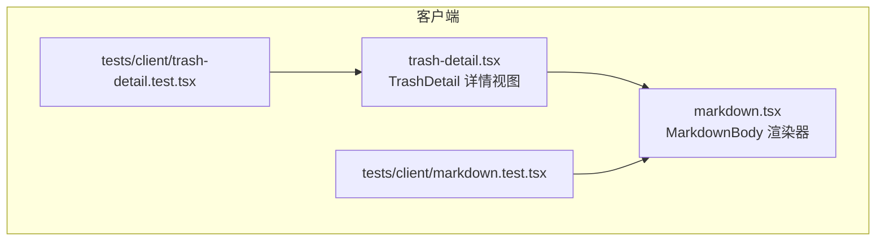
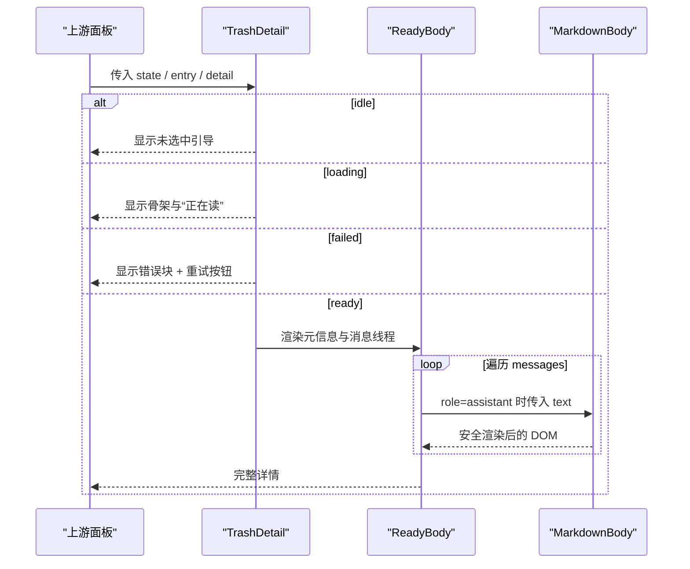
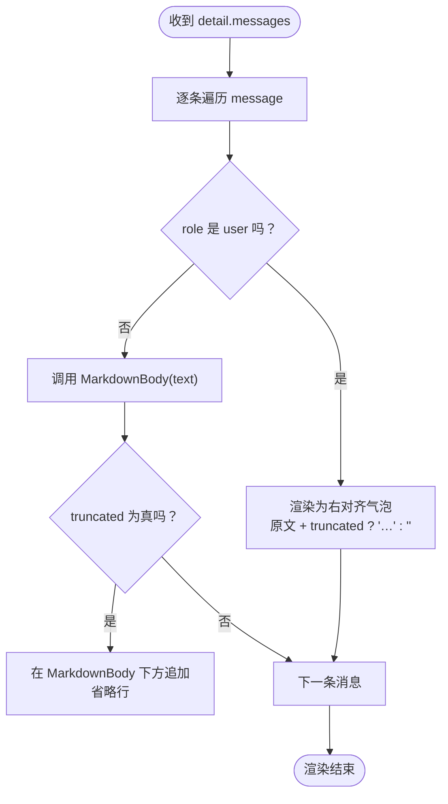
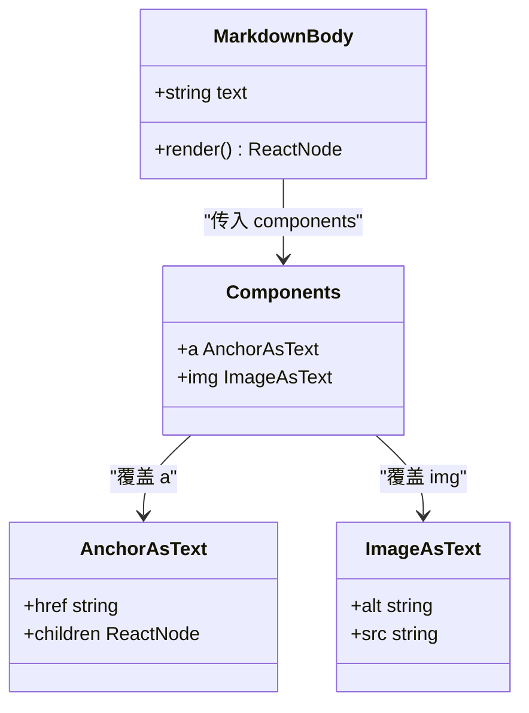
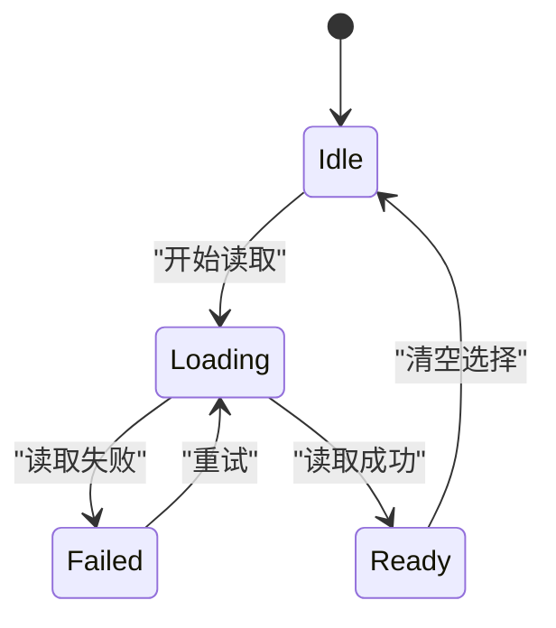
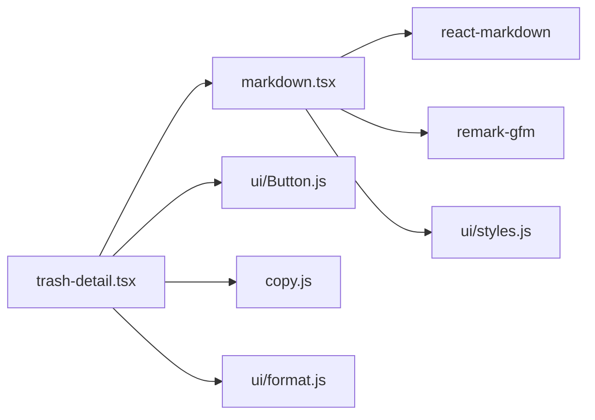

# 详情渲染与 Markdown 处理

<cite>
**本文引用的文件**   
- [src/client/markdown.tsx](file://src/client/markdown.tsx)
- [src/client/trash-detail.tsx](file://src/client/trash-detail.tsx)
- [tests/client/markdown.test.tsx](file://tests/client/markdown.test.tsx)
- [tests/client/trash-detail.test.tsx](file://tests/client/trash-detail.test.tsx)
</cite>

## 目录
1. [引言](#引言)
2. [项目结构](#项目结构)
3. [核心组件](#核心组件)
4. [架构总览](#架构总览)
5. [详细组件分析](#详细组件分析)
6. [依赖关系分析](#依赖关系分析)
7. [性能考量](#性能考量)
8. [故障排查指南](#故障排查指南)
9. [结论](#结论)
10. [附录：扩展示例](#附录扩展示例)

## 引言
本模块负责回收站中某条会话的详情渲染，尤其是“多代会话日志 → 可阅读正文”的处理。它需要回答三个关键问题：

- 消息数组按什么顺序出现？哪些字段能说明内容被裁剪过？
- 如何从原始 Markdown 源生成安全的 DOM，并正确渲染表格、任务列表、代码块和链接？
- 详情视图在加载、失败、空正文、正常四种状态下的表达是什么？

该模块由两个主要文件组成：`markdown.tsx` 提供一段 Markdown 到 DOM 的渲染器；`trash-detail.tsx` 把上游提供的 `TrashDetailLike` 数据（包括消息数组）绘制成 UI。

## 项目结构
相关代码集中在客户端层：

**图示来源**
- [src/client/markdown.tsx:1-57](file://src/client/markdown.tsx#L1-L57)
- [src/client/trash-detail.tsx:1-323](file://src/client/trash-detail.tsx#L1-L323)
- [tests/client/markdown.test.tsx:1-55](file://tests/client/markdown.test.tsx#L1-L55)
- [tests/client/trash-detail.test.tsx:1-207](file://tests/client/trash-detail.test.tsx#L1-L207)

**章节来源**
- [src/client/markdown.tsx:1-57](file://src/client/markdown.tsx#L1-L57)
- [src/client/trash-detail.tsx:1-323](file://src/client/trash-detail.tsx#L1-L323)

## 核心组件
- `MarkdownBody`：接收一段字符串 `text`，返回带 `.sd-md` 容器的 Markdown DOM。
- `TrashDetail`：接收 `state`、`busy`、`wide`、回调与翻译函数，输出四态详情。
- `ReadyBody`：详情就绪分支，渲染元信息、隐藏/截断提示、以及消息线程。
- `LoadingBody`：加载中骨架提示。
- 样式副作用导入：`.sd-md` 对应的样式表随模块加载注入宿主页面。

**章节来源**
- [src/client/markdown.tsx:1-57](file://src/client/markdown.tsx#L1-L57)
- [src/client/trash-detail.tsx:1-323](file://src/client/trash-detail.tsx#L1-L323)

## 架构总览
详情渲染的数据流是单向的：上游决定选中项、缓存、失败与重读；本模块只负责“把状态画出来”。

**图示来源**
- [src/client/trash-detail.tsx:1-323](file://src/client/trash-detail.tsx#L1-L323)
- [src/client/markdown.tsx:1-57](file://src/client/markdown.tsx#L1-L57)

## 详细组件分析

### 消息数组迭代顺序与正文裁剪策略

#### 迭代顺序
- 消息来自 `detail.messages`，按数组顺序从上到下渲染。
- 每条消息通过 `message.role` 区分用户与助手：
  - `user`：右侧气泡，原样文本。
  - `assistant`：左侧无气泡区域，使用 `MarkdownBody` 渲染。
- 测试确认了 `[user, assistant]` 的顺序不会颠倒。

**图示来源**
- [src/client/trash-detail.tsx:201-323](file://src/client/trash-detail.tsx#L201-L323)

#### 截断标记与省略规则
- 单条消息是否被截断由 `message.truncated` 控制。
- 用户提问：若 `truncated` 为真，气泡末尾追加“…”字符。
- 助手回复：`MarkdownBody` 本身不附加省略号；如果 `truncated` 为真，会在其下方单独渲染一行省略号。
- 这不是按字节或字符数在本模块内裁剪；截断发生在上游组装 `messages` 时，本模块只做“上屏表达”。

#### 可用正文提取逻辑
- 可用正文就是 `detail.messages` 中 `role` 为 `user` 或 `assistant` 的消息。
- 其他类型（例如工具调用）会体现在 `toolCallCount` 等计数字段中，但不会进入消息线程。
- 注入上下文与载荷上限导致的缺失分别由 `detail.injectedCount` 和 `detail.omittedByPayloadCap` 表示，并在页面上明确提示，避免误以为“这条会话本来就没有这些内容”。

**章节来源**
- [src/client/trash-detail.tsx:201-323](file://src/client/trash-detail.tsx#L201-L323)
- [tests/client/trash-detail.test.tsx:1-207](file://tests/client/trash-detail.test.tsx#L1-L207)

### Markdown 渲染与安全处理

#### react-markdown 与 remark-gfm 组合
- 使用 `react-markdown` 解析 Markdown。
- 通过 `remarkPlugins={[remarkGfm]}` 启用 GFM，支持表格、任务列表等语法。
- 测试验证标题、列表、粗体、表格、围栏代码块、行内代码均能被识别。

#### 支持的 Markdown 语法
- 基础语法：标题、列表、粗体、行内代码、围栏代码块。
- GFM 语法：表格（列头、列分隔符、单元格）。
- 任务列表未在测试中显式断言，但由 `remark-gfm` 开启后通常可获得支持；如需严格保证，可在测试中补充对应用例。

#### 安全处理
- **原始 HTML 不执行**：默认没有挂载 `rehype-raw`，因此裸 HTML 不会被转成可执行节点；它会变成字面文本显示。
- **链接不开新窗口**：自定义 `a` 渲染器把链接转为普通 ``，仅保留锚文本，并把原始 URL 放入 `title`。
- **图片不加载**：自定义 `img` 渲染器不显示图片，而是输出类似“[图片 · alt]”的文本，因为会话当时的相对路径在回收站里不可用。
- **容器选择器**：外层包裹带 `.sd-md` 的 `div`，样式表通过副作用导入注入。

**图示来源**
- [src/client/markdown.tsx:1-57](file://src/client/markdown.tsx#L1-L57)

**章节来源**
- [src/client/markdown.tsx:1-57](file://src/client/markdown.tsx#L1-L57)
- [tests/client/markdown.test.tsx:1-55](file://tests/client/markdown.test.tsx#L1-L55)

### markdown.tsx 封装要点

#### 自定义渲染器
- `AnchorAsText`：移除跳转行为，保留 `title`。
- `ImageAsText`：不加载图片，仅展示可读说明。
- `COMPONENTS` 对象同时覆盖 `a` 与 `img`。

#### 样式隔离
- 外层容器类名为 `.sd-md`。
- 样式通过副作用导入 `./ui/styles.js`，随模块加载注入 `<style>`。
- 测试要求容器中必须存在 `.sd-md` 节点。

#### 性能优化
- `MarkdownBody` 使用 `memo` 包装，依赖键仅为 `text`。
- 原因是底层 `react-markdown` 每次调用都会重新创建处理器并同步运行解析；如果不 memo，面板任何一次重渲染都可能触发整段 Markdown 重新解析。
- 当前实现没有防抖或懒加载；对超长消息的性能约束主要来自上游的截断策略和下游的滚动交互。

**章节来源**
- [src/client/markdown.tsx:1-57](file://src/client/markdown.tsx#L1-L57)

### trash-detail.tsx 的 Props、状态与边界

#### Props
- `state`：四态联合类型。
- `busy`：是否有写操作进行中，用于禁用重试。
- `wide`：宽档模式；窄档时在详情顶部显示返回按钮。
- `onRetry`：读取失败时的重试回调。
- `onBack`：窄档返回清单的回调。
- `t`：翻译函数。

#### 四态表达
- `idle`：未选中，显示引导文案。
- `loading`：显示“正在读”与骨架条，不显示动作按钮。
- `failed`：显示错误块、错误消息与“重试”，`role="status"` 供读屏访问。
- `ready`：显示元信息、隐藏/截断提示、消息线程。

#### 标题优先级
- 优先使用清册标题 `entry.title`。
- 为空时才回落到日志标题 `detail.logTitle`。
- 两者都为空时使用通用“未命名”。

#### 空正文
- 当 `detail.messages.length === 0` 时，显示“没有可显示的文字”。
- 这不等于“读取失败”，而是“确实没有可渲染的用户或助手消息”。

**图示来源**
- [src/client/trash-detail.tsx:1-323](file://src/client/trash-detail.tsx#L1-L323)

**章节来源**
- [src/client/trash-detail.tsx:1-323](file://src/client/trash-detail.tsx#L1-L323)
- [tests/client/trash-detail.test.tsx:1-207](file://tests/client/trash-detail.test.tsx#L1-L207)

## 依赖关系分析

**图示来源**
- [src/client/markdown.tsx:1-57](file://src/client/markdown.tsx#L1-L57)
- [src/client/trash-detail.tsx:1-323](file://src/client/trash-detail.tsx#L1-L323)

**章节来源**
- [src/client/markdown.tsx:1-57](file://src/client/markdown.tsx#L1-L57)
- [src/client/trash-detail.tsx:1-323](file://src/client/trash-detail.tsx#L1-L323)

## 性能考量

1. **Memo 渲染 MarkdownBody**
   - 避免每条消息在每次父组件重渲染时都重新解析 Markdown。
   - 适用条件：只有 `text` 变化才需要重建。

2. **截断放在上游**
   - 长会话不应让详情一次性渲染大量 Markdown；应由上游根据载荷上限、注入上下文数量等策略裁剪消息数组。
   - 本页通过 `injectedCount` 与 `omittedByPayloadCap` 向用户解释“为什么少了”。

3. **无防抖与懒加载**
   - 当前实现没有对滚动可见区域做懒渲染，也没有对输入做防抖。
   - 如果未来需要支持超大正文，可考虑：
     - 只对可视区域消息渲染 Markdown。
     - 对输入变更加防抖。
     - 将超长 Markdown 分段虚拟列表。

4. **样式注入时机**
   - 样式通过副作用导入，确保 `.sd-md` 可用；但如果宿主环境禁止动态样式注入，可能影响外观。

**章节来源**
- [src/client/markdown.tsx:1-57](file://src/client/markdown.tsx#L1-L57)
- [src/client/trash-detail.tsx:201-323](file://src/client/trash-detail.tsx#L201-L323)

## 故障排查指南

| 现象 | 可能原因 | 排查建议 |
|---|---|---|
| Markdown 内容像纯文本，没有标题、表格或列表 | 未启用 `remark-gfm`，或传入的不是 Markdown 源 | 检查是否使用 `MarkdownBody`；确认消息中助手侧走 Markdown，用户侧走原文 |
| 链接仍然可以跳转或被拦截 | 自定义 `a` 渲染器未生效，或宿主额外绑定了点击事件 | 检查 `.sd-md` 内的锚点是否为 ``；确认没有在外层再绑定跳转 |
| 图片无法加载或空白 | 图片路径属于会话当时的 cwd，回收站中不可用 | 这是预期行为；如需调试，可查看 `ImageAsText` 的 `title` 中的原路径 |
| 外部资源被浏览器策略拦截 | 跨域、CSP、或宿主导航限制 | 本模块已避免打开新窗口；如仍被拦截，检查宿主 CSP 与网络策略 |
| 超长消息导致界面卡顿 | 单条 Markdown 过长且全部渲染 | 在上游增加截断，使 `truncated` 为真；必要时引入懒渲染或虚拟列表 |
| 样式与宿主主题冲突 | `.sd-md` 样式与宿主 Markdown 样式不一致 | 核对 `ui/styles.js` 的选择器；保持宿主 Markdown 投影一致 |
| 详情没有显示动作按钮 | 动作按钮不在详情组件中，而在清单行 | 这是设计约束；不要在此处添加恢复或删除按钮 |
| 时间显示异常 | 时间戳为 0 或缺失 | 检查 `createdAt`、`lastActivity`、`deletedAt`；缺省时应降级为“—” |
| 注入条数混入计数列 | 把 `injectedinjectedCount` 当成消息总数 | 应只显示 `userMessageCount`、`assistantMessageCount`、`toolCallCount` 等 |

**章节来源**
- [tests/client/markdown.test.tsx:1-55](file://tests/client/markdown.test.tsx#L1-L55)
- [tests/client/trash-detail.test.tsx:1-207](file://tests/client/trash-detail.test.tsx#L1-L207)

## 结论
`markdown.tsx` 与 `trash-detail.tsx` 共同实现了回收站详情的安全 Markdown 渲染。前者收口安全性与 GFM 能力，后者负责消息顺序、状态表达与截断提示。二者配合的关键原则是：

- 助手正文用 Markdown，用户提问保持原话。
- 链接和图片不产生跳转或远程加载。
- 截断由上游控制，本模块负责透明表达。
- 性能依赖 `memo` 与合理的消息裁剪，而非在详情页自行节流。

## 附录：扩展示例

以下示例基于现有接口进行扩展示意，实际接入时应结合宿主构建链与样式系统。

### 示例一：注入自定义指令
- 目标：在助手 Markdown 中加入自定义指令，例如高亮关键词。
- 做法：
  - 在 `MarkdownBody` 外新增一个 `remark` 插件，把特定指令转换为 AST 节点。
  - 在 `components` 中为该节点添加渲染函数。
  - 注意：不要绕过链接与图片的安全限制。
- 参考位置：
  - [src/client/markdown.tsx:1-57](file://src/client/markdown.tsx#L1-L57)

### 示例二：替换代码高亮主题
- 目标：让围栏代码块使用不同高亮主题。
- 做法：
  - 在高亮库中加载主题样式。
  - 在 `MarkdownBody` 的子树中检测 `<pre><code>`，并用高亮库对内容进行着色。
  - 为避免重复渲染，可只在 `text` 变化时更新高亮结果。
- 参考位置：
  - [tests/client/markdown.test.tsx:1-55](file://tests/client/markdown.test.tsx#L1-L55)

### 示例三：调整预览最大高度
- 目标：防止超长 Markdown 撑开详情面板。
- 做法：
  - 给 `.sd-md` 或外层容器设置 `maxHeight` 与 `overflow`。
  - 对于已经截断的消息，保留“…”提示，让用户知道内容不完整。
- 参考位置：
  - [src/client/trash-detail.tsx:201-323](file://src/client/trash-detail.tsx#L201-L323)

### 示例四：为 Markdown 添加错误边界
- 目标：防止非法 Markdown 破坏整个详情。
- 做法：
  - 在 `MarkdownBody` 外层包裹 React 错误边界。
  - 捕获解析或渲染异常，显示“正文格式异常，无法显示”。
- 参考位置：
  - [src/client/markdown.tsx:1-57](file://src/client/markdown.tsx#L1-L57)

### 示例五：控制 Markdown 渲染性能
- 目标：减少大文档的重渲染成本。
- 做法：
  - 在当前 `memo(text)` 基础上，增加可视区域判断。
  - 对不可见消息暂不渲染 Markdown，改为占位骨架。
  - 对频繁滚动的场景加入防抖。
- 参考位置：
  - [src/client/markdown.tsx:1-57](file://src/client/markdown.tsx#L1-L57)
  - [src/client/trash-detail.tsx:201-323](file://src/client/trash-detail.tsx#L201-L323)