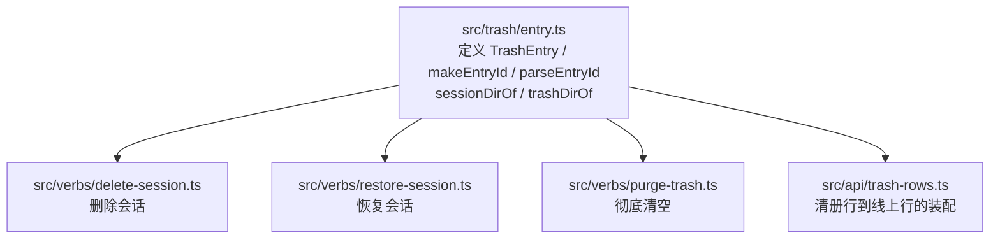
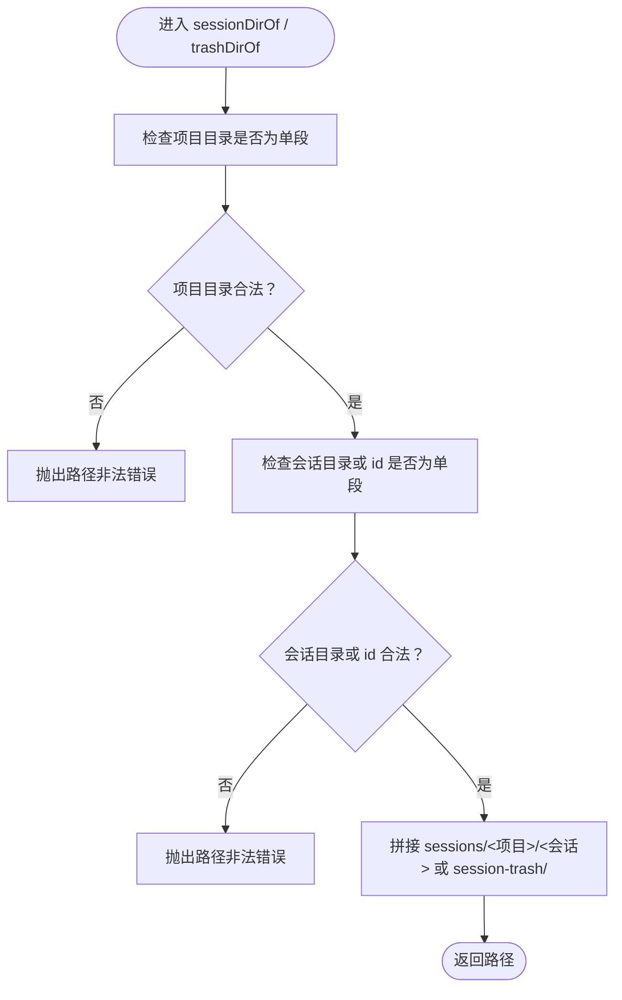
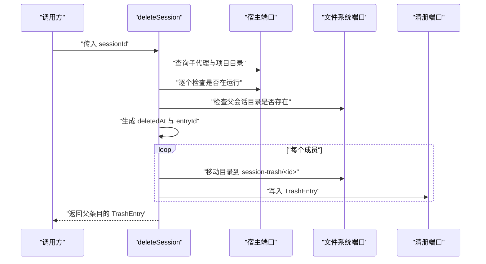
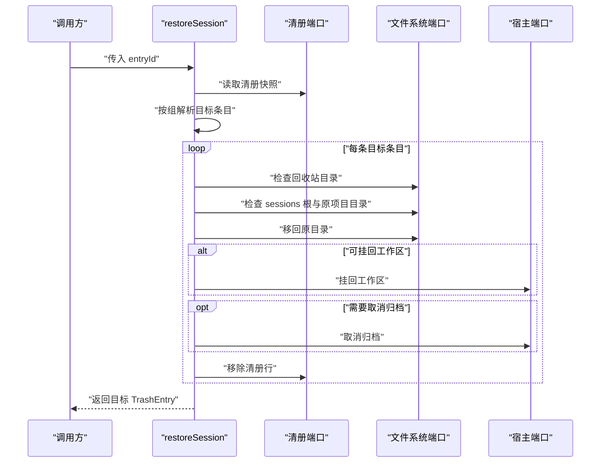
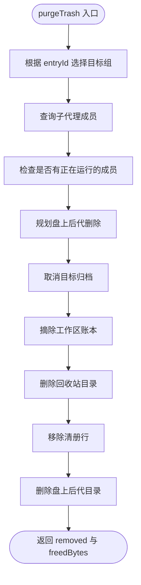

# TrashEntry 模型与 id 规则

<cite>
**本文引用的文件**   
- [entry.ts](file://src/trash/entry.ts)
- [trash-entry.test.ts](file://tests/trash-entry.test.ts)
- [delete-session.ts](file://src/verbs/delete-session.ts)
- [restore-session.ts](file://src/verbs/restore-session.ts)
- [purge-trash.ts](file://src/verbs/purge-trash.ts)
- [trash-rows.ts](file://src/api/trash-rows.ts)
</cite>

## 目录
1. [简介](#简介)
2. [项目结构中的位置](#项目结构中的位置)
3. [TrashEntry 领域模型](#trashtentry-领域模型)
4. [id 生成与解析规则](#id-生成与解析规则)
5. [路径闸与 session-trash 构造](#路径闸与-session-trash-构造)
6. [删除、恢复与清空动词消费](#删除恢复与清空动词消费)
7. [边界情况与错误处理](#边界情况与错误处理)
8. [性能与安全注意事项](#性能与安全注意事项)
9. [结论](#结论)

## 简介
本文件面向 `TrashEntry` 领域模型，围绕其 id 的生成格式、解析语义、必填字段、路径校验、回收站目录构造方式，以及删除、恢复、清空等动词如何消费该模型进行系统化说明。文档同时给出正常、非法、重复 id 等边界场景的处理建议，并补充大目录、异常文件名、并发会话等安全与性能注意事项。

## 项目结构中的位置
`TrashEntry` 是回收站领域的核心数据契约，主要位于回收站实现层，并被上层 API 装配与多个动词消费：

**图表来源**
- [entry.ts](file://src/trash/entry.ts)
- [delete-session.ts:1-206](file://src/verbs/delete-session.ts#L1-L206)
- [restore-session.ts:1-173](file://src/verbs/restore-session.ts#L1-L173)
- [purge-trash.ts:1-121](file://src/verbs/purge-trash.ts#L1-L121)
- [trash-rows.ts:1-93](file://src/api/trash-rows.ts#L1-L93)

**章节来源**
- [entry.ts](file://src/trash/entry.ts)
- [trash-entry.test.ts:1-64](file://tests/trash-entry.test.ts#L1-L64)

## TrashEntry 领域模型
`TrashEntry` 表示一条已删除会话在回收站中的持久化记录。它既承载 id 与元信息，也承载磁盘路径相关的关键字段，以便删除、恢复和清空动词能准确定位原会话目录和回收站目录。

| 字段 | 是否必填 | 含义与作用 | 关键约束或行为 |
|---|---:|---|---|
| `id` | 是 | 回收站条目唯一标识；由删除时间戳与原会话目录名拼接而成 | 必须能通过 `parseEntryId` 解析；恢复时依赖其中的 `sessionDirName` |
| `sessionId` | 是 | 当前会话的唯一标识 | 用于宿主侧查询、归档、可见性控制等 |
| `projectDir` | 是 | 会话所属的项目目录键 | 与 `sessions/` 根组合后确定原目录位置 |
| `workspaceId` | 是 | 删除时的归属工作区标识 | 空串表示未分组；恢复时可挂回，也可能因工作区缺失而按未分组处理 |
| `wasArchived` | 是 | 删除前会话是否处于归档状态 | 决定恢复时是否需要取消归档 |
| `deletedAt` | 是 | 删除时刻的时间戳（毫秒） | 与 `id` 中编码的时间戳一致，用于排序与显示 |
| `title` | 是 | 会话标题 | 通常从宿主读取后写入清册 |
| `sizeBytes` | 是 | 会话目录大小（字节） | 用于界面释放空间提示与批量统计 |
| `parentEntryId` | 否 | 子代理（子会话）的行父级 id | 仅子代理行携带；根行没有该字段 |

其中，`title` 与 `sizeBytes` 的运行时契约还体现在清册装配与清单测试中：它们不是“可忽略”的可选字段，而是影响线上展示与释放字节计算的核心值。

**章节来源**
- [trash-entry.test.ts:40-64](file://tests/trash-entry.test.ts#L40-L64)
- [trash-rows.ts:24-47](file://src/api/trash-rows.ts#L24-L47)

## id 生成与解析规则

### id 格式
`TrashEntry.id` 是由 **删除时间戳** 与 **原会话目录名** 拼接而成的字符串。测试用例表明：

- 时间戳部分采用紧凑格式，例如 `20260930T130500Z`；
- 原目录名原样保留，不追加额外后缀；
- v4 会话的原目录名带 `session-` 前缀，v3 无前缀，但两者都保持原样拼入 id；
- 因此，id 既是可排序的时间键，又携带恢复所需的原始目录名片段。

### 生成函数：`makeEntryId`
`makeEntryId(deletedAt, sessionId)` 用于在删除阶段生成 id。它把传入的删除时间与原会话目录名绑定在一起，确保恢复时能从 id 中还原出准确的目录名。

- 输入：
  - `deletedAt`：删除时间戳；
  - `sessionId`：原会话目录名。
- 输出：
  - 一个符合规范的 id 字符串；
  - 该字符串能被 `parseEntryId` 解析回 `deletedAt` 与 `sessionDirName`。

### 解析函数：`parseEntryId`
`parseEntryId(id)` 负责把回收站目录名解析为结构化结果，至少返回：

- `deletedAt`：解码后的删除时间戳；
- `sessionDirName`：被删会话的原始目录名。

解析失败时必须抛出错误，而不是返回半截结果。测试覆盖了空串、非标准格式、只有时间戳、时间戳格式不正确等情况，均要求抛错。

### id 生成与解析示例（以路径描述代替代码）
以下示例用自然语言描述调用过程，避免直接粘贴源码：

1. **正常路径：v4 会话**
   - 删除时间为 `2026-09-30T13:05:00Z`；
   - 原会话目录名为 `session-f13e7fa3-b827-888a225c45fb`；
   - 调用 `makeEntryId` 得到形如 `20260930T130500Z-session-f13e7fa3-b827-888a225c45fb` 的 id；
   - 调用 `parseEntryId` 得到 `sessionDirName = session-f13e7fa3-b827-888a225c45fb` 与正确 `deletedAt`。

2. **正常路径：v3 会话**
   - 原会话目录名无前缀，例如某个 UUID；
   - `makeEntryId` 同样以时间戳开头拼接原目录名；
   - `parseEntryId` 能正确取出无前缀的原始目录名。

3. **非法路径：空字符串**
   - 调用 `parseEntryId('')` 应抛出错误；
   - 不应返回 `sessionDirName` 为空或其他半截对象。

4. **非法路径：缺少时间戳段**
   - 例如只传普通字符串或非时间戳前缀；
   - 解析器应拒绝，因为无法可靠推断删除时间。

5. **非法路径：时间戳格式错误**
   - 例如使用 ISO 日期形式而非仓库约定的紧凑时间戳；
   - 解析器应抛出错误。

6. **重复 id 场景**
   - 如果两个删除操作在同一毫秒内发生，且原目录名相同，理论上会生成相同 id；
   - 实际风险取决于文件系统能否接受同名目录以及后续恢复逻辑；
   - 建议：
     - 尽量避免同一毫秒重复删除同一会话；
     - 对底层 `manifest.add` 或目录创建失败做明确错误码与重试策略；
     - 不要把重复 id 静默覆盖为同一条记录。

**章节来源**
- [trash-entry.test.ts:6-27](file://tests/trash-entry.test.ts#L6-L27)
- [entry.ts](file://src/trash/entry.ts)

## 路径闸与 session-trash 构造

### 两个关键路径构造器
`TrashEntry` 模型本身只保存 `projectDir` 和 `sessionId`，真正的路径由以下函数构造：

| 函数 | 用途 | 参数 | 返回值 |
|---|---|---|---|
| `sessionDirOf(projectDir, sessionId, home)` | 构造原会话目录路径 | 项目目录键、原会话目录名、home 根 | `sessions/<项目>/<原目录名>` |
| `trashDirOf(entryId, home)` | 构造回收站目录路径 | 回收站 id、home 根 | `session-trash/<id>` |

### 路径闸规则
路径闸主要发生在 `sessionDirOf` 和 `trashDirOf` 中：

- 项目目录段与会话目录段必须是**单段名称**；
- 拒绝包含路径分隔符、`.`、`..`、反斜杠、空段等危险或非法值；
- 对 `sessionDirOf`：
  - 如果 `projectDir` 不是单段，抛出错误；
  - 如果 `sessionId` 不是单段，抛出错误；
  - 若 `sessionId` 为空，则允许指向项目根下的特殊路径，这对应“项目根”语义；
- 对 `trashDirOf`：
  - `entryId` 也必须通过单段检查；
  - 非法 id 不会继续拼接成危险路径。

**图表来源**
- [trash-entry.test.ts:29-46](file://tests/trash-entry.test.ts#L29-L46)
- [entry.ts](file://src/trash/entry.ts)

### 回收站目录构造流程
删除时，系统会：

1. 调用 `makeEntryId(deletedAt, sessionId)` 生成 id；
2. 调用 `trashDirOf(id, home)` 得到回收站目录；
3. 确保 `session-trash` 目录存在；
4. 将原会话目录移动到 `session-trash/<id>`；
5. 将 `TrashEntry` 写入清册。

恢复时，系统反向执行：

1. 根据 `entry.id` 调用 `trashDirOf` 找到回收站目录；
2. 通过 `parseEntryId(entry.id).sessionDirName` 得到原始目录名；
3. 调用 `sessionDirOf(projectDir, sessionDirName, home)` 得到目标路径；
4. 将目录移回原处。

这种设计让恢复不依赖宿主当前的命名约定，只依赖删除时写死的 id。

**章节来源**
- [trash-entry.test.ts:29-46](file://tests/trash-entry.test.ts#L29-L46)
- [delete-session.ts:80-170](file://src/verbs/delete-session.ts#L80-L170)
- [restore-session.ts:105-173](file://src/verbs/restore-session.ts#L105-L173)

## 删除、恢复与清空动词消费

### 删除会话：`deleteSession`
删除动词消费 `TrashEntry` 的方式如下：

- 获取会话及其子代理成员；
- 校验所有成员不在运行；
- 确认父会话目录存在；
- 对每个存在的成员：
  - 调用 `sessionDirOf` 构造原目录；
  - 调用 `makeEntryId` 生成 id；
  - 调用 `trashDirOf` 构造回收站目录；
  - 移动目录；
  - 写入清册；
  - 设置 `parentEntryId` 区分父子关系。

**图表来源**
- [delete-session.ts:20-80](file://src/verbs/delete-session.ts#L20-L80)
- [delete-session.ts:80-170](file://src/verbs/delete-session.ts#L80-L170)

**章节来源**
- [delete-session.ts:1-206](file://src/verbs/delete-session.ts#L1-L206)

### 恢复会话：`restoreSession`
恢复动词消费 `TrashEntry` 的方式如下：

- 根据 `entryId` 查找清册中的目标条目；
- 按组解析出整组待恢复条目；
- 预检：
  - 回收站目录必须存在；
  - `sessions` 根目录与原项目目录必须存在；
- 逐个恢复：
  - 用 `parseEntryId(entry.id).sessionDirName` 恢复原始目录名；
  - 用 `sessionDirOf(projectDir, sessionDirName, home)` 构造目标路径；
  - 按需挂回工作区；
  - 按需取消归档；
  - 最后移除清册行。

**图表来源**
- [restore-session.ts:20-104](file://src/verbs/restore-session.ts#L20-L104)
- [restore-session.ts:105-173](file://src/verbs/restore-session.ts#L105-L173)

**章节来源**
- [restore-session.ts:1-173](file://src/verbs/restore-session.ts#L1-L173)

### 清空回收站：`purgeTrash`
清空动词消费 `TrashEntry` 的方式如下：

- 若无指定 id，清空全部；
- 若指定 id，按组清理该父行及关联子行；
- 对每个目标条目：
  - 计算 `trashDirOf(entry.id, home)`；
  - 若目录仍存在，统计大小并删除；
  - 从清册移除该行；
  - 通知宿主内存与客户端。

**图表来源**
- [purge-trash.ts:15-121](file://src/verbs/purge-trash.ts#L15-L121)

**章节来源**
- [purge-trash.ts:1-121](file://src/verbs/purge-trash.ts#L1-L121)

### API 行装配：`trash-rows.ts`
`trash-rows.ts` 并不直接定义 `TrashEntry`，但它消费该模型，将其装配为线上传输行：

- 显式映射 `id`、`sessionId`、`projectDir`、`workspaceId`、`wasArchived`、`deletedAt`、`title`、`sizeBytes`；
- 计算 `releaseBytes`，包含子代理与残留成员的字节；
- 可选附加 `parentEntryId` 与若干只读数。

这表明 `TrashEntry` 是服务端内部事实模型，而线上行是它的投影。

**章节来源**
- [trash-rows.ts:1-93](file://src/api/trash-rows.ts#L1-L93)

## 边界情况与错误处理

| 场景 | 表现 | 建议 |
|---|---|---|
| 路径不存在：删除时原会话目录不存在 | 删除抛出“会话目录不存在”错误 | 先确认会话是否已被外部删除；不要静默跳过 |
| 路径不存在：恢复时回收站目录不存在 | 恢复抛出“回收站条目已不在磁盘上”错误 | 用户可能手动删除了回收站目录；引导重新扫描或清空 |
| 路径不存在：恢复时原项目目录不存在 | 恢复抛出“原项目目录已不存在”错误 | 不要自动重建项目目录；这是破坏性假设 |
| id 不合法：空串或非预期格式 | `parseEntryId` 抛出“bad entry id”类错误 | 记录原始 id 日志；拒绝降级为半截对象 |
| id 不合法：只有时间戳没有原目录名 | 解析失败 | 检查清册是否损坏或被手工修改 |
| 目录名冲突：回收站中已有同名 id | 目录重命名或清册写入可能失败 | 使用具体 io 错误码；必要时退避重试或报告脏数据 |
| 重复 id：同一毫秒重复删除 | 可能产生相同 id | 尽量避免；对底层失败做幂等与诊断 |
| 非法路径段：`..`、`.`、路径分隔符 | 路径闸拒绝 | 记录可疑 `projectDir` 或 `sessionId`，防止注入 |
| 会话正在运行：删除或清空 | 动词拒绝并返回“live”错误 | 不要替用户终止会话；让用户先停止 |
| 工作区缺失：恢复时工作区注册已删除 | 按未分组恢复，不失败 | 界面应提示“原工作区已不存在” |
| 清册行与目录不一致 | 恢复或清空需分别判断 | 优先保证目录状态真实；清册行失败时走回滚 |

常见错误来源包括：

- `verbError('not-found', ...)`：会话或目录不存在；
- `verbError('trash-empty', ...)`：回收站中没有该条目或目录缺失；
- `verbError('project-missing', ...)`：原项目目录不存在；
- `verbError('live', ...)`：会话仍在运行；
- `verbError('io', ...)`：登记回收站条目失败等底层 io 错误。

**章节来源**
- [trash-entry.test.ts:18-46](file://tests/trash-entry.test.ts#L18-L46)
- [delete-session.ts:24-48](file://src/verbs/delete-session.ts#L24-L48)
- [delete-session.ts:110-140](file://src/verbs/delete-session.ts#L110-L140)
- [restore-session.ts:40-65](file://src/verbs/restore-session.ts#L40-L65)
- [purge-trash.ts:35-55](file://src/verbs/purge-trash.ts#L35-L55)

## 性能与安全注意事项

### 大目录与大量子代理
- 删除和恢复都会遍历成员、量目录大小、移动目录；
- 大会话目录可能导致：
  - `sizeOfDir` 耗时较长；
  - 目录移动占用较多系统资源；
  - 批量恢复时多次 IO；
- 建议：
  - 对超大目录增加进度反馈；
  - 限制单次批量操作规模；
  - 在 UI 上区分“已计算释放空间”和“预估空间”；
  - 避免在每次列表渲染中重复测量，尽量复用已读数据。

### 异常文件名与路径安全
- `sessionDirOf` 与 `trashDirOf` 的路径闸是关键防线；
- 即使 `sessionId` 来自宿主，也不应信任其为安全路径；
- 建议：
  - 始终使用 `sessionDirOf` 与 `trashDirOf`，禁止字符串拼接任意会话名；
  - 对异常文件名（含空格、引号、换行、不可见字符）保持容错；
  - 日志中脱敏项目名称，避免泄露敏感路径；
  - 对无法枚举的大目录或权限不足目录，记录错误但不阻塞整个批处理。

### 并发与会话生命周期
- 删除、恢复、清空都假设会话不在运行；
- 若宿主状态变化快于本地缓存，可能出现“看起来空闲但实际运行”的竞态；
- 建议：
  - 在执行前再次调用 `isLive`；
  - 对“正在运行”错误做友好提示；
  - 对并发恢复或清空做去重，避免重复删除同一条目。

### 清册一致性
- 清册行是最后一件写；
- 恢复时清册行也是最后一件写；
- 清空时目录删除与清册移除顺序要稳定；
- 建议：
  - 使用 journal 机制统一正向与回滚步骤；
  - 出现部分成功时，优先暴露真实 `removed` 与 `freedBytes`；
  - 对脏数据提供修复工具，例如根据盘上目录重建清册。

### 安全性总结
- 所有路径必须经过路径闸；
- 所有 id 必须经过解析校验；
- 所有磁盘操作必须有回滚或幂等保障；
- 所有“正在运行”的会话不得被强制删除或移动；
- 所有工作区缺失应按未分组处理，而不是静吞错误。

**章节来源**
- [trash-entry.test.ts:29-46](file://tests/trash-entry.test.ts#L29-L46)
- [delete-session.ts:20-80](file://src/verbs/delete-session.ts#L20-L80)
- [restore-session.ts:20-65](file://src/verbs/restore-session.ts#L20-L65)
- [purge-trash.ts:15-121](file://src/verbs/purge-trash.ts#L15-L121)

## 结论
`TrashEntry` 是连接会话、项目、回收站与宿主生命周期的核心模型。它的 id 不仅用于排序，更承担“把回收站目录与原会话目录名绑在一起”的职责。删除、恢复、清空三个动词分别消费该模型的 id、projectDir、sessionId 与 workspaceId，并通过 `sessionDirOf` 与 `trashDirOf` 完成路径构造。为了保证安全与一致性：

- id 必须严格生成与解析；
- 路径必须通过单段路径闸；
- 删除、恢复、清空都必须考虑目录缺失、会话运行、工作区缺失等边界；
- 对大目录、异常文件名、并发状态变化要有容错与可观测性。

只要这些契约被严格遵守，回收站就能在复杂宿主机环境中提供稳定、可审计、可回滚的数据迁移体验。