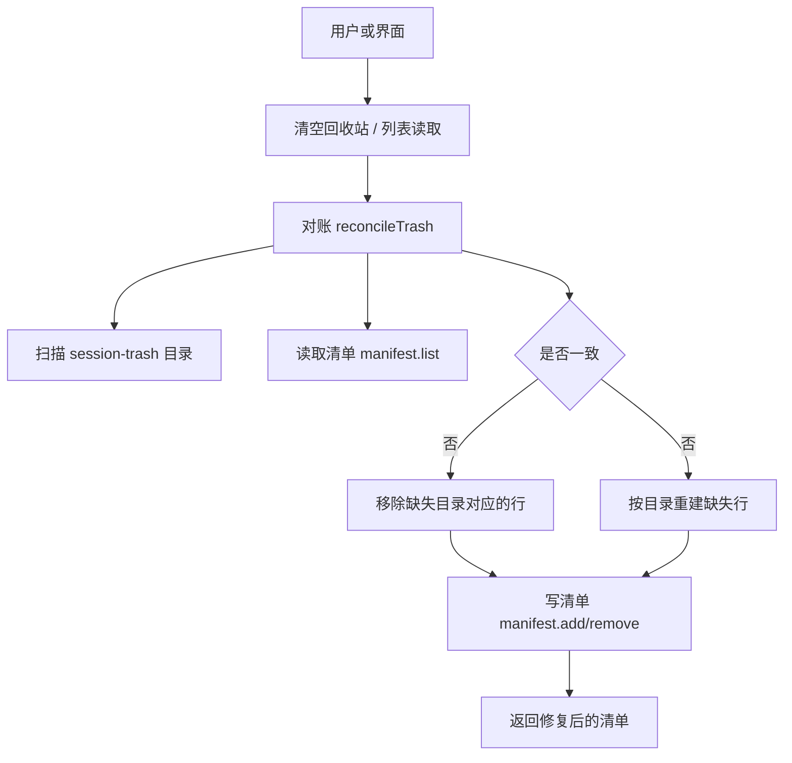
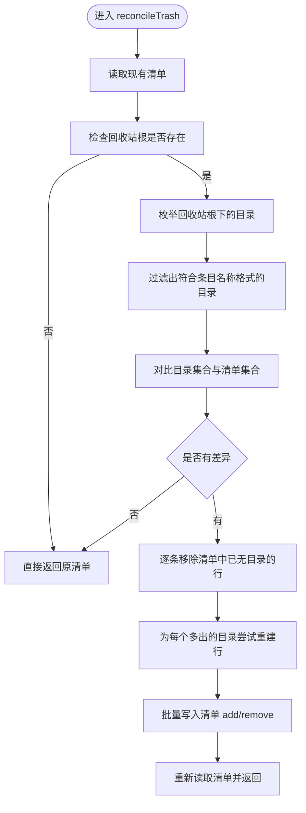
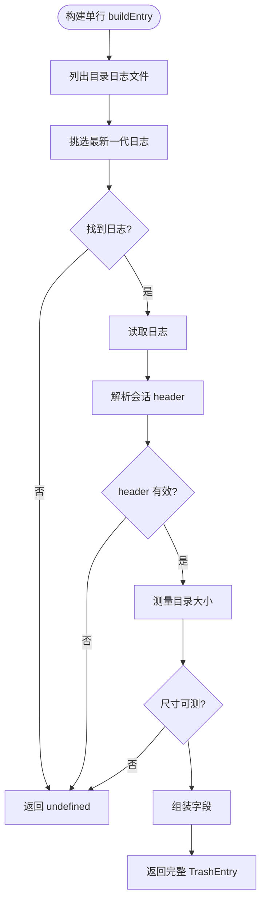
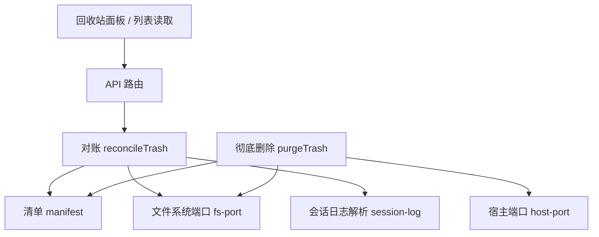
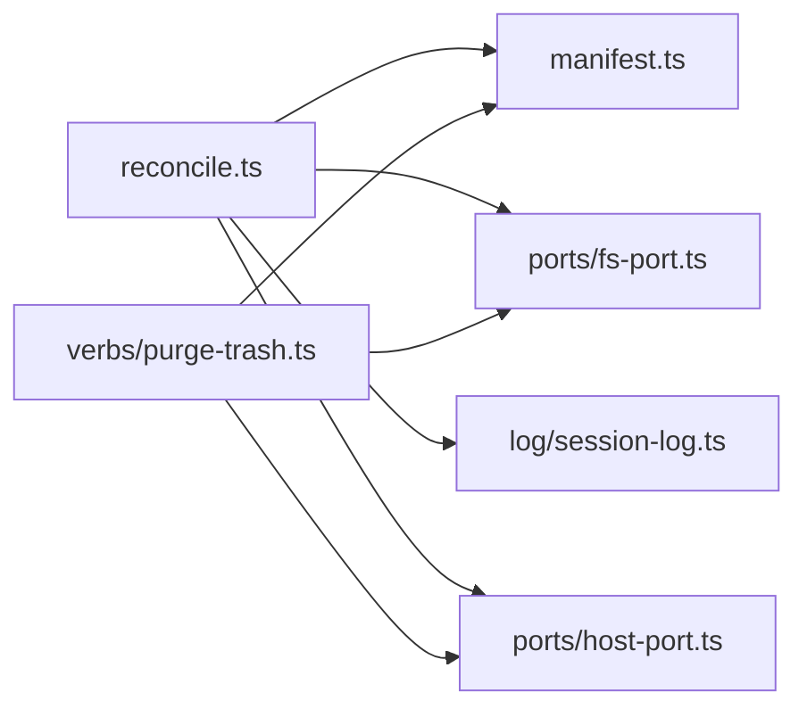

# session-trash 目录与清单对账

<cite>
**本文引用的文件**   
- [src/trash/reconcile.ts](file://src/trash/reconcile.ts)
- [tests/reconcile.test.ts](file://tests/reconcile.test.ts)
- [src/verbs/purge-trash.ts](file://src/verbs/purge-trash.ts)
- [tests/purge-trash.test.ts](file://tests/purge-trash.test.ts)
- [tests/manifest.test.ts](file://tests/manifest.test.ts)
- [README.md](file://README.md)
- [docs/design/2026-10-15-trash-detail-design.md](file://docs/design/2026-10-15-trash-detail-design.md)
</cite>

## 目录
1. [引言](#引言)
2. [项目结构](#项目结构)
3. [核心组件](#核心组件)
4. [架构总览](#架构总览)
5. [详细组件分析](#详细组件分析)
6. [依赖关系分析](#依赖关系分析)
7. [性能考量](#性能考量)
8. [故障排查指南](#故障排查指南)
9. [结论](#结论)

## 引言
本文件说明 `session-trash`（回收站）目录与其清单之间的对账机制。该插件把已删除会话移入本机 `~/.dsh/session-trash/`，并在自身存储域中维护一份清单；两者必须保持一致。对账的目标是：无论磁盘目录与清单如何偏离，只要下一次读取清单，就能恢复零漂移状态。

关键原则来自实现注释与测试：
- 以“文件是准”为基准：磁盘上存在且能被识别的目录，如果清单没有对应行，就重建行。
- 清单中有、但目录已消失的行，会被摘掉。
- 认不出或读不出的目录不动、不列，也不因此删目录或抛错。
- 回收站根不在时，整套跳过，一个字节都不动。
- 对账幂等：重复执行不会产生多余写入。

这些语义由 `reconcileTrash` 统一实现，并由“清空回收站”等动作在写操作前触发，从而避免手工残留。

**章节来源**
- [src/trash/reconcile.ts:1-43](file://src/trash/reconcile.ts#L1-L43)
- [README.md:1-147](file://README.md#L1-L147)

## 项目结构
与对账直接相关的代码集中在三个位置：
- 对账逻辑：`src/trash/reconcile.ts`
- 清单抽象与内存实现：`src/trash/manifest.ts`（通过测试引用）
- 彻底删除动词：`src/verbs/purge-trash.ts`



**图示来源**
- [src/trash/reconcile.ts:104-127](file://src/trash/reconcile.ts#L104-L127)
- [src/verbs/purge-trash.ts:1-121](file://src/verbs/purge-trash.ts#L1-L121)

**章节来源**
- [src/trash/reconcile.ts:1-127](file://src/trash/reconcile.ts#L1-L127)
- [tests/manifest.test.ts:1-37](file://tests/manifest.test.ts#L1-L37)
- [src/verbs/purge-trash.ts:1-121](file://src/verbs/purge-trash.ts#L1-L121)

## 核心组件
### 对账函数 `reconcileTrash`
- **输入**：`ReconcileDeps`，包含文件系统端口、清单端口和回收站根路径。
- **输出**：修复后的清单条目数组，顺序与 `manifest.list()` 一致。
- **副作用**：仅当发现不一致时调用清单的 `remove` 与 `add`。
- **快速路径**：若回收站根不存在，直接返回原清单，不做枚举、不写清单。
- **慢速路径**：枚举目录、过滤合法条目名、对比清单集合、分别处理“缺失行”和“多余目录”。



**图示来源**
- [src/trash/reconcile.ts:104-127](file://src/trash/reconcile.ts#L104-L127)

**章节来源**
- [src/trash/reconcile.ts:104-127](file://src/trash/reconcile.ts#L104-L127)

### 单行重建 `buildEntry`
当一个目录存在于磁盘但清单中没有对应行时，对账会尝试从磁盘重建一条记录。重建失败时整体放弃该目录，而不是写半截行。

重建过程：
1. 列出目录中的日志文件。
2. 挑选最新一代会话日志。
3. 读取压缩日志并解析第一行 header。
4. 量取目录大小。
5. 用目录名解析时间戳与原目录名，用 header 推导会话 id 和项目目录。

关键字段规则：
- `id`：目录名。
- `sessionId`：优先使用 header 的 `id`；缺失时回落到原目录名片段。
- `projectDir`：由 header 的 `cwd` 经宿主算法反推；没有 `cwd` 时使用占位值。
- `workspaceId`：重建时为空白，表示恢复时跳过工作区挂接。
- `wasArchived`：重建时为 `false`，表示恢复时按“可见”还原。
- `title`：重建为空串，详情可回退到日志标题。
- `deletedAt`：从目录名的时间戳部分解析。
- `sizeBytes`：现场测量目录大小。



**图示来源**
- [src/trash/reconcile.ts:44-103](file://src/trash/reconcile.ts#L44-L103)

**章节来源**
- [src/trash/reconcile.ts:44-103](file://src/trash/reconcile.ts#L44-L103)

### 清单接口与行为
清单提供三类操作：
- `list()`：返回按删除时间倒序排列的条目。
- `add(entry)`：同一 `id` 重复加入是覆盖整条记录，不是字段合并。
- `remove(id)`：移除不存在的 `id` 不抛错，行为幂等。

这些性质使对账可以安全地多次运行：重复重建不会复制行，重复删除不会报错。

**章节来源**
- [tests/manifest.test.ts:1-37](file://tests/manifest.test.ts#L1-L37)

## 架构总览
对账并不是独立服务，而是回收站数据一致性层的一部分。它与以下部分协作：



**图示来源**
- [src/trash/reconcile.ts:1-43](file://src/trash/reconcile.ts#L1-L43)
- [src/verbs/purge-trash.ts:1-121](file://src/verbs/purge-trash.ts#L1-L121)

**章节来源**
- [src/trash/reconcile.ts:1-127](file://src/trash/reconcile.ts#L1-L127)
- [src/verbs/purge-trash.ts:1-121](file://src/verbs/purge-trash.ts#L1-L121)

## 详细组件分析

### 对账目标与判定规则
对账只关心两类漂移：
1. **目录存在而清单缺失**：需要重建行。
2. **清单存在而目录缺失**：需要摘除行。

其他情况保持静默：
- 目录名字不符合条目格式。
- 目录里没有日志。
- 日志读不出。
- 日志没有可用 header。
- 目录尺寸量不出。
- 回收站根不存在。

这些规则由测试明确覆盖，确保对账不会因为“外人放进来的东西”或局部损坏而扩大破坏面。

**章节来源**
- [src/trash/reconcile.ts:1-43](file://src/trash/reconcile.ts#L1-L43)
- [tests/reconcile.test.ts:1-197](file://tests/reconcile.test.ts#L1-L197)

### 执行顺序
`reconcileTrash` 的执行顺序如下：
1. 读取现有清单。
2. 检查回收站根是否存在；不存在则直接返回。
3. 枚举回收站根下的目录。
4. 过滤出合法的条目目录名。
5. 计算清单中的 `id` 集合。
6. 找出清单中存在但目录缺失的行。
7. 找出目录存在但清单缺失的条目。
8. 对每个多余目录尝试重建一行。
9. 如果没有差异，直接返回原清单。
10. 先执行所有 `remove`。
11. 再执行所有 `add`。
12. 最后重新读取清单返回。

这个顺序保证：
- 重建行只在确认目录真实存在后发生。
- 摘除行不会误删仍存在的目录。
- 最终返回的是持久化后的清单，而不是中间状态。

```mermaid
sequenceDiagram
    participant Caller as "调用方"
    participant Rec as "reconcileTrash"
    participant Man as "清单 manifest"
    participant Fs as "文件系统 fs"
    participant Entry as "buildEntry"

    Caller->>Rec: "请求对账"
    Rec->>Man: "list()"
    Rec->>Fs: "exists(回收站根)"
    alt 根不存在
        Rec-->>Caller: "返回原清单"
    else 根存在
        Rec->>Fs: "listDirs(回收站根)"
        Rec->>Rec: "过滤合法条目名"
        Rec->>Rec: "计算缺失行与多余目录"
        loop 多余目录
            Rec->>Entry: "buildEntry(id)"
            Entry->>Fs: "listFiles / readFile / sizeOfDir"
            Entry-->>Rec: "成功或 undefined"
        end
        opt 有差异
            Rec->>Man: "remove(缺失行)"
            Rec->>Man: "add(重建行)"
            Rec->>Man: "list()"
            Rec-->>Caller: "返回修复后清单"
        else 无差异
            Rec-->>Caller: "返回原清单"
        end
    end
```

**图示来源**
- [src/trash/reconcile.ts:104-127](file://src/trash/reconcile.ts#L104-L127)
- [src/trash/reconcile.ts:44-103](file://src/trash/reconcile.ts#L44-L103)

**章节来源**
- [src/trash/reconcile.ts:104-127](file://src/trash/reconcile.ts#L104-L127)

### 具体场景示例

#### 场景一：新增会话后清单未更新
- **现象**：磁盘上有新目录，但清单没有该行。
- **对账行为**：枚举到该目录后，尝试重建行；成功后写入清单。
- **重建字段来源**：
  - `id`：目录名。
  - `sessionId`：日志 header 的 `id`；缺失时回落到目录名片段。
  - `projectDir`：由 `cwd` 反推；没有 `cwd` 时用占位项目目录。
  - `sizeBytes`：现场测量。
- **结果**：下一次读取清单时，该会话出现，状态回归零漂移。

参考用例路径：
- [tests/reconcile.test.ts:27-44](file://tests/reconcile.test.ts#L27-L44)

#### 场景二：手动删除回收站目录后清单残留
- **现象**：用户手动删除了 `session-trash` 下的某个会话目录，但清单仍有该行。
- **对账行为**：检测到清单 `id` 不在目录集合中，调用 `manifest.remove` 摘除该行。
- **结果**：清单不再显示该条目，界面与磁盘一致。

参考用例路径：
- [tests/reconcile.test.ts:56-66](file://tests/reconcile.test.ts#L56-L66)

#### 场景三：部分恢复失败导致状态不一致
- **现象**：恢复流程中途失败，可能出现目录已搬走但清单未更新，或清单已更新但目录尚未落盘等情况。
- **对账行为**：
  - 如果目录已搬走但清单仍在：下次对账会摘除该行。
  - 如果目录已落盘但清单缺失：下次对账会重建行。
- **重要约束**：重建行的元信息可能降级，例如 `workspaceId` 为空、`wasArchived` 为 `false`、`title` 为空。这是“只能依据磁盘事实重建”的代价，不是错误。

参考用例路径：
- [src/trash/reconcile.ts:15-43](file://src/trash/reconcile.ts#L15-L43)
- [tests/reconcile.test.ts:46-55](file://tests/reconcile.test.ts#L46-L55)

#### 场景四：多代日志并存
- **现象**：同一目录同时存在旧版与新版日志文件。
- **对账行为**：对账只挑选最新版本日志解析 header；读错版本会导致项目目录推断错误。
- **结果**：正确实现应读取版本号最大的日志，避免静默少内容或算错项目目录。

参考用例路径：
- [tests/reconcile.test.ts:46-64](file://tests/reconcile.test.ts#L46-L64)
- [docs/design/2026-10-15-trash-detail-design.md:1-113](file://docs/design/2026-10-15-trash-detail-design.md#L1-L113)

### 对账与 `manifest list/add/remove` 的关系
对账不直接管理持久化细节，而是通过清单端口调用：
- `list()`：获取当前清单，用于对比。
- `add(entry)`：为磁盘上新发现的目录写入行。
- `remove(id)`：为磁盘上消失的目录移除行。

清单实现保证：
- 重复 `add` 同 `id` 是覆盖整条记录。
- `remove` 不存在 `id` 不抛错。
- `list()` 按删除时间倒序返回。

因此对账可以在任意时刻安全重试，而不必担心重复写入或异常中断导致的二次清理。

**章节来源**
- [tests/manifest.test.ts:1-37](file://tests/manifest.test.ts#L1-L37)
- [src/trash/reconcile.ts:104-127](file://src/trash/reconcile.ts#L104-L127)

### 对账失败的降级策略
对账的设计偏向保守与可恢复：
- 单个目录重建失败时，只放弃该目录，不影响其他目录。
- 目录不可读、没有 header、没有日志、尺寸不可测，都视为“暂时无法确认”，跳过而非删除。
- 回收站根不存在时，整体跳过，避免把“盘没挂载”误判为“回收站全空”。
- 对账本身不吞异常给上层；但内部对“外人目录”和“可读性失败”做静默跳过，防止一次脏数据拖垮整个列表。

需要注意：对账与删除、恢复、彻底删除之间的并发串行化不在对账模块内，而是在传输层或调用链中保证。否则可能出现“删除刚移动目录、对账抢先重建行，随后被真实行覆盖”的竞态。

**章节来源**
- [src/trash/reconcile.ts:1-43](file://src/trash/reconcile.ts#L1-L43)
- [tests/reconcile.test.ts:68-197](file://tests/reconcile.test.ts#L68-L197)

### 与彻底删除的关系
`purgeTrash` 负责真正抹掉回收站中的会话及其目录。它：
- 根据条目 id 决定清一条、一组还是全部。
- 级联清理盘上后代。
- 先取消归档、再摘账本、最后删目录与清单行。
- 对宿主内存中的会话也尽力驱逐并通告。
- 即使目录已被手工删除，也会继续摘清单行，避免“点不到但一直存在”的行。

对账与彻底删除的配合体现在：
- 清空回收站前通常先对账，让手工放入的、可识别的目录纳入清理范围。
- 对账不会主动删目录；真正删目录的是 `purgeTrash`。
- 对账修复的是“索引与磁盘不一致”，`purgeTrash` 解决的是“用户显式要求永久删除”。

**章节来源**
- [src/verbs/purge-trash.ts:1-121](file://src/verbs/purge-trash.ts#L1-L121)
- [tests/purge-trash.test.ts:1-169](file://tests/purge-trash.test.ts#L1-L169)

## 依赖关系分析
对账依赖四个主要外部能力：

| 依赖 | 作用 | 风险点 |
| --- | --- | --- |
| 清单端口 `manifest` | 读清单、增删行 | 写入失败会影响最终一致性，但对账重试可恢复 |
| 文件系统端口 `fs` | 检查根、枚举目录、读日志、量尺寸 | 权限、挂载、坏盘、部分删除 |
| 会话日志解析 `session-log` | 选最新代、解析 header | 多代日志、压缩帧、非规范文件名 |
| 宿主端口 `host-port` | 将 `cwd` 转为 `projectKey` | 项目目录映射失败时退回占位值 |



**图示来源**
- [src/trash/reconcile.ts:1-43](file://src/trash/reconcile.ts#L1-L43)
- [src/verbs/purge-trash.ts:1-121](file://src/verbs/purge-trash.ts#L1-L121)

**章节来源**
- [src/trash/reconcile.ts:1-127](file://src/trash/reconcile.ts#L1-L127)
- [src/verbs/purge-trash.ts:1-121](file://src/verbs/purge-trash.ts#L1-L121)

## 性能考量
### 目录规模与 IO 次数
对账每次读取清单都会对账，这意味着：
- 至少一次清单读取。
- 一次回收站根存在性检查。
- 一次回收站根目录枚举。
- 对每个多出的目录：
  - 一次日志文件枚举。
  - 一次日志读取。
  - 一次 header 解析。
  - 一次目录尺寸测量。

对于小样本（例如 README 中提到的约 125 个条目），目录枚举开销很低；真正的重 IO 是日志读取和正文解析，而对账只读 header 和目录尺寸，不展开正文，因此比详情展示更轻。

### 优化建议
- 对账适合“读清单前”或“定时后台任务”触发，不适合在极高频路径中重复扫描大目录。
- 如果回收站根很大，应避免在界面渲染主线程中阻塞；可分片枚举或延迟重建。
- 多代日志目录会增加一次文件枚举和一次日志读取，但只解析最新一代，不会拼接多代。
- 尺寸测量失败会阻止整条重建，因此在大目录或网络盘上要注意 `sizeOfDir` 的性能和稳定性。

[本节为通用性能讨论，不直接分析具体源码行]

## 故障排查指南

### 常见症状与定位
| 症状 | 可能原因 | 对账行为 | 处理建议 |
| --- | --- | --- | --- |
| 面板看不到某条，但回收站目录还在 | 清单缺失 | 对账重建行 | 刷新或等待自动重读；必要时手动触发对账 |
| 面板显示某条，但目录已不存在 | 清单残留 | 对账摘除行 | 刷新后应消失；若仍存在，检查清单存储 |
| 某条重建后 workspaceId 为空 | 从目录重建，缺少原始工作区信息 | 正常降级 | 恢复后会落在“未分组”，需手动挂接 |
| 某条重建后 wasArchived 为 false | 从目录重建，缺少原始归档态 | 正常降级 | 恢复时按“可见”还原 |
| 某条重建后 title 为空 | 清单标题丢失，只能回退日志标题 | 正常降级 | 详情仍可看日志中的标题 |
| 某条始终不出现 | 目录名非法、无日志、header 无效、尺寸不可测 | 对账跳过 | 检查目录名格式、日志完整性、文件权限 |
| 清空回收站后还有目录 | 目录名不被识别为条目 | 不清理 | 手动确认是否为无关文件 |

### 极端情况下如何安全重建清单
在极端情况下，如果清单严重损坏或丢失，可按以下顺序操作：
1. 备份 `~/.dsh/storages/` 中的清单存储。
2. 停止可能导致写入的操作，避免对账与删除交错。
3. 确认 `~/.dsh/session-trash/` 存在且可读。
4. 触发一次完整的清单读取或清空前的对账流程，让 `reconcileTrash` 扫描目录并重建可识别条目。
5. 检查重建后的清单是否与预期一致，特别是：
   - 每个可识别目录是否都有行。
   - 每个清单行是否都能对应到磁盘目录。
   - 重建行的 `workspaceId`、`wasArchived`、`title` 是否为降级值。
6. 如需彻底清理，再执行“清空回收站”，它会先对账，再删除所有可识别条目及其目录。

注意：
- 对账不会删除“外人目录”，所以手工放进的非标准目录不会被自动清除。
- 对账不会自动过期会话，清空必须是显式操作。
- 若宿主的活跃会话检测不可用，部分清理可能降级为只清清单，盘上残留留给孤儿清理或人工处理。

**章节来源**
- [README.md:1-147](file://README.md#L1-L147)
- [src/trash/reconcile.ts:1-43](file://src/trash/reconcile.ts#L1-L43)
- [src/verbs/purge-trash.ts:1-121](file://src/verbs/purge-trash.ts#L1-L121)

## 结论
`reconcileTrash` 是回收站目录与清单之间的一致性保障层。它以磁盘目录为准，补充缺失行、摘除孤立行，并对不可读或非法目录保持静默跳过。其设计强调：
- 零漂移：每次读取都尽可能回到一致状态。
- 幂等：重复执行不产生副作用。
- 安全降级：重建失败时保留最小可行状态，而不是写出半截数据。
- 职责分离：对账只修索引，不替用户做删除决策；真正删除由 `purgeTrash` 承担。

在正常使用中，不需要手动编辑清单。只有在极端损坏或迁移场景中，才应结合备份、对账和清空流程，谨慎重建或清理回收站。