# 回收站领域

<cite>
**本文引用的文件**   
- [src/trash/entry.ts](file://src/trash/entry.ts)
- [src/trash/manifest.ts](file://src/trash/manifest.ts)
- [src/trash/reconcile.ts](file://src/trash/reconcile.ts)
- [src/trash/groups.ts](file://src/trash/groups.ts)
- [src/trash/attachments.ts](file://src/trash/attachments.ts)
- [src/api/attachment-orphans.ts](file://src/api/attachment-orphans.ts)
- [src/verbs/delete-session.ts](file://src/verbs/delete-session.ts)
- [src/verbs/restore-session.ts](file://src/verbs/restore-session.ts)
- [src/verbs/purge-trash.ts](file://src/verbs/purge-trash.ts)
- [src/verbs/permanent-removal.ts](file://src/verbs/permanent-removal.ts)
- [tests/trash-entry.test.ts](file://tests/trash-entry.test.ts)
- [tests/manifest.test.ts](file://tests/manifest.test.ts)
- [tests/reconcile.test.ts](file://tests/reconcile.test.ts)
- [tests/purge-trash.test.ts](file://tests/purge-trash.test.ts)
- [tests/trash-detail.test.ts](file://tests/trash-detail.test.ts)
- [tests/attachments.test.ts](file://tests/attachments.test.ts)
</cite>

## 目录
1. [引言](#引言)
2. [项目结构](#项目结构)
3. [核心领域模型与路径闸](#核心领域模型与路径闸)
4. [附件生命周期管理](#附件生命周期管理)
5. [架构总览](#架构总览)
6. [详细组件分析](#详细组件分析)
7. [依赖关系分析](#依赖关系分析)
8. [性能注意事项](#性能注意事项)
9. [数据迁移、字段约束与查询模式](#数据迁移字段约束与查询模式)
10. [对账如何保证零漂移](#对账如何保证零漂移)
11. [测试样例索引](#测试样例索引)
12. [手工恢复指引](#手工恢复指引)
13. [故障排查](#故障排查)
14. [结论](#结论)

## 引言
本领域文档聚焦"会话回收站"这一子域：定义 `TrashEntry` 领域模型，说明条目 id 生成与解析规则、路径构造与路径闸，描述 storage domain 适配器在 list/add/remove 上的行为，并解释 session-trash 目录与清单的对账流程。同时给出彻底删除、恢复、批量语义、数据迁移思路、字段约束、索引与查询模式，以及零漂移保证和手工恢复操作指引。特别补充附件生命周期管理：永久删除时清理独占的 `.dsh` 图片副本，采用 fail-closed 策略（引用源读不出则跳过），以及孤儿附件的引用扫描逻辑。

## 项目结构
回收站领域由以下层次组成：
- 领域层：`trash/entry.ts`（模型与路径）、`trash/groups.ts`（组语义）。
- 持久化适配层：`trash/manifest.ts`（清单端口与 storage domain 适配器）。
- 业务流程层：`verbs/delete-session.ts`、`verbs/restore-session.ts`、`verbs/purge-trash.ts`。
- 对账层：`trash/reconcile.ts`。
- 附件管理层：`trash/attachments.ts`（内容块提取、ID/路径闸、引用扫描、独占计划与执行）、`api/attachment-orphans.ts`（孤儿附件报告段）。
- 测试层：对应各模块的 vitest 用例。

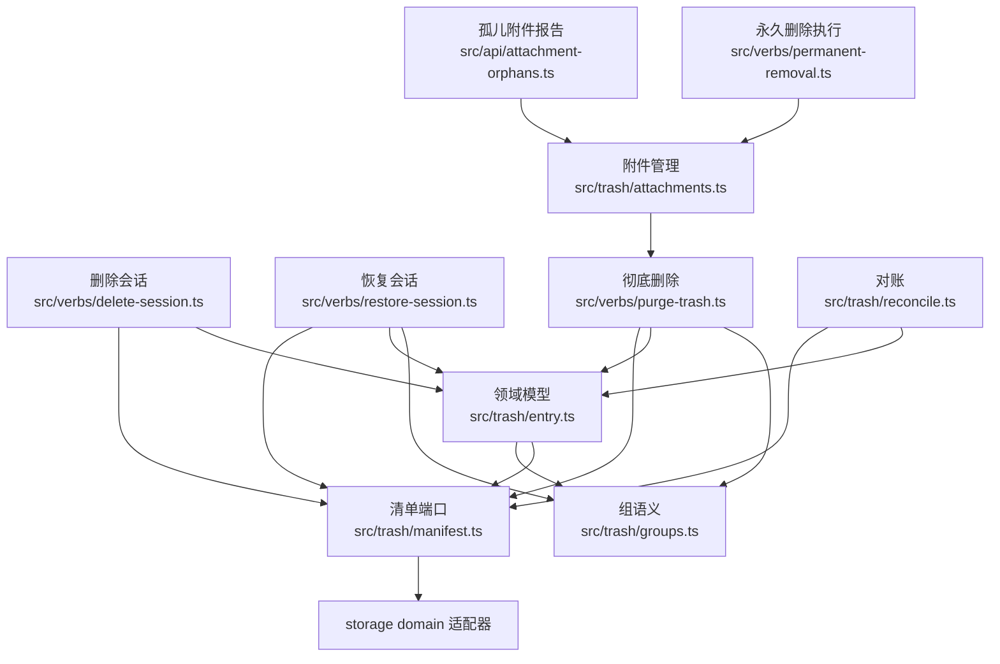

**图表来源**
- [src/trash/entry.ts:1-90](file://src/trash/entry.ts#L1-L90)
- [src/trash/manifest.ts:1-35](file://src/trash/manifest.ts#L1-L35)
- [src/trash/reconcile.ts:1-127](file://src/trash/reconcile.ts#L1-L127)
- [src/trash/groups.ts:1-83](file://src/trash/groups.ts#L1-L83)
- [src/trash/attachments.ts:1-475](file://src/trash/attachments.ts#L1-L475)
- [src/api/attachment-orphans.ts:1-26](file://src/api/attachment-orphans.ts#L1-L26)
- [src/verbs/delete-session.ts:1-206](file://src/verbs/delete-session.ts#L1-L206)
- [src/verbs/restore-session.ts:1-173](file://src/verbs/restore-session.ts#L1-L173)
- [src/verbs/purge-trash.ts:1-121](file://src/verbs/purge-trash.ts#L1-L121)
- [src/verbs/permanent-removal.ts:1-378](file://src/verbs/permanent-removal.ts#L1-L378)

**章节来源**
- [src/trash/entry.ts:1-90](file://src/trash/entry.ts#L1-L90)
- [src/trash/manifest.ts:1-35](file://src/trash/manifest.ts#L1-L35)
- [src/trash/reconcile.ts:1-127](file://src/trash/reconcile.ts#L1-L127)
- [src/trash/groups.ts:1-83](file://src/trash/groups.ts#L1-L83)
- [src/trash/attachments.ts:1-475](file://src/trash/attachments.ts#L1-L475)
- [src/api/attachment-orphans.ts:1-26](file://src/api/attachment-orphans.ts#L1-L26)
- [src/verbs/delete-session.ts:1-206](file://src/verbs/delete-session.ts#L1-L206)
- [src/verbs/restore-session.ts:1-173](file://src/verbs/restore-session.ts#L1-L173)
- [src/verbs/purge-trash.ts:1-121](file://src/verbs/purge-trash.ts#L1-L121)
- [src/verbs/permanent-removal.ts:1-378](file://src/verbs/permanent-removal.ts#L1-L378)

## 核心领域模型与路径闸

### TrashEntry 领域模型
`TrashEntry` 是回收站的单条记录。关键字段职责如下：
- `id`：由删除时刻与原目录名共同构成；既是清单键，也是回收站目录名，恢复时用于还原原目录名。
- `sessionId`：会话身份。
- `projectDir`：删除时的项目目录标识。
- `workspaceId`：删除时所属工作区；空串表示无账目。
- `wasArchived`：删除前是否归档；恢复时按此还原可见性。
- `deletedAt`：删除时间戳，用于排序与从 id 反推删除时刻。
- `title`、`sizeBytes`：删除时尽力读取的标题与目录字节数。
- `parentEntryId`：可选；若存在，表示该行是孩子，属于父行所在组。

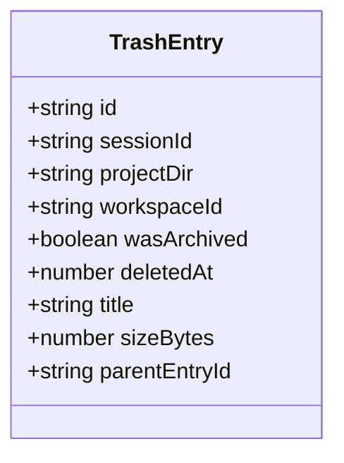

**图表来源**
- [src/trash/entry.ts:1-90](file://src/trash/entry.ts#L1-L90)

**章节来源**
- [src/trash/entry.ts:1-90](file://src/trash/entry.ts#L1-L90)

### id 生成与解析规则
- 生成：`makeEntryId(deletedAt, sessionDirName)` 输出形如 `<UTC时间戳>-<原目录名>` 的字符串；时间戳使用 UTC 年、月、日、时、分、秒拼接。
- 解析：`parseEntryId(id)` 用正则拆分时间戳与原目录名，并用 `Date.UTC` 重建时间；非法格式抛错，不返回半截结果。
- 语义：id 不是随意键，而是"目录名契约"，恢复时通过 `parseEntryId(entry.id).sessionDirName` 把会话放回原位置。

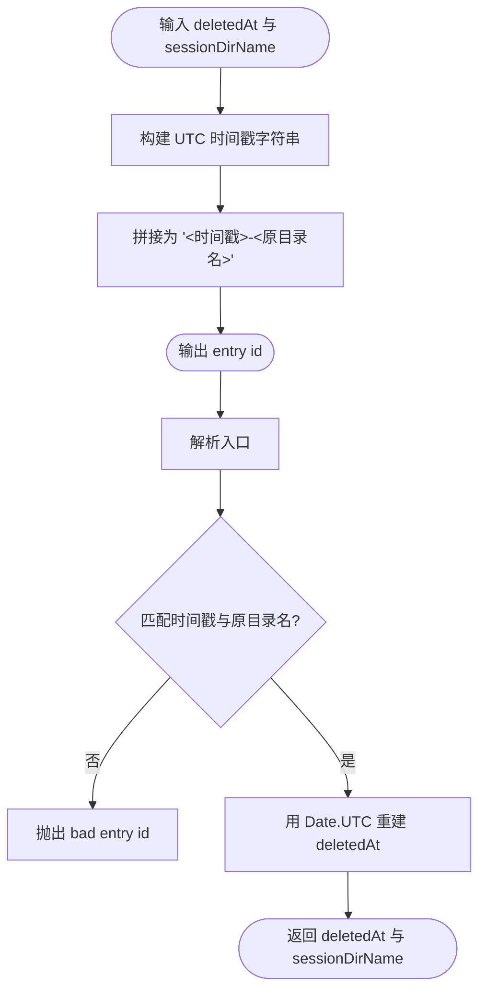

**图表来源**
- [src/trash/entry.ts:1-90](file://src/trash/entry.ts#L1-L90)

**章节来源**
- [tests/trash-entry.test.ts:1-64](file://tests/trash-entry.test.ts#L1-L64)
- [src/trash/entry.ts:1-90](file://src/trash/entry.ts#L1-L90)

### 路径闸与目录构造
- `isSinglePathSegment(value)`：拒绝空值、`.`、`..`、包含 `/`、`\`、`\0` 的值，防止路径穿越。
- `sessionDirOf(projectDir, sessionDirName, home)`：构造 `home/sessions/<projectDir>/<sessionDirName>`；允许 `sessionDirName` 为空，以定位项目根。
- `trashDirOf(entryId, home)`：构造 `home/session-trash/<entryId>`；要求 entryId 本身是单段。
- 破坏性操作一律走路径闸，不接受宿主机传来的不可信目录片段。

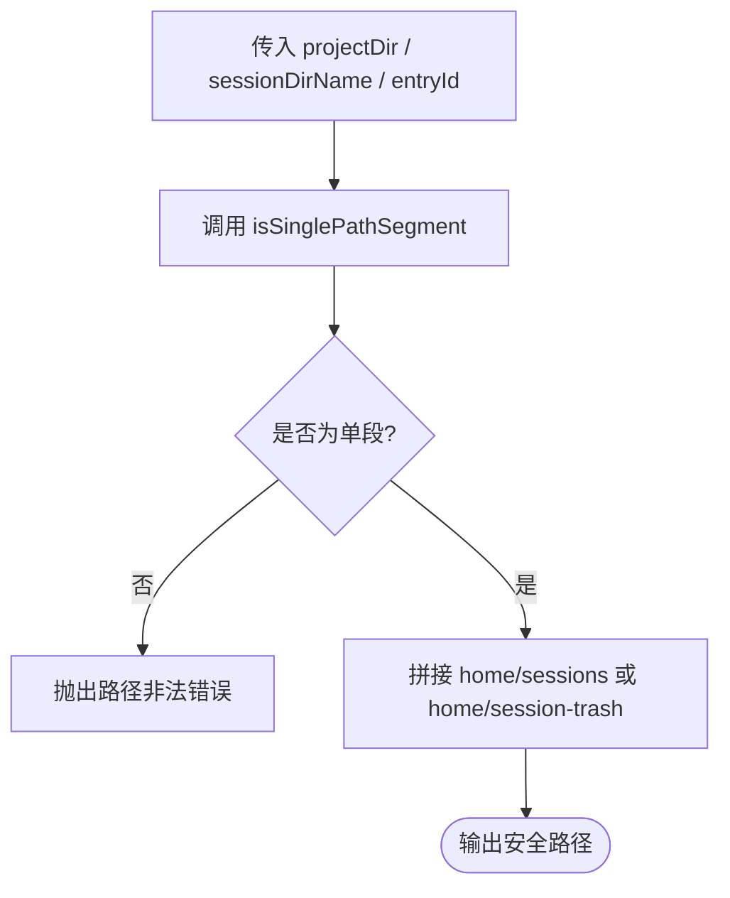

**图表来源**
- [src/trash/entry.ts:1-90](file://src/trash/entry.ts#L1-L90)

**章节来源**
- [tests/trash-entry.test.ts:1-64](file://tests/trash-entry.test.ts#L1-L64)
- [src/trash/entry.ts:1-90](file://src/trash/entry.ts#L1-L90)

## 附件生命周期管理

### 两条红线
附件管理遵循两条不可逾越的红线：
1. **只删 `$DSH_HOME/attachments/v1/objects` 下的图片**：普通文件、tmp、v2、cache 一律不碰；源文件（`$DSH_HOME` 之外）没有进入路径拼接的入口。
2. **fail-closed 策略**：只要剩余引用源读不出来，就整体跳过——宁可留孤儿，不许删共享。引用源"读不出来"包括：目录/文件读失败、目录非空却没有规范 zstd 日志（明文/陌生布局）、JSON 超出扫描上限、日志有坏行或尾巴被截断。

### 附件 ID 与路径闸
- 合法附件 ID 形状：`sha256:[0-9a-f]{64}`，由 `isAttachmentId()` 校验。
- `attachmentPathOf(home, kind, id)`：根据附件类型（image/file）推导到宿主附件库的绝对路径，路径为 `home/attachments/v1/objects/<2 hex>/<64 hex>` 或 `home/attachments/v1/file-objects/<2 hex>/<64 hex>`。
- 纵深防御：即便正则将来被改宽，解析结果也必须仍在 store 根下，按目录包含关系判（resolve + relative），不按字符串前缀——前缀判会被 `../` 之类骗过去。

### 引用扫描
一条消息的 `content[]` 里的附件块通过 `attachmentsInContent()` 提取，畸形 id 与非附件段一律跳过。扫描支持两种附件类型：
- `ImageRef`：图片附件，含 `kind`、`id`、`mediaType`、`bytes`、`width`、`height`、`name`。
- `FileRef`：普通文件附件，含 `kind`、`id`、`name`、`bytes`。

单个会话目录的图片引用通过 `imageIdsOfDir()` 扫描：
- 优先选择规范 zstd 日志（`pickSessionLog`）。
- 没有规范日志时：若只有 0 字节临时日志且无子目录，视为没有引用；否则按不可读处理。
- 规范日志旁允许并存老一代规范日志与 0 字节临时日志，非空临时日志或明文日志按不可读处理。
- 目录里有子目录时，规范日志覆盖不到它们，按不可读处理。
- 损坏的日志（坏行或截断尾巴）：解析出来的 id 也不可信，整组按不可读处理。

### 独占计划
`planImageAttachmentRemoval()` 计算哪些图片对象可以安全删除：
- **候选**：本次被删会话日志里的图片 id。
- **剩余引用**：活动会话 + 全部未删 `session-trash` 目录 + storages/cache JSON。
- **判定逻辑**：
  - 候选日志读不出：跳过它自己的 id，其他候选照常。
  - 剩余引用源读不出：整体跳过（fail closed），返回 `skipped` 原因。
  - 附件对象 stat 失败：ENOENT 视为"本来就不在"，不算失败；其他错误记进部分 skipped，其余读得出的条目照常计划。

### 执行清理
`executeImageAttachmentRemoval()` 逐文件删除计划中的附件对象：
- 删除动作只认「`home` + `id` 自己推导出来的那一条路径」：计划是数据，手搭的/被改过的条目只要路径与推导不一致就拒绝（计数为失败，不删）。
- ENOENT 由端口的 `force` 吞掉；其他错误计数并继续。
- 返回 `{ removed, freedBytes, failed }`，如实统计成功与失败数量。

### 孤儿附件扫描
`scanOrphanImageAttachments()` 扫描当前没有任何引用源引用的图片对象：
- **引用侧**：活动会话 + 全部 `session-trash` 目录 + `storages/cache` JSON，与删除计划共用同一条判据。
- **候选侧**：只认 `attachments/v1/objects` 下 `<2 hex>/<64 hex>` 这一种真实形状；`file-objects`、`tmp`、`v2`、`cache` 与非规范名字一律不进候选。
- **fail-closed**：任何一处引用源或对象列表读不出 ⇒ 整份报告跳过，绝不把"读不出"折成"没有引用"。
- 软链防环：`listDirs` 跟随软链之后，目录图不再是树，按真实路径去重才停得住。

`cleanOrphanImageAttachments()` 清掉扫描那一刻无引用的图片对象；扫描跳过 ⇒ 零删，并原样带回跳过的原因。

### API 报告段
`GET /attachment-orphans` 通过 `reportAttachmentOrphans()` 提供孤儿附件报告：
- 报告把扫描计划折成数量/字节 + 对象清单（`id`/`bytes`，供设置页预览缩略图；最多 200 条，清理不受预览条数限制）。
- 扫描跳过（引用源或对象列表读不出）时**报告必须失败**——回一份 0 会让界面说"没有孤儿"，而这类失败恰恰是"不知道"，不是"没有"。
- 清理是 `POST /attachment-clean`，由路由直接接到 `cleanOrphanImageAttachments`。

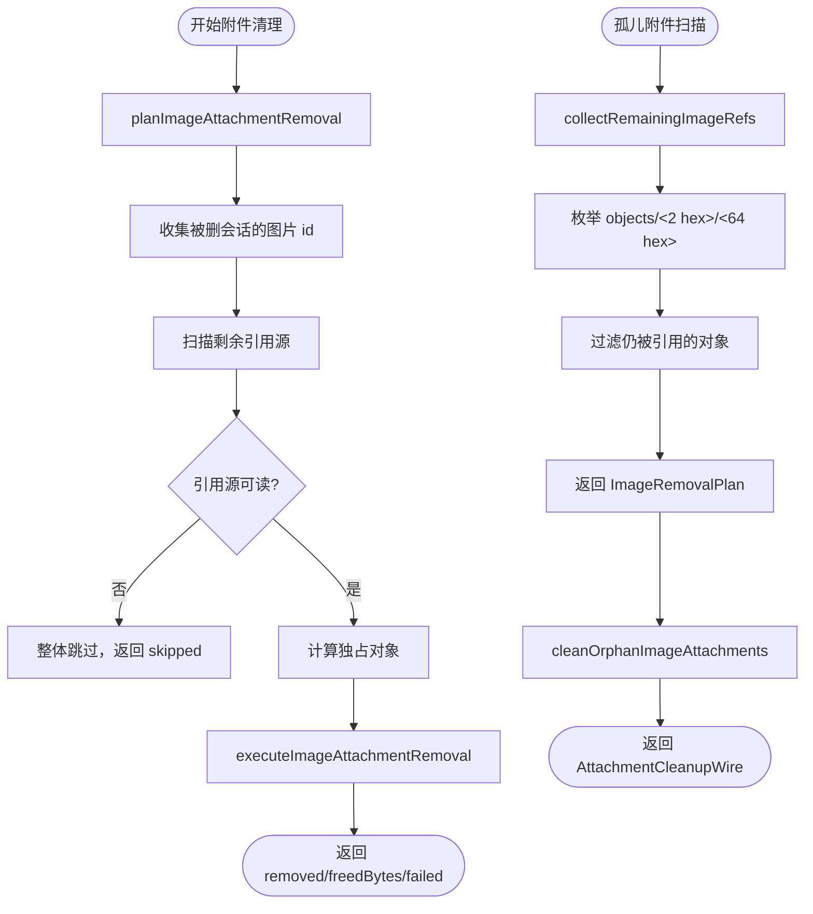

**图表来源**
- [src/trash/attachments.ts:1-475](file://src/trash/attachments.ts#L1-L475)
- [src/api/attachment-orphans.ts:1-26](file://src/api/attachment-orphans.ts#L1-L26)

**章节来源**
- [src/trash/attachments.ts:1-475](file://src/trash/attachments.ts#L1-L475)
- [src/api/attachment-orphans.ts:1-26](file://src/api/attachment-orphans.ts#L1-L26)
- [tests/attachments.test.ts:1-691](file://tests/attachments.test.ts#L1-L691)

## 架构总览
回收站写入与读取的主路径：
- 删除：`deleteSession` 将父及盘上孩子移入 `session-trash`，各自生成独立目录与一行，并记录 `parentEntryId`。
- 恢复：`restoreSession` 按 id 中的原目录名把目录放回 `sessions/<projectDir>/`，按 `wasArchived` 还原可见性，并摘除清单行。
- 彻底删除：`purgeTrash` 清理回收站目录、清册行、宿主内存，并对盘上后代做级联清理，同时清理独占的图片附件。
- 对账：`reconcileTrash` 以磁盘 `session-trash` 为准修复清单，保证多出的目录重建、缺失的行摘掉、不一致降级重建。
- 附件清理：永久删除时先计划独占图片对象，再执行删除；孤儿附件通过独立扫描与清理接口管理。

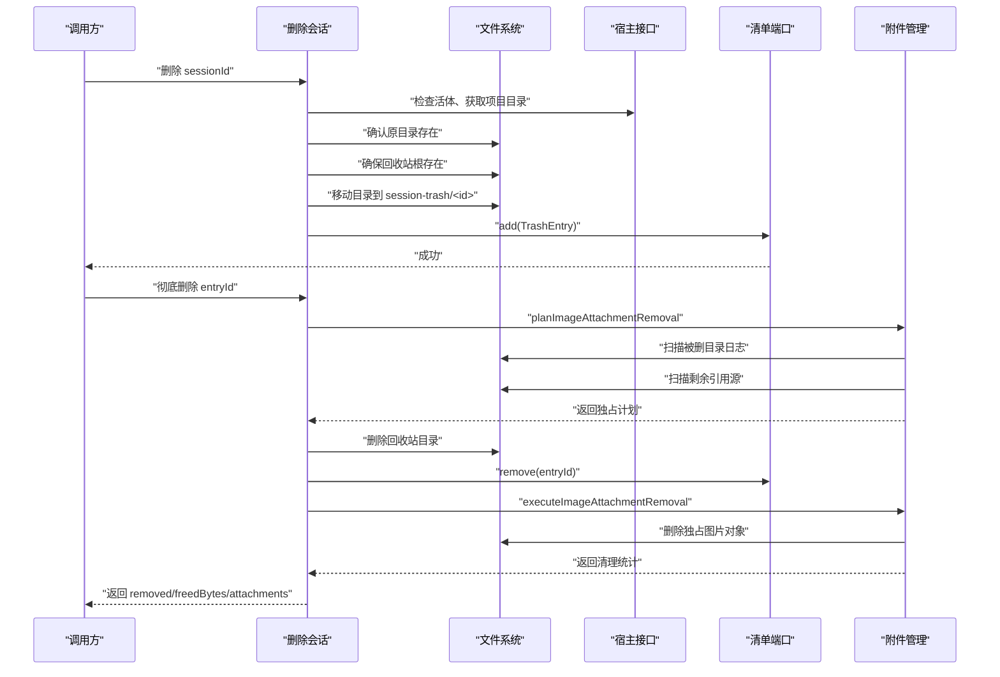

**图表来源**
- [src/verbs/delete-session.ts:1-206](file://src/verbs/delete-session.ts#L1-L206)
- [src/trash/manifest.ts:1-35](file://src/trash/manifest.ts#L1-L35)
- [src/trash/attachments.ts:1-475](file://src/trash/attachments.ts#L1-L475)
- [src/verbs/permanent-removal.ts:1-378](file://src/verbs/permanent-removal.ts#L1-L378)

**章节来源**
- [src/verbs/delete-session.ts:1-206](file://src/verbs/delete-session.ts#L1-L206)
- [src/verbs/restore-session.ts:1-173](file://src/verbs/restore-session.ts#L1-L173)
- [src/verbs/purge-trash.ts:1-121](file://src/verbs/purge-trash.ts#L1-L121)
- [src/trash/reconcile.ts:1-127](file://src/trash/reconcile.ts#L1-L127)
- [src/trash/attachments.ts:1-475](file://src/trash/attachments.ts#L1-L475)
- [src/verbs/permanent-removal.ts:1-378](file://src/verbs/permanent-removal.ts#L1-L378)

## 详细组件分析

### 领域模型与路径模块
- 提供 `TrashEntry` 类型、必填字段校验常量、id 生成/解析、路径构造与路径闸。
- 关键设计点：
  - `id` 具有契约意义：既是清单主键，又是回收站目录名，还是恢复路径依据。
  - 路径构造强制单段校验，避免 `..`、`/`、`\`、`\0` 等路径穿越。
  - `sessionDirOf` 允许空会话名，用于定位项目根。

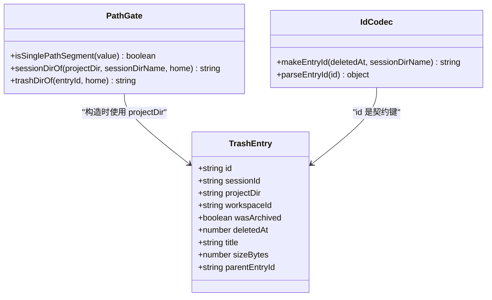

**图表来源**
- [src/trash/entry.ts:1-90](file://src/trash/entry.ts#L1-L90)

**章节来源**
- [src/trash/entry.ts:1-90](file://src/trash/entry.ts#L1-L90)
- [tests/trash-entry.test.ts:1-64](file://tests/trash-entry.test.ts#L1-L64)

### 清单与 storage domain 适配器
- `ManifestPort` 暴露 list/add/remove 三个方法，是动词层的唯一读法。
- `createMemoryManifest`：内存实现，list 按 `deletedAt` 倒序。
- `StorageDomainLike`：宿主 storage domain 的最小面，readAll/put/delete。
- `createStorageManifest(domain)`：薄适配器，把 storage domain 的行为映射到 `ManifestPort`，并在 list 后排序。

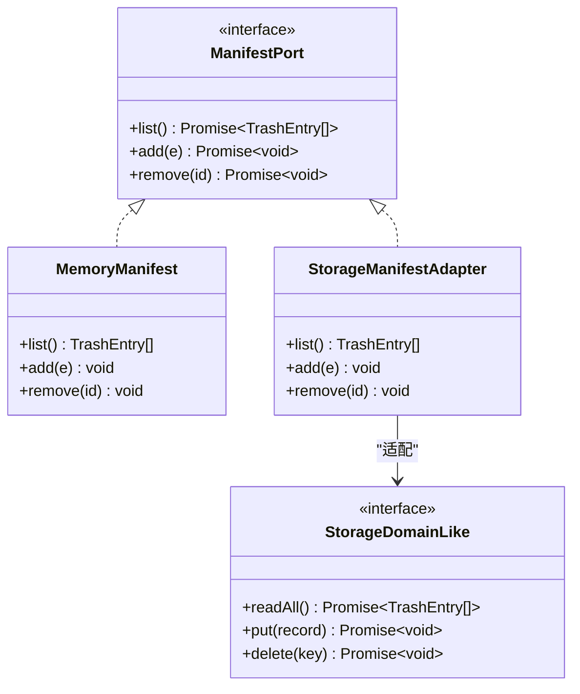

**图表来源**
- [src/trash/manifest.ts:1-35](file://src/trash/manifest.ts#L1-L35)

**章节来源**
- [src/trash/manifest.ts:1-35](file://src/trash/manifest.ts#L1-L35)
- [tests/manifest.test.ts:1-37](file://tests/manifest.test.ts#L1-L37)

### 回收站对账
对账以 `session-trash` 目录为准，修复清单：
- 若回收站根不存在：直接返回原清单，不做任何写。
- 枚举根下目录，仅接受形状像条目且原目录名可安全拼接的路径。
- 对每个合法目录：
  - 选择最新日志文件。
  - 读取日志并解析 header。
  - 若 header 有效，则计算 `sizeBytes` 并重建 `TrashEntry`。
  - 若任一环节失败，该目录跳过，不列、不删。
- 清单中目录缺失的行被移除；目录存在但清单缺失的行被重建。
- 完全一致时零读取、零写入。

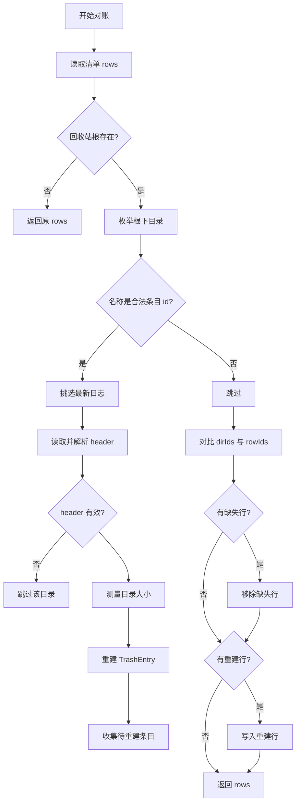

**图表来源**
- [src/trash/reconcile.ts:1-127](file://src/trash/reconcile.ts#L1-L127)

**章节来源**
- [src/trash/reconcile.ts:1-127](file://src/trash/reconcile.ts#L1-L127)
- [tests/reconcile.test.ts:1-197](file://tests/reconcile.test.ts#L1-L197)

### 删除会话
删除是"移动到回收站"的领域操作：
- 按组处理：父及其盘上孩子各自进入回收站，形成多个目录与多行，并通过 `parentEntryId` 建立组关系。
- 预检：所有成员必须非 live；父目录必须在盘上；孩子目录缺失则跳过，不让父因孩子问题失败。
- 步骤顺序：读现场 → 归档 → 摘账本 → 移动目录 → 写清单行。
- 回滚：任一成员失败时，已执行成员反向退回到原始状态；组级回滚再补发恢复通告。
- 清单行写入必须在目录搬进回收站之后，避免"行在而目录仍在 sessions"的对账误判。

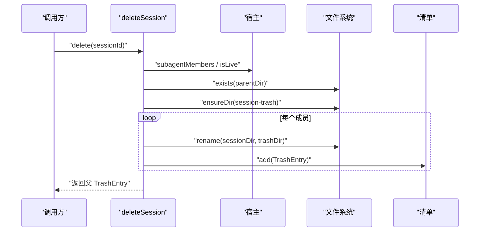

**图表来源**
- [src/verbs/delete-session.ts:1-206](file://src/verbs/delete-session.ts#L1-L206)

**章节来源**
- [src/verbs/delete-session.ts:1-206](file://src/verbs/delete-session.ts#L1-L206)

### 恢复会话
恢复是对称地退回删除前的位置：
- 按 `groupOf` 确定整组目标。
- 预检：回收站目录必须存在；原项目根必须存在；工作区账本缺失不算硬失败。
- 步骤顺序：目录放回 → 挂账本 → 按 `wasArchived` 还原可见性 → 摘清单行。
- 恢复目标目录来自 `parseEntryId(entry.id).sessionDirName`，不依赖宿主命名约定。
- 工作区判定：`attachableWorkspaceId` 决定是否能挂账本；`isWorkspaceMissing` 决定 UI 提示。

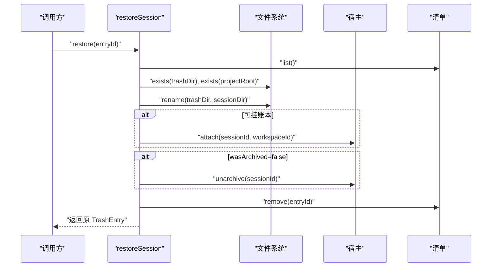

**图表来源**
- [src/verbs/restore-session.ts:1-173](file://src/verbs/restore-session.ts#L1-L173)

**章节来源**
- [src/verbs/restore-session.ts:1-173](file://src/verbs/restore-session.ts#L1-L173)

### 彻底删除
彻底删除是从回收站中真正抹掉一条或多条：
- 支持传 entryId 或清空；传父 id 时按组清理。
- 先查宿主侧后代：若后代正在运行则整条拒绝；否则计划清理。
- 步骤：取消归档 → 摘账本 → 删除回收站目录与清单行 → 删除盘上后代目录 → 清理独占图片附件。
- 每条记录尽力从宿主内存中摘除并通告；未知结果不发通告但不影响计数。
- 目录可能已被手工删除：仍要摘清单行，释放字节计为零。
- 幂等：重复执行不会重复报错，但会如实统计已清理数量。
- 附件清理排在所有会话目录删完之后：对象只在会话真的没了之后才动；单文件失败只进 `attachments.failed`，不影响（也不回滚）会话删除的回执。

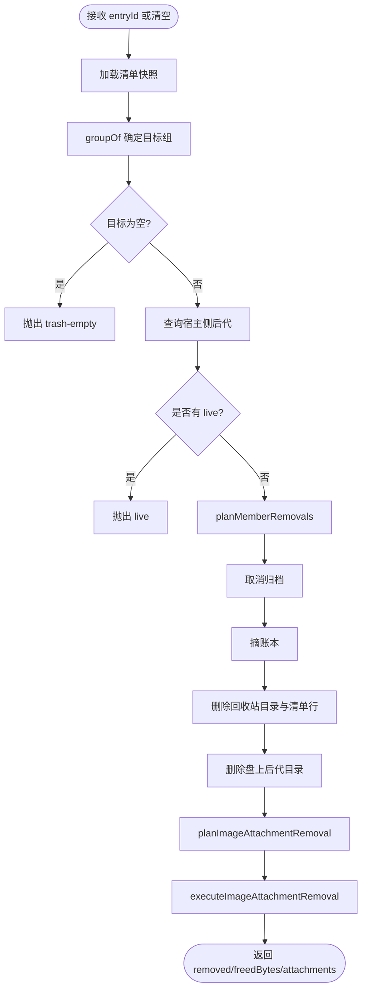

**图表来源**
- [src/verbs/purge-trash.ts:1-121](file://src/verbs/purge-trash.ts#L1-L121)
- [src/verbs/permanent-removal.ts:1-378](file://src/verbs/permanent-removal.ts#L1-L378)
- [src/trash/attachments.ts:1-475](file://src/trash/attachments.ts#L1-L475)

**章节来源**
- [src/verbs/purge-trash.ts:1-121](file://src/verbs/purge-trash.ts#L1-L121)
- [src/verbs/permanent-removal.ts:1-378](file://src/verbs/permanent-removal.ts#L1-L378)
- [src/trash/attachments.ts:1-475](file://src/trash/attachments.ts#L1-L475)
- [tests/purge-trash.test.ts:1-169](file://tests/purge-trash.test.ts#L1-L169)

### 组语义
`groups.ts` 是回收站组语义的唯一权威：
- `visibleGroups(rows)`：只展示组根，孩子折进根；无法接入的孩子自己露面。
- `groupOf(rows, id)`：返回 id 所属整组；若 id 是孩子，只返回它自己；若父不在，返回指向它的孩子集合。
- `takenByEarlierInBatch(original, current, id)`：判断 id 是否在同批中被前一条带走。

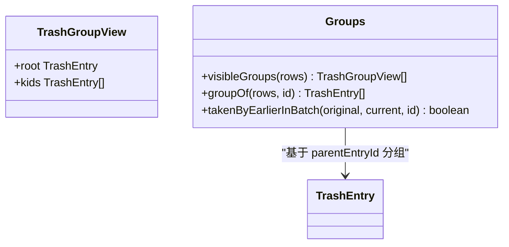

**图表来源**
- [src/trash/groups.ts:1-83](file://src/trash/groups.ts#L1-L83)

**章节来源**
- [src/trash/groups.ts:1-83](file://src/trash/groups.ts#L1-L83)

## 依赖关系分析
- `deleteSession`、`restoreSession`、`purgeTrash` 都依赖 `ManifestPort`，不直接依赖 storage domain 内部结构。
- `reconcileTrash` 依赖 `ManifestPort`、`FsPort`、host port 的 `projectKey` 与 `NO_CWD_PROJECT_DIR`。
- `purgeTrash` 与 `restoreSession` 共享 `groupOf`，保证"谁属于哪一组"的一致性。
- 路径与 id 逻辑集中在 `entry.ts`，所有破坏性路径构造都经过同一套闸。
- 附件管理模块 `attachments.ts` 被 `permanent-removal.ts` 依赖，用于计划与执行图片对象清理。
- `attachment-orphans.ts` 依赖 `attachments.ts` 的扫描能力，提供孤儿附件报告 API。

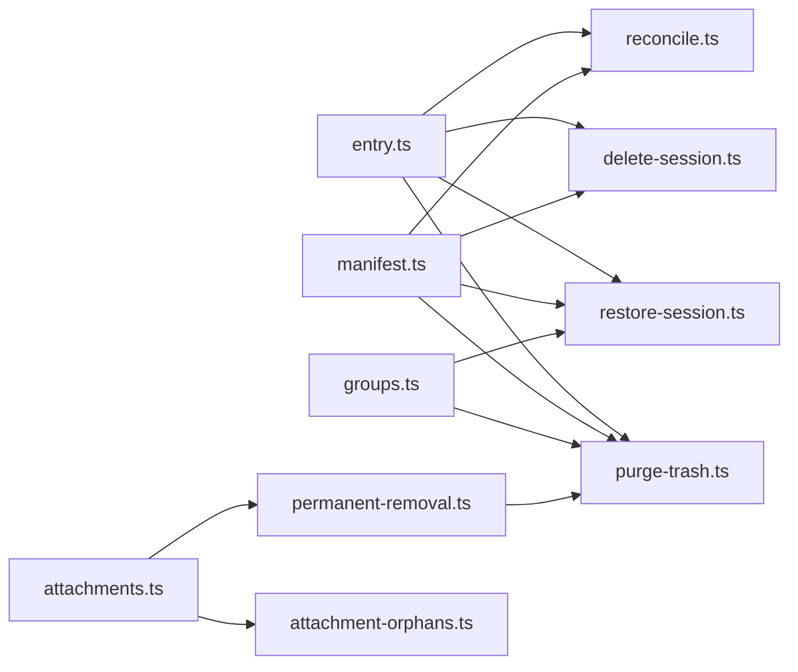

**图表来源**
- [src/trash/entry.ts:1-90](file://src/trash/entry.ts#L1-L90)
- [src/trash/manifest.ts:1-35](file://src/trash/manifest.ts#L1-L35)
- [src/trash/groups.ts:1-83](file://src/trash/groups.ts#L1-L83)
- [src/trash/attachments.ts:1-475](file://src/trash/attachments.ts#L1-L475)
- [src/api/attachment-orphans.ts:1-26](file://src/api/attachment-orphans.ts#L1-L26)
- [src/verbs/delete-session.ts:1-206](file://src/verbs/delete-session.ts#L1-L206)
- [src/verbs/restore-session.ts:1-173](file://src/verbs/restore-session.ts#L1-L173)
- [src/verbs/purge-trash.ts:1-121](file://src/verbs/purge-trash.ts#L1-L121)
- [src/verbs/permanent-removal.ts:1-378](file://src/verbs/permanent-removal.ts#L1-L378)
- [src/trash/reconcile.ts:1-127](file://src/trash/reconcile.ts#L1-L127)

**章节来源**
- [src/trash/entry.ts:1-90](file://src/trash/entry.ts#L1-L90)
- [src/trash/manifest.ts:1-35](file://src/trash/manifest.ts#L1-L35)
- [src/trash/groups.ts:1-83](file://src/trash/groups.ts#L1-L83)
- [src/trash/attachments.ts:1-475](file://src/trash/attachments.ts#L1-L475)
- [src/api/attachment-orphans.ts:1-26](file://src/api/attachment-orphans.ts#L1-L26)
- [src/verbs/delete-session.ts:1-206](file://src/verbs/delete-session.ts#L1-L206)
- [src/verbs/restore-session.ts:1-173](file://src/verbs/restore-session.ts#L1-L173)
- [src/verbs/purge-trash.ts:1-121](file://src/verbs/purge-trash.ts#L1-L121)
- [src/verbs/permanent-removal.ts:1-378](file://src/verbs/permanent-removal.ts#L1-L378)
- [src/trash/reconcile.ts:1-127](file://src/trash/reconcile.ts#L1-L127)

## 性能注意事项
- 对账每次读清单都会枚举一次 `session-trash` 根目录；本机约 124 条时为毫秒级，代价是可接受的。
- 对账在完全一致时不走日志读取与清单写，实现零漂移零写入。
- 清单 list 始终按 `deletedAt` 倒序排序；memory 与 storage adapter 都保证这一点。
- 彻底删除采用 journal 步骤，部分成功会如实返回 `removed` 与 `freedBytes`，避免隐藏中间状态。
- 恢复与删除都先预检全部成员，再执行写，避免半组落盘。
- 详情读取时对消息文本设字符上限，避免超大正文拖慢渲染。
- 附件扫描时，单个 JSON 引用源超过 10 MiB 按不可读处理，避免大文件拖慢扫描。
- 孤儿附件扫描时，对象列表或 stat 读不出同样整份跳过，报告宁可失败，也不给一份"少算了一些"的清理计划。

[本节为通用性能建议，不直接分析具体代码行]

## 数据迁移、字段约束与查询模式

### 数据迁移思路
- 旧版本会话目录无前缀，新版本带 `session-` 前缀；id 生成与解析不依赖宿主命名约定，因此迁移重点是让目录结构与 id 一致。
- 若清单丢失但目录存在：下次读清单触发对账，自动重建行。
- 若目录丢失但清单存在：对账发现目录缺失，直接摘除该行。
- 若重建行的 header 缺 `id` 或 `cwd`：`sessionId` 回落到原目录名片段，`projectDir` 使用 `_no-cwd` 占位，后续恢复仍可工作但需人工核对。
- 若工作区账本消失：`workspaceId` 非空但 `workspaceExists` 失败时，视为未分组；恢复时不再挂账本，UI 可提示原工作区已不存在。

### 字段约束
- 必填字段：`id`、`sessionId`、`projectDir`、`workspaceId`、`wasArchived`、`deletedAt`、`title`、`sizeBytes`。
- 可选字段：`parentEntryId`；缺失表示该行是组根或单独删除项。
- 路径约束：`projectDir`、`sessionDirName`、`entryId` 必须是单段，禁止 `/`、`\`、`.`、`..`、`\0`。
- 时间约束：`deletedAt` 必须可由 id 中的 UTC 时间戳重建，往返自洽。
- 附件 ID 约束：必须是 `sha256:[0-9a-f]{64}` 形状，否则拒绝处理。

### 索引与查询模式
- 主键：`id`。
- 排序：`deletedAt` 倒序。
- 常见查询：
  - 按 `sessionId` 查找条目。
  - 按 `projectDir` 筛选某项目的回收站条目。
  - 按 `parentEntryId` 找出孩子，配合 `groupOf` 进行组操作。
  - 按 `workspaceId` 筛选归属工作区的条目。
- storage domain 适配器应保证 readAll 能覆盖这些过滤场景；若底层不支持，可在适配层或查询层做额外过滤。

**章节来源**
- [src/trash/entry.ts:1-90](file://src/trash/entry.ts#L1-L90)
- [src/trash/manifest.ts:1-35](file://src/trash/manifest.ts#L1-L35)
- [src/trash/reconcile.ts:1-127](file://src/trash/reconcile.ts#L1-L127)
- [src/trash/groups.ts:1-83](file://src/trash/groups.ts#L1-L83)
- [src/trash/attachments.ts:1-475](file://src/trash/attachments.ts#L1-L475)

## 对账如何保证零漂移
对账的零漂移由五条口径共同保证：
1. 每次读清单都对账，但一致时零读取、零写入。
2. 回收站根不存在时整体跳过，不把"盘没挂上"误判为"回收站空了"。
3. 重建行只写文件事实：id、sessionId、projectDir、deletedAt、sizeBytes；缺失元数据按默认降级。
4. 认不出或读不出的目录静默跳过，不抛、不删。
5. 幂等：重建后再跑一遍，adds/removes 都不再发生。

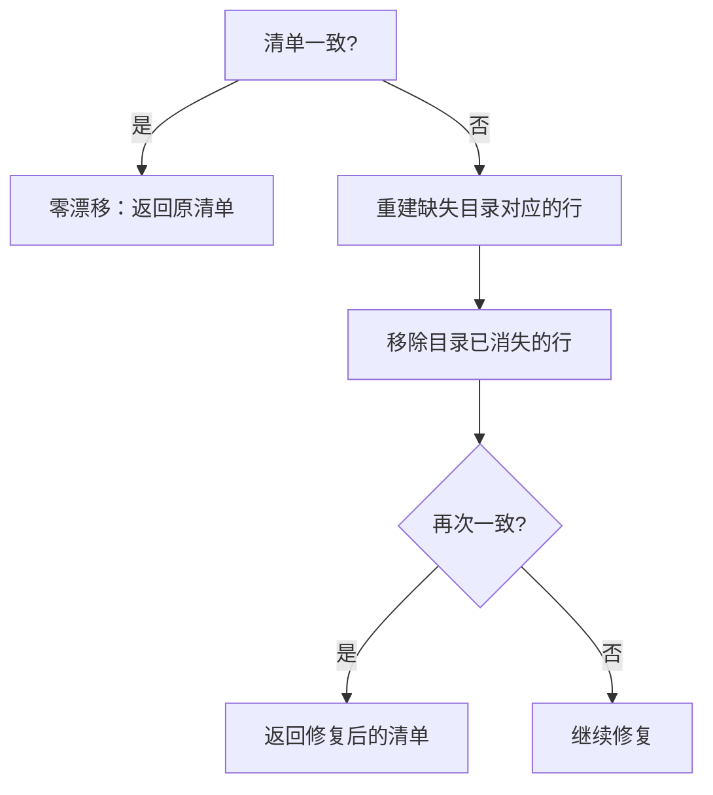

**图表来源**
- [src/trash/reconcile.ts:1-127](file://src/trash/reconcile.ts#L1-L127)

**章节来源**
- [tests/reconcile.test.ts:1-197](file://tests/reconcile.test.ts#L1-L197)
- [src/trash/reconcile.ts:1-127](file://src/trash/reconcile.ts#L1-L127)

## 测试样例索引
- 条目命名与路径闸：`tests/trash-entry.test.ts`
- 清单 add/list/remove 行为：`tests/manifest.test.ts`
- 对账多目录、幂等、外人目录、日志缺失、尺寸异常：`tests/reconcile.test.ts`
- 彻底删除单条、清空、级联、live 保护、孤儿收尾：`tests/purge-trash.test.ts`
- 详情读取、消息过滤、帧解压失败、两代日志选择：`tests/trash-detail.test.ts`
- 附件内容块提取、路径闸、日志提取、独占计划与执行、引用源不可读（fail closed）、损坏日志处理、执行闸、孤儿附件扫描与清理：`tests/attachments.test.ts`

**章节来源**
- [tests/trash-entry.test.ts:1-64](file://tests/trash-entry.test.ts#L1-L64)
- [tests/manifest.test.ts:1-37](file://tests/manifest.test.ts#L1-L37)
- [tests/reconcile.test.ts:1-197](file://tests/reconcile.test.ts#L1-L197)
- [tests/purge-trash.test.ts:1-169](file://tests/purge-trash.test.ts#L1-L169)
- [tests/trash-detail.test.ts:1-191](file://tests/trash-detail.test.ts#L1-L191)
- [tests/attachments.test.ts:1-691](file://tests/attachments.test.ts#L1-L691)

## 手工恢复指引
当用户手动修改 `session-trash` 目录时，可通过以下方式恢复一致性：

- 最简方式：
  1. 停止相关会话，确保没有 live 会话。
  2. 修正或补充 `session-trash/<id>` 目录结构，使其包含会话日志。
  3. 重新触发回收站列表读取；对账会自动重建缺失行或摘除幽灵行。

- 目录存在但清单缺失：
  - 对账会扫描目录，解析 header，重建 `TrashEntry`。
  - 若 header 缺 `id`，`sessionId` 回落到原目录名片段；缺 `cwd` 则 `projectDir` 为 `_no-cwd`。

- 清单存在但目录缺失：
  - 对账识别到目录缺失，直接摘除该行。

- 目录名字符串非法：
  - 不是合法条目 id 的目录会被当作外人，跳过且不处理。

- 验证一致性：
  - 再次读取回收站列表，确认行数与目录数一致。
  - 尝试打开某条详情，确认能读到日志。

- 附件清理相关：
  - 若手动删除了 `attachments/v1/objects` 下的图片对象，下次彻底删除时会因对象不存在而跳过（ENOENT 不算失败）。
  - 若担心有孤儿附件，可通过 `GET /attachment-orphans` 查看报告，再通过 `POST /attachment-clean` 清理。
  - 清理只删 `.dsh` 内无引用图片副本，源文件不受影响，共享引用保留。

**章节来源**
- [src/trash/reconcile.ts:1-127](file://src/trash/reconcile.ts#L1-L127)
- [tests/reconcile.test.ts:1-197](file://tests/reconcile.test.ts#L1-L197)
- [src/trash/attachments.ts:1-475](file://src/trash/attachments.ts#L1-L475)
- [src/api/attachment-orphans.ts:1-26](file://src/api/attachment-orphans.ts#L1-L26)

## 故障排查
- 条目 id 解析失败：
  - 现象：`bad entry id`。
  - 原因：目录名不符合 `<UTC时间戳>-<原目录名>` 格式。
  - 处理：不要手工重命名 id；让对账跳过外人目录，或重建正确 id 的目录。

- 路径非法：
  - 现象：`不是单段路径` 或 `不能为空`。
  - 原因：`projectDir`、`sessionDirName`、`entryId` 包含 `/`、`\`、`.`、`..`、`\0`。
  - 处理：清理目录名，避免路径穿越字符。

- 恢复时报项目目录缺失：
  - 现象：`project-missing`。
  - 原因：`sessions/<projectDir>` 不存在。
  - 处理：先恢复项目根，再重试恢复。

- 恢复时报回收站条目不在磁盘：
  - 现象：`trash-empty`。
  - 原因：`session-trash/<id>` 已被手工删除。
  - 处理：若目录确实丢了，只能放弃恢复；若只是清单残留，对账会摘除该行。

- 彻底删除报 live：
  - 现象：`live`。
  - 原因：目标或其后代正在运行。
  - 处理：先停止会话，再执行彻底删除。

- 彻底删除报 io：
  - 现象：`io`。
  - 原因：取消归档、摘账本或删除目录失败。
  - 处理：根据错误信息修复权限或资源问题后重试；部分成功会返回已清理计数。

- 附件清理报 skipped：
  - 现象：回执中 `attachments.skipped` 有值。
  - 原因：候选日志读不出、剩余引用源读不出、或附件对象 stat 失败。
  - 处理：检查日志完整性、引用源可访问性；skipped 不是失败，其余读得出的条目照常清理。

- 孤儿附件报告失败：
  - 现象：`GET /attachment-orphans` 返回 `io` 错误。
  - 原因：引用源或对象列表读不出。
  - 处理：检查活动会话目录、回收站目录、storages/cache 的可访问性；报告宁可失败，也不拿 0 冒充"没有孤儿"。

**章节来源**
- [src/trash/entry.ts:1-90](file://src/trash/entry.ts#L1-L90)
- [src/verbs/restore-session.ts:1-173](file://src/verbs/restore-session.ts#L1-L173)
- [src/verbs/purge-trash.ts:1-121](file://src/verbs/purge-trash.ts#L1-L121)
- [src/trash/attachments.ts:1-475](file://src/trash/attachments.ts#L1-L475)
- [src/api/attachment-orphans.ts:1-26](file://src/api/attachment-orphans.ts#L1-L26)
- [tests/trash-entry.test.ts:1-64](file://tests/trash-entry.test.ts#L1-L64)
- [tests/purge-trash.test.ts:1-169](file://tests/purge-trash.test.ts#L1-L169)
- [tests/attachments.test.ts:1-691](file://tests/attachments.test.ts#L1-L691)

## 结论
回收站领域围绕 `TrashEntry` 的 id 契约展开：id 既是清单键，也是目录名与恢复路径依据。路径闸确保所有破坏性操作不泄露到 `sessions` 或 `session-trash` 之外。storage domain 适配器统一 list/add/remove，使动词层只关心领域语义。对账以磁盘为准修复清单，做到多目录重建、缺失行摘除、降级重建、幂等与零漂移。结合组语义、journal 步骤与宿主侧 live 检测，系统在删除、恢复与彻底删除三条路径上都保持强一致与可恢复性。

附件生命周期管理作为回收站的重要补充，遵循两条红线：只删 `$DSH_HOME/attachments/v1/objects` 下的图片，以及 fail-closed 策略（引用源读不出则跳过）。通过引用扫描、独占计划与执行清理，系统在永久删除时自动清理独占的图片副本，同时保留共享引用。孤儿附件通过独立扫描与清理接口管理，确保 `.dsh` 内的无引用图片对象能被及时发现与清理，而源文件始终不受影响。