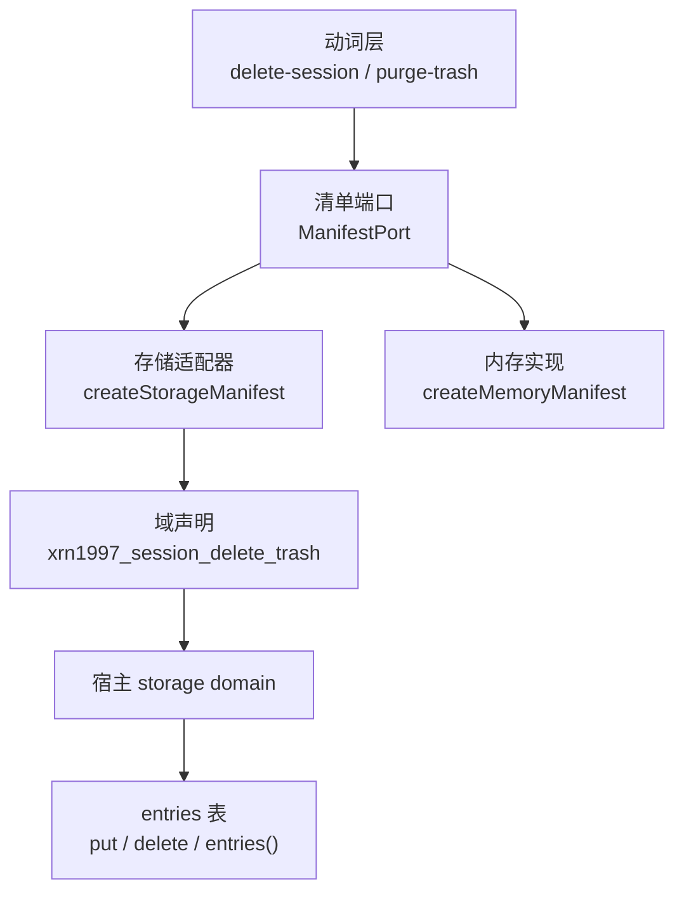
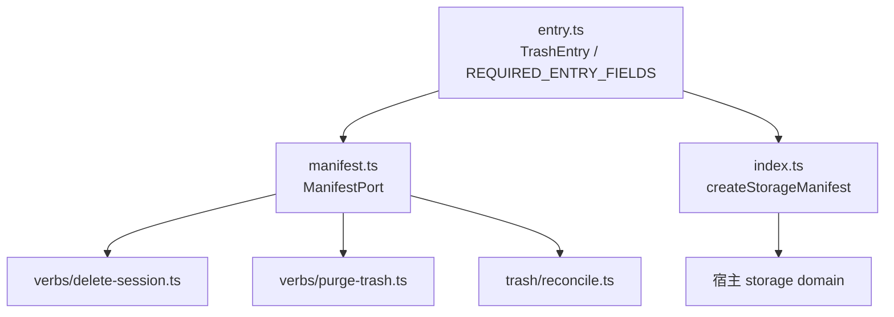
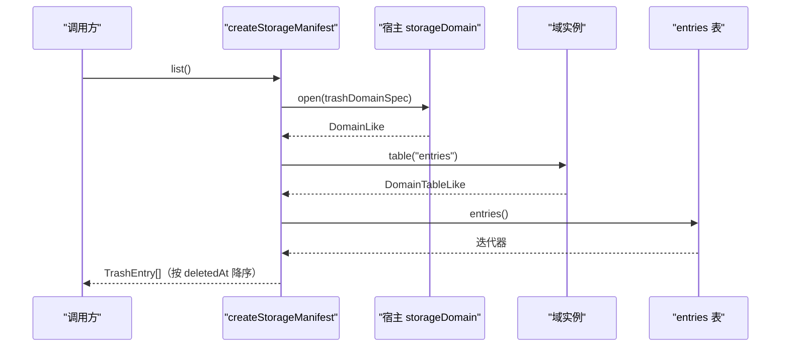
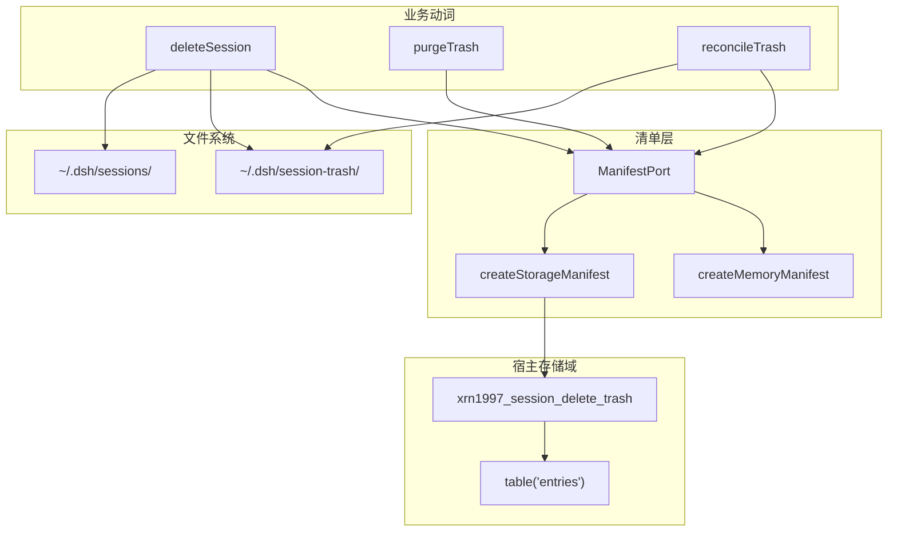
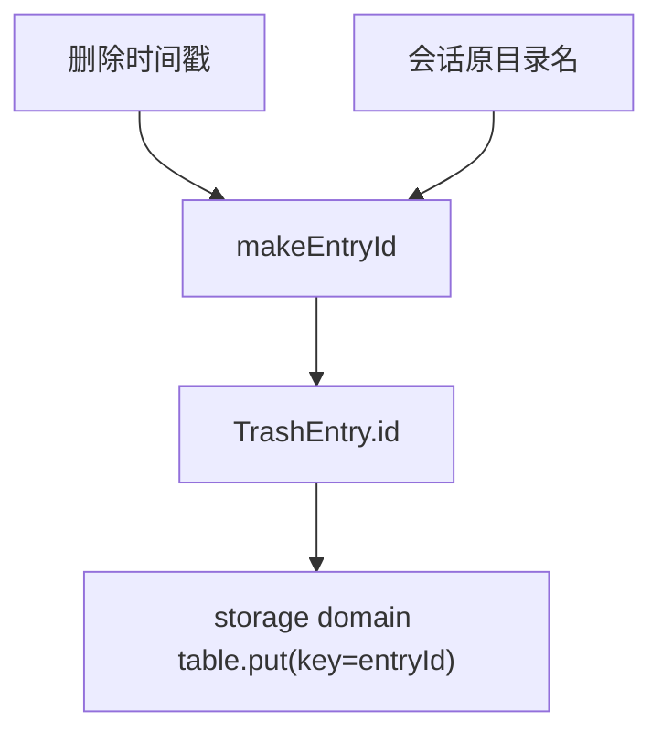
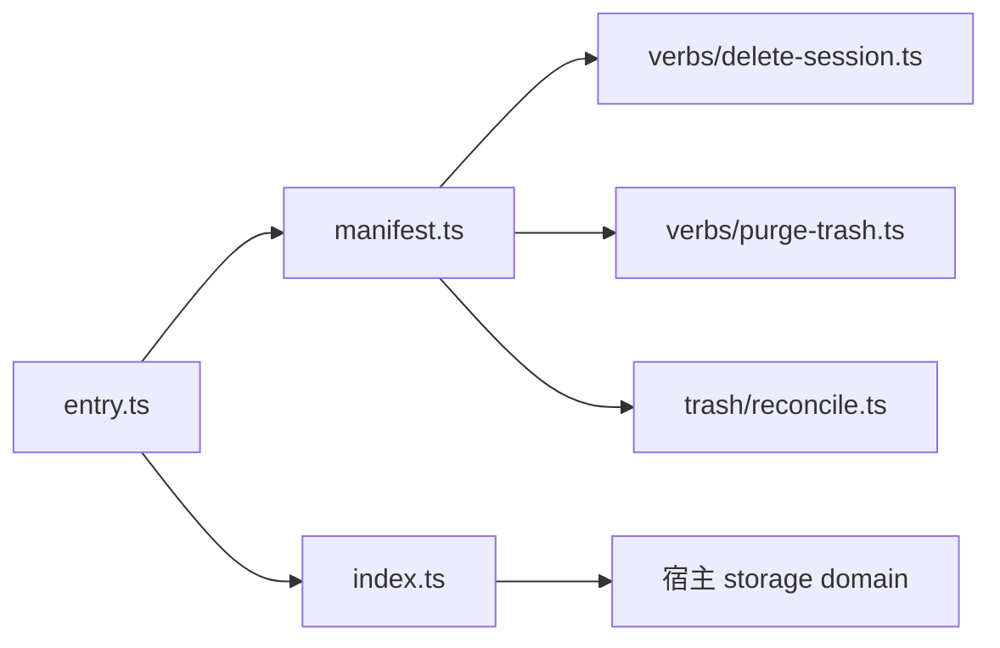
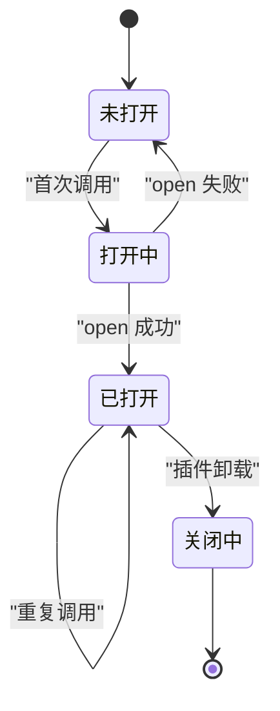

# 清单存储适配器

<cite>
**本文引用的文件**   
- [src/index.ts](file://src/index.ts)
- [src/trash/manifest.ts](file://src/trash/manifest.ts)
- [src/trash/entry.ts](file://src/trash/entry.ts)
- [src/verbs/delete-session.ts](file://src/verbs/delete-session.ts)
- [src/verbs/purge-trash.ts](file://src/verbs/purge-trash.ts)
- [src/trash/reconcile.ts](file://src/trash/reconcile.ts)
- [tests/assembly.test.ts](file://tests/assembly.test.ts)
- [tests/api.test.ts](file://tests/api.test.ts)
</cite>

## 目录

1. [引言](#引言)
2. [项目结构中的定位](#项目结构中的定位)
3. [核心组件与职责边界](#核心组件与职责边界)
4. [架构总览](#架构总览)
5. [操作语义：list、add、remove](#操作语义listaddremove)
6. [与宿主 storage domain 的映射](#与宿主-storage-domain-的映射)
7. [数据模型与约束](#数据模型与约束)
8. [典型调用场景与代码片段路径](#典型调用场景与代码片段路径)
9. [依赖方向与一致性假设](#依赖方向与一致性假设)
10. [性能与并发特性](#性能与并发特性)
11. [常见问题排查](#常见问题排查)
12. [结论](#结论)

## 引言

本文件说明回收站清单 `storage domain` 适配器的职责：**把插件内部统一的 `ManifestPort`（`list/add/remove`）绑定到宿主提供的 `xrn1997_session_delete_trash` 存储域**。它不实现删除会话的业务逻辑，也不直接枚举磁盘；它只做一件事——让动词层和对账模块以同一套接口读写回收站条目。

适配器通过两层封装保证“每个语义只由一处维护”：

- 业务动词只依赖 `ManifestPort.list()`、`add()`、`remove(id)`。
- `createStorageManifest` 是宿主页面唯一负责把这三个语义翻译成 storage domain 表操作的实现。
- 内存实现 `createMemoryManifest` 仅用于测试，确保业务层可以脱离宿主运行。



**图表来源**   
- [src/index.ts:158-193](file://src/index.ts#L158-L193)
- [src/trash/manifest.ts:1-35](file://src/trash/manifest.ts#L1-L35)

**章节来源**   
- [src/trash/manifest.ts:1-35](file://src/trash/manifest.ts#L1-L35)
- [src/index.ts:158-193](file://src/index.ts#L158-L193)

## 项目结构中的定位

回收站相关代码集中在三个层次：

| 层次 | 文件 | 职责 |
|---|---|---|
| 数据契约 | [src/trash/entry.ts](file://src/trash/entry.ts) | 定义 `TrashEntry`、必填字段、条目 id 生成与解析、路径安全校验 |
| 清单抽象 | [src/trash/manifest.ts](file://src/trash/manifest.ts) | 定义 `ManifestPort` 和两种实现：内存实现 + 存储域适配器 |
| 宿主绑定 | [src/index.ts](file://src/index.ts) | 定义域名、域 schema、懒加载 domain 句柄、把 `ManifestPort` 注入动词装配 |
| 消费者 | [src/verbs/delete-session.ts](file://src/verbs/delete-session.ts)、[src/verbs/purge-trash.ts](file://src/verbs/purge-trash.ts)、[src/trash/reconcile.ts](file://src/trash/reconcile.ts) | 读清单、写清单、重建清单 |



**图表来源**   
- [src/trash/entry.ts:1-90](file://src/trash/entry.ts#L1-L90)
- [src/trash/manifest.ts:1-35](file://src/trash/manifest.ts#L1-L35)
- [src/index.ts:158-193](file://src/index.ts#L158-L193)

**章节来源**   
- [src/trash/entry.ts:1-90](file://src/trash/entry.ts#L1-L90)
- [src/trash/manifest.ts:1-35](file://src/trash/manifest.ts#L1-L35)
- [src/index.ts:158-239](file://src/index.ts#L158-L239)

## 核心组件与职责边界

### 清单端口 `ManifestPort`

`ManifestPort` 是适配器面向上层暴露的唯一接口：

| 方法 | 输入 | 返回 | 失败行为 |
|---|---|---|---|
| `list()` | 无 | `Promise<TrashEntry[]>` | 抛错；上层统一转为 `sessiondelete/io` |
| `add(e)` | `TrashEntry` | `Promise<void>` | 抛错；删除动词把它包装为 `sessiondelete/io` |
| `remove(id)` | 字符串条目 id | `Promise<void>` | 抛错；上层根据上下文判断是否属于“不存在”或普通 io 错误 |

关键点：

- `list()` 按 `deletedAt` 降序排序，最近删除排在前面。
- `add()` 不返回已写入对象，调用方必须自己持有构造好的 `TrashEntry`。
- `remove()` 不返回成功布尔值；即使底层 storage domain 的 `delete` 返回布尔，适配器也吞掉结果，只对上层暴露成功或异常。

**章节来源**   
- [src/trash/manifest.ts:1-35](file://src/trash/manifest.ts#L1-L35)

### 存储适配器 `createStorageManifest`

`createStorageManifest` 是真正的宿主绑定。它负责：

1. 用 `ctx.storageDomain.open(trashDomainSpec)` 打开域。
2. 通过 `domain.table('entries')` 拿到表。
3. 把 `readAll/put/delete` 对应到 `list/add/remove`。
4. 在插件卸载时关闭 domain 句柄。
5. 对 `open()` 失败做重试式处理：第一次拒绝不会缓存为永久失败，后续再次读取会重新尝试打开。



**图表来源**   
- [src/index.ts:158-193](file://src/index.ts#L158-L193)

**章节来源**   
- [src/index.ts:158-193](file://src/index.ts#L158-L193)

## 架构总览



**图表来源**   
- [src/verbs/delete-session.ts:1-206](file://src/verbs/delete-session.ts#L1-L206)
- [src/verbs/purge-trash.ts:1-121](file://src/verbs/purge-trash.ts#L1-L121)
- [src/trash/reconcile.ts:1-127](file://src/trash/reconcile.ts#L1-L127)
- [src/index.ts:158-193](file://src/index.ts#L158-L193)

## 操作语义：list、add、remove

### `list()`

**语义**  
读取当前所有回收站条目，并按删除时间从新到旧排序。

**参数**  
无。

**返回值**  
`Promise<TrashEntry[]>`。空列表表示没有条目；不是 null。

**失败行为**  
任何底层异常都会向上抛出，API 层将其映射为 `sessiondelete/io`。

**排序规则**  
按 `TrashEntry.deletedAt` 数值降序，因此最新删除的条目排在数组第一个。

**典型用途**

- 删除会话后确认条目进入清单。
- 彻底删除前取快照。
- 对账入口先读现有行，再与 `session-trash/` 目录对比。

**章节来源**   
- [src/trash/manifest.ts:1-35](file://src/trash/manifest.ts#L1-L35)
- [tests/api.test.ts:301-302](file://tests/api.test.ts#L301-L302)
- [tests/api.test.ts:504-509](file://tests/api.test.ts#L504-L509)

### `add(entry)`

**语义**  
把一条完整的 `TrashEntry` 写入清单。它不是“插入或忽略”，而是按 `id` 落盘；重复写入同 id 会覆盖该条目。

**参数**  
一个 `TrashEntry` 对象，包含 `id`、`sessionId`、`projectDir`、`workspaceId`、`wasArchived`、`deletedAt`、`title`、`sizeBytes`，以及可选的 `parentEntryId`。

**返回值**  
`Promise<void>`。成功时不返回任何值。

**失败行为**  
直接抛错。删除动词捕获并包装成 `sessiondelete/io`，消息中包含原始错误信息。

**幂等性**  
不是基于 id 的幂等无副作用写入；重复 `add` 会覆盖已有记录。业务上应由删除流程保证每条会话只产生一个 `makeEntryId`。

**典型用途**

- 会话目录成功搬入回收站后，最后一步写入清册行。
- 对账发现磁盘存在但清单缺失时重建条目。

**章节来源**   
- [src/trash/manifest.ts:1-35](file://src/trash/manifest.ts#L1-L35)
- [src/verbs/delete-session.ts:130-168](file://src/verbs/delete-session.ts#L130-L168)
- [src/trash/reconcile.ts:106-127](file://src/trash/reconcile.ts#L106-L127)

### `remove(id)`

**语义**  
按条目 id 删除清单中的一条记录。

**参数**  
条目 id 字符串，形状由 `makeEntryId` 决定，例如 `<UTC 时间戳>-<原会话目录名>`。

**返回值**  
`Promise<void>`。成功时无返回值；失败时抛错。

**失败行为**  
适配器本身不区分“键不存在”和“其他 io 错误”。调用方需要结合上下文判断：

- 对账删除不在磁盘上的行：期望可能为空，但适配器仍抛错；测试中通常用 mock 控制行为。
- 彻底删除时：若目录已被手工删除，代码先检查目录存在再删，但仍继续 `manifest.remove`；失败会作为 io 错误向上传播。
- 批量删除：外层批量层负责“已被前一条带走”的判据，避免重复 remove。

**章节来源**   
- [src/trash/manifest.ts:1-35](file://src/trash/manifest.ts#L1-L35)
- [src/verbs/purge-trash.ts:85-102](file://src/verbs/purge-trash.ts#L85-L102)
- [src/trash/reconcile.ts:118-127](file://src/trash/reconcile.ts#L118-L127)

## 与宿主 storage domain 的映射

### 域名与布局

| 配置项 | 值 | 含义 |
|---|---:|---|
| `name` | `xrn1997_session_delete_trash` | 插件专属全局域名，防止与其他插件冲突 |
| `version` | `1` | 域版本 |
| `layout` | `per-record` | 每条记录独立存储 |
| `invalidRecords` | `backup-and-skip` | 单条坏记录被备份并跳过，不阻止整个域打开 |
| 表名 | `entries` | 清单数据落在该表 |
| 主键 | 条目 `id` | `TrashEntry.id` |

### 键空间

适配器使用 `TrashEntry.id` 作为 storage domain 表的 key。这个 id 由 `makeEntryId(deletedAt, sessionDirName)` 生成，形如：

```
<YYYYMMDDTHHMMSSZ>-<会话原目录名>
```

它不是随机 id，也不是会话 id；它是“删除时刻 + 原目录名”的有结构字符串。恢复时按它反推原目录名，因此其形状具有契约意义。



**图表来源**   
- [src/trash/entry.ts:34-60](file://src/trash/entry.ts#L34-L60)
- [src/index.ts:176-193](file://src/index.ts#L176-L193)

**章节来源**   
- [src/index.ts:50-155](file://src/index.ts#L50-L155)
- [src/index.ts:158-193](file://src/index.ts#L158-L193)
- [src/trash/entry.ts:34-60](file://src/trash/entry.ts#L34-L60)
- [tests/assembly.test.ts:620-646](file://tests/assembly.test.ts#L620-L646)

## 数据模型与约束

### `TrashEntry` 字段

| 字段 | 类型 | 必需 | 含义 |
|---|---|---:|---|
| `id` | `string` | 是 | 条目 id，由 `makeEntryId` 生成 |
| `sessionId` | `string` | 是 | 会话 id |
| `projectDir` | `string` | 是 | 所属项目目录名 |
| `workspaceId` | `string` | 是 | 删除时所属工作区；空串表示未分组 |
| `wasArchived` | `boolean` | 是 | 删除前的归档态 |
| `deletedAt` | `number` | 是 | 删除时间戳（毫秒） |
| `title` | `string` | 是 | 删除时尽力取的标题；取不到为空串 |
| `sizeBytes` | `number` | 是 | 会话目录字节数 |
| `parentEntryId` | `string \| undefined` | 否 | 父条目 id；缺席表示该行是父或自身 |

### 必填字段清单

`REQUIRED_ENTRY_FIELDS` 是接口与运行期校验器共享的契约：

```
{
  id: 'string',
  sessionId: 'string',
  projectDir: 'string',
  workspaceId: 'string',
  wasArchived: 'boolean',
  deletedAt: 'number',
  title: 'string',
  sizeBytes: 'number'
}
```

如果某个必填字段类型不符，storage domain 的 `parse` 会抛出 `TypeError`。因为域声明了 `invalidRecords: 'backup-and-skip'`，单条坏记录会被域层移走并跳过，而不是让整个域启动失败。

### 路径安全约束

适配器还定义了路径段校验：

- `isSinglePathSegment` 拒绝空串、`.`、`..`、`\`、`/`、NUL。
- `sessionDirOf` 要求 `projectDir` 非空且为单段。
- `trashDirOf` 要求 `entryId` 为单段。
- `parseEntryId` 无法匹配 id 形状时抛错。

这些约束保护的是“破坏性动词直接删目录”的路径，而不是单纯的数据清洗。

**章节来源**   
- [src/trash/entry.ts:1-90](file://src/trash/entry.ts#L1-L90)
- [src/index.ts:112-155](file://src/index.ts#L112-L155)

## 典型调用场景与代码片段路径

### 场景一：批量写入

**触发者**  
删除会话动词在处理一组成员时，为每个成员调用 `manifest.add(entry)`。

**语义要点**

- 每个成员的 `id` 由 `makeEntryId(deletedAt, sessionId)` 生成。
- 子会话会带上 `parentEntryId`，指向父条目 id。
- `manifest.add` 是“移动会话目录”这一 journal 步骤的一部分；如果它失败，journal 会把目录搬回去并摘除清册行。

**参考路径**

- 删除会话主流程：[src/verbs/delete-session.ts:60-104](file://src/verbs/delete-session.ts#L60-L104)
- 成员 move 与 `manifest.add`：[src/verbs/delete-session.ts:130-168](file://src/verbs/delete-session.ts#L130-L168)
- 测试断言清单长度：[tests/delete-session.test.ts:181-185](file://tests/delete-session.test.ts#L181-L185)

### 场景二：查询所有条目

**触发者**

- API 层 `/list`。
- 彻底删除动词在没有传入快照时读取全部条目。
- 对账模块先读现有行，再枚举磁盘目录。

**语义要点**

- 返回数组，按 `deletedAt` 降序。
- 如果底层 domain 不可用，错误经 API 映射为 `sessiondelete/io`。

**参考路径**

- 内存实现排序：[src/trash/manifest.ts:8-14](file://src/trash/manifest.ts#L8-L14)
- 适配器读实现：[src/index.ts:176-193](file://src/index.ts#L176-L193)
- 对账入口：[src/trash/reconcile.ts:94-127](file://src/trash/reconcile.ts#L94-L127)
- API 层域错误映射：[tests/api.test.ts:504-509](file://tests/api.test.ts#L504-L509)

### 场景三：删除单个条目

**触发者**

- 彻底删除动词对每个目标条目调用 `manifest.remove(entry.id)`。
- 对账模块在发现清单中有但磁盘上没有的行时调用 `manifest.remove(row.id)`。
- 删除会话的回滚路径在目录成功搬回后尝试摘除清册行。

**语义要点**

- 不返回布尔值，调用方不能靠返回值判断“原来是否存在”。
- 彻底删除中，即使目录已经不存在，也会继续尝试 `manifest.remove`。
- 对账中，删除磁盘上不存在的行时，适配器抛错会传播给对账调用方。

**参考路径**

- 彻底删除循环：[src/verbs/purge-trash.ts:85-102](file://src/verbs/purge-trash.ts#L85-L102)
- 对账清理多余行：[src/trash/reconcile.ts:118-127](file://src/trash/reconcile.ts#L118-L127)
- 删除回滚摘行：[src/verbs/delete-session.ts:154-168](file://src/verbs/delete-session.ts#L154-L168)

## 依赖方向与一致性假设

### 依赖方向



- `entry.ts` 是数据契约根，被清单实现、动词、对账共同引用。
- `manifest.ts` 是上层唯一抽象。
- `index.ts` 是唯一把 `ManifestPort` 绑定到宿主 storage domain 的地方。
- 动词和对账不直接知道 `xrn1997_session_delete_trash`、`domain.table`、`entries`。

### “一处维护”如何落地

| 语义 | 维护位置 | 原因 |
|---|---|---|
| `list` 排序 | `createMemoryManifest` 与 `createStorageManifest` 都显式按 `deletedAt` 降序 | 测试和真实实现保持相同顺序 |
| 必填字段 | `REQUIRED_ENTRY_FIELDS` | 接口、schema parse、文档共用一份 |
| 条目 id 形状 | `makeEntryId` / `parseEntryId` | 文件名、日志、恢复逻辑共用 |
| 域名与布局 | `trashDomainSpec` | 只在一个地方声明，测试断言名字和 layout |
| 表名 | `domain.table('entries')` | 适配器内部常量化，避免散落在多处 |

**章节来源**   
- [src/trash/manifest.ts:1-35](file://src/trash/manifest.ts#L1-L35)
- [src/trash/entry.ts:1-90](file://src/trash/entry.ts#L1-L90)
- [src/index.ts:112-193](file://src/index.ts#L112-L193)
- [tests/assembly.test.ts:620-646](file://tests/assembly.test.ts#L620-L646)

## 性能与并发特性

### 性能特征

- `list()` 先把 storage domain 的 `entries()` 迭代器展开为数组，再排序。复杂度约为 `O(n log n)`，其中 `n` 是回收站条目数。
- `add()` 和 `remove()` 是异步单次写入，不涉及批量聚合。
- domain 句柄懒加载：首次调用时才 `open()`，后续复用。
- 对账每次读清单前先枚举 `session-trash/` 目录；代码注释指出本机约 124 条时为毫秒级。

### 并发假设

- **适配器本身不串行化调用**：多个 `list/add/remove` 调用可并行到达 `host.storageDomain.open` 和表操作。
- **持久一致性由上层保障**：删除会话、彻底删除、对账都是多步事务，失败时通过 journal 回滚。
- **对账与动词的串行化不在适配器层**：设计注释明确说明，这与传输层到达序链有关。
- **domain 句柄只开一次**：插件卸载时通过 `ctx.effect` 关闭；如果 `open()` 失败，适配器会重试下一次调用，而不是缓存失败。



**图表来源**   
- [src/index.ts:158-193](file://src/index.ts#L158-L193)

**章节来源**   
- [src/index.ts:158-193](file://src/index.ts#L158-L193)
- [src/trash/reconcile.ts:1-28](file://src/trash/reconcile.ts#L1-L28)
- [tests/assembly.test.ts:654-689](file://tests/assembly.test.ts#L654-L689)

## 常见问题排查

### 问题一：键不存在

**现象**  
调用 `remove(id)` 后不确定是否真的删除；或者对账删除多余行时报错。

**排查步骤**

1. 确认传入的 `id` 是否等于 `TrashEntry.id`，而不是 `sessionId`。
2. 检查 `makeEntryId` 生成的时间戳与原目录名是否与磁盘目录一致。
3. 如果是彻底删除：确认目标是否已经被父条目或其他批量调用带走。
4. 如果是批量操作：确认批量层是否已经执行过“已被前一条带走”的去重。
5. 查看适配器不返回布尔值，因此不能用返回值判断存在性；应结合业务上下文判断。

**相关代码路径**

- 适配器 remove 实现：[src/trash/manifest.ts:8-14](file://src/trash/manifest.ts#L8-L14)
- 彻底删除移除逻辑：[src/verbs/purge-trash.ts:85-102](file://src/verbs/purge-trash.ts#L85-L102)

### 问题二：类型不一致

**现象**  
storage domain 报记录类型错误，或某字段必须是 `string` / `boolean` / `number`。

**排查步骤**

1. 对照 `REQUIRED_ENTRY_FIELDS` 检查每个必填字段类型。
2. 检查 `deletedAt` 是否为数字时间戳，而不是 ISO 字符串。
3. 检查 `wasArchived` 是否为布尔值。
4. 检查 `title` 和 `sizeBytes` 是否来自宿主投影和本地 `fs.sizeOfDir`。
5. 如果是在域 `open` 阶段报错，说明是**已有持久记录**类型不对，不是本次写入；域层会把它标记为坏记录并跳过。

**相关代码路径**

- 必填字段定义：[src/trash/entry.ts:27-38](file://src/trash/entry.ts#L27-L38)
- 域 schema parse：[src/index.ts:112-155](file://src/index.ts#L112-L155)
- 组装测试断言类型错误：[tests/assembly.test.ts:640-641](file://tests/assembly.test.ts#L640-L641)

### 问题三：存储域不可用

**现象**  
`list()` 抛错，API 层返回 `sessiondelete/io`，常见消息包含 `already open`。

**排查步骤**

1. 确认宿主 `storageDomain` 服务可用。
2. 确认没有其他插件或进程以同名 `xrn1997_session_delete_trash` 打开过域。
3. 检查插件是否正确注入 `storageDomain`。
4. 确认插件卸载路径调用了 `close()`；否则下一个同名域会撞 `already-open`。
5. 注意：适配器对 `open()` 失败会重试下一次调用，所以瞬时失败不一定导致最终失败。

**相关代码路径**

- 域名常量：[src/index.ts:50](file://src/index.ts#L50)
- 注入声明：[src/index.ts:38-45](file://src/index.ts#L38-L45)
- 卸载关闭逻辑：[src/index.ts:160-175](file://src/index.ts#L160-L175)
- API 层错误映射测试：[tests/api.test.ts:504-509](file://tests/api.test.ts#L504-L509)
- 已打开域测试：[tests/assembly.test.ts:676-689](file://tests/assembly.test.ts#L676-L689)

## 结论

回收站清单 `storage domain` 适配器的核心价值是**隔离业务语义与宿主存储细节**：

- 业务动词只关心 `list/add/remove`。
- 适配器把这三个语义映射到 `xrn1997_session_delete_trash` 域的 `entries` 表。
- `REQUIRED_ENTRY_FIELDS`、`makeEntryId`、`trashDomainSpec` 等关键契约集中在少数文件中，避免散落。
- 失败语义清晰：`list` 失败即 io 错误；`add` 失败由删除动词包装；`remove` 不返回布尔值，需由调用方结合上下文解释。
- 对账、删除、彻底删除各自承担不同的一致性责任，适配器不替它们做跨步骤事务，但保证单条记录的读写契约稳定。