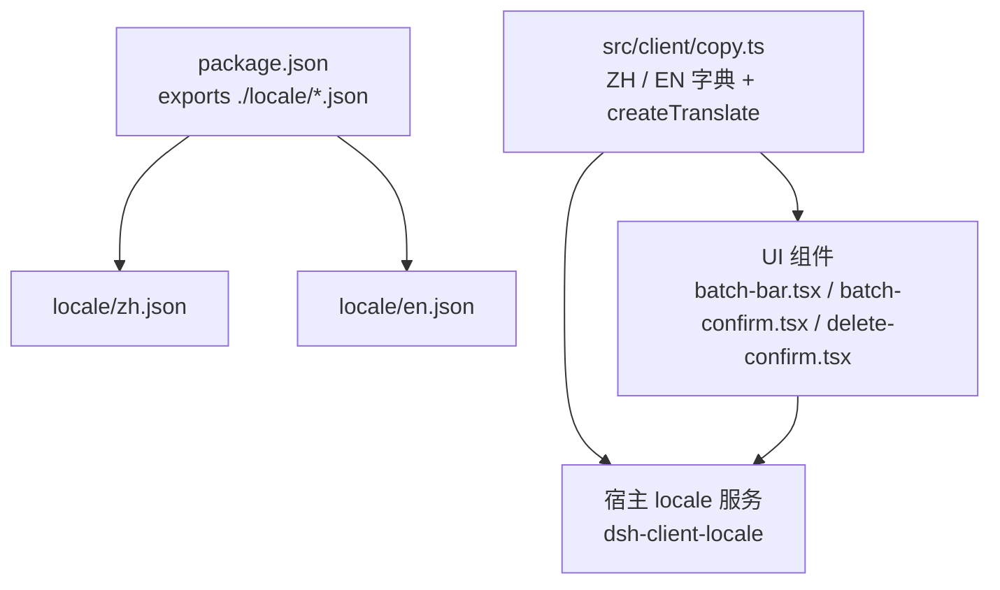
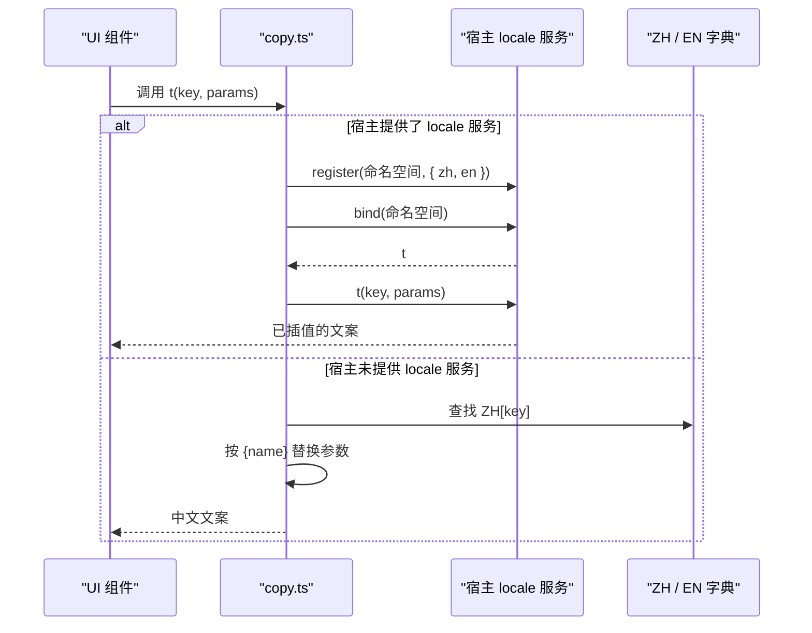
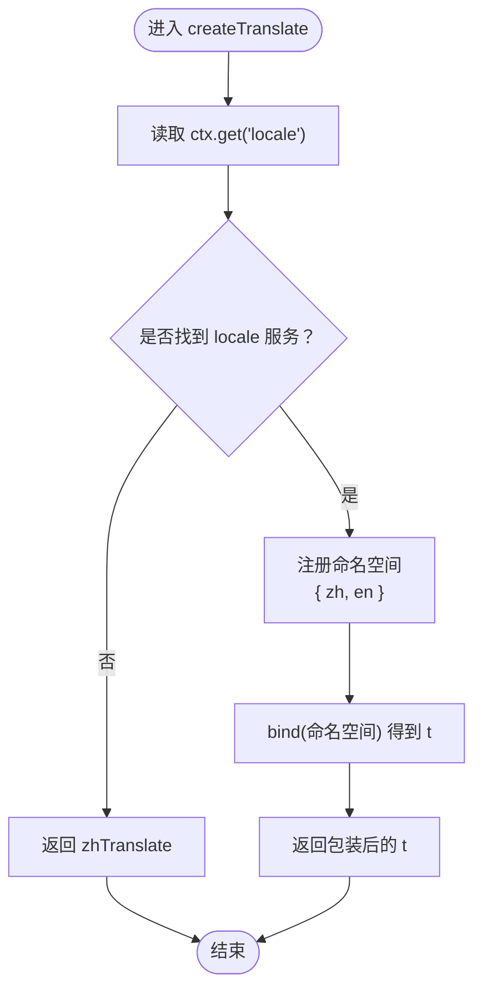
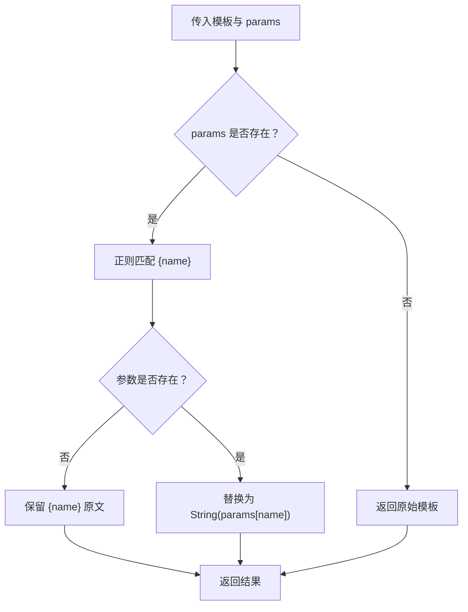
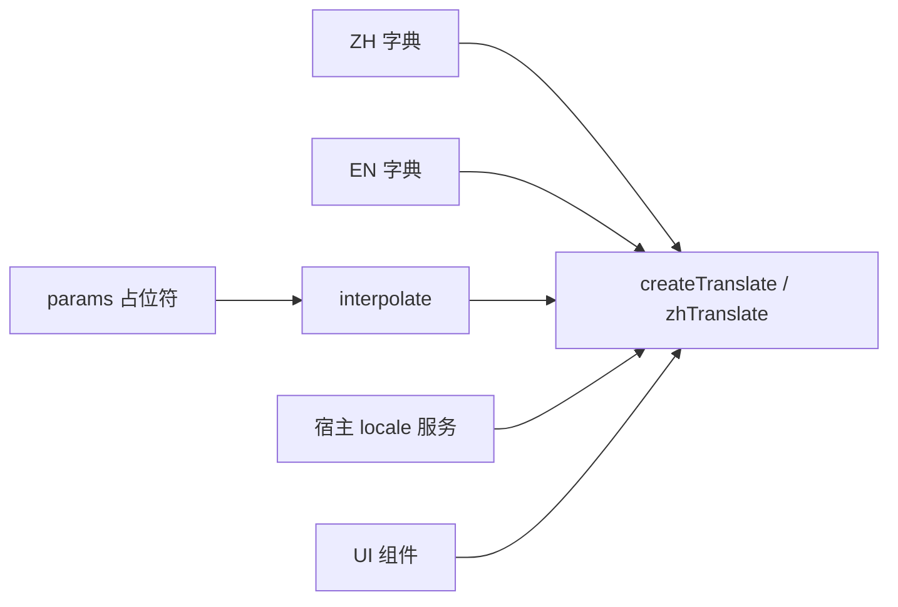

# 国际化文案

<cite>
**本文引用的文件**   
- [package.json](file://package.json)
- [locale/zh.json](file://locale/zh.json)
- [locale/en.json](file://locale/en.json)
- [src/client/copy.ts](file://src/client/copy.ts)
- [src/client/batch-bar.tsx](file://src/client/batch-bar.tsx)
- [src/client/batch-confirm.tsx](file://src/client/batch-confirm.tsx)
- [src/client/delete-confirm.tsx](file://src/client/delete-confirm.tsx)
</cite>

## 目录
1. [引言](#引言)
2. [项目结构](#项目结构)
3. [核心组件](#核心组件)
4. [架构总览](#架构总览)
5. [详细组件分析](#详细组件分析)
6. [依赖关系分析](#依赖关系分析)
7. [性能考虑](#性能考虑)
8. [故障排查](#故障排查)
9. [结论](#结论)
10. [附录：文案键清单与用途](#附录文案键清单与用途)

## 引言
本仓库的可见用户界面文本（包括按钮、提示、确认框、批量操作和回收站文案）集中在客户端文案模块中，并通过宿主提供的 Client locale 服务进行渲染。当前已实现中文（zh）与英文（en）两套资源；同时内置了“当宿主未提供 locale 服务时回退到 zh”的策略，确保插件在旧宿主或测试环境中不会因缺少翻译而崩溃。

包配置还声明了 `./locale/*.json` 的可导出路径，并在发布产物中包含 `locale` 目录，供宿主或其他消费方读取。

## 项目结构
与国际化直接相关的文件和职责如下：

| 路径 | 作用 |
|---|---|
| `locale/zh.json` | 插件元信息的中文字面量，例如标题与描述 |
| `locale/en.json` | 插件元信息的英文字面量，结构与 zh 一致 |
| `package.json` | 暴露 `./locale/*.json`，并把 `locale` 加入发布文件 |
| `src/client/copy.ts` | 全部 UI 文案字典、命名空间、占位符替换、降级逻辑与翻译函数工厂 |
| 各 UI 组件 | 通过注入或默认值获得 `t`，调用 `t('key', params)` 显示文案 |

**图示来源**
- [package.json:1-40](file://package.json#L1-L40)
- [src/client/copy.ts:1-120](file://src/client/copy.ts#L1-L120)

**章节来源**
- [package.json:1-40](file://package.json#L1-L40)
- [locale/zh.json:1-6](file://locale/zh.json#L1-L6)
- [locale/en.json:1-6](file://locale/en.json#L1-L6)
- [src/client/copy.ts:1-120](file://src/client/copy.ts#L1-L120)

## 核心组件
### 文案命名空间
所有 UI 文案属于命名空间 `xrn1997-session-delete`。官方保留 `common`、`settings`、`sidebar` 等命名空间，第三方插件应使用带前缀的名称，避免冲突。

### 双语言字典
- `ZH`：中文真源，类型是 `as const` 对象。
- `EN`：英文镜像，类型被约束为 `Record<CopyKey, string>`，其中 `CopyKey` 来自 `keyof typeof ZH`。这意味着新增中文键后，如果英文侧漏掉对应键，编译就会失败。
- 两个字典必须逐键齐全；宿主注册时使用对象形式 `{ zh, en }`，会整体校验键集合。

### 翻译函数与降级策略
- `createTranslate(ctx)`：尝试从宿主读取 `ctx.get('locale')`。若存在，则注册命名空间并返回绑定后的 `t`；若不存在，直接返回 `zhTranslate`。
- `zhTranslate`：直接使用 `ZH` 字典并按 `{name}` 规则插值参数。
- 这种设计让插件具备三个特性：
  1. 宿主正常时，使用宿主活跃语言。
  2. 宿主缺失 locale 服务时，回退到内置中文。
  3. 即使某个 key 缺失，也不会抛错，而是把模板原样返回给调用方。

**章节来源**
- [src/client/copy.ts:1-120](file://src/client/copy.ts#L1-L120)
- [src/client/copy.ts:321-386](file://src/client/copy.ts#L321-L386)

## 架构总览
下图展示一次文案渲染过程，包括宿主提供服务和未提供服务两种路径：

**图示来源**
- [src/client/copy.ts:321-386](file://src/client/copy.ts#L321-L386)

## 详细组件分析

### 文案注册与运行时行为
`createTranslate` 的核心流程如下：

关键点：
- 注册必须在 `ctx.effect` 回调内执行，否则卸载后字典残留，下次挂载报 “already has locale”。
- 同一命名空间的同一语言只能注册一次。
- 缺服务时不抛异常，也不等待异步结果。

**图示来源**
- [src/client/copy.ts:321-386](file://src/client/copy.ts#L321-L386)

**章节来源**
- [src/client/copy.ts:321-386](file://src/client/copy.ts#L321-L386)

### 组件中的文案引用方式
多个组件都通过 `t` 函数显示文案，而不是直接写死字符串：

- 批量条：
  - 选择数量：`t('batch.bar.count', { n })`
  - 子会话数：`t('trash.row.subagents', { n })`
  - 批量动作：`t('batch.run', { n })`
- 批量确认框：
  - 单条标题：`t('dialog.title')`
  - 多条标题：`t('dialog.batch.title', { n })`
  - 重试文案：`t('dialog.batch.retry', { n })`
  - 通用按钮：`t('common.cancel')`、`t('common.close')`
- 删除确认框：
  - 标题：`t('dialog.title')`
  - 正文：`t('dialog.hint')`
  - 确认按钮：`t('dialog.confirm')`

这些组件通过 props 接收 `t`，其默认值是 `zhTranslate`。因此即使宿主没有 locale 服务，组件也能继续工作。

**章节来源**
- [src/client/batch-bar.tsx:81-131](file://src/client/batch-bar.tsx#L81-L131)
- [src/client/batch-confirm.tsx:198-234](file://src/client/batch-confirm.tsx#L198-L234)
- [src/client/delete-confirm.tsx:161-190](file://src/client/delete-confirm.tsx#L161-L190)
- [src/client/copy.ts:321-335](file://src/client/copy.ts#L321-L335)

### 复数与占位符处理
项目没有引入 ICU MessageFormat 这类复杂复数库，而是采用简洁方案：

| 需求 | 处理方式 |
|---|---|
| 简单占位符 | 使用 `{name}` 语法，如 `{n}`、`{count}`、`{title}`、`{size}`、`{project}` |
| 相对时间 | 由 `relativeTime` 计算单位桶，再通过 `unitWord` 查字典，最后拼入 `common.ago` |
| 强调片段 | 用 `splitOn(sentence, inner)` 拆出中间段，交给调用方包裹 `<b>` 等标记 |
| 复数语义 | 不在代码里硬编码复数形态；不同语言可自由调整语序和单位词 |

占位符替换由 `interpolate` 实现：只匹配形如 `{name}` 的键；如果参数缺失，就保留原占位符文本，避免空字符串破坏句子结构。

**图示来源**
- [src/client/copy.ts:337-345](file://src/client/copy.ts#L337-L345)

**章节来源**
- [src/client/copy.ts:337-386](file://src/client/copy.ts#L337-L386)

### 宿主 locale 降级内置 zh 的策略
- 插件不将 `locale` 写入 `inject`，而是通过 `ctx.get?.('locale')` 可选读取。
- 原因：客户端条目激活失败会导致宿主进程报错甚至终止，所以插件不能假设 locale 服务一定存在。
- 降级路径：
  1. 宿主有 locale 服务 → 使用宿主活跃语言。
  2. 宿主无 locale 服务 → 使用 `zhTranslate`，即中文字典。
- 这个策略使插件对宿主代数更健壮，也方便在无 UI 宿主的测试环境中运行。

**章节来源**
- [src/client/copy.ts:1-40](file://src/client/copy.ts#L1-L40)
- [src/client/copy.ts:321-345](file://src/client/copy.ts#L321-L345)

## 依赖关系分析
文案相关依赖可以概括为三层：

| 层级 | 内容 | 说明 |
|---|---|---|
| 数据层 | `ZH`、`EN` | 中文真源与英文镜像 |
| 运行时层 | `createTranslate`、`zhTranslate`、`interpolate`、`unitWord`、`agoText` | 决定如何解析 key、参数和时间文案 |
| 宿主集成层 | `ctx.get('locale')`、`register`、`bind` | 对接 dsh-client-locale |

**图示来源**
- [src/client/copy.ts:321-386](file://src/client/copy.ts#L321-L386)

**章节来源**
- [src/client/copy.ts:321-386](file://src/client/copy.ts#L321-L386)

## 性能考虑
- 文案查找本身是对象属性访问，时间复杂度接近 O(1)。
- `interpolate` 使用单次正则扫描模板，成本与模板长度线性相关。
- 真正需要注意的性能点是：不要在 JSX 中每次渲染重新构造 `t` 或频繁创建新的上下文对象；应复用 `createTranslate` 的结果，或通过 props 传递稳定的 `t`。
- 时间文案依赖宿主 `relativeTime` 的单位桶，应避免自行拼接数字和单位，否则中英文时间格式容易漂移。

[本节为通用性能建议，不直接分析具体代码行]

## 故障排查
### 现象：英文键缺失导致编译失败
- 原因：`EN` 的类型是 `Record<CopyKey, string>`，`CopyKey` 来源于 `ZH` 的所有键。
- 解决：新增中文键时，必须在英文侧添加同键名的镜像值。

### 现象：HMR 或热重载时报 “already has locale”
- 原因：`service.register` 返回的 disposer 没有被正确挂进 `ctx.effect`，导致字典重复注册。
- 解决：确保 `createTranslate` 中的注册逻辑在 `ctx.effect` 回调内执行。

### 现象：宿主切换语言后文案不变
- 可能原因：
  - 组件没有在语言变化时重新计算需要的 thunk。
  - 面板名没有传 thunk，而是传了固定字符串。
- 官方约定：面板 label 应传函数，让宿主在语言切换时重新解析。

### 现象：宿主没有 locale 服务时文案丢失或错误
- 检查点：
  - 组件是否使用了默认的 `zhTranslate`。
  - 自定义 `t` prop 是否覆盖了降级分支。
  - key 是否在 `ZH` 中存在。

**章节来源**
- [src/client/copy.ts:1-40](file://src/client/copy.ts#L1-L40)
- [src/client/copy.ts:321-386](file://src/client/copy.ts#L321-L386)

## 结论
本项目的国际化方案以“一个中文真源 + 一个类型约束的英文镜像”为核心，通过宿主 locale 服务接入多语言，并通过 `zhTranslate` 提供降级能力。新增文案时应遵循以下原则：

1. 只在 `src/client/copy.ts` 中新增 key。
2. 同时在 `ZH` 与 `EN` 中添加相同 key。
3. 使用 `t('namespace.key', params)` 引用文案。
4. 不要硬编码用户可见字符串。
5. 需要复数或强调时，优先扩展现有 key 或增加新 key，而不是在组件中拼接。
6. 发布时需保证 `locale/*.json` 随包一起发布。

## 附录：文案键清单与用途

### 元信息
| 键 | 用途 |
|---|---|
| `meta.title` | 插件或页面的标题 |
| `meta.description` | 插件或页面的描述 |

**章节来源**
- [locale/zh.json:1-6](file://locale/zh.json#L1-L6)
- [locale/en.json:1-6](file://locale/en.json#L1-L6)

### 通用文案
| 键 | 用途 |
|---|---|
| `common.untitled` | 无标题会话的替代名称 |
| `common.cancel` | 取消按钮 |
| `common.close` | 关闭按钮 |
| `common.justNow` | 相对时间“刚刚” |
| `common.ago` | “{n}{unit}前”，用于相对时间短语 |
| `common.retry` | 重试按钮 |

**章节来源**
- [src/client/copy.ts:41-60](file://src/client/copy.ts#L41-L60)

### 回收站列表
| 键 | 用途 |
|---|---|
| `trash.title` | 回收站面板标题 |
| `trash.loading` | 读取回收站时的加载提示 |
| `trash.readFailed` | 读取回收站失败的错误提示 |
| `trash.empty.title` | 回收站为空时的标题 |
| `trash.empty.hint` | 回收站为空时的引导说明 |
| `trash.summary` | 汇总文案，含会话数和总大小 |
| `trash.group.count` | 分组下的会话数量 |
| `trash.project.unknown` | 未记录项目的显示名 |

**章节来源**
- [src/client/copy.ts:61-82](file://src/client/copy.ts#L61-L82)

### 回收站行与时间
| 键 | 用途 |
|---|---|
| `trash.row.deletedNow` | 刚删除的行状态 |
| `trash.row.deletedAgo` | 之前删除的行状态 |
| `trash.row.subagents` | 行内子会话数量 chip |
| `trash.row.strandedSubagents` | 磁盘上残留的子会话数 |
| `trash.row.workspaceGone` | 原工作区消失时的提示 |
| `trash.unit.minutes` | 分钟单位词 |
| `trash.unit.hours` | 小时单位词 |
| `trash.unit.days` | 天单位词 |
| `trash.unit.months` | 月单位词 |
| `trash.unit.years` | 年单位词 |

**章节来源**
- [src/client/copy.ts:83-100](file://src/client/copy.ts#L83-L100)

### 回收站操作
| 键 | 用途 |
|---|---|
| `trash.row.restore` | 恢复单个会话 |
| `trash.row.purge` | 彻底删除单个会话 |
| `trash.footer.note` | 回收站存储位置与不可恢复说明 |
| `trash.emptyAll` | 清空回收站入口 |
| `trash.confirm.all` | 清空回收站确认标题 |
| `trash.confirm.one` | 彻底删除单个会话确认标题 |
| `trash.confirm.one.meta` | 单条彻底删除的元信息模板 |
| `trash.confirm.body` | 彻底删除正文，支持插入强调片段 |
| `trash.confirm.body.strong` | 强调片段文案 |
| `trash.confirm.purge` | 彻底删除按钮 |

**章节来源**
- [src/client/copy.ts:101-119](file://src/client/copy.ts#L101-L119)

### 工具栏与多选
| 键 | 用途 |
|---|---|
| `trash.toolbar.collapseAll` | 全部折叠 |
| `trash.toolbar.expandAll` | 全部展开 |
| `trash.divider.label` | 分栏宽度调节器提示 |
| `trash.select.group` | 勾选某项目下全部会话 |
| `trash.toolbar.select` | 进入多选模式 |
| `trash.toolbar.selectExit` | 退出多选模式 |
| `trash.select.count` | 已选数量 |
| `trash.select.purge` | 批量彻底删除 |
| `trash.select.restore` | 批量恢复 |
| `trash.select.needOne` | 尚未选择会话时的提示 |
| `trash.select.row` | 单行 aria-label |

**章节来源**
- [src/client/copy.ts:120-141](file://src/client/copy.ts#L120-L141)

### 批量确认与撤销
| 键 | 用途 |
|---|---|
| `trash.confirm.bulk` | 批量彻底删除确认标题 |
| `trash.confirm.restore` | 批量恢复确认标题 |
| `trash.confirm.restore.body` | 批量恢复说明 |
| `trash.confirm.restoreNow` | 批量恢复按钮 |
| `undo.movedBatch` | 批量移入回收站的撤销消息 |
| `undo.moved` | 单条移入回收站的撤销消息 |
| `undo.session` | 撤销消息中的实体名 |
| `undo.undo` | 撤销按钮 |

**章节来源**
- [src/client/copy.ts:142-165](file://src/client/copy.ts#L142-L165)

### 无主子会话维护
| 键 | 用途 |
|---|---|
| `trash.orphans.banner` | 发现无主子会话的横幅 |
| `trash.orphans.meta` | 无主子会话总数与父会话数 |
| `trash.orphans.open` | 查看并清理入口 |
| `trash.orphans.confirm` | 清理确认标题 |
| `trash.orphans.body` | 清理风险提示 |
| `trash.orphans.group` | 分组摘要 |
| `trash.orphans.cacheNote` | 缓存与附件说明 |
| `trash.orphans.clean` | 清理按钮 |
| `trash.orphans.failure` | 残留检查或清理失败消息 |
| `trash.orphans.cleanFailed` | 部分组清理失败 |
| `trash.orphans.cleanPartial` | 部分会话目录已先删除 |
| `trash.orphans.cleanGone` | 部分组已经不存在 |

**章节来源**
- [src/client/copy.ts:166-187](file://src/client/copy.ts#L166-L187)

### 详情页面
| 键 | 用途 |
|---|---|
| `detail.notSelected` | 未选中会话的提示 |
| `detail.loading` | 读取详情加载中 |
| `detail.readFailed` | 详情读取失败 |
| `detail.noBody` | 无可显示正文 |
| `detail.field.created` | 创建时间字段 |
| `detail.field.lastActivity` | 最后活动时间字段 |
| `detail.field.deletedAt` | 删除时间字段 |
| `detail.field.span` | 活跃跨度字段 |
| `detail.field.size` | 大小字段 |
| `detail.field.turns` | 轮数字段 |
| `detail.field.userMessages` | 用户消息数 |
| `detail.field.assistantMessages` | 助手回复数 |
| `detail.field.toolCalls` | 工具调用数 |
| `detail.field.models` | 模型字段 |
| `detail.field.project` | 项目字段 |
| `detail.field.sessionId` | 会话 id 字段 |
| `detail.field.trashDir` | 回收站目录字段 |
| `detail.field.wasArchived` | 原本归档标记 |
| `detail.value.yes` | 是 |
| `detail.value.no` | 否 |
| `detail.value.spanHours` | 跨度小时文案 |
| `detail.value.spanDays` | 跨度天文案 |
| `detail.messages.hidden` | 宿主注入上下文隐藏计数 |
| `detail.messages.omitted` | 更多未显示消息计数 |
| `detail.back` | 返回列表 |
| `detail.list.label` | 详情页列表标签 |
| `detail.role.user` | 用户角色名 |
| `detail.role.assistant` | 助手角色名 |

**章节来源**
- [src/client/copy.ts:188-219](file://src/client/copy.ts#L188-L219)

### 菜单与对话框
| 键 | 用途 |
|---|---|
| `menu.delete` | 删除菜单项 |
| `menu.live` | 运行中会话不能删除的提示 |
| `dialog.title` | 删除单个会话确认标题 |
| `dialog.subagents` | 包含子会话的说明 |
| `dialog.hint` | 删除进入回收站的提示 |
| `dialog.confirm` | 移入回收站确认按钮 |

**章节来源**
- [src/client/copy.ts:220-236](file://src/client/copy.ts#L220-L236)

### 批量操作
| 键 | 用途 |
|---|---|
| `batch.row.pick` | 批量删除行选择提示 |
| `batch.bar.count` | 已选数量 |
| `batch.bar.kids` | 跟随整组的子会话数 |
| `batch.bar.review` | 查看已选项 |
| `batch.bar.reviewClose` | 收起已选项 |
| `batch.bar.remove` | 取消选择 aria-label |
| `batch.bar.selectAll` | 全选 |
| `batch.bar.selectNone` | 取消全选 |
| `batch.run` | 批量移入回收站按钮 |
| `dialog.batch.title` | 批量删除确认标题 |
| `dialog.batch.retry` | 失败重试按钮 |

**章节来源**
- [src/client/copy.ts:237-257](file://src/client/copy.ts#L237-L257)

## 新增文案与翻译流程
1. 确定文案出现的位置，判断它属于哪个语义域：通用、回收站、详情、对话框、批量操作或无主子会话。
2. 在 `src/client/copy.ts` 的 `ZH` 对象中新增键，键名建议使用小写字母、数字和点号组成的路径，例如 `trash.toolbar.select`。
3. 在 `EN` 对象中新增同名英文值。
4. 在组件中用 `t('你的键', params)` 引用，不要直接写中文或英文字符串。
5. 如果需要复数或动态段落，优先考虑已有键；必要时新增键，并把可变部分放在占位符中。
6. 运行类型检查与构建，确保 `ZH` 与 `EN` 键集合一致。
7. 如需更新插件元信息，同步修改 `locale/zh.json` 与 `locale/en.json`。

## 发布与验证要求
### 打包要求
- `package.json` 的 `exports` 中暴露 `./locale/*.json`。
- `files` 字段包含 `locale`，确保发布包中包含 `locale/zh.json` 与 `locale/en.json`。
- 宿主可通过 `import ... from '@xrn1997/dsh-session-delete/locale/zh.json'` 等方式读取。

### 验证方法
1. **键完整性**：新增中文键后，编译阶段应能发现英文镜像缺失。
2. **宿主语言切换**：在支持 locale 的宿主中切换语言，确认 UI 文案随之变化。
3. **降级验证**：在未注入 locale 服务的环境中运行，确认仍显示中文文案。
4. **发布包检查**：解压缩发布的 npm 包，确认 `locale` 目录存在且包含 zh 与 en 两个 JSON 文件。
5. **占位符验证**：检查含 `{n}`、`{count}`、`{title}` 等占位符的文案在真实数据下是否正常替换。
6. **时间文案一致性**：对比清单行与详情中的相对时间与绝对时间，确保不再各自拼接。

**章节来源**
- [package.json:1-40](file://package.json#L1-L40)
- [src/client/copy.ts:321-386](file://src/client/copy.ts#L321-L386)