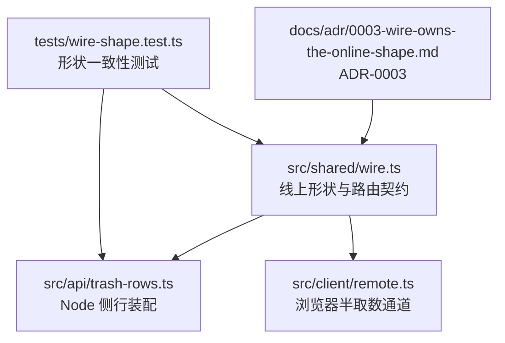
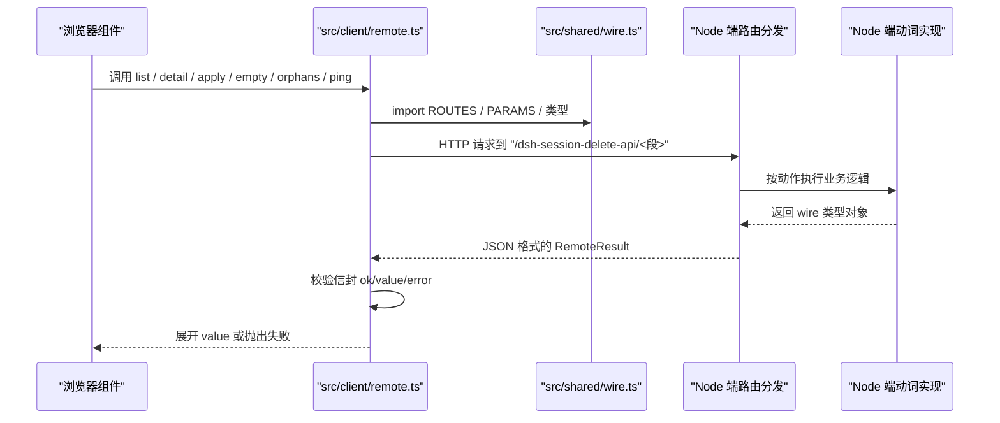
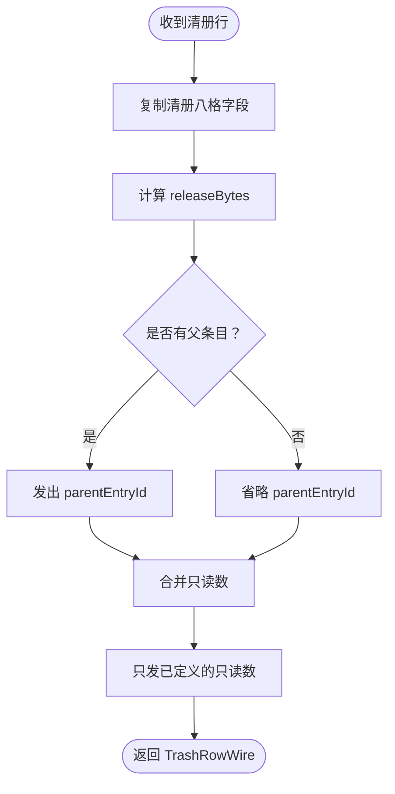
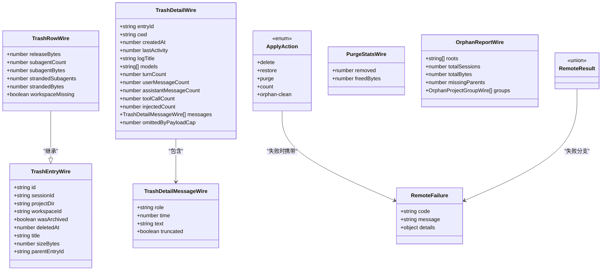

# 在线数据模型

<cite>
**本文引用的文件**   
- [wire.ts](file://src/shared/wire.ts)
- [trash-rows.ts](file://src/api/trash-rows.ts)
- [remote.ts](file://src/client/remote.ts)
- [0003-wire-owns-the-online-shape.md](file://docs/adr/0003-wire-owns-the-online-shape.md)
- [wire-shape.test.ts](file://tests/wire-shape.test.ts)
</cite>

## 目录
1. [引言](#引言)
2. [项目结构中的位置](#项目结构中的位置)
3. [核心类型总览](#核心类型总览)
4. [架构概览：浏览器半与 Node 半的传递边界](#架构概览浏览器半与-node-半的传递边界)
5. [详细类型定义](#详细类型定义)
6. [序列化、可选字段与现算字段](#序列化可选字段与现算字段)
7. [向后兼容规则](#向后兼容规则)
8. [版本演进建议](#版本演进建议)
9. [依赖关系分析](#依赖关系分析)
10. [故障排查](#故障排查)
11. [结论](#结论)

## 引言

本参考文档聚焦“在线数据模型”，也就是在浏览器半（前端）与 Node 半（插件后端）之间通过 `/dsh-session-delete-api` 实际传输的数据形状。仓库中真正承担这一职责的文件是 `src/shared/wire.ts`，它被明确称为两半之间的“唯一真相”：端点前缀、六个段名、请求字段名、信封、失败形状以及所有回收站相关线上类型都集中在这里。

需要区分两个概念：

- **线上形状**：JSON 里实际存在的键和类型，由 `TrashEntryWire`、`TrashRowWire`、`TrashDetailWire`、`TrashDetailMessageWire`、`PurgeStatsWire`、`OrphanReportWire` 等描述。
- **落地形状**：Node 侧持久化或运行时内部使用的对象，例如清册行 `TrashEntry`。

两者不是同一个东西。`TrashRowWire` 继承自 `TrashEntryWire`，并额外增加“现算现给”的只读数字段；`TrashDetailWire` 只携带从日志中读取的详情，并不重复发送清册里已有的字段。这种分离让“磁盘事实”和“网络契约”各司其职。

## 项目结构中的位置



**图表来源**
- [wire.ts:1-261](file://src/shared/wire.ts#L1-L261)
- [trash-rows.ts:1-93](file://src/api/trash-rows.ts#L1-L93)
- [remote.ts:1-200](file://src/client/remote.ts#L1-L200)
- [0003-wire-owns-the-online-shape.md:1-58](file://docs/adr/0003-wire-owns-the-online-shape.md#L1-L58)
- [wire-shape.test.ts:1-116](file://tests/wire-shape.test.ts#L1-L116)

`wire.ts` 不引入任何模块，也没有运行时依赖，因此可以被浏览器端完整内联进打包产物。浏览器端不再各自抄写接口，而是直接 import 这些类型；Node 端则用它定义返回给浏览器的 JSON 形状。

**章节来源**
- [wire.ts:1-40](file://src/shared/wire.ts#L1-L40)
- [0003-wire-owns-the-online-shape.md:1-58](file://docs/adr/0003-wire-owns-the-online-shape.md#L1-L58)

## 核心类型总览

| 类型 | 角色 | 是否可枚举 | 必填字段 | 关键约束 |
|---|---|---|---|---|
| `TrashEntryWire` | 清册条目基础线上海报 | 否 | `id`、`sessionId`、`projectDir`、`workspaceId`、`wasArchived`、`deletedAt`、`title`、`sizeBytes` | 不含 `releaseBytes`；`parentEntryId` 可选 |
| `TrashRowWire` | 清册行 + 现算只读数 | 否 | 继承 `TrashEntryWire` 的所有字段，加上 `releaseBytes` | 其余只读数可选；缺席不等于零 |
| `TrashDetailMessageWire` | 单条详情中的一条消息 | 否 | `role`、`time`、`text`、`truncated` | `role` 仅用户或助手 |
| `TrashDetailWire` | 单条详情的容器 | 否 | `entryId`、`cwd`、`createdAt`、`lastActivity`、`logTitle`、`models`、`turnCount`、`userMessageCount`、`assistantMessageCount`、`toolCallCount`、`injectedCount`、`messages`、`omittedByPayloadCap` | `messages` 为数组；`models` 为字符串数组 |
| `ApplyAction` | 动作枚举 | 是 | — | 五个值：`delete`、`restore`、`purge`、`count`、`orphan-clean` |
| `ApplyOutcome` | 一次动作的一条结果 | 否 | `id`、`action`、成功时 `value` 或失败时 `error` | 按动作联合判别 |
| `PurgeStatsWire` | 清空回执 | 否 | `removed`、`freedBytes` | 纯数字聚合 |
| `OrphanReportWire` | 孤儿扫描报告 | 否 | `roots`、`totalSessions`、`totalBytes`、`missingParents`、`groups` | 只读扫描，不包含清理动作 |
| `RemoteFailure` | 远程失败信封 | 否 | `code`、`message` | `details` 可选；整件缺失时不应出现空对象 |
| `RemoteResult<T>` | 成功或失败的统一信封 | 否 | 二选一：`ok:true,value` 或 `ok:false,error` | 不是 Promise reject 的载体 |

**章节来源**
- [wire.ts:40-180](file://src/shared/wire.ts#L40-L180)

## 架构概览：浏览器半与 Node 半的传递边界



**图表来源**
- [remote.ts:1-200](file://src/client/remote.ts#L1-L200)
- [wire.ts:1-120](file://src/shared/wire.ts#L1-L120)

关键设计要点如下：

1. 浏览器端通过 `createHttpRemote` 发起同源 fetch，路径拼接 `SESSION_DELETE_API_PREFIX` 与 `ROUTES` 中的段名。
2. 请求体使用 `PARAMS` 中的字段名：`entryId`、`action`、`ids`。
3. 响应必须解析成 `RemoteResult<T>`：成功为 `{ ok: true, value }`，失败为 `{ ok: false, error }`。
4. 浏览器端的 `unwrapRemoteResult` 把失败转为异常；`callRemote` 再把异常捕获为 `{ ok: false, failure }`，供 UI 状态层消费。
5. Node 端负责产出真正的 wire 对象，而不是直接把内部实体透传。

**章节来源**
- [remote.ts:120-200](file://src/client/remote.ts#L120-L200)
- [wire.ts:1-120](file://src/shared/wire.ts#L1-L120)

## 详细类型定义

### TrashEntryWire

这是清册条目在网上传输时的最小公共形状。它描述一个已经进入回收站的会话条目，但不包含 Node 侧“彻底删除时会释放多少字节”这类现算字段。

| 字段 | 类型 | 必填 | 说明 |
|---|---|---:|---|
| `id` | `string` | 是 | 回收站条目标识 |
| `sessionId` | `string` | 是 | 宿主会话标识 |
| `projectDir` | `string` | 是 | 项目目录 |
| `workspaceId` | `string` | 是 | 工作区标识 |
| `wasArchived` | `boolean` | 是 | 是否曾归档 |
| `deletedAt` | `number` | 是 | 删除时间戳 |
| `title` | `string` | 是 | 标题 |
| `sizeBytes` | `number` | 是 | 条目自身大小 |
| `parentEntryId` | `string \| undefined` | 否 | 父条目标识；不存在时不应发出该键 |

**TypeScript 片段**

```typescript
interface TrashEntryWire {
  id: string
  sessionId: string
  projectDir: string
  workspaceId: string
  wasArchived: boolean
  deletedAt: number
  title: string
  sizeBytes: number
  parentEntryId?: string
}
```

**JSON 示例**

```json
{
  "id": "session-trash/abc",
  "sessionId": "session-a",
  "projectDir": "--p--",
  "workspaceId": "ws-1",
  "wasArchived": false,
  "deletedAt": 1760000000000,
  "title": "示例会话",
  "sizeBytes": 229376
}
```

**章节来源**
- [wire.ts:70-86](file://src/shared/wire.ts#L70-L86)

### TrashRowWire

`TrashRowWire` 扩展了 `TrashEntryWire`，用于 `GET /list` 返回的行。它的核心思想是：**清册里的字段是事实，而 `releaseBytes` 及后续可选字段是 Node 端计算后附加的只读数**。

| 字段 | 类型 | 必填 | 说明 |
|---|---|---:|---|
| 继承字段 | 见 `TrashEntryWire` | 同上 | 全部必填，除 `parentEntryId` |
| `releaseBytes` | `number` | 是 | 彻底删除本行会释放的总字节数 |
| `subagentCount` | `number \| undefined` | 否 | 随父会话一起进回收站的孩子数量 |
| `subagentBytes` | `number \| undefined` | 否 | 那些孩子的大小合计 |
| `strandedSubagents` | `number \| undefined` | 否 | 还留在盘上但未被带走的后代数量 |
| `strandedBytes` | `number \| undefined` | 否 | 盘上后代的实际字节合计 |
| `workspaceMissing` | `boolean \| undefined` | 否 | 工作区已不在账本中 |

`releaseBytes` 的唯一算式是：

```
releaseBytes = sizeBytes + subagentBytes + strandedBytes
```

其中 `subagentBytes` 和 `strandedBytes` 缺失时按零处理。

**TypeScript 片段**

```typescript
interface TrashRowWire extends TrashEntryWire {
  releaseBytes: number
  subagentCount?: number
  subagentBytes?: number
  strandedSubagents?: number
  strandedBytes?: number
  workspaceMissing?: boolean
}
```

**JSON 示例**

```json
{
  "id": "session-trash/abc",
  "sessionId": "session-a",
  "projectDir": "--p--",
  "workspaceId": "ws-1",
  "wasArchived": false,
  "deletedAt": 1760000000000,
  "title": "示例会话",
  "sizeBytes": 229376,
  "releaseBytes": 234496,
  "subagentCount": 2,
  "subagentBytes": 4096,
  "strandedSubagents": 1,
  "strandedBytes": 1024
}
```

注意：如果某个只读数没有计算出来，应当省略该字段，而不是写出 `0`。测试中明确要求“缺席 ≠ 0”。

**章节来源**
- [wire.ts:88-119](file://src/shared/wire.ts#L88-L119)
- [trash-rows.ts:20-55](file://src/api/trash-rows.ts#L20-L55)
- [wire-shape.test.ts:35-75](file://tests/wire-shape.test.ts#L35-L75)

### TrashDetailMessageWire

单条详情中的消息记录，对应日志中读出的对话项。

| 字段 | 类型 | 必填 | 说明 |
|---|---|---:|---|
| `role` | `'user' \| 'assistant'` | 是 | 消息角色 |
| `time` | `number` | 是 | 时间戳 |
| `text` | `string` | 是 | 文本内容 |
| `truncated` | `boolean` | 是 | 是否因载荷上限被截断 |

**TypeScript 片段**

```typescript
interface TrashDetailMessageWire {
  role: 'user' | 'assistant'
  time: number
  text: string
  truncated: boolean
}
```

**JSON 示例**

```json
{
  "role": "user",
  "time": 1760000000000,
  "text": "你好",
  "truncated": false
}
```

**章节来源**
- [wire.ts:121-126](file://src/shared/wire.ts#L121-L126)

### TrashDetailWire

`POST /detail` 返回的单条详情。它强调“无损”和“可读”，而不是简单复用清册行。

| 字段 | 类型 | 必填 | 说明 |
|---|---|---:|---|
| `entryId` | `string` | 是 | 对应的回收站条目标识 |
| `cwd` | `string` | 是 | 日志头中的原串 cwd，不做二次反推 |
| `createdAt` | `number` | 是 | 创建时间 |
| `lastActivity` | `number` | 是 | 最后活动时间 |
| `logTitle` | `string` | 是 | 日志内会话标题；清册标题为空时可兜底 |
| `models` | `string[]` | 是 | 模型列表 |
| `turnCount` | `number` | 是 | 对话轮数 |
| `userMessageCount` | `number` | 是 | 用户消息数 |
| `assistantMessageCount` | `number` | 是 | 助手消息数 |
| `toolCallCount` | `number` | 是 | 工具调用次数 |
| `injectedCount` | `number` | 是 | 注入消息数量 |
| `messages` | `TrashDetailMessageWire[]` | 是 | 消息数组 |
| `omittedByPayloadCap` | `number` | 是 | 因载荷上限被省略的消息数量 |

**TypeScript 片段**

```typescript
interface TrashDetailWire {
  entryId: string
  cwd: string
  createdAt: number
  lastActivity: number
  logTitle: string
  models: string[]
  turnCount: number
  userMessageCount: number
  assistantMessageCount: number
  toolCallCount: number
  injectedCount: number
  messages: TrashDetailMessageWire[]
  omittedByPayloadCap: number
}
```

**JSON 示例**

```json
{
  "entryId": "session-trash/abc",
  "cwd": "/projects/example",
  "createdAt": 1760000000000,
  "lastActivity": 1760000100000,
  "logTitle": "示例会话详情",
  "models": ["model-a"],
  "turnCount": 10,
  "userMessageCount": 5,
  "assistantMessageCount": 5,
  "toolCallCount": 2,
  "injectedCount": 0,
  "messages": [
    {
      "role": "user",
      "time": 1760000000000,
      "text": "开始",
      "truncated": false
    }
  ],
  "omittedByPayloadCap": 0
}
```

**章节来源**
- [wire.ts:128-150](file://src/shared/wire.ts#L128-L150)

### ApplyAction 与 ApplyOutcome

`ApplyAction` 是 `/apply` 的动作枚举。不同动作对 `id` 的解释不同：

- `delete`、`count`、`orphan-clean`：`id` 是宿主会话标识。
- `restore`、`purge`：`id` 是回收站条目标识。

`ApplyOutcome` 是按动作联合判别的结果类型。每条传入的 `id` 都会产生一条结果。

| 动作 | 成功值的 `value` 类型 | 语义 |
|---|---|---|
| `delete` | `TrashEntryWire \| null` | 删除后可能返回该行；`null` 表示幂等 no-op，已被同批前一条带走 |
| `restore` | `TrashEntryWire \| null` | 恢复后可能返回该行；`null` 同上 |
| `purge` | `PurgeStatsWire` | 一组彻底删除的聚合回执 |
| `count` | `number` | 子会话计数；拿不到时为 `0` |
| `orphan-clean` | `OrphanCleanStatsWire` | 清理盘上孤儿目录的回执 |

**TypeScript 片段**

```typescript
type ApplyAction = 'delete' | 'restore' | 'purge' | 'count' | 'orphan-clean'

type ApplyValueByAction = {
  delete: TrashEntryWire | null
  restore: TrashEntryWire | null
  purge: PurgeStatsWire
  count: number
  'orphan-clean': OrphanCleanStatsWire
}

type ApplyOutcome = { id: string } & {
  [A in ApplyAction]:
    | { action: A; ok: true; value: ApplyValueByAction[A] }
    | { action: A; ok: false; error: RemoteFailure }
}[ApplyAction]
```

**JSON 示例：成功**

```json
{
  "id": "session-a",
  "action": "delete",
  "ok": true,
  "value": {
    "id": "session-trash/abc",
    "sessionId": "session-a",
    "projectDir": "--p--",
    "workspaceId": "ws-1",
    "wasArchived": false,
    "deletedAt": 1760000000000,
    "title": "示例会话",
    "sizeBytes": 229376
  }
}
```

**JSON 示例：失败**

```json
{
  "id": "session-b",
  "action": "delete",
  "ok": false,
  "error": {
    "code": "sessiondelete/io",
    "message": "读取会话失败",
    "details": {
      "sessionId": "session-b"
    }
  }
}
```

**章节来源**
- [wire.ts:46-68](file://src/shared/wire.ts#L46-L68)

### PurgeStatsWire

清空回收站的聚合回执。它与旧 `purge` 返回值同形，表示删除了多少条、释放了多少字节。

| 字段 | 类型 | 必填 | 说明 |
|---|---|---:|---|
| `removed` | `number` | 是 | 删除条目数 |
| `freedBytes` | `number` | 是 | 释放字节数 |

**TypeScript 片段**

```typescript
interface PurgeStatsWire {
  removed: number
  freedBytes: number
}
```

**JSON 示例**

```json
{
  "removed": 3,
  "freedBytes": 1048576
}
```

**章节来源**
- [wire.ts:152-156](file://src/shared/wire.ts#L152-L156)

### OrphanReportWire 与 OrphanCleanStatsWire

`OrphanReportWire` 是 `GET /orphans` 的纯读扫描结果，不执行清理。它提供：

- `roots`：每个“父没了”的子会话根路径。
- `totalSessions`：会话总数。
- `totalBytes`：占用字节总数。
- `missingParents`：去重后的失踪父数量。
- `groups`：按项目目录分组的汇总。

`OrphanCleanStatsWire` 与 `PurgeStatsWire` 同形，但语义是“删掉的会话目录”而非回收站条目。

| 字段 | 类型 | 必填 | 说明 |
|---|---|---:|---|
| `roots` | `readonly string[]` | 是 | 孤儿根路径集合 |
| `totalSessions` | `number` | 是 | 孤儿会话数 |
| `totalBytes` | `number` | 是 | 孤儿会话总字节数 |
| `missingParents` | `number` | 是 | 去重后的失踪父数量 |
| `groups` | `readonly OrphanProjectGroupWire[]` | 是 | 按项目分组 |

**TypeScript 片段**

```typescript
interface OrphanProjectGroupWire {
  projectDir: string
  sessions: number
  bytes: number
}

interface OrphanReportWire {
  roots: readonly string[]
  totalSessions: number
  totalBytes: number
  missingParents: number
  groups: readonly OrphanProjectGroupWire[]
}

interface OrphanCleanStatsWire {
  removed: number
  freedBytes: number
}
```

**JSON 示例**

```json
{
  "roots": ["~AAAA/session-x"],
  "totalSessions": 1,
  "totalBytes": 51200,
  "missingParents": 1,
  "groups": [
    {
      "projectDir": "--p--",
      "sessions": 1,
      "bytes": 51200
    }
  ]
}
```

**章节来源**
- [wire.ts:158-179](file://src/shared/wire.ts#L158-L179)

### RemoteFailure 与 RemoteResult

`RemoteFailure` 是跨半失败信封，对齐宿主网关客户端面的错误结构。

| 字段 | 类型 | 必填 | 说明 |
|---|---|---:|---|
| `code` | `string` | 是 | 失败码，通常来自 `SESSION_DELETE_CODES` |
| `message` | `string` | 是 | 可直接上屏的失败原文 |
| `details` | `Record<string, unknown> \| undefined` | 否 | 结构化附带物；无附带物时应整件缺席 |

`RemoteResult<T>` 是统一信封：

| 分支 | 字段 | 含义 |
|---|---|---|
| 成功 | `{ ok: true, value: T }` | 本次操作成功 |
| 失败 | `{ ok: false, error: RemoteFailure }` | 本次操作失败 |

浏览器端把失败转化为异常，所以 UI 层通常只能看到裸值或抛错；Node 端则按这个形状输出 JSON。

**TypeScript 片段**

```typescript
interface RemoteFailure {
  code: string
  message: string
  details?: Record<string, unknown>
}

type RemoteResult<T> =
  | { ok: true; value: T }
  | { ok: false; error: RemoteFailure }
```

**JSON 示例：成功**

```json
{
  "ok": true,
  "value": {
    "id": "session-trash/abc",
    "sessionId": "session-a",
    "projectDir": "--p--",
    "workspaceId": "ws-1",
    "wasArchived": false,
    "deletedAt": 1760000000000,
    "title": "示例会话",
    "sizeBytes": 229376
  }
}
```

**JSON 示例：失败**

```json
{
  "ok": false,
  "error": {
    "code": "sessiondelete/not-found",
    "message": "目标会话已不存在"
  }
}
```

**章节来源**
- [wire.ts:181-200](file://src/shared/wire.ts#L181-L200)
- [remote.ts:60-120](file://src/client/remote.ts#L60-L120)

## 序列化、可选字段与现算字段

### 必填字段与可选字段

| 模型 | 绝对必填 | 条件可选 | 可选但建议补全 |
|---|---|---|---|
| `TrashEntryWire` | `id`、`sessionId`、`projectDir`、`workspaceId`、`wasArchived`、`deletedAt`、`title`、`sizeBytes` | `parentEntryId` | 有父子关系时必发 |
| `TrashRowWire` | 继承 `TrashEntryWire` 外加 `releaseBytes` | `subagentCount`、`subagentBytes`、`strandedSubagents`、`strandedBytes`、`workspaceMissing` | 有对应数据时发，否则省略 |
| `TrashDetailWire` | 所有顶层字段 | 无 | `messages` 非空时更完整 |
| `TrashDetailMessageWire` | 所有字段 | 无 | 无 |
| `ApplyOutcome` | `id`、`action`，成功时 `value`，失败时 `error` | 无 | 无 |
| `PurgeStatsWire` | `removed`、`freedBytes` | 无 | 无 |
| `OrphanReportWire` | 所有顶层字段 | 无 | 无 |
| `RemoteFailure` | `code`、`message` | `details` | 有结构化信息时补全 |

### 现算字段

`TrashRowWire.releaseBytes` 是唯一强制计算的字段，其他可选只读数都是“能算就发，不能算就不发”。Node 端装配逻辑位于 `src/api/trash-rows.ts`：



**图表来源**
- [trash-rows.ts:20-55](file://src/api/trash-rows.ts#L20-L55)

### 序列化约束

1. 所有请求体和响应体都是 JSON。
2. 浏览器端使用 `content-type: application/json` 发送 POST。
3. 成功或失败都必须落在 `RemoteResult` 信封中。
4. `RemoteFailure.details` 存在时才发出；不应发出空对象来表示“没有详细信息”。
5. 可选只读数应省略而不是写 `undefined` 或 `0`。
6. 浏览器端不会把 TypeScript 标记位 `isDSHRemoteError` 发到线上；该标记只在进程内判别失败时使用。

**章节来源**
- [trash-rows.ts:20-55](file://src/api/trash-rows.ts#L20-L55)
- [remote.ts:160-200](file://src/client/remote.ts#L160-L200)
- [wire.ts:181-200](file://src/shared/wire.ts#L181-L200)

## 向后兼容规则

### 新增可选字段

当向 `TrashRowWire` 或 `TrashDetailWire` 添加可选字段时：

1. 在 `wire.ts` 声明字段。
2. 在 Node 端装配处显式填充。
3. 不要假设旧浏览器端会忽略未知字段以外的行为——旧代码可能不会渲染新字段，但这属于渐进增强。
4. 不要把“老行没有”和“这次没算”混在一起：可选字段的存在性本身也是语义。

### 新增动作

对于 `ApplyAction`，新增动作时应同时更新：

- `ApplyAction` 字面量。
- `ApplyValueByAction` 的成功值映射。
- Node 端 `/apply` 分发逻辑。
- 浏览器端调用处的动作语义。
- 测试中的动作覆盖。

### 新增失败码

失败码走受控表：

- `VERB_CODES`：动词码。
- `ROUTE_CODES`：路由自检码。
- `SESSION_DELETE_CODES`：完整码映射。

新增后缀时必须同时出现在两个表中，否则编译失败。这保证了“加一个后缀而忘了这里”会成为编译错误，而不是线上静默漂移。

### 保持现有字段稳定

- `TrashEntryWire` 的必填字段一旦上线，不应随意改名或改变类型。
- `RemoteResult` 的信封结构应保持与宿主网关客户端面一致，因为浏览器端依赖 `ok/value/error` 判别。
- `RemoteFailure.code/message/details` 三件套应保持可用，即使未来增加新的错误域。

**章节来源**
- [wire.ts:201-261](file://src/shared/wire.ts#L201-L261)
- [0003-wire-owns-the-online-shape.md:18-44](file://docs/adr/0003-wire-owns-the-online-shape.md#L18-L44)

## 版本演进建议

| 场景 | 建议 | 理由 |
|---|---|---|
| 新增可选只读数 | 扩展 `TrashRowWire` 并在投影中条件发出 | 不影响旧浏览器端；新字段由 Node 端控制 |
| 新增必填字段 | 先发可选字段，再在下一个主版本改为必填 | 避免旧浏览器端丢失显示字段 |
| 新增动作 | 扩展 `ApplyAction` 并维护 `ApplyValueByAction` | 保持动作与成功值强绑定 |
| 新增失败码 | 扩展 `VERB_CODES` 或 `ROUTE_CODES`，并同步 `SESSION_DELETE_CODES` | 编译期检查防止遗漏 |
| 修改线上字段名 | 视为破坏性变更，应废弃旧字段并双写一段时间 | JSON 无 schema 校验，需靠两端过渡 |
| 替换信封结构 | 不建议 | 当前结构与宿主网关客户端面保持一致，改动成本高 |

最佳实践是：**每次变更都让类型系统报错，而不是让运行期静默接受**。这正是 ADR-0003 的核心动机：线上形状只有一个家，投影必须显式写出，不能用 `...row` 悄悄扩散。

**章节来源**
- [0003-wire-owns-the-online-shape.md:18-58](file://docs/adr/0003-wire-owns-the-online-shape.md#L18-L58)
- [wire-shape.test.ts:1-30](file://tests/wire-shape.test.ts#L1-L30)

## 依赖关系分析



**图表来源**
- [wire.ts:46-200](file://src/shared/wire.ts#L46-L200)

浏览器端 `remote.ts` 只 import 类型和常量，不导入 Node 专属实现。Node 端 `trash-rows.ts` 负责把内部 `TrashEntry` 投影成 `TrashRowWire`。测试 `wire-shape.test.ts` 确保：

- 浏览器端别名与 wire 类型完全相等。
- 必填字段清单与接口键集一致。
- 投影只发出线上形状允许的字段。
- 失败码与目录名字面量同源。

**章节来源**
- [wire.ts:46-200](file://src/shared/wire.ts#L46-L200)
- [trash-rows.ts:1-93](file://src/api/trash-rows.ts#L1-L93)
- [remote.ts:1-120](file://src/client/remote.ts#L1-L120)
- [wire-shape.test.ts:1-116](file://tests/wire-shape.test.ts#L1-L116)

## 故障排查

| 现象 | 可能原因 | 处理建议 |
|---|---|---|
| 浏览器端拿到一行但没有 `releaseBytes` | Node 端投影未发出必填字段，或使用了宽 spread 导致字段缺失 | 检查 `toWire` 是否显式写出 `releaseBytes` |
| 界面上把“没有数据”误判为 `0` | 把可选只读数写成 `0` 而不是省略 | 用 `readouts.x === undefined ? {} : { x }` 模式 |
| `apply` 的某条结果成功但整体信封失败 | 混淆了顶层信封与逐条 `ApplyOutcome` | 顶层失败表示整次调用失败；逐条成败看 `ApplyOutcome.ok` |
| 失败消息能显示但结构化信息丢失 | `RemoteFailure.details` 被替换为空对象或未带上 | 保留 `details` 原样，仅在确实存在时发出 |
| 新增失败码后编译正常但线上仍缺码 | 只改了枚举或类型，没改 `SESSION_DELETE_CODES` | 同步 `VERB_CODES`、`ROUTE_CODES` 和映射表 |
| 浏览器端与 Node 端字段不一致 | 浏览器端重新定义了接口而不是使用 wire 别名 | 让浏览器端使用 `TrashEntryLike`、`PurgeResultLike`、`TrashDetailLike` |
| 清册行多出一个不该过线的字段 | 使用了 `...row` 投影 | 改用显式字面量构造 |

**章节来源**
- [wire-shape.test.ts:35-116](file://tests/wire-shape.test.ts#L35-L116)
- [trash-rows.ts:20-55](file://src/api/trash-rows.ts#L20-L55)
- [remote.ts:60-120](file://src/client/remote.ts#L60-L120)

## 结论

`src/shared/wire.ts` 是这个仓库中“线上形状的唯一主人”。它不仅是类型声明的地方，更是浏览器半与 Node 半共享的契约：端点前缀、段名、请求字段名、动作枚举、失败信封、成功信封、清册行、详情行、清空回执和孤儿报告都从这里导出。

围绕这些模型的实践原则可以总结为：

1. 线上形状只有一份家。
2. 落地图像与线上形状分离。
3. 投影必须显式写出字段。
4. 可选字段用“缺席”表达“没有”，而不是用 `0` 或空对象。
5. 动作、成功值和失败码通过联合类型和受控表约束。
6. 浏览器端使用 wire 类型别名，不另起一份镜像。
7. 测试负责抓住“形状漂移”和“两边各写一遍”的问题。

只要遵守这些规则，`TrashEntryWire`、`TrashRowWire`、`TrashDetailWire`、`TrashDetailMessageWire`、`ApplyAction`、`ApplyOutcome`、`PurgeStatsWire`、`OrphanReportWire`、`RemoteFailure` 与 `RemoteResult` 就能在浏览器半与 Node 半之间保持稳定、可演进且可验证的数据契约。