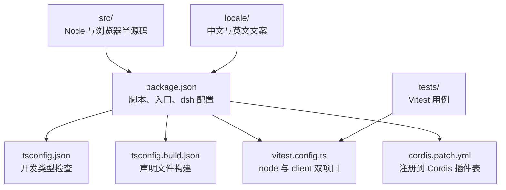
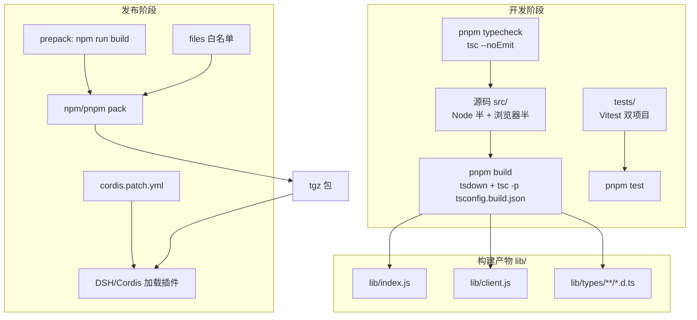
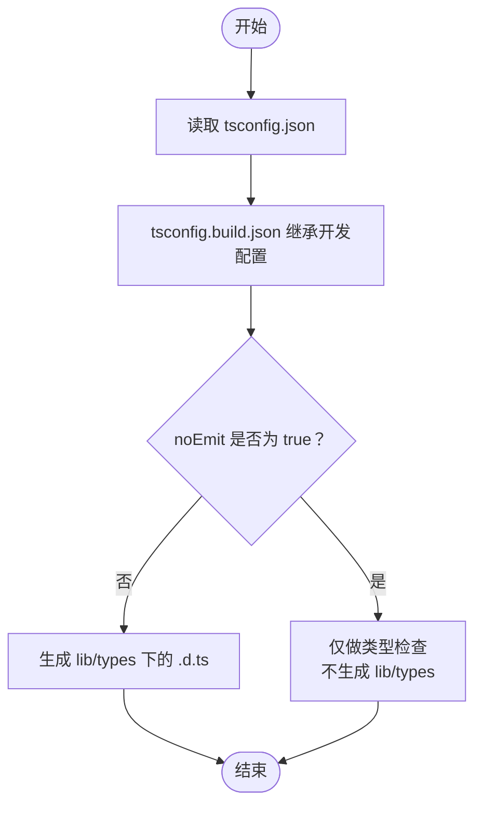
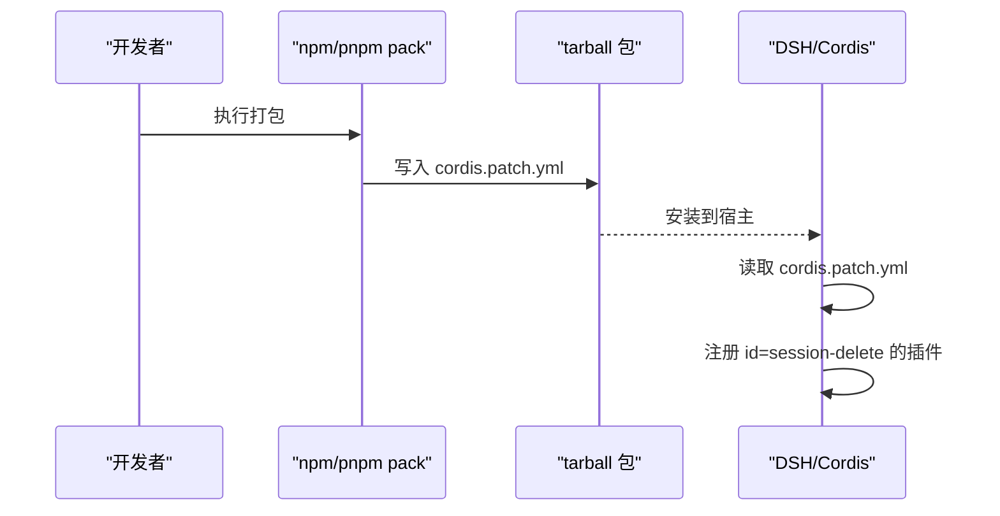
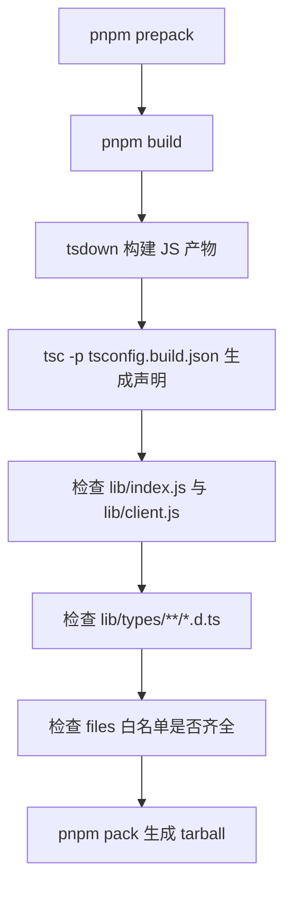
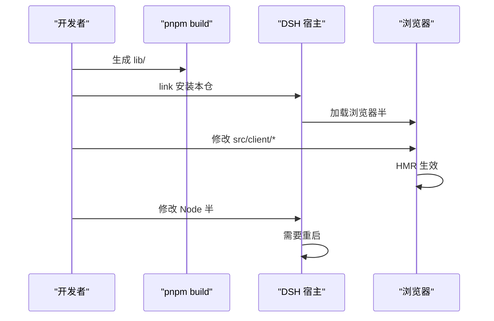
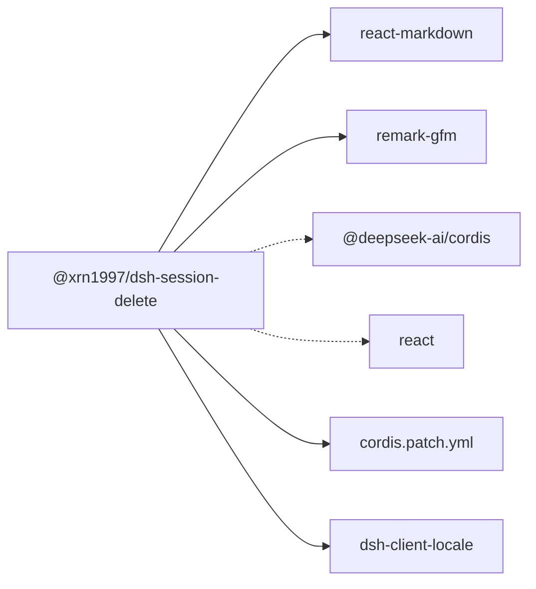

# 开发与发版

<cite>
**本文引用的文件**   
- [package.json](file://package.json)
- [tsconfig.json](file://tsconfig.json)
- [tsconfig.build.json](file://tsconfig.build.json)
- [cordis.patch.yml](file://cordis.patch.yml)
- [vitest.config.ts](file://vitest.config.ts)
- [README.md](file://README.md)
</cite>

## 目录
1. [简介](#简介)
2. [项目结构](#项目结构)
3. [核心组件](#核心组件)
4. [架构总览](#架构总览)
5. [详细组件分析](#详细组件分析)
6. [依赖关系分析](#依赖关系分析)
7. [性能注意事项](#性能注意事项)
8. [故障排查指南](#故障排查指南)
9. [结论](#结论)
10. [附录：发布前检查清单与命令速查](#附录发布前检查清单与命令速查)

## 简介
本文面向本插件 `@xrn1997/dsh-session-delete` 的开发者与维护者，覆盖本地安装、构建、类型检查、测试、调试、打包补丁、预发包产物要求、提交门控与退出码约束，以及浏览器半与 Node 半的验证方法。同时给出发布前的文档、截图、本地化、版本与变更日志检查清单。

## 项目结构
仓库采用“源码—测试—配置”分层组织：
- `src/`：Node 端入口与业务逻辑，`src/client/` 为浏览器端 UI 与宿主注入点。
- `tests/`：Vitest 测试，分为 Node 环境（根级 `tests/*.test.ts`）与浏览器环境（`tests/client/**`）。
- `locale/`：界面文案资源。
- `docs/`：架构设计、ADR、截图与设计说明。
- 根目录配置：`package.json`、`tsconfig.json`、`tsconfig.build.json`、`vitest.config.ts`、`cordis.patch.yml`。

**图示来源**
- [package.json:1-105](file://package.json#L1-L105)
- [tsconfig.json:1-10](file://tsconfig.json#L1-L10)
- [tsconfig.build.json:1-11](file://tsconfig.build.json#L1-L11)
- [vitest.config.ts:1-31](file://vitest.config.ts#L1-L31)
- [cordis.patch.yml:1-3](file://cordis.patch.yml#L1-L3)

**章节来源**
- [package.json:1-105](file://package.json#L1-L105)
- [README.md:1-147](file://README.md#L1-L147)

## 核心组件
| 配置或模块 | 职责 | 关键影响 |
|---|---|---|
| `package.json` | 定义包名、版本、入口、导出、脚本、依赖、`dsh` 扩展字段、`files` 白名单等 | 决定安装、运行、打包、发布产物与 DSH 兼容性 |
| `tsconfig.json` | 开发期类型检查配置，不生成输出 | 控制严格模式、目标、模块解析、包含范围 |
| `tsconfig.build.json` | 继承开发配置并开启声明文件输出 | 控制 `lib/types` 下的 `.d.ts` 生成 |
| `vitest.config.ts` | 定义 Node 与 jsdom 两个测试项目 | 避免浏览器半在 Node 环境误用 `import.meta.url` |
| `cordis.patch.yml` | 向 Cordis 注册插件 ID | 让宿主把本包作为插件加载 |
| `README.md` | 用户文档、安装、用法、常见问题、开发说明 | 发布前必须同步更新 |

**章节来源**
- [package.json:1-105](file://package.json#L1-L105)
- [tsconfig.json:1-10](file://tsconfig.json#L1-L10)
- [tsconfig.build.json:1-11](file://tsconfig.build.json#L1-L11)
- [vitest.config.ts:1-31](file://vitest.config.ts#L1-L31)
- [cordis.patch.yml:1-3](file://cordis.patch.yml#L1-L3)
- [README.md:1-147](file://README.md#L1-L147)

## 架构总览
本插件由 Node 半与浏览器半组成：Node 半暴露主入口和 API；浏览器半通过 DSH 客户端注入 UI，并与宿主会话列表、回收站面板交互。构建流程由 `tsdown` 生成 JS 产物，再由 TypeScript 单独生成类型声明。

**图示来源**
- [package.json:1-105](file://package.json#L1-L105)
- [tsconfig.json:1-10](file://tsconfig.json#L1-L10)
- [tsconfig.build.json:1-11](file://tsconfig.build.json#L1-L11)
- [vitest.config.ts:1-31](file://vitest.config.ts#L1-L31)
- [cordis.patch.yml:1-3](file://cordis.patch.yml#L1-L3)

**章节来源**
- [package.json:1-105](file://package.json#L1-L105)
- [README.md:1-147](file://README.md#L1-L147)

## 详细组件分析

### 开发与调试命令
| 任务 | 命令 | 说明 |
|---|---|---|
| 安装依赖 | `pnpm install` | 使用 pnpm 拉取依赖 |
| 构建 | `pnpm build` | 先执行 `tsdown` 构建 Node 半与浏览器半，再执行 `tsc -p tsconfig.build.json` 生成声明文件 |
| 类型检查 | `pnpm typecheck` | 等价于 `tsc --noEmit`，只检查不输出 |
| 运行测试 | `pnpm test` | 等价于 `vitest run` |
| 本地源码调试 | 先 `pnpm build`，再用 `dsh plugin --profile <profile> add "link:<本仓绝对路径>"` | `lib/` 是构建产物且不入库，链接安装不会自动构建 |

**章节来源**
- [README.md:1-147](file://README.md#L1-L147)
- [package.json:1-105](file://package.json#L1-L105)

### `tsconfig.json` 与 `tsconfig.build.json` 的区别
- `tsconfig.json` 用于开发类型检查：
  - `noEmit: true`，不生成任何 JS 或 `.d.ts`。
  - 包含 `src`、`tests`、`tsdown.config.ts`、`vitest.config.ts`。
  - 启用严格模式、禁用未使用变量/参数、使用 ES2022 目标、Bundler 模块解析、支持 JSX。
- `tsconfig.build.json` 继承开发配置，但针对构建调整：
  - `noEmit: false`，允许 TypeScript 输出。
  - `declaration: true`、`emitDeclarationOnly: true`，只生成类型声明。
  - `declarationDir: "lib/types"`，声明文件落在 `lib/types`。
  - `rootDir: "src"`，仅以 `src` 为根参与构建。
  - `include: ["src"]`，排除测试与工具配置。

建议：新增公共类型时优先放在 `src` 中；若只是测试辅助类型，可留在 `tests`，不要污染构建产物。

**图示来源**
- [tsconfig.json:1-10](file://tsconfig.json#L1-L10)
- [tsconfig.build.json:1-11](file://tsconfig.build.json#L1-L11)

**章节来源**
- [tsconfig.json:1-10](file://tsconfig.json#L1-L10)
- [tsconfig.build.json:1-11](file://tsconfig.build.json#L1-L11)

### `cordis.patch.yml` 的打包补丁作用
`cordis.patch.yml` 是一个 Cordis 插件注册补丁，其中插入一条记录：
- `id: session-delete`
- `name: '@xrn1997/dsh-session-delete'`

它的作用是让 DSH/Cordis 把当前包识别为一个插件，并在宿主侧加载。该文件被写入 `package.json` 的 `files` 白名单，因此会被包含在最终发布的 tarball 中。

**图示来源**
- [cordis.patch.yml:1-3](file://cordis.patch.yml#L1-L3)
- [package.json:1-105](file://package.json#L1-L105)

**章节来源**
- [cordis.patch.yml:1-3](file://cordis.patch.yml#L1-L3)
- [package.json:1-105](file://package.json#L1-L105)

### `prepack` 产物要求
`package.json` 中定义了：
- `"prepack": "npm run build"`
- `"build": "tsdown && tsc -p tsconfig.build.json"`
- `"main": "lib/index.js"`
- `"types": "lib/types/index.d.ts"`
- `"exports"` 同时声明 Node 入口与 `./client` 浏览器入口
- `files` 白名单包含 `lib/index.js`、`lib/client.js`、`lib/types/**/*.d.ts`、`locale`、`icon.svg`、`cordis.patch.yml`、`README.md`、`LICENSE`

因此，发布前必须满足：
1. `pnpm build` 成功，且无 TypeScript 错误。
2. `lib/index.js` 存在。
3. `lib/client.js` 存在。
4. `lib/types/**/*.d.ts` 存在，尤其是 `lib/types/index.d.ts`。
5. `locale`、`icon.svg`、`cordis.patch.yml`、`README.md`、`LICENSE` 存在于发布包。
6. 如果通过 `pnpm pack` 离线分发，请确认生成的 tarball 中包含上述文件。

**图示来源**
- [package.json:1-105](file://package.json#L1-L105)

**章节来源**
- [package.json:1-105](file://package.json#L1-L105)

### 提交门控与退出码约束
README 明确要求：提交改动前必须确保 `pnpm test` 与 `pnpm typecheck` 都通过，并且**两条命令的退出码都必须亲眼看过**。原因是当命令输出被管道或日志系统吞掉时，红色失败信息可能不可见，但非零退出码仍能反映失败状态。

实践建议：
- 不要在 CI 中直接 `pnpm test \| cat`；应先保存输出，再打印 `$?`。
- 类型检查失败、测试失败、构建失败都应阻止合并。
- 如果本地想快速验证门控，可顺序执行：
  1. `pnpm typecheck`
  2. `pnpm test`
  3. `pnpm build`
  4. `pnpm prepack`

**章节来源**
- [README.md:1-147](file://README.md#L1-L147)
- [package.json:1-105](file://package.json#L1-L105)

### 源码调试步骤
1. 在项目根目录执行 `pnpm build`，生成 `lib/`。
2. 使用链接方式安装到指定 profile：  
   `dsh plugin --profile <profile> add "link:<本仓绝对路径>"`
3. 启动或重启 DSH 宿主。
4. 修改 `src/client/` 中的浏览器半代码：宿主 HMR 会把变更推送到浏览器，无需重启。
5. 修改 Node 半代码后，必须重启宿主，因为 Node 半不在热重载链路中。

**图示来源**
- [README.md:1-147](file://README.md#L1-L147)
- [package.json:1-105](file://package.json#L1-L105)

**章节来源**
- [README.md:1-147](file://README.md#L1-L147)

### HMR 生效范围
- 生效范围：浏览器半，即 `src/client/` 下的前端代码。
- 不生效范围：Node 半。Node 半不走 HMR，必须重启宿主才能看到变化。
- 原因：HMR 由宿主驱动浏览器端刷新；Node 进程本身没有对应热替换机制。

**章节来源**
- [README.md:1-147](file://README.md#L1-L147)

### 如何验证浏览器半
浏览器半通过 DSH 客户端注入，并在 Web 平台运行。验证要点：
1. 完成链接安装与宿主重启。
2. 打开宿主界面，确认回收站面板行出现。
3. 在会话列表中确认“多选”和“删除”入口可用。
4. 触发删除、恢复、批量操作，观察 UI 行为与提示。
5. 修改 `src/client/` 后确认 HMR 能刷新页面，无需重启。

参考实现位置：
- 浏览器入口：`src/client/index.tsx`
- 回收站视图与详情：`src/client/trash-view.ts`、`src/client/trash-detail.tsx`
- 批量操作入口：`src/client/batch-bar.tsx`、`src/client/batch-confirm.tsx`
- 宿主上下文：`src/client/context.ts`

**章节来源**
- [README.md:1-147](file://README.md#L1-L147)
- [package.json:1-105](file://package.json#L1-L105)

### 如何验证 Node 半 HTTP API
Node 半通过 `package.json` 的 `main` 与 `exports` 暴露接口：
- 默认入口：`lib/index.js`
- 类型入口：`lib/types/index.d.ts`
- 浏览器子入口：`./client`，对应 `lib/client.js` 与 `lib/types/client/index.d.ts`

验证建议：
1. 执行 `pnpm build` 确保产物存在。
2. 在 Node 环境中 `require` 或 `import` 默认导出，确认函数、类型、错误处理可用。
3. 对 `./client` 子路径的导入应在浏览器或宿主上下文中验证，而非纯 Node 环境。
4. 结合单元测试查看 Node 半相关用例，例如 `tests/api.test.ts`、`tests/assembly.test.ts` 等。

注意：`vitest.config.ts` 明确区分 node 与 client 两个测试项目，浏览器半相关测试放在 `tests/client/**`，并由 jsdom 提供 DOM 环境。

**章节来源**
- [package.json:1-105](file://package.json#L1-L105)
- [vitest.config.ts:1-31](file://vitest.config.ts#L1-L31)

## 依赖关系分析
- 运行时依赖：`react-markdown`、`remark-gfm`。
- peerDependencies：`@deepseek-ai/cordis`、`react`，表示宿主需提供这些能力。
- 开发依赖：TypeScript、tsdown、Vitest、jsdom、Testing Library、React 类型等。
- DSH 扩展：
  - `dsh.bundle.patch` 指向 `./cordis.patch.yml`。
  - `dsh.client.inject` 注入 `@deepseek-ai/dsh-client-locale`。
  - `dsh.client.platform` 设为 `web`。
  - `dsh.compatibility.dshReleases` 列出已实测兼容的 DSH Desktop 版本。

**图示来源**
- [package.json:1-105](file://package.json#L1-L105)
- [cordis.patch.yml:1-3](file://cordis.patch.yml#L1-L3)

**章节来源**
- [package.json:1-105](file://package.json#L1-L105)

## 性能注意事项
- 构建成本：`pnpm build` 会先执行 `tsdown` 再执行 TypeScript 声明生成；增量开发时尽量只改 `src/client/` 并利用 HMR，减少 Node 半重启次数。
- 测试隔离：Node 与浏览器测试分开运行，避免 DOM 环境与真实 Node 语义互相干扰。
- 大对象与 Markdown：回收站详情渲染 Markdown，大量正文时应关注渲染性能；必要时通过分页、延迟加载或缓存优化。
- 文件系统操作：回收站移动基于同卷原子 `rename`，应避免跨盘复制。

[本节为通用指导，不直接分析具体文件]

## 故障排查指南
| 现象 | 可能原因 | 处理 |
|---|---|---|
| 安装后侧栏没有“回收站”，菜单也没有“删除” | 宿主未重启；或探测失败导致入口不注册 | 重启宿主；确认宿主版本在 `engines.dsh` 范围内 |
| 浏览器半改动不生效 | 未执行 `pnpm build`；或修改了 Node 半 | 重新构建；Node 半需重启宿主 |
| 类型检查报错 | 新增代码违反严格类型规则 | 修复类型后再提交 |
| 测试部分通过但门控失败 | 只看了输出颜色，未看退出码 | 分别执行 `pnpm typecheck` 与 `pnpm test`，并确认非零退出码 |
| 打包后缺少文件或类型 | `lib/` 未构建或 `files` 白名单遗漏 | 运行 `pnpm prepack` 并检查 tarball |
| 浏览器半测试报 `import.meta.url` 相关错误 | 浏览器半代码在 Node 项目中运行 | 确认用例位于 `tests/client/**`，由 jsdom 项目运行 |

**章节来源**
- [README.md:1-147](file://README.md#L1-L147)
- [vitest.config.ts:1-31](file://vitest.config.ts#L1-L31)
- [package.json:1-105](file://package.json#L1-L105)

## 结论
本项目的开发工作流围绕三个关键阶段展开：开发期类型检查、构建期产物生成、发布期预打包与校验。`tsconfig.json` 负责类型检查，`tsconfig.build.json` 负责声明文件输出，`cordis.patch.yml` 负责将插件注册到宿主，`prepack` 保证发布包始终包含最新构建产物。提交门控必须依赖明确的非零退出码，而不仅仅是控制台颜色。调试时记住：浏览器半走 HMR，Node 半必须重启宿主。

[本节为总结性内容，不直接分析具体文件]

## 附录：发布前检查清单与命令速查

### 命令速查
| 场景 | 命令 |
|---|---|
| 安装依赖 | `pnpm install` |
| 类型检查 | `pnpm typecheck` |
| 运行测试 | `pnpm test` |
| 构建产物 | `pnpm build` |
| 预打包校验 | `pnpm prepack` |
| 生成 tarball | `pnpm pack` |
| 链接调试 | `dsh plugin --profile <profile> add "link:<本仓绝对路径>"` |

**章节来源**
- [README.md:1-147](file://README.md#L1-L147)
- [package.json:1-105](file://package.json#L1-L105)

### 发布前 Checklist
1. **文档更新**
   - 更新 `README.md` 中功能、安装、用法、常见问题、开发说明。
   - 如涉及架构或行为变化，更新 `docs/architecture.md`、`docs/adr/`、`docs/design/`。
2. **截图**
   - 新增或修改界面行为后，更新 `docs/screenshots/` 中的截图。
   - 如 README 引用新截图，确认图片路径正确。
3. **本地化**
   - 新增文案时同步更新 `locale/zh.json` 与 `locale/en.json`。
   - 确认宿主 locale 服务不可用时能回退到内置中文。
4. **版本与变更日志**
   - 更新 `package.json` 中的版本号。
   - 如有变更日志文件，更新变更记录；若无，至少在 PR 描述中说明重大变更。
5. **构建与产物**
   - 执行 `pnpm build`，确认 `lib/index.js`、`lib/client.js`、`lib/types/**/*.d.ts` 存在。
   - 执行 `pnpm prepack`，确认 tarball 包含 `files` 白名单中的所有必要文件。
6. **类型检查**
   - 执行 `pnpm typecheck`，确认退出码为 0。
7. **测试**
   - 执行 `pnpm test`，确认 Node 与 client 项目全部通过，退出码为 0。
8. **兼容性**
   - 如需适配新 DSH 版本，更新 `engines.dsh` 与 `dsh.compatibility.dshReleases`。
   - 确认 `cordis.patch.yml` 中的插件 ID 与名称正确。
9. **提交门控**
   - 分别执行 `pnpm typecheck` 与 `pnpm test`，并亲自确认两者退出码均为 0。
   - 不在 CI 中用管道掩盖非零退出码。

**章节来源**
- [README.md:1-147](file://README.md#L1-L147)
- [package.json:1-105](file://package.json#L1-L105)
- [cordis.patch.yml:1-3](file://cordis.patch.yml#L1-L3)