# 开发与验证指南

<cite>
**本文档引用文件**
- [package.json](file://package.json)
- [README.md](file://README.md)
- [CONTRIBUTING.md](file://CONTRIBUTING.md)
- [docs/development.md](file://docs/development.md)
- [docs/ui-spec.md](file://docs/ui-spec.md)
- [.github/workflows/ci.yml](file://.github/workflows/ci.yml)
- [tsconfig.json](file://tsconfig.json)
- [tsconfig.build.json](file://tsconfig.build.json)
- [tsdown.config.ts](file://tsdown.config.ts)
- [src/api/request-trust.ts](file://src/api/request-trust.ts)
- [src/client/maintenance-settings.tsx](file://src/client/maintenance-settings.tsx)
- [src/client/maintenance-parts.tsx](file://src/client/maintenance-parts.tsx)
- [src/client/use-maintenance.ts](file://src/client/use-maintenance.ts)
- [src/client/ui/styles.ts](file://src/client/ui/styles.ts)
- [tests/docs.test.ts](file://tests/docs.test.ts)
- [tests/skeleton.test.ts](file://tests/skeleton.test.ts)
</cite>

## 目录

1. [引言](#引言)
2. [项目结构与构建流程](#项目结构与构建流程)
3. [本地开发环境](#本地开发环境)
4. [真机验证门控](#真机验证门控)
5. [CI/CD自动化](#ci-cd自动化)
6. [发版流程](#发版流程)
7. [已知环境坑](#已知环境坑)
8. [结论](#结论)

## 引言

本指南面向 `@xrn1997/dsh-session-delete` 插件的贡献者与维护者，系统性地阐述从代码构建、本地调试、真机验证到持续集成与版本发布的完整工作流。该插件为 DeepSeek Harness（DSH）提供会话删除能力，采用"删除=移入回收站"的可恢复设计，并包含显式的彻底删除功能。

本项目的技术栈基于 TypeScript 与 React，运行于 DSH 宿主环境中，分为 Node 半（处理文件系统操作、数据持久化）与浏览器半（UI 交互层）。理解这两半的分离机制及其各自的构建、测试与验证要求是高效贡献的前提。

## 项目结构与构建流程

### 整体架构

项目采用双输出构建策略，分别生成 Node 半与浏览器半产物：

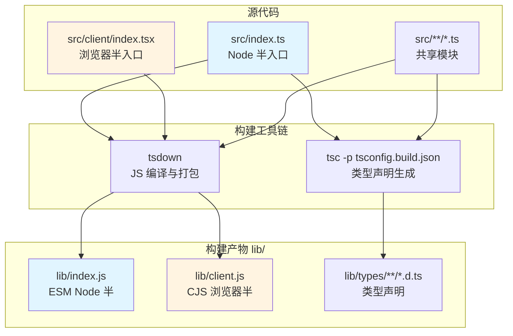

**图表来源**
- [tsdown.config.ts:100-186](file://tsdown.config.ts#L100-L186)
- [package.json:28-31](file://package.json#L28-L31)

**章节来源**
- [package.json:1-107](file://package.json#L1-L107)
- [tsdown.config.ts:1-186](file://tsdown.config.ts#L1-L186)

### 构建命令详解

项目通过 `package.json` 定义了四个核心脚本：

| 命令 | 功能说明 | 使用场景 |
|------|---------|---------|
| `pnpm build` | 两步构建：先 tsdown 生成 JS，后 tsc 生成类型声明 | 发布前、本地调试前 |
| `pnpm typecheck` | 仅类型检查，不生成任何文件 | 日常开发、提交前自检 |
| `pnpm test` | 运行 vitest 测试套件 | 功能验证、回归测试 |
| `pnpm prepack` | 自动触发 build，npm publish 前执行 | 发布流程 |

构建顺序至关重要：`tsdown` 必须先于 `tsc` 执行，因为后者依赖前者清理后的 `lib/` 目录结构。`tsconfig.build.json` 专门用于生成类型声明，配置了 `declaration: true` 与 `emitDeclarationOnly: true`，输出至 `lib/types/`。

### 双半构建配置

**Node 半配置**：
- 目标格式：ESM
- 平台：node
- 依赖策略：`@deepseek-ai/*` 包保持外部引用（由宿主提供），其他 npm 依赖内联
- 不生成 sourcemap（精确清单原则）

**浏览器半配置**：
- 目标格式：CJS 单文件闭包工厂
- 平台：browser
- 特殊处理：注入宿主模块加载器 banner/footer
- 纯度门控：禁止 Node 内建模块与非平台白名单的 `@deepseek-ai/*` 值导入

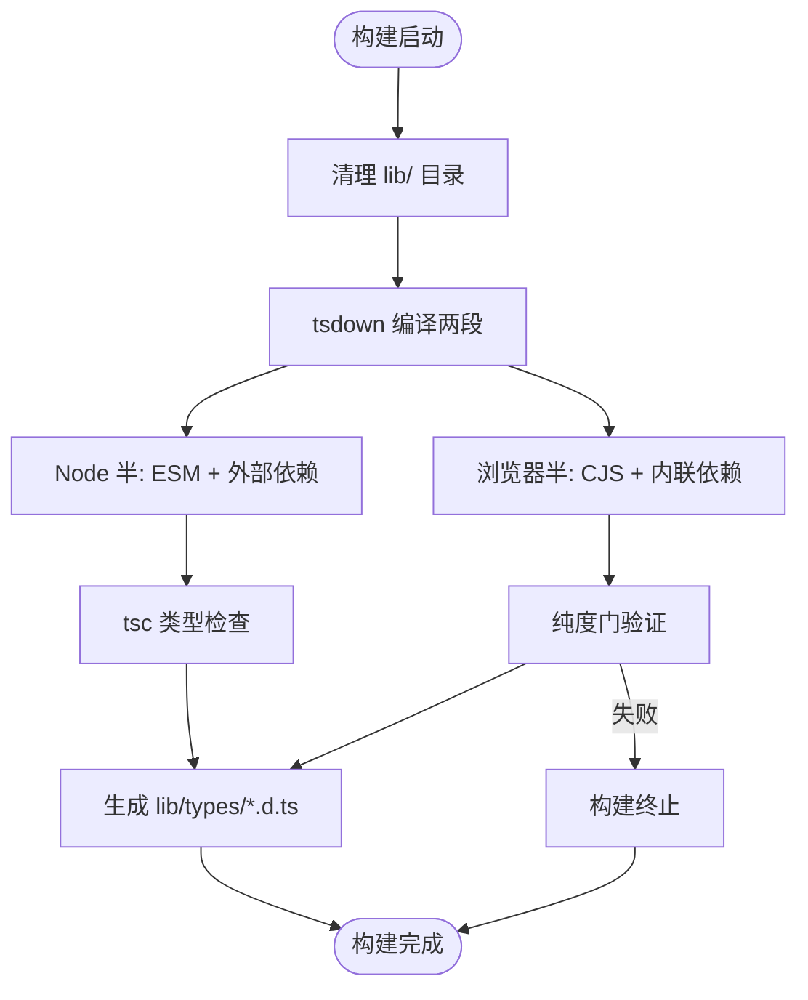

**图表来源**
- [tsdown.config.ts:100-186](file://tsdown.config.ts#L100-L186)
- [tsconfig.build.json:1-11](file://tsconfig.build.json#L1-L11)

**章节来源**
- [tsdown.config.ts:100-186](file://tsdown.config.ts#L100-L186)
- [tsconfig.build.json:1-11](file://tsconfig.build.json#L1-L11)
- [package.json:28-31](file://package.json#L28-L31)

### 浏览器半纯度门

浏览器半构建了严格的导入纯度验证机制，防止运行时错误：

1. **Node 内建拦截**：检测并阻止 `node:*` 模块进入浏览器 bundle
2. **跨插件红线**：除平台白名单外的 `@deepseek-ai/*` 值导入被禁止
3. **vfile 浏览器分支解析**：特殊处理 `unified` 生态的 `#minpath`、`#minproc`、`#minurl` 请求

平台白名单当前仅包含三个 React 相关模块：`react`、`react/jsx-runtime`、`react-dom`。这一收窄决策源于 2026-10-02 的架构调整，将 UI 控件与图标固化为本插件自有实现，不再依赖宿主的 `dsh-client-ui-primitives` 等包。

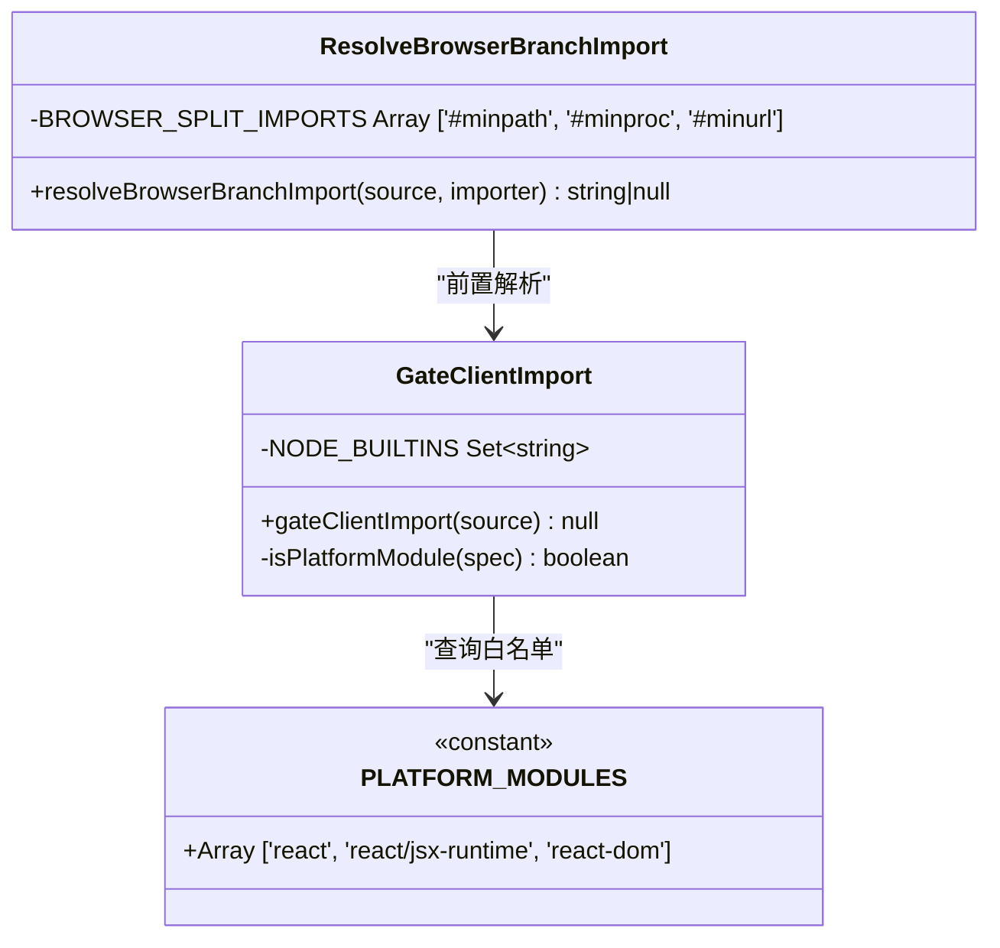

**图表来源**
- [tsdown.config.ts:85-120](file://tsdown.config.ts#L85-L120)
- [tsdown.config.ts:15-25](file://tsdown.config.ts#L15-L25)

**章节来源**
- [tsdown.config.ts:15-120](file://tsdown.config.ts#L15-L120)
- [tests/skeleton.test.ts:45-60](file://tests/skeleton.test.ts#L45-L60)

## 本地开发环境

### 环境准备

```bash
git clone https://github.com/xrn1997/dsh-session-delete.git
cd dsh-session-delete
pnpm install
```

**关键要求**：
- Node.js >= 24（由 `engines.node` 约束）
- pnpm 11.25.0（由 `packageManager` 字段锁定）
- DSH 宿主 >= 0.1.7-rc.2（完整功能最低版本）

### 源码链接调试

本地开发推荐使用 `link:` 方式安装插件：

```bash
pnpm build  # 必须手动执行，link 不会自动构建
dsh plugin --profile <profile> add "link:<仓库绝对路径>"
```

**重要注意事项**：
- `link:` 仅创建目录符号链接，不触发构建
- 修改 `src/client/` 后，宿主 HMR 会自动推送至浏览器，无需重启
- 修改 Node 半代码后，必须重启宿主进程
- 卸载插件仅移除链接，`$DSH_HOME/session-trash/` 下的回收站数据不会被清理

### 离线分发调试

另一种调试方式是使用 `pnpm pack` 生成 tarball：

```bash
pnpm build
pnpm pack  # 生成 xrn1997-dsh-session-delete-<版本>.tgz
dsh plugin --profile <profile> add ./xrn1997-dsh-session-delete-*.tgz
```

此方式的优势在于 `prepack` 脚本会自动执行构建，适合模拟真实安装环境。tarball 中包含预构建产物，无需为目标环境授权构建脚本。

### 样式注入机制

浏览器半的样式通过独特的 `<style>` 注入机制装载：

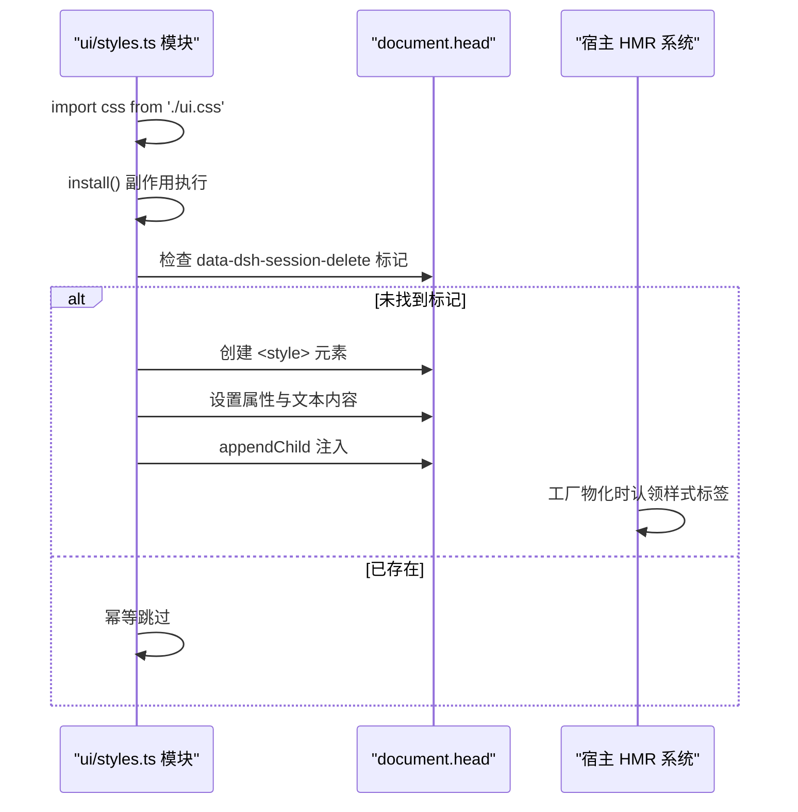

**图表来源**
- [src/client/ui/styles.ts:1-50](file://src/client/ui/styles.ts#L1-L50)

**章节来源**
- [docs/development.md:15-30](file://docs/development.md#L15-L30)
- [src/client/ui/styles.ts:1-50](file://src/client/ui/styles.ts#L1-L50)

## 真机验证门控

真机验证是本项目的硬约束，不可跳过。由于客户端条目激活失败会导致宿主进程崩溃（`web boot: N entry did not activate`），必须在有可见浏览器的隔离环境中先行验证。

### 门控体系总览

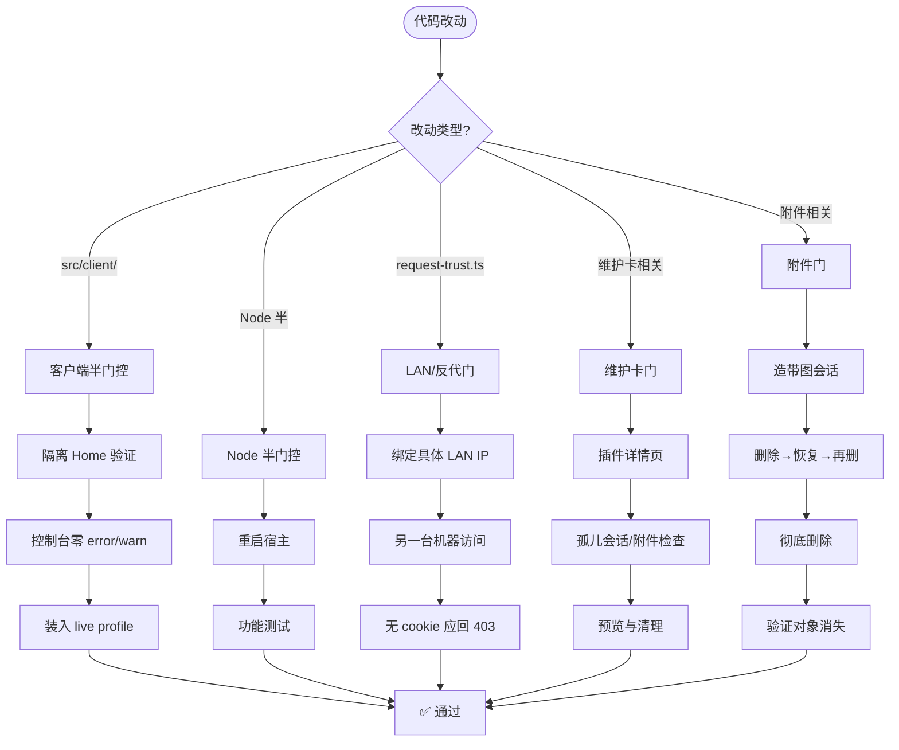

**章节来源**
- [docs/development.md:35-74](file://docs/development.md#L35-L74)

### 客户端半验证流程

**第一步：隔离 Home 搭建**

```bash
DSH_HOME=<临时目录> dsh --profile <名> --from-default-profile web --no-open --port 0
```

此命令创建一个镜像目标 profile 插件组成的临时环境，避免污染生产配置。浏览器访问 localhost 端口，打开开发者工具控制台。

**验证要点**：
1. 页面正常加载，无白屏或崩溃
2. 槽位注册成功（回收站面板、会话菜单项）
3. 控制台零 error/warn
4. 指针驱动交互在有可视视口的环境中测试

**第二步：装入 Live Profile**

隔离环境验证通过后，方可装入实际使用的 profile。此时仍需观察控制台，确保无回归问题。

### 附件门验证

附件门验证图片与普通文件的完整生命周期：

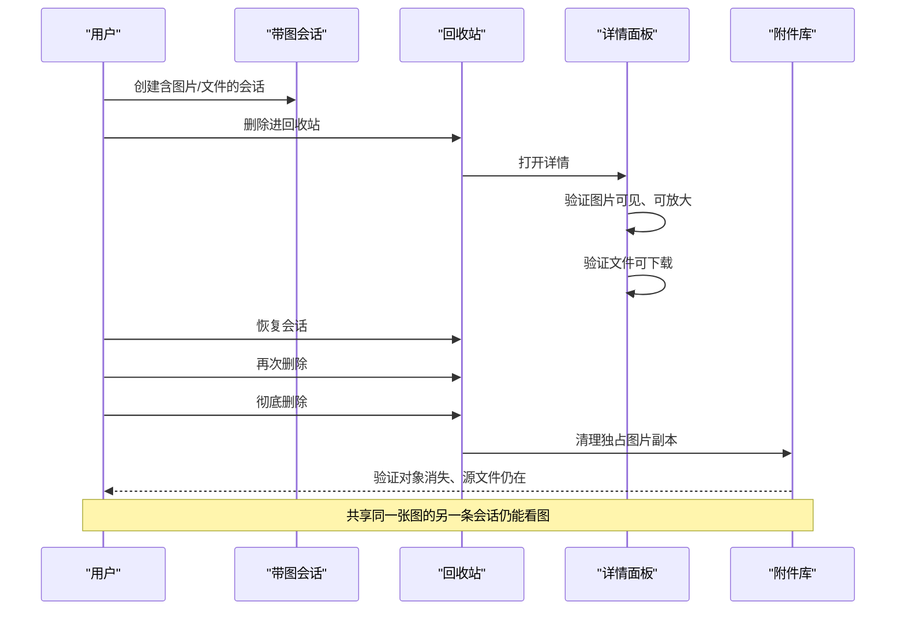

**图表来源**
- [docs/development.md:55-60](file://docs/development.md#L55-L60)

**关键验证点**：
1. 图片在详情中内联显示，点击可放大
2. 普通文件提供下载 chip
3. 图片加载失败显示占位符（名称与体量仍保留）
4. 彻底删除后，`.dsh/attachments/v1/objects` 中独占对象消失
5. 源文件不受影响，共享引用的图片在其他会话中仍可用

### LAN / 反代门验证

此门控针对 `src/api/request-trust.ts` 的改动，验证请求归属与身份判据：

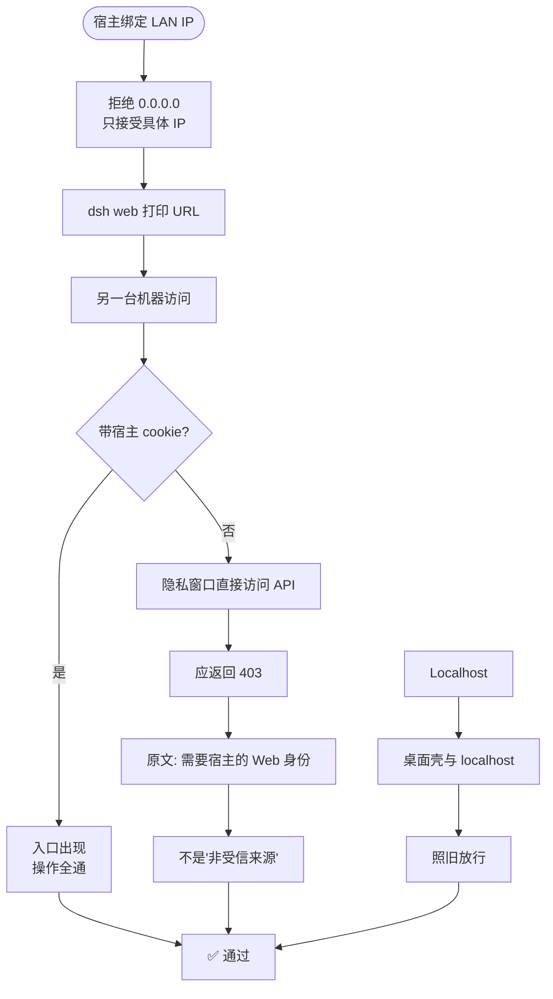

**图表来源**
- [src/api/request-trust.ts:1-128](file://src/api/request-trust.ts#L1-L128)
- [docs/development.md:61-65](file://docs/development.md#L61-L65)

**验证步骤**：
1. 宿主绑定到具体 LAN IP（如 `192.168.50.199`）
2. 用另一台机器打开 `dsh web` 打印的 URL
3. 确认入口出现，删除/恢复/回收站功能全通
4. 在同一地址的隐私窗口（无 cookie）直接访问 API，应返回 403
5. 错误消息应为"需要宿主的 Web 身份"而非"非受信来源"
6. 桌面壳与 localhost 两条路照常放行

**请求栅栏逻辑**：
- **归属判定**：Host/Origin/Referer 是否属于本次部署
- **身份判定**：远程客户端是否携带宿主签发的 Web 身份（cookie）
- **回环豁免**：源地址为回环且 Host 匹配时直接放行
- **DNS 重绑定防护**：归属判定优先于本机/远程分支

**章节来源**
- [src/api/request-trust.ts:1-128](file://src/api/request-trust.ts#L1-L128)
- [docs/development.md:61-65](file://docs/development.md#L61-L65)

### 维护卡门验证

维护卡位于插件设置页（`plugins.bundle.config` 槽位），包含孤儿会话与孤儿附件两段独立功能：

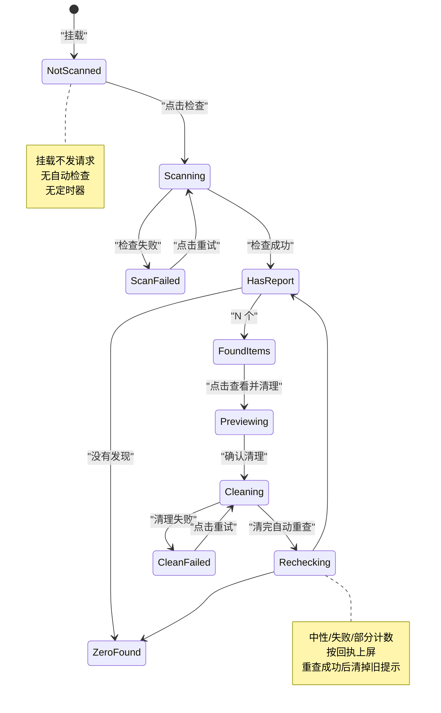

**图表来源**
- [src/client/use-maintenance.ts:1-100](file://src/client/use-maintenance.ts#L1-L100)
- [src/client/maintenance-settings.tsx:1-100](file://src/client/maintenance-settings.tsx#L1-L100)

**验证步骤**：
1. 重启宿主，打开插件详情页
2. 确认"维护"卡出现，两段均显示"尚未检查"（挂载不发请求）
3. 点击孤儿附件"检查"：报告应显示当前无引用对象数与体积
4. 点击"查看并清理"：先列图片缩略图（最多 200 个），可点开放大
5. 确认正文说明：只清 `.dsh` 内无引用图片副本，源文件不受影响
6. 清理后重查应为 0，`.dsh/attachments/v1/objects` 中对象消失
7. 查看回收站面板：无孤儿横幅或提示，挂载与写后重读都不发 `GET /orphans`

**状态行优先级**：
清理中… → 检查中… → 检查失败 → 尚未检查 → 没有发现 → N 个

**章节来源**
- [src/client/maintenance-settings.tsx:1-100](file://src/client/maintenance-settings.tsx#L1-L100)
- [src/client/use-maintenance.ts:1-100](file://src/client/use-maintenance.ts#L1-L100)
- [docs/development.md:50-54](file://docs/development.md#L50-L54)

### 删除→恢复对话门

此门控源于 2026-10-21 的真机事故，验证删除已打开会话后的恢复行为：

1. 删除一个**打开过**的会话
2. 从回收站恢复
3. 直接发送一条消息

**已触发的信号**：消息出现在对话中、会话日志增长并得到回复。若恢复后仍停在"会话不可用"，表明宿主常驻 `Session` 的 `removed` 粘性状态未被清除。当前实现在删除当前视图时会关闭它，撤销后重新打开。

**章节来源**
- [docs/development.md:45-49](file://docs/development.md#L45-L49)

## CI/CD自动化

### GitHub Actions 工作流

CI 工作流定义在 `.github/workflows/ci.yml`，在以下时机触发：
- push 到 `main` 分支
- 每个 PR 创建或更新
- 手动触发（workflow_dispatch）

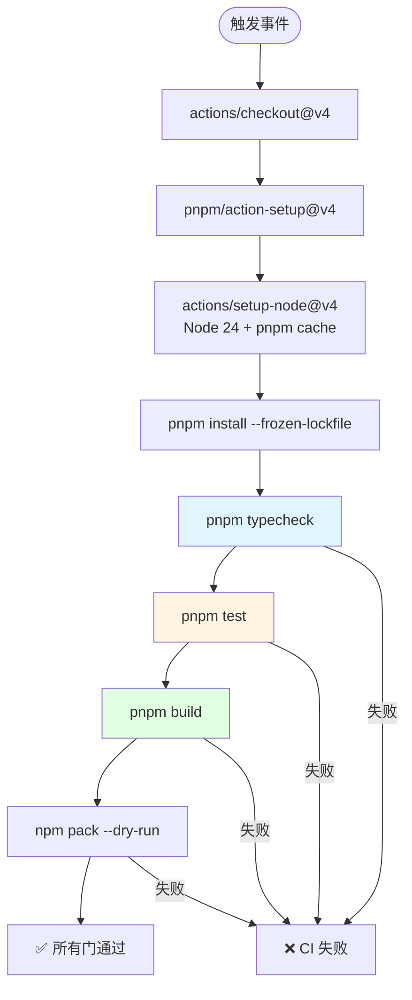

**图表来源**
- [.github/workflows/ci.yml:1-35](file://.github/workflows/ci.yml#L1-L35)

**三道门**：
1. **类型检查**：`pnpm typecheck`，验证 TypeScript 类型正确性
2. **测试套件**：`pnpm test`，运行 vitest 全部测试
3. **构建验证**：`pnpm build` + `npm pack --dry-run`，验证产物完整性与发布清单

**并发控制**：同一分支的多个 CI 运行会取消进行中的任务，避免资源浪费。超时限制为 15 分钟。

**章节来源**
- [.github/workflows/ci.yml:1-35](file://.github/workflows/ci.yml#L1-L35)

### 文档门

`tests/docs.test.ts` 实现了严格的文档一致性验证：

**扫描范围**：
- 根文档：`AGENTS.md`、`CONTEXT.md`、`README.md`、`CONTRIBUTING.md`、`CHANGELOG.md`
- 文档目录：`docs/**`
- 源代码与测试：`src/**`、`tests/**`

**验证规则**：
1. **路径真实性**：文档中点名的 `src/`、`tests/`、`docs/`、`locale/` 路径必须真实存在
2. **废弃称呼清理**：已废的文档称呼（如"现状稿"、"设计稿 §N"）不再出现
3. **小节引用有效性**：`§N` 指路必须点名还活着的家
4. **相对链接与锚点**：必须指向有效内容
5. **ADR 完整性**：标题、Status、锚点齐全，索引双向完整且无重复行
6. **README 截图一致性**：截图清单与本地文件双向一致
7. **兼容性投影**：README 的窗口/真机名单/徽章从 `package.json` 投影
8. **唯一主人原则**：主人清单、界面规格、文档标准各只有一份
9. **根 AGENTS.md 预算**：≤ 8,000 字符

**白名单机制**：允许特定历史路径存在，但必须写明理由。例如 `src/verbs/apply.ts` 因 ADR-0001 的"当时"表而保留。

**自排除规则**：`tests/docs.test.ts` 自身从语料中排除，因为其正文必须引用被禁称呼与历史设计稿目录名，扫自己必然自红。

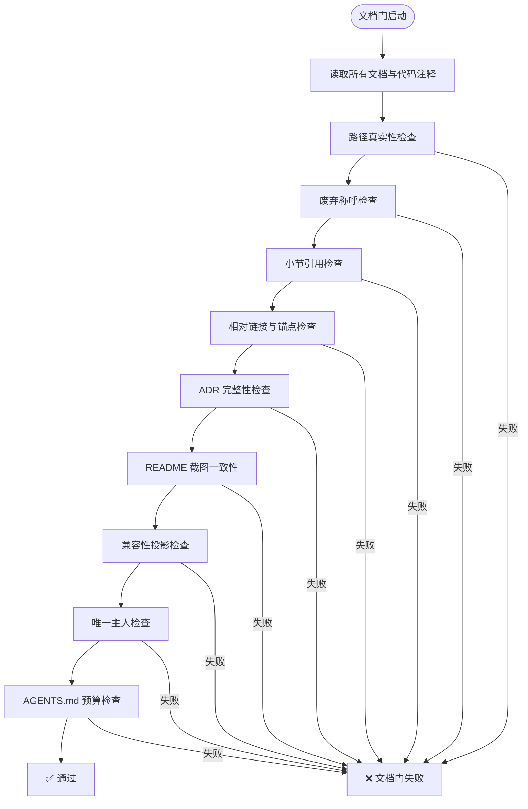

**章节来源**
- [tests/docs.test.ts:1-100](file://tests/docs.test.ts#L1-L100)
- [docs/development.md:20-35](file://docs/development.md#L20-L35)

### 骨架测试

`tests/skeleton.test.ts` 验证插件的基本形状与契约：

**验证内容**：
1. 导出 `name` 与 `apply`，且 `name` 等于包名
2. Node 半的 `inject` 包含 `webServer`（前缀路由承载者）
3. `engines.dsh` 是唯一的宿主要求声明处
4. 窗口覆盖全部真机代次，地板对上台架下界
5. 没有任何 `@deepseek-ai/dsh-*` peer 依赖
6. `dshReleases` 与实测代次双向钉住
7. 冻结平台模块表与 `PLATFORM_MODULES` 一致性

**真机代次账本**：
- 当前实测：`0.2.0-rc.2`、`0.2.1-rc.1`、`0.2.1-rc.2`、`0.2.1-rc.3`
- CLI 台架验过的完整功能最低版本：`0.1.7-rc.2`
- 窗口上限：`<0.3.0-0`（阻挡 0.3.0 预发布）

**章节来源**
- [tests/skeleton.test.ts:1-100](file://tests/skeleton.test.ts#L1-L100)

## 发版流程

### 发版前三道门

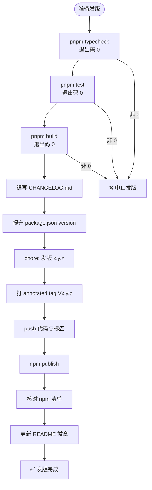

**图表来源**
- [docs/development.md:60-74](file://docs/development.md#L60-L74)
- [CONTRIBUTING.md:20-25](file://CONTRIBUTING.md#L20-L25)

**关键步骤**：

1. **三道门验证**：依次执行 `typecheck`、`test`、`build`，逐个确认退出码为 0
   - **重要**：跑门取退出码，别看管道说了什么。`pnpm test | tail` 之后退出码是管道工具的，红色输出会被吃掉。应先把输出灌进文件，再单独打印退出码

2. **编写发布记录**：在 `CHANGELOG.md` 追加这一版的改动（新增/变更/修复/升级注意）
   - 未发布改动不预写，逐提交明细留 git

3. **版本前移**：提升 `package.json` 的 `version`，提交信息格式为 `chore: 发版 x.y.z`

4. **打标签与推送**：创建 annotated tag `Vx.y.z`，push 代码与标签

5. **发布到 npm**：执行 `npm publish`
   - `prepack` 脚本会自动执行 `build`
   - `files` 是精确清单，构建每新多出一个要发布的产物，就要同时加进 `files`
   - 两半都不产 sourcemap，产物里不会留指向不进包文件的 `//# sourceMappingURL`

6. **发布后核对**：
   - 检查 npm 清单上的 `engines.dsh` 与 `dshReleases` 是否已落到产物上
   - 清单里的 `locale/` 是插件自己的展示元信息，与界面文案字典是两样东西
   - 根目录 `screenshots.json` 列的是 README 真机图清单，文档门会钉住三方一致

7. **更新 README 徽章**：根据当次实测代次更新徽章与"真跑过"名单
   - 商店牌子读 npm `latest` 清单（`engines.dsh`）
   - `dsh.compatibility.dshReleases` 只是真机账本，宿主与市场都不读它

**章节来源**
- [docs/development.md:60-74](file://docs/development.md#L60-L74)
- [CONTRIBUTING.md:20-30](file://CONTRIBUTING.md#L20-L30)
- [package.json:20-25](file://package.json#L20-L25)

### 兼容性声明

兼容性分两层，不可混淆：

| 层级 | 决定因素 | 作用 | 当前值 |
|------|---------|------|--------|
| 装得上 | `package.json` 的 `engines.dsh` | 宿主拿运行版本比区间，不满足即拒绝并回滚 | `>=0.1.7-rc.2 <0.3.0-0` |
| 真跑过 | `dsh.compatibility.dshReleases` | 记录桌面真机实测过的宿主 | `0.2.0-rc.2`、`0.2.1-rc.1`、`0.2.1-rc.2`、`0.2.1-rc.3` |

**地板确定依据**：
- `0.1.7-rc.2`：CLI 台架验过四个槽位齐全、激活零错误
- `0.1.7-rc.1`：缺 `sidebar.session.row.leading`（行首勾选静默缺席）
- `0.1.5` 及以前：连会话行入口都没有

**天花板选择**：`<0.3.0-0` 才能连 0.3.0 的预发布一起挡在外面（`<0.3.0` 挡不住）。

**章节来源**
- [README.md:35-50](file://README.md#L35-L50)
- [tests/skeleton.test.ts:25-45](file://tests/skeleton.test.ts#L25-L45)

## 已知环境坑

### Windows 沙箱问题

**现象**：vitest 起 esbuild 服务时撞上 `EPERM` 错误

**原因**：Windows 沙箱环境下 node 的子进程 `spawn` 一律被拒绝

**解决方案**：换个不受限的执行环境即可，这不是本仓代码的问题

### npm cache EPERM

**现象**：`npm view` 偶尔撞 `AppData\Local\npm-cache` 临时文件锁

**解决方案**：重试或换查询方式

### 回收站运行时数据位置

**本体**：`$DSH_HOME/session-trash/`（默认 `~/.dsh/session-trash/`）

**内部索引**：`$DSH_HOME/storages/`（别手碰）

**DSH_HOME 缺省值**：`~/.dsh`

### 会话文件格式

**格式**：多帧 zstd

**陷阱**：Node 自带 API 只给第一帧

**正确读法**：见 `src/log/zstd-frames.ts` 与 `tests/zstd-frames.test.ts`

### 冒烟启动凭据泄露风险

**现象**：日志里那行带 token 的 URL 是活的凭据

**风险**：留在日志或会话输出中可能导致凭据泄露

**解决方案**：测完删文件

### .qoder/repowiki 知识库快照

**性质**：生成的知识库快照，不是事实源

**基线 commit**：只记在 `.qoder/repowiki/knowledge/zh/_index.yaml` 里

**局限性**：
- 仓内没有再生成它的路径（只能在 Qoder 里重跑）
- 永远可能落后于代码
- 篇数与 hash 都不在这里抄——抄一次就多一个会腐烂的镜像

**判断口径**：见 `docs/AGENTS.md`

### 退出码陷阱

**现象**：`pnpm test | tail` 之后退出码是管道工具的，红色输出会被吃掉

**正确做法**：先把输出灌进文件，再单独打印退出码；跑门与提交必须是两条命令

**章节来源**
- [docs/development.md:70-74](file://docs/development.md#L70-L74)

## 结论

本指南系统性地梳理了 `@xrn1997/dsh-session-delete` 插件从开发到发布的完整工作流。核心要点总结如下：

**构建与开发**：
- 双半构建策略（Node ESM + 浏览器 CJS）要求严格遵循构建顺序
- 浏览器半纯度门防止运行时错误，平台白名单仅含三个 React 模块
- 样式通过 `<style>` 注入机制装载，由宿主 HMR 系统认领

**真机验证**：
- 客户端半改动必须先在隔离 Home 验证，激活失败会导致宿主进程崩溃
- 五大门控（客户端半、附件、LAN/反代、维护卡、删除→恢复对话）缺一不可
- Node 半改动后必须重启宿主

**CI/CD 自动化**：
- GitHub Actions 运行三道门（typecheck、test、build）+ 发布清单验证
- 文档门确保文档与代码的一致性，扫描范围涵盖根文档、docs、src、tests
- 骨架测试验证插件基本形状与兼容性声明

**发版流程**：
- 三道门验证通过后，编写 CHANGELOG、提升版本号、打标签、发布
- 兼容性分两层：`engines.dsh` 决定装得上，`dshReleases` 记录真跑过
- README 徽章从 npm `latest` 清单投影，需发版后现查

**已知环境坑**：
- Windows 沙箱下 spawn EPERM、npm cache EPERM、多帧 zstd 读取、退出码陷阱等

遵循本指南可确保贡献的高效性与发布的质量，避免因跳过验证环节导致的线上问题。