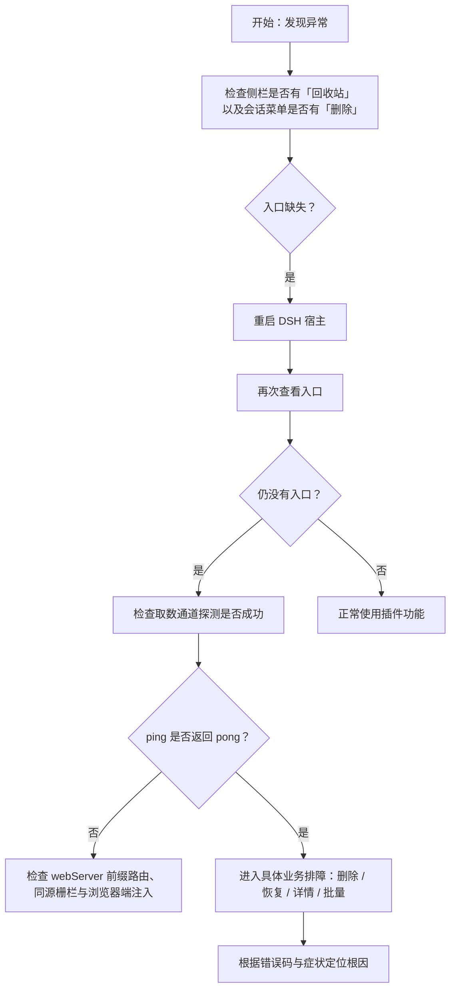
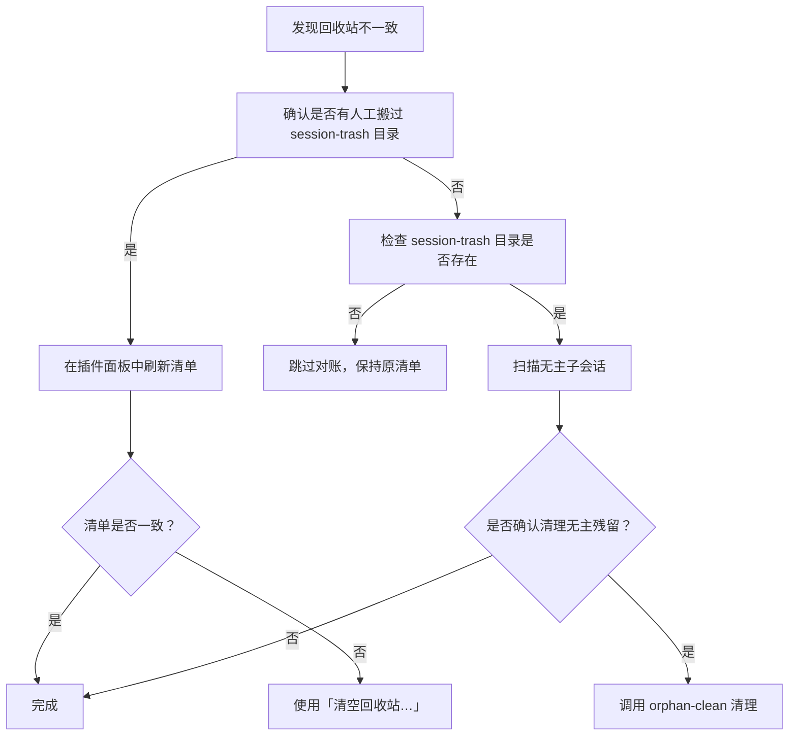
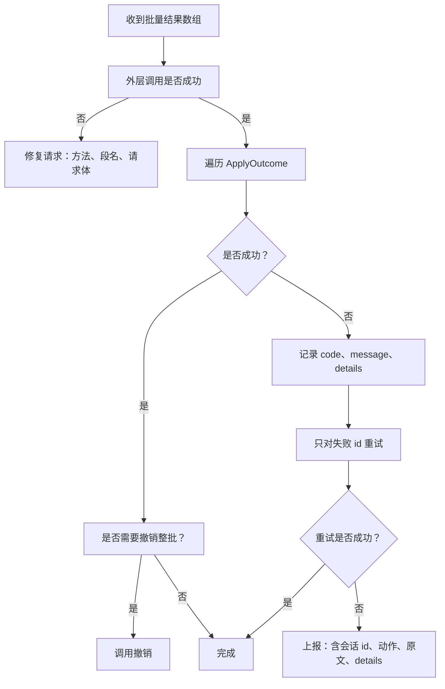

# 故障排查

<cite>
**本文引用的文件**   
- [README.md](file://README.md)
- [package.json](file://package.json)
- [src/index.ts](file://src/index.ts)
- [src/client/index.tsx](file://src/client/index.tsx)
- [src/client/remote.ts](file://src/client/remote.ts)
- [src/api/dispatch.ts](file://src/api/dispatch.ts)
- [src/api/route-table.ts](file://src/api/route-table.ts)
- [src/verbs/batch.ts](file://src/verbs/batch.ts)
- [src/verbs/delete-session.ts](file://src/verbs/delete-session.ts)
- [src/verbs/errors.ts](file://src/verbs/errors.ts)
- [src/verbs/purge-trash.ts](file://src/verbs/purge-trash.ts)
- [src/verbs/restore-session.ts](file://src/verbs/restore-session.ts)
- [src/trash/reconcile.ts](file://src/trash/reconcile.ts)
- [src/trash/detail.ts](file://src/trash/detail.ts)
- [src/verbs/orphan-subagents.ts](file://src/verbs/orphan-subagents.ts)
</cite>

## 目录

1. [引言](#引言)
2. [快速定位流程](#快速定位流程)
3. [常见问题与解决方案](#常见问题与解决方案)
4. [错误码与诊断信息对照](#错误码与诊断信息对照)
5. [日志、HTTP 响应与 onclose 事件使用指南](#日志http-响应与-onclose-事件使用指南)
6. [回收站不一致的修复原则](#回收站不一致的修复原则)
7. [批量操作失败的处理顺序](#批量操作失败的处理顺序)
8. [预防建议](#预防建议)
9. [结论](#结论)

## 引言

本插件把 DeepSeek Harness 的会话删除实现为“移入回收站”，并提供恢复、彻底删除、清空回收站、无主子会话扫描等能力。它的数据本体留在本机 `~/.dsh/session-trash/`，不联网、不上传；清单则存在宿主 storage domain（介质在 `~/.dsh/storages/`）。

排障的核心思路是：**先确认入口是否存在，再确认取数通道是否可用，再按 HTTP 信封与动词错误码缩小范围，最后只通过插件提供的恢复、对账和清空能力处理回收站。** 不要直接修改 `~/.dsh/session-trash/` 下的文件；如果确实需要手工干预，也应以对账结果为准，而不是直接编辑清单或目录名。

**章节来源**
- [README.md:1-147](file://README.md#L1-L147)

## 快速定位流程



**图示来源**
- [src/client/index.tsx:1-200](file://src/client/index.tsx#L1-L200)
- [src/client/remote.ts:1-200](file://src/client/remote.ts#L1-L200)
- [src/api/dispatch.ts:1-200](file://src/api/dispatch.ts#L1-L200)

**章节来源**
- [src/client/index.tsx:1-200](file://src/client/index.tsx#L1-L200)
- [src/client/remote.ts:1-200](file://src/client/remote.ts#L1-L200)

## 常见问题与解决方案

### 问题一：插件入口不出现

#### 症状

- 侧栏没有「回收站」行。
- 会话行的「⋯」菜单没有「多选」和「删除」。
- 页面看起来像插件完全没有安装，但也不会让宿主崩溃。

#### 可能原因

1. 刚安装完，尚未重启宿主。
2. 宿主版本不在引擎窗口内。
3. 浏览器端的取数通道探测失败，插件选择“一个入口都不注册”。
4. Node 半依赖注入失败，导致整个插件挂起。
5. 浏览器端槽位注册不完整，例如面板列表行与中央面板未同时注册。

#### 定位步骤

1. 先重启宿主。
2. 打开浏览器开发者工具的网络面板，查看是否能访问 `/dsh-session-delete-api/ping`。
3. 若 `ping` 不可用，检查 Node 半是否把前缀路由注册到宿主的 `webServer`。
4. 若 `ping` 可通但界面仍没有入口，检查浏览器端是否只注入了部分槽位。
5. 检查 `package.json` 中 `engines.dsh` 是否与运行中的宿主兼容。

#### 修复命令

```bash
dsh plugin --profile <profile> add @xrn1997/dsh-session-delete
dsh plugin --profile <profile> remove @xrn1997/dsh-session-delete
```

安装后必须重启宿主。卸载不会自动清理 `~/.dsh/session-trash/`。

#### 预防建议

- 每次安装、升级、卸载插件后重启宿主。
- 不要手动修改 `~/.dsh/storages/` 下由本插件管理的 storage domain；同名域已经打开会导致下一个实例报冲突。
- 浏览器端只声明一定存在的槽位（`slots`），不要把取数通道写进 `inject`，否则探测失败会走致命路径。

**章节来源**
- [README.md:1-147](file://README.md#L1-L147)
- [package.json:1-105](file://package.json#L1-L105)
- [src/index.ts:1-200](file://src/index.ts#L1-L200)
- [src/client/index.tsx:1-200](file://src/client/index.tsx#L1-L200)
- [src/client/remote.ts:1-200](file://src/client/remote.ts#L1-L200)

### 问题二：会话处于运行中被拒绝

#### 症状

- 点击删除时提示会话正在运行。
- 被拒绝的会话可能在会话列表中看不到，因为它是子会话。
- 批量删除时只有部分条目失败，其余成功。

#### 可能原因

1. 目标会话本身仍在运行。
2. 父会话的子会话仍在运行。
3. 用户想删的是整组，但组内任一成员活跃就会整组拒绝。
4. 批量操作中某一条失败，但其他条继续执行。

#### 定位步骤

1. 先在宿主会话列表中确认目标会话是否显示为运行中。
2. 如果该会话是子会话且列表中没有，注意错误消息中的会话 id。
3. 查看批量操作的逐条结果：失败的条目保留原文，成功的条目可撤销。
4. 不要替用户终止正在运行的会话；应先停止会话后再删。

#### 修复命令

```bash
# 先停止会话，再尝试删除
# 停止方式取决于宿主当前可用的会话控制接口
```

#### 预防建议

- 删除前确认整组都没有运行态。
- 批量删除失败时不要忽略失败项，应重试失败名单。
- 对子会话要特别留意：宿主列表不显示不代表它不存在。

**章节来源**
- [src/verbs/delete-session.ts:1-200](file://src/verbs/delete-session.ts#L1-L200)
- [src/verbs/batch.ts:1-197](file://src/verbs/batch.ts#L1-L197)
- [src/verbs/purge-trash.ts:1-121](file://src/verbs/purge-trash.ts#L1-L121)

### 问题三：批量操作部分失败

#### 症状

- 批量删除确认框没有关闭。
- 失败的那一行显示服务端返回的原文。
- 按钮变为“重试这 N 条”之类文案。
- 已成功的条目可以整批撤销。

#### 可能原因

1. 某个会话仍在运行。
2. 某个会话的工作区目录不存在。
3. 某个会话的回收站目录缺失。
4. 宿主服务暂不可用。
5. 请求体字段不符合约定（例如 id 为空、动作不认识）。

#### 定位步骤

1. 查看批量操作的返回结果数组，而不是只看外层信封。
2. 对每个 `ApplyOutcome` 判断 `ok`。
3. 失败条目携带 `{ code, message, details? }`。
4. 只重试失败列表，不要重复提交已成功条目。
5. 如果失败来自路由自检，检查请求方法、请求体和段名。

#### 修复命令

```bash
# 仅重试失败的会话 id
curl -X POST http://localhost:<port>/dsh-session-delete-api/apply \
  -H "content-type: application/json" \
  -d '{"action":"delete","ids":["session-xxx"]}'
```

#### 预防建议

- 批量操作前先做预检（例如子会话数量、是否运行）。
- 对 `not-found`、`live`、`trash-empty`、`project-missing` 等语义化错误分别给出明确提示。
- 不要把外层 `ok:false` 和单条 `ApplyOutcome.ok` 混为一谈。

**章节来源**
- [src/verbs/batch.ts:1-197](file://src/verbs/batch.ts#L1-L197)
- [src/api/route-table.ts:1-143](file://src/api/route-table.ts#L1-L143)
- [src/api/dispatch.ts:1-200](file://src/api/dispatch.ts#L1-L200)

### 问题四：工作区目录被删除

#### 症状

- 恢复时提示原项目目录不存在。
- 恢复后会话归入“未分组”。
- 回收站里的会话仍然能恢复，只是不再挂在原工作区。

#### 可能原因

1. 宿主执行了“删除工作区”，只删注册、保留日志与会话目录。
2. 会话删除时记录的工作区 id 在当前宿主里不存在。
3. 手工移动或清理过 `sessions/` 目录。

#### 定位步骤

1. 查看恢复错误码是否为 `project-missing`。
2. 确认 `~/.dsh/sessions/` 下对应项目目录是否还在。
3. 确认回收站条目仍存在于 `~/.dsh/session-trash/`。
4. 在回收站面板中点击恢复；即使工作区缺失也应允许恢复到“未分组”。

#### 修复命令

```bash
# 在插件面板中点击「恢复」
# 不要直接把目录从 session-trash 搬到 sessions
```

#### 预防建议

- 优先使用插件的恢复能力。
- 不要认为“目录没了就恢复不了”——恢复目标是把目录放回磁盘，工作区归属只是可选步骤。
- 如果工作区已丢失，接受会话回到“未分组”是正常行为。

**章节来源**
- [src/verbs/restore-session.ts:1-173](file://src/verbs/restore-session.ts#L1-L173)
- [README.md:1-147](file://README.md#L1-L147)

### 问题五：回收站清单与目录不一致

#### 症状

- 回收站目录比清册多。
- 清册里有目录已经不存在的行。
- 手工搬过回收站目录后，列表状态异常。
- “清空回收站”没有清理掉手工放进来的目录。

#### 可能原因

1. 手工复制或删除了 `~/.dsh/session-trash/` 下的目录。
2. 清单存储在宿主 storage domain，不是 `session-trash/` 目录。
3. 进程中途退出，目录已搬但清册行未写入。
4. 手工把目录搬回 `sessions/`，但没有走恢复逻辑。

#### 定位步骤

1. 不要在 `~/.dsh/session-trash/` 下直接改文件。
2. 在回收站面板中刷新清单。
3. 调用 `GET /list`，它会先对账再读清单。
4. 若仍有残留，使用“清空回收站…”；该动作会先对账再清。
5. 对账只重建“认得出”的目录；名字不像条目或日志读不出时会被跳过。

#### 修复命令

```bash
# 触发一次对账 + 读取
curl http://localhost:<port>/dsh-session-delete-api/list

# 清空回收站（先对账，再清）
curl -X POST http://localhost:<port>/dsh-session-delete-api/empty
```

#### 预防建议

- 清单是内部索引，真实事实以 `session-trash/` 目录为准。
- 任何手工搬动都应视为破坏一致性，之后必须刷新或清空。
- 对账是幂等的，反复运行不会产生新数据漂移。

**章节来源**
- [src/trash/reconcile.ts:1-127](file://src/trash/reconcile.ts#L1-L127)
- [src/api/route-table.ts:1-143](file://src/api/route-table.ts#L1-L143)
- [README.md:1-147](file://README.md#L1-L147)

### 问题六：Markdown 详情为空

#### 症状

- 选中回收站条目后右侧详情空白。
- 元信息可能显示，但正文区域没有内容。
- 有时能看到标题、大小、轮数，却看不到提问或助手回复。

#### 可能原因

1. 回收站目录不存在。
2. 目录里没有会话日志。
3. 会话日志损坏或无法解压。
4. 日志里没有任何 `user/message` 或 `assistant/message` 文字。
5. 正文超过单次载荷上限被截断。
6. 宿主 Markdown 渲染组件加载失败。

#### 定位步骤

1. 检查 `POST /detail` 的错误码。
2. 若返回 `io`，检查回收站目录与会话日志是否存在。
3. 若返回 `trash-empty`，检查清册是否包含该 `entryId`。
4. 若详情成功但正文为空，确认日志中是否真的有人类提问与助手回复。
5. 检查浏览器控制台是否出现 Markdown 渲染相关异常。
6. 查看详情返回结构中的 `omittedByPayloadCap`，确认是否被载荷闸截断。

#### 修复命令

```bash
# 单独读取详情
curl -X POST http://localhost:<port>/dsh-session-delete-api/detail \
  -H "content-type: application/json" \
  -d '{"entryId":"<回收站条目id>"}'
```

#### 预防建议

- 详情是选中后才读取的，不应预读全部详情。
- 正文有每条 3000 字符、累计 50 万字符的载荷闸，这是防异常膨胀的保护，不是“文件太大就拒绝”。
- 如果日志损坏，优先走恢复或重新生成日志；不要手工拼接帧。

**章节来源**
- [src/trash/detail.ts:1-172](file://src/trash/detail.ts#L1-L172)
- [src/client/markdown.tsx:1-57](file://src/client/markdown.tsx#L1-L57)
- [docs/design/2026-10-15-trash-detail-design.md:1-113](file://docs/design/2026-10-15-trash-detail-design.md#L1-L113)

### 问题七：远程通道不可用

#### 症状

- 网络面板中出现非信封响应，例如 HTML 页面。
- 浏览器端报错类似“取数通道打不通”或“取数通道回的不是信封”。
- 插件侧栏没有入口，或者所有回收站操作都失败。
- `ping` 返回失败，或请求被同源栅栏拒绝。

#### 可能原因

1. Node 半没有把 `/dsh-session-delete-api` 注册到宿主 `webServer`。
2. 桌面壳的同源栅栏拒绝请求。
3. 前端 fetch 打到 SPA 兜底处理器，收到 `index.html`。
4. 后端返回的不是 `{ ok, value | error }` 形状。
5. 插件启动探测失败，因此不注册任何入口。

#### 定位步骤

1. 直接访问 `/dsh-session-delete-api/ping`，期望得到字符串探针值。
2. 检查请求来源是否为回环地址。
3. 检查 `Origin`、`Referer` 是否符合信任规则。
4. 检查返回响应的 `Content-Type` 是否为 JSON。
5. 检查浏览器端 `callRemote` 抛出的失败对象。

#### 修复命令

```bash
# 健康检查
curl http://localhost:<port>/dsh-session-delete-api/ping

# 检查 list 是否返回信封
curl http://localhost:<port>/dsh-session-delete-api/list
```

#### 预防建议

- 插件的 Node 半只负责传输：栅栏、路由分发、信封映射。
- 浏览器端探测失败时，插件应安静地不注册入口，而不是让整个客户端启动失败。
- 不要用 `ping` 当健康检查来频繁拉取清单；`ping` 设计为最便宜的连通性测试。

**章节来源**
- [src/client/remote.ts:1-200](file://src/client/remote.ts#L1-L200)
- [src/api/dispatch.ts:1-200](file://src/api/dispatch.ts#L1-L200)
- [src/client/index.tsx:1-200](file://src/client/index.tsx#L1-L200)

## 错误码与诊断信息对照

| 类别 | 错误码 | 含义 | 典型症状 | 建议动作 |
|---|---|---|---|---|
| 会话状态 | `sessiondelete/live` | 会话正在运行 | 删除或彻底删除被拒绝 | 停止会话后再操作 |
| 会话状态 | `sessiondelete/not-found` | 会话不在宿主持久化中 | 删除时报找不到会话 | 确认会话 id 正确 |
| 回收站 | `sessiondelete/trash-empty` | 回收站里没有这一条 | 恢复、详情、彻底删除报空 | 刷新清单，确认条目存在 |
| 工作区 | `sessiondelete/project-missing` | 原项目目录不存在 | 恢复失败 | 在面板中恢复，接受“未分组” |
| I/O | `sessiondelete/io` | 文件、日志或服务不可用 | 详情为空、通道异常、未知失败 | 检查目录、日志、HTTP 响应 |
| 路由 | `sessiondelete/bad-request` | 请求体非法 | 400 错误 | 检查 action、ids、entryId |
| 路由 | `sessiondelete/bad-method` | HTTP 方法不对 | 405 错误 | GET 用 GET，POST 用 POST |
| 路由 | `sessiondelete/not-found-route` | 未知路由 | 404 错误 | 检查 `/dsh-session-delete-api/...` 路径 |
| 浏览器端 | `client/unknown` | 非远程失败形状的异常 | 网络层或解析异常 | 查看原始错误消息 |

这些码定义在两半共享契约中，Node 半与浏览器端共同消费。浏览器端会把带标记的远程失败还原成带 `code`、`message`、`details` 的对象，便于上屏与调试。

**章节来源**
- [src/verbs/errors.ts:1-82](file://src/verbs/errors.ts#L1-L82)
- [src/remote/map-error.ts:1-134](file://src/remote/map-error.ts#L1-L134)
- [src/api/dispatch.ts:1-200](file://src/api/dispatch.ts#L1-L200)

## 日志、HTTP 响应与 onclose 事件使用指南

### 第一步：看 HTTP 状态与信封

插件的前缀路由采用统一信封：

- 成功：`{ ok: true, value }`
- 操作失败：`{ ok: false, error: { code, message, details? } }`
- 请求本身错误：HTTP 4xx + 失败信封
- 同源栅栏拒绝：403 + 失败信封

浏览器端只解信封，不把 200 当作“操作成功”的唯一依据。真正成败要看 `ok` 和 `error.code`。

### 第二步：区分外层失败与单条失败

`POST /apply` 返回一组 `ApplyOutcome`。外层 `ok:false` 表示整次调用失败；单条失败要看数组里每一项的 `ok`。批量操作的成功与失败是逐条记录的，不是整批一起成功或失败。

### 第三步：看 onclose 事件

onclose 通常用于 WebSocket 或长连接断开。本插件的 REST 通道没有 long-poll 语义，因此 onclose 更可能是底层连接中断，而不是“会话被删除”的业务通知。排查时应优先看：

1. 最近一次请求的 URL 与方法。
2. 请求体。
3. 响应状态码。
4. 响应体是否可解析为信封。
5. 浏览器端 `failureOf` 产出的 `client/unknown` 原始消息。

### 第四步：缩小范围

| 现象 | 优先查 | 下一步 |
|---|---|---|
| 没有入口 | 槽位注册、`inject`、探测 | 检查 `ping` |
| `ping` 失败 | webServer、栅栏、fetch | 检查同源请求 |
| `ping` 成功但操作失败 | 路由表、请求体 | 检查 `bad-request` |
| 删除失败 | `live`、`not-found` | 停止会话或修正 id |
| 恢复失败 | `trash-empty`、`project-missing` | 刷新清单或接受未分组 |
| 详情为空 | `io`、日志文件 | 检查回收站目录与会话日志 |
| 批量部分失败 | 逐条 `ApplyOutcome` | 重试失败列表 |

**章节来源**
- [src/client/remote.ts:1-200](file://src/client/remote.ts#L1-L200)
- [src/api/dispatch.ts:1-200](file://src/api/dispatch.ts#L1-L200)
- [src/verbs/batch.ts:1-197](file://src/verbs/batch.ts#L1-L197)

## 回收站不一致的修复原则

### 核心原则

1. **不要直接修改 `~/.dsh/session-trash/` 下文件。**
2. **清单是内部索引，目录才是真实数据。**
3. 每次读清单都会对账，因此手工改动后刷新即可恢复一致。
4. 对账不会删除“外人目录”，也不会为坏目录编造行。
5. 如果手工搬入了回收站目录，应该用“清空回收站…”让它参与清理，而不是直接删盘。
6. 如果手工把目录搬回 `sessions/`，这不是恢复；应回到面板点“恢复”。

### 推荐修复流程



**图示来源**
- [src/trash/reconcile.ts:1-127](file://src/trash/reconcile.ts#L1-L127)
- [src/api/route-table.ts:1-143](file://src/api/route-table.ts#L1-L143)
- [src/verbs/orphan-subagents.ts:1-200](file://src/verbs/orphan-subagents.ts#L1-L200)

**章节来源**
- [src/trash/reconcile.ts:1-127](file://src/trash/reconcile.ts#L1-L127)
- [README.md:1-147](file://README.md#L1-L147)

## 批量操作失败的处理顺序



**图示来源**
- [src/verbs/batch.ts:1-197](file://src/verbs/batch.ts#L1-L197)
- [src/api/route-table.ts:1-143](file://src/api/route-table.ts#L1-L143)

### 关键规则

- 批量去重保序：输入顺序就是界面读感。
- 同批“已被前一条带走”算幂等成功，不算失败。
- 恢复时批量只发一次宿主会话表通告，避免恢复大量会话时很慢。
- 彻底删除不回滚；部分成功时由调用方决定重试。
- 无主会话清理先对账，再扫语料，再准入，最后才删盘。

**章节来源**
- [src/verbs/batch.ts:1-197](file://src/verbs/batch.ts#L1-L197)
- [src/verbs/purge-trash.ts:1-121](file://src/verbs/purge-trash.ts#L1-L121)
- [src/verbs/orphan-subagents.ts:1-200](file://src/verbs/orphan-subagents.ts#L1-L200)

## 预防建议

1. **入口问题优先重启宿主。** 插件的 Node 半和浏览器端行为不同：浏览器端支持热重载，Node 半需要重启。
2. **不要把 `remote`、`sessions`、`sessionProjectionCache` 写进 Node 半的注入列表。** 插件注释明确指出，某些服务只能可选读取，写进 `inject` 会让插件永远等待。
3. **storage domain 名称全局唯一。** 同名域已经打开会阻止下一个实例激活。
4. **批量操作前做最小预检。** 例如检查会话是否运行、工作区是否存在、回收站条目是否存在。
5. **不要假设 HTTP 200 等于操作成功。** 操作失败也返回 200 + 信封。
6. **不要假设 4xx 是业务失败。** 它们多数是请求本身的问题。
7. **恢复工作区丢失的会话时接受“未分组”。** 这是设计允许的降级路径。
8. **回收站不一致时先刷新或清空，不要直接编辑文件或目录。**
9. **Markdown 详情为空时先看日志是否存在，再看正文过滤逻辑，最后才怀疑渲染组件。**
10. **远程通道探测失败时，插件应安静不注册入口，而不是让整个客户端启动失败。**

**章节来源**
- [src/index.ts:1-200](file://src/index.ts#L1-L200)
- [src/client/index.tsx:1-200](file://src/client/index.tsx#L1-L200)
- [src/client/remote.ts:1-200](file://src/client/remote.ts#L1-L200)
- [src/trash/detail.ts:1-172](file://src/trash/detail.ts#L1-L172)

## 结论

本插件的故障面可以收敛到三层：

1. **插件装配层**：入口是否注册、Node 半依赖是否注入、storage domain 是否可开。
2. **传输层**：webServer 前缀路由、同源栅栏、HTTP 方法与请求体、信封格式。
3. **业务层**：会话是否运行、目录是否存在、工作区是否存在、回收站清单是否一致、日志是否可读。

排障时请按以下顺序进行：

- 先看入口。
- 再看 `ping`。
- 再看 HTTP 状态码与信封。
- 再看动词错误码。
- 最后才检查 `session-trash/` 与日志文件。
- 所有回收站修复优先使用插件的“恢复”“对账”“清空回收站”和“无主会话清理”。

只要遵循这些边界，大多数问题都能在浏览器开发者工具、HTTP 响应与插件面板之间定位清楚，而不需要手工修改回收站数据。