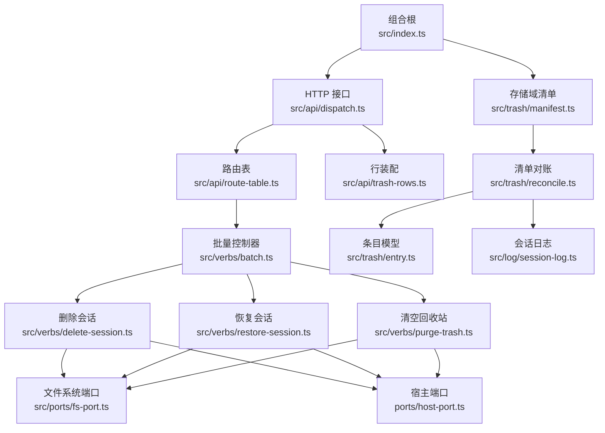
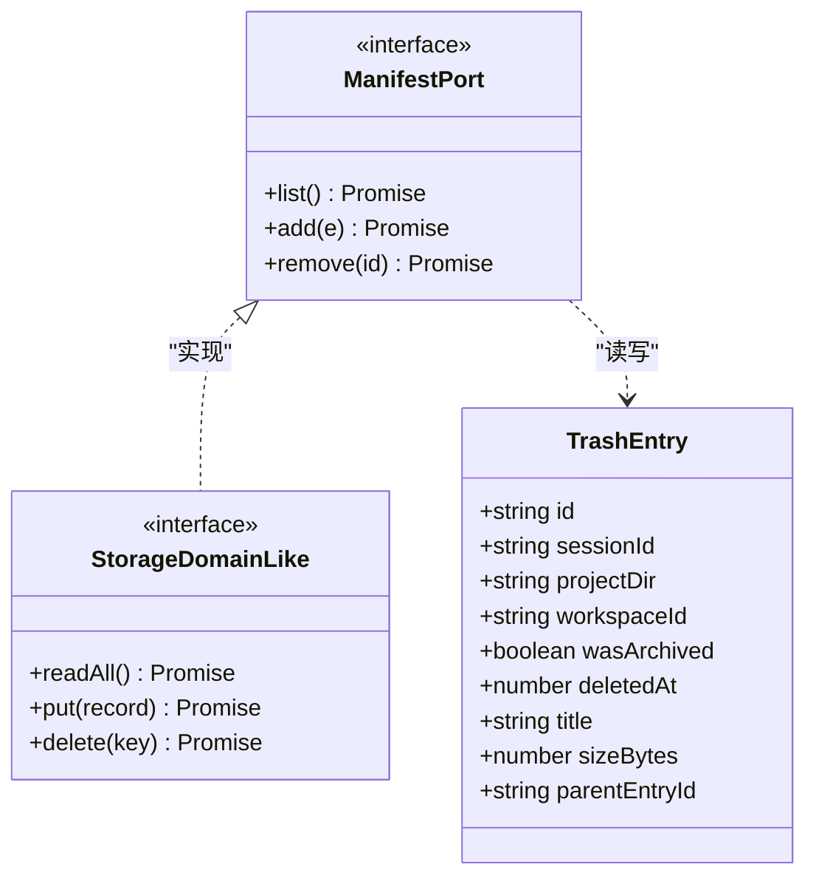
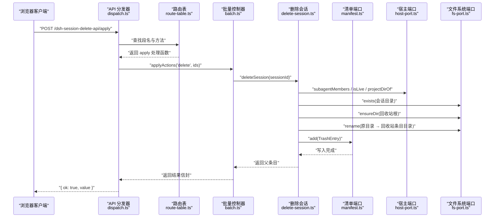
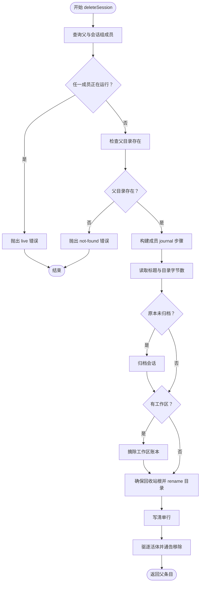
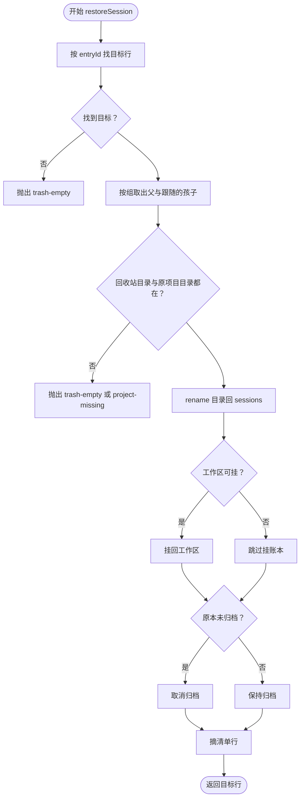
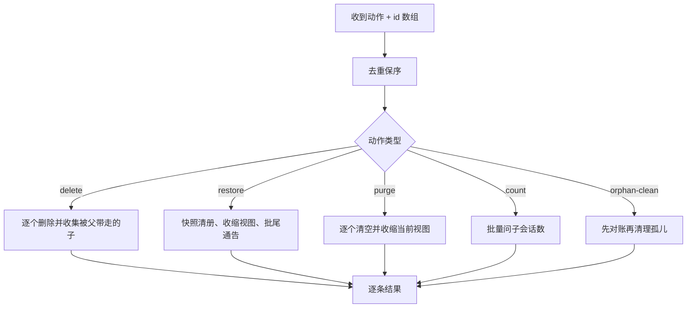
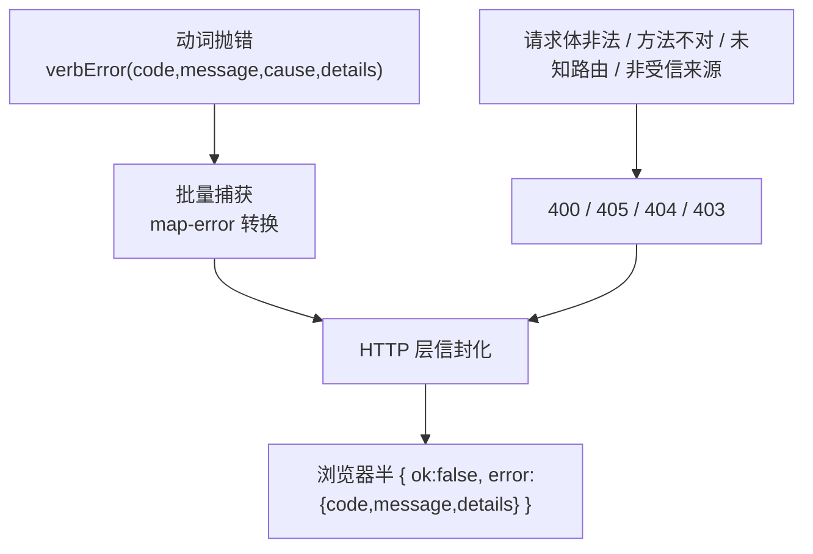
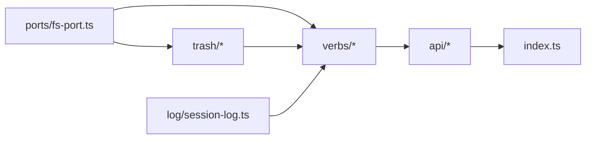
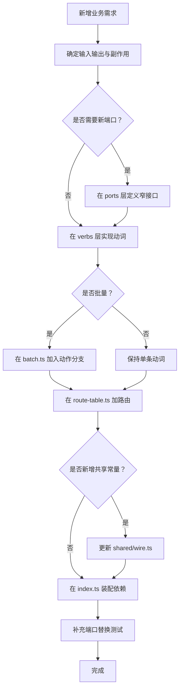

# Node 半分层与依赖方向

<cite>
**本文引用的文件**   
- [README.md](file://README.md)
- [src/index.ts](file://src/index.ts)
- [src/ports/fs-port.ts](file://src/ports/fs-port.ts)
- [src/trash/entry.ts](file://src/trash/entry.ts)
- [src/trash/manifest.ts](file://src/trash/manifest.ts)
- [src/trash/reconcile.ts](file://src/trash/reconcile.ts)
- [src/log/session-log.ts](file://src/log/session-log.ts)
- [src/verbs/delete-session.ts](file://src/verbs/delete-session.ts)
- [src/verbs/restore-session.ts](file://src/verbs/restore-session.ts)
- [src/verbs/purge-trash.ts](file://src/verbs/purge-trash.ts)
- [src/verbs/batch.ts](file://src/verbs/batch.ts)
- [src/verbs/errors.ts](file://src/verbs/errors.ts)
- [src/api/dispatch.ts](file://src/api/dispatch.ts)
- [src/api/route-table.ts](file://src/api/route-table.ts)
- [src/api/trash-rows.ts](file://src/api/trash-rows.ts)
</cite>

## 目录

1. [简介](#简介)
2. [项目结构](#项目结构)
3. [核心层职责](#核心层职责)
4. [架构总览](#架构总览)
5. [详细组件分析](#详细组件分析)
6. [依赖关系分析](#依赖关系分析)
7. [性能考虑](#性能考虑)
8. [故障排查](#故障排查)
9. [结论](#结论)
10. [附录：新增业务动词接入路径](#附录新增业务动词接入路径)

## 简介

本仓库为 DeepSeek Harness（DSH）提供“删除会话”能力：官方只有归档，没有删除；该插件把删除实现为“移入回收站”，并支持恢复、彻底删除、批量操作和孤儿清理。回收站本体落在本机 `~/.dsh/session-trash/`，清单则挂在宿主 storage domain 上，不联网、不上传。

Node 半采用“半分层”组织：端口层只暴露窄接口，trash 层维护领域模型与对账，log 层读会话日志，verbs 层写业务动词，api 层暴露 HTTP 前缀路由，`index.ts` 作为组合根装配宿主服务、存储域、文件系统端口与路由处理器。依赖方向是单向的：

```
ports → trash / log → verbs → api → index
```

这样分层的核心原因是：

- **测试可替换端口**：fs、host、storage domain 都通过接口注入，单元测试可用内存清单或假文件系统。
- **领域逻辑与传输解耦**：删除、恢复、清空等语义在 verbs 层表达，HTTP 方法、同源栅栏、信封格式只在 api 层处理。
- **清单与磁盘一致性由 reconcile 负责**：每次读清单先以回收站目录为准修回清单，手工改目录也能被下一次读取修复。
- **错误传播统一**：动词抛带 `code` 的错误，api 层用同一张映射表折成浏览器半可读的信封，状态码只区分请求错误与操作失败。

**章节来源**
- [README.md:1-147](file://README.md#L1-L147)

## 项目结构

Node 半相关代码集中在 `src/` 下，按职责切分：

| 目录 | 主要职责 | 对外暴露 |
| --- | --- | --- |
| `src/ports/` | 文件系统窄镜像与宿主服务最小面 | `FsPort`、`HostPort` |
| `src/trash/` | 回收站条目模型、清单读写、目录与清单对账 | `TrashEntry`、`ManifestPort`、`reconcileTrash` |
| `src/log/` | 读取会话日志、解析 header | `readSessionHeader`、`pickSessionLog` |
| `src/verbs/` | 删除、恢复、清空、批量、孤儿等业务动词 | `deleteSession`、`restoreSession`、`purgeTrash`、`applyActions` |
| `src/api/` | HTTP 前缀路由、串行到达序链、行投影 | `createApiHandler`、`ROUTE_TABLE` |
| `src/index.ts` | 插件入口、storage domain 装配、主机数据根、路由注册 | `name`、`inject`、`createStorageManifest` |



**图表来源**
- [src/index.ts:1-200](file://src/index.ts#L1-L200)
- [src/api/dispatch.ts:1-200](file://src/api/dispatch.ts#L1-L200)
- [src/api/route-table.ts:1-143](file://src/api/route-table.ts#L1-L143)
- [src/verbs/batch.ts:1-197](file://src/verbs/batch.ts#L1-L197)
- [src/verbs/delete-session.ts:1-200](file://src/verbs/delete-session.ts#L1-L200)
- [src/verbs/restore-session.ts:1-173](file://src/verbs/restore-session.ts#L1-L173)
- [src/verbs/purge-trash.ts:1-121](file://src/verbs/purge-trash.ts#L1-L121)
- [src/trash/reconcile.ts:1-127](file://src/trash/reconcile.ts#L1-L127)
- [src/trash/entry.ts:1-90](file://src/trash/entry.ts#L1-L90)
- [src/ports/fs-port.ts:1-46](file://src/ports/fs-port.ts#L1-L46)

**章节来源**
- [src/index.ts:1-200](file://src/index.ts#L1-L200)
- [src/api/dispatch.ts:1-200](file://src/api/dispatch.ts#L1-L200)
- [src/api/route-table.ts:1-143](file://src/api/route-table.ts#L1-L143)

## 核心层职责

### ports 层：宿主服务与文件系统窄镜像

`FsPort` 是 fs 层的唯一契约，包含存在性检查、递归建目录、原子 rename、递归删目录、目录大小、文件列表、子目录列表和整文件读取。它刻意避免直接暴露完整 `node:fs`，让删除、恢复、清空、对账等上层逻辑只依赖“会用到的那几件事”。

| 方法 | 用途 |
| --- | --- |
| `exists` | 判断会话目录或回收站根是否存在 |
| `ensureDir` | 首次删除时创建 `~/.dsh/session-trash/` |
| `rename` | 同卷原子移动，是“移入回收站”的关键 |
| `removeDir` | 彻底删除回收站目录或盘上后代 |
| `sizeOfDir` | 计算目录字节数，用于元信息与释放空间统计 |
| `listFiles` | 挑出当前回收站条目下的日志文件 |
| `listDirs` | 找出回收站根下的条目目录名，供对账重建 |
| `readFile` | 读取日志正文给详情或对账使用 |

**章节来源**
- [src/ports/fs-port.ts:1-46](file://src/ports/fs-port.ts#L1-L46)

### trash 层：回收站领域模型与清单对账

trash 层定义三条边界：

1. **数据模型**：`TrashEntry` 描述一个会话在回收站里的状态，包括原项目目录、工作区、是否曾归档、删除时间、标题、字节数和父子组关系。
2. **清单接口**：`ManifestPort` 只提供 list/add/remove，不关心底层是内存 Map 还是宿主 storage domain。
3. **对账规则**：以 `session-trash/` 目录为准，重建缺失行、摘除多余行，且幂等。



**图表来源**
- [src/trash/entry.ts:1-90](file://src/trash/entry.ts#L1-L90)
- [src/trash/manifest.ts:1-35](file://src/trash/manifest.ts#L1-L35)

对账过程以回收站根目录为权威源：如果根不存在，说明数据位置变了，跳过对账；否则枚举所有子目录，匹配条目 id 形状，从日志 header 重建字段，最后增删清册行。

**章节来源**
- [src/trash/entry.ts:1-90](file://src/trash/entry.ts#L1-L90)
- [src/trash/manifest.ts:1-35](file://src/trash/manifest.ts#L1-L35)
- [src/trash/reconcile.ts:1-127](file://src/trash/reconcile.ts#L1-L127)

### log 层：会话日志读取

log 层负责从回收站条目中挑选日志文件、读取缓冲、解析 header。对账需要 header 中的会话 id 和工作目录；详情需要全文。文件大小上限不在这里硬控，而是由逐帧解压与调用方共同约束。

**章节来源**
- [src/log/session-log.ts](file://src/log/session-log.ts)

### verbs 层：删除、恢复、清空、批量等业务动词

verbs 层是领域逻辑中心：

| 模块 | 输入 | 输出 | 关键副作用 |
| --- | --- | --- | --- |
| `delete-session` | 会话 id | 回收站父行 | 归档、摘账本、move 目录、写清单、更新宿主缓存 |
| `restore-session` | 条目 id | 回收站行 | 还原目录、挂账本、恢复可见性、摘清单行 |
| `purge-trash` | 条目 id 或空 | `{ removed, freedBytes }` | 取消归档、摘账本、删目录、摘清单 |
| `batch` | 动作 + id 数组 | 每个 id 的结果信封 | 去重、快照、部分失败隔离、批级通告 |
| `errors` | 动词码 | 结构化错误 | 统一 code/message/details/cause |

**章节来源**
- [src/verbs/delete-session.ts:1-200](file://src/verbs/delete-session.ts#L1-L200)
- [src/verbs/restore-session.ts:1-173](file://src/verbs/restore-session.ts#L1-L173)
- [src/verbs/purge-trash.ts:1-121](file://src/verbs/purge-trash.ts#L1-L121)
- [src/verbs/batch.ts:1-197](file://src/verbs/batch.ts#L1-L197)
- [src/verbs/errors.ts:1-82](file://src/verbs/errors.ts#L1-L82)

### api 层：HTTP 接口

api 层只做三件事：同源栅栏、查路由表、信封化响应。它不关心删除怎么搬目录，也不关心恢复怎么挂账本。

| 路由段名 | 方法 | 行为 |
| --- | --- | --- |
| `list` | GET | 对账后组装行返回 |
| `ping` | GET | 最轻量探测，纯读 |
| `orphans` | GET | 扫描无主子会话，纯读 |
| `apply` | POST | 批量动作：delete/restore/purge/count/orphan-clean |
| `empty` | POST | 先对账再清空 |
| `detail` | POST | 读取单条回收站详情 |

**章节来源**
- [src/api/dispatch.ts:1-200](file://src/api/dispatch.ts#L1-L200)
- [src/api/route-table.ts:1-143](file://src/api/route-table.ts#L1-L143)
- [src/api/trash-rows.ts:1-93](file://src/api/trash-rows.ts#L1-L93)

### index.ts：组合根

`index.ts` 装配三个宿主依赖：workspaceRegistry、storageDomain、webServer。它不是业务逻辑入口，而是把：

- 宿主 storage domain 适配为 `ManifestPort`
- 插件名称与注入声明
- 存储域规范、记录校验器、domain 句柄生命周期
- 主机数据根与路由前缀

绑定在一起。

**章节来源**
- [src/index.ts:1-200](file://src/index.ts#L1-L200)

## 架构总览

下图展示一次“删除会话”请求如何从 HTTP 进入，最终落到 `FsPort.rename`。



**图表来源**
- [src/api/dispatch.ts:120-200](file://src/api/dispatch.ts#L120-L200)
- [src/api/route-table.ts:80-143](file://src/api/route-table.ts#L80-L143)
- [src/verbs/batch.ts:60-120](file://src/verbs/batch.ts#L60-L120)
- [src/verbs/delete-session.ts:20-120](file://src/verbs/delete-session.ts#L20-L120)
- [src/trash/manifest.ts:1-35](file://src/trash/manifest.ts#L1-L35)
- [src/ports/fs-port.ts:1-46](file://src/ports/fs-port.ts#L1-L46)

**章节来源**
- [src/api/dispatch.ts:1-200](file://src/api/dispatch.ts#L1-L200)
- [src/verbs/delete-session.ts:1-200](file://src/verbs/delete-session.ts#L1-L200)

## 详细组件分析

### 删除会话动词

删除不是简单 move：它是“按组执行的多步事务”，并用 journal 保证可回滚。

#### 删除流程



**图表来源**
- [src/verbs/delete-session.ts:20-120](file://src/verbs/delete-session.ts#L20-L120)

关键设计点：

- 准入阶段零写：先查活跃态、再查目录，失败不留下任何副作用。
- 顺序承重：归档必须在摘账本之前，否则会出现短暂“无主且可见”窗口。
- 目录与清单合成一步：目录搬进回收站后再写清单，避免对账误判。
- 回滚相反顺序：清单摘回 → 目录搬回 → 账本挂回 → 可见性还原。
- 组级回滚：某个成员失败时，已成功的兄弟也退回去，不留半组在回收站。

**章节来源**
- [src/verbs/delete-session.ts:1-200](file://src/verbs/delete-session.ts#L1-L200)

### 恢复会话动词

恢复是删除的逆过程：目录回到原项目路径，然后挂账本、恢复可见性、摘清单行。

#### 恢复流程



**图表来源**
- [src/verbs/restore-session.ts:20-173](file://src/verbs/restore-session.ts#L20-L173)

关键点：

- 恢复按组走：只回父会留下点不到的孩子行。
- 工作区缺失是降级路径：恢复仍回盘，只是归入“未分组”。
- 目录没真正退回回收站时不发“已移除”通告，避免客户端误删仍在盘的会话。

**章节来源**
- [src/verbs/restore-session.ts:1-173](file://src/verbs/restore-session.ts#L1-L173)

### 清空回收站动词

清空是破坏性动词，设计上不回滚：一旦开始删目录，已删的部分不能自动恢复。它的成功回执会如实给出 `removed` 和 `freedBytes`，部分失败时调用方应重试。

**章节来源**
- [src/verbs/purge-trash.ts:1-121](file://src/verbs/purge-trash.ts#L1-L121)

### 批量控制器

批量层是“这一批”的唯一拥有者，承担：

- id 去重保序
- 清册快照
- 每条结果独立 try/catch
- 恢复时批尾一次通告
- “已被同批前一条带走”的幂等成功



**图表来源**
- [src/verbs/batch.ts:1-197](file://src/verbs/batch.ts#L1-L197)

**章节来源**
- [src/verbs/batch.ts:1-197](file://src/verbs/batch.ts#L1-L197)

### API 分发器与路由表

分发器负责：

- 同源栅栏
- URL 前缀匹配
- HTTP 方法与 body 校验
- JSON 流式读取与体积限制
- 纯读绕过串行链，写动作排队执行
- 统一信封与错误映射

路由表集中声明每个段名的方法、body 类型、纯度、处理函数。新增接口必须在这里加一行，编译期就能发现 wire 与路由表不一致。

**章节来源**
- [src/api/dispatch.ts:1-200](file://src/api/dispatch.ts#L1-L200)
- [src/api/route-table.ts:1-143](file://src/api/route-table.ts#L1-L143)

### 错误传播

错误传播分为三层：

1. **动词层**：用 `verbError` 构造带 `code`、`message`、可选 `details` 和 `cause` 的结构化错误。
2. **批量层**：捕获每条动词错误，转为浏览器半可读的 `ApplyOutcome`，失败不传染下一条。
3. **API 层**：用 `toRemoteFailure` 把 Node 侧错误映射成统一信封；请求错误走 4xx，操作失败走 200 + `ok: false`。



**图表来源**
- [src/verbs/errors.ts:1-82](file://src/verbs/errors.ts#L1-L82)
- [src/api/dispatch.ts:140-200](file://src/api/dispatch.ts#L140-L200)
- [src/remote/map-error.ts](file://src/remote/map-error.ts)

**章节来源**
- [src/verbs/errors.ts:1-82](file://src/verbs/errors.ts#L1-L82)
- [src/api/dispatch.ts:1-200](file://src/api/dispatch.ts#L1-L200)

## 依赖关系分析

各层依赖方向严格单向，不允许反向引用：



- **ports 不被 trash/verbs/api 反向 import**：它们只被 verbs 和 reconcile 消费。
- **trash 不依赖 api 或 index**：领域模型与对账可以独立测试。
- **verbs 不直接依赖 http 或 node:http**：它只依赖端口抽象。
- **api 不直接依赖具体业务实现细节**：它通过路由表委托给 verbs。
- **index 是唯一装配点**：把宿主服务、storage domain、fs-port 和 api handler 连起来。

潜在风险：

- 如果新逻辑同时需要 fs 和 host，应放在 verbs 层，而不是直接跨层调用。
- 如果新增 HTTP 接口，不要只在 dispatch 里加 if，而应走 route-table 的编译期约束。
- 对磁盘的破坏性操作应优先放在 verbs 层，并在批量层做幂等控制。

**图表来源**
- [src/ports/fs-port.ts:1-46](file://src/ports/fs-port.ts#L1-L46)
- [src/trash/reconcile.ts:1-127](file://src/trash/reconcile.ts#L1-L127)
- [src/verbs/delete-session.ts:1-200](file://src/verbs/delete-session.ts#L1-L200)
- [src/api/dispatch.ts:1-200](file://src/api/dispatch.ts#L1-L200)
- [src/index.ts:1-200](file://src/index.ts#L1-L200)

**章节来源**
- [src/index.ts:1-200](file://src/index.ts#L1-L200)
- [src/api/dispatch.ts:1-200](file://src/api/dispatch.ts#L1-L200)

## 性能考虑

- **对账代价**：每次读清单都会枚举回收站目录并对齐清单，但快路直接返回原清单，零写入。对于本机常见规模（几十到上百条），开销在毫秒级。
- **批量恢复通告**：改为批尾一次 `announceRestoredBatch`，避免逐条触发宿主全表扫描，这是解决历史“恢复很慢”问题的关键优化。
- **JSON body 上限**：API 层限制请求体为 1MiB，防止恶意大正文拖慢解析。
- **纯读不占串行链**：`ping`、`orphans`、`detail`、`count` 不会阻塞删除/恢复/清空等写操作。
- **目录大小测量**：`sizeOfDir` 是递归遍历，适合回收站规模；若未来回收站达到万级条目，应考虑缓存或增量统计。

[本节为通用性能讨论，不直接分析特定代码片段]

## 故障排查

| 现象 | 可能原因 | 定位建议 |
| --- | --- | --- |
| 页面加载后没有“回收站”入口 | 依赖不可用或探测失败 | 检查 webServer 与 storageDomain 是否注入成功 |
| 删除时报“会话正在运行” | 父或某个子会话仍在活跃 | 先停止会话，再重试 |
| 恢复时报“原项目目录不存在” | 用户手动删除了 `sessions/<project>` | 先在宿主恢复项目，再恢复会话 |
| 恢复时报“回收站条目已不在磁盘上” | 回收站目录被手工删除 | 无法恢复；如需保留元数据，应先从对账后的清单导出 |
| 清空后仍有目录 | 彻底删除不支持回滚，部分失败需重试 | 查看回执中 `removed` 与 `freedBytes` |
| 清单与目录不一致 | 手工改了 `session-trash/` | 下一次 `GET /list` 会自动对账修复 |
| 批量只成功一部分 | 某条动词失败，其他继续 | 查看 `/apply` 返回的逐条结果，重试失败项 |
| 403 拒绝 | 非受信来源或跨源请求 | 检查 Origin/Referer/桌面壳 dsh-app://app |
| 400 错误 | JSON 非法、缺少必填字段、超过 1MiB | 检查请求体结构与大小 |
| 404 错误 | 未知路由或前缀不匹配 | 确认路径以 `/dsh-session-delete-api` 开头 |

**章节来源**
- [src/api/dispatch.ts:1-200](file://src/api/dispatch.ts#L1-L200)
- [src/verbs/errors.ts:1-82](file://src/verbs/errors.ts#L1-L82)
- [src/verbs/delete-session.ts:20-120](file://src/verbs/delete-session.ts#L20-L120)
- [src/verbs/restore-session.ts:20-120](file://src/verbs/restore-session.ts#L20-L120)
- [src/verbs/purge-trash.ts:20-121](file://src/verbs/purge-trash.ts#L20-L121)

## 结论

这个 Node 半分层把“谁管什么”说得很清楚：

- **ports** 是外部系统的窄镜像，方便替换。
- **trash** 是领域事实，负责条目模型与清单一致性。
- **log** 是会话文件的只读入口。
- **verbs** 是业务动词，封装删除、恢复、清空、批量和孤儿清理。
- **api** 是传输层，只负责 HTTP、栅栏、路由、信封和串行化。
- **index** 是组合根，把宿主服务、存储域、fs 端口和路由装配到一起。

依赖方向严格自外向内，测试可以用内存清单、假 fs 和 stub host 替换真实宿主，业务逻辑与 HTTP 传输完全解耦。新增业务动词时，不应绕开 verbs 层直接操作 fs 或 manifest，也不应在 api 层复制业务判断。

[本节为总结性内容，不直接分析特定文件]

## 附录：新增业务动词接入路径

如果要新增一个业务动词，推荐遵循以下路径：

1. **定义动词输入输出**  
   如果是“对回收站中的一条或多条做某种变更”，新增在 `src/verbs/` 下，例如 `src/verbs/new-action.ts`。

2. **只依赖端口，不直接依赖宿主 API**  
   需要文件系统操作就通过 `FsPort`，需要宿主会话信息就通过 `HostPort`，需要清单就通过 `ManifestPort`。

3. **必要时加入 journal 或幂等策略**  
   - 可回滚的操作：用 `createJournal` 包装多步副作用。
   - 破坏性操作：明确不回滚，并把部分成功计数交给调用方重试。
   - 批量场景：与现有动词一样，接受只读快照，不自己收缩 id 列表。

4. **如动词涉及多条 id，纳入 batch 层**  
   在 `src/verbs/batch.ts` 的 `applyActions` 中增加分支，并复用 `forEachId` 或自定义批量逻辑。

5. **暴露 HTTP 接口时，先改路由表**  
   在 `src/api/route-table.ts` 的 `ROUTE_TABLE` 加一行，指定 method、body、purity 和 run 函数。

6. **wire 与路由表保持一致**  
   如果新增共享常量或动作名，应放在 `shared/wire.ts`，并确保路由表与类型推导能编译通过。

7. **在组合根装配依赖**  
   如果动词需要新的端口，在 `src/index.ts` 中创建端口实例并传入 api 处理器。

8. **补充测试**  
   - 用 `createMemoryManifest` 替代持久清单。
   - 用 `createFsPort` 的等价实现或测试夹具覆盖 rename、exists、listDirs 等关键路径。
   - 验证错误码、回滚顺序、批量幂等性和对账影响。



**图表来源**
- [src/ports/fs-port.ts:1-46](file://src/ports/fs-port.ts#L1-L46)
- [src/trash/manifest.ts:1-35](file://src/trash/manifest.ts#L1-L35)
- [src/verbs/batch.ts:1-197](file://src/verbs/batch.ts#L1-L197)
- [src/api/route-table.ts:1-143](file://src/api/route-table.ts#L1-L143)
- [src/index.ts:1-200](file://src/index.ts#L1-L200)

**章节来源**
- [src/verbs/batch.ts:1-197](file://src/verbs/batch.ts#L1-L197)
- [src/api/route-table.ts:1-143](file://src/api/route-table.ts#L1-L143)
- [src/index.ts:1-200](file://src/index.ts#L1-L200)