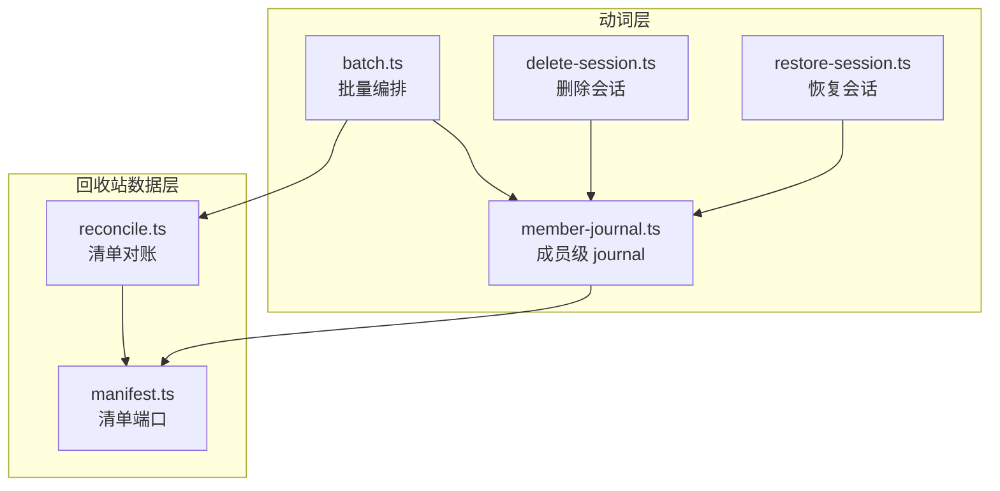
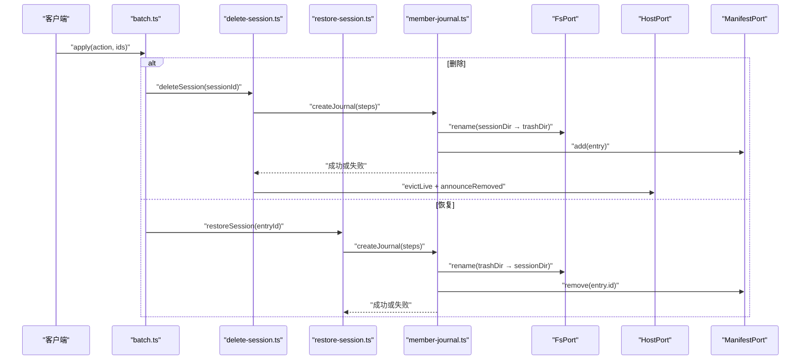
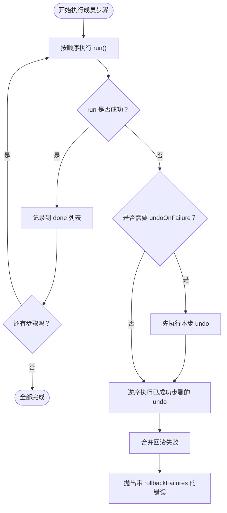
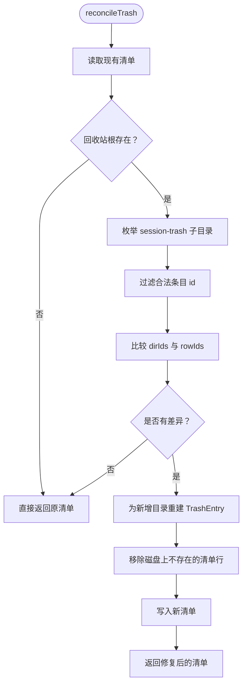
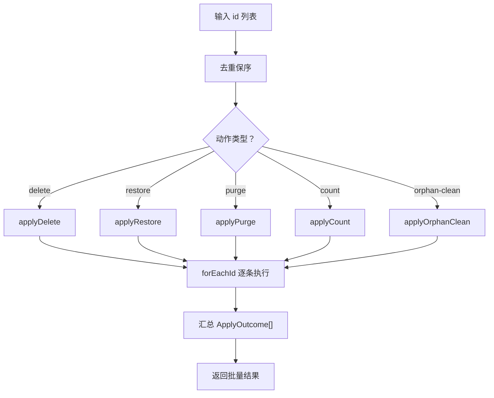
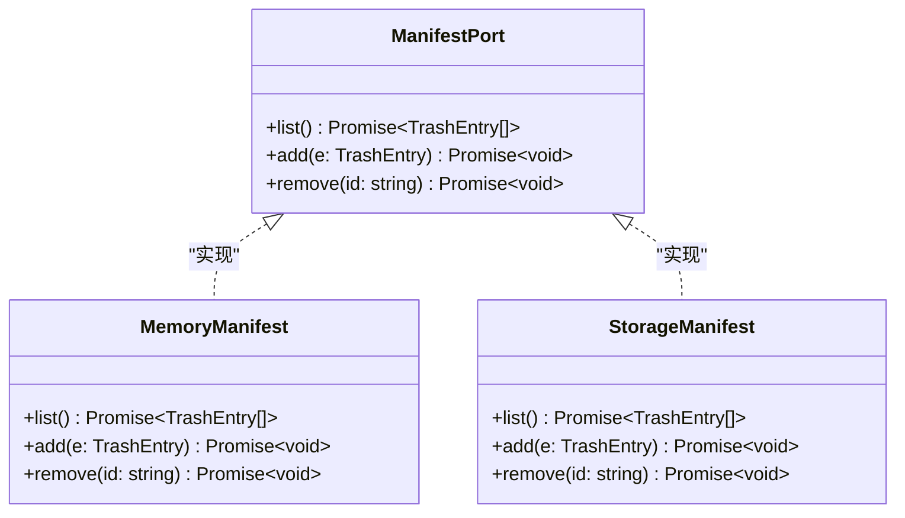
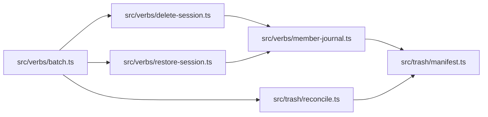

# 关键设计模式

<cite>
**本文引用的文件**   
- [member-journal.ts](file://src/verbs/member-journal.ts)
- [reconcile.ts](file://src/trash/reconcile.ts)
- [batch.ts](file://src/verbs/batch.ts)
- [delete-session.ts](file://src/verbs/delete-session.ts)
- [restore-session.ts](file://src/verbs/restore-session.ts)
- [manifest.ts](file://src/trash/manifest.ts)
- [0002-batch-and-journal-own-the-request.md](file://docs/docs/adr/0002-batch-and-journal-own-the-request.md)
- [2026-10-15-trash-detail-design.md](file://docs/design/2026-10-15-trash-detail-design.md)
- [reconcile.test.ts](file://tests/reconcile.test.ts)
- [batch.test.ts](file://tests/batch.test.ts)
</cite>

## 目录
1. [引言](#引言)
2. [项目结构](#项目结构)
3. [核心模式总览](#核心模式总览)
4. [架构总图](#架构总图)
5. [详细模式分析](#详细模式分析)
6. [依赖关系分析](#依赖关系分析)
7. [性能与扩展指南](#性能与扩展指南)
8. [故障排查](#故障排查)
9. [结论](#结论)

## 引言
本文围绕四个关键设计模式展开：成员移动 journal 回滚、回收站清单对账、批量编排，以及单一真相源与“唯一主人清单”原则。它们共同解决的是分布式会话删除、恢复和彻底删除过程中常见的不一致问题——目录搬进回收站但清单没写、同批操作顺序交错、失败后半组留在回收站、清单与磁盘互不认等。

这些模式不是通用框架，而是把“一次请求的完整语义”收归到具体模块：journal 拥有成员级步骤及其反向动作；batch 拥有整批去重、快照、通告与幂等语义；reconcile 拥有“以磁盘为准修复清单”的对账规则。这样可以把错误传播、失败收集、回滚顺序和一致性边界都落到可测试的代码位置。

## 项目结构
与本文相关的实现集中在 `src/verbs`（动词）、`src/trash`（回收站数据层）和 `docs/design`、`docs/docs/adr`（设计裁决）。

**图示来源**
- [batch.ts:1-197](file://src/verbs/batch.ts#L1-L197)
- [member-journal.ts:1-103](file://src/verbs/member-journal.ts#L1-L103)
- [delete-session.ts:1-200](file://src/verbs/delete-session.ts#L1-L200)
- [restore-session.ts:1-173](file://src/verbs/restore-session.ts#L1-L173)
- [reconcile.ts:1-127](file://src/trash/reconcile.ts#L1-L127)
- [manifest.ts:1-35](file://src/trash/manifest.ts#L1-L35)

**章节来源**
- [batch.ts:1-197](file://src/verbs/batch.ts#L1-L197)
- [member-journal.ts:1-103](file://src/verbs/member-journal.ts#L1-L103)
- [reconcile.ts:1-127](file://src/trash/reconcile.ts#L1-L127)

## 核心模式总览

| 模式 | 主要文件 | 解决的问题 | 核心数据结构 | 失败时行为 | 主要性能影响 |
|---|---|---|---|---|---|
| 成员移动 journal 回滚 | `member-journal.ts`、`delete-session.ts`、`restore-session.ts` | 多步 IO 必须按相反顺序退回；某步退不干净不能掩盖原错误；非原子步骤自己失败也要回退 | `JournalStep`、`Journal`、`rollbackJournals` | 已做成功步骤反向回滚；失败收集到 `details.rollbackFailures`；原错误不被单独抛出 | 每成员一个 journal，回滚时逆序调用 undo；undo 数量与成员数线性相关 |
| 回收站清单对账 | `reconcile.ts` | 手工动回收站后，清单与 `session-trash/` 目录不一致；需要零漂移自动修复 | `ReconcileDeps`、`TrashEntry` | 根不存在则跳过；不可识别目录静默跳过；重建失败也不抛；最终返回一致清单 | 每次读清单枚举回收站子目录；本机 124 条毫秒级；一致路径零写入 |
| 批量编排 | `batch.ts` | 同一批 id 的去重保序、幂等、逐条信封、一批一次通告、清册只读一次 | `ApplyOutcome[]`、收缩视图 `current` | 单条失败不传染下一条；已被前一条带走的 id 返回幂等成功值 | 批量内 `forEachId` 是 O(n)，清册快照只在 restore/purge/orphan-clean 入口取一次 |
| 单一真相源与唯一主人清单 | `manifest.ts`、`reconcile.ts`、`batch.ts` | 清单不能由多个读路径各自维护；磁盘与清单必须以明确规则对齐 | `ManifestPort` | 读取端通过 `reconcileTrash` 强制对齐 | 读路径可能多一次目录枚举，但避免写路径复杂化 |

**章节来源**
- [member-journal.ts:1-103](file://src/verbs/member-journal.ts#L1-L103)
- [reconcile.ts:1-127](file://src/trash/reconcile.ts#L1-L127)
- [batch.ts:1-197](file://src/verbs/batch.ts#L1-L197)
- [manifest.ts:1-35](file://src/trash/manifest.ts#L1-L35)

## 架构总图
下面展示“批量入口 → 单条动词 → journal 步骤 → 文件系统 / 宿主端口 / 清单端口”的真实调用链。

**图示来源**
- [batch.ts:1-197](file://src/verbs/batch.ts#L1-L197)
- [delete-session.ts:1-200](file://src/verbs/delete-session.ts#L1-L200)
- [restore-session.ts:1-173](file://src/verbs/restore-session.ts#L1-L173)
- [member-journal.ts:1-103](file://src/verbs/member-journal.ts#L1-L103)

## 详细模式分析

### 模式一：成员移动 journal 回滚

#### 它解决什么问题
删除和恢复都不是单步 IO。删除要经历“读现场 → 归档 → 摘账本 → 搬目录 → 写清单行”；恢复则是反方向“放回目录 → 挂账本 → 取消归档 → 摘清单行”。如果中间任何一步失败，不能留下“半在回收站、半在原处”的成员。此外，某一步的反向动作本身也可能失败，这时不能只抛原错误，而要把回滚失败合并起来。

#### 数据流
每个成员对应一个 `JournalStep[]`，由 `createJournal` 执行并记录已成功的步骤。失败时调用 `undoAll` 逆序执行 undo；若某 step 设置 `undoOnFailure`，即使该 step 自身失败也执行其 undo。组级失败时用 `rollbackJournals` 把所有成员的 journal 逆序回滚，并把回滚失败合并到 `withRollbackFailures`。

**图示来源**
- [member-journal.ts:1-103](file://src/verbs/member-journal.ts#L1-L103)

#### 真实代码片段：删除失败时的回滚
删除会话中，成员移动的五个触点被组织为 journal 步骤。其中“移动会话目录失败”这一步设置了 `undoOnFailure`，因为目录 rename 可能已经部分生效，需要先把会话目录从回收站搬回去，再摘清册行。

参考实现位置：
- 成员步骤定义与 `undoOnFailure`：[delete-session.ts:120-180](file://src/verbs/delete-session.ts#L120-L180)
- 组级 catch 调用回滚：[delete-session.ts:80-110](file://src/verbs/delete-session.ts#L80-L110)
- journal 运行与回滚抽象：[member-journal.ts:24-74](file://src/verbs/member-journal.ts#L24-L74)

当某个成员在“登记回收站条目”失败时，journal 会把之前已成功执行的步骤逆序退回：目录搬回原处、账本挂回、可见性还原。如果这些反向动作也有失败，它们会被包装成 `rollbackReason` 字符串，并作为 `details.rollbackFailures` 与原错误一起抛出。

#### 失败场景
- 单个成员步骤失败：只回滚该成员已完成的步骤。
- 组成员间失败：父成员成功后、孩子成员失败，组级 catch 会按相反顺序回滚所有已加入 `done` 的 journal。
- 反向动作失败：不会让原错误独走；客户端必须检查 `details.rollbackFailures`，否则会误以为系统完全回到删除前状态。
- 非原子步骤失败：如取消归档中途失败，仍会尝试把会话重新归档回去，保证可见性安全。

#### 性能影响
- 时间复杂度：每个成员最多执行一次正向步骤和一次反向步骤；回滚是 O(k)，k 为已完成步骤数。
- 空间复杂度：`done` 数组保存已执行步骤，随成员数线性增长。
- 并发风险：journal 只负责单成员回滚；跨成员一致性由调用方（delete/restore 的组循环）管理。

**章节来源**
- [member-journal.ts:1-103](file://src/verbs/member-journal.ts#L1-L103)
- [delete-session.ts:1-200](file://src/verbs/delete-session.ts#L1-L200)
- [restore-session.ts:1-173](file://src/verbs/restore-session.ts#L1-L173)

### 模式二：回收站清单对账

#### 它解决什么问题
用户可以直接操作 `session-trash/` 目录，比如复制、重命名、手工清理。如果只改目录而不更新清单，就会出现“磁盘有、清单无”或“清单有、磁盘无”的不一致。设计稿明确要求：手工动回收站只需要动那个目录，多出来的目录由对账重建，目录没了的行由对账摘除；清单成为内部索引，不再手工维护。

#### 数据流
`reconcileTrash` 每次读取清单时都会执行对账：
1. 读取当前清单。
2. 判断回收站根是否存在；不存在则直接返回原清单，一个字节都不写。
3. 枚举回收站根下所有子目录，过滤出符合条目 id 形状的目录。
4. 对比清单中的 id 集合。
5. 对缺失的目录尝试重建行；对不在磁盘上的清单行执行移除。
6. 最后返回一份新的清单。

**图示来源**
- [reconcile.ts:1-127](file://src/trash/reconcile.ts#L1-L127)

#### 真实代码片段：清单不一致时的自动修复
测试用例覆盖了多种不一致形态：
- 多出的目录重建出行：id 来自目录名，sessionId/cwd 从日志 header 推导，workspaceId 默认空串，wasArchived 默认 false，sizeBytes 现场测量。
- 目录没了的行被摘掉。
- 两代日志并存时读取最新一代。
- 名字不像条目的目录当作外人跳过。
- 尺寸量不出时整条放弃重建，避免产生半截行。

参考实现位置：
- 对账主流程：[reconcile.ts:96-127](file://src/trash/reconcile.ts#L96-L127)
- 单条重建逻辑：[reconcile.ts:33-94](file://src/trash/reconcile.ts#L33-L94)
- 多代日志选择与测试断言：[reconcile.test.ts:63-85](file://tests/reconcile.test.ts#L63-L85)

#### 失败场景
- 回收站根不存在：视为挂载异常或盘未挂载，不对账，不删行。
- 目录名非法：跳过，不列、不删。
- 日志缺失、header 解析失败、尺寸测量失败：跳过该条，不抛错。
- 半截行风险：如果无法重建完整事实，宁可丢弃该行，也不把 sessionId、projectDir 等关键字段设为可疑默认值。

#### 性能影响
- 每次读清单都要枚举回收站根目录，属于额外 I/O。
- 文档注释指出本机 124 条样本下为毫秒级开销。
- 一致路径零写入：如果没有差异，直接返回原清单，不调用 `manifest.add/remove`。
- 重建路径会读取日志 header 并计算目录大小，因此比一致路径慢，但仍是一次性修复。

**章节来源**
- [reconcile.ts:1-127](file://src/trash/reconcile.ts#L1-L127)
- [2026-10-15-trash-detail-design.md:1-113](file://docs/design/2026-10-15-trash-detail-design.md#L1-L113)
- [reconcile.test.ts:1-197](file://tests/reconcile.test.ts#L1-L197)

### 模式三：批量编排

#### 它解决什么问题
批量不是“多条单条调用的简单拼接”。它有自己的语义：
- 输入去重且保持界面顺序。
- 整批只读一次清册快照。
- 每条结果独立封装，失败不传染下一条。
- “已被同批前一条带走”的 id 返回幂等成功值，而不是失败。
- 恢复动作攒起整批通告，只发一次 `announceRestoredBatch`。
- 孤儿清理在对账之后才扫描，避免把仍在回收站里的组当成孤儿直接删盘。

#### 数据流
`applyActions` 根据动作类型分发到 `applyDelete`、`applyRestore`、`applyPurge`、`applyCount`、`applyOrphanClean`。每个实现使用 `forEachId` 包裹单条执行，再用 `unique` 去重。

**图示来源**
- [batch.ts:1-197](file://src/verbs/batch.ts#L1-L197)

#### 真实代码片段：幂等与通告
- 去重保序：`unique` 使用 `Set` 去重，`out` 保持首次出现顺序。
- 逐条信封：`forEachId` 捕获每条 try/catch，成功返回 `success`，失败返回 `failure`。
- 已被前一条带走：restore 和 purge 使用原始快照 `original` 和当前私有视图 `current`，配合 `takenByEarlierInBatch` 判定。
- 一批一次通告：restore 收集 `restored` 列表，在批尾调用 `announceRestoredBatch(restored, restoredSummariesOf())`。

参考实现位置：
- 批量入口与动作分发：[batch.ts:168-197](file://src/verbs/batch.ts#L168-L197)
- forEachId 与 success/failure 构造：[batch.ts:36-72](file://src/verbs/batch.ts#L36-L72)
- restore 批次通告：[batch.ts:108-143](file://src/verbs/batch.ts#L108-L143)
- orphan-clean 先对账再扫描：[batch.ts:149-167](file://src/verbs/batch.ts#L149-L167)

#### 失败场景
- 单条失败：例如幽灵 id 被 purge，返回 `trash-empty`，不影响其他条。
- 幂等成功：父先删、孩子后删，孩子是 no-op；父先恢复、孩子后恢复，孩子也是 no-op。
- 孤儿清理过期：如果父又被放回回收站或组已被上一个请求带走，报告不再是可清理的孤儿。
- 宿主接口失败：count 和 orphans 查询失败会作为整次调用失败或单条失败处理，不会伪装成成功。

#### 性能影响
- 去重 O(n)。
- restore/purge 整批只读一次清单，减少重复 I/O。
- 恢复通告聚合为一次，避免每条触发宿主全表扫描，这是修复“恢复很慢”的关键优化。
- orphan-clean 先对账，增加一次 reconcile 调用，但避免误删仍在回收站的组。

**章节来源**
- [batch.ts:1-197](file://src/verbs/batch.ts#L1-L197)
- [batch.test.ts:1-132](file://tests/batch.test.ts#L1-L132)

### 模式四：单一真相源与“唯一主人清单”原则

#### 原则含义
清单的唯一读法是 `ManifestPort.list()`；清单的唯一写法是 `add` 和 `remove`。`reconcile.ts` 不以业务逻辑猜测清单应该长什么样，而是以 `session-trash/` 目录的事实为准，把清单修回一致。`manifest.ts` 只提供最小端口，不暴露 storage domain 的内部形状，便于内存实现和宿主存储实现共用。

**图示来源**
- [manifest.ts:1-35](file://src/trash/manifest.ts#L1-L35)

#### 它在系统中的体现
- 动词层不直接操作宿主 storage domain；只通过 `ManifestPort`。
- 对账函数依赖 `ManifestPort` 和 `FsPort`，把磁盘事实映射为 `TrashEntry`。
- 批量层只关心“这一批的结果”，不持有清单副本作为长期真相。
- 设计裁决 ADR-0002 明确指出：批量和 journal 拥有请求，而不是让每个动词既知道自己是第几个、又知道前面带走了谁。

**章节来源**
- [manifest.ts:1-35](file://src/trash/manifest.ts#L1-L35)
- [reconcile.ts:1-127](file://src/trash/reconcile.ts#L1-L127)
- [batch.ts:1-60](file://src/verbs/batch.ts#L1-L60)
- [0002-batch-and-journal-own-the-request.md](file://docs/docs/adr/0002-batch-and-journal-own-the-request.md)

## 依赖关系分析

**图示来源**
- [batch.ts:1-197](file://src/verbs/batch.ts#L1-L197)
- [delete-session.ts:1-200](file://src/verbs/delete-session.ts#L1-L200)
- [restore-session.ts:1-173](file://src/verbs/restore-session.ts#L1-L173)
- [member-journal.ts:1-103](file://src/verbs/member-journal.ts#L1-L103)
- [reconcile.ts:1-127](file://src/trash/reconcile.ts#L1-L127)
- [manifest.ts:1-35](file://src/trash/manifest.ts#L1-L35)

**章节来源**
- [batch.ts:1-197](file://src/verbs/batch.ts#L1-L197)
- [member-journal.ts:1-103](file://src/verbs/member-journal.ts#L1-L103)
- [reconcile.ts:1-127](file://src/trash/reconcile.ts#L1-L127)
- [manifest.ts:1-35](file://src/trash/manifest.ts#L1-L35)

## 性能与扩展指南

### 性能小结
- journal：每成员固定步骤数，失败时逆序回滚；适合小批量成员移动。
- 对账：每次读清单枚举一次回收站目录；一致路径零写入，不一致路径重建少量行。
- 批量：去重和逐条处理 O(n)；恢复/删除/彻底删除避免每条重复读清单和重复通告。
- 清单端口：内存实现排序 O(n log n)，存储实现委托宿主，批量层不感知实现细节。

### 何时引入新的 journal 动作
建议在以下情况为成员移动增加步骤：
1. 步骤会改变外部状态（文件系统、宿主注册表、可见性、通知）。
2. 步骤可以部分成功，需要反向动作恢复。
3. 步骤失败后，已有成功步骤必须按相反顺序退回。
4. 步骤本身是非原子的，失败时仍需回退已做的部分。

新增步骤时应遵守：
- label 要与既有 `rollbackReason` 风格一致，方便错误上屏。
- undo 返回失败原因列表，不抛错。
- 只有真正做了写操作的步骤才提供 undo。
- 如果步骤可能半成功，设置 `undoOnFailure`。
- 不要把“该不该通告”“通告几次”放进 journal；那是调用方的职责。

参考位置：
- journal 接口定义：[member-journal.ts:18-40](file://src/verbs/member-journal.ts#L18-L40)
- 删除侧成员步骤：[delete-session.ts:120-180](file://src/verbs/delete-session.ts#L120-L180)
- 恢复侧成员步骤：[restore-session.ts:110-173](file://src/verbs/restore-session.ts#L110-L173)

### 何时引入新的对账规则
建议在对账规则新增时回答以下问题：
1. 这条规则的权威数据来源是什么？当前规则以 `session-trash/` 目录为准。
2. 是否能从磁盘事实重建完整 `TrashEntry`？如果不能，应跳过而不是生成半截行。
3. 规则是否幂等？再次运行不应写入。
4. 失败是否会影响整次读数？不应因一个坏目录导致整次清单失效。
5. 是否需要在读取路径执行？如果是，要考虑枚举目录的额外成本。

新增规则应放在 `reconcileTrash` 的数据流中，优先区分“目录不存在”“目录名称非法”“日志缺失”“header 缺失”“尺寸缺失”等分支，而不是统一抛错。

参考位置：
- 对账主流程：[reconcile.ts:96-127](file://src/trash/reconcile.ts#L96-L127)
- 单条重建失败分支：[reconcile.ts:33-94](file://src/trash/reconcile.ts#L33-L94)
- 相关测试覆盖：[reconcile.test.ts:86-197](file://tests/reconcile.test.ts#L86-L197)

### 何时修改批量编排
新增批量动作时应遵循：
- 动作入口进入 `applyActions`。
- 输入 id 去重保序。
- 单条执行被 `try/catch` 包裹，结果封装为 `ApplyOutcome`。
- 如果动作涉及组关系，使用 `groupOf` 和 `takenByEarlierInBatch` 判断幂等。
- 如果需要宿主通告，攒到批尾一次性发送。
- 如果动作可能读到过期数据，先调用 `reconcileTrash`。

参考位置：
- 批量入口：[batch.ts:168-197](file://src/verbs/batch.ts#L168-L197)
- 幂等判据与收缩视图：[batch.ts:73-143](file://src/verbs/batch.ts#L73-L143)
- 孤儿清理先对账：[batch.ts:149-167](file://src/verbs/batch.ts#L149-L167)

**章节来源**
- [member-journal.ts:18-40](file://src/verbs/member-journal.ts#L18-L40)
- [delete-session.ts:120-180](file://src/verbs/delete-session.ts#L120-L180)
- [restore-session.ts:110-173](file://src/verbs/restore-session.ts#L110-L173)
- [reconcile.ts:33-127](file://src/trash/reconcile.ts#L33-L127)
- [reconcile.test.ts:86-197](file://tests/reconcile.test.ts#L86-L197)
- [batch.ts:73-197](file://src/verbs/batch.ts#L73-L197)

## 故障排查

| 现象 | 可能原因 | 排查位置 | 处理方式 |
|---|---|---|---|
| 删除后部分成员仍在回收站 | 组级回滚失败或某步 undo 失败 | `member-journal.ts` 的 `rollbackJournals` 与 `undoAll` | 检查 `details.rollbackFailures`，确认目录、账本、可见性是否全部退回 |
| 恢复后客户端仍显示已移除 | 组级回滚没有正确通告已移除 | `restore-session.ts` 的 `undo` 中 `announceRemoved` | 确认 `movedBack` 为真且宿主 evict 返回已知状态 |
| 回收站里出现点不开的幽灵行 | 清单行写成功但目录 rename 失败，或反向动作没把目录搬回 | `delete-session.ts` 的目录与清单合成步骤 | 让下一次 `GET /list` 触发对账，或手动修复目录 |
| 清单与磁盘不一致 | 手工动过 `session-trash/` | `reconcile.ts` | 触发一次清单读取，对账会自动修复 |
| 对账后大量行消失 | 回收站根不存在或被移到别处 | `reconcile.ts` 根存在性检查 | 不要对账；恢复挂载后再读 |
| 批量恢复很慢 | 每条都触发宿主会话表刷新或通告 | `batch.ts` 的 restore 通告路径 | 确认已使用 `announceRestoredBatch` 聚合 |
| 孤儿清理误删 | 扫描时父还在回收站但磁盘尚未同步 | `applyOrphanClean` | 确认已先调用 `reconcileTrash` |

**章节来源**
- [member-journal.ts:41-103](file://src/verbs/member-journal.ts#L41-L103)
- [delete-session.ts:80-180](file://src/verbs/delete-session.ts#L80-L180)
- [restore-session.ts:110-173](file://src/verbs/restore-session.ts#L110-L173)
- [reconcile.ts:1-127](file://src/trash/reconcile.ts#L1-L127)
- [batch.ts:108-167](file://src/verbs/batch.ts#L108-L167)

## 结论
这四个模式共同构成了一套面向“易出错持久化操作”的稳健架构：

- journal 把“做什么”和“怎么退”绑定在一起，保证成员级原子性。
- 对账把“磁盘是准的”作为事实来源，让手工操作也能回归一致。
- 批量编排把“这一批”的语义从单条动词中抽离，统一处理去重、幂等、失败隔离和通告。
- 单一真相源与唯一主人清单原则确保清单不是到处共享的可变状态，而是由 `ManifestPort` 提供、由 `reconcile` 修正的受控事实。

扩展时应坚持：新增动作要能写出明确的正向步骤和反向步骤；新增对账规则要以磁盘事实为依据、幂等且不破坏整次读数；新增批量行为要放在 `applyActions`，不污染单条动词接口。这样，错误、回滚、一致性和性能才会落在同一个可测试的位置。