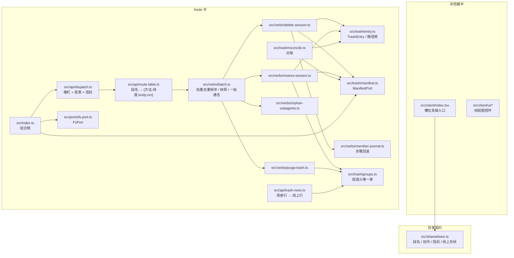
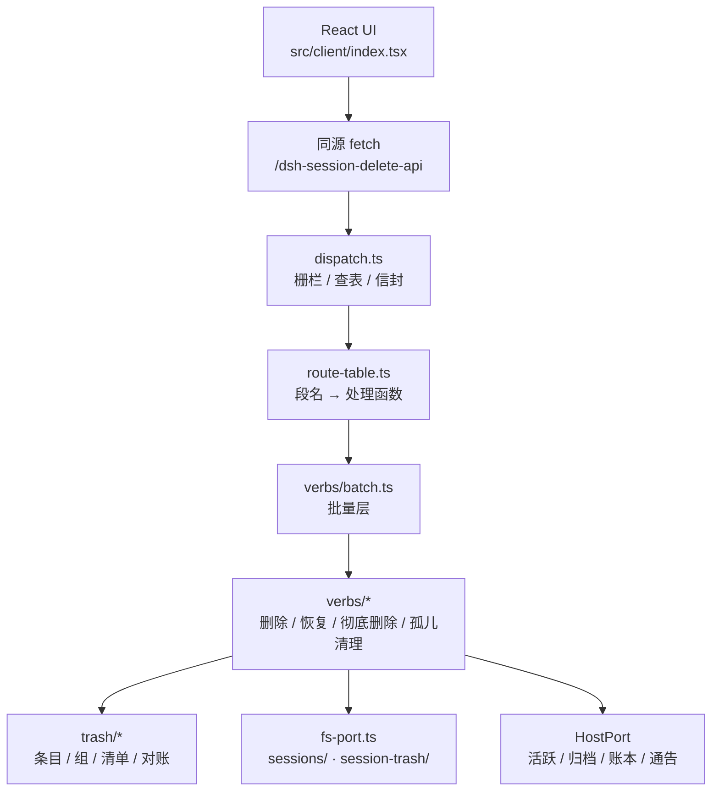
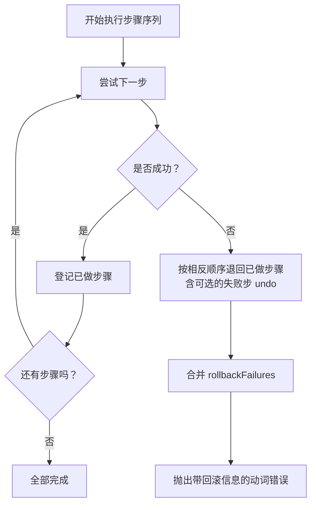
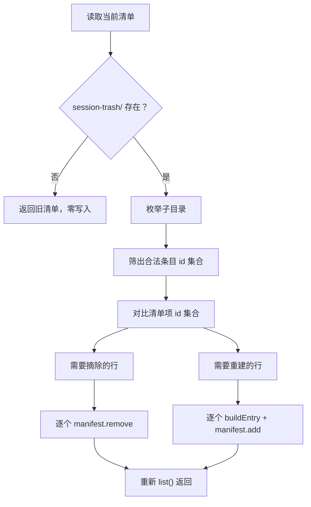
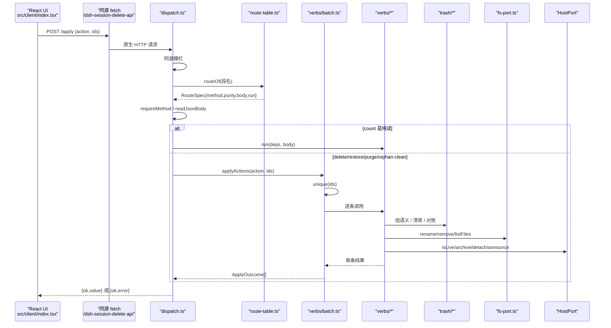

# 架构总览

<cite>
**本文引用的文件**   
- [README.md](file://README.md)
- [docs/architecture.md](file://docs/architecture.md)
- [docs/design/2026-09-30-session-delete-design.md](file://docs/design/2026-09-30-session-delete-design.md)
- [docs/adr/0001-group-membership-has-one-home.md](file://docs/adr/0001-group-membership-has-one-home.md)
- [docs/adr/0002-batch-and-journal-own-the-request.md](file://docs/adr/0002-batch-and-journal-own-the-request.md)
- [docs/adr/0003-wire-owns-the-online-shape.md](file://docs/adr/0003-wire-owns-the-online-shape.md)
- [docs/adr/0004-route-table-is-one-record.md](file://docs/adr/0004-route-table-is-one-record.md)
- [src/index.ts](file://src/index.ts)
- [src/shared/wire.ts](file://src/shared/wire.ts)
- [src/api/dispatch.ts](file://src/api/dispatch.ts)
- [src/api/route-table.ts](file://src/api/route-table.ts)
- [src/api/trash-rows.ts](file://src/api/trash-rows.ts)
- [src/ports/fs-port.ts](file://src/ports/fs-port.ts)
- [src/trash/entry.ts](file://src/trash/entry.ts)
- [src/trash/groups.ts](file://src/trash/groups.ts)
- [src/trash/manifest.ts](file://src/trash/manifest.ts)
- [src/trash/reconcile.ts](file://src/trash/reconcile.ts)
- [src/verbs/batch.ts](file://src/verbs/batch.ts)
- [src/verbs/member-journal.ts](file://src/verbs/member-journal.ts)
- [src/verbs/delete-session.ts](file://src/verbs/delete-session.ts)
- [src/verbs/orphan-subagents.ts](file://src/verbs/orphan-subagents.ts)
- [src/verbs/purge-trash.ts](file://src/verbs/purge-trash.ts)
- [src/verbs/restore-session.ts](file://src/verbs/restore-session.ts)
- [src/client/index.tsx](file://src/client/index.tsx)
</cite>

## 目录
1. [引言](#引言)
2. [项目结构](#项目结构)
3. [核心组件](#核心组件)
4. [架构总览](#架构总览)
5. [关键设计模式](#关键设计模式)
6. [请求数据流：从 React UI 到回收站动词](#请求数据流从-react-ui-到回收站动词)
7. [安全约束](#安全约束)
8. [可扩展点与变更契约](#可扩展点与变更契约)
9. [性能考量](#性能考量)
10. [故障排查](#故障排查)
11. [结论](#结论)

## 引言
本插件为 DeepSeek Harness（DSH）补齐“删除会话”能力：删除不是直接抹掉，而是移入本机回收站，可恢复；另有显式的彻底删除与清空。Node 半负责文件系统、宿主服务适配、回收站清单与 HTTP 前缀路由；浏览器半只负责槽位 UI 与可丢弃投影，通过同源 `fetch` 调用 `/dsh-session-delete-api`。仓库构建产出 Node 半与浏览器半，二者由 `src/shared/wire.ts` 这份零运行时依赖的跨半契约对齐。

**章节来源**
- [README.md:1-147](file://README.md#L1-L147)
- [docs/architecture.md:1-94](file://docs/architecture.md#L1-L94)

## 项目结构
仓库按职责分层组织，Node 半与浏览器半共享少量类型与常量：

**图表来源**
- [docs/architecture.md:12-94](file://docs/architecture.md#L12-L94)
- [src/api/dispatch.ts:1-60](file://src/api/dispatch.ts#L1-L60)
- [src/api/route-table.ts:1-40](file://src/api/route-table.ts#L1-L40)
- [src/verbs/batch.ts:1-40](file://src/verbs/batch.ts#L1-L40)
- [src/trash/groups.ts:1-25](file://src/trash/groups.ts#L1-L25)
- [src/trash/reconcile.ts:1-30](file://src/trash/reconcile.ts#L1-L30)
- [src/ports/fs-port.ts:1-20](file://src/ports/fs-port.ts#L1-L20)
- [src/shared/wire.ts:1-40](file://src/shared/wire.ts#L1-L40)

**章节来源**
- [docs/architecture.md:12-94](file://docs/architecture.md#L12-L94)

## 核心组件
- **跨半契约 `wire.ts`**：定义六个段名、五个动作、信封、失败形状、回收站目录名与请求字段名。它是 Node 半与浏览器半之间唯一的文本协议，浏览器半禁止值 import Node 模块，因此它必须零运行时依赖。
- **组合根 `index.ts`**：声明插件名、注入项、storage domain 规格、懒开清单句柄、home 路径，并注册 `/dsh-session-delete-api` 前缀路由。
- **API 层**：`dispatch.ts` 只做同源栅栏、前缀匹配、方法校验、body 预读、错误信封；`route-table.ts` 把段名映射为 `{method, body, purity, run}`；`trash-rows.ts` 把落地的 `TrashEntry` 装配成线上 `TrashRowWire`。
- **领域层**：`trash/entry.ts` 定义条目形状与路径闸；`trash/groups.ts` 是唯一拥有“这一组有谁”的地方；`trash/manifest.ts` 暴露 `ManifestPort`；`trash/reconcile.ts` 以磁盘为准修回清单。
- **动词层**：`batch.ts` 拥有批量语义；`member-journal.ts` 拥有成员移动的回滚；`delete-session.ts`、`restore-session.ts`、`purge-trash.ts`、`orphan-subagents.ts` 分别实现删除、恢复、彻底删除与无主子会话清理。
- **端口层**：`fs-port.ts` 是文件系统能力的唯一适配；`host-port.ts`（在 Node 半中）是宿主服务的窄镜像。
- **浏览器半入口 `client/index.tsx`**：探测通道后注册菜单项、行首勾选、行尾兜底开关、浮条、确认框、撤销提示以及回收站面板两席。

**章节来源**
- [src/shared/wire.ts:1-80](file://src/shared/wire.ts#L1-L80)
- [src/index.ts:1-60](file://src/index.ts#L1-L60)
- [src/api/dispatch.ts:1-60](file://src/api/dispatch.ts#L1-L60)
- [src/api/route-table.ts:1-40](file://src/api/route-table.ts#L1-L40)
- [src/api/trash-rows.ts:1-25](file://src/api/trash-rows.ts#L1-L25)
- [src/trash/entry.ts:1-25](file://src/trash/entry.ts#L1-L25)
- [src/trash/groups.ts:1-25](file://src/trash/groups.ts#L1-L25)
- [src/trash/manifest.ts:1-20](file://src/trash/manifest.ts#L1-L20)
- [src/trash/reconcile.ts:1-30](file://src/trash/reconcile.ts#L1-L30)
- [src/verbs/batch.ts:1-40](file://src/verbs/batch.ts#L1-L40)
- [src/verbs/member-journal.ts:1-35](file://src/verbs/member-journal.ts#L1-L35)
- [src/ports/fs-port.ts:1-20](file://src/ports/fs-port.ts#L1-L20)
- [src/client/index.tsx:1-40](file://src/client/index.tsx#L1-L40)

## 架构总览
系统上下文如下：浏览器半通过槽位渲染 UI，用户操作经同源 fetch 进入 Node 半的前缀路由；Node 半校验后交给动词层，动词层协调文件系统、宿主服务与回收站清单，必要时回滚或通告。

**图表来源**
- [docs/architecture.md:12-38](file://docs/architecture.md#L12-L38)
- [src/api/dispatch.ts:1-60](file://src/api/dispatch.ts#L1-L60)
- [src/api/route-table.ts:1-40](file://src/api/route-table.ts#L1-L40)
- [src/verbs/batch.ts:1-40](file://src/verbs/batch.ts#L1-L40)

**章节来源**
- [docs/architecture.md:12-94](file://docs/architecture.md#L12-L94)

## 关键设计模式

### 分层架构
依赖方向严格自上而下：`ports` → `trash/log` → `verbs` → `api` → `index`。`verbs` 不 import `api`，路由层只搬运；宿主类型面用本地窄镜像，避免随宿主包代次漂移。

**章节来源**
- [docs/architecture.md:28-56](file://docs/architecture.md#L28-L56)

### 单一真相源
- 段名、动作、信封、失败码、回收站目录名统一在 `wire.ts`。
- “这一组有谁”的唯一家在 `trash/groups.ts`。
- 清册行的落地形状在 `trash/entry.ts`，线上形状在 `wire.ts`，由 `api/trash-rows.ts` 显式投影连接，不允许 spread 继承。

**章节来源**
- [docs/adr/0001-group-membership-has-one-home.md:1-50](file://docs/adr/0001-group-membership-has-one-home.md#L1-L50)
- [docs/adr/0003-wire-owns-the-online-shape.md:1-58](file://docs/adr/0003-wire-owns-the-online-shape.md#L1-L58)
- [src/api/trash-rows.ts:1-25](file://src/api/trash-rows.ts#L1-L25)

### Journal 回滚
一次成员移动是一串带标签、正向执行和反向动作的步骤。journal 保证相反顺序退化、收集退不干净的失败、让原错误带上 `rollbackFailures`；组级回滚则把已做成的成员 journal 也逆序退回。

**图表来源**
- [src/verbs/member-journal.ts:1-60](file://src/verbs/member-journal.ts#L1-L60)
- [src/verbs/delete-session.ts:1-60](file://src/verbs/delete-session.ts#L1-L60)
- [src/verbs/restore-session.ts:1-40](file://src/verbs/restore-session.ts#L1-L40)

**章节来源**
- [src/verbs/member-journal.ts:1-103](file://src/verbs/member-journal.ts#L1-L103)
- [docs/adr/0002-batch-and-journal-own-the-request.md:20-77](file://docs/adr/0002-batch-and-journal-own-the-request.md#L20-L77)

### 回收站清单对账
每次读清单都以 `session-trash/` 目录为准：多出的目录重建行，缺失的行摘除，认不出或读不出的目录静默跳过。对账返回修好后的清单，幂等且零漂移。

**图表来源**
- [src/trash/reconcile.ts:30-127](file://src/trash/reconcile.ts#L30-L127)

**章节来源**
- [src/trash/reconcile.ts:1-127](file://src/trash/reconcile.ts#L1-L127)

### 同源栅栏与串行路由分发
- 同源栅栏允许：同源 `Origin`、桌面壳 `dsh-app://app` 的 `Origin` 或 `Referer`，以及两个头都缺席的本机工具；非回环地址一律拒绝。
- 到达序链只排 `chained` 请求，`pure` 直通；任务失败不会卡死整条链，因为 `tail` 的 reject 分支被吞掉。

**章节来源**
- [src/api/dispatch.ts:60-140](file://src/api/dispatch.ts#L60-L140)

## 请求数据流：从 React UI 到回收站动词

### 系统上下文图

**图表来源**
- [src/client/index.tsx:1-40](file://src/client/index.tsx#L1-L40)
- [src/shared/wire.ts:40-80](file://src/shared/wire.ts#L40-L80)
- [src/api/dispatch.ts:120-200](file://src/api/dispatch.ts#L120-L200)
- [src/api/route-table.ts:80-143](file://src/api/route-table.ts#L80-L143)
- [src/verbs/batch.ts:120-197](file://src/verbs/batch.ts#L120-L197)

### 详细流程说明
1. **React UI 发起请求**：浏览器半通过槽位挂载 UI，用户在会话菜单选择“删除”，或在多选模式下勾选多条，最终调用同源 fetch 发送 `POST /apply`。
2. **dispatch.ts 接收**：先检查回环地址与同源栅栏；再校验 URL 前缀是否为 `SESSION_DELETE_API_PREFIX`；然后查路由表。
3. **route-table.ts 查表**：段名必须来自 `wire.ts` 中的 `ROUTES`；每个段名指定 HTTP 方法、是否读 body、纯度与处理函数。
4. **方法白名单**：`requireMethod` 把实际方法与路由表要求的方法比较，不符即抛 405。
5. **body 预读**：只有 `json` 体才消费请求流；GET 一律不读，避免重复消费。
6. **调度到 verbs/**：`count` 走纯读直出；其他写动作进入串行链，交由 `applyActions` 处理。
7. **批量层**：先去重保序，取一次清册快照，逐条执行动词，失败不连坐，最后攒一次恢复通告。
8. **具体动词**：`delete-session` 把父与盘上孩子搬进回收站；`restore-session` 按逆序放回；`purge-trash` 彻底删目录与清册行；`orphan-subagents` 清理父已不在语料和清册的孩子组。
9. **资源访问**：动词通过 `FsPort` 读写 `sessions/` 与 `session-trash/`，通过 `HostPort` 查活跃、归档、账本与通告。

**章节来源**
- [src/api/dispatch.ts:60-200](file://src/api/dispatch.ts#L60-L200)
- [src/api/route-table.ts:80-143](file://src/api/route-table.ts#L80-L143)
- [src/verbs/batch.ts:120-197](file://src/verbs/batch.ts#L120-L197)
- [src/verbs/delete-session.ts:1-120](file://src/verbs/delete-session.ts#L1-L120)
- [src/verbs/restore-session.ts:1-120](file://src/verbs/restore-session.ts#L1-L120)
- [src/verbs/purge-trash.ts:1-80](file://src/verbs/purge-trash.ts#L1-L80)
- [src/verbs/orphan-subagents.ts:1-80](file://src/verbs/orphan-subagents.ts#L1-L80)

## 安全约束
- **CSRF 防护**：仅回环地址受信；`Origin` 非同源拒绝；桌面壳允许 `dsh-app://app` 的 `Origin` 或 `Referer`；两个头都缺席等价于本机工具，但 GET 若走 `no-cors` 仍不可读内容，不构成泄露。
- **JSON body 上限**：流式累加字节，超过 1MiB 立即抛 `bad-request`，防止内存放大。
- **方法白名单**：每个段名固定一个方法，非法方法回 405。
- **未知路由与方法**：未知路径 404，非法方法 405，栅栏拒 403；这些属于“请求本身不对”，不走操作失败信封。
- **操作失败信封**：业务失败统一 200 + `{ok:false,error}`，由 `map-error` 映射到统一失败形状。

**章节来源**
- [src/api/dispatch.ts:60-180](file://src/api/dispatch.ts#L60-L180)
- [src/api/route-table.ts:1-40](file://src/api/route-table.ts#L1-L40)
- [src/shared/wire.ts:140-200](file://src/shared/wire.ts#L140-L200)

## 可扩展点与变更契约

### 新增段名
根据 ADR-0004，新增段名需要同步两处：
1. 在 `src/shared/wire.ts` 的 `ROUTES` 对象里加键。
2. 在 `src/api/route-table.ts` 的 `ROUTE_TABLE` 里加一行，指定 `method`、`body`、`purity` 与 `run`。

漏掉任一都会触发编译错误或测试红。

**章节来源**
- [docs/adr/0004-route-table-is-one-record.md:1-51](file://docs/adr/0004-route-table-is-one-record.md#L1-L51)
- [src/shared/wire.ts:40-80](file://src/shared/wire.ts#L40-L80)
- [src/api/route-table.ts:80-143](file://src/api/route-table.ts#L80-L143)

### 新增动作
`/apply` 的动作由 `ApplyAction` 联合派生到运行期表，少一个动作编译不过。新增动作需同时更新：
- `wire.ts` 的 `ApplyAction`、`ApplyValueByAction` 与相关类型。
- `route-table.ts` 的 `APPLY_ACTION_TABLE`。
- `batch.ts` 的 `applyActions` 分支。

**章节来源**
- [src/shared/wire.ts:80-140](file://src/shared/wire.ts#L80-L140)
- [src/api/route-table.ts:40-80](file://src/api/route-table.ts#L40-L80)
- [src/verbs/batch.ts:160-197](file://src/verbs/batch.ts#L160-L197)

### 新增线上字段
根据 ADR-0003：
- 在 `wire.ts` 加线上接口字段。
- 在 `api/trash-rows.ts` 的 `toWire` 显式补一格。
- 若是必填，还要在 `trash/entry.ts` 的 `REQUIRED_ENTRY_FIELDS` 同步，并由骨架测试核对键集。

**章节来源**
- [docs/adr/0003-wire-owns-the-online-shape.md:1-58](file://docs/adr/0003-wire-owns-the-online-shape.md#L1-L58)
- [src/shared/wire.ts:100-180](file://src/shared/wire.ts#L100-L180)
- [src/api/trash-rows.ts:25-60](file://src/api/trash-rows.ts#L25-L60)
- [src/trash/entry.ts:25-60](file://src/trash/entry.ts#L25-L60)

## 性能考量
- **批量去重保序**：`unique()` 使用 `Set` 去重，保持界面“从上到下”的输入顺序；重复 id 被视为幂等 no-op。
- **一批清册快照**：恢复与彻底删除在批量层只读一次清单，动词层只读传入的只读快照，避免 N 条请求读 N 次存储域。
- **一批通告**：恢复批次攒完所有会话 id，再一次性调用 `announceRestoredBatch` 并配摘要表，避免逐条发导致宿主全表扫描。
- **批量去重保序与收缩**：父先删时，孩子 id 在后来的迭代中被判为“已被同批前一条带走”，返回 null，不再重复搬动。
- **对账快路**：`reconcileTrash` 当目录集合与清单 id 集合一致时直接返回原清单，零写入。
- **请求体流式上限**：1MiB 限制在循环内累加，遇到超限立刻短路。

**章节来源**
- [src/verbs/batch.ts:40-120](file://src/verbs/batch.ts#L40-L120)
- [src/trash/reconcile.ts:80-127](file://src/trash/reconcile.ts#L80-L127)
- [src/api/dispatch.ts:140-200](file://src/api/dispatch.ts#L140-L200)

## 故障排查
- **侧栏没有“回收站”，会话菜单也没有“删除”**：可能 Node 半未重启，或取数通道探测失败。探测不过时插件主动不注册任何入口，这是“不可用”的设计表达，不是禁用态。
- **批量删除/恢复部分失败**：批量逐条执行，失败不连坐；批量删除确认框不关，失败原文留在对应行，按钮变成“重试这 N 条”。
- **工作区已被删还能恢复**：工作区账本是可选步骤；账本不存在时照常回盘，归入“未分组”，界面会提前告知。
- **手工搬过回收站目录后列表异常**：下一次读清单会对账；手工目录若无日志或 header 会被当外人跳过，不会破坏整体。
- **正在运行的会话删不掉**：任一成员在跑整组拒绝，且不替用户终止进程。
- **清空回收站后仍有目录**：清空前先对账，手工放进 `session-trash/` 且能识别的目录会纳入清理；认不出目录不动也不列。

**章节来源**
- [README.md:1-147](file://README.md#L1-L147)
- [src/trash/reconcile.ts:1-80](file://src/trash/reconcile.ts#L1-L80)
- [src/verbs/batch.ts:120-197](file://src/verbs/batch.ts#L120-L197)
- [src/verbs/restore-session.ts:40-120](file://src/verbs/restore-session.ts#L40-L120)
- [src/verbs/purge-trash.ts:1-60](file://src/verbs/purge-trash.ts#L1-L60)

## 结论
该插件采用清晰的分层与严格的依赖方向，把 Node 半的职责限定在传输、持久化与宿主适配，把浏览器半限定在槽位 UI 与可丢弃投影。六个段名、五个动作、失败形状与回收站目录名集中在 `wire.ts`；“这一组有谁”集中在 `groups.ts`；批量语义集中在 `batch.ts`；成员回滚集中在 `member-journal.ts`。新增段名、动作或线上字段都有明确的编译期契约，减少手写一致性风险。安全上以同源栅栏与 JSON 上限保护本地写口，性能上以批量去重、清册快照与一批通告控制开销，并以 journal 与对账保障数据一致性。