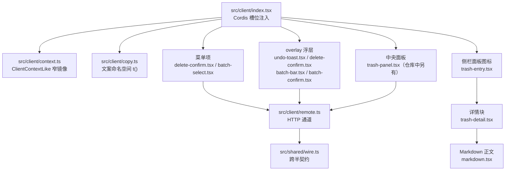
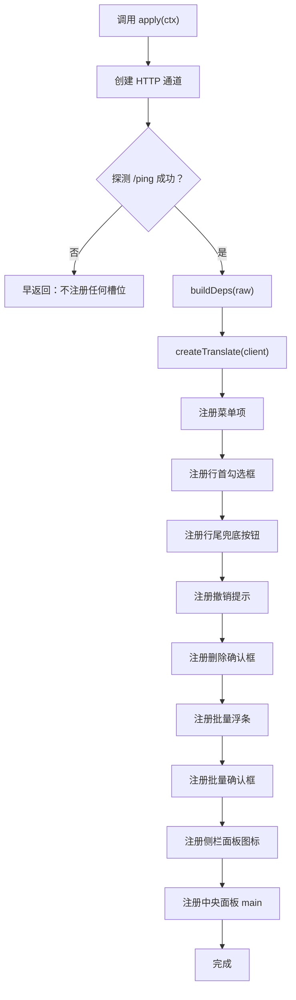
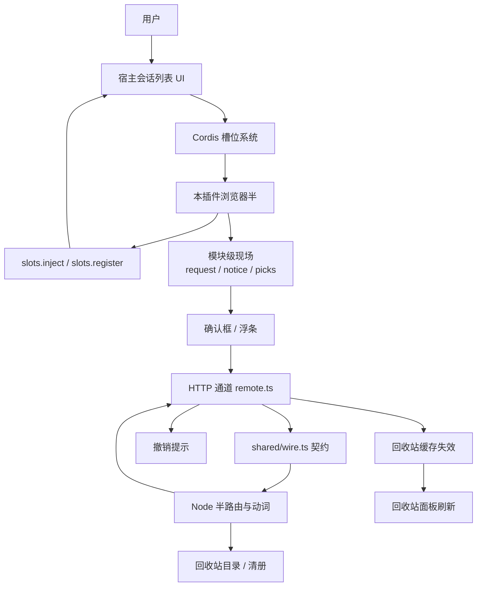
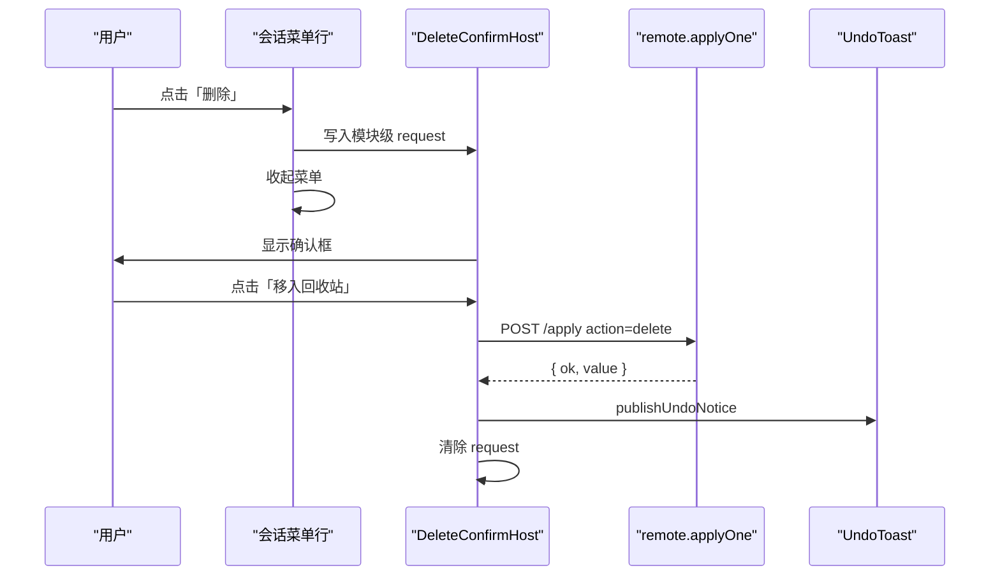
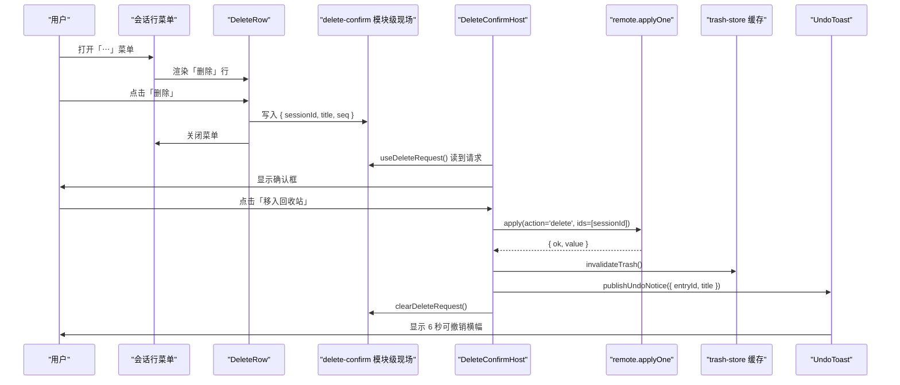
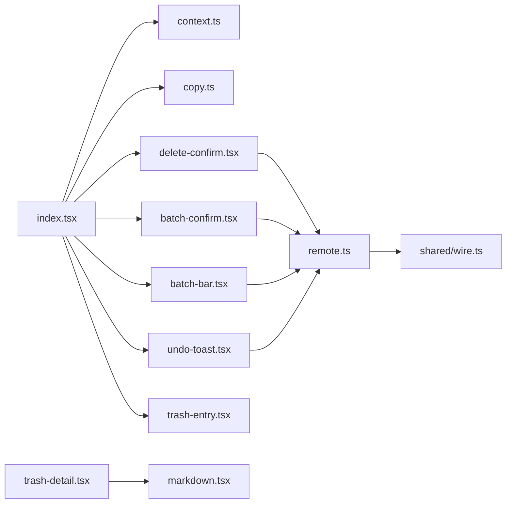

# 浏览器半槽位贡献模式

<cite>
**本文引用的文件**   
- [src/client/index.tsx](file://src/client/index.tsx)
- [src/client/context.ts](file://src/client/context.ts)
- [src/client/copy.ts](file://src/client/copy.ts)
- [src/client/markdown.tsx](file://src/client/markdown.tsx)
- [src/client/trash-detail.tsx](file://src/client/trash-detail.tsx)
- [src/client/trash-entry.tsx](file://src/client/trash-entry.tsx)
- [src/client/batch-bar.tsx](file://src/client/batch-bar.tsx)
- [src/client/batch-confirm.tsx](file://src/client/batch-confirm.tsx)
- [src/client/delete-confirm.tsx](file://src/client/delete-confirm.tsx)
- [src/client/undo-toast.tsx](file://src/client/undo-toast.tsx)
- [src/shared/wire.ts](file://src/shared/wire.ts)
- [src/client/remote.ts](file://src/client/remote.ts)
- [README.md](file://README.md)
</cite>

## 目录

1. [引言](#引言)
2. [项目结构](#项目结构)
3. [核心组件](#核心组件)
4. [架构总览](#架构总览)
5. [详细组件分析](#详细组件分析)
6. [依赖关系分析](#依赖关系分析)
7. [性能考虑](#性能考虑)
8. [故障排查](#故障排查)
9. [结论](#结论)
10. [附录：扩展新槽位的步骤](#附录扩展新槽位的步骤)

## 引言

本插件以“浏览器半”的形式通过 Cordis 的槽位机制向宿主 DSH 客户端贡献界面，而不是直接渲染宿主页面。它只做五件事：

| 贡献类型 | 目标 | 行为 |
|---|---|---|
| 菜单项 | `sidebar.workspaces.session.menu.item` | 在会话「⋯」菜单里加入「多选」与「删除」。菜单行只发请求，不持有确认框状态。 |
| 行首勾选框 | `sidebar.session.row.leading` | 多选模式内出现，16px 格里的原生勾选框。 |
| 行尾按钮 | `sidebar.workspaces.session.row.action` | 行首不可用时出现的兜底勾选开关；悬停排点击不误开会话。 |
| overlay 浮层 | `shell.overlay` | 撤销提示、删除确认框、批量浮条、批量确认框都挂在这里，脱离菜单子树生命周期。 |
| 侧栏面板 | `sidebar.panellist` + `main` | 一对座位：侧栏图标行 + 中央回收站面板。 |

入口 `apply(ctx)` 同步返回、绝不抛错；真正的槽位注册挂在取数通道探测的异步续拍上。通道不可用等价于“插件不存在”，不会让宿主前端启动失败。

**章节来源**
- [README.md:1-147](file://README.md#L1-L147)
- [src/client/index.tsx:1-346](file://src/client/index.tsx#L1-L346)

## 项目结构

浏览器半按职责拆分，而不是按“所有 UI 放一个入口”组织：

**图表来源**
- [src/client/index.tsx:201-346](file://src/client/index.tsx#L201-L346)
- [src/client/context.ts:1-34](file://src/client/context.ts#L1-L34)
- [src/client/copy.ts:1-386](file://src/client/copy.ts#L1-L386)
- [src/client/markdown.tsx:1-57](file://src/client/markdown.tsx#L1-L57)
- [src/client/trash-detail.tsx:1-323](file://src/client/trash-detail.tsx#L1-L323)
- [src/client/trash-entry.tsx:1-30](file://src/client/trash-entry.tsx#L1-L30)
- [src/client/batch-bar.tsx:1-136](file://src/client/batch-bar.tsx#L1-L136)
- [src/client/batch-confirm.tsx:1-237](file://src/client/batch-confirm.tsx#L1-L237)
- [src/client/delete-confirm.tsx:1-194](file://src/client/delete-confirm.tsx#L1-L194)
- [src/client/undo-toast.tsx:1-151](file://src/client/undo-toast.tsx#L1-L151)
- [src/client/remote.ts:1-288](file://src/client/remote.ts#L1-L288)
- [src/shared/wire.ts:1-261](file://src/shared/wire.ts#L1-L261)

**章节来源**
- [src/client/index.tsx:1-346](file://src/client/index.tsx#L1-L346)

## 核心组件

### 入口初始化流程

入口暴露两个导出：

| 导出 | 用途 |
|---|---|
| `name` | 插件名，供宿主识别。 |
| `apply(ctx)` | Cordis 调用入口，负责探测通道、构造翻译函数、注册全部槽位。 |

`activate(client)` 是真正的初始化逻辑：

1. 创建 HTTP 取数通道 `createHttpRemote()`。
2. 调用 `probeChannel(raw)` 发送一次 `/ping`。
3. 探测失败时早返回：一个槽位都不注册。
4. 探测成功时 `buildDeps(raw)` 包装成调用方需要的远程面。
5. 通过 `createTranslate(client)` 接入宿主 locale 服务或降级到内置中文。
6. 依次注册菜单项、行首勾选框、行尾按钮、四个 overlay 常驻宿主、侧栏面板图标、中央面板。
7. `apply` 捕获异常并只打日志，确保同步入口不抛错。

关键约束是：**槽位只在通道可用时注册**。这样“不可用”表现为页面上没有入口，而不是出现一个点下去就崩溃的入口。

**图表来源**
- [src/client/index.tsx:201-346](file://src/client/index.tsx#L201-L346)

**章节来源**
- [src/client/index.tsx:201-346](file://src/client/index.tsx#L201-L346)

### 宿主能力上下文

`context.ts` 定义了浏览器半对宿主 `ctx` 的本地窄镜像：

| 接口 | 字段 | 含义 |
|---|---|---|
| `SlotRegistration` | `name`、`id`、`key`、`order`、`label`、`inject` | 槽位注册项。`label` 可以是 thunk，随语言变化重读。 |
| `SlotsLike` | `inject(key, contribute)`、`register(options, component)` | 槽位注册表。这是 `inject` 中唯一保证存在的宿主成员。 |
| `ClientContextLike` | `slots`、`get?(name)`、`effect(execute, label)` | 浏览器侧 ctx 最小面。`get` 可选，`effect` 用于挂载卸载回调。 |

设计原则是“只声明用到的成员 + 一次强转”，不引入宿主类型包，也不做 `declare module` 增强。这样插件可以跨宿主代数运行，但必须容忍某些可选服务缺失。

**章节来源**
- [src/client/context.ts:1-34](file://src/client/context.ts#L1-L34)

### 复制与文案体系

`copy.ts` 集中维护可见文案，并通过宿主 locale 服务绑定命名空间。

要点：

- 中文字典 `ZH` 是真源，英文字典 `EN` 必须逐键齐全；漏键会编译期报错。
- 命名空间为 `xrn1997-session-delete`，避免和宿主 `common`、`settings`、`sidebar` 冲突。
- `createTranslate(ctx)` 先尝试 `ctx.get('locale')`；若缺失则返回 `zhTranslate`，整插件继续工作。
- 注册必须挂在 `ctx.effect` 上，以便宿主卸载时释放 disposer。
- 面板行的 `label` 使用 `() => t('trash.title')`，走宿主的 `resolveSlotLabel`，从而随语言切换刷新。
- `agoText`、`unitWord`、`absoluteText`、`splitOn` 等工具统一时间、单位与危险句式的展示。

**章节来源**
- [src/client/copy.ts:1-386](file://src/client/copy.ts#L1-L386)

### Markdown 详情如何嵌入宿主 UI

回收站详情不是把原始 HTML 塞进 DOM，而是：

1. 清单面板 `TrashPanel`（仓库中另有文件）通过 `main` 槽成为中央面板占用者。
2. 选中条目后，`TrashDetail` 显示元信息、消息计数与正文。
3. 用户提问保持原话。
4. 助手回复交给 `MarkdownBody`。
5. `react-markdown` 配合 `remark-gfm` 渲染表格与任务列表。
6. 链接渲染为纯文本加 `title`，图片渲染为 `[图片 alt]`，因为回收站场景下原路径不可用且不应跳转。
7. 样式通过副作用导入 `./ui/styles.js`，由宿主给插件的 CSS 通道注入 `<style>`。
8. 组件用 `memo` 包裹，避免每次面板重渲染都重新解析 Markdown。

**章节来源**
- [src/client/markdown.tsx:1-57](file://src/client/markdown.tsx#L1-L57)
- [src/client/trash-detail.tsx:1-323](file://src/client/trash-detail.tsx#L1-L323)

## 架构总览

从用户操作到数据落地的整体链路如下：

**图表来源**
- [src/client/index.tsx:201-346](file://src/client/index.tsx#L201-L346)
- [src/client/delete-confirm.tsx:1-194](file://src/client/delete-confirm.tsx#L1-L194)
- [src/client/batch-confirm.tsx:1-237](file://src/client/batch-confirm.tsx#L1-L237)
- [src/client/undo-toast.tsx:1-151](file://src/client/undo-toast.tsx#L1-L151)
- [src/client/remote.ts:1-288](file://src/client/remote.ts#L1-L288)
- [src/shared/wire.ts:1-261](file://src/shared/wire.ts#L1-L261)

## 详细组件分析

### 槽位与贡献映射

| 槽位常量 | 实际名称 | 贡献内容 | 是否常驻 |
|---|---|---|---|
| `MENU_SLOT` | `sidebar.workspaces.session.menu.item` | 「多选」「删除」两行 | 否，随菜单渲染 |
| `LEADING_SLOT` | `sidebar.session.row.leading` | 行首勾选框 | 否，仅多选模式且无状态点时 |
| `ROW_ACTION_SLOT` | `sidebar.workspaces.session.row.action` | 行尾兜底勾选按钮 | 否，仅多选模式 |
| `OVERLAY_SLOT` | `shell.overlay` | 撤销提示、删除确认、批量浮条、批量确认 | 是 |
| `PANEL_SLOT` | `sidebar.panellist` | 回收站图标行 | 是 |
| `MAIN_SLOT` | `main` | 回收站中央面板 | 是 |

每个注册项使用插件专属 id 前缀 `@xrn1997/dsh-session-delete`，避免与宿主或其他插件撞 key。

**章节来源**
- [src/client/index.tsx:1-346](file://src/client/index.tsx#L1-L346)

### 菜单项：只发请求，不持确认框

菜单槽的适配函数从宿主投影拿到 `sessionId`、`displayTitle`、`useSessions` 与 `useMenuOpenState`。

行为规则：

- 「多选」入口进入多选模式，再按一次退出，并按官方示例收起菜单。
- 「删除」菜单行先把 `{ sessionId, title }` 写入 `delete-confirm.tsx` 的模块级现场，然后关闭菜单。
- 真实删除请求由挂在 `shell.overlay` 上的 `DeleteConfirmHost` 读取现场并提交。
- 这样做的原因是：宿主菜单行随菜单一起卸载，如果确认框住在菜单行里，会在菜单收起时被 React 生命周期卸载，即使使用了 portal 也不行。

**图表来源**
- [src/client/index.tsx:1-200](file://src/client/index.tsx#L1-L200)
- [src/client/delete-confirm.tsx:1-194](file://src/client/delete-confirm.tsx#L1-L194)
- [src/client/undo-toast.tsx:1-151](file://src/client/undo-toast.tsx#L1-L151)

**章节来源**
- [src/client/index.tsx:1-200](file://src/client/index.tsx#L1-L200)
- [src/client/delete-confirm.tsx:1-194](file://src/client/delete-confirm.tsx#L1-L194)

### 行首勾选框与行尾兜底按钮

`LEADING_SLOT` 与 `ROW_ACTION_SLOT` 共同覆盖多选模式下的两种宿主行态：

- 行首勾选框：宿主只在没有状态点、非归档的行渲染该格。
- 行尾按钮：当行首格不渲染时出现，作为兜底选择开关。
- 两条不会同时出现：`ui.css` 的 `:has` 规则隐藏重复项。
- 行尾按钮负责把标题和运行态登记给多选模式的整行点击守卫。
- 宿主保证这些槽位的排内点击不误开会话，所以插件不需要处理事件冒泡。

**章节来源**
- [src/client/index.tsx:1-200](file://src/client/index.tsx#L1-L200)
- [src/client/batch-bar.tsx:1-136](file://src/client/batch-bar.tsx#L1-L136)

### overlay 浮层与撤销提示

`shell.overlay` 是框架级浮层容器，适合放 toast、确认框、浮条这类不依附于某个菜单的生命周期对象。

常驻贡献包括：

| 贡献 | 组件 | 作用 |
|---|---|---|
| 撤销提示 | `UndoToast` | 删除成功后显示可撤销横幅，停留 6 秒。 |
| 删除确认框 | `DeleteConfirmHost` | 单条删除二次确认。 |
| 批量浮条 | `BatchBar` | 多选模式内的常驻浮条，显示已选数量与展开清单。 |
| 批量确认框 | `BatchConfirmHost` | 批量删除二次确认。 |

撤销提示的状态也是模块级现场，通过 `useSyncExternalStore` 订阅；单条撤销调用 `restore(entryId)`，批量撤销一次调用 `applyOutcomes('restore', entryIds)`。

**章节来源**
- [src/client/index.tsx:201-346](file://src/client/index.tsx#L201-L346)
- [src/client/undo-toast.tsx:1-151](file://src/client/undo-toast.tsx#L1-L151)
- [src/client/batch-bar.tsx:1-136](file://src/client/batch-bar.tsx#L1-L136)
- [src/client/batch-confirm.tsx:1-237](file://src/client/batch-confirm.tsx#L1-L237)

### 侧栏面板与中央面板

回收站入口是一对必须同批注册的座位：

1. `sidebar.panellist` 注册一个带 `label: () => t('trash.title')` 的面板行。
2. `main` 注册一个同字 `key` 的中央面板占用者 `TrashPanel`。
3. 面板图标组件 `TrashPanelIcon` 只输出 glyph，不写按钮、文字或角标，因为宿主 `PanelRow` 已经负责整行交互。
4. 面板 id 与 `main` 的 key 必须是同一个字符串；宿主 `layout.selectPanel` 要求中央列里存在同字 key，否则抛出错误。

面板 id 使用插件前缀，避免复用宿主保留的 `conversation` 键导致静默替换。

**章节来源**
- [src/client/index.tsx:201-346](file://src/client/index.tsx#L201-L346)
- [src/client/trash-entry.tsx:1-30](file://src/client/trash-entry.tsx#L1-L30)

### 槽位不可用时的降级策略

| 情况 | 行为 | 原因 |
|---|---|---|
| 取数通道探测失败 | 不注册任何槽位 | 避免暴露无法工作的 UI。 |
| 宿主 locale 服务缺失 | 使用内置中文 | 不让“没有语言服务”变成进程启动失败。 |
| 菜单 hook 缺失 | 使用恒等兜底函数 | 防止菜单行因宿主版本差异而抛错。 |
| root sessions hook 缺失 | 空 state 求值 | `running` 判 false，`title` 取空串。 |
| 详情正文为空 | 显示“这条会话没有可显示的文字” | 区分“加载中”“读失败”“确实没正文”。 |
| 子会话计数读不到 | 整句不说，不报 0 | 0 可能掩盖一次失败的查询。 |
| 远程信封失败 | 上屏 `code` + `message` + 可选 `details` | 失败原文不能吞。 |
| 网络层失败 | 转为 `client/unknown` 并保留原文 | 非本仓信封的错误也要可诊断。 |

**章节来源**
- [src/client/index.tsx:1-200](file://src/client/index.tsx#L1-L200)
- [src/client/copy.ts:1-386](file://src/client/copy.ts#L1-L386)
- [src/client/remote.ts:1-288](file://src/client/remote.ts#L1-L288)

### 类型安全契约：wire.ts

`src/shared/wire.ts` 是 Node 半与浏览器半之间唯一的 wire 契约。它不是运行时依赖，浏览器构建产物把它 inline 进去。

契约范围：

| 类别 | 内容 |
|---|---|
| API 前缀 | `SESSION_DELETE_API_PREFIX = '/dsh-session-delete-api'` |
| 路由段 | `list`、`ping`、`detail`、`apply`、`empty`、`orphans` |
| 动作 | `delete`、`restore`、`purge`、`count`、`orphan-clean` |
| 结果信封 | `RemoteResult<T>` |
| 失败信封 | `RemoteFailure` |
| 批量结果 | `ApplyOutcome` |
| 清册行 | `TrashEntryWire`、`TrashRowWire` |
| 详情行 | `TrashDetailWire`、`TrashDetailMessageWire` |
| 孤儿扫描报告 | `OrphanReportWire`、`OrphanCleanStatsWire` |
| 清空回执 | `PurgeStatsWire` |
| 请求参数名 | `PARAMS.entryId`、`PARAMS.action`、`PARAMS.ids` |

浏览器半通过 `src/client/remote.ts` 把这段契约实现成同源 fetch 通道；Node 半按同一契约产出信封。

**章节来源**
- [src/shared/wire.ts:1-261](file://src/shared/wire.ts#L1-L261)
- [src/client/remote.ts:1-288](file://src/client/remote.ts#L1-L288)

### 为什么浏览器半不持有回收站真相

本仓库的“真相”分层很明确：

| 层级 | 责任 |
|---|---|
| 宿主会话列表 | 决定哪些会话在列表中显示。 |
| Node 半动词 | 操作回收站目录、工作区账本、日志与磁盘。 |
| 浏览器半 | 展示宿主提供的数据，发起操作，管理局部 UI 状态。 |
| wire 契约 | 两端共享的请求字段、响应形状与错误模型。 |

浏览器半有自己的回收站缓存（例如 `trash-store.ts`），但它只是**镜像**：清单读取后缓存，写操作成功后通过 `invalidateTrash()` 让面板重新拉取。真正决定“这条会话是否还在盘上、是否属于回收站”的是 Node 半与宿主数据根。

因此，浏览器半不会自己维护“回收站真相”，也不会假设本地缓存永远准确。

**章节来源**
- [src/shared/wire.ts:1-261](file://src/shared/wire.ts#L1-L261)
- [src/client/remote.ts:1-288](file://src/client/remote.ts#L1-L288)

### “用户点击删除”端到端交互图

下面描述从会话菜单点到撤销横幅的完整流程：

**图表来源**
- [src/client/index.tsx:1-200](file://src/client/index.tsx#L1-L200)
- [src/client/delete-confirm.tsx:1-194](file://src/client/delete-confirm.tsx#L1-L194)
- [src/client/undo-toast.tsx:1-151](file://src/client/undo-toast.tsx#L1-L151)

**章节来源**
- [src/client/delete-confirm.tsx:1-194](file://src/client/delete-confirm.tsx#L1-L194)
- [src/client/undo-toast.tsx:1-151](file://src/client/undo-toast.tsx#L1-L151)

## 依赖关系分析

**图表来源**
- [src/client/index.tsx:1-346](file://src/client/index.tsx#L1-L346)
- [src/client/context.ts:1-34](file://src/client/context.ts#L1-L34)
- [src/client/copy.ts:1-386](file://src/client/copy.ts#L1-L386)
- [src/client/delete-confirm.tsx:1-194](file://src/client/delete-confirm.tsx#L1-L194)
- [src/client/batch-bar.tsx:1-136](file://src/client/batch-bar.tsx#L1-L136)
- [src/client/batch-confirm.tsx:1-237](file://src/client/batch-confirm.tsx#L1-L237)
- [src/client/undo-toast.tsx:1-151](file://src/client/undo-toast.tsx#L1-L151)
- [src/client/trash-detail.tsx:1-323](file://src/client/trash-detail.tsx#L1-L323)
- [src/client/markdown.tsx:1-57](file://src/client/markdown.tsx#L1-L57)
- [src/client/remote.ts:1-288](file://src/client/remote.ts#L1-L288)
- [src/shared/wire.ts:1-261](file://src/shared/wire.ts#L1-L261)

**章节来源**
- [src/client/index.tsx:1-346](file://src/client/index.tsx#L1-L346)
- [src/client/remote.ts:1-288](file://src/client/remote.ts#L1-L288)
- [src/shared/wire.ts:1-261](file://src/shared/wire.ts#L1-L261)

## 性能考虑

当前实现中的主要性能决策：

| 位置 | 优化 | 理由 |
|---|---|---|
| MarkdownBody | `memo(text)` | `react-markdown` 内部无 memoization，面板频繁重渲会导致每条助手回复每拍重新解析。 |
| 批量子会话计数 | 防抖 300ms | 连勾多条时不连续发多次 count 请求。 |
| 批量计数序号 | `seqRef` 守卫 | 旧响应不允许盖掉最新名单的读数。 |
| 确认框 | `key={current.seq}` | 换一条会话或换一批条目时重新挂载，避免 busy/failure 记忆污染。 |
| 撤销提示 | `key={notice.seq}` | 同一段文案再次出现也能重新计停留时间。 |
| 菜单行 | 菜单收起后才提交请求 | 符合宿主第三方行示例，避免在菜单仍打开时产生多余交互。 |
| 面板宽度 | ResizeObserver 观测中央列宽 | 宿主侧栏折叠也会改变宽度，仅监听 window.resize 不够。 |

**章节来源**
- [src/client/markdown.tsx:1-57](file://src/client/markdown.tsx#L1-L57)
- [src/client/batch-bar.tsx:1-136](file://src/client/batch-bar.tsx#L1-L136)
- [src/client/delete-confirm.tsx:1-194](file://src/client/delete-confirm.tsx#L1-L194)
- [src/client/batch-confirm.tsx:1-237](file://src/client/batch-confirm.tsx#L1-L237)
- [src/client/undo-toast.tsx:1-151](file://src/client/undo-toast.tsx#L1-L151)

## 故障排查

| 现象 | 检查点 | 处理方式 |
|---|---|---|
| 安装后侧栏没有回收站、菜单没有删除 | 重启宿主；查看控制台是否有“入口未注册”警告 | 通道探测失败时插件不注册任何入口，这是预期降级。 |
| 点击删除后确认框消失 | 确认框是否被误放在菜单行子树内 | 确认框必须挂在 `shell.overlay`，由模块级现场驱动。 |
| 回收站面板能点开但没有数据 | 清单读取是否失败 | 失败块应显示原文并提供重试；不要把“读不到”当成“空的”。 |
| Markdown 正文不渲染 | 检查是否只渲染了用户消息 | 只有助手回复走 `MarkdownBody`；用户消息保持原话。 |
| 批量删除部分失败 | 查看确认框中失败行的 danger Tag | 批量确认框不关，按钮变为“重试这 N 条”。 |
| 撤销横幅没有撤销按钮 | 单条形 entryId 是否为空，或批量形 entryIds 是否为空 | 没有有效落点的撤销只出正文不出动作。 |
| 面板 id 冲突 | 检查 `main` 的 key 是否与宿主或其他插件重复 | 宿主对重 id 可能静默替换，必须带插件专属前缀。 |

**章节来源**
- [src/client/index.tsx:201-346](file://src/client/index.tsx#L201-L346)
- [src/client/remote.ts:1-288](file://src/client/remote.ts#L1-L288)
- [README.md:1-147](file://README.md#L1-L147)

## 结论

浏览器半的贡献模式可以概括为：

- **界面归属宿主**：插件通过 Cordis 槽位插入菜单项、行首勾选框、行尾按钮、overlay 浮层与侧栏面板。
- **状态尽量局部化**：菜单行不持确认框；确认框、toast、批量状态都放在模块级现场。
- **能力来自宿主**：`ClientContextLike` 只提供必要能力，可选服务一律降级。
- **真相不在浏览器半**：wire 契约只描述线上形状，回收站目录与账本由 Node 半与宿主管理。
- **不可用等于不存在**：通道探测失败时不注册入口，避免半吊子 UI。
- **类型契约集中在 shared/wire.ts**：浏览器半与 Node 半共享请求字段、响应信封与失败形状。

这套模式适合跨宿主代数的轻量插件：它依赖最少的宿主公开面，承担最明确的边界，并把不可恢复的错误留给宿主进程，把可解释的错误留给用户。

**章节来源**
- [src/client/index.tsx:1-346](file://src/client/index.tsx#L1-L346)
- [src/client/context.ts:1-34](file://src/client/context.ts#L1-L34)
- [src/shared/wire.ts:1-261](file://src/shared/wire.ts#L1-L261)

## 附录：扩展新槽位的步骤

如果你要在本插件中加入一个新的 Cordis 槽位贡献，建议按以下步骤进行：

1. **确认宿主确实提供该槽位**  
   查阅宿主槽位声明或使用探测方式确认，不要把槽位名当作猜测常量。

2. **定义稳定的 slot 常量**  
   在 `index.tsx` 中以类似 `const NEW_SLOT = '...'` 的形式声明，便于统一管理和搜索。

3. **确定贡献形态**  
   - 菜单项：通常只发请求，不持确认框。  
   - 行内元素：注意宿主是否已有状态点、归档行等分支。  
   - overlay：适合需要脱离菜单生命周期的弹窗、toast、浮条。  
   - 面板：`sidebar.panellist` 与 `main` 必须成对注册，id/key 一致。

4. **编写适配函数**  
   把槽位投影转换成组件 props；对可选 hook 使用恒等兜底，避免宿主版本差异导致抛错。

5. **注册时使用插件专属 id**  
   使用 `PLUGIN_ID` 前缀，避免与宿主或其他插件冲突。

6. **如果需要文案**  
   新增文案键到 `copy.ts` 的 `ZH` 与 `EN`，并通过 `t(...)` 访问；面板标签优先用 thunk。

7. **如果需要远程数据**  
   先在 `shared/wire.ts` 中增加契约，再在 `remote.ts` 中实现方法，最后由组件通过 `callRemote` 或 `applyOutcomes` 调用。

8. **处理不可用分支**  
   - 如果是探测前就能判断不可用，可以在 `activate` 中跳过注册。  
   - 如果是运行时失败，把错误原文交给用户，不要吞掉。

9. **验证生命周期**  
   特别检查：菜单行是否会卸载、confirm 是否挂在 overlay、toast 是否在菜单关闭后仍存在。

10. **更新文档与测试**  
    记录新的槽位名、props、状态与失败表现；如有交互，补充端到端用例。

**章节来源**
- [src/client/index.tsx:1-346](file://src/client/index.tsx#L1-L346)
- [src/client/context.ts:1-34](file://src/client/context.ts#L1-L34)
- [src/client/copy.ts:1-386](file://src/client/copy.ts#L1-L386)
- [src/shared/wire.ts:1-261](file://src/shared/wire.ts#L1-L261)
- [src/client/remote.ts:1-288](file://src/client/remote.ts#L1-L288)