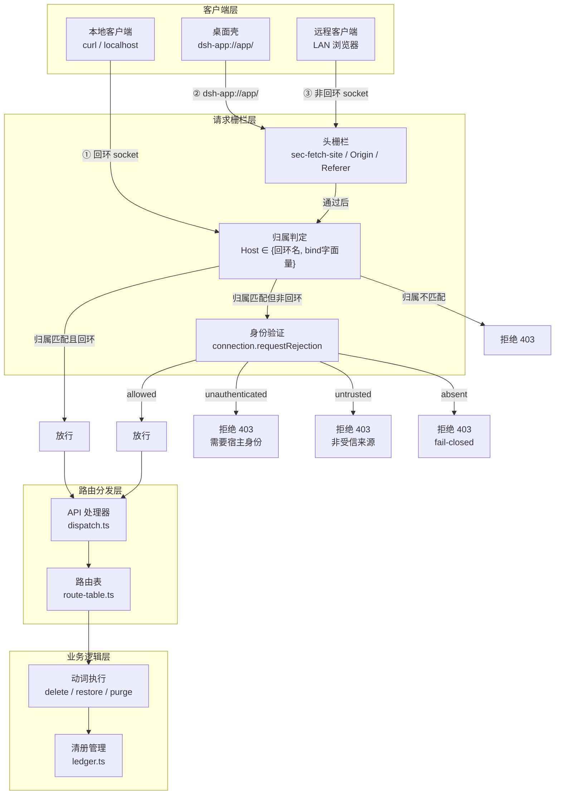
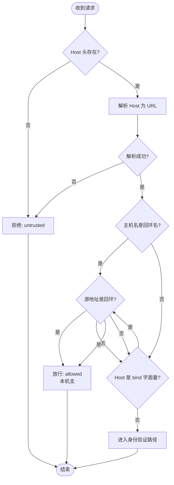
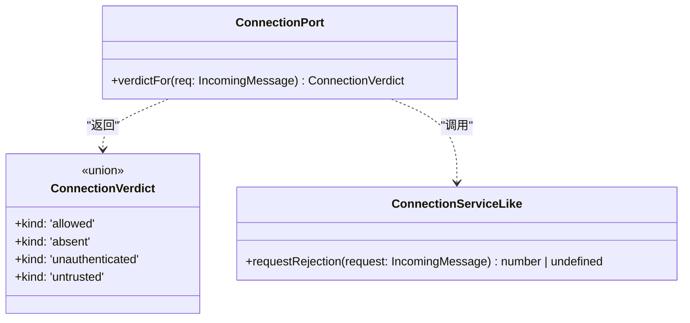
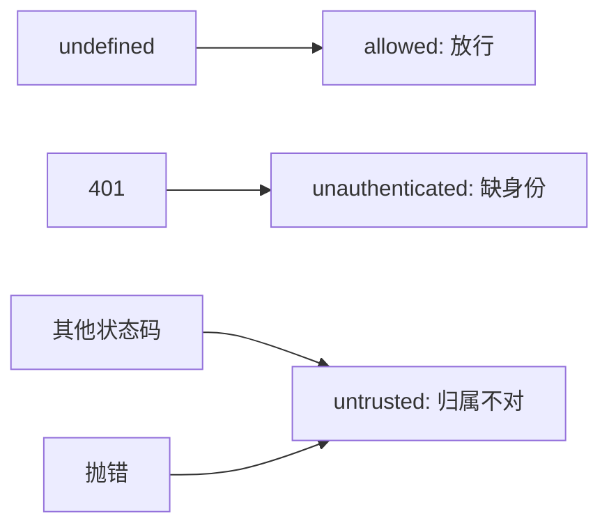
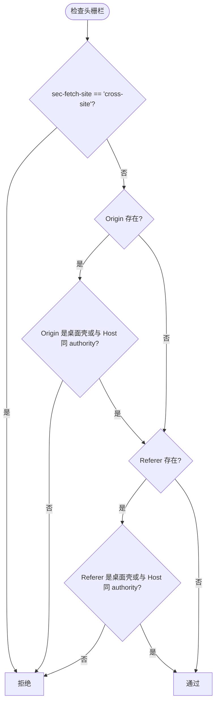
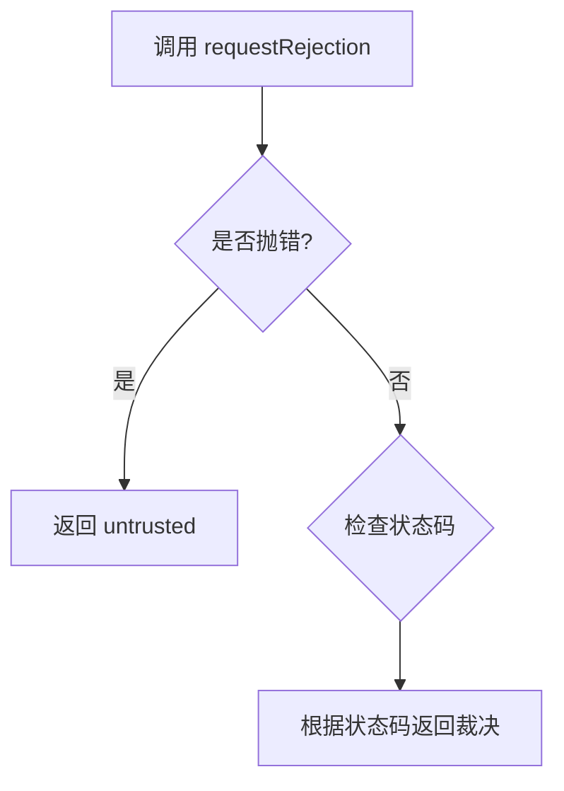
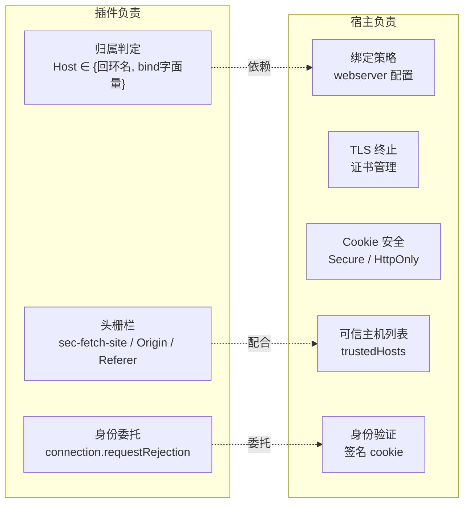
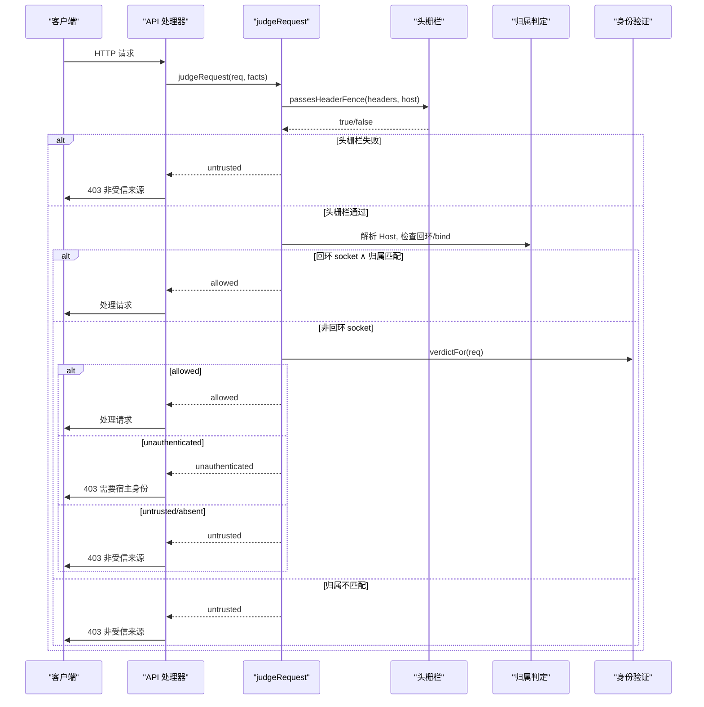
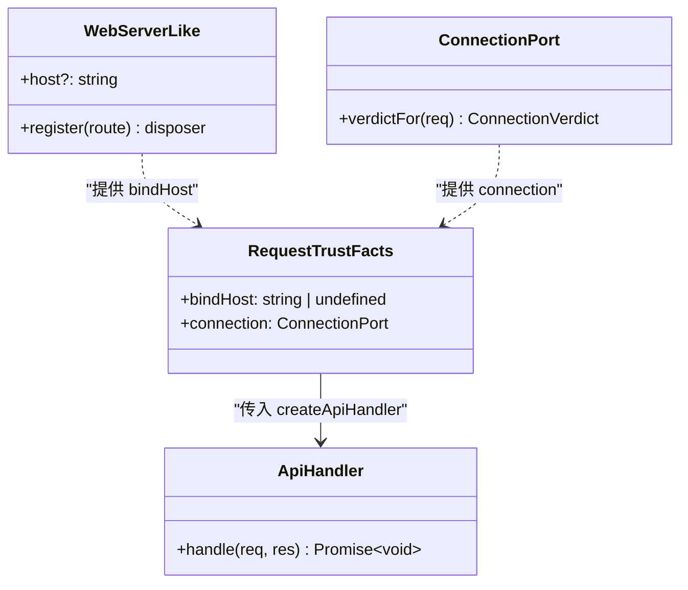
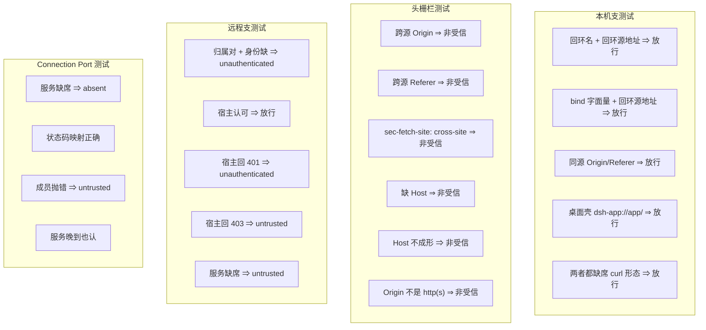

# 请求信任与栅栏机制

<cite>
**Referenced Files in This Document **
- [request-trust.ts](file://src/api/request-trust.ts)
- [connection-port.ts](file://src/ports/connection-port.ts)
- [dispatch.ts](file://src/api/dispatch.ts)
- [index.ts](file://src/index.ts)
- [wire.ts](file://src/shared/wire.ts)
- [0022-non-loopback-clients-ride-host-identity.md](file://docs/adr/0022-non-loopback-clients-ride-host-identity.md)
- [0009-plugin-prefix-route-instead-of-remote.md](file://docs/adr/0009-plugin-prefix-route-instead-of-remote.md)
- [request-trust.test.ts](file://tests/request-trust.test.ts)
- [api.test.ts](file://tests/api.test.ts)
- [connection-stub.ts](file://tests/support/connection-stub.ts)
</cite>

## Table of Contents

1. [概述](#概述)
2. [架构设计](#架构设计)
3. [归属判定机制](#归属判定机制)
4. [身份继承机制](#身份继承机制)
5. [头栅栏机制](#头栅栏机制)
6. [缺席处理策略](#缺席处理策略)
7. [安全边界与威胁模型](#安全边界与威胁模型)
8. [实现细节](#实现细节)
9. [测试覆盖](#测试覆盖)
10. [部署与兼容性](#部署与兼容性)

## 概述

本插件实现了双层请求信任与栅栏机制，将传统的单一「源地址回环」判据重构为**归属**与**身份**两个独立层次。这一设计使得插件能够在局域网部署和反向代理场景下正常工作，同时保持严格的安全边界。

### 核心概念

**归属（Ownership）**：由 `Host` 头判定，确定请求是否指向本次部署的实例。判据包括回环主机名、监听器绑定的具体接口 IP 字面量。

**身份（Identity）**：远程客户端需通过宿主的 `connection.requestRejection` 方法验证，继承宿主 Web 服务器的已认证身份。

**头栅栏（Header Fence）**：对所有客户端生效的额外防护层，否决跨站请求并要求 `Origin` / `Referer` 与 `Host` 具有相同的 authority。

**缺席处理（Fail-Closed）**：当身份服务缺席时，远程请求一律拒绝，退回到「仅本机访问」模式。

### 设计动机

原有的请求栅栏将「源地址必须是回环」作为唯一准入条件，这导致以下问题：

1. **局域网部署不可用**：当宿主绑定到局域网 IP 时，所有远程客户端都被拒绝
2. **替宿主做绑定决策**：插件无法替宿主 webserver 配置决定绑定策略
3. **缺乏灵活性**：无法支持桌面壳转发、反向代理等合法使用场景

新的双层机制解决了这些问题，同时保持了严格的安全边界。

## 架构设计



**Diagram sources **
- [request-trust.ts:1-128](file://src/api/request-trust.ts#L1-L128)
- [connection-port.ts:1-49](file://src/ports/connection-port.ts#L1-L49)
- [dispatch.ts:1-166](file://src/api/dispatch.ts#L1-L166)

**Section sources**
- [request-trust.ts:1-128](file://src/api/request-trust.ts#L1-L128)
- [connection-port.ts:1-49](file://src/ports/connection-port.ts#L1-L49)
- [0022-non-loopback-clients-ride-host-identity.md:1-43](file://docs/adr/0022-non-loopback-clients-ride-host-identity.md#L1-L43)

## 归属判定机制

归属判定是请求栅栏的第一道防线，它确定请求是否指向本次部署的实例。

### 判定流程



**Diagram sources **
- [request-trust.ts:85-128](file://src/api/request-trust.ts#L85-L128)

### 回环主机名判定

回环主机名包括以下形式：

| 主机名格式 | 示例 | 说明 |
|-----------|------|------|
| `localhost` | `localhost:3080` | 标准回环主机名 |
| `[::1]` | `[::1]:3080` | IPv6 回环地址 |
| `127.x.x.x` | `127.0.0.1:3080`, `127.0.0.2:3080` | 整个 127/8 网段 |

**Section sources**
- [request-trust.ts:55-60](file://src/api/request-trust.ts#L55-L60)

### Bind 字面量判定

当 Host 不是回环名时，系统检查它是否与监听器绑定的具体接口 IP 字面量匹配：

1. **忽略端口**：归属判定只关心主机名，不参与端口比较
2. **忽略 zone ID**：IPv6 的 `%zone` 部分是接口选择器，不是地址文本
3. **精确匹配**：必须与宿主 webserver 配置的 bind 地址完全一致

例如：
- `bindHost: '192.168.50.199'` 匹配 `Host: '192.168.50.199:3080'`
- `bindHost: 'fe80::1%eth0'` 匹配 `Host: '[fe80::1]:3080'`

### DNS Rebinding 防护

归属判定先于任何本机/远程分支执行，防止 DNS rebinding 攻击：

- `Origin === Host` 只证明两者同名，不证明这个名字属于本部署
- 回环 socket 不构成豁免：重绑到 `127.0.0.1` 的攻击正是回环源地址
- 对浏览器来说，`Host` 是按连接目标填写的，而 `Origin` 是页面自己的名字

**Section sources**
- [request-trust.ts:62-70](file://src/api/request-trust.ts#L62-L70)
- [request-trust.ts:85-128](file://src/api/request-trust.ts#L85-L128)
- [0022-non-loopback-clients-ride-host-identity.md:15-20](file://docs/adr/0022-non-loopback-clients-ride-host-identity.md#L15-L20)

## 身份继承机制

远程客户端的身份验证委托给宿主的 `connection` 服务，插件不复刻 cookie 校验逻辑。

### Connection Port 设计



**Diagram sources **
- [connection-port.ts:1-49](file://src/ports/connection-port.ts#L1-L49)

### 裁决类型

| 裁决类型 | 含义 | 处理方式 |
|---------|------|---------|
| `allowed` | 宿主认可归属且请求已认证 | 放行 |
| `absent` | 服务不存在（无 web 组成或老代次） | fail-closed，按归属不对处理 |
| `unauthenticated` | 宿主认可归属，但请求未携带已认证身份 | 拒绝，提示用户使用 `dsh web` 打印的 URL |
| `untrusted` | 宿主不认可归属（Host/Origin 栅栏不过） | 拒绝，提示「非受信来源」 |

### 惰性解析策略

Connection Port 在**每次请求时**使用 `ctx.get` 解析服务，而不是在激活时取一次：

**原因**：
- 插件与 `client-connection` 的激活顺序没有承诺
- 提前获取会导致远程支永远缺席（LAN 上全 403 且难以排查）
- `ctx.get` 是同步查表，代价可以忽略

**Section sources**
- [connection-port.ts:1-49](file://src/ports/connection-port.ts#L1-L49)
- [0022-non-loopback-clients-ride-host-identity.md:25-28](file://docs/adr/0022-non-loopback-clients-ride-host-identity.md#L25-L28)

### 状态码映射

宿主的 `requestRejection` 返回的状态码被翻译成裁决：



**Diagram sources **
- [connection-port.ts:35-47](file://src/ports/connection-port.ts#L35-L47)

**Section sources**
- [connection-port.ts:35-47](file://src/ports/connection-port.ts#L35-L47)

## 头栅栏机制

头栅栏对所有客户端生效，包括本机客户端，提供额外的跨站请求伪造防护。

### 三条规则



**Diagram sources **
- [request-trust.ts:72-83](file://src/api/request-trust.ts#L72-L83)

### Sec-Fetch-Site 检查

如果 `sec-fetch-site` 头的值为 `cross-site`，直接拒绝。这是浏览器的标准安全头，用于标识请求的来源站点关系。

### Origin 验证

当 `Origin` 头存在时，必须满足以下条件之一：

1. **桌面壳来源**：`dsh-app://app` 协议和主机
2. **同 authority**：与 `Host` 头具有相同的主机和端口

**Authority 比较规则**：
- 按 Origin 自己的 scheme 归一化默认端口
- `http://x:80` 与 `Host: x` 是同一个 authority
- `https://x:443` 与 `Host: x` 是同一个 authority

### Referer 验证

当 `Referer` 头存在时，遵循与 Origin 相同的验证规则。

**为什么需要 Referer 验证**：
- `GET /attachment` 是二进制响应，可以被跨源 `` 标签渲染
- 该请求不带 `Origin` 头，只能依靠 `Referer` 判断同源
- 宿主 `/api` 没有二进制响应段，所以它的栅栏不需要这一条

### 桌面壳特殊处理

桌面壳的请求具有以下特征：
- 协议：`dsh-app:`
- 主机：`app`
- 完整 URL：`dsh-app://app/`

**重要注意**：不能通过 `URL.origin` 比较桌面壳来源，因为 `dsh-app:` 不是 WHATWG special scheme，`new URL('dsh-app://app/').origin` 返回字符串 `"null"`。

**Section sources**
- [request-trust.ts:30-35](file://src/api/request-trust.ts#L30-L35)
- [request-trust.ts:72-83](file://src/api/request-trust.ts#L72-L83)
- [0009-plugin-prefix-route-instead-of-remote.md:22-25](file://docs/adr/0009-plugin-prefix-route-instead-of-remote.md#L22-L25)

## 缺席处理策略

当身份服务缺席时，系统采用 fail-closed 策略，确保安全性。

### 缺席场景

| 场景 | 原因 | 表现 |
|------|------|------|
| 无 web 组成 | 宿主没有安装 web 服务 | connection 服务不存在 |
| 老代次宿主 | 旧版本没有 connection 服务 | requestRejection 方法不存在 |
| 成员改名 | 宿主内部服务名称变更 | ctx.get 返回 undefined |

### Fail-Closed 行为

当 `connection.verdictFor` 返回 `{ kind: 'absent' }` 时：

1. **远程请求一律拒绝**：即使 Host 属于本次部署
2. **按归属不对处理**：返回 `untrusted` 而非 `unauthenticated`
3. **原文提示**：显示「非受信来源」，不提示用户去补一个不存在的身份

**设计理由**：
- 那时没有可换的身份，不能让原文提示用户去补一个不存在的东西
- 退回改动前的「只有本机」模式
- LAN 上表现为 403 而不是静默放行

### 错误处理

当 `requestRejection` 方法抛出异常时：



**Diagram sources **
- [connection-port.ts:40-46](file://src/ports/connection-port.ts#L40-L46)

任何异常都被视为归属不对，返回 `untrusted` 裁决。

**Section sources**
- [connection-port.ts:15-49](file://src/ports/connection-port.ts#L15-L49)
- [0022-non-loopback-clients-ride-host-identity.md:22-24](file://docs/adr/0022-non-loopback-clients-ride-host-identity.md#L22-L24)

## 安全边界与威胁模型

### 威胁场景分析

#### DNS Rebinding 攻击

**攻击方式**：攻击者控制 DNS，将域名先解析到合法服务器，再重绑到 `127.0.0.1`

**防护机制**：
- 归属判定先于任何本机/远程分支执行
- `Origin === Host` 只证明两者同名，不证明属于本部署
- 回环 socket 不构成豁免

#### Cross-Site Request Forgery (CSRF)

**攻击方式**：恶意网站诱导用户浏览器向插件发送请求

**防护机制**：
- `sec-fetch-site: cross-site` 直接拒绝
- Origin/Referer 必须与 Host 同 authority
- 远程客户端需要宿主的已认证身份

#### 伪造头攻击

**攻击方式**：非浏览器客户端伪造 Origin/Referer 头

**防护机制**：
- 头栅栏只是第一道防线
- 远程客户端还需要通过宿主的身份验证
- 归属判定基于 Host 头，而 Host 由连接目标决定，难以伪造

#### 反向代理绕过

**攻击方式**：反代将外部请求变成回环来源

**防护机制**：
- 反代必须保留客户端原始 Host
- 改写成回环地址时，浏览器请求会因 Origin/Referer 与 Host 对不上被拒
- 不带这两个头的工具请求会落进本机支（反而免身份），需要在反代上做认证

### 安全边界声明



**Diagram sources **
- [request-trust.ts:1-128](file://src/api/request-trust.ts#L1-L128)
- [0022-non-loopback-clients-ride-host-identity.md:30-35](file://docs/adr/0022-non-loopback-clients-ride-host-identity.md#L30-L35)

**关键原则**：
- 插件不读转发头、不看协议
- 不新增一份自己的 `trustedHosts`
- 绑定、TLS、cookie 的 `Secure` 与可信 authority 的声明全归宿主

**Section sources**
- [request-trust.ts:1-128](file://src/api/request-trust.ts#L1-L128)
- [0022-non-loopback-clients-ride-host-identity.md:30-43](file://docs/adr/0022-non-loopback-clients-ride-host-identity.md#L30-L43)

## 实现细节

### 请求判决函数



**Diagram sources **
- [request-trust.ts:105-128](file://src/api/request-trust.ts#L105-L128)
- [dispatch.ts:115-125](file://src/api/dispatch.ts#L115-L125)

### API 处理器集成

在 `createApiHandler` 中，请求栅栏是第一道检查：

1. **接收请求**：从 web server 接收 `IncomingMessage` 和 `ServerResponse`
2. **执行栅栏**：调用 `judgeRequest(req, trust)`
3. **处理裁决**：
   - `allowed`：继续处理请求
   - `untrusted`：返回 403 + 「非受信来源」
   - `unauthenticated`：返回 403 + 「需要宿主的 Web 身份」

### 信任事实传递



**Diagram sources **
- [request-trust.ts:42-48](file://src/api/request-trust.ts#L42-L48)
- [index.ts:55-90](file://src/index.ts#L55-L90)

**Section sources**
- [request-trust.ts:105-128](file://src/api/request-trust.ts#L105-L128)
- [dispatch.ts:115-166](file://src/api/dispatch.ts#L115-L166)
- [index.ts:75-90](file://src/index.ts#L75-L90)

## 测试覆盖

### 测试矩阵

请求栅栏的测试覆盖了三个维度：归属、身份、rebinding。



**Diagram sources **
- [request-trust.test.ts:1-157](file://tests/request-trust.test.ts#L1-L157)

### 关键测试用例

#### 本机支测试

测试验证了以下场景：
- 各种回环主机名格式（`127.0.0.1`, `127.0.0.2`, `localhost`, `[::1]`）
- bind 字面量匹配（包括 IPv6 zone ID）
- 同源 Origin/Referer 与默认端口归一
- 桌面壳特殊协议处理
- 无 Origin/Referer 的 curl 形态

#### DNS Rebinding 防护测试

验证即使源地址是回环，如果 Host 写成外来域名也会被拒绝：
```
Host: evil.example:3080
Origin: http://evil.example:3080
Source: 127.0.0.1
Result: untrusted
```

#### 远程支测试

测试了身份层的各种裁决：
- 归属对但身份缺 ⇒ `unauthenticated`
- 宿主认可 ⇒ `allowed`
- 宿主回 401 ⇒ `unauthenticated`
- 宿主回 403 ⇒ `untrusted`
- 服务缺席 ⇒ `untrusted`（fail-closed）

#### Connection Port 测试

验证端口的健壮性：
- 服务缺席或成员不是函数 ⇒ `absent`
- 状态码正确映射（401 = 缺身份，其余 = 归属不对）
- 成员抛错按归属不对拒绝
- 服务晚到也能识别（惰性解析）

### 集成测试

在 `tests/api.test.ts` 中，通过真 `node:http` server 测试路由层的请求栅栏：

- 使用原生 `http.request` 而非 `fetch`，因为 `Origin` / `Referer` 在 Fetch 规范里是 forbidden header name
- 验证归属不对与远程缺身份都回 403
- 验证拒之前一个副作用都不发生

**Section sources**
- [request-trust.test.ts:1-157](file://tests/request-trust.test.ts#L1-L157)
- [api.test.ts:1-200](file://tests/api.test.ts#L1-L200)
- [connection-stub.ts:1-12](file://tests/support/connection-stub.ts#L1-L12)

## 部署与兼容性

### 部署场景

#### 场景 1：本机开发

**配置**：
- 宿主绑定：`127.0.0.1:3080`
- 访问方式：`http://127.0.0.1:3080` 或 `http://localhost:3080`

**行为**：
- 走本机支，不需要宿主身份
- 适用于 `curl`、本地浏览器、桌面壳

#### 场景 2：局域网部署

**配置**：
- 宿主绑定：`192.168.50.199:3080`
- 访问方式：`http://192.168.50.199:3080`

**行为**：
- 远程客户端需要过宿主 `connection.requestRejection`
- 需要使用 `dsh web` 打印的 URL 打开页面
- 宿主会在 `trustedHosts` 中声明该 IP

#### 场景 3：反向代理

**配置**：
- 反代配置：保留客户端原始 `Host` 头
- 访问方式：`https://example.com/plugin-path`

**行为**：
- Host 必须在宿主 `client-connection` 的 `trustedHosts` 里声明
- 反代必须保留客户端原始 `Host`，不能改写成回环地址
- 浏览器请求带 Origin/Referer，会被头栅栏验证

### 兼容性要求

#### 宿主版本

- **最低版本**：DSH 0.1.7-rc.2（完整功能）
- **推荐版本**：DSH 0.2.0-rc.2 及以上（经过真机实测）
- **依赖服务**：`connection` 服务（可选，缺席时 fail-closed）

#### 向后兼容

- **老代次宿主**：没有 `connection` 服务时，远程请求一律拒绝，退回「仅本机」模式
- **服务改名**：如果宿主 `connection` 服务改名，同样 fail-closed
- **bindHost getter 缺席**：老代次 web server 没有 `host` getter 时，bind 支退化，仍 fail-closed

### 迁移指南

#### 从旧版本升级

旧版本的请求栅栏只允许回环源地址，升级到新版本后：

1. **本机访问不受影响**：仍然可以通过 localhost 访问
2. **局域网访问需要配置**：
   - 确保宿主绑定到具体的 LAN IP
   - 在宿主的 `trustedHosts` 中声明该 IP
   - 使用 `dsh web` 打印的 URL 访问
3. **桌面壳不受影响**：仍然可以正常转发

#### 故障排查

**问题 1：LAN 上所有请求返回 403**

可能原因：
- 宿主没有 `connection` 服务
- `connection` 服务的 `requestRejection` 方法不存在
- Host 不在宿主的 `trustedHosts` 中

解决方法：
- 检查宿主版本是否支持 `connection` 服务
- 确认宿主配置中的 `trustedHosts` 包含访问的 Host

**问题 2：桌面壳访问返回 403**

可能原因：
- 桌面壳转发的 Referer 不是 `dsh-app://app/`
- Host 头被修改

解决方法：
- 检查桌面壳版本
- 确认转发逻辑保留了正确的 Referer

**问题 3：反代部署返回 403**

可能原因：
- 反代改写了 Host 头
- Host 不在 `trustedHosts` 中

解决方法：
- 配置反代保留客户端原始 Host 头
- 在宿主 `trustedHosts` 中声明反代的域名

**Section sources**
- [0022-non-loopback-clients-ride-host-identity.md:36-43](file://docs/adr/0022-non-loopback-clients-ride-host-identity.md#L36-L43)
- [0009-plugin-prefix-route-instead-of-remote.md:22-25](file://docs/adr/0009-plugin-prefix-route-instead-of-remote.md#L22-L25)

## 结论

请求信任与栅栏机制的双层设计成功解决了原有单一回环判据的局限性，使得插件能够在多种部署场景下正常工作，同时保持了严格的安全边界。

### 核心优势

1. **灵活性**：支持本机、局域网、反向代理等多种部署场景
2. **安全性**：通过归属判定、头栅栏、身份验证三层防护
3. **可维护性**：身份验证委托给宿主，插件不负责 cookie 校验
4. **健壮性**：服务缺席时 fail-closed，不会静默放行

### 设计原则

- **归属先于身份**：先确定请求是否指向本部署，再验证身份
- **最小权限**：插件只负责归属判定和头栅栏，身份验证委托给宿主
- **fail-closed**：不确定时拒绝，而不是放行
- **透明性**：错误信息明确告诉用户下一步该做什么

### 未来改进方向

1. **监控与日志**：记录栅栏拒绝的原因，便于调试
2. **配置化**：允许用户自定义某些栅栏参数（需谨慎评估安全性）
3. **性能优化**：缓存归属判定结果，减少重复计算

该机制的实现体现了安全设计的最佳实践：分层防御、最小权限、fail-closed 原则，为插件提供了坚实的安全基础。