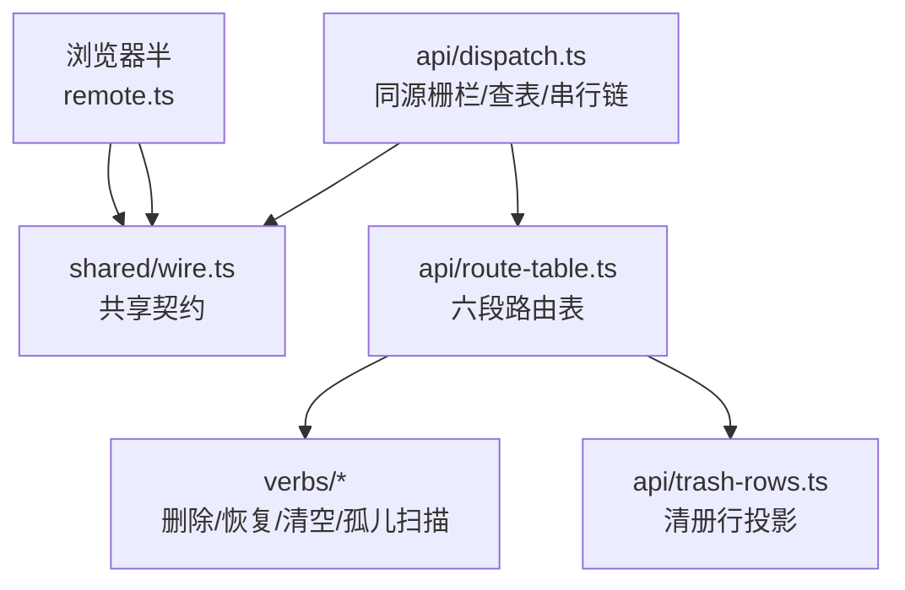
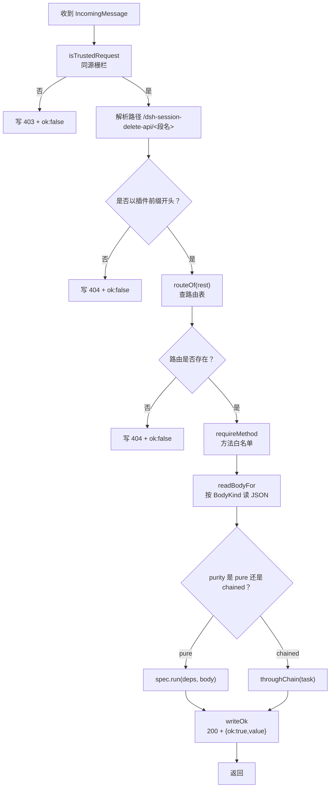
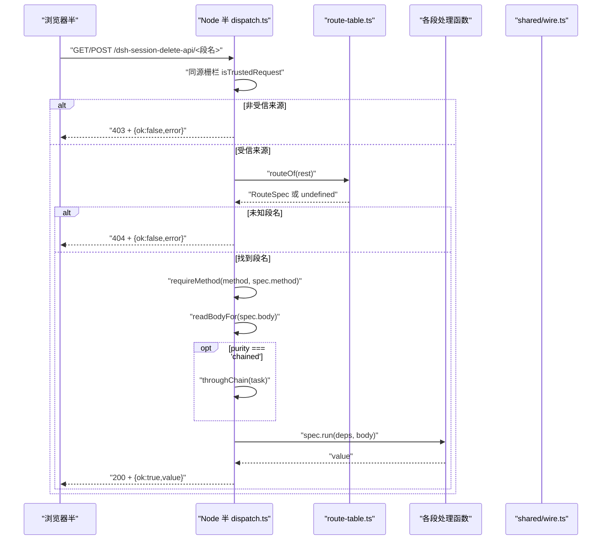
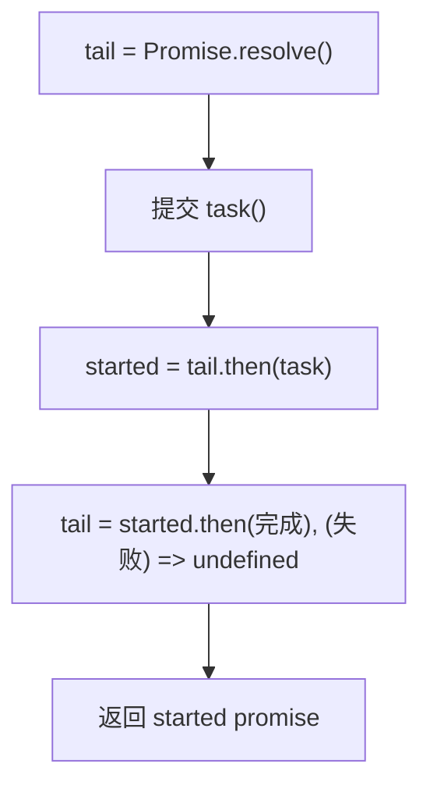
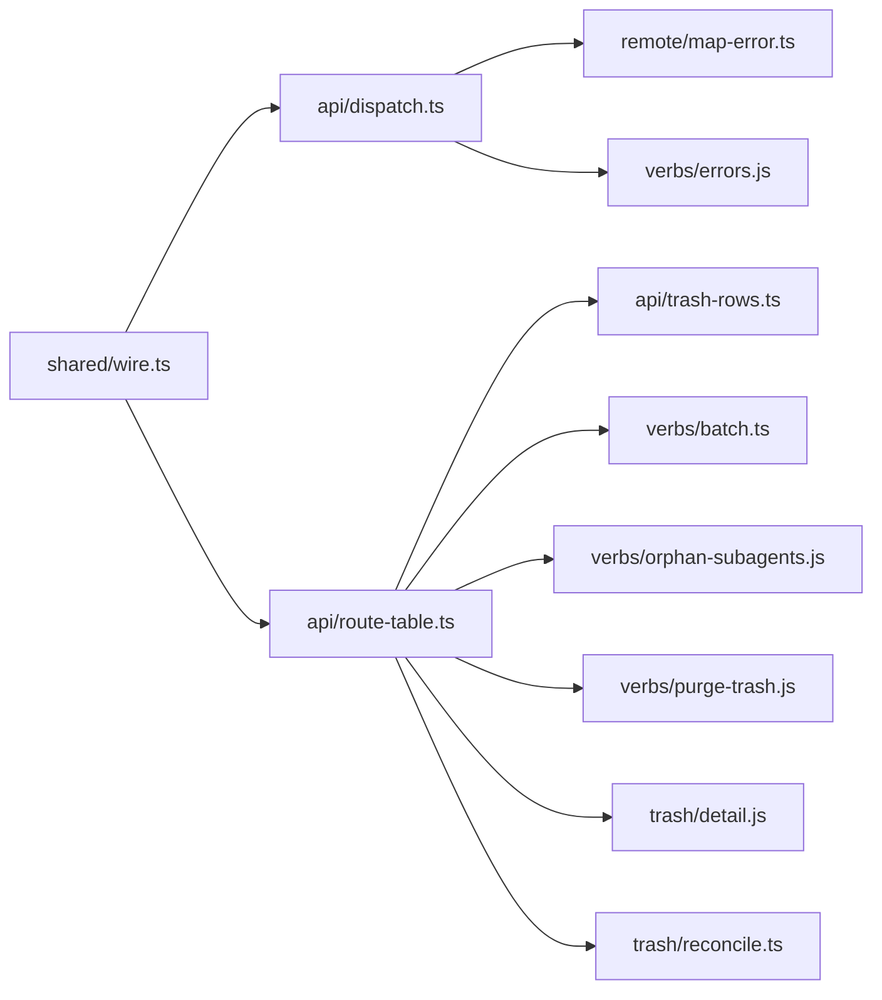

# 通信契约与路由分发

<cite>
**本文引用的文件**   
- [dispatch.ts](file://src/api/dispatch.ts)
- [route-table.ts](file://src/api/route-table.ts)
- [wire.ts](file://src/shared/wire.ts)
- [trash-rows.ts](file://src/api/trash-rows.ts)
- [wire-shape.test.ts](file://tests/wire-shape.test.ts)
- [README.md](file://README.md)
</cite>

## 目录
1. [引言](#引言)
2. [项目结构](#项目结构)
3. [核心组件](#核心组件)
4. [架构总览](#架构总览)
5. [详细组件分析](#详细组件分析)
6. [依赖关系分析](#依赖关系分析)
7. [性能考虑](#性能考虑)
8. [故障排查指南](#故障排查指南)
9. [结论](#结论)

## 引言
本插件为 DeepSeek Harness（DSH）提供“删除会话”能力：删除不是直接删盘，而是移入回收站，再提供恢复、批量操作和清空回收站。Node 半通过宿主 web server 暴露一条插件专属前缀路由，浏览器半用同源请求访问。  
本 API 文档聚焦跨半通信契约与 HTTP 路由分发，说明：
- `dispatch.ts` 的传输层安全机制：同源栅栏、JSON body 上限、方法白名单、串行链。
- `route-table.ts` 中六个段名的唯一声明处：HTTP 方法、纯度、请求体、处理函数。
- 所有 HTTP 端点的 URL、请求体、响应信封、失败码与错误映射规则。
- `wire.ts` 中的共享类型：`TrashEntryWire`、`TrashRowWire`、`ApplyAction`、`RemoteFailure` 等。
- 新增端点时的同步位置、向后兼容约束与调试建议。

## 项目结构
本次文档涉及的代码集中在四个文件中：

| 文件 | 职责 |
|---|---|
| `src/shared/wire.ts` | 两半共享的 wire 契约：前缀、六个段名、动作、请求字段名、线上类型、信封与失败形状。 |
| `src/api/route-table.ts` | 段名到 `{ 方法, 纯度, 请求体, 处理函数 }` 的唯一路由表。 |
| `src/api/dispatch.ts` | Node 半薄传输层：同源栅栏 → 查表 → 预读 body → 串行链 → 信封。 |
| `src/api/trash-rows.ts` | 清册行装配成线上行，并组装 `/list` 的可见组。 |

**图示来源**
- [dispatch.ts:1-100](file://src/api/dispatch.ts#L1-L100)
- [route-table.ts:1-143](file://src/api/route-table.ts#L1-L143)
- [wire.ts:1-200](file://src/shared/wire.ts#L1-L200)
- [trash-rows.ts:1-93](file://src/api/trash-rows.ts#L1-L93)

**章节来源**
- [README.md:1-147](file://README.md#L1-L147)

## 核心组件
本节按调用顺序梳理一次请求在系统内的关键路径。

### 传输层入口
`createApiHandler` 是 `/dsh-session-delete-api` 下所有请求的统一入口。它只负责三件事：
1. 同源栅栏校验。
2. 根据段名查路由表。
3. 把成功值包进 `{ ok: true, value }`，失败包进 `{ ok: false, error }`。

**图示来源**
- [dispatch.ts:100-200](file://src/api/dispatch.ts#L100-L200)

**章节来源**
- [dispatch.ts:1-200](file://src/api/dispatch.ts#L1-L200)

## 架构总览
下图展示从浏览器到 Node 半处理的端到端流程，以及两端共享的 wire 契约。

**图示来源**
- [dispatch.ts:120-200](file://src/api/dispatch.ts#L120-L200)
- [route-table.ts:80-143](file://src/api/route-table.ts#L80-L143)
- [wire.ts:1-200](file://src/shared/wire.ts#L1-L200)

## 详细组件分析

### 传输层安全机制：dispatch.ts

#### 同源栅栏
`isTrustedRequest` 放行三类请求：
1. `Origin` 与 `Host` 同源（浏览器直接打开宿主那行 URL）。
2. `Origin` 是桌面壳的 `dsh-app://app`。
3. `Referer` 是桌面壳的 `dsh-app://app`（真机那条路会把 `Origin` 删掉，只留 `Referer`）。
4. 两个头都缺席时视为本机工具（如 curl），因为跨源 POST 必然带 `Origin`；跨源 `no-cors` GET 虽可能缺失两个头，但回包 opaque，无法泄露正文。

仅当 `req.socket.remoteAddress` 属于回环地址时才继续检查。

| 条件 | 结果 |
|---|---|
| 非回环地址 | 拒绝 |
| `Origin` 存在且不是 `dsh-app://app`，且 host 不同源 | 拒绝 |
| `Referer` 存在且不是 `dsh-app://app`，且 host 不同源 | 拒绝 |
| 其他情况 | 放行 |

栅栏拒绝时统一走 `writeFailure(res, new Error('非受信来源'), 403)`。

**章节来源**
- [dispatch.ts:30-110](file://src/api/dispatch.ts#L30-L110)

#### JSON body 上限
`JSON_BODY_MAX_BYTES = 1024 * 1024`，即 1 MiB。读取过程流式累积字节数，超过上限立即抛 `routeError('bad-request', 400, ...)`。空体返回 `null`；非空体必须解析为 JSON 对象，数组和原始值都被拒绝。

| 输入 | 行为 |
|---|---|
| 空体 | `null` |
| 合法 JSON 对象 | 解析后的对象 |
| 非法 JSON | 400，错误码 `bad-request` |
| JSON 数组 | 400，错误码 `bad-request` |
| JSON 非对象 | 400，错误码 `bad-request` |
| 超过 1 MiB | 400，错误码 `bad-request` |

**章节来源**
- [dispatch.ts:110-160](file://src/api/dispatch.ts#L110-L160)

#### 方法白名单
每个路由表条目指定一个期望方法。`requireMethod` 对不匹配的请求抛出 `routeError('bad-method', 405, ...)`。浏览器半与服务器之间约定：
- 4xx 表示“请求本身不对”。
- 200 + `ok:false` 表示“操作执行了但业务失败”。

**章节来源**
- [dispatch.ts:160-200](file://src/api/dispatch.ts#L160-L200)

#### 串行链
对于 `purity === 'chained'` 的处理函数，请求会进入 `throughChain`。`tail` 由构造保证永不 reject，因此单次任务失败不会阻塞后续任务，也不会让整条链卡死。这是为了避免“读清单 + 动文件 + 写清单”的多步操作交错。

**图示来源**
- [dispatch.ts:160-200](file://src/api/dispatch.ts#L160-L200)

**章节来源**
- [dispatch.ts:140-200](file://src/api/dispatch.ts#L140-L200)

### 路由表：route-table.ts

路由表是唯一的地方，集中声明六个段名的：
- HTTP 方法。
- 纯度。
- 请求体策略。
- 处理函数。

| 段名 | 方法 | 请求体 | 纯度 | 行为 |
|---|---:|---:|---:|---|
| `/list` | GET | none | chained | 对账回收站目录后组装清册行。 |
| `/ping` | GET | none | pure | 最便宜探测，不碰清册、不碰盘、不进链。 |
| `/orphans` | GET | none | pure | 扫描无主子会话报告。 |
| `/apply` | POST | json | count 为 pure，其余为 chained | 一组 id 上执行同一个动作，逐条返回 `ApplyOutcome`。 |
| `/empty` | POST | none | chained | 先对账再清空回收站，返回聚合回执。 |
| `/detail` | POST | json | pure | 读取单条详情。 |

#### 段名的唯一声明处
路由表使用 TypeScript 的 `Record<(typeof ROUTES)[keyof typeof ROUTES], RouteSpec>` 作为编译期闸：如果 `wire.ts` 新增了段名而这里没有对应条目，TypeScript 编译会失败。

| 关注点 | 声明位置 |
|---|---|
| 段名字面量 | `wire.ts` 的 `ROUTES` |
| 段名到处理函数的映射 | `route-table.ts` 的 `ROUTE_TABLE` |
| HTTP 方法 | 每条记录的 `method` |
| 纯度 | 每条记录的 `purity` |
| 请求体 | 每条记录的 `body` |
| 处理函数 | 每条记录的 `run` |

**章节来源**
- [route-table.ts:1-143](file://src/api/route-table.ts#L1-L143)

### 共享类型：wire.ts

#### 前缀与段名
| 名称 | 值 | 含义 |
|---|---|---|
| `SESSION_DELETE_API_PREFIX` | `/dsh-session-delete-api` | 插件专属前缀，避免与宿主其他 prefix route 冲突。 |
| `ROUTES.list` | `/list` | 对账并读取清册。 |
| `ROUTES.ping` | `/ping` | 通道健康探测。 |
| `ROUTES.detail` | `/detail` | 单条详情。 |
| `ROUTES.apply` | `/apply` | 批量动作。 |
| `ROUTES.empty` | `/empty` | 清空回收站。 |
| `ROUTES.orphans` | `/orphans` | 无主子会话扫描报告。 |

#### 动作与参数
| 名称 | 含义 |
|---|---|
| `ApplyAction` | `'delete' \| 'restore' \| 'purge' \| 'count' \| 'orphan-clean'` |
| `PARAMS.entryId` | 单条详情的请求字段。 |
| `PARAMS.action` | `/apply` 的动作字段。 |
| `PARAMS.ids` | `/apply` 的 id 数组字段。 |

#### 共享类型定义

| 类型 | 字段 | 语义 |
|---|---|---|
| `TrashEntryWire` | `id`, `sessionId`, `projectDir`, `workspaceId`, `wasArchived`, `deletedAt`, `title`, `sizeBytes`, `parentEntryId?` | 清册落地的线上形状。 |
| `TrashRowWire` | 继承 `TrashEntryWire`，并增加 `releaseBytes`、`subagentCount?`、`subagentBytes?`、`strandedSubagents?`、`strandedBytes?`、`workspaceMissing?` | `/list` 真正发给浏览器的行。 |
| `ApplyAction` | `'delete'`, `'restore'`, `'purge'`, `'count'`, `'orphan-clean'` | `/apply` 支持的动作。 |
| `ApplyValueByAction` | 按动作区分成功值 | `delete`/`restore` 返回可空行，`purge` 返回统计，`count` 返回数字，`orphan-clean` 返回清理统计。 |
| `ApplyOutcome` | `id` + 判别型联合 | 每条动作结果；`action` + `ok` 双重判别。 |
| `RemoteFailure` | `code`, `message`, `details?` | 两半共享的错误信封。 |
| `RemoteResult<T>` | `{ ok: true; value: T } \| { ok: false; error: RemoteFailure }` | 两半共享的成功/失败信封。 |

**章节来源**
- [wire.ts:1-200](file://src/shared/wire.ts#L1-L200)

### 清册行投影：trash-rows.ts

`toWire` 是清册行到线上行的唯一装配器。它显式写出必填字段，避免展开运算符把多余字段悄悄带上；可选字段只在存在时出现。

`releaseBytes` 是唯一算式：
- 本行大小。
- 跟着这条父会话一起进回收站的孩子大小。
- 还留在盘上的后代大小。

这个数值由 Node 半计算，界面头部合计与单条确认框共用，不再各自重算。

`assembleTrashRows` 的职责是把清册行按分组投影成一行一组，并把孩子折进父行；若父不在，则子自己占一行。

**章节来源**
- [trash-rows.ts:1-93](file://src/api/trash-rows.ts#L1-L93)

## 依赖关系分析

**图示来源**
- [dispatch.ts:1-200](file://src/api/dispatch.ts#L1-L200)
- [route-table.ts:1-143](file://src/api/route-table.ts#L1-L143)
- [wire.ts:1-200](file://src/shared/wire.ts#L1-L200)

### 耦合与内聚
- `wire.ts` 是两半之间的低耦合边界：它不包含 Node 内建模块，也不 import 平台模块，浏览器半可以内联。
- `dispatch.ts` 与 `route-table.ts` 解耦：前者只管传输，后者管段名语义。
- `route-table.ts` 集中了所有段名处理逻辑，新增端点只需改一处。
- `trash-rows.ts` 只负责数据投影，与 HTTP 无关。

### 潜在循环
当前结构中，`dispatch.ts` 不直接 import 动词实现，而是通过 `route-table.ts` 间接依赖；`wire.ts` 不被 Node 半的业务逻辑反向依赖为值 import，避免了客户端 bundle 被拖入 Node 模块。

**章节来源**
- [dispatch.ts:1-60](file://src/api/dispatch.ts#L1-L60)
- [route-table.ts:1-40](file://src/api/route-table.ts#L1-L40)
- [wire.ts:1-30](file://src/shared/wire.ts#L1-L30)

## 性能考虑

| 方面 | 设计选择 | 影响 |
|---|---|---|
| JSON body 解析 | 流式累积并限制 1 MiB | 防止内存放大，适合只传 id 的场景。 |
| 纯读 | `purity === 'pure'` 不走串行链 | 探测、详情、计数、孤儿扫描不会阻塞写操作。 |
| 写操作 | `purity === 'chained'` 或动态判定 | 对账、删除、恢复、清空、孤儿清理排队执行，避免竞态。 |
| `/apply` 的动态纯度 | `count` 为 pure，其余为 chained | 批量计数只读盘上状态，不污染队列。 |
| `/list` | 先对账再读 | 每次列表请求有磁盘 I/O 成本，因此用 `/ping` 做轻量探测。 |

**章节来源**
- [dispatch.ts:100-200](file://src/api/dispatch.ts#L100-L200)
- [route-table.ts:80-143](file://src/api/route-table.ts#L80-L143)

## 故障排查指南

### 网络层 4xx 与业务层 200+ok:false 的区别

| 类别 | HTTP 状态 | 信封 | 典型原因 |
|---|---:|---|---|
| 请求体不对 | 400 | `{ ok: false, error }` | JSON 非法、数组、非对象、字段缺失、超过 1 MiB。 |
| 方法不对 | 405 | `{ ok: false, error }` | 例如向 `/list` 发 POST。 |
| 未知路由 | 404 | `{ ok: false, error }` | 段名不在 `wire.ts` 的 `ROUTES` 中，或路由表未同步。 |
| 同源栅栏拒 | 403 | `{ ok: false, error }` | 非回环地址、`Origin`/`Referer` 不同源。 |
| 业务失败 | 200 | `{ ok: false, error }` | 会话仍运行、工作区不存在、动词内部错误。 |

浏览器半应先解出信封，再判断 `ok`；不能只看 HTTP 状态码。

### 常见错误映射

| 错误域 | 语义 |
|---|---|
| `bad-request` | 请求体或参数不符合契约。 |
| `bad-method` | HTTP 方法与路由表不一致。 |
| `not-found-route` | 段名未知。 |
| 动词错误 | 由动词抛出的领域错误，经 `toRemoteFailure` 映射为 `RemoteFailure`。 |

`RemoteFailure` 的 `code` 来自同一张错误映射表，`message` 是用户可读原文，`details` 是可选结构化附带物。

### 调试建议

1. **先测 `/ping`**：它是纯读、不碰清册、不碰盘、不进链，能验证路由表、依赖注入和错误映射是否生效。
2. **确认同源栅栏**：本地 curl 应能通过（回环 + 无 `Origin`/`Referer`）；跨源网页请求必须满足 `Origin` 或 `Referer` 同源。
3. **检查方法**：GET 段名只能 GET，POST 段名只能 POST。
4. **检查 JSON 体**：`/apply` 和 `/detail` 必须发送 JSON 对象；`/apply.ids` 是非空字符串数组。
5. **观察串行链**：写操作并发时，失败不会卡死整链，但旧任务仍在排队。
6. **对比 wire 形状**：运行 `tests/wire-shape.test.ts`，确保线上类型与客户端别名一致。

**章节来源**
- [dispatch.ts:60-200](file://src/api/dispatch.ts#L60-L200)
- [wire.ts:160-261](file://src/shared/wire.ts#L160-L261)
- [wire-shape.test.ts:1-116](file://tests/wire-shape.test.ts#L1-L116)

## HTTP 端点清单

### 通用响应信封

所有端点返回信封：
- 成功：`{ ok: true; value: T }`
- 失败：`{ ok: false; error: { code, message, details? } }`

HTTP 状态码用于表达“请求是否可被该路由处理”，而不是“业务是否成功”。

**章节来源**
- [wire.ts:180-261](file://src/shared/wire.ts#L180-L261)
- [dispatch.ts:140-200](file://src/api/dispatch.ts#L140-L200)

### GET /list

| 项目 | 说明 |
|---|---|
| URL | `/dsh-session-delete-api/list` |
| 方法 | GET |
| 请求体 | 无 |
| 纯度 | chained |
| 成功值 | `TrashRowWire[]` |
| 失败场景 | 403 同源栅栏、404 未知前缀、405 方法错误、200+ok:false 业务错误。 |
| 成功语义 | 先对账回收站目录，再组装可见组，返回每组的根行。 |

`TrashRowWire` 包含必填八格加 `releaseBytes`，以及可选的 `parentEntryId`、`subagentCount`、`subagentBytes`、`strandedSubagents`、`strandedBytes`、`workspaceMissing`。

**章节来源**
- [wire.ts:80-160](file://src/shared/wire.ts#L80-L160)
- [route-table.ts:90-110](file://src/api/route-table.ts#L90-L110)
- [trash-rows.ts:1-93](file://src/api/trash-rows.ts#L1-L93)

### GET /ping

| 项目 | 说明 |
|---|---|
| URL | `/dsh-session-delete-api/ping` |
| 方法 | GET |
| 请求体 | 无 |
| 纯度 | pure |
| 成功值 | `"pong"` |
| 失败场景 | 403、404、405、200+ok:false。 |
| 用途 | 客户端探测，不应当作“回收站有多少条”。 |

**章节来源**
- [route-table.ts:100-115](file://src/api/route-table.ts#L100-L115)

### GET /orphans

| 项目 | 说明 |
|---|---|
| URL | `/dsh-session-delete-api/orphans` |
| 方法 | GET |
| 请求体 | 无 |
| 纯度 | pure |
| 成功值 | `OrphanReportWire` |
| 失败场景 | 403、404、405、200+ok:false。 |
| 语义 | 扫描语料与清册，统计无主子会话的数量、字节与分组；不修改任何文件。 |

**章节来源**
- [route-table.ts:110-125](file://src/api/route-table.ts#L110-L125)
- [wire.ts:140-180](file://src/shared/wire.ts#L140-L180)

### POST /detail

| 项目 | 说明 |
|---|---|
| URL | `/dsh-session-delete-api/detail` |
| 方法 | POST |
| 请求体 | `{ entryId: string }` |
| 纯度 | pure |
| 成功值 | `TrashDetailWire` |
| 失败场景 | 400 缺少非空 `entryId`、403、404、405、200+ok:false。 |
| 语义 | 读取回收站目录里该会话的日志消息。 |

**章节来源**
- [route-table.ts:125-143](file://src/api/route-table.ts#L125-L143)
- [wire.ts:120-160](file://src/shared/wire.ts#L120-L160)

### POST /apply

| 项目 | 说明 |
|---|---|
| URL | `/dsh-session-delete-api/apply` |
| 方法 | POST |
| 请求体 | `{ action: ApplyAction; ids: string[] }` |
| 纯度 | `action === 'count'` 时为 pure，其余为 chained |
| 成功值 | `ApplyOutcome[]` |
| 失败场景 | 400 动作或 ids 不合法、403、404、405、200+ok:false。 |

#### 动作语义

| 动作 | id 含义 | 成功值 | 备注 |
|---|---|---|---|
| `delete` | 宿主会话 id | `TrashEntryWire \| null` | 已同批前一条带走时为 null。 |
| `restore` | 回收站条目 id | `TrashEntryWire \| null` | 幂等 no-op 时返回 null。 |
| `purge` | 回收站条目 id | `PurgeStatsWire` | 已同批前一条带走时返回零统计。 |
| `count` | 宿主会话 id | `number` | 纯读，只问盘上还在多少。 |
| `orphan-clean` | 宿主会话 id | `OrphanCleanStatsWire` | 清理的是盘上目录，不进回收站。 |

**章节来源**
- [route-table.ts:115-140](file://src/api/route-table.ts#L115-L140)
- [wire.ts:60-120](file://src/shared/wire.ts#L60-L120)

### POST /empty

| 项目 | 说明 |
|---|---|
| URL | `/dsh-session-delete-api/empty` |
| 方法 | POST |
| 请求体 | 无 |
| 纯度 | chained |
| 成功值 | `PurgeStatsWire` |
| 失败场景 | 403、404、405、200+ok:false。 |
| 语义 | 先对账回收站目录，再清空；返回聚合移除数和释放字节数。 |

**章节来源**
- [route-table.ts:120-135](file://src/api/route-table.ts#L120-L135)
- [wire.ts:160-180](file://src/shared/wire.ts#L160-L180)

## 向后兼容约束

1. **前缀不可重复**：`SESSION_DELETE_API_PREFIX` 是宿主 prefix route 的硬边界，重复注册会导致整棵插件树启动失败。
2. **段名必须双向同步**：新增段名需要同时出现在：
   - `wire.ts` 的 `ROUTES`。
   - `route-table.ts` 的 `ROUTE_TABLE`。
   否则 TypeScript 编译失败。
3. **线上类型必须保持兼容**：`TrashEntryWire`、`TrashRowWire`、`RemoteFailure`、`RemoteResult` 等是两半共同契约。新增字段应优先使用可选字段；已有字段的语义不得静默改变。
4. **wire-shape 测试是防线**：`tests/wire-shape.test.ts` 断言浏览器半的类型别名与 wire 类型完全相等；新增类型或字段时若编译不过，说明两侧形状漂移。
5. **错误码域稳定**：动词码与路由自检码都应落在同一错误域，完整码映射由单一表维护。
6. **行为不变原则**：`/ping` 仍是最轻探测；`/list` 仍是对账后再读；`/apply` 仍是一组 id 上一个动作；`/empty` 仍是聚合回执。

**章节来源**
- [wire.ts:1-60](file://src/shared/wire.ts#L1-L60)
- [wire-shape.test.ts:1-116](file://tests/wire-shape.test.ts#L1-L116)

## 新增端点操作清单

新增一个端点时，至少检查以下位置：

| 步骤 | 修改位置 | 目的 |
|---|---|---|
| 1 | `wire.ts` 的 `ROUTES` | 声明新段名字面量。 |
| 2 | `wire.ts` 的共享类型 | 新增请求字段、成功值或失败扩展。 |
| 3 | `route-table.ts` 的 `ROUTE_TABLE` | 声明方法、body、purity、处理函数。 |
| 4 | `dispatch.ts` | 一般不需要改动；除非新增传输层语义。 |
| 5 | `trash-rows.ts` | 仅当 `/list` 的线上行需要新字段。 |
| 6 | `tests/wire-shape.test.ts` | 确保浏览器半与 wire 类型保持 exact 等价。 |
| 7 | 客户端 `remote.ts` | 消费新的成功值与失败码。 |

新增成功后应验证：
- 同名段名在编译期可查。
- 405 对错误方法生效。
- 404 对未知段名生效。
- 400 对非法 JSON 或缺失字段生效。
- 403 对非受信来源生效。
- 200 + `ok:false` 对业务失败生效。
- 串行链不会因单次失败卡死。
- 浏览器半仍可正确解码响应。

**章节来源**
- [route-table.ts:40-143](file://src/api/route-table.ts#L40-L143)
- [wire.ts:1-200](file://src/shared/wire.ts#L1-L200)
- [wire-shape.test.ts:1-116](file://tests/wire-shape.test.ts#L1-L116)

## 结论
本插件的跨半通信契约由 `wire.ts` 统一管理，路由语义由 `route-table.ts` 唯一声明，传输安全由 `dispatch.ts` 集中执行。这样设计的好处是：
- 段名、动作、字段和类型只有一处真相。
- 4xx 与 200+ok:false 的语义清晰分离。
- 写操作串行执行，避免回收站对账与写入竞态。
- 纯读绕过串行链，减少写操作延迟。
- 新增端点时，TypeScript 和 wire-shape 测试共同阻止形状漂移。

开发时应始终记住：**协议变更优先改 wire，路由语义优先改 route-table，传输问题才改 dispatch**。