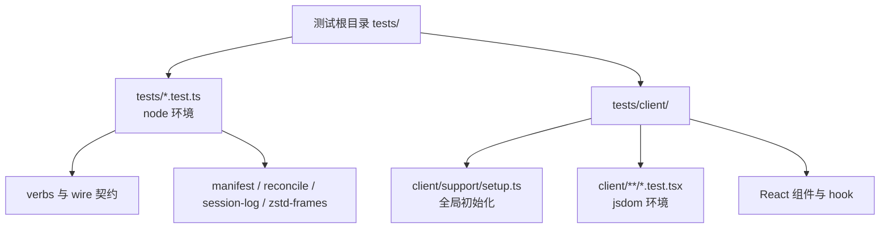
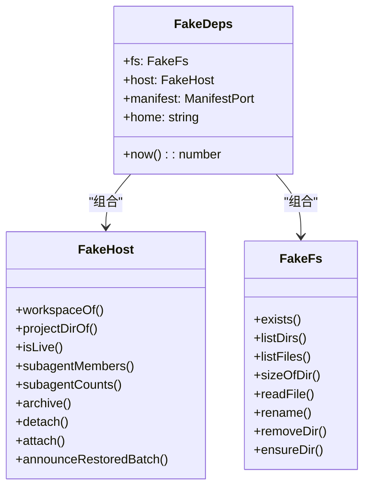
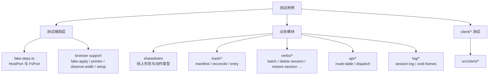
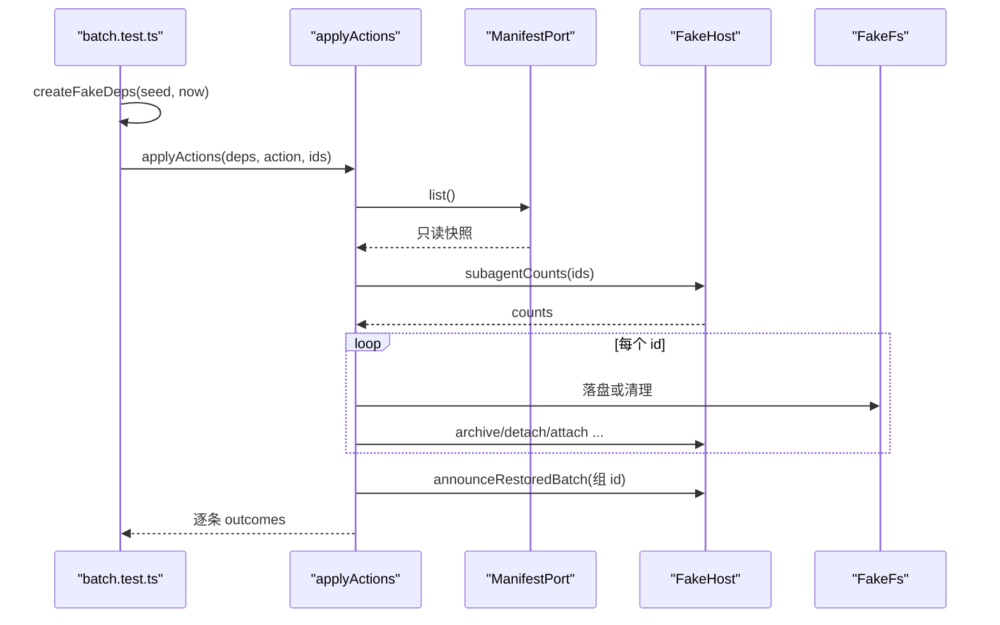
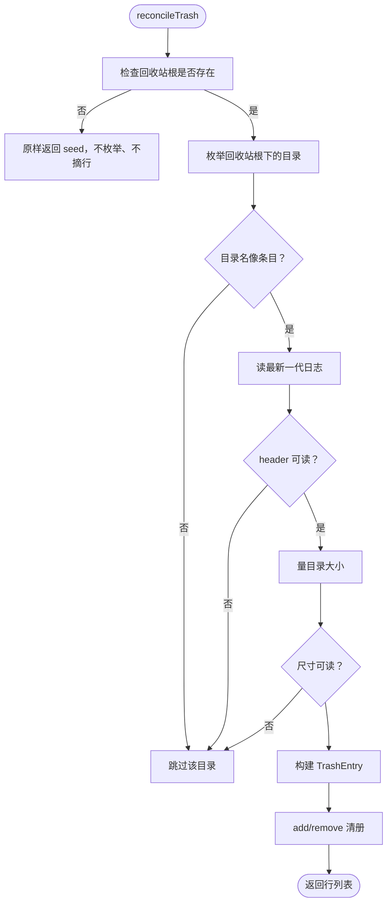
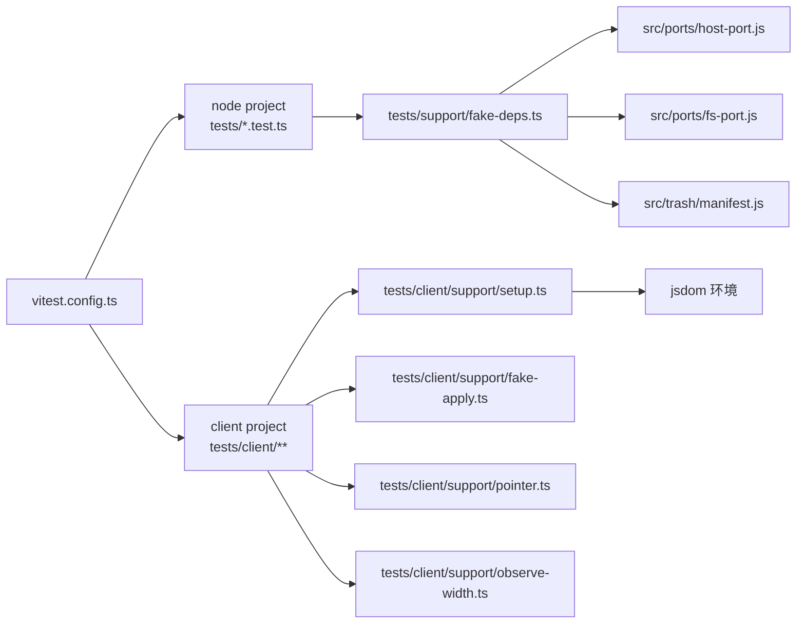

# 测试指南

<cite>
**本文引用的文件**   
- [vitest.config.ts](file://vitest.config.ts)
- [package.json](file://package.json)
- [tests/support/fake-deps.ts](file://tests/support/fake-deps.ts)
- [tests/client/support/fake-apply.ts](file://tests/client/support/fake-apply.ts)
- [tests/client/support/pointer.ts](file://tests/client/support/pointer.ts)
- [tests/client/support/observe-width.ts](file://tests/client/support/observe-width.ts)
- [tests/client/support/setup.ts](file://tests/client/support/setup.ts)
- [tests/batch.test.ts](file://tests/batch.test.ts)
- [tests/manifest.test.ts](file://tests/manifest.test.ts)
- [tests/reconcile.test.ts](file://tests/reconcile.test.ts)
- [tests/session-log.test.ts](file://tests/session-log.test.ts)
- [tests/zstd-frames.test.ts](file://tests/zstd-frames.test.ts)
- [tests/route-table.test.ts](file://tests/route-table.test.ts)
- [tests/wire-shape.test.ts](file://tests/wire-shape.test.ts)
- [tests/client/batch-bar.test.tsx](file://tests/client/batch-bar.test.tsx)
- [tests/client/batch-confirm.test.tsx](file://tests/client/batch-confirm.test.tsx)
- [tests/client/trash-detail.test.tsx](file://tests/client/trash-detail.test.tsx)
- [tests/client/use-column-resize.test.tsx](file://tests/client/use-column-resize.test.tsx)
- [tests/client/use-panel-width.test.tsx](file://tests/client/use-panel-width.test.tsx)
</cite>

## 目录
1. [引言](#引言)
2. [项目结构](#项目结构)
3. [核心组件](#核心组件)
4. [架构总览](#架构总览)
5. [详细组件分析](#详细组件分析)
6. [依赖分析](#依赖分析)
7. [性能考量](#性能考量)
8. [故障排查](#故障排查)
9. [结论](#结论)

## 引言
本仓库的测试体系围绕两个真实用户工作流展开：
- Node 半单元测试：对动词、线协议、路由表、回收站对账、清册、端口与 zstd 帧等纯后端逻辑进行确定性断言。
- 浏览器半组件测试：对 `src/client/*` 中的 React 行为、指针交互、面板宽度与批量操作 UI 进行可视化断言。

测试不是“把实现跑一遍”，而是把设计文档（ADR）和架构复核候选变成可运行的契约：例如批量部分失败、journal 回滚、对账修复、路由纯度、wire 形状一致性，以及宿主能力缺失时的降级行为。

## 项目结构
测试代码集中在 `tests/`，并按运行环境分成两类：

| 类别 | 路径 | 运行环境 | 典型目标 |
|---|---|---|---|
| Node 半单元 | `tests/*.test.ts` | node | verbs、wire、route-table、reconcile、manifest、ports、session-log、zstd-frames |
| 浏览器半组件 | `tests/client/**/*.test.{ts,tsx}` | jsdom + React Testing Library | client 下的交互、状态与布局相关逻辑 |

Vitest 通过 `projects` 把两者分开，而不是用一个全局 `jsdom` 环境。原因是 Node 侧用例需要真实的 `import.meta.url`（例如 `skeleton.test.ts` 用它定位包根），而在 jsdom 下它是 `http://` URL，会触发路径转换错误。



**图表来源**
- [vitest.config.ts:1-31](file://vititest.config.ts#L1-L31)

**章节来源**
- [vitest.config.ts:1-31](file://vitest.config.ts#L1-L31)
- [package.json:1-105](file://package.json#L1-L105)

## 核心组件
本节聚焦五类测试辅助工具，它们共同构成“少写样板、多断行为”的基础设施。

### fake-deps：Node 端双端口假件
`tests/support/fake-deps.ts` 提供三个关键产物：
- `createFakeHost`：内存实现的 `HostPort`，包含会话查询、归档、分离/附加、子代理成员与计数、公告等语义。
- `createFakeFs`：内存实现的 `FsPort`，支持存在性、目录枚举、文件大小、重命名与删除。
- `createFakeDeps`：一次性装配 `{ deps, host, fs, manifest }`，返回值类型就是 `DeleteDeps`，不需要强转。

它有三条设计约定：
1. 每个端口方法都是 `vi.fn`，参数与返回类型由真实接口推导。
2. 缺省值是“最安静的成功”：不改变世界、不抛错。
3. 调用日志按需记录，默认格式只是方法名；读口默认不写日志，避免每条断言都被无关调用淹没。



**图表来源**
- [tests/support/fake-deps.ts:1-213](file://tests/support/fake-deps.ts#L1-L213)

**章节来源**
- [tests/support/fake-deps.ts:1-213](file://tests/support/fake-deps.ts#L1-L213)

### fake-apply：浏览器端的批量动作替身
`tests/client/support/fake-apply.ts` 把一个单条动作函数包装成 `applyOutcomes(action, ids)` 的形状，用于模拟组件调用的批量执行。它按以下规则组装结果：
- 每个 id 对应一个 outcome。
- 成功时 `ok: true`，值默认为 `null`；`count` 动作默认为 `0`。
- 失败时 `ok: false`，错误码优先取 `error.code`，否则退到 `sessiondelete/io`。

这使浏览器测试不再需要为每个动作手写 outcomes 数组，而是声明“某个 id 成功、某个 id 失败”。

**章节来源**
- [tests/client/support/fake-apply.ts:1-39](file://tests/client/support/fake-apply.ts#L1-L39)

### pointer：指针事件桥接
`tests/client/support/pointer.ts` 解决 jsdom 缺少 PointerEvent 的问题：
- 给 `Element.prototype` 补上 `setPointerCapture`、`releasePointerCapture`、`hasPointerCapture`。
- 暴露 `firePointer(target, type, init)`，创建带 `clientX`、`pointerId` 的原生事件，并用 `act` 派发，确保 React 状态更新同步可见。

这对拖拽、分栏调整等交互测试至关重要。

**章节来源**
- [tests/client/support/pointer.ts:1-42](file://tests/client/support/pointer.ts#L1-L42)

### observe-width：ResizeObserver 替身
`tests/client/support/observe-width.ts` 提供可手动注入宽度的 `ResizeObserver` 替身：
- `pump(width)`：在 `act` 中触发所有被观测元素的宽度更新。
- `active()`：断言卸载后没有残留观测者。
- `restore()`：恢复全局 `ResizeObserver`。

生产代码只认标准 RO 与真实几何量法，因此这里改的是被观测元素自己的 `getBoundingClientRect`，而不是让生产代码走测试分支。

**章节来源**
- [tests/client/support/observe-width.ts:1-43](file://tests/client/support/observe-width.ts#L1-L43)

### setup：浏览器测试全局初始化
`tests/client/support/setup.ts` 是浏览器 project 的 `setupFiles`：
- 引入 `@testing-library/jest-dom/vitest`，启用 DOM 匹配器。
- 在每个用例结束后调用 React Testing Library 的 `cleanup`，防止上一个用例的 DOM 污染下一个用例。
- 给 `globalThis.ResizeObserver` 提供一个空壳，供 `ui/Tooltip` 等控件使用；这个空壳不产出尺寸，因此气泡保持“尚未量到”的状态，不影响用例对可见文本的断言。

**章节来源**
- [tests/client/support/setup.ts:1-25](file://tests/client/support/setup.ts#L1-L25)

## 架构总览
测试架构可以理解为三层：



**图表来源**
- [tests/support/fake-deps.ts:1-213](file://tests/support/fake-deps.ts#L1-L213)
- [tests/client/support/fake-apply.ts:1-39](file://tests/client/support/fake-apply.ts#L1-L39)
- [tests/client/support/pointer.ts:1-42](file://tests/client/support/pointer.ts#L1-L42)
- [tests/client/support/observe-width.ts:1-43](file://tests/client/support/observe-width.ts#L1-L43)
- [tests/client/support/setup.ts:1-25](file://tests/client/support/setup.ts#L1-L25)

## 详细组件分析

### Node 半单元测试

#### 批量动词（verbs/batch）
`tests/batch.test.ts` 是对 ADR-0002 的直接落地：输入去重保序、幂等、逐条信封、一批一次通告、清册只读一次。

关键点：
- 用 `createFakeDeps` 构造 `DeleteDeps`，并把内存清单包装成能数读取次数的 `ManifestPort`。
- 断言一条失败不会传染下一条。
- 断言 `count` 动作只调用一次 `host.subagentCounts`，而不是每个 id 一次。
- 断言父子关系在 restore/purge/delete 中的幂等行为。
- 断言幽灵 id 不走“已被同批前一条带走”的路径，而是响亮失败。
- 断言整批清册只读一次，动词使用的是同一份只读快照。



**图表来源**
- [tests/batch.test.ts:1-132](file://tests/batch.test.ts#L1-L132)
- [tests/support/fake-deps.ts:1-213](file://tests/support/fake-deps.ts#L1-L213)

**章节来源**
- [tests/batch.test.ts:1-132](file://tests/batch.test.ts#L1-L132)

#### 清册（trash/manifest）
`tests/manifest.test.ts` 断言内存清册的增删查语义：
- 加入后按删除时间倒序列出。
- 重复 id 是覆盖而非追加。
- 移除不存在 id 幂等。
- 空清单返回空数组。

这是批量与对账共享的底层数据结构，因此测试非常薄，但断言很稳。

**章节来源**
- [tests/manifest.test.ts:1-37](file://tests/manifest.test.ts#L1-L37)

#### 回收站对账（trash/reconcile）
`tests/reconcile.test.ts` 模拟磁盘上的会话目录形态，并验证对账如何修正清册：
- 多出来的目录重建行。
- 目录没了的行摘掉。
- 同一目录多代日志取最新版本。
- 一一对应时零漂移。
- 幂等：重建后再跑一遍不写入。
- 回收站根不存在时不动任何数据。
- 非条目目录跳过。
- 无日志、读不出日志、无 header 时跳过但不报错。
- 尺寸量不出时整条不重建。



**图表来源**
- [tests/reconcile.test.ts:1-197](file://tests/reconcile.test.ts#L1-L197)

**章节来源**
- [tests/reconcile.test.ts:1-197](file://tests/reconcile.test.ts#L1-L197)

#### 会话日志（log/session-log）
`tests/session-log.test.ts` 断言 zstd 压缩日志的解析行为：
- 跨帧输出记录，顺序即写入顺序。
- 一行内多条记录逐条输出。
- 最后一行截断不计入已解析记录。
- 记录切在帧之间时拼接还原。
- 回调返回 `false` 就地停机。
- 某帧解不开时报错并指出帧号。
- `readSessionHeader` 只读第一条 session 记录。
- `pickSessionLog` 在多代日志中选择版本号最大的一代，并拒绝非规范文件名。

**章节来源**
- [tests/session-log.test.ts:1-148](file://tests/session-log.test.ts#L1-L148)

#### Zstd 帧边界（log/zstd-frames）
`tests/zstd-frames.test.ts` 直接对二进制帧边界做断言，因为 Node 的 zstd 解压只处理第一帧，而回收站日志是多帧 append 序列：
- 无缝铺满整段。
- 每片单独解压回到原文。
- DSH 实测形状：每帧后多 4 字节。
- 一帧多块按 last 位收帧。
- Raw 与 RLE 混在一帧里边界准确。
- Reserved 块类型拒绝。
- 坏输入响亮失败：越界、截断、非法 magic、空 buffer。

**章节来源**
- [tests/zstd-frames.test.ts:1-123](file://tests/zstd-frames.test.ts#L1-L123)

#### 路由表（api/route-table）
`tests/route-table.test.ts` 是“一张表一个事实”的契约测试：
- 段名与路由表键对齐。
- GET/POST 方法分类正确。
- body 分类正确：只有 `apply` 与 `detail` 需要 JSON。
- `list` 与 `empty` 进入到达序链；探测、扫描、详情不进链。
- `apply` 中只有 `count` 是纯读。
- 不认识段名返回 `undefined`。
- `APPLY_ACTIONS` 与 `ApplyAction` 类型一致。

**章节来源**
- [tests/route-table.test.ts:1-69](file://tests/route-table.test.ts#L1-L69)

#### 线上形状（shared/wire 与 trash rows）
`tests/wire-shape.test.ts` 不是普通行为测试，而是类型层契约：
- 必填字段清单与 `TrashEntry` 必填键集一致。
- 必填字段类型表同源。
- 投影只发送线上形状允许出现的字段。
- `releaseBytes` 是唯一算式。
- 浏览器半条目、回执、详情是 wire 别名，不是重写接口。
- 失败码表完整且域一致。
- 回收站目录名两版同源。

**章节来源**
- [tests/wire-shape.test.ts:1-116](file://tests/wire-shape.test.ts#L1-L116)

### 浏览器半组件测试

#### 批量浮条（client/batch-bar）
`tests/client/batch-bar.test.tsx` 测试多选模式、计数、已选清单、行点击选择与确认框。典型断言包括：
- 不在多选态不渲染。
- 多选态 0 条也渲染提示与退出按钮。
- 主行不再放汇总，子会话数在“查看已选”列表头。
- 计数读不到就整句不说。
- 旧响应不覆盖新勾选。
- 已选清单可展开、收起、逐条移除。
- 多选模式下行点击切换选中，并挡住行自身的 onClick。

**章节来源**
- [tests/client/batch-bar.test.tsx:1-200](file://tests/client/batch-bar.test.tsx#L1-L200)

#### 批量确认框（client/batch-confirm）
`tests/client/batch-confirm.test.tsx` 测试批量删除确认流程：
- 标题随条数变化。
- 子会话信息只在有数时说。
- 目标列表限高滚动。
- 成功路径：一次 `applyOutcomes`、框关闭、撤销横幅、清空选中。
- 部分失败：失败原因落在对应行，按钮变为“重试”，重试只发失败 id。

**章节来源**
- [tests/client/batch-confirm.test.tsx:1-132](file://tests/client/batch-confirm.test.tsx#L1-L132)

#### 回收站详情（client/trash-detail）
`tests/client/trash-detail.test.tsx` 断言详情块的四种状态、消息排列、窄档返回、时间显示与注入上下文展示。

**章节来源**
- [tests/client/trash-detail.test.tsx:1-200](file://tests/client/trash-detail.test.tsx#L1-L200)

#### 分栏拖动（client/use-column-resize）
`tests/client/use-column-resize.test.tsx` 测试分栏 hook 的边界、键盘、aria、指针拖动与卸载兜底：
- 默认宽度与上限计算。
- 往宽/往窄拖动的夹限。
- 面板变窄时重新夹住。
- Home/End 快捷键。
- 把手 role、aria-label、tabindex、范围值。
- 拖动中途把手被卸载时 window 兜住结束。
- 没按下时 move 不改变宽度。

**章节来源**
- [tests/client/use-column-resize.test.tsx:1-131](file://tests/client/use-column-resize.test.tsx#L1-L131)

#### 面板宽度观测（client/use-panel-width）
`tests/client/use-panel-width.test.tsx` 使用 `installWidthObserver` 验证：
- 初始量不到时为窄档。
- RO 交回多少宽度就跟多少。
- 卸载后断开，不留活跃观测者。

**章节来源**
- [tests/client/use-panel-width.test.tsx:1-49](file://tests/client/use-panel-width.test.tsx#L1-L49)

## 依赖分析



**图表来源**
- [vitest.config.ts:1-31](file://vitest.config.ts#L1-L31)
- [tests/support/fake-deps.ts:1-213](file://tests/support/fake-deps.ts#L1-L213)
- [tests/client/support/setup.ts:1-25](file://tests/client/support/setup.ts#L1-L25)

**章节来源**
- [vitest.config.ts:1-31](file://vitest.config.ts#L1-L31)
- [tests/support/fake-deps.ts:1-213](file://tests/support/fake-deps.ts#L1-L213)
- [tests/client/support/setup.ts:1-25](file://tests/client/support/setup.ts#L1-L25)

## 性能考量
当前测试规模较小，主要关注点不是吞吐，而是稳定性与隔离性：
- Node 与浏览器环境分离，避免 `import.meta.url` 与 jsdom 的全局冲突。
- 浏览器用例使用 `afterEach(cleanup)` 清除 DOM，避免跨用例状态泄漏。
- fake-deps 的日志记录默认关闭，只在需要时打开，减少断言噪声。
- observe-width 的 `active()` 可用于断言资源释放，避免 ResizeObserver 泄漏。
- zstd 与 session-log 测试基于 Buffer，不涉及网络或磁盘 I/O，适合高频回归。

[本节为通用建议，不直接分析具体源码]

## 故障排查

### 运行全量测试
在项目根目录执行：
```bash
pnpm test
```
脚本等价于 `vitest run`，会同时运行 `node` 与 `client` 两个 project。

**章节来源**
- [package.json:1-105](file://package.json#L1-L105)

### 运行单个测试
```bash
pnpm vitest run tests/batch.test.ts
pnpm vitest run tests/client/batch-confirm.test.tsx
```

### 运行覆盖率报告
当前 `package.json` 未配置 vitest 的 coverage reporter。若需覆盖率，可在 `vitest.config.ts` 中添加 `coverage` 配置，然后运行：
```bash
pnpm vitest run --coverage
```
常见注意事项：
- 覆盖率统计会命中 `src/` 下的源码，不要误把 `tests/` 当作被测代码。
- Node 与 browser 测试共享同一份源码，覆盖率会合并。
- 如果只想看 Node 侧覆盖率，可以只跑 `tests/*.test.ts`。

[本节为通用指导，未引用具体源码片段]

### 常见问题

| 现象 | 可能原因 | 处理方法 |
|---|---|---|
| 浏览器测试报 `ResizeObserver is not defined` | `tests/client/support/setup.ts` 未加载或 global 被提前污染 | 确认 client project 使用 jsdom 环境，并确保 setup 文件被 vitest 加载 |
| 指针事件 `clientX` 为 `NaN` | jsdom 原生事件不带 pointer 属性 | 使用 `firePointer`，不要用 `fireEvent.pointerDown` |
| 上一用例 DOM 残留导致“找到多个元素” | 未清理 React Testing Library 的 DOM | 确保使用 `tests/client/support/setup.ts` 的 `afterEach(cleanup)` |
| Node 测试报 `The URL must be of scheme file` | 在 jsdom 下访问 `import.meta.url` | 确认用例属于 `tests/*.test.ts`，不属于 `tests/client/**` |
| 批量测试中 count 被调用多次 | 把 count 当成每条 id 一次调用 | 改为断言 `host.subagentCounts` 只调用一次，结果映射到各 id |
| 部分失败后重试发了全部 id | 重试逻辑应该只传失败 id | 用 `fake-apply` 或手动 outcomes 区分成功与失败 id，并断言最后一次调用 |

**章节来源**
- [vitest.config.ts:1-31](file://vitest.config.ts#L1-L31)
- [tests/client/support/setup.ts:1-25](file://tests/client/support/setup.ts#L1-L25)
- [tests/client/support/pointer.ts:1-42](file://tests/client/support/pointer.ts#L1-L42)
- [tests/client/support/observe-width.ts:1-43](file://tests/client/support/observe-width.ts#L1-L43)
- [tests/batch.test.ts:1-132](file://tests/batch.test.ts#L1-L132)

## 编写新测试的步骤

### 第一步：判断测试类型
- 如果是纯 Node 逻辑（动词、清册、对账、日志、帧、路由表、wire 形状、端口适配器），放在 `tests/` 根目录，命名为 `xxx.test.ts`。
- 如果是 React 组件、hook、浏览器状态，放在 `tests/client/` 下，命名为 `xxx.test.tsx`。

### 第二步：选择辅助工具
| 场景 | 推荐工具 |
|---|---|
| 需要 `HostPort` 与 `FsPort` | `tests/support/fake-deps.ts` 的 `createFakeDeps` |
| 需要批量动作结果 | `tests/client/support/fake-apply.ts` 的 `fakeApply` |
| 需要指针事件 | `tests/client/support/pointer.ts` 的 `firePointer` |
| 需要可控宽度 | `tests/client/support/observe-width.ts` 的 `installWidthObserver` |
| 需要全局 DOM 清理与 ResizeObserver 空壳 | `tests/client/support/setup.ts` |

### 第三步：构造世界
优先声明“世界长什么样”，而不是“第几行会被调用”。例如：
- 用 `seed` 设置清册初值。
- 用 `members`、`counts`、`corpus`、`live` 描述宿主数据。
- 用 `dirs`、`files`、`logsByFile` 描述磁盘目录。
- 用 `now` 固定删除时间，避免时序漂移。

### 第四步：写出用户工作流
测试应贴近真实操作：
- 用户先多选，再查看已选，再确认删除。
- 批量中部分 id 失败，界面显示失败原因并提供重试。
- 回收站目录新增或消失，对账修复清册。
- 路由表加新段时，编译期与运行期都发现不一致。

### 第五步：断言最小集合
优先断言：
- 对外可见状态（DOM 文案、按钮是否禁用）。
- 外部副作用（host/fs 方法的调用次数与参数）。
- 数据一致性（清册行数、id 集合、wire 字段）。
- 失败路径（错误码、消息、重试 id 集合）。
- 资源释放（observer active 数量、DOM cleanup）。

### 第六步：补充边界
对每个重要分支至少补一个边界用例：
- 空输入。
- 部分失败。
- 重复 id。
- 不存在 id。
- 多代日志。
- 坏帧。
- 不可读目录。
- 面板宽度临界值。

**本节为通用流程，不直接分析具体源码片段**

## Mock 宿主能力的方法

### 使用 fake-deps
```text
const { deps, host, fs, manifest } = createFakeDeps({
  seed: [...],
  home: '/h',
  now: 1234567890,
  live: (sessionId) => sessionId === 'running-id',
  members: { parentId: [...] },
  corpus: [...],
  summaries: [...],
})
```
- `host.*` 与 `fs.*` 都是 `vi.fn`，可直接断言调用次数、参数、返回值。
- 如需记录顺序，传入 `log`、`logMethods`、`format`。
- 如需替换整个 fs，传入 `fs` 选项。

**章节来源**
- [tests/support/fake-deps.ts:1-213](file://tests/support/fake-deps.ts#L1-L213)

### 使用 fake-apply
```text
const applyOutcomes = fakeApply({
  delete: async (id) => { /* 模拟单条删除 */ },
  count: async (id) => childCount,
})
```
- 未提供的动作默认成功，`count` 默认返回 `0`。
- 抛出异常时自动转为 `ok: false` 的 outcome。

**章节来源**
- [tests/client/support/fake-apply.ts:1-39](file://tests/client/support/fake-apply.ts#L1-L39)

### 使用 pointer 与 observe-width
```text
firePointer(handle, 'pointerdown', { clientX: 500 })
firePointer(handle, 'pointermove', { clientX: 600 })
firePointer(handle, 'pointerup', { clientX: 600 })

const observer = installWidthObserver()
act(() => observer.pump(1100))
expect(observer.active()).toBe(1)
view.unmount()
expect(observer.active()).toBe(0)
```

**章节来源**
- [tests/client/support/pointer.ts:1-42](file://tests/client/support/pointer.ts#L1-L42)
- [tests/client/support/observe-width.ts:1-43](file://tests/client/support/observe-width.ts#L1-L43)

## 断言最佳实践

1. **优先断言结果，其次断言过程**  
   先断言 outcomes、DOM、清册、wire 字段；再断言 `host.archive`、`fs.rename` 等副作用。

2. **用类型锁住形状**  
   如 `wire-shape.test.ts`，用 `Exact` 与 `satisfies` 捕获字段漂移，而不只是运行时相等。

3. **用幂等性约束副作用**  
   如对账、批量 restore/purge，重复运行不应产生额外写入。

4. **用失败码断言错误域**  
   不要只断言错误消息字符串；要断言 `code` 属于 `SESSION_DELETE_ERROR_DOMAIN`。

5. **用批次一次调用约束性能**  
   如 `subagentCounts` 必须一次调用，而不是每条 id 一次。

6. **用 active/length/count 约束资源**  
   观察 observer 数量、DOM 元素数量、清册长度，确保没有泄漏。

7. **用实际用户路径串联断言**  
   多选 → 查看已选 → 确认 → 部分失败 → 重试，比孤立断言更贴近真实问题。

**本节为通用实践，不直接分析具体源码片段**

## 测试如何反映真实用户工作流

### 批量部分失败
用户从列表中勾选若干会话，点击移入回收站，其中某些会话目录已经不在盘上。测试应断言：
- 成功的会话正常进入回收站。
- 失败的会话在确认框中显示原文。
- 重试按钮只向失败 id 发起请求。
- 成功数与失败数分别呈现。

参考：
- [tests/client/batch-confirm.test.tsx:1-132](file://tests/client/batch-confirm.test.tsx#L1-L132)
- [tests/client/batch-bar.test.tsx:1-200](file://tests/client/batch-bar.test.tsx#L1-L200)

### Journal 回滚与对账修复
回收站目录可能因异常中断、宿主升级、磁盘迁移处于不一致状态。测试应覆盖：
- 目录多出：重建清册行。
- 目录丢失：摘掉清册行。
- 多代日志：取最新版本。
- 日志损坏：跳过该目录，不抛错，不盲目删除。
- 根目录不存在：静默跳过。
- 幂等：修复后再跑一遍，零写入。

参考：
- [tests/reconcile.test.ts:1-197](file://tests/reconcile.test.ts#L1-L197)
- [tests/session-log.test.ts:1-148](file://tests/session-log.test.ts#L1-L148)

### 路由与纯度契约
用户点击删除按钮时，不能因为探测或大正文读取阻塞真正的写操作。测试应断言：
- `list`、`empty` 进到达序链。
- `ping`、`orphans`、`detail` 不进链。
- `apply` 中只有 `count` 是纯读。
- 路由表段名与 wire 定义同步。

参考：
- [tests/route-table.test.ts:1-69](file://tests/route-table.test.ts#L1-L69)
- [tests/wire-shape.test.ts:1-116](file://tests/wire-shape.test.ts#L1-L116)

### 浏览器交互工作流
用户在回收站中：
- 进入多选模式。
- 勾选若干会话。
- 查看已选清单与子会话数。
- 确认批量删除。
- 调整左右分栏宽度。
- 下钻查看会话详情。

这些流程由 `batch-bar`、`batch-confirm`、`use-column-resize`、`use-panel-width`、`trash-detail` 的测试共同覆盖。

参考：
- [tests/client/batch-bar.test.tsx:1-200](file://tests/client/batch-bar.test.tsx#L1-L200)
- [tests/client/batch-confirm.test.tsx:1-132](file://tests/client/batch-confirm.test.tsx#L1-L132)
- [tests/client/use-column-resize.test.tsx:1-131](file://tests/client/use-column-resize.test.tsx#L1-L131)
- [tests/client/use-panel-width.test.tsx:1-49](file://tests/client/use-panel-width.test.tsx#L1-L49)
- [tests/client/trash-detail.test.tsx:1-200](file://tests/client/trash-detail.test.tsx#L1-L200)

## 结论
这份测试指南的核心思想是：**测试应当成为架构决策的活文档**。

- Node 测试锁定动词、清册、对账、日志、帧与路由表的确定性行为。
- 浏览器测试锁定用户可感知的交互、状态与布局。
- fake-deps、fake-apply、pointer、observe-width、setup 把宿主差异、环境差异与 UI 差异收敛到少数工具中。
- 批量部分失败、journal 回滚、对账修复、路由纯度、wire 形状一致性，都是可以用少量稳定断言钉住的真实风险。

新增测试时，请先问自己：这个用例保护的是哪条用户路径？它应该断言结果还是副作用？它是否覆盖了部分失败、幂等、资源释放与类型形状？如果答案清晰，测试就已经不只是“让绿色通过”，而是在维护产品可靠性。