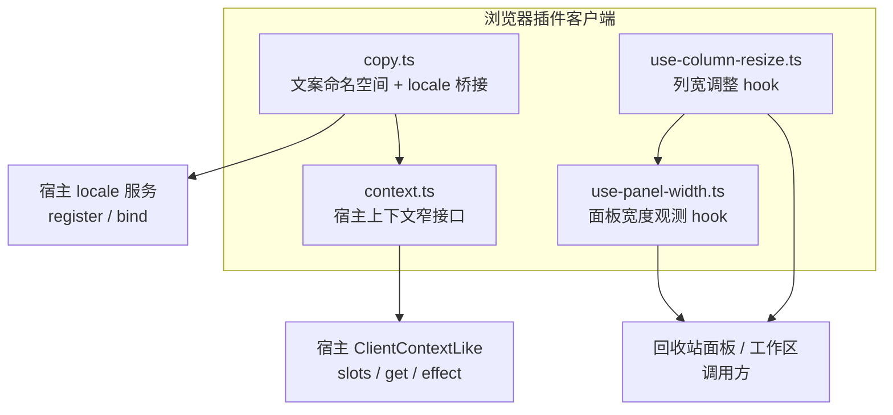
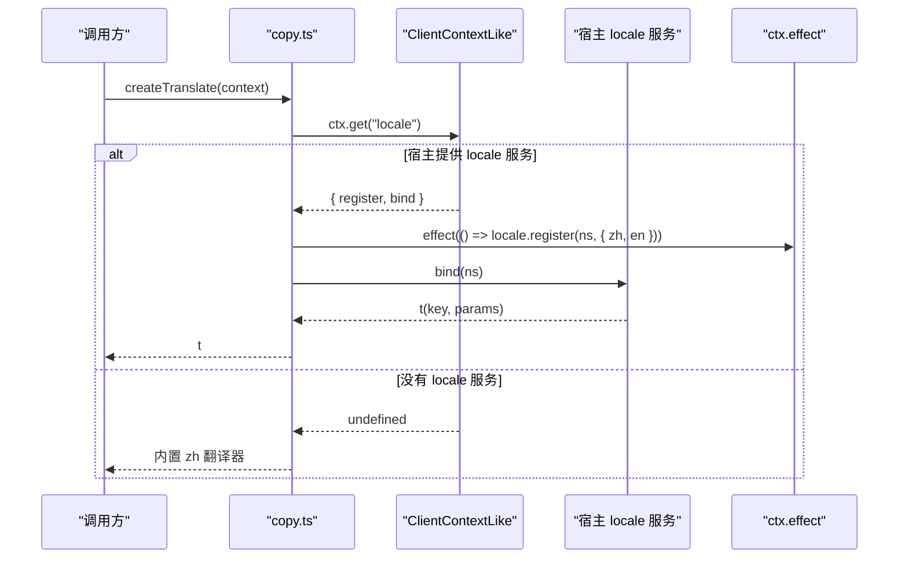
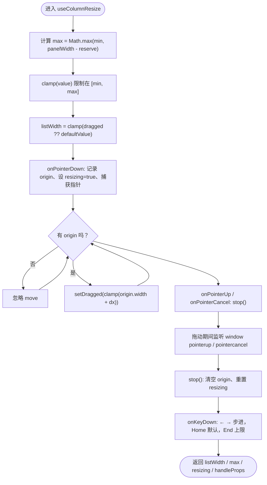
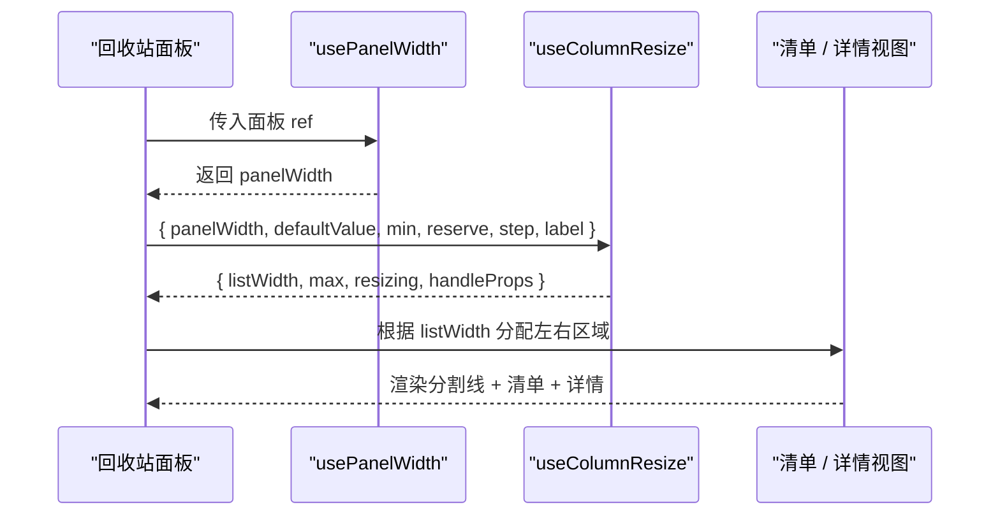
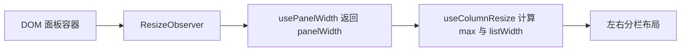
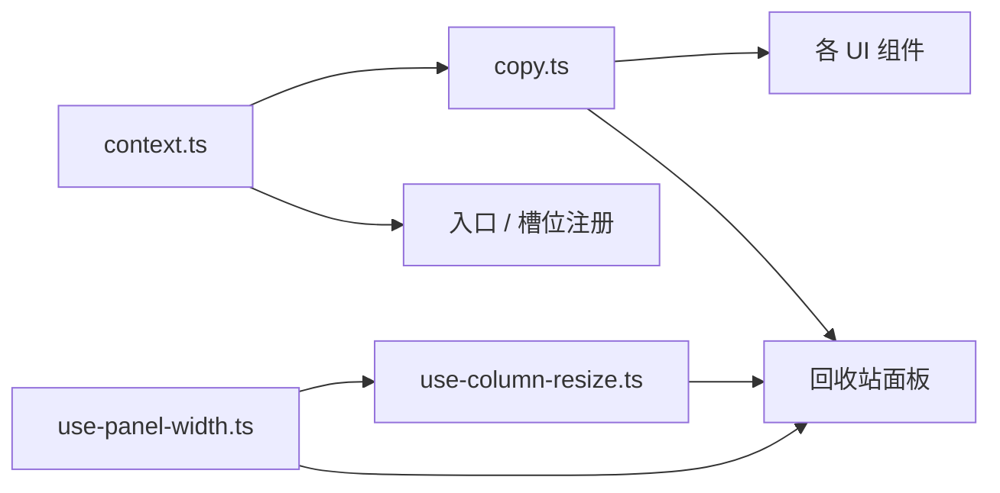

# Hook、上下文与工具函数

<cite>
**本文引用的文件**   
- [context.ts](file://src/client/context.ts)
- [copy.ts](file://src/client/copy.ts)
- [use-column-resize.ts](file://src/client/use-column-resize.ts)
- [use-panel-width.ts](file://src/client/use-panel-width.ts)
- [copy.test.ts](file://tests/client/copy.test.ts)
- [use-column-resize.test.tsx](file://tests/client/use-column-resize.test.tsx)
- [use-panel-width.test.tsx](file://tests/client/use-panel-width.test.tsx)
</cite>

## 目录
1. [引言](#引言)
2. [项目结构定位](#项目结构定位)
3. [核心组件总览](#核心组件总览)
4. [架构总图](#架构总图)
5. [详细模块分析](#详细模块分析)
6. [依赖关系分析](#依赖关系分析)
7. [性能注意事项](#性能注意事项)
8. [测试建议](#测试建议)
9. [常见问题与排错](#常见问题与排错)
10. [结论](#结论)

## 引言
本文面向浏览器侧“半 Hook”能力，聚焦四个紧密协作的文件：

- `context.ts`：定义宿主注入的客户端上下文窄接口，用于槽位注册、可选服务读取和副作用登记。
- `copy.ts`：集中管理可见文案，并桥接宿主的本地化服务；若服务缺失则降级为内置中文。
- `use-column-resize.ts`：实现回收站清单列与详情列之间的可拖拽分栏宽度调整。
- `use-panel-width.ts`：观测当前面板容器的实际宽度，驱动两栏/下钻布局断点。

它们共同支撑回收站面板的文案国际化、左右分栏交互、以及随宿主工作区宽度变化的响应式布局。

## 项目结构定位
这四个文件位于浏览器插件客户端层：

**图表来源**
- [context.ts:1-34](file://src/client/context.ts#L1-L34)
- [copy.ts:1-120](file://src/client/copy.ts#L1-L120)
- [use-column-resize.ts:1-60](file://src/client/use-column-resize.ts#L1-L60)
- [use-panel-width.ts:1-30](file://src/client/use-panel-width.ts#L1-L30)

**章节来源**
- [context.ts:1-34](file://src/client/context.ts#L1-L34)
- [copy.ts:1-120](file://src/client/copy.ts#L1-L120)
- [use-column-resize.ts:1-60](file://src/client/use-column-resize.ts#L1-L60)
- [use-panel-width.ts:1-30](file://src/client/use-panel-width.ts#L1-L30)

## 核心组件总览

| 模块 | 职责 | 主要输入 | 主要返回值 / 副作用 | 关键依赖 |
|---|---|---|---|---|
| `context.ts` | 声明宿主侧 `ClientContextLike`、槽位注册项等窄类型 | 无运行时输入，纯类型与常量说明 | 导出类型供其他模块使用 | 宿主提供的槽位、locale、工作区等抽象 |
| `copy.ts` | 维护文案字典，桥接宿主 locale 服务，提供翻译函数和文案工具 | `ClientContextLike` | `createTranslate(ctx)` 返回 `t`；内部注册命名空间、绑定 `bind(ns)` | `context.ts`、宿主 `ctx.get('locale')`、`ctx.effect` |
| `use-column-resize.ts` | 在回收站清单列与详情列之间提供可拖拽分栏 | `panelWidth`、`defaultValue`、`min`、`reserve`、`step`、`label` | `{ listWidth, max, resizing, handleProps }` | React hooks；通常配合 `use-panel-width.ts` |
| `use-panel-width.ts` | 观测容器元素的 border-box 宽度 | DOM 引用 `ref` | 数值型宽度 | ResizeObserver（或 fallback） |

**章节来源**
- [context.ts:1-34](file://src/client/context.ts#L1-L34)
- [copy.ts:1-120](file://src/client/copy.ts#L1-L120)
- [use-column-resize.ts:1-144](file://src/client/use-column-resize.ts#L1-L144)
- [use-panel-width.ts:1-30](file://src/client/use-panel-width.ts#L1-L30)

## 架构总图
以下序列图展示“复制逻辑如何复用宿主能力或降级”：

**图表来源**
- [copy.ts:1-120](file://src/client/copy.ts#L1-L120)
- [context.ts:1-34](file://src/client/context.ts#L1-L34)

## 详细模块分析

### 共享上下文：`context.ts`
`context.ts` 不实现业务逻辑，而是定义浏览器插件需要使用的宿主上下文窄接口。它把宿主可能暴露的能力收敛成三个关键字段：

| 字段 | 含义 | 约束 |
|---|---|---|
| `slots` | 槽位注册入口，支持 `inject` 与 `register` | 槽位项允许 `label` 为字符串或 thunk，以便语言切换时重新计算 |
| `get` | 可选服务读取面，典型用法是 `ctx.get('locale')` | 老宿主可能没有该方法，因此调用方必须做空值处理 |
| `effect` | 登记随插件卸载撤销的副作用 | 由框架接管清理，常用于注销 locale 命名空间 |

类型设计的关键原则是“只声明用到的成员”，避免引入完整宿主类型包，也避免全局 `declare module` 污染。`SlotRegistration.label` 接受 thunk，是因为宿主解析面板行名时会调用它，从而让面板标题跟随活跃语言变化。

**章节来源**
- [context.ts:1-34](file://src/client/context.ts#L1-L34)

### 复制逻辑与文案桥接：`copy.ts`
`copy.ts` 的核心不是简单的键值表，而是一条“文案 → 宿主 locale → 降级中文”的契约链：

1. **文案集中化**  
   所有用户可见文本集中在一个命名空间下，中文作为真源，英文逐键镜像。这样既能保证多语言一致性，又能通过 TypeScript 的键集合检查发现遗漏。

2. **命名空间隔离**  
   文案使用插件专属命名空间注册到宿主 locale，避免与宿主公共命名空间冲突。

3. **服务可选**  
   通过 `ctx.get('locale')` 获取服务，而不是把它写进强制注入列表。原因有两个：
   - 本仓库要求“客户端半条目激活失败等于宿主进程死”，所以不能因为 locale 缺失导致整条客户端启动失败。
   - 老宿主可能没有 `ctx.get`，此时应直接退化为内置中文，继续可用。

4. **副作用登记**  
   当 locale 服务存在时，调用 `ctx.locale.register` 注册双语字典，并把返回的 disposer 挂进 `ctx.effect`，确保插件卸载后不会留下残留命名空间。

5. **面板标题 thunk**  
   面板标题传函数形式，而不是静态字符串，这样能跟随宿主语言切换重读。

#### 输入参数与返回值

| 内容 | 说明 |
|---|---|
| 输入 | `context: ClientContextLike` |
| 返回值 | `createTranslate(context)` 返回 `t(key, params?)` |
| 副作用 | 若宿主提供 locale，则注册命名空间并绑定翻译函数；disposer 由 `ctx.effect` 管理 |
| 降级行为 | 若无 `ctx.get` 或 `ctx.get('locale')` 返回空值，则回退到内置中文翻译器 |

#### 与其他模块的关系

- 被 `index.tsx` 等入口或视图消费，用于渲染界面文案。
- 依赖 `context.ts` 的类型定义。
- 面板标题的 thunk 语义与宿主 `resolveSlotLabel` 约定一致。

#### 实际使用方式
调用方通常只做一件事：用 `createTranslate(ctx)` 拿到 `t`，然后在组件中调用 `t('trash.title')` 或带参数的 `t('trash.summary', { count, size })`。如果宿主 locale 不可用，`t` 仍可用，只是走内置中文路径。

**章节来源**
- [copy.ts:1-120](file://src/client/copy.ts#L1-L120)
- [copy.ts:121-200](file://src/client/copy.ts#L121-L200)
- [context.ts:1-34](file://src/client/context.ts#L1-L34)

### 列宽调整 Hook：`use-column-resize.ts`
这个 hook 负责回收站左侧清单列与右侧详情列之间的分割线拖动。它同时承担三件事：宽度夹限、指针拖动、键盘无障碍操作。

#### 输入参数

| 参数 | 类型 | 默认值或约束 | 含义 |
|---|---|---|---|
| `panelWidth` | `number` | 由调用方传入，通常来自 `usePanelWidth` | 面板整体宽度，不是窗口宽度 |
| `defaultValue` | `number` | 必填 | 未拖动时的默认清单宽度，也是 Home 键落点 |
| `min` | `number` | 必填 | 清单列最小宽度，例如“删除于 … · 大小”不再省略 |
| `reserve` | `number` | 必填 | 详情列要保留的最小空间，包括正文可读宽度、间隙、分隔线和内边距 |
| `step` | `number` | 必填 | 键盘按 ←→ 每次移动的像素数 |
| `label` | `string` | 必填 | 读屏标签，文案来自 `copy.ts` |

#### 返回值

| 字段 | 含义 |
|---|---|
| `listWidth` | 当前清单列宽度，受 `min` 与 `max` 限制 |
| `max` | 最大允许宽度，等于 `Math.max(min, panelWidth - reserve)` |
| `resizing` | 是否处于拖动状态，用于给面板根添加样式类 |
| `handleProps` | 分割线的属性集，包含 role、aria、tabIndex、pointer 事件和键盘事件 |

#### 内部状态

- `dragged`：拖动过程中记录的当前宽度，初始为 `null`。
- `resizing`：布尔值，表示是否在拖动。
- `origin`：引用对象，记录按下时的鼠标横坐标和当时宽度，避免重复订阅。

#### 处理逻辑流程

**图表来源**
- [use-column-resize.ts:61-144](file://src/client/use-column-resize.ts#L61-L144)

#### 对回收站面板布局的影响
- 当 `listWidth` 增大时，详情列宽度减少；当 `listWidth` 减小时，详情列变宽。
- `max` 由 `panelWidth - reserve` 决定，因此面板变窄时，即使之前拖得很宽，也会重新夹住。
- 拖动中的 `resizing` 会让面板根关闭文字选择，防止拖长选中文本影响体验。
- 分割线本身携带 `role="separator"`、`aria-orientation="vertical"`、范围值，满足屏幕阅读器和键盘导航需求。

#### 实际使用示例
调用方一般这样组合：

**图表来源**
- [use-panel-width.ts:1-30](file://src/client/use-panel-width.ts#L1-L30)
- [use-column-resize.ts:1-144](file://src/client/use-column-resize.ts#L1-L144)

**章节来源**
- [use-column-resize.ts:1-144](file://src/client/use-column-resize.ts#L1-L144)

### 面板宽度 Hook：`use-panel-width.ts`
这个 hook 的目标很明确：给出当前面板容器的 border-box 宽度，而不是 `window.innerWidth`。原因是面板位于宿主中央列，侧栏折叠、拖分栏都会改变它的宽度，但窗口尺寸不一定变。

#### 输入与输出

| 内容 | 说明 |
|---|---|
| 输入 | `ref: RefObject<HTMLElement | null>` |
| 输出 | `number`：面板容器宽度 |
| 初始值 | `0`，代表窄档；只有证明面板够宽时才切换到两栏布局 |
| 副作用 | 挂载时创建 `ResizeObserver` 观察元素，卸载时断开 |

#### 为什么用 `border-box` 宽度
文档明确指出：量的是 `getBoundingClientRect().width`，不是 `contentRect.width`。后者已经扣除内边距，而布局断点判断的是整个盒子；如果用 content width 去比阈值，相当于扣两次内边距，结果会错误地退回下钻模式。

#### 与拖分栏工作区的配合
`use-panel-width.ts` 提供原始宽度，`use-column-resize.ts` 在其基础上计算 `max` 和 `listWidth`。二者分工如下：

- `use-panel-width.ts`：只负责“面板现在有多宽”。
- `use-column-resize.ts`：负责“在面板宽度范围内，怎么切清单列和详情列”。

**图表来源**
- [use-panel-width.ts:1-30](file://src/client/use-panel-width.ts#L1-L30)
- [use-column-resize.ts:1-144](file://src/client/use-column-resize.ts#L1-L144)

**章节来源**
- [use-panel-width.ts:1-30](file://src/client/use-panel-width.ts#L1-L30)

## 依赖关系分析

**图表来源**
- [context.ts:1-34](file://src/client/context.ts#L1-L34)
- [copy.ts:1-120](file://src/client/copy.ts#L1-L120)
- [use-panel-width.ts:1-30](file://src/client/use-panel-width.ts#L1-L30)
- [use-column-resize.ts:1-144](file://src/client/use-column-resize.ts#L1-L144)

### 耦合与内聚
- `context.ts` 与 `copy.ts` 解耦了宿主类型与文案逻辑：前者只声明窄接口，后者只消费该接口。
- `use-panel-width.ts` 不关心具体布局，只产出宽度；`use-column-resize.ts` 不关心面板来源，只消费宽度。
- 两个宽度相关模块之间通过数据而非直接导入耦合，便于单独测试。

### 外部依赖
- React hooks：`useState`、`useRef`、`useEffect`。
- DOM API：`ResizeObserver`、`getBoundingClientRect`、`setPointerCapture`。
- 宿主 API：`ClientContextLike`、`ctx.get('locale')`、`ctx.effect`。

**章节来源**
- [context.ts:1-34](file://src/client/context.ts#L1-L34)
- [copy.ts:1-120](file://src/client/copy.ts#L1-L120)
- [use-panel-width.ts:1-30](file://src/client/use-panel-width.ts#L1-L30)
- [use-column-resize.ts:1-144](file://src/client/use-column-resize.ts#L1-L144)

## 性能注意事项

| 关注点 | 现状 | 建议 |
|---|---|---|
| 宽度更新频率 | `use-panel-width.ts` 使用 `ResizeObserver`，每次容器尺寸变化触发一次 setState | 若面板频繁抖动，可在调用方加防抖，但不要改动 hook 本身；hook 本身已避免轮询 |
| 重复订阅 | `use-panel-width.ts` 在 useEffect 中创建 observer，并在 cleanup 中 disconnect | 保持 ref 稳定；不要在 render 中创建新 ref，否则每次渲染都会重建 observer |
| 指针拖动开销 | `use-column-resize.ts` 只在 `pointerdown` 时设置 `origin`，`pointermove` 才计算新宽度 | 已在非拖动态跳过计算；不需要额外节流，但应避免在回调里做昂贵渲染 |
| 文案初始化 | `copy.ts` 只在首次 `createTranslate` 时注册命名空间 | 避免在高频渲染路径中反复调用；把 `t` 提升到组件外层或 memo 值 |
| 面板宽度计算 | 使用 `getBoundingClientRect()` 测量 border-box | 不要混用 `contentRect.width`；如需更细粒度优化，应在父级缓存断点结果 |
| 无障碍键盘交互 | 每次按键都 setState | 按键频率低，开销很小；如未来扩展更多快捷键，可按需合并更新 |

**章节来源**
- [use-panel-width.ts:1-30](file://src/client/use-panel-width.ts#L1-L30)
- [use-column-resize.ts:1-144](file://src/client/use-column-resize.ts#L1-L144)
- [copy.ts:1-120](file://src/client/copy.ts#L1-L120)

## 测试建议

### 文案与 locale 桥接：`copy.test.ts`
已有测试覆盖三条关键路径：

1. 宿主 locale 服务存在时，命名空间注册成功，中英文都能翻译。
2. 宿主 locale 服务不存在时，直接返回内置中文，且不触发 `ctx.effect`。
3. locale 注册的 disposer 确实通过 `ctx.effect` 交给框架管理。

补充建议：
- 增加“英文键缺失时报错”的模拟场景，验证宿主对象形式注册的行为。
- 增加“thunk 面板标题随语言变化”的集成测试，确认 `label` 能拿到最新翻译。
- 增加“同命名空间重复注册”的场景，验证 disposer 能正确清理。

**章节来源**
- [copy.test.ts:1-121](file://tests/client/copy.test.ts#L1-L121)
- [copy.ts:1-120](file://src/client/copy.ts#L1-L120)

### 列宽调整：`use-column-resize.test.tsx`
现有测试覆盖了默认宽度、拖动边界、面板变窄后的重新夹限、键盘操作、ARIA 属性、拖动中途把手卸载、非拖动态不响应 move、以及 `max < min` 的极端情况。

补充建议：
- 增加“面板宽度从宽变窄再变宽”的多轮测试，确认 `max` 与 `listWidth` 同步。
- 增加“焦点进入分割线后仅方向键生效”的可访问性测试。
- 增加“拖动到精确 min/max 时 aria-valuenow 对齐”的断言。

**章节来源**
- [use-column-resize.test.tsx:1-131](file://tests/client/use-column-resize.test.tsx#L1-L131)
- [use-column-resize.ts:1-144](file://src/client/use-column-resize.ts#L1-L144)

### 面板宽度观测：`use-panel-width.test.tsx`
现有测试覆盖了初始窄档、宽度变化响应、卸载后 observer 断开。

补充建议：
- 增加“ref 先为空后赋值”的挂载顺序测试。
- 增加“容器宽度为 0 时保持窄档”的边界测试。
- 增加“多次 rerender 且 ref 不变时不重复创建 observer”的稳定性测试。

**章节来源**
- [use-panel-width.test.tsx:1-49](file://tests/client/use-panel-width.test.tsx#L1-L49)
- [use-panel-width.ts:1-30](file://src/client/use-panel-width.ts#L1-L30)

## 常见问题与排错

### 列宽计算异常

**现象**
- 清单列过宽或过窄。
- 面板变窄后，之前拖出的超宽清单没有被收回。
- 分割线拖动结束后仍然处于拖动样式。

**排查要点**
1. 检查传入 `useColumnResize` 的 `min` 和 `reserve` 是否与真实布局匹配。`min` 应基于“删除于 … · 大小”不被省略的实际宽度，`reserve` 应包含详情正文最小可读宽度、间隙、分隔线和内边距。
2. 确认 `panelWidth` 来自 `usePanelWidth`，而不是 `window.innerWidth`。
3. 检查 `max = Math.max(min, panelWidth - reserve)`；如果 `panelWidth - reserve < min`，hook 会把 `max` 抬回 `min`，避免负数宽度。
4. 拖动结束后若 `resizing` 仍为真，通常是把手在拖动途中被卸载。hook 已在 window 上兜底监听 `pointerup` 和 `pointercancel`，但调用方仍需确保分割线能被销毁并恢复布局。

**章节来源**
- [use-column-resize.ts:1-144](file://src/client/use-column-resize.ts#L1-L144)
- [use-column-resize.test.tsx:1-131](file://tests/client/use-column-resize.test.tsx#L1-L131)

### 上下文未注入

**现象**
- 面板标题显示为键名。
- 点击菜单或按钮时出现英文键字面量。
- 某些宿主环境下无法使用可选服务。

**排查要点**
1. 确认宿主提供了 `ClientContextLike`，至少包含 `slots` 与 `effect`。
2. 如果希望启用多语言，还要确认 `ctx.get('locale')` 返回 `register` 和 `bind`。
3. 如果没有 `ctx.get`，`createTranslate` 会退化为内置中文，不会抛错；这是预期降级。
4. 如果 locale 存在但没有注册命名空间，检查 `ctx.effect` 是否被执行，以及 `register` 返回的 disposer 是否正确交给框架。

**章节来源**
- [context.ts:1-34](file://src/client/context.ts#L1-L34)
- [copy.ts:1-120](file://src/client/copy.ts#L1-L120)
- [copy.test.ts:1-121](file://tests/client/copy.test.ts#L1-L121)

### 复制失败

**现象**
- 界面上出现类似 `trash.title` 的字面量。
- 宿主启动时报客户端条目未激活。
- HMR 或重新挂载时报“locale namespace already has locale”。

**排查要点**
- 文案显示为键名：说明宿主 locale 服务不可用或未注册命名空间。优先检查 `ctx.get('locale')` 是否为空。
- 客户端条目激活失败：说明本仓库要求的“客户端半激活失败即致命”规则被触发，应检查 `copy.ts` 是否完成注册。
- 命名空间重复注册：说明 disposer 没有挂在 `ctx.effect` 上，卸载后旧命名空间仍在。确认 `ctx.effect` 的执行结果就是 `locale.register` 返回的 disposer。

**章节来源**
- [copy.ts:1-120](file://src/client/copy.ts#L1-L120)
- [copy.test.ts:1-121](file://tests/client/copy.test.ts#L1-L121)

### 面板宽度异常

**现象**
- 明明面板足够宽，却显示单栏下钻。
- 侧栏折叠后宽度没更新。
- 组件卸载后仍有 observer 在派发。

**排查要点**
1. 确认使用的是 `getBoundingClientRect().width`，而不是 `contentRect.width`。
2. 确认传给 hook 的 ref 指向的是面板容器，而不是子节点。
3. 确认 ref 没有在每次渲染时新建，否则会重建 observer。
4. 确认组件卸载后 observer 已断开；测试中已通过 mock observer 验证 active 数量为 0。

**章节来源**
- [use-panel-width.ts:1-30](file://src/client/use-panel-width.ts#L1-L30)
- [use-panel-width.test.tsx:1-49](file://tests/client/use-panel-width.test.tsx#L1-L49)

## 结论
这四个模块构成了回收站面板的“上下文—文案—宽度—分栏”基础：

- `context.ts` 定义了宿主注入能力的窄接口，避免强耦合宿主类型。
- `copy.ts` 把文案集中化，并通过宿主 locale 服务提供国际化；缺失服务时优雅降级。
- `use-panel-width.ts` 提供面板真实宽度，是布局断点的唯一数据源。
- `use-column-resize.ts` 在面板宽度范围内实现安全的列宽拖动，并兼顾键盘和无障碍。

它们的最佳实践是：
- 宽度计算使用 border-box，避免内边距扣两次。
- 文案翻译优先走宿主 locale，缺失时回退中文。
- 指针拖动仅在按下后生效，并在 window 上兜底结束。
- 所有副作用通过宿主 `ctx.effect` 或 React effect 清理，避免泄漏。
- 测试覆盖服务存在、缺失、拖动边界、面板宽度变化和 observer 生命周期。