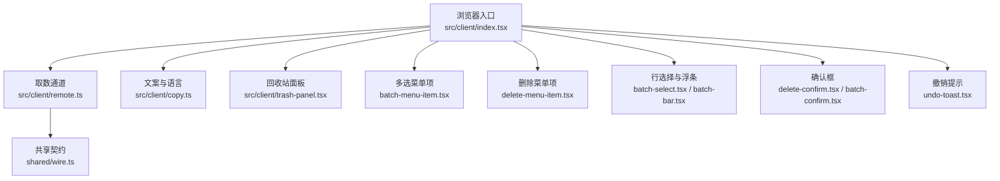
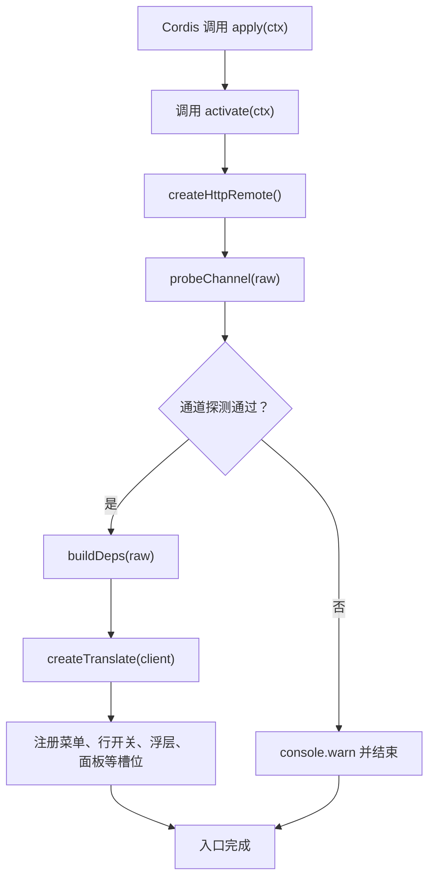
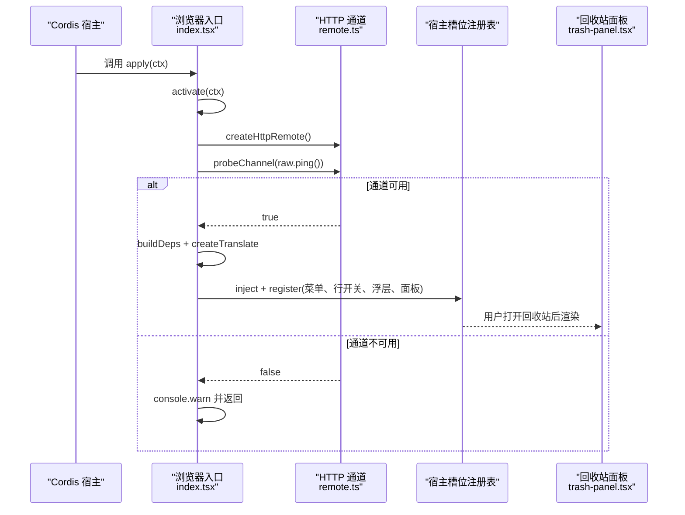
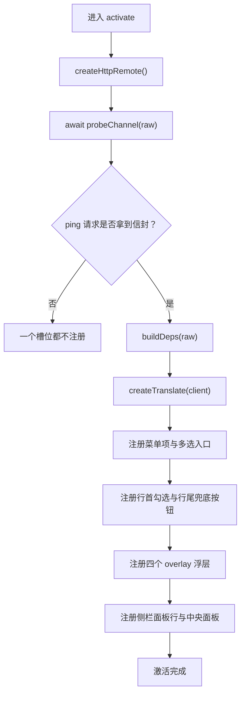

# 入口与槽位注册

<cite>
**本文引用的文件**   
- [src/client/index.tsx](file://src/client/index.tsx)
- [src/client/context.ts](file://src/client/context.ts)
- [src/client/remote.ts](file://src/client/remote.ts)
- [src/client/copy.ts](file://src/client/copy.ts)
- [src/client/trash-panel.tsx](file://src/client/trash-panel.tsx)
- [package.json](file://package.json)
- [cordis.patch.yml](file://cordis.patch.yml)
- [README.md](file://README.md)
- [docs/architecture.md](file://docs/architecture.md)
</cite>

## 目录

1. [引言](#引言)
2. [项目结构](#项目结构)
3. [核心组件](#核心组件)
4. [架构总览](#架构总览)
5. [详细组件分析](#详细组件分析)
6. [依赖分析](#依赖分析)
7. [性能考虑](#性能考虑)
8. [故障排查指南](#故障排查指南)
9. [可访问性注意事项](#可访问性注意事项)
10. [结论](#结论)

## 引言

`src/client/index.tsx` 是 `@xrn1997/dsh-session-delete` 插件在浏览器端的装配根。它不直接承担删除逻辑，而是把宿主提供的槽位能力与本插件的 React 组件拼起来：菜单项、行首勾选框、行尾兜底按钮、overlay 浮层、以及回收站侧栏面板和中央面板。

插件激活时不会立刻渲染界面；它会先探测远程通道是否可用。只有探测通过，才注册十个槽位贡献（第十三批起批量相关再加五件）。如果通道不可用，插件“静默隐身”——不注册任何入口，也不会让宿主进程崩溃。

## 项目结构

浏览器端代码集中在 `src/client/`，按职责拆分：

| 路径 | 职责 |
| --- | --- |
| `index.tsx` | 浏览器半入口、槽位探测与注册 |
| `context.ts` | 宿主 `ClientContextLike` 的本地窄镜像 |
| `remote.ts` | 同源 HTTP 取数通道、信封适配与依赖注入面 |
| `copy.ts` | 中/英文案字典与宿主 locale 服务绑定 |
| `trash-panel.tsx` | 回收站中央面板本体 |
| `batch-bar.tsx` / `batch-confirm.tsx` / `batch-menu-item.tsx` / `batch-select.tsx` | 多选模式与批量删除浮层 |
| `delete-menu-item.tsx` / `delete-confirm.tsx` | 单条删除菜单项与确认框 |
| `undo-toast.tsx` | 撤销提示浮层 |
| `ui/*` | 从官方 UI 抄来的控件样式与轻量封装 |



**图表来源**   
- [src/client/index.tsx:1-346](file://src/client/index.tsx#L1-L346)
- [src/client/remote.ts:1-288](file://src/client/remote.ts#L1-L288)
- [src/client/trash-panel.tsx:1-200](file://src/client/trash-panel.tsx#L1-L200)

**章节来源**   
- [docs/architecture.md:1-94](file://docs/architecture.md#L1-L94)
- [package.json:1-105](file://package.json#L1-L105)

## 核心组件

### 浏览器半入口：`activate` 与 `apply`

入口导出两个符号：

| 符号 | 作用 |
| --- | --- |
| `name` | 客户端模块名，供宿主识别 |
| `inject` | 声明本条目需要的宿主服务，当前只写 `['slots']` |
| `apply(ctx)` | Cordis 调用的装配函数，同步返回，绝不抛出 |

`apply` 内部调用异步的 `activate`，并把未捕获错误降级为控制台警告。这样前端启动自检只关心 `inject` 里声明的服务是否存在，不关心异步注册是否成功。



**图表来源**   
- [src/client/index.tsx:201-346](file://src/client/index.tsx#L201-L346)
- [src/client/remote.ts:201-288](file://src/client/remote.ts#L201-L288)

**章节来源**   
- [src/client/index.tsx:1-346](file://src/client/index.tsx#L1-L346)

### 槽位常量与插件标识

入口定义了五个槽位键和一个插件专属前缀：

| 常量 | 值 | 用途 |
| --- | --- | --- |
| `MENU_SLOT` | `sidebar.workspaces.session.menu.item` | 会话菜单项 |
| `LEADING_SLOT` | `sidebar.session.row.leading` | 行首勾选框 |
| `ROW_ACTION_SLOT` | `sidebar.workspaces.session.row.action` | 行尾兜底按钮 |
| `OVERLAY_SLOT` | `shell.overlay` | overlay 常驻浮层 |
| `PANEL_SLOT` | `sidebar.panellist` | 侧栏面板列表行 |
| `MAIN_SLOT` | `main` | 中央面板占用者 |
| `PLUGIN_ID` | `@xrn1997/dsh-session-delete` | 槽位 id 与面板 key 前缀 |
| `PANEL_ID` | `${PLUGIN_ID}.trash` | 回收站面板 id 与 main key |

面板 id 同时用作 `sidebar.panellist` 行的 id 和 `main` 槽的 key，因为宿主按 list id 去 `main` 中查找同字 key 的中央面板。

**章节来源**   
- [src/client/index.tsx:150-180](file://src/client/index.tsx#L150-L180)

### 依赖注入方式

依赖分为两类：

| 类别 | 注入位置 | 原因 |
| --- | --- | --- |
| `slots` | 模块级 `inject = ['slots']` | 宿主必给，用于槽位注册表 |
| `locale` | 运行时 `client.get('locale')` | 可选服务，缺席时降级内置中文 |
| 远程方法 | `buildDeps(raw)` 产出 `SessionDeleteRemote` | 不是注入服务，而是探测后构造的对象 |
| 文案函数 `t` | 每个槽位的 `inject` 载荷 | 随语言变化稳定引用 |

`context.ts` 中的 `ClientContextLike` 是宿主浏览器侧上下文的最小视图，只声明 `slots`、可选的 `get`、以及 `effect`。这样做避免引入宿主类型包，也避免把“不一定存在的服务”当成强约束。

**章节来源**   
- [src/client/index.tsx:120-149](file://src/client/index.tsx#L120-L149)
- [src/client/context.ts:1-34](file://src/client/context.ts#L1-L34)
- [src/client/remote.ts:201-288](file://src/client/remote.ts#L201-L288)

## 架构总览



**图表来源**   
- [src/client/index.tsx:201-346](file://src/client/index.tsx#L201-L346)
- [src/client/remote.ts:201-288](file://src/client/remote.ts#L201-L288)
- [src/client/trash-panel.tsx:1-200](file://src/client/trash-panel.tsx#L1-L200)

## 详细组件分析

### 插件激活流程

激活分三步：

1. 创建 HTTP 远程对象。
2. 执行 `probeChannel`，发起一次 `GET /ping`。
3. 仅当探测成功时，构建依赖、创建翻译器，然后按顺序注册槽位。

探测成功并不表示业务操作成功；只要请求往返拿到信封，就认为“通道已接通”。即使返回 `{ ok: false, error }`，插件仍会注册所有入口，让错误由界面展示，而不是隐藏入口。



**图表来源**   
- [src/client/index.tsx:201-346](file://src/client/index.tsx#L201-L346)
- [src/client/remote.ts:201-288](file://src/client/remote.ts#L201-L288)

**章节来源**   
- [src/client/index.tsx:201-346](file://src/client/index.tsx#L201-L346)

### 菜单项槽位

菜单槽 `sidebar.workspaces.session.menu.item` 注册两个贡献：

| 贡献 id | order | 行为 |
| --- | --- | --- |
| `@xrn1997/dsh-session-delete.batch-select` | 850 | “多选”入口，按下进入或退出多选模式 |
| `@xrn1997/dsh-session-delete.delete` | 900 | “删除”菜单项，只负责把删除意图传给确认框 |

这两个贡献都通过 `inject: () => ({ t })` 传入文案函数。删除行还会消费宿主注入的 `useMenuOpenState`，在点击后立即收起宿主菜单。

**章节来源**   
- [src/client/index.tsx:150-200](file://src/client/index.tsx#L150-L200)
- [src/client/index.tsx:240-260](file://src/client/index.tsx#L240-L260)

### 行首勾选与行尾兜底按钮

行首槽位 `sidebar.session.row.leading` 只在没有状态点且非归档的行渲染，作为多选模式的“主勾选框”。它只接收 `sessionId`，标题从宿主的 root hook `useSessions` 中按 `byId[sessionId].title` 读取。

行尾槽位 `sidebar.workspaces.session.row.action` 是兜底入口：当行首格子不存在时显示。它的座位规则是“一行一颗图标按钮”，并且排内点击不会误触发会话切换，因此组件不需要处理事件冒泡。

两者都通过 `BatchPickCheckbox` 或 `BatchPickButton` 接入批量选择状态，并把每行的标题与运行态登记给整行点击守卫。

**章节来源**   
- [src/client/index.tsx:170-200](file://src/client/index.tsx#L170-L200)
- [src/client/index.tsx:260-280](file://src/client/index.tsx#L260-L280)

### overlay 浮层

`shell.overlay` 注册四个常驻宿主：

| id | 组件 | 生命周期要求 |
| --- | --- | --- |
| `@xrn1997/dsh-session-delete.undo-toast` | `UndoToast` | 撤销提示常驻 |
| `@xrn1997/dsh-session-delete.delete-confirm` | `DeleteConfirmHost` | 必须脱离菜单子树 |
| `@xrn1997/dsh-session-delete.batch-bar` | `BatchBar` | 跟随行选择状态重绘 |
| `@xrn1997/dsh-session-delete.batch-confirm` | `BatchConfirmHost` | 必须脱离行开关子树 |

这些不是额外“入口”，而是支撑交互的常驻容器。它们各自通过 `inject` 获得 `deps` 与 `t`。

**章节来源**   
- [src/client/index.tsx:201-240](file://src/client/index.tsx#L201-L240)
- [src/client/index.tsx:280-320](file://src/client/index.tsx#L280-L320)

### 回收站面板：侧栏行与中央面板

回收站入口是一对必须成批注册的座位：

| 槽位 | 占用者 | 说明 |
| --- | --- | --- |
| `sidebar.panellist` | `TrashPanelIconSlot` | 侧栏列表中占一行，只输出图标 glyph |
| `main` | `TrashPanel` | 中央面板，自带页面骨架、滚动与两栏布局 |

两条注册放在同一个异步块中，但宿主 `inject` 回调并非原子事务。若只注册了行而没有面板，用户点击时会由宿主抛出 `layout.selectPanel` 相关错误；反之若有面板但没有行，用户无法打开面板。入口注释明确接受这种风险，因为“漏一半”比“半吊子 UI”更利于暴露问题。

面板行的 `label` 使用 thunk `() => t('trash.title')`，以便宿主语言切换时重新解析。中央面板的 key 与侧栏行的 id 同为 `PANEL_ID`。

**章节来源**   
- [src/client/index.tsx:320-346](file://src/client/index.tsx#L320-L346)
- [src/client/trash-panel.tsx:1-200](file://src/client/trash-panel.tsx#L1-L200)

### 远程通道与降级表达

`remote.ts` 定义六个段：`list`、`ping`、`orphans`、`detail`、`apply`、`empty`。浏览器端通过同源 fetch 访问宿主 web server 上的 `/dsh-session-delete-api`。

关键约定：

| 情况 | 表现 |
| --- | --- |
| HTTP 请求失败 | 抛异常，`probeChannel` 返回 false |
| 响应不是信封 | 抛异常，`probeChannel` 返回 false |
| 收到 `{ ok: false, error }` | 视为通道可用，继续注册入口 |
| 业务失败 | 由 `unwrapRemoteResult` 转为抛异常，组件侧再转成失败状态 |

降级表达的核心原则是：**入口不出现，不等于禁用态**。插件不会在页面上画一个灰色的“删除不可用”按钮；它只是不注册任何菜单、行开关或面板。

**章节来源**   
- [src/client/remote.ts:1-200](file://src/client/remote.ts#L1-L200)
- [src/client/remote.ts:201-288](file://src/client/remote.ts#L201-L288)

## 依赖分析

```mermaid
classDiagram
    class ClientContextLike {
        +slots
        +get(name)
        +effect(execute, label)
    }

    class SlotsLike {
        +inject(key, contribute)
        +register(options, component)
    }

    class SessionDeleteRemote {
        +list()
        +scanOrphans()
        +detail(entryId)
        +applyOutcomes(action, ids)
        +emptyTrash()
    }

    class RawSessionDeleteRemote {
        +list()
        +ping()
        +orphans()
        +detail(entryId)
        +apply(action, ids)
        +empty()
    }

    class TrashPanelProps {
        +deps: SessionDeleteRemote
        +t?: Translate
    }

    ClientContextLike --> SlotsLike : "持有"
    Entry["index.tsx"] --> ClientContextLike : "activate(ctx)"
    Entry --> SessionDeleteRemote : "buildDeps"
    Entry --> SlotsLike : "slots.inject/register"
    TrashPanelProps --> SessionDeleteRemote : "依赖"
```

**图表来源**   
- [src/client/context.ts:1-34](file://src/client/context.ts#L1-L34)
- [src/client/index.tsx:1-346](file://src/client/index.tsx#L1-L346)
- [src/client/remote.ts:1-288](file://src/client/remote.ts#L1-L288)
- [src/client/trash-panel.tsx:1-200](file://src/client/trash-panel.tsx#L1-L200)

### 组件耦合关系

- `index.tsx` 是装配中心，耦合最少的是 `copy.ts` 的文案工厂，耦合最多的是 `slots`。
- `remote.ts` 是浏览器端与 Node 端之间的薄边界，组件不应直接 import `fetch` 或路由路径。
- `trash-panel.tsx` 依赖 `SessionDeleteRemote`，但不直接依赖 `RawSessionDeleteRemote`。
- 各菜单项、行开关和浮层只依赖 `SessionDeleteRemote` 的子集，例如删除确认框只需要 `applyOutcomes`。

**章节来源**   
- [docs/architecture.md:1-94](file://docs/architecture.md#L1-L94)

## 性能考虑

1. **探测只做一次零成本 ping**：不再每次加载都读全表。
2. **注册是微任务延迟生效**：`activate` 异步执行，宿主槽位订阅按微任务批量传播，不影响首次渲染时序。
3. **面板自带滚动容器**：中央列盒子没有 padding 与滚动，面板自己撑满并自收滚动，避免长清单撑坏宿主布局。
4. **文案函数稳定**：`createTranslate` 返回的 `t` 经宿主 locale 服务记忆化，适合放进槽位 `inject` 载荷而不破坏 memoization。
5. **批量动作收敛到一段 `/apply`**：旧版 N=1 多段调用被合并，减少第二条执行路径与重复逻辑。

**章节来源**   
- [src/client/index.tsx:320-346](file://src/client/index.tsx#L320-L346)
- [src/client/trash-panel.tsx:1-200](file://src/client/trash-panel.tsx#L1-L200)
- [src/client/remote.ts:201-288](file://src/client/remote.ts#L201-L288)

## 故障排查指南

### 常见症状与原因

| 症状 | 可能原因 | 建议排查 |
| --- | --- | --- |
| 安装后侧栏没有“回收站”，菜单也没有“删除” | 远程通道探测失败 | 检查宿主是否重启、Node 半是否挂载、`/dsh-session-delete-api/ping` 是否可达 |
| 控制台出现“入口未注册”警告 | `probeChannel` 抛错 | 查看网络错误、SPA 兜底处理器是否拦截了 API 请求 |
| 菜单存在但点击失败 | 远端路由或动词失败 | 检查 Node 半日志与 `dispatch.ts` 路由分支 |
| 打开回收站报“main panel ... is not registered” | 只注册了侧栏行，没注册 `main` | 检查 `PANEL_ID` 是否与中央面板 key 一致 |
| 面板有入口但中央列不渲染 | 只注册了 `main`，没注册 `sidebar.panellist` | 检查两处 `slots.inject` 是否都执行 |
| 宿主版本不兼容 | `engines.dsh` 或 `dsh.compatibility.dshReleases` 不满足 | 对照 README 与 package.json 的宿主版本区间 |
| Cordis 事件未触发 | 插件未激活或槽位名错误 | 检查 cordis.patch.yml、slot 名称是否与宿主声明一致 |
| 文案缺失或英文不完整 | locale 服务降级或 en 字典缺键 | 检查 `copy.ts` 中 zh 与 en 是否逐键齐全 |

### 槽位未注册

最可能的原因是通道探测失败。排查顺序：

1. 确认插件已安装并重启宿主。
2. 确认 Node 半可访问，`/dsh-session-delete-api/ping` 返回信封。
3. 确认没有 SPA 兜底处理器把 API 请求当作 HTML 页面返回。
4. 确认没有向未声明槽位注册。
5. 确认 `apply` 没有抛出；入口本身会 catch 异步错误并记录警告。

**章节来源**   
- [src/client/index.tsx:201-346](file://src/client/index.tsx#L201-L346)
- [src/client/remote.ts:201-288](file://src/client/remote.ts#L201-L288)

### 宿主版本不兼容

兼容性分两层：

| 层级 | 依据 | 效果 |
| --- | --- | --- |
| 装得上 | `package.json.engines.dsh` | 宿主版本不在区间则拒绝安装 |
| 真跑过 | `package.json.dsh.compatibility.dshReleases` | 仅列出桌面实测版本 |

README 明确说明最低地板是 `0.1.7-rc.2`；更低版本缺少行首勾选槽位或会话行入口。`0.2.0-rc.2`、`0.2.1-rc.1`、`0.2.1-rc.2` 是标记为 `compatible` 的版本。

**章节来源**   
- [README.md:1-147](file://README.md#L1-L147)
- [package.json:1-105](file://package.json#L1-L105)

### Cordis 事件未触发

`cordis.patch.yml` 插入插件名，`package.json` 的 `exports` 暴露 `./client` 入口，`dsh.client.platform` 设为 `web`。若 Cordis 不调用 `apply`，应检查：

- 插件是否成功安装。
- Cordis 是否能找到 `lib/client.js`。
- 浏览器半是否有编译错误导致入口未激活。
- 宿主是否对第三方插件启用浏览器端装配。

**章节来源**   
- [cordis.patch.yml:1-3](file://cordis.patch.yml#L1-L3)
- [package.json:1-105](file://package.json#L1-L105)

## 可访问性注意事项

当前实现已有部分可访问性基础，但文档注释也明确指出一些已知边界：

| 关注点 | 现状与建议 |
| --- | --- |
| 键盘导航 | 面板分隔线支持左右方向键调整宽度；其他控件应确保 Tab 顺序合理，危险按钮需二次确认 |
| ARIA 标签 | 面板错误块使用 `role="status"`，但“插入即播报”不能仅靠该属性保证 |
| 屏幕阅读器 | 需要常驻播报区域配合 `aria-live`，当前仓库无 AT 验证，属于已知限制 |
| 焦点管理 | 关闭确认框、浮层和菜单时应归还焦点；行内按钮不应误触发会话切换 |
| 颜色与对比度 | 危险操作使用实心红，普通彻底删除使用安静红色；应避免仅用颜色表达语义 |
| 文本替代 | 图标按钮应有可读描述，如“勾选某会话以批量删除” |
| 语言切换 | 面板名走宿主 locale，文案字典提供 zh/en，但切换后的焦点与播报仍需测试 |

**章节来源**   
- [src/client/trash-panel.tsx:1-200](file://src/client/trash-panel.tsx#L1-L200)
- [src/client/copy.ts:1-200](file://src/client/copy.ts#L1-L200)

## 结论

`src/client/index.tsx` 的职责很清晰：它是 Cordis 插件在浏览器端的装配根，负责把宿主槽位与本插件的菜单、行开关、浮层和回收站面板组装起来。它的健壮性主要来自三点：

1. 异步激活，同步返回，绝不抛出。
2. 远程通道探测决定入口是否出现。
3. 面板相关槽位成批注册，id 与 key 保持一致。

对于使用者和维护者来说，判断入口是否正常，第一看控制台是否出现“入口未注册”警告；第二看宿主是否确实挂载了 Node 半 API；第三看 `engines.dsh` 与 `dshReleases` 是否与运行宿主匹配。若这三个条件都满足，却仍有槽位缺失，应优先检查槽位名、id、key 与宿主声明是否一致。