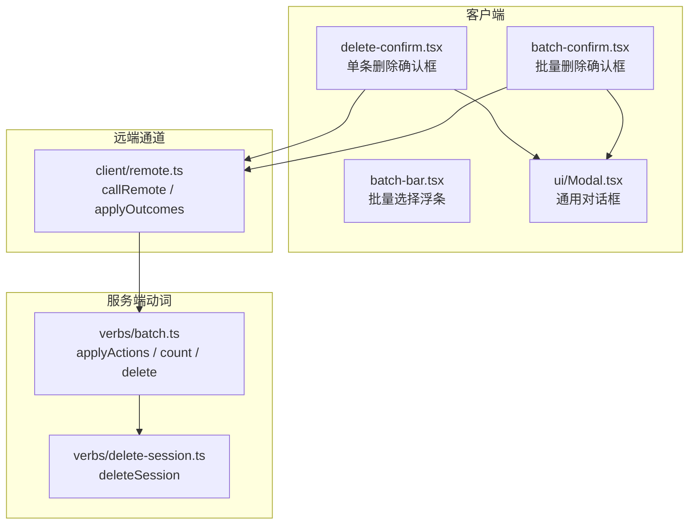
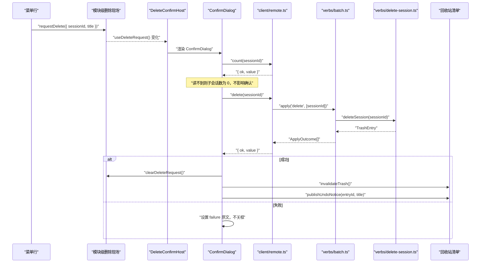
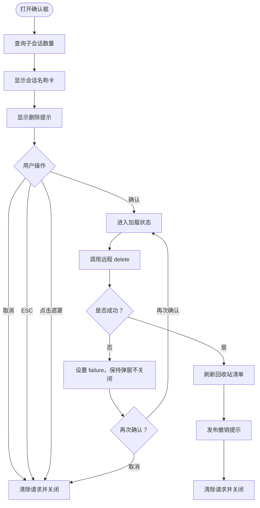
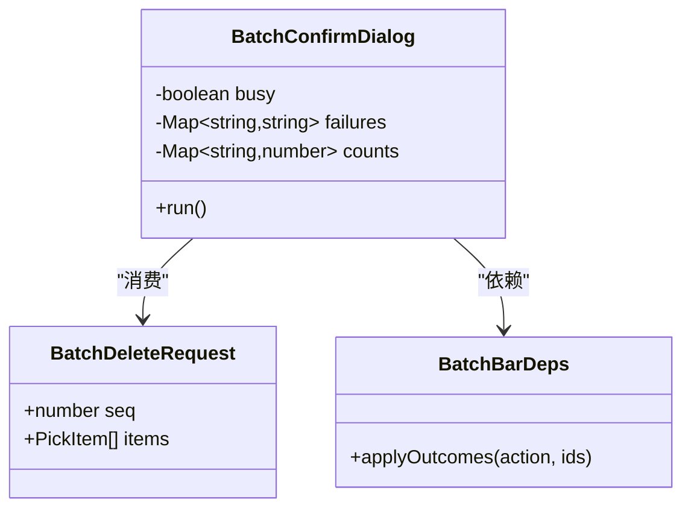
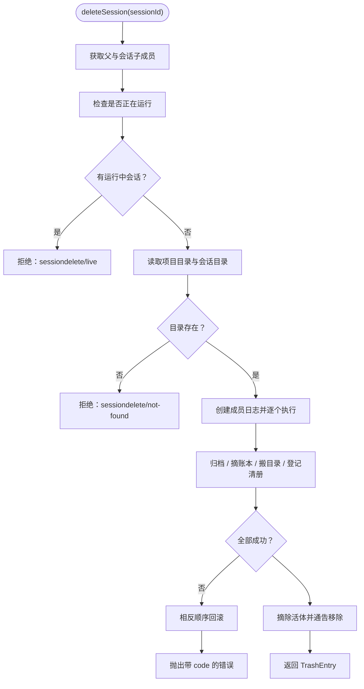
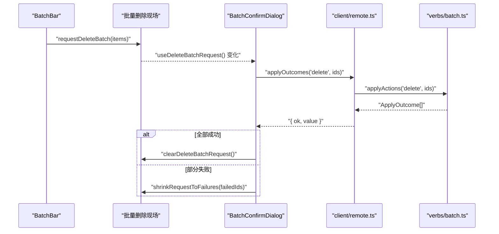

# 删除确认框

<cite>
**本文引用的文件**   
- [delete-confirm.tsx](file://src/client/delete-confirm.tsx)
- [batch-bar.tsx](file://src/client/batch-bar.tsx)
- [batch-confirm.tsx](file://src/client/batch-confirm.tsx)
- [remote.ts](file://src/client/remote.ts)
- [delete-session.ts](file://src/verbs/delete-session.ts)
- [batch.ts](file://src/verbs/batch.ts)
- [Modal.tsx](file://src/client/ui/Modal.tsx)
- [delete-session.test.ts](file://tests/delete-session.test.ts)
</cite>

## 目录
1. [简介](#简介)
2. [项目结构定位](#项目结构定位)
3. [核心组件与职责](#核心组件与职责)
4. [架构总览](#架构总览)
5. [详细组件分析](#详细组件分析)
6. [参数与类型说明](#参数与类型说明)
7. [与批量流程的协作关系](#与批量流程的协作关系)
8. [远端通信与错误处理](#远端通信与错误处理)
9. [无障碍建议](#无障碍建议)
10. [调用示例](#调用示例)
11. [故障排查](#故障排查)
12. [结论](#结论)

## 简介
`delete-confirm.tsx` 是“删除会话”的单条确认浮层宿主。它解决一个关键问题：菜单行在收起时会被卸载，如果确认框挂在菜单行内部，就会随菜单一起被卸载，导致用户永远点不到“移入回收站”。因此，组件把“请求”和“确认”拆开：

- 菜单行只负责发出 `{ sessionId, title }` 请求，写入模块级现场；
- `DeleteConfirmHost` 挂在框架级浮层槽位 `shell.overlay` 上，从现场读取并渲染确认对话框；
- 对话框自身持有加载中、失败、子会话数量等状态，从而不受菜单生命周期影响。

这个模式同样被批量删除复用：单删确认框和批量确认框共享卡片样式与文案键，但批量侧有自己的请求现场、计数和重试逻辑。

**章节来源**
- [delete-confirm.tsx:1-33](file://src/client/delete-confirm.tsx#L1-L33)

## 项目结构定位
删除确认功能横跨客户端视图、远端通道、动词实现和测试：



**图表来源**
- [delete-confirm.tsx:1-194](file://src/client/delete-confirm.tsx#L1-L194)
- [batch-bar.tsx:1-136](file://src/client/batch-bar.tsx#L1-L136)
- [batch-confirm.tsx:1-200](file://src/client/batch-confirm.tsx#L1-L200)
- [remote.ts:1-200](file://src/client/remote.ts#L1-L200)
- [batch.ts:1-197](file://src/verbs/batch.ts#L1-L197)
- [delete-session.ts:1-200](file://src/verbs/delete-session.ts#L1-L200)

**章节来源**
- [delete-confirm.tsx:1-194](file://src/client/delete-confirm.tsx#L1-L194)
- [batch-bar.tsx:1-136](file://src/client/batch-bar.tsx#L1-L136)
- [batch-confirm.tsx:1-200](file://src/client/batch-confirm.tsx#L1-L200)
- [remote.ts:1-200](file://src/client/remote.ts#L1-L200)
- [batch.ts:1-197](file://src/verbs/batch.ts#L1-L197)
- [delete-session.ts:1-200](file://src/verbs/delete-session.ts#L1-L200)

## 核心组件与职责
| 组件 | 职责 | 关键行为 |
|---|---|---|
| `DeleteConfirmHost` | 挂载在 `shell.overlay` 上的常驻确认框宿主 | 没有待删除请求时不渲染；有新请求时用 `seq` 作为 key 重挂载，避免旧状态污染 |
| `ConfirmDialog` | 单条删除确认对话框本体 | 显示会话名称、子会话数、提示文案、失败 Tag；提供取消与确认按钮 |
| `requestDelete` | 菜单行调用的入口 | 写入模块级 `DeleteRequest`，触发订阅者重绘 |
| `clearDeleteRequest` | 关闭确认框或成功后的收尾 | 清空现场并通知订阅者 |
| `useDeleteRequest` | 供宿主订阅模块级删除请求 | 基于 `useSyncExternalStore` 同步外部状态 |

**章节来源**
- [delete-confirm.tsx:34-194](file://src/client/delete-confirm.tsx#L34-L194)

## 架构总览
单条删除的完整时序如下：



**图表来源**
- [delete-confirm.tsx:88-194](file://src/client/delete-confirm.tsx#L88-L194)
- [remote.ts:136-200](file://src/client/remote.ts#L136-L200)
- [batch.ts:60-100](file://src/verbs/batch.ts#L60-L100)
- [delete-session.ts:1-120](file://src/verbs/delete-session.ts#L1-L120)

**章节来源**
- [delete-confirm.tsx:88-194](file://src/client/delete-confirm.tsx#L88-L194)
- [remote.ts:136-200](file://src/client/remote.ts#L136-L200)
- [batch.ts:60-100](file://src/verbs/batch.ts#L60-L100)
- [delete-session.ts:1-120](file://src/verbs/delete-session.ts#L1-L120)

## 详细组件分析

### 单条删除确认框 `delete-confirm.tsx`
该文件同时承担三件事：

1. **模块级现场**：保存当前 `DeleteRequest`，并通过 `Set` + `emit` 通知订阅者。每次发布递增 `seq`，新请求会换一个新的确认框实例。
2. **宿主组件**：`DeleteConfirmHost` 挂在 `shell.overlay`，没有请求时返回 `null`，有请求时渲染 `ConfirmDialog`。
3. **交互与状态**：`ConfirmDialog` 管理 `busy`、`failure`、`subagents`，分别对应加载中、失败消息、子会话数量。

#### 数据流与状态机


**图表来源**
- [delete-confirm.tsx:110-194](file://src/client/delete-confirm.tsx#L110-L194)

#### 关键设计要点
- **子会话数量是可缺项**：`count` 读不到时按 0 处理，不会阻断确认，也不会伪造“没有子会话”的断言。
- **失败不吞**：失败消息通过 `Tag tone="danger"` 直接显示在对话框内，且对话框不自动关闭，允许用户重试。
- **成功后幂等处理**：如果返回值是 `null`（例如已被同批前一条带走），只刷新清单，不发布撤销提示。
- **字段隔离**：每个 `seq` 都创建新的 `ConfirmDialog`，避免上一个请求的 `busy` 或 `failure` 泄漏到下一个会话。

**章节来源**
- [delete-confirm.tsx:34-194](file://src/client/delete-confirm.tsx#L34-L194)

### 批量删除确认框 `batch-confirm.tsx`
批量确认框不是简单复用单删组件，而是共享卡片样式和文案键，再扩展出批量语义：

- 标题根据选中数量变化；
- 目标卡逐条列出会话标题和子会话数；
- 执行走批量 `apply('delete', ids)`；
- 支持“部分成功 + 失败名单”的重试；
- 成功后对已移动条目发布批量撤销提示。



**图表来源**
- [batch-confirm.tsx:25-120](file://src/client/batch-confirm.tsx#L25-L120)
- [batch-bar.tsx:27-40](file://src/client/batch-bar.tsx#L27-L40)

**章节来源**
- [batch-confirm.tsx:1-200](file://src/client/batch-confirm.tsx#L1-L200)
- [batch-bar.tsx:1-136](file://src/client/batch-bar.tsx#L1-L136)

### 底层删除动词 `delete-session.ts`
`deleteSession` 并不是前端 UI 的一部分，但它决定了“删除”的真实语义，直接影响确认框的成功路径和撤销提示：

- 删除等于“移入回收站”，按组执行；
- 父会话与其盘上的子会话一起搬进回收站；
- 顺序固定为：校验 → 归档 → 摘账本 → 搬目录 → 登记清册 → 摘活体 → 通告移除；
- 任何写步骤失败都会回滚已经完成的反向动作；
- 成功时返回回收站条目，用于撤销提示。



**图表来源**
- [delete-session.ts:1-120](file://src/verbs/delete-session.ts#L1-L120)

**章节来源**
- [delete-session.ts:1-200](file://src/verbs/delete-session.ts#L1-L200)
- [delete-session.test.ts:1-120](file://tests/delete-session.test.ts#L1-L120)

## 参数与类型说明

### 单条删除确认框参数

| 参数 | 类型 | 必填 | 说明 |
|---|---|---:|---|
| `deps` | `DeleteConfirmDeps` | 是 | 远端依赖，包含 `applyOutcomes` 等方法 |
| `t` | `Translate` | 否 | 翻译函数，默认使用中文本地化 |

`DeleteConfirmDeps` 来自 `client/remote.ts`，本质是 `SessionDeleteRemote` 的子集，通常包含：

| 字段 | 作用 |
|---|---|
| `applyOutcomes` | 执行批量动作，单条场景下传入长度为 1 的数组 |

### 模块级删除请求

| 字段 | 类型 | 说明 |
|---|---|---|
| `seq` | `number` | 单调递增序号，用于 React key 重建确认框 |
| `sessionId` | `string` | 要删除的会话 id，原样透传给后端 |
| `title` | `string` | 删除那一刻的会话名，仅用于界面文案和撤销提示 |

### 批量删除请求

| 字段 | 类型 | 说明 |
|---|---|---|
| `seq` | `number` | 批次序号，用于区分不同批次 |
| `items` | `readonly PickItem[]` | 当前选中的会话条目列表 |

### 与 `Modal` 的交互契约

`ConfirmDialog` 和 `BatchConfirmDialog` 都使用 `ui/Modal.tsx`，传递以下关键 props：

| 字段 | 含义 |
|---|---|
| `open` | 控制对话框可见性 |
| `onClose` | 统一关闭回调，由上层绑定到“取消”“关闭”“ESC”“点击遮罩” |
| `title` | 对话框标题，也是屏幕阅读器可及名 |
| `closeLabel` | 关闭按钮的可及标签 |
| `footer` | 底部动作区，通常为“取消”和“确认”两个按钮 |

**章节来源**
- [delete-confirm.tsx:56-194](file://src/client/delete-confirm.tsx#L56-L194)
- [batch-confirm.tsx:25-200](file://src/client/batch-confirm.tsx#L25-L200)
- [Modal.tsx:93-152](file://src/client/ui/Modal.tsx#L93-L152)

## 与批量流程的协作关系

### 批量入口
批量删除从 `batch-bar.tsx` 开始：

1. 用户在多选模式中勾选若干会话；
2. 勾选变化后防抖 300ms 调用批量 `count`，汇总子会话总数；
3. 用户点击主操作按钮时，调用 `requestDeleteBatch`；
4. `batch-confirm.tsx` 接收请求并在 `shell.overlay` 上渲染批量确认框；
5. 确认后调用 `applyOutcomes('delete', ids)`；
6. 成功时刷新回收站清单并发布批量撤销提示；
7. 部分失败时保留失败名单，允许用户重试剩余项。



**图表来源**
- [batch-bar.tsx:27-136](file://src/client/batch-bar.tsx#L27-L136)
- [batch-confirm.tsx:25-200](file://src/client/batch-confirm.tsx#L25-L200)
- [batch.ts:100-197](file://src/verbs/batch.ts#L100-L197)

**章节来源**
- [batch-bar.tsx:1-136](file://src/client/batch-bar.tsx#L1-L136)
- [batch-confirm.tsx:1-200](file://src/client/batch-confirm.tsx#L1-L200)
- [batch.ts:1-197](file://src/verbs/batch.ts#L1-L197)

## 远端通信与错误处理

### 通信通道
`client/remote.ts` 定义浏览器半与宿主服务之间的薄通道：

- 使用同源 fetch 调用 `/dsh-session-delete-api`；
- 响应信封格式为 `{ ok: true, value }` 或 `{ ok: false, error }`；
- `callRemote` 把“值”和“抛出的失败”统一收成 `{ ok, value }` 或 `{ ok, failure }`；
- `apply` 接口一次发送一组 id，返回逐条 `ApplyOutcome`；
- 网络异常、JSON 解析失败、路由缺失等非信封响应会转为 `client/unknown` 类失败。

### 错误分类

| 层级 | 错误来源 | 表现 |
|---|---|---|
| 通道层 | fetch 打不通、响应不是信封 | 包装成带原文的异常，最终落到 `client/unknown` |
| 远端层 | 宿主服务返回 `{ ok: false, error }` | 携带 `code`、`message`、可选 `details` |
| 动词层 | 会话运行中、目录不存在、IO 失败 | 如 `sessiondelete/live`、`sessiondelete/not-found`、`sessiondelete/io` |
| 批量层 | 某条 id 未返回结果 | 前端视为通道问题，记录为失败消息 |

### 单条确认框的错误处理
- 先查子会话数：读不到不算失败，只显示 0；
- 删除失败时设置 `failure`，不关闭对话框；
- 用户可以再次点击确认重试；
- 成功后才清理请求、刷新回收站、发布撤销提示。

### 批量确认框的错误处理
- 整次调用失败：每条 pending 条目都显示相同的整体失败消息；
- 部分成功：成功的条目进入撤销名单，失败的条目保留在框内；
- 重试轮只提交失败条目；
- 若某条 id 完全没有收到结果，视为通道错误，不伪装成“已被前一条带走”。

**章节来源**
- [remote.ts:1-200](file://src/client/remote.ts#L1-L200)
- [delete-confirm.tsx:110-194](file://src/client/delete-confirm.tsx#L110-L194)
- [batch-confirm.tsx:120-200](file://src/client/batch-confirm.tsx#L120-L200)
- [batch.ts:60-197](file://src/verbs/batch.ts#L60-L197)

## 无障碍建议

### 焦点管理
`ui/Modal.tsx` 已经实现了较完整的对话框焦点行为：

- 打开时将焦点移动到对话框内首个可聚焦元素；
- ESC 仅在最上层对话框生效；
- Tab 在对话框内循环；
- 关闭后将焦点还给打开前的元素；
- 自动聚焦时暂时抑制 outline，键盘导航后恢复。

建议宿主在装配 `DeleteConfirmHost` 和 `BatchConfirmHost` 时，确保 `Modal` 能正常接管焦点，不要在外层容器拦截 ESC 或阻止 `keydown`。

### 语义化标签
- `Modal` 输出 `role="dialog"` 和 `aria-modal="true"`；
- `aria-label` 使用对话框标题；
- 关闭按钮使用独立的 `closeLabel`，便于本地化为“关闭”；
- 单条确认框的目标会话名称区域使用 `data-dsh-session-delete="target"`，便于自动化测试定位。

### 屏幕阅读器文案
- 标题应表达“删除”意图；
- 关闭按钮应有明确可及名；
- 失败消息应保留原始错误信息，以便用户理解；
- 子会话提示不应误导用户认为“一定没有子会话”，因为 0 也可能是读不到；
- 批量确认框应对“查看已选”“全选”“取消选择”等操作提供清晰的 `aria-expanded` 和 `aria-label`，`batch-bar.tsx` 已经在部分按钮上使用这些属性。

### 键盘交互
- ESC 关闭确认框；
- 取消按钮与 ESC、点击遮罩走同一个 `onClose`；
- 确认按钮在加载中禁用，防止重复提交；
- 批量浮条中的展开/收起按钮使用 `aria-expanded` 表达状态。

**章节来源**
- [Modal.tsx:1-152](file://src/client/ui/Modal.tsx#L1-L152)
- [delete-confirm.tsx:140-194](file://src/client/delete-confirm.tsx#L140-L194)
- [batch-bar.tsx:60-136](file://src/client/batch-bar.tsx#L60-L136)

## 调用示例

### 从菜单行发起单条删除
菜单行不需要直接渲染确认框，只需调用模块级函数：

```ts
import { requestDelete } from './client/delete-confirm.js'

function handleMenuDelete(sessionId: string, title: string) {
  requestDelete({ sessionId, title })
}
```

- `sessionId`：真实要删除的会话 id；
- `title`：删除时刻的显示标题；
- 调用后会立即弹出确认框，无论菜单是否已经收起。

### 从批量浮条发起批量删除
批量浮条已经内置入口，调用的是 `batch-confirm.tsx` 的 `requestDeleteBatch`：

```ts
import { requestDeleteBatch } from './client/batch-confirm.js'

// 通常由批量浮条完成
<Button onClick={() => requestDeleteBatch(getPicks())}>
  删除所选
</Button>
```

- 空列表不会弹出确认框；
- 首次打开会批量查询子会话数量；
- 确认后执行批量删除；
- 部分失败时可重试剩余项。

### 在宿主装配确认框
宿主需要在 `shell.overlay` 槽位注入：

```tsx
import { DeleteConfirmHost } from './client/delete-confirm.js'
import { BatchConfirmHost } from './client/batch-confirm.js'

function ShellOverlay({ deps }) {
  return (
    <>
      <DeleteConfirmHost deps={deps} />
      <BatchConfirmHost deps={deps} />
    </>
  )
}
```

- 单条和批量宿主可以同时存在；
- 没有待处理请求时两者都不渲染 DOM；
- `deps` 至少需要远端通道的 `applyOutcomes`。

**章节来源**
- [delete-confirm.tsx:56-108](file://src/client/delete-confirm.tsx#L56-L108)
- [batch-confirm.tsx:25-65](file://src/client/batch-confirm.tsx#L25-L65)
- [batch-bar.tsx:95-136](file://src/client/batch-bar.tsx#L95-L136)

## 故障排查

| 现象 | 可能原因 | 排查方向 |
|---|---|---|
| 菜单收起后无法点击“移入回收站” | 确认框仍挂在菜单行内部 | 改为 `DeleteConfirmHost` 挂在 `shell.overlay`，菜单行只调用 `requestDelete` |
| 确认框出现但没有标题 | 未传 `title` 或未正确本地化 | 检查 `Modal.title` 与翻译键 |
| 删除失败后框自动关闭 | 失败分支没有保持 `open` 或过早 `clearDeleteRequest` | 确认失败只设 `failure`，不关闭 |
| 子会话数始终为 0 | 宿主远端 `subagentCounts` 未实现或返回空对象 | 检查批量 `count` 路径 |
| 网络断开时报错但不显示原文 | 非信封响应未被 `failureOf` 正确处理 | 检查 `callRemote` 和 `failureOf` |
| 批量删除只有部分成功 | 某些会话已被同批前一条带走或被其他窗口抢先删除 | 查看失败 Map，允许重试 |
| 删除成功后回收站没有刷新 | 忘记调用 `invalidateTrash` | 确认成功分支刷新回收站 |
| ESC 没有关闭对话框 | 外层监听拦截了 `keydown` 或对话框不是最上层 | 检查宿主事件监听与 `Modal` 顶层判定 |

**章节来源**
- [delete-confirm.tsx:110-194](file://src/client/delete-confirm.tsx#L110-L194)
- [batch-confirm.tsx:120-200](file://src/client/batch-confirm.tsx#L120-L200)
- [remote.ts:136-200](file://src/client/remote.ts#L136-L200)
- [delete-session.test.ts:1-120](file://tests/delete-session.test.ts#L1-L120)

## 结论
`delete-confirm.tsx` 的核心价值在于把“删除确认”从易卸载的菜单行中解放出来，通过模块级现场和 `shell.overlay` 宿主持久渲染确认框。它对外暴露的最小契约是 `requestDelete`、`DeleteConfirmHost` 和 `useDeleteRequest`；对内通过 `client/remote.ts` 与 `verbs/batch.ts`、`verbs/delete-session.ts` 协作，完成子会话探测、移入回收站、撤销提示和清单刷新。

对于使用者来说，最重要的原则是：

- 菜单行只发请求，不持状态；
- 确认框只读请求，不直接改菜单；
- 失败消息必须上屏，不能吞掉；
- 子会话数是辅助信息，读不到也不应阻断删除；
- 批量与单条共享视觉和文案基础，但各自维护独立请求现场；
- 对话框焦点、ESC、遮罩关闭、屏幕阅读器文案都应交给 `Modal` 统一管理，宿主不要在外部破坏其语义。