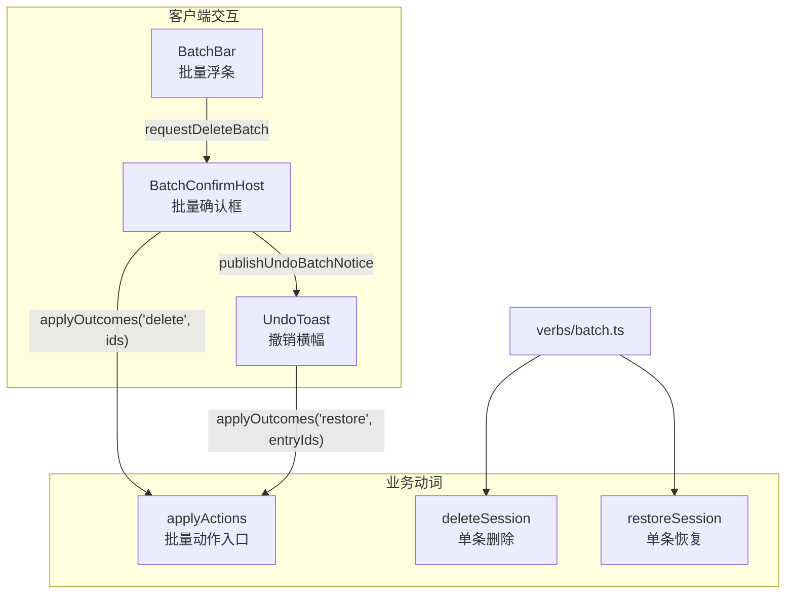
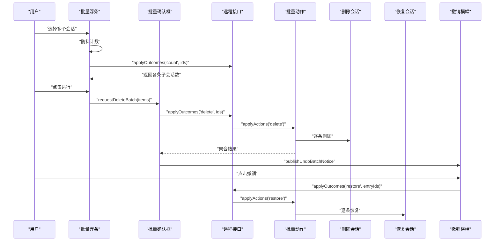
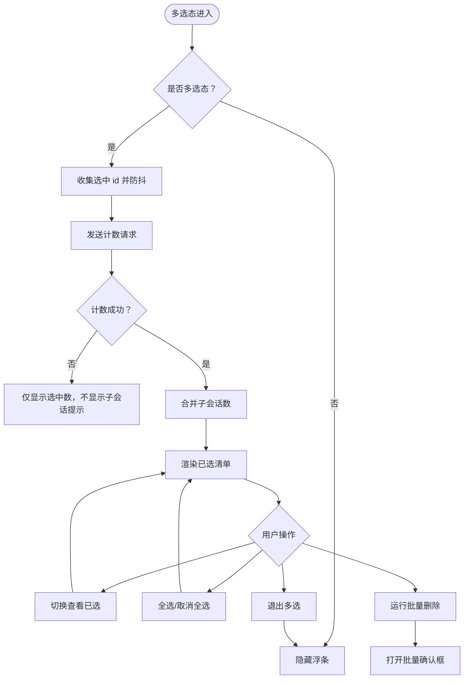
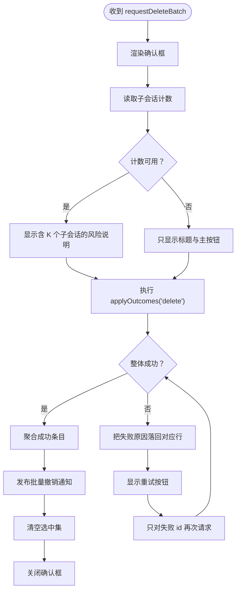
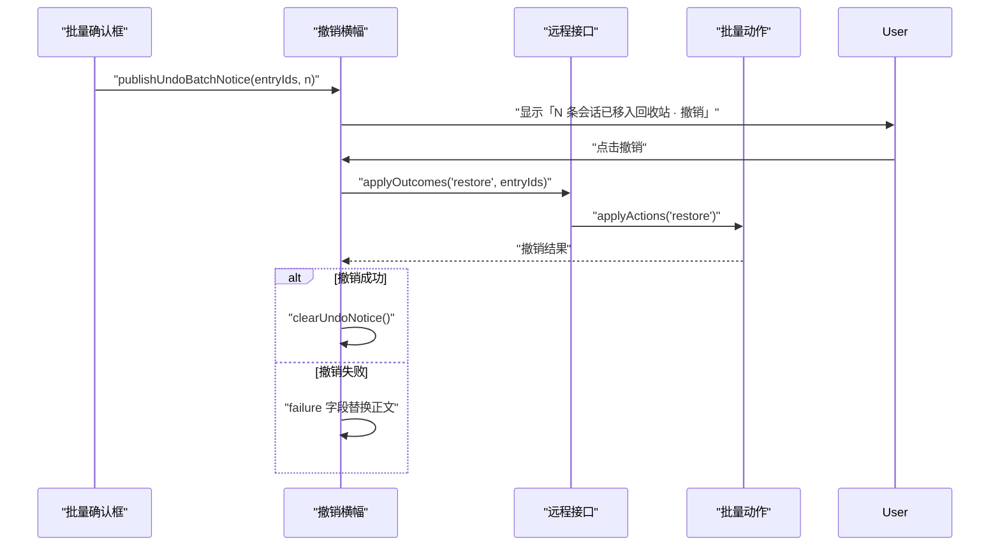
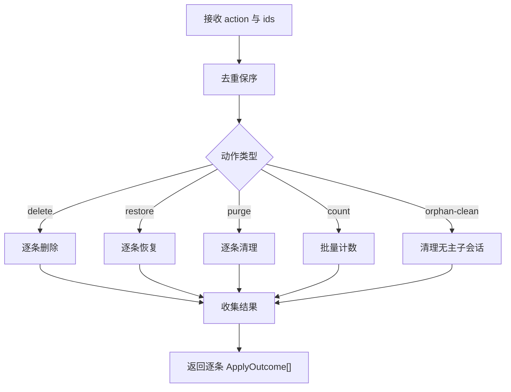
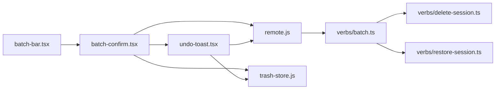

# 批量浮条与批量确认

<cite>
**本文引用的文件**   
- [src/client/batch-bar.tsx](file://src/client/batch-bar.tsx)
- [src/client/batch-confirm.tsx](file://src/client/batch-confirm.tsx)
- [src/client/undo-toast.tsx](file://src/client/undo-toast.tsx)
- [src/verbs/batch.ts](file://src/verbs/batch.ts)
- [src/verbs/delete-session.ts](file://src/verbs/delete-session.ts)
- [src/verbs/restore-session.ts](file://src/verbs/restore-session.ts)
- [tests/client/batch-bar.test.tsx](file://tests/client/batch-bar.test.tsx)
- [tests/client/batch-confirm.test.tsx](file://tests/client/batch-confirm.test.tsx)
- [tests/client/undo-toast-batch.test.tsx](file://tests/client/undo-toast-batch.test.tsx)
</cite>

## 目录
1. [引言](#引言)
2. [项目结构定位](#项目结构定位)
3. [核心组件总览](#核心组件总览)
4. [架构总览](#架构总览)
5. [详细组件分析](#详细组件分析)
6. [依赖关系分析](#依赖关系分析)
7. [性能考虑](#性能考虑)
8. [故障排查指南](#故障排查指南)
9. [结论](#结论)

## 引言
本文件面向“批量删除会话”的界面流程，重点说明：
- 用户如何在宿主列表中多选会话；
- 批量浮条如何展示选中数量、子会话数、查看已选清单、全选/取消全选、运行批量删除和退出多选；
- 批量确认框如何汇总待删除条目、展示风险说明、执行逐条信封请求；
- 批量结果聚合、部分失败重试、成功后的撤销横幅，以及与 `undo-toast.tsx` 的协作；
- 从多选到完成撤销的完整流程图；
- 批量去重保序、重试策略在界面的表现；
- 大量选中时的渲染优化与滚动体验建议。

## 项目结构定位
批量删除相关代码集中在客户端交互层与动词执行层：
- 交互层：
  - `batch-bar.tsx`：多选模式下的常驻浮条。
  - `batch-confirm.tsx`：挂在框架级覆盖层的批量确认框及模块级请求现场。
  - `undo-toast.tsx`：删除成功后的可撤销横幅。
- 执行层：
  - `verbs/batch.ts`：批量动作的唯一拥有者，负责去重保序、逐条信封、幂等处理与通告聚合。
  - `verbs/delete-session.ts`：单条删除实现，按组移动目录与清册行。
  - `verbs/restore-session.ts`：单条恢复实现，按组原路退回。

**图表来源**
- [src/client/batch-bar.tsx:1-136](file://src/client/batch-bar.tsx#L1-L136)
- [src/client/batch-confirm.tsx:1-200](file://src/client/batch-confirm.tsx#L1-L200)
- [src/client/undo-toast.tsx:1-151](file://src/client/undo-toast.tsx#L1-L151)
- [src/verbs/batch.ts:1-197](file://src/verbs/batch.ts#L1-L197)
- [src/verbs/delete-session.ts:1-200](file://src/verbs/delete-session.ts#L1-L200)
- [src/verbs/restore-session.ts:1-173](file://src/verbs/restore-session.ts#L1-L173)

**章节来源**
- [src/client/batch-bar.tsx:1-136](file://src/client/batch-bar.tsx#L1-L136)
- [src/client/batch-confirm.tsx:1-200](file://src/client/batch-confirm.tsx#L1-L200)
- [src/client/undo-toast.tsx:1-151](file://src/client/undo-toast.tsx#L1-L151)
- [src/verbs/batch.ts:1-197](file://src/verbs/batch.ts#L1-L197)
- [src/verbs/delete-session.ts:1-200](file://src/verbs/delete-session.ts#L1-L200)
- [src/verbs/restore-session.ts:1-173](file://src/verbs/restore-session.ts#L1-L173)

## 核心组件总览
- 批量浮条 `BatchBar`：
  - 多选模式内常驻，即使选中数量为 0 也渲染，用于显示模式和退出入口。
  - 通过防抖的计数请求汇总当前选中项的子会话数量。
  - 提供查看已选清单、全选/取消全选、运行批量删除、退出多选等按钮。
- 批量确认框 `BatchConfirmHost` / `BatchConfirmDialog`：
  - 挂在框架级覆盖层，避免被列表行卸载影响。
  - 开框时一次性读取子会话计数，并据此展示风险说明。
  - 调用 `applyOutcomes('delete', ids)`，聚合每条结果，发布撤销通知，并在部分失败时支持重试。
- 撤销横幅 `UndoToast`：
  - 使用模块级通知台，支持单条和批量两种撤销形式。
  - 批量撤销只调用一次 `applyOutcomes('restore', entryIds)`。

**章节来源**
- [src/client/batch-bar.tsx:1-136](file://src/client/batch-bar.tsx#L1-L136)
- [src/client/batch-confirm.tsx:1-200](file://src/client/batch-confirm.tsx#L1-L200)
- [src/client/undo-toast.tsx:1-151](file://src/client/undo-toast.tsx#L1-L151)

## 架构总览
批量删除的整体架构遵循“界面触发 → 批量动作统一拥有 → 逐条信封 → 结果聚合 → 撤销能力”的分层设计：
- 界面层不直接操作磁盘或远端，而是通过 `SessionDeleteRemote.applyOutcomes` 发起批量请求。
- 批量动作层 `verbs/batch.ts` 承担去重保序、幂等判断、逐条错误隔离、批次通告聚合。
- 单条动词 `delete-session` 与 `restore-session` 专注于单个会话的移动、回滚与副作用清理。
- 撤销横幅通过同一个 `applyOutcomes` 接口发起恢复请求，复用批量语义。

**图表来源**
- [src/client/batch-bar.tsx:1-136](file://src/client/batch-bar.tsx#L1-L136)
- [src/client/batch-confirm.tsx:1-200](file://src/client/batch-confirm.tsx#L1-L200)
- [src/client/undo-toast.tsx:1-151](file://src/client/undo-toast.tsx#L1-L151)
- [src/verbs/batch.ts:1-197](file://src/verbs/batch.ts#L1-L197)
- [src/verbs/delete-session.ts:1-200](file://src/verbs/delete-session.ts#L1-L200)
- [src/verbs/restore-session.ts:1-173](file://src/verbs/restore-session.ts#L1-L173)

## 详细组件分析

### 批量浮条 `BatchBar`
批量浮条是多选模式的可见形态，职责包括：
- 订阅多选状态与选中集合。
- 对选中会话 id 列表进行防抖计数，避免连续勾选时频繁请求。
- 展开/收起已选清单，逐条移除仍保留多选模式。
- 提供全选/取消全选、运行批量删除、退出多选等操作。

关键行为：
- 计数防抖时间为固定常量，同一批勾选变化只发一次计数请求。
- 旧响应不会覆盖新名单：通过序号守卫确保后发的请求结果优先生效。
- 如果计数失败，整句子会话提示不出现，而不是用 0 冒充没有。
- 已选清单中每个条目标题为空时显示默认未命名文案，并可独立取消选择。
- “运行”按钮在未选中时为禁用状态。

**图表来源**
- [src/client/batch-bar.tsx:1-136](file://src/client/batch-bar.tsx#L1-L136)

**章节来源**
- [src/client/batch-bar.tsx:1-136](file://src/client/batch-bar.tsx#L1-L136)
- [tests/client/batch-bar.test.tsx:1-200](file://tests/client/batch-bar.test.tsx#L1-L200)

### 批量确认框 `BatchConfirmHost` / `BatchConfirmDialog`
批量确认框的职责是把用户选择的条目汇总为一次批量删除请求，并处理执行结果：
- 模块级请求现场保存当前待确认批次，包含序列号、条目数组。
- 开框时一次性请求子会话计数，用于展示风险说明。
- 目标卡片区域设置最大高度与内部滚动，防止几十条条目撑出弹框。
- 首次执行全部待删 id；重试轮只发送失败 id。
- 成功时发布批量撤销通知，清空选中集，关闭确认框。
- 部分失败时保持框打开，每行显示失败原文，并提供“重试这 N 条”的操作。

**图表来源**
- [src/client/batch-confirm.tsx:1-200](file://src/client/batch-confirm.tsx#L1-L200)

**章节来源**
- [src/client/batch-confirm.tsx:1-200](file://src/client/batch-confirm.tsx#L1-L200)
- [tests/client/batch-confirm.test.tsx:1-132](file://tests/client/batch-confirm.test.tsx#L1-L132)

### 撤销横幅 `UndoToast`
撤销横幅是删除成功后出现的可撤销提示：
- 支持两种撤销类型：单条删除与批量删除。
- 批量撤销使用一次 `applyOutcomes('restore', entryIds)`，而不是逐条恢复。
- 撤销成功则刷新回收站并清除横幅。
- 撤销失败则将失败原因替换为横幅正文，不再提供撤销按钮。

**图表来源**
- [src/client/undo-toast.tsx:1-151](file://src/client/undo-toast.tsx#L1-L151)

**章节来源**
- [src/client/undo-toast.tsx:1-151](file://src/client/undo-toast.tsx#L1-L151)
- [tests/client/undo-toast-batch.test.tsx:1-45](file://tests/client/undo-toast-batch.test.tsx#L1-L45)

### 批量动作与逐条信封
`verbs/batch.ts` 是批量操作的唯一拥有者，承担以下责任：
- **去重保序**：重复 id 会跳过，但输入顺序就是界面清单顺序。
- **清册快照**：恢复与清理类操作先读一次清册快照，再维护一份收缩视图，避免同批内重复处理。
- **逐条信封**：一条失败不影响下一条，失败会被映射为标准错误对象。
- **幂等处理**：若某条已被同批前一条带走，返回幂等成功值，而不是失败。
- **通告聚合**：批量恢复时攒起会话 id，只在批尾发一次宿主通告，避免全表扫描。

**图表来源**
- [src/verbs/batch.ts:1-197](file://src/verbs/batch.ts#L1-L197)

**章节来源**
- [src/verbs/batch.ts:1-197](file://src/verbs/batch.ts#L1-L197)
- [src/verbs/delete-session.ts:1-200](file://src/verbs/delete-session.ts#L1-L200)
- [src/verbs/restore-session.ts:1-173](file://src/verbs/restore-session.ts#L1-L173)

## 依赖关系分析
批量流程中的主要依赖关系如下：
- `batch-bar.tsx` 依赖多选选择逻辑与 `batch-confirm.tsx` 的请求入口。
- `batch-confirm.tsx` 依赖远程接口、批量选择逻辑、回收站失效通知与撤销通知。
- `undo-toast.tsx` 依赖远程接口与回收站失效通知。
- 所有写操作最终落到 `verbs/batch.ts`，再由其调度 `delete-session` 或 `restore-session`。

**图表来源**
- [src/client/batch-bar.tsx:1-136](file://src/client/batch-bar.tsx#L1-L136)
- [src/client/batch-confirm.tsx:1-200](file://src/client/batch-confirm.tsx#L1-L200)
- [src/client/undo-toast.tsx:1-151](file://src/client/undo-toast.tsx#L1-L151)
- [src/verbs/batch.ts:1-197](file://src/verbs/batch.ts#L1-L197)

**章节来源**
- [src/client/batch-bar.tsx:1-136](file://src/client/batch-bar.tsx#L1-L136)
- [src/client/batch-confirm.tsx:1-200](file://src/client/batch-confirm.tsx#L1-L200)
- [src/client/undo-toast.tsx:1-151](file://src/client/undo-toast.tsx#L1-L151)
- [src/verbs/batch.ts:1-197](file://src/verbs/batch.ts#L1-L197)

## 性能考虑
批量删除涉及多选、计数、确认框渲染、逐条信封与撤销横幅，以下优化建议来自现有实现与测试用例：

1. **多选计数防抖**
   - 当前实现使用固定防抖间隔，避免连续勾选时多次请求计数。
   - 建议：若选中数量持续增长，应继续等待最后一次勾选后再发请求，而不是为每次勾选单独计时。

2. **旧响应守卫**
   - 通过递增序号保证后发请求的结果不被旧响应覆盖。
   - 建议：组件卸载时也应清理定时器与异步任务，避免内存泄漏。

3. **大列表渲染优化**
   - 批量确认框的目标卡片区域设置了最大高度与内部滚动，避免数十条条目撑出弹框。
   - 建议：
     - 对超长已选清单使用虚拟滚动或分页加载。
     - 已选清单仅在展开时渲染，收起时不构建完整列表。
     - 条目文本过长时使用截断与省略提示，减少布局抖动。

4. **滚动体验**
   - 大量选中时，确认框内的目标卡片区域应独立滚动，标题与底部按钮保持固定。
   - 建议：
     - 避免在滚动容器内频繁重建 DOM。
     - 对长列表使用稳定的 key，避免 React 重排整个列表。
     - 滚动位置在进入确认框时尽量保持，提升用户感知连续性。

5. **批量去重与保序**
   - 去重使用集合检查，时间复杂度接近 O(n)，空间复杂度 O(n)。
   - 保序保证界面清单顺序与用户选择顺序一致，这对可预期性很重要。

6. **重试策略**
   - 首次请求全部 id，重试只发送失败 id。
   - 建议：
     - 对网络超时类错误增加有限次自动重试。
     - 对确定性错误（如目录不存在）不应自动重试，而应明确提示用户。
     - 重试按钮应反映剩余失败条目数，避免误以为整批仍在执行。

7. **撤销横幅性能**
   - 批量撤销使用一次批量恢复接口，避免逐条恢复带来的宿主全表扫描。
   - 建议：
     - 撤销失败时尽快停止后续操作，只更新横幅内容。
     - 撤销成功后及时清理通知，避免长时间持有引用。

[本节为通用性能建议，不直接分析具体源码片段]

## 故障排查指南
常见问题与定位思路：

1. **子会话数始终不显示**
   - 可能原因：计数请求失败或被忽略。
   - 现象：浮条只显示“已选 N 条”，不显示“含 K 个子会话”。
   - 定位：检查 `fetchCounts` 与 `applyOutcomes('count', ids)` 是否返回有效结果。

2. **旧子会话数覆盖新名单**
   - 可能原因：旧响应在新响应之后落地。
   - 现象：先勾选 A，再勾选 B，但子会话数仍停留在 A 的状态。
   - 定位：检查序号守卫与定时器清理逻辑。

3. **批量确认框无法关闭**
   - 可能原因：存在部分失败且未重试成功。
   - 现象：框体一直保留，按钮变为“重试这 N 条”。
   - 定位：检查失败集合收缩与重试请求是否只包含失败 id。

4. **撤销横幅不出现**
   - 可能原因：没有成功条目，或撤销通知未被发布。
   - 现象：删除完成后没有“N 条会话已移入回收站”。
   - 定位：检查批量结果聚合路径与 `publishUndoBatchNotice` 调用。

5. **撤销失败后无法再次撤销**
   - 可能原因：撤销失败会把失败原因写入横幅，不再提供撤销按钮。
   - 现象：横幅只显示错误信息。
   - 定位：检查 `undo-toast.tsx` 的 failure 分支。

6. **批量去重导致条目丢失**
   - 可能原因：重复 id 被跳过。
   - 现象：用户勾选了同一会话多次，但实际只删除一次。
   - 定位：确认这是预期行为；批量去重保序的设计目标是避免重复执行。

**章节来源**
- [src/client/batch-bar.tsx:1-136](file://src/client/batch-bar.tsx#L1-L136)
- [src/client/batch-confirm.tsx:1-200](file://src/client/batch-confirm.tsx#L1-L200)
- [src/client/undo-toast.tsx:1-151](file://src/client/undo-toast.tsx#L1-L151)
- [tests/client/batch-bar.test.tsx:1-200](file://tests/client/batch-bar.test.tsx#L1-L200)
- [tests/client/batch-confirm.test.tsx:1-132](file://tests/client/batch-confirm.test.tsx#L1-L132)
- [tests/client/undo-toast-batch.test.tsx:1-45](file://tests/client/undo-toast-batch.test.tsx#L1-L45)

## 结论
批量删除界面由“多选浮条 → 批量确认框 → 批量动作 → 撤销横幅”构成清晰链路：
- 浮条负责多选模式、选中集合、计数与入口。
- 确认框负责汇总条目、展示风险、执行批量删除与结果聚合。
- 批量动作负责去重保序、逐条信封、幂等与通告聚合。
- 撤销横幅提供一次批量恢复能力，并与回收站状态联动。

当前实现已经覆盖了多选、批量计数、部分失败重试、撤销横幅与大列表滚动等关键点。未来可在长列表虚拟滚动、重试策略精细化、异步任务清理等方面进一步优化，以应对更大规模的用户选择场景。