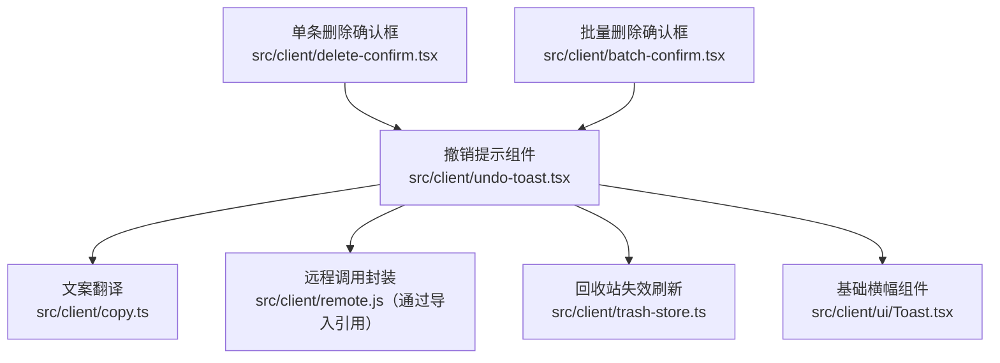
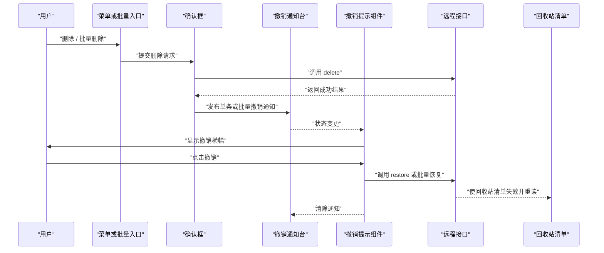
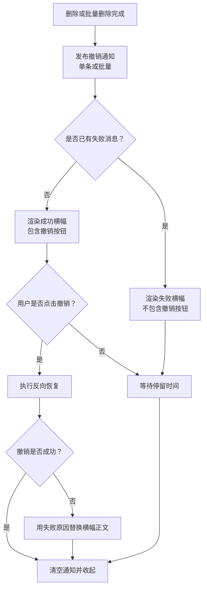
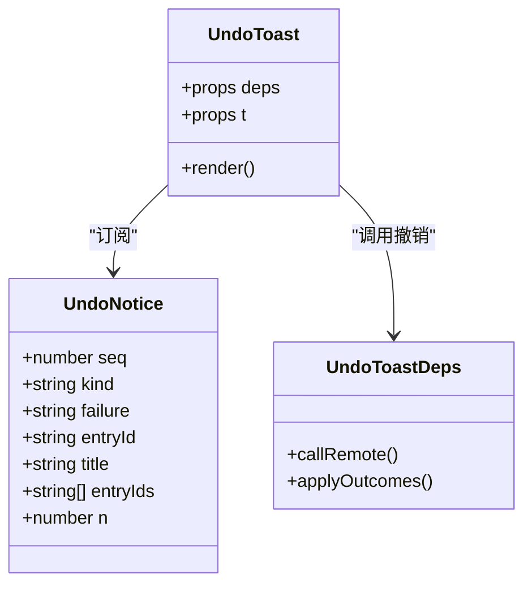
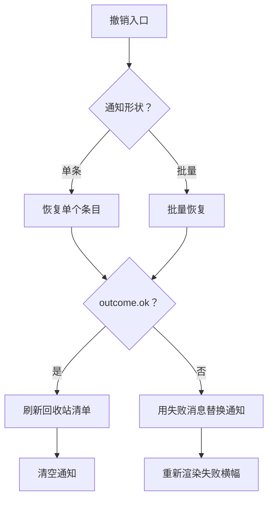
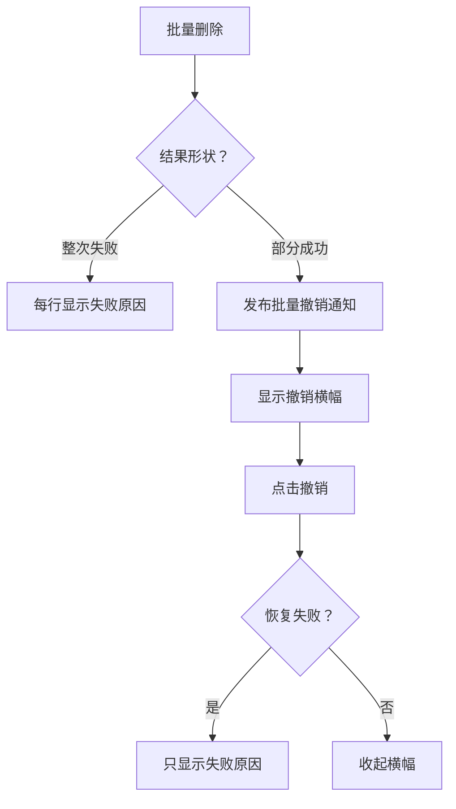
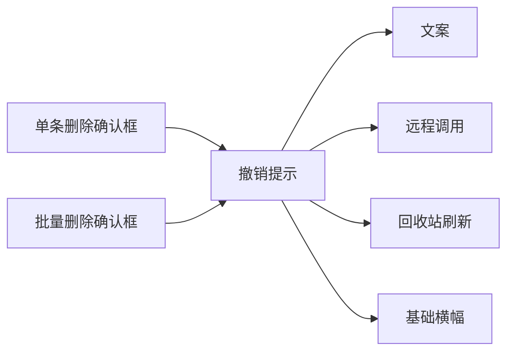

# 撤销提示

<cite>
**本文引用的文件**
- [undo-toast.tsx](file://src/client/undo-toast.tsx)
- [Toast.tsx](file://src/client/ui/Toast.tsx)
- [copy.ts](file://src/client/copy.ts)
- [delete-confirm.tsx](file://src/client/delete-confirm.tsx)
- [batch-confirm.tsx](file://src/client/batch-confirm.tsx)
- [trash-store.ts](file://src/client/trash-store.ts)
- [undo-toast-batch.test.tsx](file://tests/client/undo-toast-batch.test.tsx)
- [delete-menu-item.test.tsx](file://tests/client/delete-menu-item.test.tsx)
- [batch-confirm.test.tsx](file://tests/client/batch-confirm.test.tsx)
</cite>

## 目录
1. [简介](#简介)
2. [项目结构中的位置](#项目结构中的位置)
3. [核心组件与职责](#核心组件与职责)
4. [架构总览](#架构总览)
5. [撤销提示生命周期](#撤销提示生命周期)
6. [详细组件分析](#详细组件分析)
7. [调用示例](#调用示例)
8. [批量场景：合并、重试与失败降级](#批量场景合并重试与失败降级)
9. [样式定制](#样式定制)
10. [多语言文案接入](#多语言文案接入)
11. [可访问性要求](#可访问性要求)
12. [依赖关系分析](#依赖关系分析)
13. [故障排查](#故障排查)
14. [结论](#结论)

## 简介
撤销提示是一个“删除成功后短暂出现”的横幅。它告诉用户会话已进入回收站，并提供一个“撤销”按钮；点击后执行反向恢复操作，并把相关条目从回收站移回原处。它的实现采用“独立组件 + 模块级通知台”的模式：触发方只负责发布通知，撤销提示组件在任何需要的位置渲染，从而避开宿主菜单行随菜单卸载的生命周期问题。

该组件同时支持两种数据形状：
- 单条删除：显示会话标题，撤销时按单个条目恢复。
- 批量删除：显示成功条数，撤销时一次性对全部成功条目发起恢复。

当撤销失败时，横幅不会静默消失，而是把失败原因作为正文重新展示，并移除撤销按钮。

## 项目结构中的位置
撤销提示位于客户端层，属于浏览器半 UI 插件的一部分。其直接依赖包括本地化翻译函数、远程调用封装、回收站失效刷新工具、图标和 Toast 基础组件。

**图示来源**
- [undo-toast.tsx:1-151](file://src/client/undo-toast.tsx#L1-L151)
- [delete-confirm.tsx:1-194](file://src/client/delete-confirm.tsx#L1-L194)
- [batch-confirm.tsx:1-200](file://src/client/batch-confirm.tsx#L1-L200)

**章节来源**
- [undo-toast.tsx:1-20](file://src/client/undo-toast.tsx#L1-L20)

## 核心组件与职责
| 名称 | 职责 | 关键导出或行为 |
|---|---|---|
| `UndoToast` | 撤销提示常驻组件，订阅模块状态并渲染成功或失败的横幅 | 接收 `deps` 与可选翻译函数；无待处理通知时不渲染 |
| 模块级通知台 | 保存当前撤销通知、维护递增序号、管理监听者 | `publishUndoNotice`、`publishUndoBatchNotice`、`clearUndoNotice`、`useUndoNotice` |
| `Toast` | 顶部居中的一次性横幅，负责滑入、停留、淡出与 DOM Portal 挂载 | 通过 `holdMs` 控制停留时长，`onDone` 在淡出完成后回调 |
| 文案系统 | 提供中文默认文案，并通过宿主 locale 服务接入英文等语言 | 命名空间 `xrn1997-session-delete`，键包括 `undo.moved`、`undo.movedBatch`、`undo.undo`、`undo.session` |

**章节来源**
- [undo-toast.tsx:21-151](file://src/client/undo-toast.tsx#L21-L151)
- [Toast.tsx:1-97](file://src/client/ui/Toast.tsx#L1-L97)
- [copy.ts:1-200](file://src/client/copy.ts#L1-L200)

## 架构总览
撤销提示不是绑定在某一条菜单行上的局部弹窗，而是一个由宿主浮层承载的常驻 UI。典型调用链路如下：

**图示来源**
- [delete-confirm.tsx:120-194](file://src/client/delete-confirm.tsx#L120-L194)
- [batch-confirm.tsx:100-200](file://src/client/batch-confirm.tsx#L100-L200)
- [undo-toast.tsx:80-151](file://src/client/undo-toast.tsx#L80-L151)

## 撤销提示生命周期
撤销提示的生命周期分为六个阶段：发布、出现、停留、撤销或自动结束、反向动作、清理。

**图示来源**
- [undo-toast.tsx:60-151](file://src/client/undo-toast.tsx#L60-L151)
- [Toast.tsx:40-97](file://src/client/ui/Toast.tsx#L40-L97)

### 出现时机
- 单条删除成功后，删除确认框会发布一条单条撤销通知，携带回收站条目 id 与删除时的会话标题。
- 批量删除成功后，批量确认框会发布一条批量撤销通知，携带所有成功且非幂等的回收站条目 id，以及本次成功条数。
- 如果同一个宿主连续收到新的通知，会用递增的 `seq` 强制重挂载，避免文案重复出现但没有新状态的情况。

### 自动消失时间
- 成功横幅与失败横幅都使用固定停留时长 `UNDO_HOLD_MS = 6000` 毫秒。
- 内部 `Toast` 组件实际会在 `holdMs + FADE_MS` 后调用 `onDone`，其中淡出时长为 1000 毫秒。
- 因此用户看到完整横幅的时间约为 6 秒，随后进入 1 秒淡出，再调用完成回调。

### 用户点击撤销触发的反向动作
- 单条形：通过远程调用恢复单个回收站条目。
- 批量形：通过一次 `applyOutcomes('restore', entryIds)` 统一恢复，而不是逐条循环。
- 撤销成功后：
  - 使回收站清单失效，让正在打开的回收站面板重新读取。
  - 清空当前撤销通知。
  - 横幅自然结束。

**章节来源**
- [undo-toast.tsx:60-120](file://src/client/undo-toast.tsx#L60-L120)
- [Toast.tsx:40-97](file://src/client/ui/Toast.tsx#L40-L97)

## 详细组件分析

### 撤销通知数据结构
撤销通知是模块级变量，由三种导出函数共同维护：

| 字段 | 含义 | 备注 |
|---|---|---|
| `seq` | 递增序号 | 用于 React key 和外部状态重挂载 |
| `kind` | `one` 或 `batch` | 决定单条还是批量语义 |
| `entryId` | 单条删除的回收站条目 id | 空值时不允许显示撤销按钮 |
| `title` | 删除那一刻的会话标题 | 为空时使用默认“会话”文案 |
| `entryIds` | 批量撤销的条目 id 列表 | 仅包含成功支中非 null 的条目 |
| `n` | 批量横幅显示的条数 | 与撤销名单可能不同 |
| `failure` | 撤销失败后的错误文本 | 有该字段时不再显示撤销按钮 |

**图示来源**
- [undo-toast.tsx:21-58](file://src/client/undo-toast.tsx#L21-L58)
- [undo-toast.tsx:121-151](file://src/client/undo-toast.tsx#L121-L151)

**章节来源**
- [undo-toast.tsx:21-58](file://src/client/undo-toast.tsx#L21-L58)

### 模块级通知台
撤销通知使用模块级变量存储，并通过自定义监听器集合广播变化。React 侧通过 `useSyncExternalStore` 订阅，避免引入额外状态库。

关键行为：
- `publishUndoNotice`：覆盖上一条通知，发布单条删除结果。
- `publishUndoBatchNotice`：覆盖上一条通知，发布批量删除结果。
- `clearUndoNotice`：安全清空，已为空时不做多余操作。
- `useUndoNotice`：对外暴露的 Hook，供组件订阅。

这种设计保证：
- 多个组件可以共享同一条撤销通知。
- 宿主菜单关闭后，撤销提示仍可存活。
- 连续发布相同文案也能靠 `seq` 重新计一次停留时间。

**章节来源**
- [undo-toast.tsx:39-79](file://src/client/undo-toast.tsx#L39-L79)

### 撤销逻辑与失败降级
撤销函数根据通知形状选择调用方式：
- 单条形：调用 `applyOne('restore', entryId)`。
- 批量形：调用 `deps.applyOutcomes('restore', entryIds)`。
- 外层统一通过 `callRemote` 包裹，以复用远程调用的错误处理契约。

成功路径：
- 调用 `invalidateTrash()` 让回收站面板刷新。
- 调用 `clearUndoNotice()` 收起横幅。

失败路径：
- 不抛出异常。
- 用原通知生成新通知，附带 `failure.message`。
- 递增 `seq`，触发重新渲染。
- 新横幅只显示失败原因，没有撤销按钮。

**图示来源**
- [undo-toast.tsx:96-120](file://src/client/undo-toast.tsx#L96-L120)

**章节来源**
- [undo-toast.tsx:96-120](file://src/client/undo-toast.tsx#L96-L120)

### 基础横幅组件 `Toast`
`Toast` 是撤销提示的视觉实现，但它被刻意保持轻量：
- 通过 `createPortal` 渲染到 `document.body`，避免父容器 transform/filter 导致溢出。
- 使用 `role="alert"`，使屏幕阅读器能识别这是一个重要提示。
- 通过 CSS 自定义属性 `--dsh-toast-hold` 同步 JS 停留时间与淡出延迟，避免两者不一致。
- `tone="success"` 自带成功图标，此时传入的 `icon` 被忽略。
- 动作文本通过 `actions` 数组渲染为按钮，撤销提示只传一个“撤销”。

**章节来源**
- [Toast.tsx:1-97](file://src/client/ui/Toast.tsx#L1-L97)

## 调用示例

### 基本调用方式
撤销提示通常不由业务视图直接创建实例，而是由删除流程发布通知，再由全局挂载的 `UndoToast` 组件消费。常见组合是：

1. 用户在会话菜单中选择“删除”，或由多选模式触发批量删除。
2. 确认框执行删除请求。
3. 删除成功后，调用 `publishUndoNotice` 或 `publishUndoBatchNotice`。
4. 宿主浮层挂载 `<UndoToast deps={...} />`，自动渲染对应横幅。

### 传入消息文本
撤销提示的消息文本不直接由调用方传入，而是由文案系统根据通知形状生成：
- 单条：`undo.moved`，参数包含会话标题；标题为空时使用 `undo.session`。
- 批量：`undo.movedBatch`，参数包含成功条数 `n`。

如果需要自定义文案，应修改翻译函数或注入新的 `t`，而不是修改通知结构。

### 传入超时参数
撤销提示使用固定的 `UNDO_HOLD_MS = 6000` 毫秒。若需调整整体体验，可在 `undo-toast.tsx` 中修改该常量；不应由调用方随意传入，否则会破坏单条与批量的统一停留策略。

### 传入撤销回调
撤销回调由组件内部构造，调用方只需通过 `deps` 提供远程能力：
- 单条：通过 `applyOne('restore', entryId)` 恢复。
- 批量：通过 `applyOutcomes('restore', entryIds)` 恢复。

测试中通过 `fakeApply({ restore })` 模拟该行为，验证撤销是否只调用一次批量恢复。

**章节来源**
- [undo-toast.tsx:121-151](file://src/client/undo-toast.tsx#L121-L151)
- [delete-menu-item.test.tsx:117-175](file://tests/client/delete-menu-item.test.tsx#L117-L175)
- [undo-toast-batch.test.tsx:1-45](file://tests/client/undo-toast-batch.test.tsx#L1-45)

## 批量场景：合并、重试与失败降级

### 批量成功后的合并
批量删除成功后，组件只发布一条撤销通知，而不是为每个成功条目分别发布。这意味着：
- 横幅显示的是本次成功的条目总数。
- 撤销按钮只出现一次。
- 点击撤销会一次性恢复全部成功条目。

这避免了 N 条成功就弹出 N 个横幅的体验问题。

### 批量重试
批量删除本身支持部分失败重试：
- 首轮对所有选中条目发起删除。
- 如果整次调用失败，每条失败条目显示自己的错误原文。
- 如果部分成功，成功条目进入撤销通知，失败条目保留在确认框中。
- 重试时只向服务端发送失败条目 id。

撤销提示并不承担批量重试逻辑，它只反映“已经成功进入回收站”的那一批条目。

### 失败降级
撤销失败时，组件不会抛错、不会静默隐藏，也不会保留撤销按钮。它会：
1. 捕获远端返回的错误对象。
2. 将 `failure.message` 写入新通知。
3. 递增 `seq`，触发重新渲染。
4. 渲染失败横幅，显示原始错误信息。

测试覆盖了两种情况：
- 单条删除成功后，撤销失败，横幅显示失败原因。
- 批量撤销失败，同样只保留失败原文，不再出现撤销按钮。

**图示来源**
- [batch-confirm.tsx:130-200](file://src/client/batch-confirm.tsx#L130-L200)
- [undo-toast.tsx:96-151](file://src/client/undo-toast.tsx#L96-L151)
- [undo-toast-batch.test.tsx:15-45](file://tests/client/undo-toast-batch.test.tsx#L15-L45)

**章节来源**
- [batch-confirm.tsx:100-200](file://src/client/batch-confirm.tsx#L100-L200)
- [undo-toast-batch.test.tsx:1-45](file://tests/client/undo-toast-batch.test.tsx#L1-45)

## 样式定制
撤销提示的样式主要继承自基础 `Toast` 组件：
- 容器类名：`sd-toast`
- 图标容器：`sd-toast-icon`、`sd-toast-icon-success`
- 文本容器：`sd-toast-text`
- 动作文本按钮：`sd-toast-action`
- 停留时长通过 CSS 变量 `--dsh-toast-hold` 传递

若要定制外观，建议优先修改 `ui/Toast.tsx` 对应的样式文件，而不是在撤销提示内部写内联样式。撤销提示组件本身没有暴露主题、颜色、宽度或定位等 props，因为它只负责业务语义：成功、失败、撤销、自动结束。

需要注意：
- `tone="success"` 会覆盖传入的 `icon`，这是为了保持一致的成功反馈样式。
- 失败横幅使用警告图标，而不是成功对勾。
- 横幅始终居中渲染，不锚定到某个子元素。

**章节来源**
- [Toast.tsx:40-97](file://src/client/ui/Toast.tsx#L40-L97)
- [undo-toast.tsx:121-151](file://src/client/undo-toast.tsx#L121-L151)

## 多语言文案接入
文案集中定义在 `copy.ts`，命名空间为 `xrn1997-session-delete`。撤销提示使用的键如下：

| 键 | 用途 | 中文默认值 | 英文默认值 |
|---|---|---|---|
| `undo.movedBatch` | 批量撤销横幅 | `{n} 条会话已移入回收站` | `{n} sessions were moved to the trash` |
| `undo.moved` | 单条撤销横幅 | `{title} 已移入回收站` | `{title} was moved to the trash` |
| `undo.session` | 单条标题为空时的兜底主语 | `会话` | `the session` |
| `undo.undo` | 撤销按钮文案 | `撤销` | `Undo` |

接入方式：
- 默认使用内置中文文案。
- 宿主可通过 Client locale 服务注册字典，并注入翻译函数 `t`。
- 如果宿主 locale 缺失，插件降级为内置中文继续工作，而不是进程崩溃。
- 英文必须与中文逐键齐全，否则宿主注册时会报运行时错误。

新增文案时应同时补充中英文，避免宿主对象形式注册校验失败。

**章节来源**
- [copy.ts:1-200](file://src/client/copy.ts#L1-L200)
- [copy.ts:290-307](file://src/client/copy.ts#L290-L307)

## 可访问性要求
### 自动播报
`Toast` 根元素设置了 `role="alert"`，符合无障碍提示语义。屏幕阅读器应在横幅出现后尝试播报主要内容，包括正文和动作文本。

### 键盘操作
撤销按钮是标准 `<button type="button">`，具备以下特性：
- 可聚焦。
- 可通过 Enter 或 Space 激活。
- 可通过 Tab 从页面焦点顺序进入。
- 点击后执行撤销回调，并随横幅淡出而移除。

测试中通过 `getByRole('button', { name: '撤销' })` 查找按钮，说明按钮名称来自文案键 `undo.undo`。

### 推荐实践
- 不要给撤销按钮添加额外的 `aria-hidden`，否则屏幕阅读器无法识别。
- 不要在失败横幅上保留“撤销”按钮，因为失败语义不再是可逆动作。
- 如需扩展更多动作文本，应保持每个动作都有可读标签。

**章节来源**
- [Toast.tsx:40-97](file://src/client/ui/Toast.tsx#L40-L97)
- [undo-toast.tsx:133-147](file://src/client/undo-toast.tsx#L133-L147)
- [delete-menu-item.test.tsx:147-175](file://tests/client/delete-menu-item.test.tsx#L147-L175)

## 依赖关系分析
撤销提示的依赖链比较短，耦合点清晰：

| 依赖 | 方向 | 说明 |
|---|---:|---|
| `copy.ts` | 撤销提示 → 文案 | 获取本地化文案 |
| `remote.js` | 撤销提示 → 远程 | 调用恢复操作 |
| `trash-store.ts` | 撤销提示 → 回收站刷新 | 撤销成功后使回收站失效 |
| `ui/Toast.tsx` | 撤销提示 → 基础横幅 | 渲染视觉横幅 |
| `delete-confirm.tsx` | 单条删除 → 撤销提示 | 成功后发布单条通知 |
| `batch-confirm.tsx` | 批量删除 → 撤销提示 | 成功后发布批量通知 |

**图示来源**
- [undo-toast.tsx:1-20](file://src/client/undo-toast.tsx#L1-L20)
- [delete-confirm.tsx:1-194](file://src/client/delete-confirm.tsx#L1-L194)
- [batch-confirm.tsx:1-200](file://src/client/batch-confirm.tsx#L1-L200)

**章节来源**
- [undo-toast.tsx:1-20](file://src/client/undo-toast.tsx#L1-L20)

## 故障排查
| 现象 | 可能原因 | 处理方式 |
|---|---|---|
| 删除成功后没有撤销提示 | 未调用 `publishUndoNotice` 或 `publishUndoBatchNotice` | 检查删除成功分支 |
| 撤销按钮不可见 | 单条 `entryId` 为空，或批量 `entryIds` 为空 | 检查删除回执是否带有效条目 id |
| 撤销失败后横幅消失 | 撤销回调抛出了未捕获异常 | 使用 `callRemote` 包装，确保错误落入 outcome |
| 撤销后回收站没有刷新 | 未调用 `invalidateTrash()` | 撤销成功路径必须刷新 |
| 连续两次相同文案没有刷新 | 没有递增 `seq` | 检查通知发布是否覆盖旧通知 |
| 批量撤销只恢复了一条 | 撤销逻辑被拆成多次调用 | 应使用一次 `applyOutcomes('restore', entryIds)` |
| 屏幕阅读器没有播报 | 未使用 `role="alert"` 或按钮被隐藏 | 检查 `Toast` 根节点和按钮可访问性 |
| 语言切换后文案不变 | 未接入宿主 locale 服务或翻译函数未更新 | 检查 `copy.ts` 与宿主 locale 注册 |

**章节来源**
- [undo-toast.tsx:96-151](file://src/client/undo-toast.tsx#L96-L151)
- [undo-toast-batch.test.tsx:15-45](file://tests/client/undo-toast-batch.test.tsx#L15-L45)

## 结论
撤销提示的核心价值是把“可逆删除”这个用户预期，从确认框延伸到结果反馈层。它不关心删除如何发生，只关心删除已经完成，并且用户还有短时间内反悔的机会。

实现上，它通过模块级通知台解耦触发方与展示方，通过固定 6 秒停留时间降低误触成本，通过批量合并减少横幅噪音，通过失败降级保证错误可见，并通过基础 `Toast` 组件统一视觉和无障碍行为。对于后续扩展，例如清空回收站、批量恢复等动作，都应遵循同一契约：成功后发布通知，撤销时执行反向操作，失败时把原因写回横幅，而不是静默吞掉。