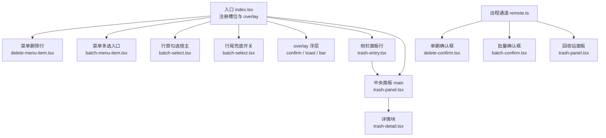
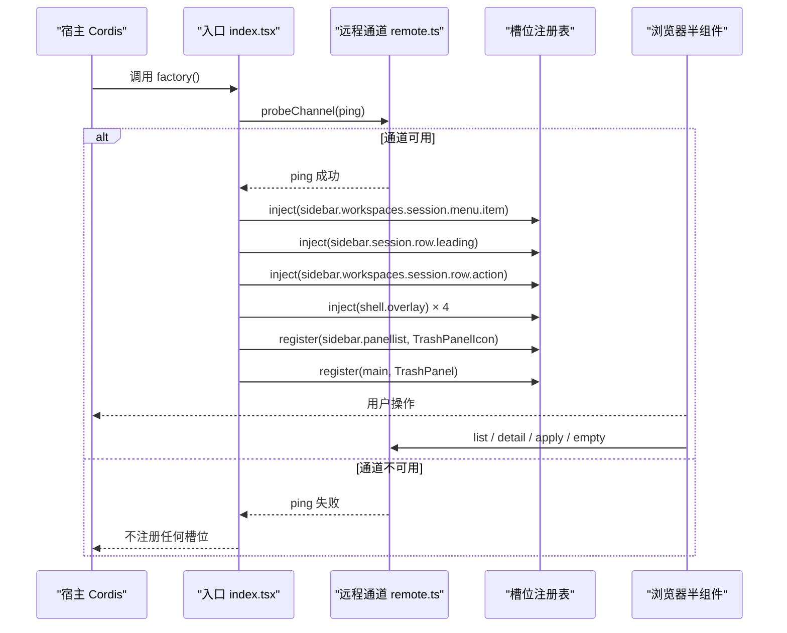
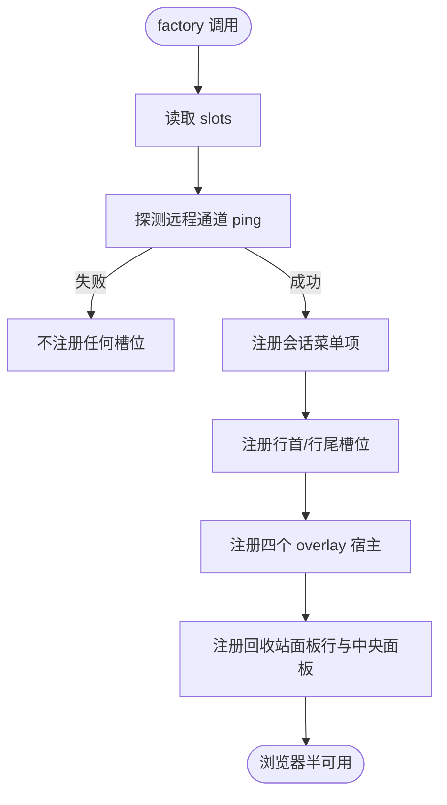
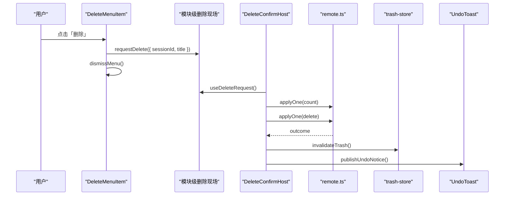
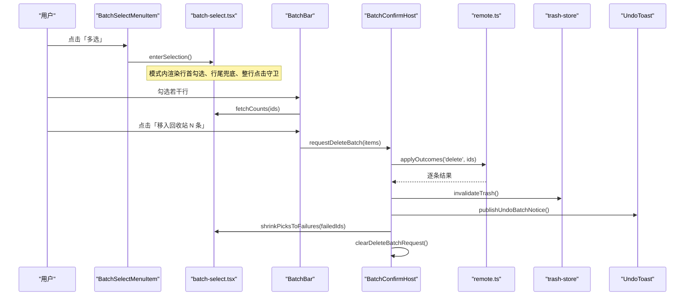
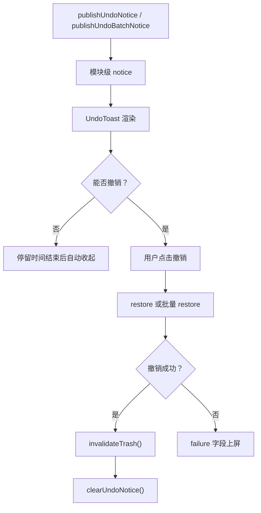
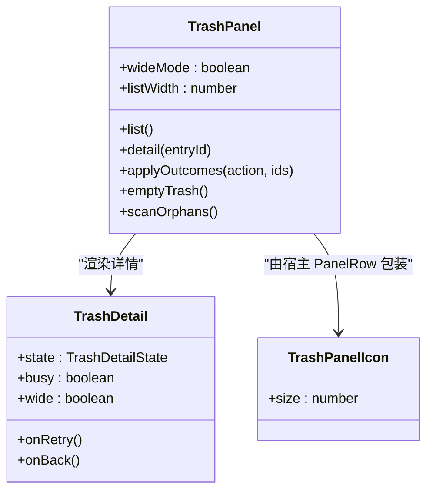
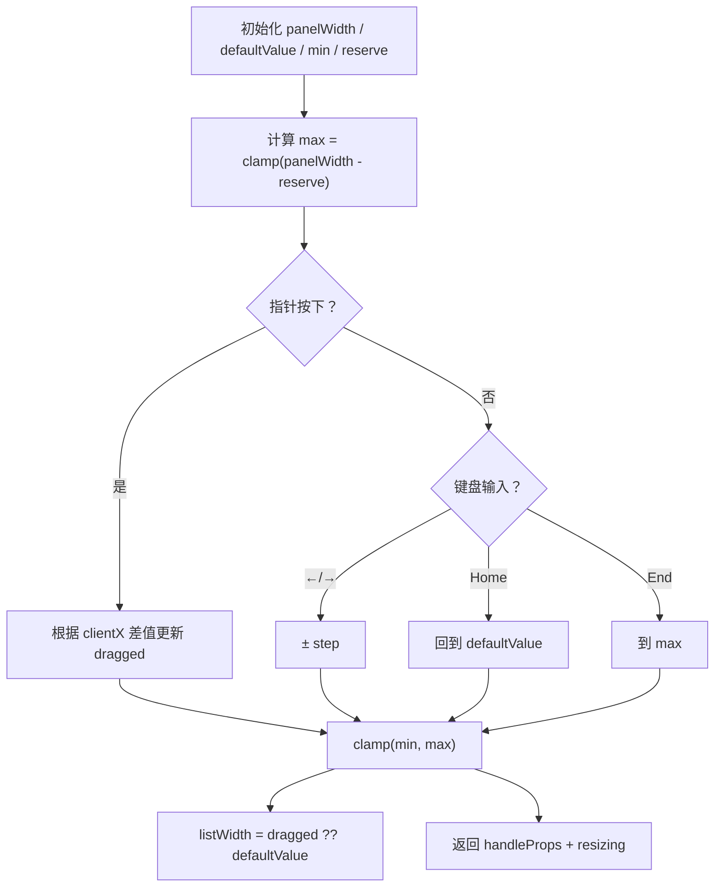
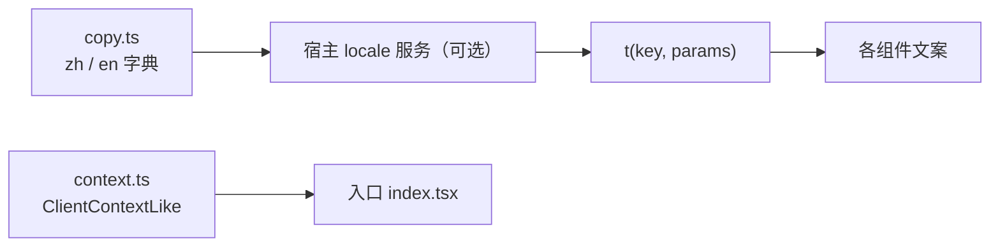
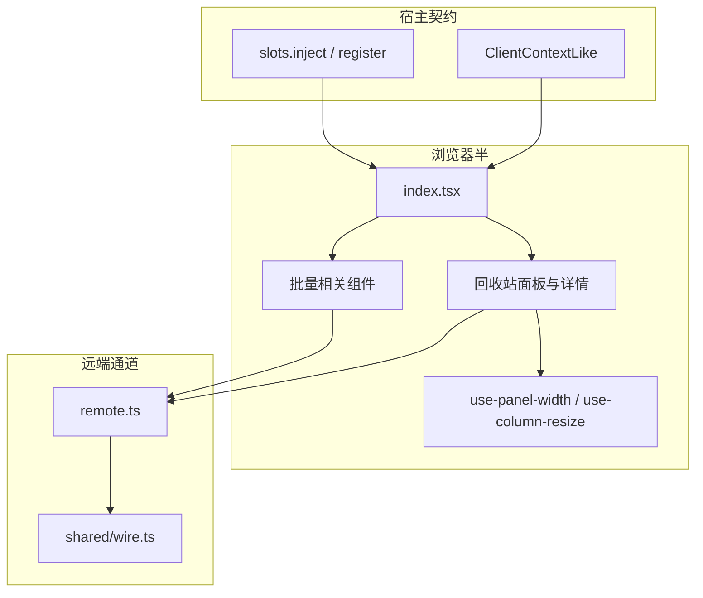

# 浏览器半界面

<cite>
**本文引用的文件**   
- [index.tsx](file://src/client/index.tsx)
- [batch-menu-item.tsx](file://src/client/batch-menu-item.tsx)
- [delete-menu-item.tsx](file://src/client/delete-menu-item.tsx)
- [batch-select.tsx](file://src/client/batch-select.tsx)
- [batch-bar.tsx](file://src/client/batch-bar.tsx)
- [batch-confirm.tsx](file://src/client/batch-confirm.tsx)
- [delete-confirm.tsx](file://src/client/delete-confirm.tsx)
- [undo-toast.tsx](file://src/client/undo-toast.tsx)
- [trash-entry.tsx](file://src/client/trash-entry.tsx)
- [trash-detail.tsx](file://src/client/trash-detail.tsx)
- [trash-panel.tsx](file://src/client/trash-panel.tsx)
- [use-column-resize.ts](file://src/client/use-column-resize.ts)
- [use-panel-width.ts](file://src/client/use-panel-width.ts)
- [context.ts](file://src/client/context.ts)
- [copy.ts](file://src/client/copy.ts)
- [remote.ts](file://src/client/remote.ts)
- [styles.ts](file://src/client/ui/styles.ts)
- [README.md](file://README.md)
</cite>

## 目录
1. [引言](#引言)
2. [项目结构](#项目结构)
3. [核心组件](#核心组件)
4. [架构总览](#架构总览)
5. [详细组件分析](#详细组件分析)
6. [依赖关系分析](#依赖关系分析)
7. [性能与交互特征](#性能与交互特征)
8. [可访问性注意事项](#可访问性注意事项)
9. [样式前缀 sd- 的使用方式](#样式前缀-sd-的使用方式)
10. [常见问题排查](#常见问题排查)
11. [结论](#结论)

## 引言
本文面向“浏览器半界面”：插件通过 Cordis 槽位向宿主注入菜单项、行首勾选、行尾按钮、确认浮层、撤销提示，以及回收站中央面板。重点说明入口 `src/client/index.tsx` 的生命周期、远程通道探测、不可用表达，以及批量操作的完整交互链：**多选 → 批量确认 → 逐条执行 → 成功可撤销**。同时记录 `use-column-resize`、`use-panel-width`、上下文与复制逻辑的作用，并给出组件组合示例、可访问性要点和常见问题定位方法。

## 项目结构
浏览器半代码集中在 `src/client`，按职责拆分为：
- 入口与槽位适配：`index.tsx`、`context.ts`
- 会话删除入口：`delete-menu-item.tsx`、`delete-confirm.tsx`
- 批量选择与浮层：`batch-menu-item.tsx`、`batch-select.tsx`、`batch-bar.tsx`、`batch-confirm.tsx`
- 撤销提示：`undo-toast.tsx`
- 回收站中央面板：`trash-entry.tsx`、`trash-panel.tsx`、`trash-detail.tsx`
- 布局钩子：`use-panel-width.ts`、`use-column-resize.ts`
- 文案与语言：`copy.ts`
- 远程通道：`remote.ts`
- 控件样式装载：`ui/styles.ts`

**图表来源**
- [index.tsx:1-200](file://src/client/index.tsx#L1-L200)
- [delete-menu-item.tsx:1-83](file://src/client/delete-menu-item.tsx#L1-L83)
- [batch-menu-item.tsx:1-42](file://src/client/batch-menu-item.tsx#L1-L42)
- [batch-select.tsx:1-200](file://src/client/batch-select.tsx#L1-L200)
- [batch-bar.tsx:1-136](file://src/client/batch-bar.tsx#L1-L136)
- [batch-confirm.tsx:1-200](file://src/client/batch-confirm.tsx#L1-L200)
- [delete-confirm.tsx:1-194](file://src/client/delete-confirm.tsx#L1-L194)
- [undo-toast.tsx:1-151](file://src/client/undo-toast.tsx#L1-L151)
- [trash-entry.tsx:1-30](file://src/client/trash-entry.tsx#L1-L30)
- [trash-panel.tsx:1-200](file://src/client/trash-panel.tsx#L1-L200)
- [trash-detail.tsx:1-200](file://src/client/trash-detail.tsx#L1-L200)
- [remote.ts:1-200](file://src/client/remote.ts#L1-L200)

**章节来源**
- [index.tsx:1-200](file://src/client/index.tsx#L1-L200)
- [README.md:1-147](file://README.md#L1-L147)

## 核心组件
本节聚焦浏览器半对外可见的五个贡献面：
1. **会话菜单中的「多选」与「删除」**  
   - 「多选」进入显式多选模式；「删除」把请求写入模块级现场。
2. **会话行的行首勾选与行尾兜底勾选**  
   - 行首只在多选模式出现；行尾是兜底开关，并登记标题与运行态。
3. **overlay 常驻浮层**  
   - 撤销提示、单删确认框、批量浮条、批量确认框。
4. **回收站侧栏入口**  
   - 只渲染图标，行名由宿主的 `sidebar.panellist` 元数据提供。
5. **回收站中央面板**  
   - 左清单右详情，或窄档下钻；负责读回收站、恢复、彻底删除、清空、无主子会话扫描。

这些能力都来自 `src/client/index.tsx` 对 Cordis 槽位的声明与注入。

**章节来源**
- [index.tsx:1-200](file://src/client/index.tsx#L1-L200)
- [delete-menu-item.tsx:1-83](file://src/client/delete-menu-item.tsx#L1-L83)
- [batch-menu-item.tsx:1-42](file://src/client/batch-menu-item.tsx#L1-L42)
- [batch-select.tsx:1-200](file://src/client/batch-select.tsx#L1-L200)
- [batch-bar.tsx:1-136](file://src/client/batch-bar.tsx#L1-L136)
- [batch-confirm.tsx:1-200](file://src/client/batch-confirm.tsx#L1-L200)
- [delete-confirm.tsx:1-194](file://src/client/delete-confirm.tsx#L1-L194)
- [undo-toast.tsx:1-151](file://src/client/undo-toast.tsx#L1-L151)
- [trash-entry.tsx:1-30](file://src/client/trash-entry.tsx#L1-L30)
- [trash-panel.tsx:1-200](file://src/client/trash-panel.tsx#L1-L200)

## 架构总览
插件不直接持有远端类型，也不假设宿主一定提供 locale 服务；它只注入 `slots`，并通过可选 `ctx.get('locale')` 回退到内置中文。远程通道不是 `inject` 的一部分，而是启动后探测 `ping`，只有通道可用才注册所有槽位。

**图表来源**
- [index.tsx:1-200](file://src/client/index.tsx#L1-L200)
- [remote.ts:1-200](file://src/client/remote.ts#L1-L200)

**章节来源**
- [index.tsx:1-200](file://src/client/index.tsx#L1-L200)
- [remote.ts:1-200](file://src/client/remote.ts#L1-L200)
- [context.ts:1-34](file://src/client/context.ts#L1-L34)

## 详细组件分析

### 入口与生命周期：`src/client/index.tsx`
入口承担三类职责：
- **槽位常量与 id 前缀**：定义菜单、行首、行尾、overlay、面板列表、中央面板等槽位名，并统一使用插件专属 id 前缀，避免与宿主面板冲突。
- **菜单行适配**：把宿主投影的 `sessionId`、`displayTitle`、`useSessions`、`useMenuOpenState` 转为 `DeleteMenuItem` 与 `BatchSelectMenuItem` 的 props，并提供缺失 hook 时的恒等兜底。
- **overlay 与面板注册**：在通道探测成功后一次性注册撤销提示、单删确认、批量浮条、批量确认，以及回收站的侧栏行与中央面板。

关键设计约束：
- `inject = ['slots']`，不注入取数通道；通道探测失败时不注册任何入口，从而把“不可用”表达为“页面上没有本插件”，而不是让宿主进程因条目激活失败而崩溃。
- 面板 id 与 `main` key 同字，且带插件专属前缀，避免静默覆盖宿主面板。
- 菜单行只发请求，确认框必须挂在 `shell.overlay` 上，因为菜单行随菜单关闭卸载。

**图表来源**
- [index.tsx:1-200](file://src/client/index.tsx#L1-L200)
- [remote.ts:1-200](file://src/client/remote.ts#L1-L200)

**章节来源**
- [index.tsx:1-200](file://src/client/index.tsx#L1-L200)

### 会话删除入口：菜单行与确认框
- **菜单行** `delete-menu-item.tsx`：只负责把 `{sessionId, title}` 写入 `delete-confirm.tsx` 的模块级现场，并让宿主收起菜单。会话正在运行时禁用该行，并用 Tooltip 解释原因。
- **确认框** `delete-confirm.tsx`：挂在 `shell.overlay` 上，从模块级 store 订阅请求；开框前先查子会话数量，提交后刷新回收站缓存并发布撤销提示。

**图表来源**
- [delete-menu-item.tsx:1-83](file://src/client/delete-menu-item.tsx#L1-L83)
- [delete-confirm.tsx:1-194](file://src/client/delete-confirm.tsx#L1-L194)
- [undo-toast.tsx:1-151](file://src/client/undo-toast.tsx#L1-L151)
- [remote.ts:1-200](file://src/client/remote.ts#L1-L200)

**章节来源**
- [delete-menu-item.tsx:1-83](file://src/client/delete-menu-item.tsx#L1-L83)
- [delete-confirm.tsx:1-194](file://src/client/delete-confirm.tsx#L1-L194)

### 多选模式与批量流程
多选模式的核心状态集中在 `batch-select.tsx`：
- `selecting`：是否处于多选模式。
- `picks`：已选会话列表，顺序即后续执行顺序。
- `rowInfo`：行尾兜底开关登记的标题与运行态，供整行点击守卫与“全选”使用。
- DOM 查询：通过 `[data-row-key^="session:"]` 识别可见会话行，跳过运行中行。

批量交互链如下：

**图表来源**
- [batch-menu-item.tsx:1-42](file://src/client/batch-menu-item.tsx#L1-L42)
- [batch-select.tsx:1-200](file://src/client/batch-select.tsx#L1-L200)
- [batch-bar.tsx:1-136](file://src/client/batch-bar.tsx#L1-L136)
- [batch-confirm.tsx:1-200](file://src/client/batch-confirm.tsx#L1-L200)
- [undo-toast.tsx:1-151](file://src/client/undo-toast.tsx#L1-L151)
- [remote.ts:1-200](file://src/client/remote.ts#L1-L200)

**章节来源**
- [batch-menu-item.tsx:1-42](file://src/client/batch-menu-item.tsx#L1-L42)
- [batch-select.tsx:1-200](file://src/client/batch-select.tsx#L1-L200)
- [batch-bar.tsx:1-136](file://src/client/batch-bar.tsx#L1-L136)
- [batch-confirm.tsx:1-200](file://src/client/batch-confirm.tsx#L1-L200)

### 撤销提示：`undo-toast.tsx`
撤销提示是独立组件 + 模块级通知台：
- 单条删除发布 `{kind:'one', entryId, title}`。
- 批量删除发布 `{kind:'batch', entryIds, n}`。
- 撤销动作：单条走 `restore(entryId)`，批量一次 `applyOutcomes('restore', entryIds)`。
- 撤销成功后刷新回收站缓存并清掉提示；失败则在同一条横幅上显示错误原文。

**图表来源**
- [undo-toast.tsx:1-151](file://src/client/undo-toast.tsx#L1-L151)
- [remote.ts:1-200](file://src/client/remote.ts#L1-L200)

**章节来源**
- [undo-toast.tsx:1-151](file://src/client/undo-toast.tsx#L1-L151)

### 回收站入口与中央面板
- **侧栏入口** `trash-entry.tsx`：只输出图标，行名来自宿主的 `label` 元数据，不做角标，不接管选中态。
- **中央面板** `trash-panel.tsx`：拥有回收站的全部读写状态，负责分组、折叠、两栏切换、恢复、彻底删除、清空、无主子会话扫描。
- **详情块** `trash-detail.tsx`：纯展示层，接收 `state`、`busy`、`wide`，不自己取数。

**图表来源**
- [trash-entry.tsx:1-30](file://src/client/trash-entry.tsx#L1-L30)
- [trash-panel.tsx:1-200](file://src/client/trash-panel.tsx#L1-L200)
- [trash-detail.tsx:1-200](file://src/client/trash-detail.tsx#L1-L200)

**章节来源**
- [trash-entry.tsx:1-30](file://src/client/trash-entry.tsx#L1-L30)
- [trash-panel.tsx:1-200](file://src/client/trash-panel.tsx#L1-L200)
- [trash-detail.tsx:1-200](file://src/client/trash-detail.tsx#L1-L200)

### 布局钩子：`use-panel-width` 与 `use-column-resize`
- **`use-panel-width.ts`**：观测当前面板容器的 border-box 宽度，优先用 ResizeObserver，首帧读一次，0 表示窄档。用于判断“左清单右详情”还是“下钻”。
- **`use-column-resize.ts`**：实现可拖拽的分栏把手，约束最小宽、最大宽、键盘步长，并提供可访问属性 `role="separator"`、`aria-orientation`、`aria-valuenow/min/max`。拖动中在 window 层兜住 pointerup/pointercancel，防止把手被卸载后 `resizing` 一直挂起。

**图表来源**
- [use-panel-width.ts:1-30](file://src/client/use-panel-width.ts#L1-L30)
- [use-column-resize.ts:1-144](file://src/client/use-column-resize.ts#L1-L144)

**章节来源**
- [use-panel-width.ts:1-30](file://src/client/use-panel-width.ts#L1-L30)
- [use-column-resize.ts:1-144](file://src/client/use-column-resize.ts#L1-L144)

### 上下文与复制逻辑
- **`context.ts`**：定义浏览器半对宿主 `ClientContextLike` 的窄镜像，包括 `slots.inject`、`register`、可选 `get` 与 `effect`。不引入宿主类型包，避免耦合。
- **`copy.ts`**：集中所有可见文案，以命名空间形式注册到宿主 locale 服务；若服务不存在，降级到内置中文。面板行名使用 thunk，以便随语言变化重新解析。

**图表来源**
- [copy.ts:1-200](file://src/client/copy.ts#L1-L200)
- [context.ts:1-34](file://src/client/context.ts#L1-L34)

**章节来源**
- [copy.ts:1-200](file://src/client/copy.ts#L1-L200)
- [context.ts:1-34](file://src/client/context.ts#L1-L34)

## 依赖关系分析
浏览器半的依赖分三层：
1. **宿主契约层**：`slots`、`ClientContextLike`、面板元数据。
2. **本地组件层**：菜单行、批量选择、确认框、撤销提示、回收站面板与详情。
3. **远端通道层**：同源 fetch `/dsh-session-delete-api`，信封 `{ok, value}` / `{ok, failure}`。

**图表来源**
- [index.tsx:1-200](file://src/client/index.tsx#L1-L200)
- [context.ts:1-34](file://src/client/context.ts#L1-L34)
- [remote.ts:1-200](file://src/client/remote.ts#L1-L200)

**章节来源**
- [index.tsx:1-200](file://src/client/index.tsx#L1-L200)
- [context.ts:1-34](file://src/client/context.ts#L1-L34)
- [remote.ts:1-200](file://src/client/remote.ts#L1-L200)

## 性能与交互特征
- **批量计数防抖**：`batch-bar.tsx` 在勾选变化后等待 300ms 再发一次批量 count，避免连勾十条就发十次。
- **序号守卫**：旧 count 响应不会覆盖新名单，确保最终显示的子会话数是最新一批。
- **批量执行收敛**：`batch-confirm.tsx` 首轮发全部 id，重试轮只发失败 id；成功后收缩选中集到失败集合。
- **通道封装**：`remote.ts` 把网络异常与远程失败统一收进 `callRemote` 的 `{ok, failure}`，组件侧只做状态检查，不写 try/catch。
- **面板滚动与断点**：`trash-panel.tsx` 自管滚动容器，断点 900px 基于面板盒子的 border-box 宽，避免侧栏折叠造成的误判。

[本节为通用性能与交互总结，未直接分析具体代码片段]

## 可访问性注意事项
- **分割线**：`use-column-resize.ts` 提供 `role="separator"`、`aria-orientation="vertical"`、`aria-valuenow/min/max`、`tabIndex=0`，支持键盘 ←/→/Home/End 调整宽度。
- **按钮与菜单**：`delete-menu-item.tsx` 使用原生 `disabled` 而非仅 `aria-disabled`，配合 Tooltip 说明运行中不可删的原因。
- **面板行**：`trash-entry.tsx` 不重复宿主已提供的 `aria-current` 与选中态呈现。
- **错误区域**：详情与面板多处失败块使用 `role="status"`，但注释也指出“插入即播报并不保证”，属于已知边界。
- **浮层行为**：`ui/styles.ts` 跟踪最近一次输入模态，避免指针交互后紧接着的 focus 意外弹出 Tooltip。

**章节来源**
- [use-column-resize.ts:1-144](file://src/client/use-column-resize.ts#L1-L144)
- [delete-menu-item.tsx:1-83](file://src/client/delete-menu-item.tsx#L1-L83)
- [trash-entry.tsx:1-30](file://src/client/trash-entry.tsx#L1-L30)
- [trash-detail.tsx:1-200](file://src/client/trash-detail.tsx#L1-L200)
- [styles.ts:1-75](file://src/client/ui/styles.ts#L1-L75)

## 样式前缀 sd- 的使用方式
插件控件样式通过 `ui/styles.ts` 在模块物化时注入一个 `<style>`，并带上 `data-dsh-session-delete` 标记，使宿主能认领并在卸载时清理。组件类名统一使用 `sd-` 前缀，例如：
- `sd-batch-bar`、`sd-batch-bar-list-head`、`sd-batch-bar-list`、`sd-batch-bar-item`、`sd-batch-bar-title`、`sd-batch-bar-meta`、`sd-batch-bar-remove`、`sd-batch-bar-main`、`sd-batch-bar-hint`
- `sd-resizing`、`data-dragging`
- 其他控件类名见 `ui/ui.css` 与 `ui/markdown.css`

使用建议：
- 不要在业务组件里硬编码像素颜色，优先走宿主 token；结构布局可使用内联样式，配色与圆角交给 token。
- 自定义 CSS 应放在 `ui/ui.css` 或 `ui/markdown.css`，由 `styles.ts` 统一装载，避免重复挂载。
- 不要向外暴露全局状态；输入模态等插件内部标志应限定在本模块作用域。

**章节来源**
- [styles.ts:1-75](file://src/client/ui/styles.ts#L1-L75)
- [batch-bar.tsx:1-136](file://src/client/batch-bar.tsx#L1-L136)
- [use-column-resize.ts:1-144](file://src/client/use-column-resize.ts#L1-L144)

## 常见问题排查
- **侧栏没有「回收站」，菜单里没有「删除」**  
  先重启宿主；如果仍没有，说明取数通道探测失败。插件会选择不注册任何槽位，因此页面上看起来像“插件不存在”。这是有意为之，用来表达“不可用”，而不是让宿主进程崩溃。
- **远程通道不可用**  
  检查 Node 半是否启动、`/dsh-session-delete-api` 路由是否挂载、HTTP 响应是否为信封 JSON。`remote.ts` 会把打不通或回的不是信封的情况包装成 `client/unknown` 失败。
- **槽位未注册**  
  确认宿主版本满足引擎窗口，并且 `slots` 确实存在。入口只注入 `slots`，不注入取数通道；通道探测失败时所有注册都被跳过。
- **批量删除只成功一部分**  
  批量接口是一次发送多个 id，返回逐条结果。失败的不会连坐，确认框保持打开，按钮变为“重试这 N 条”，选中集收缩到失败 id。
- **撤销提示没有出现**  
  检查是否真正成功移动了条目：单条要求 `value !== null`，批量要求至少有一条成功且 `action === 'delete'` 且 `value !== null`。幂等的“已被同批前一条带走”不走撤销名单。
- **回收站面板宽度异常**  
  确认使用的是 `use-panel-width` 观测的容器宽，而不是 `window.innerWidth`；断点 900px 是面板盒子的 border-box 宽。拖分栏时注意 `min`、`reserve` 与 `DETAIL_RESERVE` 的来源。
- **样式不生效或主题不一致**  
  确认组件被 import，从而使 `styles.ts` 副作用装载 `<style>`；类名使用 `sd-` 前缀；避免覆盖宿主主题 token。

**章节来源**
- [README.md:1-147](file://README.md#L1-L147)
- [index.tsx:1-200](file://src/client/index.tsx#L1-L200)
- [remote.ts:1-200](file://src/client/remote.ts#L1-L200)
- [batch-confirm.tsx:1-200](file://src/client/batch-confirm.tsx#L1-L200)
- [undo-toast.tsx:1-151](file://src/client/undo-toast.tsx#L1-L151)
- [use-panel-width.ts:1-30](file://src/client/use-panel-width.ts#L1-L30)
- [styles.ts:1-75](file://src/client/ui/styles.ts#L1-L75)

## 结论
浏览器半界面的核心是“入口探测 + 槽位注入 + 模块级跨卸载现场 + 远端信封通道”。菜单与面板只是宿主提供的座位；真正的状态由模块级 store 与 `remote.ts` 统一管理。批量删除的正确体验依赖多选模式、浮条计数、确认框分批重试、撤销提示与回收站缓存失效的协同；可访问性与样式则依赖明确的语义属性和统一的 `sd-` 样式装载机制。当宿主环境不完整时，插件宁可“什么都不显示”，也不牺牲宿主进程的稳定性。